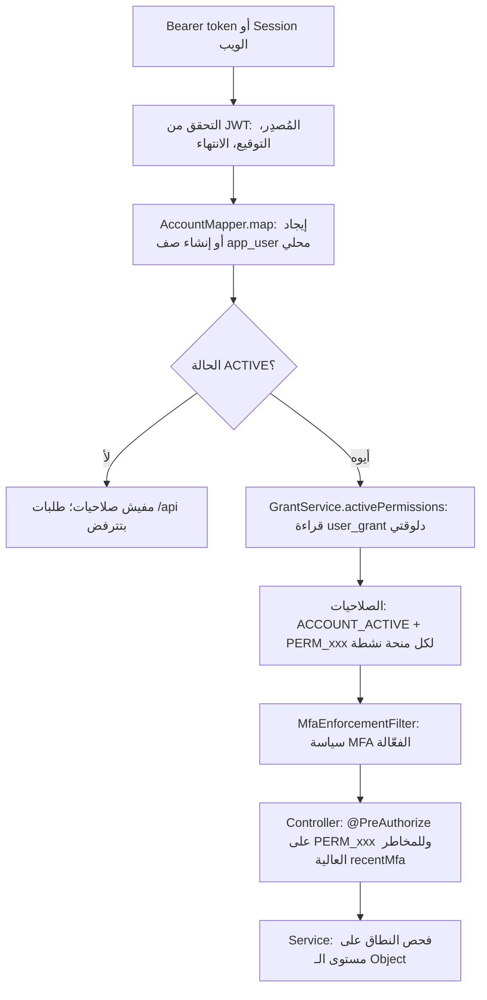

# الأطراف والصلاحيات

> **Owner role:** Business documentation
> **Status:** IMPLEMENTED — الأدوار والمنح والتحديد على مستوى الـ Object بيتطبّقوا من الـ Backend؛ وأي حاجة غير كده متعلّمة في المتن.
> **Language / اللغة:** [English](actors-and-permissions.md) · العربية

مستندات المنتج بتوصف سبع أدوار (Anonymous وCustomer وCook وSupport وOps وFinance وAdmin) في `docs/product/06-permissions.md`. **الكود مفيهوش سبع Objects للأدوار.** فيه آليتين، وفهمهم هو مفتاح نموذج الـ Authorization كله.

1. **حقائق الحساب** (بتتشتق، ومش بتيجي من العميل أبدًا): الحساب `ACTIVE`؛ بيملك مطبخ (طبّاخ)؛ عنده طلب طبّاخ (متقدّم).
2. **منح صلاحيات الموظفين** (صفوف في `user_grant`): صلاحية باسم زي `finance.verify`، بيمنحها أدمن، وممكن تنتهي، وتتسحب، ومتسجّلة في المراجعة.

"الدعم" و"العمليات" و"المالية" و"الأدمن" بالتالي هم *مجموعات صلاحيات ممنوحة لشخص*، مش أدوار متخزّنة على الحساب.

## الـ Backend بيعرف مين الشخص إزاي

الملفات: `backend/app/src/main/java/com/matbakhy/app/security/AccountMapper.java` (من الـ Claims للصلاحيات)، `backend/app/src/main/java/com/matbakhy/app/security/SecurityConfiguration.java` (قواعد الـ Routes)، `backend/modules/identity/src/main/java/com/matbakhy/identity/internal/GrantService.java` (دورة حياة المنحة)، `backend/app/src/main/java/com/matbakhy/app/security/MfaEnforcementFilter.java`.

الخصائص الأساسية:

- **الصلاحيات بتتقرا من جديد مع كل طلب** من `user_grant` (`AccountMapper.map` بينادي `grants.activePermissions`). الـ Token عمره ما بيشيل صلاحيات، فسحب المنحة أو انتهاءها بيسري من الطلب الجاي مباشرةً (حالة المالك E2E-OPS-102؛ الاختبار `revoked_grant_stops_working_on_the_next_request` في `backend/app/src/test/java/com/matbakhy/app/identity/StaffAccessIntegrationTest.java`).
- العميل مايقدرش يخلّي نفسه موظف: حقول الدور في طلبات العميل بتترفض، ومفيش مسار تسجيل بيدّي منحة (E2E-OPS-058).
- الحساب `ACTIVE` بس هو اللي بياخد `ACCOUNT_ACTIVE`؛ وكل Route تحت `/api/**` غير الـ GETs العامة بتحتاجها (`SecurityConfiguration`، `.requestMatchers("/api/**").hasAuthority(AccountMapper.ACTIVE)`). الحساب `DELETION_REQUESTED` يقدر بس يكرّر طلب الحذف بتاعه.

## الأطراف

| الطرف | السيستم بيتعرّف عليه إزاي | يقدر يعمل (ملخص) |
|---|---|---|
| **الزائر** (Guest، مجهول) | مفيش Session | يتصفّح الوجبات والمطابخ والـ Slots والتقييمات والمناطق والسياسات والإعدادات العامة؛ ويبعت عدّادات نشاط مجهولة. الـ Routes العامة: `SecurityConfiguration.PUBLIC_GET`، `ACTIVITY` |
| **العميل** | أي حساب `ACTIVE` | يدير ملفه الشخصي، والتحقق من الموبايل، والعناوين، والمفضّلة؛ ويطلب Quotes ويسجّل أوردرات (محتاج إيميل وموبايل متحقق منهم)؛ ويقرا أوردراته ويلغيها (المعلّقة بس) ويقيّمها؛ ويفتح حالات دعم؛ ويقرا إشعاراته |
| **متقدّم للعمل كطبّاخ** (Cook applicant) | عنده صف في `cook_application` | يعدّل مسودة خاصة ويقدّم نسخ معدّلة من طلبه؛ ويقرا تاريخ قرارات طلبه. لسه مش طبّاخ |
| **الطبّاخ / صاحب المطبخ** | بيملك صف `kitchen` واحد بالظبط (`kitchen.owner_id UNIQUE`، V5) | يدير وجباته وSlots ومطبخه وملف الدفع بتاعه؛ ويشغّل طابور أوردراته؛ ويبلّغ عن الكاش واستلام العربون؛ ويشوف كشف حسابه والـ Insights |
| **الدعم** | منحة `support.case` | يشتغل على حالات الدعم؛ الملاحظات الداخلية عمرها ما بتظهر للعملاء؛ وكل مشاهدة من الموظف بتتسجّل في المراجعة |
| **العمليات** | منح زي `cook.review` و`order.ops` و`order.exception_cancel` و`order.handover_override` و`content.moderate` و`integration.ops` | يراجع طلبات الطبّاخين، ويغيّر حالة تشغيل المطبخ، ويراقب الأوردرات والاستثناءات، ويراجع الوجبات والتقييمات، ويعيد محاولة الـ Outbox |
| **المالية** | منح `finance.read` و`finance.verify` و`finance.refund_approve` و`finance.settlement` | يتحقق من بلاغات الكاش، ويعتمد مستلمي دفع المطبخ، ويقرّر في العربون المتنازع عليه أو المطابَق، ويطلب وينفّذ الاسترداد، ويبني التسويات |
| **الأدمن** | منح `staff.grant` و`audit.read` و`config.read` و`config.write` و`security.mfa_policy` و`security.mfa_reset` | يمنح ويسحب الصلاحيات، ويقرا المراجعة، ويغيّر إصدارات الإعدادات، ويضبط سياسة الـ MFA، ويعيد ضبط الـ MFA لمستخدم |

مجموعة الصلاحيات الكاملة هي الـ enum اسمه `Permission` في `backend/modules/identity/src/main/java/com/matbakhy/identity/api/Permission.java` (17 قيمة). قيد الفحص في الـ Database على `user_grant.permission` موجود في `backend/app/src/main/resources/db/migration/V4__grants_and_audit.sql`؛ والـ Migrations اللي بعده بتوسّعه (مثلًا `backend/app/src/main/resources/db/migration/V31__mfa_policy.sql` لصلاحيات الـ MFA).

### مستخدمين بأكتر من دور

الشخص الواحد ممكن يبقى عميل وطبّاخ وموظف في نفس الوقت؛ وكله متعلّق بصف `app_user` واحد.

- عميل **و** طبّاخ: مسموح وعادي. الـ Endpoints الخاصة بالطبّاخ بتستخدم `kitchens.ownedBy(accountId)`؛ وخاصة العميل بتستخدم `customer_id = accountId`. النطاقين مبيختلطوش: العميل اللي طلب مايقدرش ينفّذ أوامر الطبّاخ، والطبّاخ مايقدرش يستخدم إلغاء العميل (الاختبار `the_ordering_customer_cannot_run_cook_commands_and_the_cook_cannot_use_the_customer_cancel`، `backend/app/src/test/java/com/matbakhy/app/orders/OrderLifecycleIntegrationTest.java`).
- طبّاخ **و** موظف: مسموح، مع حواجز صريحة لتعارض المصالح. المراجع مايقدرش يقرّر في طلبه هو، والموظف مايقدرش يغيّر حالة تشغيل مطبخه هو، والمالية مايقدروش يعتمدوا مستلم الدفع بتاع مطبخهم هم (`CookReviewService.refuseSelfReview`، `KitchenService`، `PaymentService.approveRecipient`؛ حالة المالك E2E-OPS-108).
- موظف معاه منح كتير: مسموح (التجربة الفردية ممكن تعمل كده). ولما المنتج بيطلب شخصين، الكود بيفرض *أشخاص مختلفين* على زوج الخطوات المحدد: بلاغ الكاش مقابل التحقق (`CashService`، فحص الـ Database ‏`cash_report_separation_ck` في V13)، وطلب الاسترداد مقابل الموافقة، وخطوات التسوية (`FinanceOpsService.separate`؛ حالات المالك E2E-FIN-114، E2E-FIN-044).
- "موظفين" المطبخ أو المفوّضين **مش موجودين**: المطبخ ليه حساب مالك واحد بالظبط. صاحب المطبخ والطبّاخ هم نفس الطرف في الكود. NOT IMPLEMENTED: المطابخ متعددة المستخدمين (وهي مش في المواصفات كمان).

## خريطة الصلاحية للقدرة (الموظفين)

| الصلاحية | بتحمي (معرّفات الـ API من `contracts/endpoints.json`) | متطلب إضافي |
|---|---|---|
| `staff.grant` | API-091 عرض الموظفين، API-092 منح، API-093 سحب | المنح والسحب محتاجين MFA حديث (`@staffAssurance.recentMfa`)؛ مفيش تصعيد ذاتي؛ آخر حامل للصلاحية محمي |
| `audit.read` | API-094 قراءة المراجعة | القراءة نفسها بتتسجّل في المراجعة (E2E-OPS-110)؛ التصدير API-095 موجود في العقد بس مش متنفّذ (E2E-OPS-112) |
| `cook.review` | API-067..API-069 طابور الطلبات وتفاصيلها والقرار؛ API-070 حالة تشغيل المطبخ | القرار وحالة التشغيل محتاجين MFA حديث؛ السبب مطلوب |
| `content.moderate` | API-071..API-073، API-098 مراجعة الكتالوج والوجبات والتقييمات | السبب مطلوب |
| `order.ops` | API-074، API-075 مراقبة الأوردرات | فتح بيانات تواصل العميل بيتسجّل في المراجعة |
| `order.exception_cancel` | API-076 | `PREPARING` أو `READY` بس؛ كود السبب ومرجع الحالة مطلوبين |
| `order.handover_override` | API-077 | MFA حديث، وسبب 10 حروف على الأقل، ومرجع دليل |
| `support.case` | API-078..API-081 | الملاحظات الخاصة تفضل داخلية |
| `finance.read` | API-082، API-086 قراءة | قراءة بس؛ بيانات التواصل مخفية جزئيًا |
| `finance.verify` | API-083 التحقق من الكاش؛ API-104، API-106، API-107، API-109 مستلمي العربون وقرارات الدفع | API-104 وAPI-107 محتاجين MFA حديث وسبب؛ مايقدرش يتحقق من اللي بلّغ عنه هو |
| `finance.refund_approve` | API-084، API-085 الاسترداد | استرداد كامل بس؛ الطالب غير المعتمِد |
| `finance.settlement` | API-087، API-088 | خامل تحت نظام صفر عمولة |
| `config.read` / `config.write` | API-089 / API-090 | الكتابة محتاجة MFA حديث، وسبب، وإصدار Optimistic |
| `integration.ops` | API-096، API-097 إعادة محاولة الـ Outbox | متسجّل في المراجعة |
| `security.mfa_policy` | API-114، API-115 | الكتابة محتاجة MFA حديث وسبب؛ متسجّلة في المراجعة |
| `security.mfa_reset` | API-116 | MFA حديث، وسبب، ومش لحساب الشخص نفسه؛ متسجّل في المراجعة؛ عمره ما بيقرا أسرار |

ملاحظات عن الفرق بين ده وبين `docs/product/06-permissions.md`: المستند بيقول إن الأدمن يقدر يعمل إجراءات تشغيلية "بس لو اتمنح صلاحية عمليات". ده متوافق مع الكود، مع حقيقة محددة تستاهل تعرفها: **الأدمن الأولي (Bootstrap administrator)** اللي بيتعمل من إعدادات البيئة بياخد `staff.grant` و`audit.read` بس (`GrantService.bootstrapAdministratorIfNone`). أي حاجة تانية لازم تتمنح صراحةً. حالة المالك E2E-OPS-055 بتوضّح إن "الأدمن مش مستخدم خارق".

## الـ Authorization على مستوى الـ Object (الملكية والعزل بين المطابخ)

فحوصات الدور بتجاوب على "هل يجوز لنوع الشخص ده يعمل نوع الحاجة دي". وفحوصات مستوى الـ Object بتجاوب على "هل يجوز *للشخص ده* يلمس *السجل ده*". التانية هي اللي بتستخبّى فيها أغلب العيوب الحقيقية، فالكود بيعملها بتلات طرق.

1. **تحديد النطاق في الاستعلام.** الاستعلام نفسه بيشمل المالك، فالسجل الخاص بحد تاني مش موجود بالنسبة للمستدعي. أمثلة: إلغاء العميل بيقفل `o.customer_id = ?`؛ وكل أمر طبّاخ بيقفل `o.kitchen_id = ?` باستخدام مطبخ المستدعي نفسه (`OrderLifecycleService.lock`)؛ واستعلامات الدفع بتعمل Join مع `customer_order` على معرّف العميل (`PaymentService.lockForCustomer`). معرّف السجل الخاص بحد تاني بيرجّع **404**، عمره ما بيرجّع 403، عشان وجود السجل مايتكشفش (BR-006).
2. **سياسة مشتركة لقراءات المالك أو الموظف.** `AccessPolicy.requireOwnerOrPermitted(ownerId, staffPermission, objectType, objectId)` (`backend/modules/identity/src/main/java/com/matbakhy/identity/api/AccessPolicy.java`، وينفّذها `backend/app/src/main/java/com/matbakhy/app/security/ScopedAccessPolicy.java`): المالك بيعدّي؛ والموظف اللي معاه الصلاحية المسمّاة بيعدّي **والدخول بيتسجّل في المراجعة**؛ وأي حد غيرهم بياخد 404. الاختبار `kitchen_scope_matrix` في `StaffAccessIntegrationTest` بيغطي الطبّاخ A، والطبّاخ B، وعميل، وموظف بـ `cook.review` وبدونها.
3. **ضمانات الـ Database** لأعلى الثوابت قيمة: المراجعة وأحداث الأوردر وأحداث الدفع والـ Ledger بتتضاف بس؛ وTrigger للحالة النهائية على `customer_order` (V12)؛ وقيود الفحص لفصل المهام.

العزل بين المطابخ بشكل عملي (حالات المالك E2E-COOK-054 وE2E-ORDER-037): الطبّاخ B مايقدرش يقرا أو يغيّر وجبات أو Slots أو أوردرات أو رفوعات الطبّاخ A، وبيانات A فضلت زي ما هي بعد محاولات B. مستخدم من غير مطبخ بينادي Endpoint للطبّاخ بياخد `FORBIDDEN "not a cook"`.

## الـ MFA والـ Step-up

الـ Authentication متعدد العوامل بيتم عن طريق مزوّد الهوية (Keycloak)؛ والـ API بيطبّق *السياسة الفعّالة* من ناحية السيرفر.

- الفئات: `CUSTOMER`، `KITCHEN`، `STAFF` (`MfaPolicyService.Category`). الحساب بينتمي لكل فئة بتنطبق عليه (الكل عميل؛ وصاحب المطبخ كمان `KITCHEN`؛ وحامل أي منحة `STAFF`).
- الأوضاع لكل فئة: `DISABLED`، `OPTIONAL`، `REQUIRED` (`MfaPolicyService.Mode`). الوضع الأكثر حماية من المنطبقين هو اللي بيكسب. تفضيل المستخدم نفسه ممكن يضيف متطلب تحت `OPTIONAL` بس عمره ما يخفّف `REQUIRED`. صف سياسة ناقص بيرجع للأمان لـ `REQUIRED`.
- `MfaEnforcementFilter` بيرفض نداءات الـ API المحمية بـ `STEP_UP_REQUIRED` لما السياسة الفعّالة بتطلب MFA والـ Token ناقصه إثبات الـ MFA من المزوّد. Endpoints الإعدادات (`/api/v1/me/security`) وتسجيل الخروج والقراءات العامة بتفضل متاحة عشان المستخدم يقدر يسجّل.
- **إجراءات الموظفين عالية المخاطر محتاجة دايمًا إثبات MFA حديث**، أيًا كان وضع السياسة، لأن الـ Controller بينادي `@staffAssurance.recentMfa(authentication)` (المنح، قرارات الطبّاخين، تجاوز التسليم، اعتماد مستلم الدفع، قرارات الدفع، كتابة الإعدادات، سياسة الـ MFA وإعادة ضبطه). `StaffAssurance.recentMfa` بيفحص `acr`/`amr` اللي أكّدها المزوّد و`auth_time` جوه نافذة الـ Step-up، وبيتجاهل الإثباتات الأقدم من آخر إعادة ضبط إدارية للحساب.

التفاصيل ومراجع الاختبارات: [رحلة الـ Authentication والـ MFA](../02-user-journeys/authentication-and-mfa-ar.md)، [معمارية الهوية والأمان](../03-architecture/identity-and-security-ar.md)، حالات المالك CFG-101 وCFG-104 وCFG-105، `docs/security/mfa-policy.md`.

## أمثلة عملية

1. *العميل B بيحاول يقرا أوردر العميل A بتخمين المعرّف.* `GET /api/v1/orders/{id}` → الخدمة بتدوّر بـ `customer_id = B` → مش لاقي → **404**. مفيش منحة موظف ممكن تساعد B. (E2E-ORDER-120.)
2. *موظف دعم بيفتح بيانات تواصل عميل أوردر.* محتاج `order.ops`؛ بيانات التواصل بترجع بس للحالات النشطة والقراءة بتتكتب في `audit_event` (E2E-ORDER-119).
3. *أدمن بيحاول يمنح نفسه `finance.verify`.* `GrantService.grant` بيسجّل حدث مراجعة DENIED ("self-escalation refused") وبيرجّع 403 (E2E-OPS-101، الاختبار `self_escalation_unknown_permissions_and_last_admin_are_refused`).
4. *سحب منحة آخر حامل لـ `staff.grant`.* بيترفض بتعارض حالة، ومتسجّل DENIED "last administrator protected" (E2E-OPS-060).
5. *موظفين المالية بيعتمدوا حساب عربون جديد لمطبخ.* محتاج `finance.verify`، وMFA حديث، وسبب من 10–500 حرف، ومايقدرش يتعمل بواسطة صاحب المطبخ نفسه (E2E-COOK-108، E2E-FIN-103).

## القيود المعروفة وفجوات التوثيق

- حدود المعدّل (Rate limits) على مستوى التطبيق لتسجيل الدخول والـ Quote والأوردر والبحث **مش متنفّذة** (حالة المالك CFG-039 بتقول إن قفل Keycloak هو الحد الوحيد لتسجيل الدخول). `docs/product/03-business-rules.md` BR-054 بيقول إن حدود المعدّل بتغطي دول؛ والكود بيطبّق `RATE_LIMITED` بس على إرسال التحقق من الموبايل (`PhoneVerificationService`) ومحاولات التسليم (`OrderLifecycleService`) وبلاغات التقييمات (`ReviewService`) والرفع (`MediaService`).
- تصدير المراجعة (API-095) ومقاييس لوحة العمليات موجودين في العقد بس مش متنفّذين (E2E-OPS-112).
- `docs/product/06-permissions.md` لسه بيوصف جدول عام للأدوار من غير تفاصيل الصلاحيات؛ ونموذج منح الصلاحيات اللي فوق هو المرجع.
