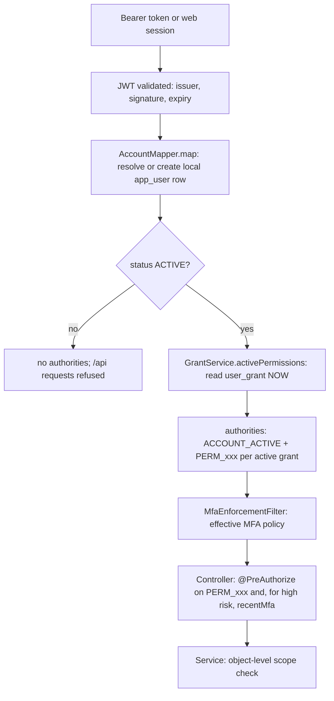

# Actors and permissions

> **Owner role:** Business documentation
> **Status:** IMPLEMENTED — roles, grants and object-level scoping are enforced by the backend; items marked otherwise in the body.

The product documents describe seven roles (Anonymous, Customer, Cook, Support, Ops, Finance, Admin) in `docs/product/06-permissions.md`. **The code does not have seven role objects.** It has two mechanisms, and understanding them is the key to the whole authorization model.

1. **Account facts** (derived, never client-supplied): the account is `ACTIVE`; it owns a kitchen (cook); it has a cook application (applicant).
2. **Staff permission grants** (rows in `user_grant`): a named permission such as `finance.verify`, granted by an administrator, optionally expiring, revocable, audited.

"Support", "Operations", "Finance" and "Administrator" are therefore *bundles of grants that a human holds*, not roles stored on the account.

## How the backend decides who someone is

Files: `backend/app/src/main/java/com/matbakhy/app/security/AccountMapper.java` (claims to authorities), `backend/app/src/main/java/com/matbakhy/app/security/SecurityConfiguration.java` (route rules), `backend/modules/identity/src/main/java/com/matbakhy/identity/internal/GrantService.java` (grant lifecycle), `backend/app/src/main/java/com/matbakhy/app/security/MfaEnforcementFilter.java`.

Key properties:

- **Permissions are re-read on every request** from `user_grant` (`AccountMapper.map` calls `grants.activePermissions`). A token never carries permissions, so revoking a grant or letting it expire takes effect on the very next request (owner case E2E-OPS-102; test `revoked_grant_stops_working_on_the_next_request` in `backend/app/src/test/java/com/matbakhy/app/identity/StaffAccessIntegrationTest.java`).
- A customer cannot make themselves staff: role fields in customer requests are rejected, and no registration path assigns a grant (E2E-OPS-058).
- Only an `ACTIVE` account gets `ACCOUNT_ACTIVE`; every `/api/**` route other than the public GETs requires it (`SecurityConfiguration`, `.requestMatchers("/api/**").hasAuthority(AccountMapper.ACTIVE)`). A `DELETION_REQUESTED` account can only repeat its deletion request.

## Actors

| Actor | How the system recognises them | Can do (summary) |
|---|---|---|
| **Guest** (anonymous) | No session | Browse public meals, kitchens, slots, reviews, zones, policies, public configuration; send anonymous activity counters. Public routes: `SecurityConfiguration.PUBLIC_GET`, `ACTIVITY` |
| **Customer** | Any `ACTIVE` account | Manage own profile, phone verification, addresses, favorites; quote and place orders (needs verified e-mail and phone); read, cancel (pending only), review own orders; open support cases; read own notifications |
| **Cook applicant** | Has a row in `cook_application` | Edit a private draft and submit revisions; read their own decision history. Not a cook yet |
| **Cook / kitchen owner** | Owns exactly one `kitchen` row (`kitchen.owner_id UNIQUE`, V5) | Manage own meals, slots, kitchen settings and payment profile; run own order queue; report cash and deposit receipts; see own statement and insights |
| **Support** | Grant `support.case` | Work support cases; internal notes are never shown to customers; each staff view is audited |
| **Operations** | Grants such as `cook.review`, `order.ops`, `order.exception_cancel`, `order.handover_override`, `content.moderate`, `integration.ops` | Review cook applications, change kitchen operating state, monitor orders and exceptions, moderate meals and reviews, retry outbox |
| **Finance** | Grants `finance.read`, `finance.verify`, `finance.refund_approve`, `finance.settlement` | Verify cash reports, approve kitchen payment recipients, decide on disputed or reconciled deposits, request and action refunds, build settlements |
| **Administrator** | Grants `staff.grant`, `audit.read`, `config.read`, `config.write`, `security.mfa_policy`, `security.mfa_reset` | Grant and revoke permissions, read audit, change configuration versions, set the MFA policy, reset a user's MFA |

The full permission set is the enum `Permission` in `backend/modules/identity/src/main/java/com/matbakhy/identity/api/Permission.java` (17 values). The database check constraint on `user_grant.permission` is in `backend/app/src/main/resources/db/migration/V4__grants_and_audit.sql`; later migrations extend it (for example `backend/app/src/main/resources/db/migration/V31__mfa_policy.sql` for the MFA permissions).

### Multi-role users

One person can be a customer, a cook and staff at once; all of it hangs off one `app_user` row.

- Customer **and** cook: allowed and normal. Cook endpoints use `kitchens.ownedBy(accountId)`; customer endpoints use `customer_id = accountId`. The two scopes do not mix: the ordering customer cannot run cook commands and a cook cannot use the customer cancel (test `the_ordering_customer_cannot_run_cook_commands_and_the_cook_cannot_use_the_customer_cancel`, `backend/app/src/test/java/com/matbakhy/app/orders/OrderLifecycleIntegrationTest.java`).
- Cook **and** staff: allowed, with explicit conflict-of-interest guards. A reviewer cannot decide their own application, staff cannot change the operating state of their own kitchen, and finance cannot approve their own kitchen's payment recipient (`CookReviewService.refuseSelfReview`, `KitchenService`, `PaymentService.approveRecipient`; owner case E2E-OPS-108).
- Staff holding several grants: allowed (a solo pilot may do this). Where the product requires two people, the code enforces *different people* for the specific pair of steps: cash report vs verification (`CashService`, DB check `cash_report_separation_ck` in V13), refund request vs approval, settlement steps (`FinanceOpsService.separate`; owner cases E2E-FIN-114, E2E-FIN-044).
- Kitchen "staff" or delegates do **not** exist: a kitchen has exactly one owner account. Kitchen-owner and cook are the same actor in the code. NOT IMPLEMENTED: multi-user kitchens (not in the specification either).

## Permission-to-capability map (staff)

| Permission | Guards (API ids from `contracts/endpoints.json`) | Extra requirement |
|---|---|---|
| `staff.grant` | API-091 list staff, API-092 grant, API-093 revoke | Grant and revoke need recent MFA (`@staffAssurance.recentMfa`); no self-escalation; last holder protected |
| `audit.read` | API-094 audit read | Reading is itself audited (E2E-OPS-110); export API-095 is in the contract but not implemented (E2E-OPS-112) |
| `cook.review` | API-067..API-069 application queue, detail and decision; API-070 kitchen operating state | Decision and operating state need recent MFA; reason required |
| `content.moderate` | API-071..API-073, API-098 catalogue, meal and review moderation | Reason required |
| `order.ops` | API-074, API-075 order monitoring | Opening customer contact is audited |
| `order.exception_cancel` | API-076 | Only `PREPARING` or `READY`; reason code and case reference required |
| `order.handover_override` | API-077 | Recent MFA, reason of at least 10 characters, evidence reference |
| `support.case` | API-078..API-081 | Private notes stay internal |
| `finance.read` | API-082, API-086 read | Read only; contact is masked |
| `finance.verify` | API-083 cash verification; API-104, API-106, API-107, API-109 deposit recipients and payment decisions | API-104 and API-107 need recent MFA and a reason; cannot verify what you reported |
| `finance.refund_approve` | API-084, API-085 refunds | Full refund only; requester differs from approver |
| `finance.settlement` | API-087, API-088 | Dormant under zero commission |
| `config.read` / `config.write` | API-089 / API-090 | Write needs recent MFA, a reason, optimistic version |
| `integration.ops` | API-096, API-097 outbox retry | Audited |
| `security.mfa_policy` | API-114, API-115 | Write needs recent MFA, reason; audited |
| `security.mfa_reset` | API-116 | Recent MFA, reason, never one's own account; audited; never reads secrets |

Notes on how this differs from `docs/product/06-permissions.md`: the document says Admin may do operational actions "only if granted an ops permission". That matches the code, with one concrete fact worth knowing: the **bootstrap administrator** created from environment configuration receives only `staff.grant` and `audit.read` (`GrantService.bootstrapAdministratorIfNone`). Everything else must be granted explicitly. Owner case E2E-OPS-055 demonstrates "the administrator is not a superuser".

## Object-level authorization (ownership and cross-kitchen isolation)

Role checks answer "may this kind of person do this kind of thing". Object-level checks answer "may *this* person touch *this* record". The second is where most real bugs hide, so the code does it in three ways.

1. **Query-level scoping.** The lookup itself includes the owner, so a foreign record simply does not exist for the caller. Examples: the customer cancel locks `o.customer_id = ?`; every cook command locks `o.kitchen_id = ?` using the caller's own kitchen (`OrderLifecycleService.lock`); payment lookups join `customer_order` on the customer id (`PaymentService.lockForCustomer`). A foreign id returns **404**, never 403, so the existence of the record is not revealed (BR-006).
2. **Shared policy for owner-or-staff reads.** `AccessPolicy.requireOwnerOrPermitted(ownerId, staffPermission, objectType, objectId)` (`backend/modules/identity/src/main/java/com/matbakhy/identity/api/AccessPolicy.java`, implemented by `backend/app/src/main/java/com/matbakhy/app/security/ScopedAccessPolicy.java`): the owner passes; staff with the named permission pass **and the access is audited**; anyone else gets 404. Test `kitchen_scope_matrix` in `StaffAccessIntegrationTest` covers cook A, cook B, a customer, and staff with and without `cook.review`.
3. **Database guarantees** for the highest-value invariants: append-only audit, order events, payment events, ledger; a terminal-state trigger on `customer_order` (V12); the separation-of-duties check constraints.

Cross-kitchen isolation, concretely (owner cases E2E-COOK-054 and E2E-ORDER-037): cook B cannot read or change cook A's meals, slots, orders or uploads, and A's data is unchanged after B's attempts. A user with no kitchen calling a cook endpoint receives `FORBIDDEN "not a cook"`.

## MFA and step-up

Multi-factor authentication is performed by the identity provider (Keycloak); the API enforces the *effective policy* server side.

- Populations: `CUSTOMER`, `KITCHEN`, `STAFF` (`MfaPolicyService.Category`). An account belongs to every population that applies (everyone is a customer; a kitchen owner is also `KITCHEN`; a holder of any grant is `STAFF`).
- Modes per population: `DISABLED`, `OPTIONAL`, `REQUIRED` (`MfaPolicyService.Mode`). The most protective applicable mode wins. A user's own preference can add a requirement under `OPTIONAL` but can never relax `REQUIRED`. A missing policy row fails safe to `REQUIRED`.
- `MfaEnforcementFilter` refuses protected API calls with `STEP_UP_REQUIRED` when the effective policy requires MFA and the token lacks the provider's MFA assertion. The settings endpoints (`/api/v1/me/security`), logout and public reads stay reachable so the user can enrol.
- **High-risk staff actions always need a recent MFA proof**, whatever the policy mode, because the controller calls `@staffAssurance.recentMfa(authentication)` (grants, cook decisions, handover override, payment-recipient approval, payment decisions, configuration writes, MFA policy and reset). `StaffAssurance.recentMfa` checks the provider-asserted `acr`/`amr` and `auth_time` inside the step-up window and ignores proofs older than the account's last administrative reset.

Details and test references: [authentication and MFA journey](../02-user-journeys/authentication-and-mfa.md), [identity and security architecture](../03-architecture/identity-and-security.md), owner cases CFG-101, CFG-104, CFG-105, `docs/security/mfa-policy.md`.

## Worked examples

1. *Customer B tries to read customer A's order by guessing the id.* `GET /api/v1/orders/{id}` → service looks up with `customer_id = B` → not found → **404**. No staff grant could help B. (E2E-ORDER-120.)
2. *A support agent opens an order's customer contact.* Needs `order.ops`; the contact is returned only for active states and the read is written to `audit_event` (E2E-ORDER-119).
3. *An administrator tries to grant themselves `finance.verify`.* `GrantService.grant` records a DENIED audit event ("self-escalation refused") and returns 403 (E2E-OPS-101, test `self_escalation_unknown_permissions_and_last_admin_are_refused`).
4. *The last holder of `staff.grant` is revoked.* Refused with a state conflict, audited as DENIED "last administrator protected" (E2E-OPS-060).
5. *Finance staff approve a kitchen's new deposit account.* Needs `finance.verify`, recent MFA, a reason of 10–500 characters, and cannot be done by the kitchen's own owner (E2E-COOK-108, E2E-FIN-103).

## Known limitations and documentation gaps

- Application-level rate limits for login, quote, order and search are **not implemented** (owner case CFG-039 states Keycloak lockout is the only login throttle). `docs/product/03-business-rules.md` BR-054 says rate limits cover these; the code applies `RATE_LIMITED` only to phone-verification sends (`PhoneVerificationService`), handover attempts (`OrderLifecycleService`), review reports (`ReviewService`) and uploads (`MediaService`).
- Audit export (API-095) and operations dashboard metrics are in the contract but not implemented (E2E-OPS-112).
- `docs/product/06-permissions.md` still describes a coarse role table; the permission-grant model above is the authoritative one.
