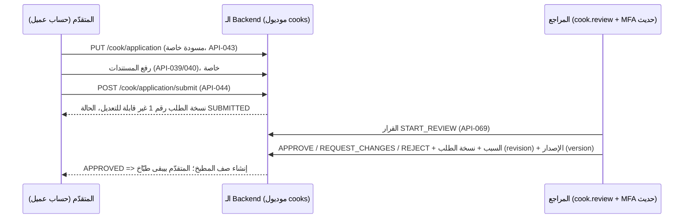

# إدارة المطبخ

> **Owner role:** Business documentation
> **Status:** IMPLEMENTED — طلب الطبّاخ والموافقة وحالات التشغيل والوجبات والـ Slots ومساحة الطبّاخ موجودين في الـ Backend وفي `apps/operations-web`؛ تطبيق الطبّاخ الـ Native مش مخطط للـ MVP.
> **Language / اللغة:** [English](kitchen-management.md) · العربية

"المطبخ" هو الهوية اللي بيبيع بيها طبّاخ واحد معتمد. الصفحة دي بتغطي إزاي حد بيبقى بائع، وإيه اللي المطبخ يقدر يعمله، وإيه اللي الموظفين يقدروا يعملوه فيه. شاشات ناحية الطبّاخ متوصّفة في [رحلة عمليات الطبّاخ](../02-user-journeys/cook-operations-ar.md)، وناحية الموظفين في [رحلة الـ Backoffice](../02-user-journeys/backoffice-admin-ar.md).

## 1. إنك تبقى طبّاخ: الطلب والموافقة

- **المسودة.** طلب واحد لكل حساب (`cook_application`). المسودة فيها الاسم العام، والنبذة، وموبايل التواصل (متحوّل لرقم مصري موحّد، `EgyptianPhone`)، وموقع الإنتاج الخاص، وهل الاستلام متاح، ومناطق الخدمة، ومعرّفات المستندات. حفظ المسودة مبيغيّرش حاجة في حالة الشخص: هو **مش** طبّاخ (حالة المالك E2E-COOK-048). الملفات: `backend/modules/cooks/src/main/java/com/matbakhy/cooks/internal/CookApplicationService.java`.
- **التقديم** بيحتاج مسودة كاملة وبيعمل `cook_application_revision` غير قابلة للتعديل (Trigger في الـ Database اسمه `cook_revision_immutable`، في `backend/app/src/main/resources/db/migration/V5__cook_applications_and_kitchens.sql`). المسودة الناقصة بتترفض مع قائمة بالحقول الناقصة ومن غير ما تتعمل نسخة طلب (revision). المناطق اللي اتعطّلت بعد المسودة بتمنع التقديم.
- **المراجعة** (`CookReviewService`): القرارات هي `START_REVIEW` و`APPROVE` و`REQUEST_CHANGES` و`REJECT`. القواعد:
  - محتاجة `cook.review` **و**MFA حديث (`CookReviewController`)؛
  - `START_REVIEW` لازم تيجي الأول؛ والقرار بيحدد **نسخة الطلب** (revision) و**إصدار** الطلب اللي بيخصّه؛ السبب مطلوب؛ وتأثير واحد لكل Idempotency key؛
  - المراجع عمره ما يقدر يقرّر في طلبه هو (المحاولة بتتسجّل في سجل الـ Audit؛ حالة المالك E2E-OPS-108)؛
  - المستندات الخاصة بيقراها المالك وموظفين المراجعة بس، وكل قراءة من الموظف بتتسجّل (E2E-COOK-053)؛
  - `APPROVE` بيعمل `kitchen` واحد بالظبط (الموافقات المتزامنة برضه بتنتج واحد؛ الاختبار `concurrent_approvals_create_exactly_one_kitchen`، `backend/app/src/test/java/com/matbakhy/app/cooks/CookWorkflowIntegrationTest.java`)؛
  - `REQUEST_CHANGES` بيرجّع المتقدّم يعدّل ويقدّم تاني كنسخة تالية من الطلب؛ و`REJECT` بيحتفظ بكل التاريخ وعمره ما بينشئ مطبخ (E2E-COOK-111).
- **الموافقة تشغيلية.** معناها إن الموظفين راجعوا نسخة كاملة وسجّلوا مين قرّر وليه. مش شهادة سلامة غذاء، والـ DTOs العامة بتعرض التسمية المحايدة `OPERATIONALLY_VERIFIED`.

حالات المالك: E2E-COOK-048، E2E-COOK-049، E2E-COOK-111، E2E-OPS-109.

## 2. سجل المطبخ وحالات التشغيل بتاعته

الجدول `kitchen` (V5): واحد لكل مالك (`owner_id UNIQUE`)، وSlug عام، واسم عرض، ووصف، و`operating_state`، و`timezone` ثابت على `Africa/Cairo`، و`pickup_enabled`، وموبايل تواصل خاص وموقع خاص. مناطق التوصيل صفوف في `kitchen_zone`.

| الحالة | مين بيحددها | مبيعات جديدة | قبول الأوردرات المعلّقة | تنفيذ الأوردرات المقبولة بالفعل |
|---|---|---|---|---|
| `ACTIVE` | الموافقة، استئناف البيع من الطبّاخ، إعادة تفعيل المطبخ من الموظفين | أيوه | أيوه | أيوه |
| `PAUSED` | إيقاف مؤقت من الطبّاخ، أو الموظفين | لأ | أيوه | أيوه |
| `SUSPENDED` | الموظفين بس (`cook.review` + MFA، مع سبب) | لأ | **لأ** | أيوه |
| `CLOSED` | محجوزة؛ مفيش أمر بيحددها في الخدمات اللي اتقرت لأجل الصفحة دي | لأ | لأ | لأ |

(من `KitchenDirectory.KitchenStatus.canAcceptOrders` / `canFulfillAcceptedOrders` في `backend/modules/cooks/src/main/java/com/matbakhy/cooks/api/KitchenDirectory.java` و`KitchenService`.)

الأوامر: الموظفين `PAUSE` و`SUSPEND` و`RESTORE` (API-070)؛ إيقاف الطبّاخ واستئنافه عن طريق `PATCH /api/v1/cook/settings` (API-065). الإيقاف اللي حطّه الموظفين الطبّاخ مايقدرش يلغيه (E2E-COOK-107). الموظفين مايقدروش يغيّروا حالة مطبخهم هم (متسجّل في سجل الـ Audit، `KitchenService`). مطبخ الطبّاخ الموقوف أو غير المعتمد مش ظاهر للعملاء ومايتعملوش له Quote (E2E-DISC-104)؛ والإيقاف بيوقف المبيعات الجديدة والقبول بس بيسيب الأوردرات المقبولة تخلص (E2E-COOK-050).

## 3. إعدادات المطبخ

الطبّاخ بيعدّل مطبخه هو بس (`KitchenService`، API-065): الوصف، وهل الاستلام متاح، ومناطق التوصيل **من ضمن المناطق المعتمدة** (غير كده `ZONE_NOT_APPROVED`)، والإيقاف المؤقت/الاستئناف. التعديلات القديمة بتترفض بالإصدار. الإعدادات لازم تفضّل مخلّية المطبخ قادر يخدم (E2E-COOK-112). إعدادات الدفع منفصلة (القسم 6).

## 4. الوجبات

الـ State Machine (`MealService`، عمود الحالة في `meal`): `DRAFT → PUBLISHED ↔ PAUSED → ARCHIVED`، بالإضافة لعلامة مستقلة لمراجعة المحتوى من الموظفين `VISIBLE`/`HIDDEN`.

- **المحتوى** له إصدارات: كل تعديل بيعمل Snapshot اسمه `meal_revision` غير قابل للتعديل؛ والـ Quotes والأوردرات بتشاور على الـ revision (شوف [التسعير](pricing-and-payments-ar.md#إصدارات-السعر-والـ-snapshots)).
- **النشر** (API-049) بيتحقق إن الحاجات دي موجودة: عنوان بالعربي، ووصف بالعربي، ونص الحصة بالعربي، والمكونات بالعربي، وإقرار صريح بمسببات الحساسية، وسعر من 1..1,000,000 قرش، وصورة **معتمدة** واحدة على الأقل (بحد أقصى 6). كل حقل ناقص بيتسمّى في رسالة الخطأ (حالة المالك E2E-COOK-101).
- **الصور** بتعدّي على خط الرفع: قائمة أنواع مسموحة (JPEG وPNG)، وحدود حجم (8 MB، وأقل ضلع 320 px)، وفحص المحتوى، والحجر، وAdapter لفحص الفيروسات؛ والوسائط المعتمدة بس هي اللي تتربط (`MediaPolicy`، `MediaService`؛ E2E-COOK-102). مستندات الطبّاخ منفصلة وخاصة وعمرها ما بياخدوا روابط عامة (BR-010).
- **Pause/archive (الإيقاف المؤقت/الأرشفة)** بيشيل الوجبة من البيع من غير ما يلمس التاريخ (E2E-COOK-104). الأرشفة عمرها ما بتغيّر Snapshots الأوردرات.
- **مراجعة الموظفين للمحتوى** (`content.moderate`، API-072): إخفاء وجبة بسبب بيشيلها من البيع فورًا من غير ما يغيّر حالة المسودة/النشر عند الطبّاخ؛ والاسترجاع بيرجّعها (E2E-OPS-056).
- **تاريخ الأسعار** (API-099): السعر النشط بالإضافة لتغييرات الأسعار الفعلية السابقة من الـ revisions (D14).
- وجبة طبّاخ تاني بترجّع 404 (E2E-COOK-054).

مثال: أم أحمد بترفع "ورق عنب محشي" من EGP 85.00 لـ EGP 95.00. بيتكتب revision جديد. العملاء اللي معاهم Quote لسه متسجّلتش بسعر EGP 85.00 لازم يوافقوا من جديد على الإجمالي الجديد؛ والأوردرات الموجودة تفضل على 85.00. عرض تاريخ الأسعار بيورّي التغييرين بتوقيت القاهرة.

## 5. الـ Slots والسعة

الـ Slot (`cook_slot`، V8) هو نافذة بتاريخ بسعة إجمالية؛ والوجبات بتتربط بحدود حصصها هي (`meal_slot`). بيعملها الطبّاخ في ويب العمليات (E2E-COOK-052). القواعد اللي `SlotService` بيطبّقها:

- التاريخ والأوقات المحلية بتتفسّر بتوقيت `Africa/Cairo`؛ الأوقات اللي مش موجودة (تقديم الساعة في الربيع) بتترفض، والأوقات المتكررة محتاجة Offset صريح (الاختبارات `a_local_time_skipped_by_the_spring_change_is_rejected`، `a_repeated_local_time_needs_an_explicit_offset_and_maps_to_one_instant`، `backend/app/src/test/java/com/matbakhy/app/availability/SlotIntegrationTest.java`)؛ واللحظات بتتخزّن بـ UTC؛
- `lead_minutes` من 30..1440، والـ Cutoff = البداية − مدة الـ lead بالدقايق ولازم يفضل في المستقبل؛ و`max_portions` من 1..500؛ ومفيش تداخل مع Slots المطبخ التانية؛
- الوجبات لازم تكون من نفس المطبخ (Trigger في الـ Database اسمه `meal_slot_same_kitchen`)؛
- الـ Slot ممكن يتفتح بس لو بيعرض وجبات، ومش بعد الـ Cutoff؛ والسعة عمرها ما تتقلّل لأقل من الحصص المحجوزة+المخصصة+المستهلكة؛ وبعد الـ Cutoff تعديلات السعة بتترفض (E2E-COOK-105، E2E-COOK-106)؛
- الطبّاخ مايقدرش يلغي Slot عليه التزامات أوردرات؛ ده محتاج مسار الاستثناءات بتاع العمليات (`SlotService`).

## 6. إعدادات الدفع

الطبّاخ بيحدد `deposit_bps`، وحد اختياري لـ `COD`، ومستلم العربون (InstaPay أو محفظة أو بيانات بنك) عن طريق API-102/103. المستلم الجديد أو المتغيّر مخفي عن العملاء لحد ما موظفين المالية يعتمدوه. التفاصيل: [التسعير والدفع](pricing-and-payments-ar.md#3-طرق-الدفع). حالات المالك E2E-COOK-108، E2E-FIN-105.

## 7. تشغيل الأوردرات

طابور الأوردرات (API-053/054) بيورّي الطبّاخ أوردرات مطبخه هو بس، مع الحد الأدنى من بيانات تواصل العميل المحتاجة طول ما الأوردر نشط (الاسم، الموبايل، العنوان للتوصيل) وعمره ما بيورّيه كود التسليم. الإجراءات المعروضة لكل حالة (`OrderService.cookActions`): `ACCEPT`/`REJECT`؛ `PREPARE`/`CANCEL`؛ `READY`؛ `HANDOVER` (استلام) أو `DISPATCH` (توصيل)؛ `HANDOVER`/`DELIVERY_FAILURE` وهو خارج للتوصيل. شوف [دورة حياة الأوردر](order-lifecycle-ar.md). بعد الاكتمال الطبّاخ بيبلّغ بالكاش اللي حصّله (API-063)؛ والطبّاخين بيشوفوا كشف حساب (API-064، `StatementService`) وInsights مجانية (API-111: أعداد مرات الظهور والمشاهدات والـ Quotes والأوردرات حسب النتيجة، والسعة، ومبيعاته هو؛ "never claims profit"، E2E-COOK-109).

الـ Dashboard (`CookDashboardService`، API-045) بيعرض الأوردرات المعلّقة للقبول مع المهل، وإجماليات الـ Slots، وأعداد النشط عشان الطبّاخ يتحرك قبل المهلة.

## 8. حذف الحساب للطبّاخ

الطبّاخ اللي بيطلب حذف حسابه بيتعطّل حسابه فورًا، لكن **حذفه بيتأجّل لحد مراجعة الموظفين** بدل ما يتمسح، لأن الأوردرات المفتوحة وسجلات الفلوس لازم تتحفظ (E2E-COOK-110). المسح نفسه متنفّذ للعملاء (`AccountErasureService`) وبيحافظ على سلامة مراجعة الحسابات المالية (BR-055)؛ شوف [معمارية قاعدة البيانات](../03-architecture/database-architecture-ar.md).

## القيود المعروفة وفجوات التوثيق

- المطبخ ليه حساب مالك واحد؛ المطابخ متعددة الأشخاص وموظفين المطبخ المفوّضين مش موجودين.
- مفيش حاجة في الخدمات اللي اتقرت بتحدد حالة التشغيل `CLOSED`؛ هي موجودة في الـ Schema والفحوصات. NOT VERIFIED هل فيه مسار أدمن بيقفل مطبخ.
- نص المواصفات بيذكر "daily pause/cutoff" و"advanced business intelligence"؛ المتنفّذ بس هو Cutoff الـ Slot، والإيقاف/الاستئناف، والـ Insights الأساسية.
- متطلبات تجهيز التجربة التجريبية (ترخيص نشاط الأكل، المستندات، عملية مسببات الحساسية) قرار مالك مفتوح O06؛ وحقول نموذج الطلب عامة.
