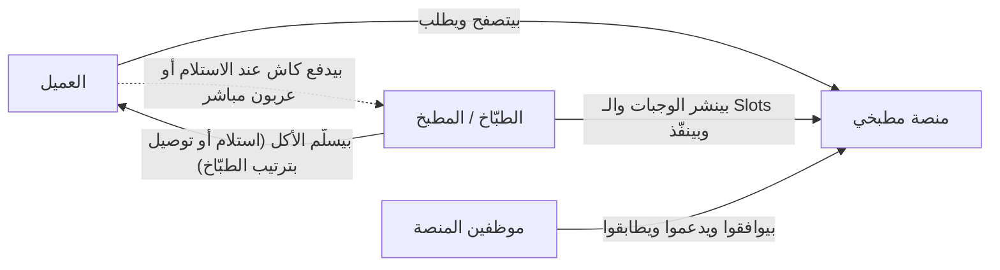
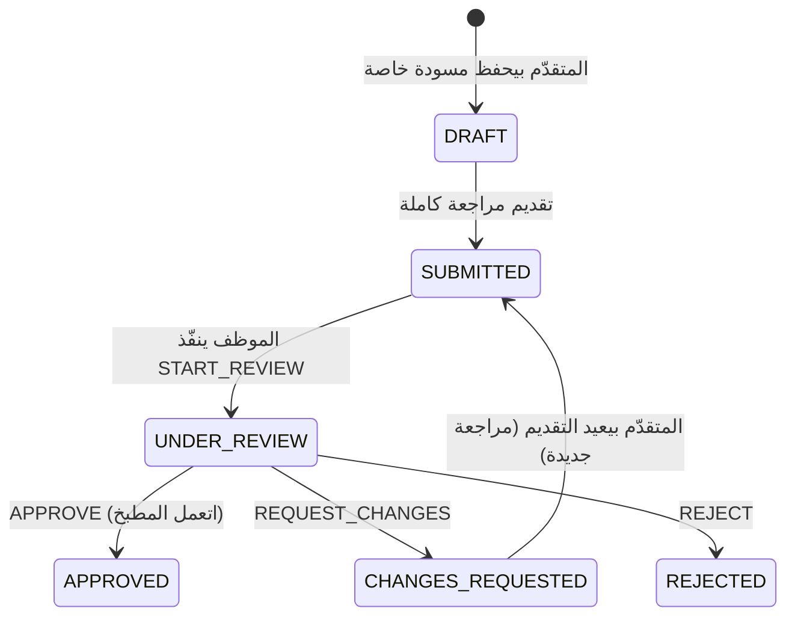

# نموذج الـ Marketplace

> **Owner role:** Business documentation
> **Status:** PARTIALLY IMPLEMENTED — الـ Marketplace المعاملاتي والاستكشاف والتوافر والموافقة متنفّذين؛ أي تسييل (Monetization) بعد صفر عمولة PLANNED.
> **Language / اللغة:** [English](marketplace-model.md) · العربية

## الهيكل التلاتي الأطراف

سهم الدفع المنقّط هو الحقيقة البيزنس الأساسية: **الفلوس بتتحرك بين العميل والمطبخ، مش عن طريق مطبخي** (القرار D16). المنصة بتخزّن اللي كل طرف *بيبلّغ* بيه عنها.

## المنصة مسؤولة عن إيه

| المسؤولية | المعنى | متنفّذة في |
|---|---|---|
| بوابة جودة العرض | الطبّاخين اللي وافق عليهم الموظفين بس هم اللي يبيعوا؛ والمطبخ الموقوف أو المتوقف مؤقتًا بيوقف المبيعات الجديدة | `CookReviewService`، `KitchenService` في `backend/modules/cooks/src/main/java/com/matbakhy/cooks/internal/` |
| سلامة الكتالوج | الوجبة محتاجة عنوان ووصف وحصة وسعر موجب ومكونات وإقرار صريح بمسببات الحساسية وصورة معتمدة قبل ما تتنشر | `MealService` في `backend/modules/catalog/src/main/java/com/matbakhy/catalog/internal/meal/MealService.java` |
| حقيقة التوافر | عدّادات حصص الـ Slot والوجبة هي المصدر الوحيد لـ "فاضل كام"؛ وبتتقفل بترتيب ثابت وقت الطلب | `SlotService`، `SlotInventory` في `backend/modules/availability/` |
| حقيقة السعر | السيرفر بيحسب كل مبلغ؛ والـ Quotes غير قابلة للتعديل وبتنتهي | `QuoteService` |
| أمان المعاملة | تسجيل الأوردر والحجز والـ Snapshots والأحداث وسجل الكاش/الدفع بيتثبّتوا مع بعض بشكل ذرّي؛ وإعادة المحاولة Idempotent | `OrderService.placeOnce` |
| الاستثناءات | حالات الدعم، وإلغاء الاستثناء وتجاوز التسليم من العمليات، والاسترداد، وطابور النزاعات | `backend/modules/support`، `OpsOrderService`، `PaymentService` |
| المراجعة (Audit) | إجراءات الموظفين والقراءات الحساسة بتتسجّل في سجل مراجعة بيتضاف بس | `backend/modules/operations`، الجدول `audit_event` (V4) |

اللي المنصة **مش** مسؤولة عنه في الـ MVP: الطبخ، وشهادة سلامة الغذاء، ولوجستيات التوصيل (الطبّاخ هو اللي بيرتّبها)، وحفظ فلوس العملاء، والتكامل مع مزوّد دفع.

## الاستكشاف

- عام، من ناحية السيرفر: نص البحث، والمنطقة، والفئة، والحد الأقصى للسعر، والترتيب (الأحدث / السعر تصاعدي / السعر تنازلي)، وترقيم بالـ Cursor (`GET /api/v1/meals`، API-003؛ `DiscoveryService`).
- الوجبات المنشورة بس، من مطابخ معتمدة ونشطة، وليها Slot مستقبلي مفتوح، هي اللي ينفع تتشرى (BR-017). مفضّلات الوجبات الموقوفة أو المؤرشفة بتظهر كغير متاحة بدل ما تختفي.
- العميل بيشوف المطبخ بس للمناطق اللي بيخدمها (حالة المالك E2E-DISC-101)؛ والتوصيل لمنطقة مش مخدومة بيترفض وقت الـ Quote (E2E-DISC-007).
- النشاط العضوي (مرات الظهور، والمشاهدات، والإضافة للسلة) بيتعدّ مرة لكل زائر في اليوم من غير هوية، عشان يدّي الطبّاخين عرض أداء مجاني بعدين (`ActivityService`، API-110/API-111). مش بيتستخدم في الترتيب. PARTIALLY IMPLEMENTED: العدّ وعرض الطبّاخ موجودين؛ وأي استخدام للنمو أو للمزايا المدفوعة PLANNED.

## نموذج الثقة

- **تسمية الموافقة التشغيلية.** الـ DTOs العامة للمطبخ بتشيل `OPERATIONALLY_VERIFIED`. معناها إن مراجع وافق على نسخة طلب كاملة؛ ولازم عمرها ما تتعرض كضمان لسلامة الغذاء (قاعدة المشروع).
- **التقييمات** من عميل أوردر `COMPLETED` بس، مرة لكل أوردر، تقييم 1–5 (`ReviewService`؛ حالة المالك E2E-DISC-110). الموظفين يقدروا يخفوا تقييم متبلَّغ عنه بسبب (E2E-OPS-104).
- **مسببات الحساسية** إقرارات صريحة على كل revision للوجبة وبتتنسخ لـ Snapshot الأوردر.
- **شكاوى السلامة** بتفتح حالة دعم `CRITICAL` (`SupportService`، الفئة `FOOD_SAFETY`).

## نموذج الإيراد

| البند | الحالة |
|---|---|
| عمولة الأوردر | `commission_rate_bps` حقل في سياسة التجارة اللي ليها إصدارات، وبيتعمل له Snapshot على كل أوردر (`customer_order.commission_bps_snapshot`، `commission_minor`). **مثبّت على 0**: السياسة الحية (مش التجريبية) لازم معدّلها 0 (فحص V23)، والـ API بيرفض المعدّلات غير الصفرية. IMPLEMENTED كخامل. |
| رسوم العميل | مفيش. الـ Quote مفيهاش بند رسوم خدمة. |
| دفعات التسوية | الكود موجود (`FinanceOpsService.createSettlement`) لكن مجموعات الـ Ledger بمبالغ صفر مينفعش تتجمّع في دفعة (`ZERO_AMOUNT`)، فالتسوية خاملة تحت صفر عمولة (حالة المالك E2E-FIN-110). |
| الظهور المدفوع / الإعلانات | PLANNED بس؛ مفيش كود. |
| رسوم التوصيل | بتتحدد لكل منطقة (`service_zone.delivery_fee_minor`) مع تجاوز اختياري لكل مطبخ (`kitchen_zone.fee_override_minor`)؛ جزء من إجمالي الأوردر اللي العميل بيدفعه للمطبخ؛ بتظهر في الـ Quote باسم `deliveryFee`. مستبعدة من أساس أي عمولة. مش بند إيراد للمنصة. |

## دورة حياة العرض في الـ Marketplace

الحالات بتطابق `CookReviewService.STATES` والـ enum اسمه `Decision` (`START_REVIEW`، `APPROVE`، `REQUEST_CHANGES`، `REJECT`). التفاصيل في [إدارة المطبخ](kitchen-management-ar.md).

## القيود المعروفة وفجوات التوثيق

- `docs/product/04-state-machines.md` بيقول إن "Owning cook/ops" ممكن يرسلوا الأوردرات ويكمّلوها. في الكود الطبّاخ المالك بس هو اللي بيرسل ويتحقق من التسليم؛ والموظفين يقدروا بس يستخدموا أمري `handover-override` و`exception-cancel` المتسجّلين في المراجعة (شوف [دورة حياة الأوردر](order-lifecycle-ar.md)). الكود هو المعتمد.
- `docs/product/02-product-specification.md` بيوصف كشوف عمولة للطبّاخين. كشف الطبّاخ موجود (`StatementService`، API-064) لكنه بيبلّغ بصفر عمولة تحت سياسة الإطلاق.
