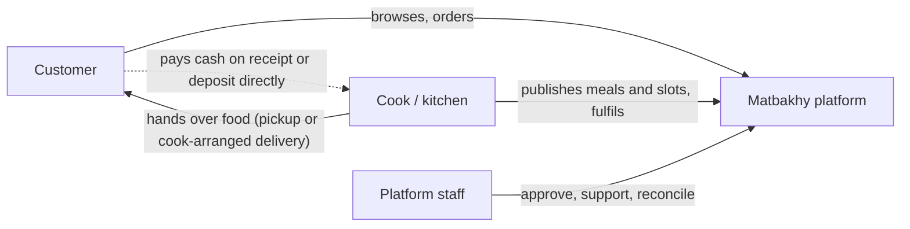
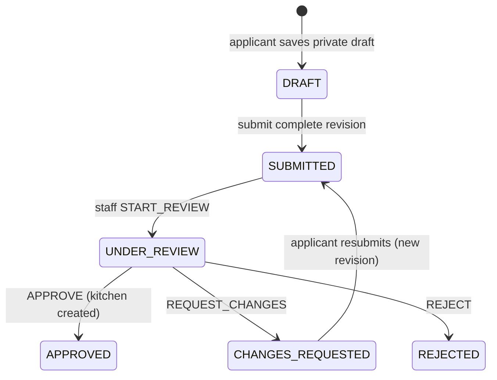

# Marketplace model

> **Owner role:** Business documentation
> **Status:** PARTIALLY IMPLEMENTED — the transactional marketplace, discovery, availability and approval are implemented; monetization beyond zero commission is PLANNED.

## Three-sided structure

The dotted payment arrow is the key business fact: **money moves between customer and kitchen, not through Matbakhy** (decision D16). The platform stores what each party *reports* about it.

## What the platform is responsible for

| Responsibility | Meaning | Implemented in |
|---|---|---|
| Supply quality gate | Only staff-approved cooks can sell; a suspended or paused kitchen stops new sales | `CookReviewService`, `KitchenService` in `backend/modules/cooks/src/main/java/com/matbakhy/cooks/internal/` |
| Catalogue integrity | A meal needs title, description, portion, positive price, ingredients, explicit allergen declaration and an approved photo before it can be published | `MealService` in `backend/modules/catalog/src/main/java/com/matbakhy/catalog/internal/meal/MealService.java` |
| Availability truth | Slot and meal portion counters are the only source of "how many are left"; they are locked in a fixed order when ordering | `SlotService`, `SlotInventory` in `backend/modules/availability/` |
| Price truth | The server computes every amount; quotes are immutable and expire | `QuoteService` |
| Transaction safety | Placement, reservation, snapshots, events and the cash/payment record commit atomically; retries are idempotent | `OrderService.placeOnce` |
| Exceptions | Support cases, ops exception-cancel and handover override, refunds, dispute queue | `backend/modules/support`, `OpsOrderService`, `PaymentService` |
| Audit | Staff actions and sensitive reads are recorded in an append-only audit log | `backend/modules/operations`, table `audit_event` (V4) |

What the platform is **not** responsible for in the MVP: cooking, food safety certification, delivery logistics (cook-arranged), holding customer funds, and payment-provider integration.

## Discovery

- Public, server-side: search text, zone, category, maximum price, sort (newest / price ascending / price descending), cursor pagination (`GET /api/v1/meals`, API-003; `DiscoveryService`).
- Only meals that are published, from approved and active kitchens, with an open future slot, are purchasable (BR-017). Favorites of paused or archived meals show as unavailable instead of disappearing.
- A customer sees a kitchen only for zones it serves (owner case E2E-DISC-101); delivery to an unserved zone is refused at quote time (E2E-DISC-007).
- Organic activity (impressions, views, add-to-cart) is counted once per visitor and day without identity, to give cooks a free performance view later (`ActivityService`, API-110/API-111). It is not used for ranking. PARTIALLY IMPLEMENTED: counting and the cook view exist; any use for growth or paid features is PLANNED.

## Trust model

- **Operational approval label.** Public kitchen DTOs carry `OPERATIONALLY_VERIFIED`. It means a reviewer approved a complete application revision; it must never be presented as a guarantee of food safety (project rule).
- **Reviews** only from the customer of a `COMPLETED` order, once per order, rating 1–5 (`ReviewService`; owner case E2E-DISC-110). Staff can hide a reported review with a reason (E2E-OPS-104).
- **Allergens** are explicit declarations on each meal revision and are copied into the order snapshot.
- **Safety complaints** open a `CRITICAL` support case (`SupportService`, category `FOOD_SAFETY`).

## Revenue model

| Item | State |
|---|---|
| Order commission | `commission_rate_bps` is a field of the versioned commerce policy and is snapshotted on every order (`customer_order.commission_bps_snapshot`, `commission_minor`). **Held at 0**: a live (non-synthetic) policy must have rate 0 (V23 check), and the API refuses non-zero rates. IMPLEMENTED as dormant. |
| Customer fee | None. A quote has no service-fee line. |
| Settlement batches | Code exists (`FinanceOpsService.createSettlement`) but zero-amount ledger groups cannot be batched (`ZERO_AMOUNT`), so settlement is dormant under zero commission (owner case E2E-FIN-110). |
| Paid visibility / ads | PLANNED only; no code. |
| Delivery fee | Set per zone (`service_zone.delivery_fee_minor`) with an optional per-kitchen override (`kitchen_zone.fee_override_minor`); part of the order total the customer pays to the kitchen; shown in the quote as `deliveryFee`. Excluded from any commission base. Not a platform revenue line. |

## Marketplace lifecycle of supply

States match `CookReviewService.STATES` and the `Decision` enum (`START_REVIEW`, `APPROVE`, `REQUEST_CHANGES`, `REJECT`). Details in [kitchen management](kitchen-management.md).

## Known limitations and documentation gaps

- `docs/product/04-state-machines.md` states that "Owning cook/ops" may dispatch and complete orders. In code only the owning cook dispatches and verifies the handover; staff can only use the audited `handover-override` and `exception-cancel` commands (see [order lifecycle](order-lifecycle.md)). The code is trusted.
- `docs/product/02-product-specification.md` describes commission statements for cooks. The cook statement exists (`StatementService`, API-064) but reports zero commission under the launch policy.
