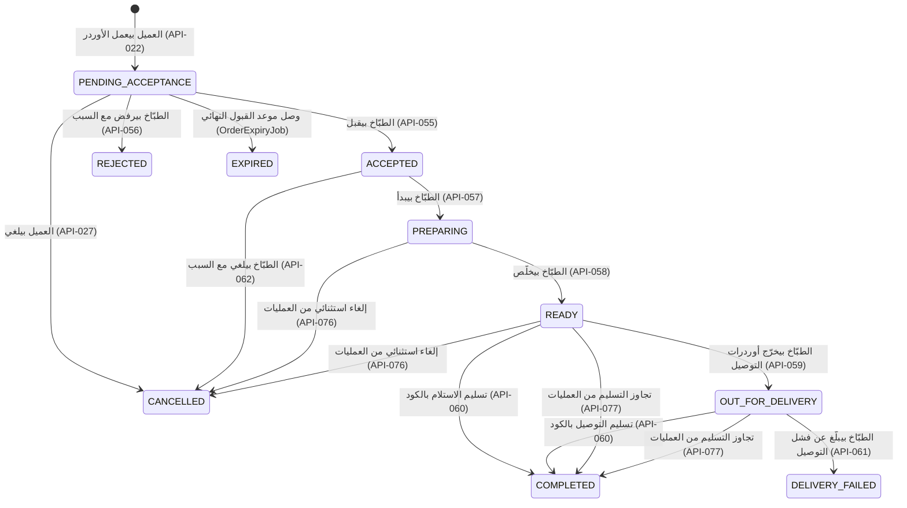

# دورة حياة الأوردر

> **Owner role:** Business documentation
> **Status:** IMPLEMENTED — كل حالة وأمر تحت موجود في `backend/modules/orders`؛ اللي برّه كده (الدفع الحقيقي وتتبّع المندوب) متعلَّم عليه في النص.
> **Language / اللغة:** [English](order-lifecycle.md) · العربية

الصفحة دي بتتابع أوردر واحد من الاستكشاف لحد الإكمال، باستخدام الـ State Machine الحقيقية. وبتجاوب على: *البيزنس بيتوقع إيه يحصل في كل خطوة، والسيرفر بيفرض إيه، والـ Client بياخد أنهي خطأ لما يكسر القاعدة؟* التعريف الأصلي على مستوى المنتج هو `docs/product/04-state-machines.md`؛ ولو الصفحة دي اختلفت عنه، الكود هو مصدر الحقيقة، والفرق مذكور في آخر الصفحة.

للتفاصيل على مستوى الكود شوف [تنفيذ الأوردر](../04-codebase/order-implementation-ar.md)؛ وللتتبّع الكامل من الأول للآخر بنداءات HTTP شوف [رحلة الأوردر الكاملة](../02-user-journeys/complete-order-journey-ar.md)؛ وللفلوس شوف [التسعير والدفع](pricing-and-payments-ar.md).

## نظرة عامة

الحالات النهائية (Terminal): `COMPLETED` و`REJECTED` و`EXPIRED` و`CANCELLED` و`DELIVERY_FAILED` (`OrderLifecycleService.TERMINAL`). الأوردر النهائي مبيتعدّلش: حارس الأوامر بيرفضه، وTrigger في الـ Database (`customer_order_terminal_guard`، `backend/app/src/main/resources/db/migration/V12__order_lifecycle.sql`) بيرفض التحديثات المباشرة (استثناء ضيق واحد: تحديث المسح لأسباب الخصوصية في V21 للـ Snapshots الخاصة ببيانات الاتصال/العنوان والملاحظة، شوف [معمارية قاعدة البيانات](../03-architecture/database-architecture-ar.md)). الاسترداد والنزاعات وتغييرات الدفع مبتعيدش كتابة حالة الأوردر أبدًا؛ بتتسجّل في سجلات منفصلة (`order_payment` و`cash_obligation` و`refund`).

كل أمر ليه الخصائص دي (`OrderLifecycleService`):

- بيقفل صف الأوردر (`SELECT ... FOR UPDATE`) ولو الفاعل طبّاخ بيضيف المطبخ الخاص بيه في البحث، فأوردر مطبخ تاني بيرجع `404`.
- محتاج `expectedVersion`؛ لو الإصدار قديم بيرجع `409 VERSION_CONFLICT`؛ وأمر على أوردر نهائي بيرجع `409 STATE_CONFLICT`.
- بيكتب تغيير الحالة، وصف `order_event` (رقم تسلسلي، ونوع الفاعل، وكود السبب)، وصف `outbox_event` (بصيغة `ORDER_<STATE>`) وأي أثر على المخزون أو الكاش، في **Transaction واحدة**.
- بيعدّي على `IdempotentCommands` (نطاق المفتاح = الفاعل + الأمر + `Idempotency-Key`، و`expires_at` بعد 24 ساعة بيتسجّل لكن مش بيتفرض): إعادة نفس الأمر بترجّع النتيجة الأصلية.

## الخطوة 1 — الاستكشاف

التصفّح العام (`GET /api/v1/meals`، API-003). الوجبات المنشورة بس من مطابخ معتمدة ونشطة وليها Slot مفتوح في المستقبل هي اللي تتشرى. مش محتاج حساب. شوف [نموذج الـ Marketplace](marketplace-model-ar.md#الاستكشاف).

*مثال:* ضيف في الواجهة العربي بيفلتر بالمنطقة وأقصى سعر؛ السيرفر بيرجّع نتيجة مقسّمة بـ Cursor؛ وتغيير الفلتر بيبعت Query جديد (BR-016، حالة المالك E2E-DISC-006).

## الخطوة 2 — قواعد السلة والكمية

السلة حالة على الـ Client (`apps/customer-web/src/cart.ts` و`apps/customer-mobile/src/basket.ts`)، لكن القواعد يحددها السيرفر وبيتم التحقق منها تاني وقت العرض (Quote):

| القاعدة | القيمة | المصدر |
|---|---|---|
| طبّاخ واحد وSlot واحد لكل سلة | استبدال أي منهم محتاج تأكيد صريح من العميل في الـ Client؛ والسيرفر بيرفض السلال المختلطة (`MIXED_KITCHENS_OR_SLOT`) | `QuoteService.terms`; حالات المالك E2E-BASKET-010, E2E-BASKET-021 |
| عدد البنود في الأوردر | 1..20 (`CommercePolicies.MAX_LINES_PER_ORDER`) | `QuoteService.create` |
| الكمية في البند | 1..`max_item_quantity` في سياسة التجارة النشطة (سياسة المعاينة فيها 10) | `commerce_policy` (V10); E2E-BASKET-011 |
| بنود الوجبة المكرّرة | بتترفض (`DUPLICATE_OR_MISSING_MEAL`) | `QuoteService.create` |
| الوجبة لازم تكون معروضة في الـ Slot المختار | غير كده `MEAL_NOT_OFFERED_IN_SLOT` | `QuoteService.terms` |
| السلة مبتحجزش مخزون | الإضافة للسلة مبتحجزش حاجة | E2E-BASKET-029 |

## الخطوة 3 — التوافر والسعة

السعة هي دفاع البيزنس ضد البيع الزيادة. كل Slot للطبّاخ (`cook_slot`) ليه `max_portions`؛ وكل وجبة في الـ Slot (`meal_slot`) ليها حدها الخاص. العدّادات في كل صف بتتحرك عبر المراحل `reserved → allocated → consumed` (`SlotInventory.Stage`).

| الحدث | حركة العدّاد | الكود |
|---|---|---|
| تسجيل الأوردر | available → **reserved** (كل صفوف الوجبات وصف الـ Slot، بترتيب قفل ثابت؛ كله أو مفيش) | `SlotInventory.reserve` |
| الطبّاخ بيقبل | reserved → **allocated** | `OrderLifecycleService` `accept` → `move` |
| الطبّاخ بيبدأ التحضير | allocated → **consumed** (مفيش استرجاع تلقائي بعد كده) | `prepare` |
| الرفض / الانتهاء / إلغاء العميل (المعلّق) | reserved → released، مرة واحدة بالظبط | `release(o, Stage.RESERVED)` |
| إلغاء الطبّاخ (المقبول) | allocated → released، مرة واحدة بالظبط | `release(o, Stage.ALLOCATED)` |
| الإلغاء الاستثنائي من العمليات (قيد التحضير أو جاهز) | **المخزون المستهلَك بيفضل مستهلَك والتزام الكاش بيتساب من غير تغيير**؛ والمالية بتراجعه يدويًا | `opsExceptionCancel` |

القواعد: سعة الـ Slot مينفعش تتخفض أبدًا تحت مجموع المحجوز+المخصَّص+المستهلَك (`SlotService`، حالة المالك E2E-COOK-106)؛ الـ Cutoff = بداية الـ Slot − مهلة الطلب المسبق (lead time) (`lead_minutes` من 30 لـ 1440)؛ بعد الـ Cutoff الـ Slot بيرفض العروض وتعديلات السعة (E2E-BASKET-023). عميلين بيتنافسوا على آخر حصة بينتج عنهم أوردر واحد بالظبط (الاختبار `twenty_customers_racing_for_the_last_portion_produce_exactly_one_order`، `backend/app/src/test/java/com/matbakhy/app/orders/OrderPlacementIntegrationTest.java`؛ E2E-ORDER-115).

*مثال:* الـ Slot فيه 3 حصص متبقية؛ العميل A طلب 2، والعميل B طلب 2 في نفس اللحظة. العرضين بينجحوا (العرض مبيحجزش مخزون). التسجيل بيتسلسل: أوردر A بيتعمل؛ وتسجيل B بيرجع `409 STOCK_CHANGED` مع `INSUFFICIENT_PORTIONS`؛ سلة B وتفاصيلها بتفضل وB يقدر يقلل الكمية.

## الخطوة 4 — العرض وحساب السعر

`POST /api/v1/quotes` (API-021)، `QuoteService.create`. الطلب فيه بس أرقام الوجبات (ids) والكميات والـ Slot ووضع التنفيذ والعنوان (للتوصيل) وطريقة الدفع. السيرفر بيعمل الآتي:

1. بيتطلب بيانات اتصال متحقَّق منها (الإيميل والتليفون المصري)؛
2. بيحمّل **سياسة التجارة النشطة** (علامة إيقاف الطلب أو سياسة ناقصة/غير معتمدة بتمنع العرض: `ORDERING_PAUSED` و`NO_APPROVED_POLICY`)؛
3. بيسعّر كل بند من *Revision الوجبة المنشورة الحالية* (`meal_revision`)، `line = unit × quantity` باستخدام `Math.multiplyExact` (آمن من الـ Overflow)؛
4. بيضيف رسوم التوصيل لمنطقة العنوان (رسوم المنطقة، أو الرسوم البديلة اللي محدّدها المطبخ) في التوصيل، ولا حاجة في الاستلام (الاستلام لازم يكون مفعّل من المطبخ)؛
5. بيطبّق الضريبة من السياسة، `tax = floor((subtotal+fee) × bps + 5000) / 10000` (تقريب لأعلى عند المنتصف؛ 0 bps في السياسة الاصطناعية (Synthetic))؛
6. بيحسب معاينة موعد القبول `min(now + acceptance window, slot cutoff)` وبيرفض لو هيفضل أقل من `min_acceptance_minutes` (`ACCEPTANCE_WINDOW_TOO_SHORT`)؛
7. بيستنتج شروط الدفع (كاش عند الاستلام أو عربون) من ملف الدفع الخاص بالمطبخ؛
8. بيخزّن صفوف `quote` + `quote_item` غير قابلة للتعديل مع **مدة انتهاء (الافتراضي 5 دقايق)** وبيرجّع التكلفة الكاملة وإصدارات السياسة اللي لازم العميل يوافق عليها.

العروض مبتحجزش مخزون وغير قابلة للتعديل (Trigger في الـ Database هو `quote_immutable`، V10). الأسعار اللي يبعتها الـ Client مش موجودة في نموذج الطلب؛ والسيرفر كمان بيرفض الحقول غير المعروفة (Strict JSON، `backend/app/src/main/java/com/matbakhy/app/config/StrictJsonConfiguration.java`؛ الاختبار `the_server_computes_exact_totals_and_forged_amounts_are_rejected` في `QuoteIntegrationTest`).

## الخطوة 5 — العرض القديم والانتهاء

عند التسجيل السيرفر **بيعيد التحقق** من العرض (`QuoteService.requireValid`): بيقفل السياسة وصفوف التسعير، وبعدين بيقارن بالبيانات الحالية.

| الحالة | الاستجابة | تجربة العميل |
|---|---|---|
| مدة صلاحية العرض انتهت | `409 QUOTE_EXPIRED` | "The quote expired. Calculate the total again." |
| إصدار السياسة اتغيّر | `409 PRICE_CHANGED`، السبب `POLICY_CHANGED` | لازم يعمل عرض جديد ويوافق من جديد |
| Revision الوجبة أو سعر الوحدة اتغيّر | `409 PRICE_CHANGED`، السبب `MEAL_CHANGED` | أي Revision جديدة للوجبة بتبطل العرض، حتى لو السعر زي ما هو. الواجهة بتنسب تغيير السعر للمطبخ بس لو مبالغ الوحدة اختلفت فعلًا (`packages/api-client/src/priceChanges.ts`)؛ غير كده بتعرض إشعار عام بإن التفاصيل اتغيّرت. بتتعرض الإجماليات القديمة والجديدة |
| رسوم التوصيل أو الإجمالي اتغيّر | `409 PRICE_CHANGED`، السبب `TOTAL_CHANGED` | بيتقاله إن رسوم التوصيل/الضريبة اتغيّرت (مش المطبخ) |
| العنوان اتعدّل أو المنطقة اتغيّرت | `409 STATE_CONFLICT`، السبب `ADDRESS_CHANGED` | يختار العنوان من جديد |
| نسبة العربون أو سقف الكاش أو المستلم اتغيّر | `409 PRICE_CHANGED`، السبب `PAYMENT_CHANGED` | عرض جديد |

مفيش حاجة بتتعمل ومفيش حاجة بتتحجز لما التسجيل يترفض. الـ Clients على الويب والموبايل بيعرضوا اللي اتغيّر وبيطلبوا "أوافق على الإجمالي الجديد" صراحةً قبل ما يتسجّل عرض جديد (`apps/customer-web/src/Checkout.tsx`، و`priceChanges` في `packages/api-client`). السياسة الكاملة والأمثلة في [التسعير والدفع](pricing-and-payments-ar.md#2-تغييرات-السعر-قبل-التسجيل-قرار-المالك-d13). الاختبارات: `backend/app/src/test/java/com/matbakhy/app/orders/PriceChangeIntegrationTest.java`، وحالات المالك E2E-BASKET-014 وE2E-ORDER-112.

## الخطوة 6 — التسجيل (Placement)

`POST /api/v1/orders` (API-022) بـ Header اسمه `Idempotency-Key` وجسم `{quoteId, clientRequestId, acceptedPolicyVersions}`. الدالة `OrderService.placeOnce` في Transaction واحدة:

1. بتاخد advisory lock على `(customer, clientRequestId)` عشان تسلسل الإرسالات المكرّرة؛
2. لو فيه أوردر موجود لنفس العميل و`clientRequestId`: بترجّعه لو بصمة الطلب (fingerprint) متطابقة، وغير كده `409 IDEMPOTENCY_CONFLICT` (بينجو من حذف سجل الـ Header، V29)؛
3. بتعيد التحقق من العرض (الخطوة 5) ومن إن العميل وافق على إصدارات الشروط وسياسة الإلغاء *الحالية* (`POLICY_NOT_ACCEPTED`)؛
4. بترفض عرض مستخدم قبل كده في أوردر تاني (`QUOTE_ALREADY_USED`؛ E2E-BASKET-028)؛
5. بتحجز المخزون (الخطوة 3)؛
6. بتكتب `customer_order` (الحالة `PENDING_ACCEPTANCE`، والمبالغ، و`policy_version`، وSnapshot العمولة، وإصدارات الشروط، و`accept_by`، وSnapshots بيانات الاتصال والعنوان كـ JSON)، وصفوف `order_item` مع **Snapshot Revision الوجبة**، وصفوف `stock_allocation`، وأول `order_event`، وحدث Outbox بنوع `ORDER_PLACED`، وسجل `order_payment` غير القابل للتعديل، و`cash_obligation` (المبلغ = الإجمالي − العربون).

لو أي جزء فشل، كل حاجة بترجع (Rollback) (الاختبار `an_injected_failure_after_the_stock_update_rolls_everything_back_and_a_retry_completes_once`). ولو الرد ضاع، الـ Client بيدوّر على الأوردر بـ `GET /api/v1/orders/by-request/{clientRequestId}` (API-024) وبيعيد المحاولة بنفس المفتاح؛ والنتيجة أوردر واحد بالظبط (E2E-ORDER-024 وE2E-ORDER-123، والـ Native E2E-ORDER-107).

*النتيجة المتوقعة:* HTTP 201 والأوردر في `PENDING_ACCEPTANCE`، ورقم عام `MB-<n>`، و`acceptBy`. القبول مش مفترض.

## الخطوة 7 — المطبخ بيقبل أو يرفض

- **القبول** (API-055): الطبّاخ المالك بس، والحالة `PENDING_ACCEPTANCE`، والمطبخ مسموح له يقبل (`KitchenStatus.canAcceptOrders`: حالة التشغيل `ACTIVE` أو `PAUSED`؛ المطبخ المعلَّق أو المقفول مينفعش يقبل)، و`now < acceptBy` (قبل الموعد بـ ميلي ثانية بيعدّي؛ عند الموعد بالظبط بيترفض؛ الاختبار `acceptance_is_allowed_one_millisecond_before_the_deadline_and_refused_exactly_at_it`). الأثر: reserved→allocated؛ والعميل بياخد بيانات اتصال المطبخ وموقعه (للاستلام).
- **الرفض** (API-056): كود السبب من `KITCHEN_BUSY` و`INGREDIENT_UNAVAILABLE` و`OUTSIDE_CAPACITY` و`OTHER`. الأثر: الحصص المحجوزة بترجع متاحة مرة واحدة؛ التزام الكاش `NOT_DUE`؛ وحالة الدفع بتتحرك (أوردرات العربون بتعدّي على المطابقة، شوف صفحة الدفع).
- **الانتهاء**: الـ Job اسمه `OrderExpiryJob` بيشتغل كل 30 ثانية (قابلة للضبط) وبينهي الأوردرات المعلّقة اللي `accept_by <= now` حسب *وقت السيرفر*؛ والقبول/الإلغاء/الانتهاء المتزامنين بينتج عنهم فايز واحد بالظبط (E2E-ORDER-028، والاختبار `accept_cancel_and_expire_racing_produce_one_legal_outcome_and_at_most_one_release`).

موعد القبول: `min(created + acceptance window (15 min in the synthetic policy), slot cutoff)`؛ لازم يفضل على الأقل `min_acceptance_minutes` (5) وقت التسجيل.

## الخطوة 8 — التحضير

- **التحضير (Prepare)** (API-057): من `ACCEPTED`؛ والمطبخ لازم يكون قادر ينفّذ الأوردرات المقبولة (`KitchenStatus.canFulfillAcceptedOrders`: أي حالة تشغيل ما عدا `CLOSED`، فحتى المطبخ المعلَّق يقدر يخلّص اللي قبله فعلًا)، وفي أوردرات العربون المطبخ لازم يكون بلّغ بالفعل باستلام العربون (`PaymentService.requireReadyForPreparation` → `DEPOSIT_NOT_RECEIVED`؛ E2E-FIN-106). المخزون allocated→consumed.
- **إلغاء الطبّاخ** (API-062): من `ACCEPTED` بس (قبل التحضير)، والسبب من `INGREDIENT_UNAVAILABLE` و`KITCHEN_ISSUE` و`OTHER`؛ وبيرجع الحصص المخصّصة متاحة مرة واحدة (E2E-ORDER-110).
- **جاهز (Ready)** (API-058): من `PREPARING`؛ والسيرفر بيولّد **كود تسليم** من ست أرقام (`HandoverCodes.issue`) بيتخزّن كـ Hash بمفتاح مع قيمة عرض مشفّرة؛ والكود ظاهر لصاحب الأوردر بس (`OrderService.handoverCode`، وبس وقت `READY` أو `OUT_FOR_DELIVERY` وصالح للاستخدام) ومبيظهرش أبدًا في DTOs الطبّاخ أو الـ Staff (E2E-ORDER-030).

> الإيقاف المؤقت والتعليق: الإيقاف المؤقت (Pause) بيوقف البيع الجديد بس (الأوردرات المعلّقة لسه ممكن تتقبل)؛ والتعليق (Suspension) بيوقف القبول كمان؛ والأوردرات المقبولة بالفعل بتفضل قابلة للتنفيذ في الحالتين (E2E-COOK-050؛ الاختبار `pause_stops_new_sales_suspension_stops_acceptance_and_accepted_orders_stay_fulfillable`).

## الخطوة 9 — الاستلام أو التوصيل

وضع التنفيذ بيتثبّت وقت العرض ومينفعش يتغيّر بعد كده.

| الوضع | المسار | التفاصيل |
|---|---|---|
| `PICKUP` | `READY → COMPLETED` | الطبّاخ بيدخل كود العميل (API-060 `handover`). موقع استلام المطبخ بيظهر للعميل بعد القبول بس |
| `DELIVERY` | `READY → OUT_FOR_DELIVERY → COMPLETED` | الطبّاخ بيبعت الأوردر بـ `deliveryReference` إجباري (API-059)، وبعدين بيدخل الكود عند التسليم. التوصيل **بيرتّبه الطبّاخ**؛ المنصة بتسجّل مرجع، ومبترسلش مناديب (مفيش تطبيق للسواقين ولا خريطة مباشرة: PLANNED في أحسن الأحوال) |
| مسار غلط | مثلًا `handover` على أوردر توصيل في حالة READY | `409 STATE_CONFLICT` مع `WRONG_FULFILLMENT_MODE` (E2E-ORDER-032) |

**فشل التوصيل** (API-061): من `OUT_FOR_DELIVERY` بالسبب `CUSTOMER_UNREACHABLE` أو `ADDRESS_NOT_FOUND` أو `REFUSED` أو `OTHER` → `DELIVERY_FAILED`. مفيش استرداد ولا دفع ولا عمولة تلقائية (E2E-ORDER-034)؛ وطبقة الدفع بتنقل العربون للمطابقة.

## الخطوة 10 — التحقق من التسليم والإكمال

`OrderLifecycleService.handover`:

- بحد أقصى 5 محاولات غلط لكل أوردر (`matbakhy.handover.max-attempts` = 5)، وبعدها الـ Challenge بيتقفل (`CHALLENGE_LOCKED`) وحتى الكود الصح بيترفض؛ وبحد أقصى 30 محاولة لكل فاعل في الساعة (`RATE_LIMITED`).
- الكود بينتهي بعد `expiry-after-slot-end` (ساعتين) من نهاية الـ Slot، لكن مش قبل ساعة من وقت إصداره (`CHALLENGE_EXPIRED`).
- الكود الصح بيتستهلك Atomically مع الانتقال لـ `COMPLETED`؛ وإعادته بترجّع `CODE_CONSUMED`.
- لو الكود اتقفل/انتهى/ضاع، الـ Staff اللي معاهم `order.handover_override` و**MFA حديث** بس هما اللي يقدروا يكمّلوا الأوردر، مع سبب (10 حروف على الأقل) ومرجع دليل؛ التجاوز بيتسجّل في الـ Audit وبيكمّل المسار القانوني للوضع بس (E2E-ORDER-108). الطبّاخ مينفعش يعيد ضبط الأكواد.

الإكمال **مش معناه** إن الأوردر اتدفع: الكاش ممكن لسه مستحق. الطبّاخ بيبلّغ بالكاش اللي حصّله بعدين (API-063)، والمالية بتتحقق منه بشكل منفصل ([التسعير والدفع](pricing-and-payments-ar.md#5-تحصيل-الكاش-والتحقق-منه)). بعد الإكمال العميل يقدر يقيّم الوجبة مرة واحدة (E2E-DISC-110) ويعيد الطلب (عرض جديد وأوردر جديد).

## الإلغاء

| مين | إمتى | إزاي | النتيجة |
|---|---|---|---|
| العميل | `PENDING_ACCEPTANCE` | `POST /orders/{id}/cancel` (API-027)، السبب `CHANGED_MIND` أو `ORDERED_BY_MISTAKE` أو `TOO_SLOW` أو `OTHER` | `CANCELLED`، المخزون اتفرّج عنه، من غير غرامة |
| العميل | `ACCEPTED` أو `PREPARING` أو `READY` أو `OUT_FOR_DELIVERY` | الإلغاء المباشر بيترفض: `409 STATE_CONFLICT` الحقل `state` = `CANCELLATION_REQUEST_REQUIRED`. العميل بيقدّم `POST /orders/{id}/cancellation-requests` (API-028) | بيفتح حالة دعم `CANCELLATION_REQUEST` (خطورة HIGH). الأوردر نفسه مبيتغيّرش (E2E-ORDER-035) |
| الطبّاخ | `ACCEPTED` بس | API-062 | `CANCELLED`، التخصيص اتفرّج عنه |
| العمليات | `PREPARING` أو `READY` بس | API-076 `exception-cancel` بالسبب `SAFETY` أو `OPERATIONAL` أو `OTHER` ومرجع الحالة | `CANCELLED`؛ المخزون المستهلَك بيفضل مستهلَك؛ مراجعة مالية يدوية (E2E-ORDER-109) |
| السيستم | موعد القبول | `OrderExpiryJob` | `EXPIRED` |

طلب الإلغاء لوحده مبيلغيش حاجة أبدًا: لازم حد معاه الصلاحية (الطبّاخ قبل التحضير، والعمليات بعده) ينفّذ الإلغاء، وحالة الدعم مينفعش تتحل بالكود `ORDER_CANCELLED` إلا لو الأوردر فعلًا `CANCELLED` (`SupportService`).

## الحالات الاستثنائية والنزاعات

| الاستثناء | بيظهر فين | التعامل |
|---|---|---|
| القبول قرّب ينتهي / متأخر | شاشة متابعة الأوردرات للعمليات، فلتر `OVERDUE_ACCEPTANCE` (API-074) | الـ Staff يقدروا يشوفوه؛ والسيستم بينهيه تلقائيًا |
| فشل التوصيل | متابعة العمليات، `DELIVERY_FAILED` | مهمة دعم؛ وقرارات الاسترداد/الدفع يدوية |
| نقص في الكاش | حالة `cash_report` هي `DISPUTED` | قرار من المالية مع سبب (E2E-FIN-043) |
| العربون مش موجود / المبلغ غلط | حالة `order_payment` هي `DISPUTED` | بتتفتح حالة دعم `PAYMENT` بخطورة HIGH تلقائيًا (E2E-FIN-040 وE2E-FIN-109) |
| شكوى سلامة غذاء | فئة الدعم `FOOD_SAFETY` | خطورة `CRITICAL`، وبتتصعّد وقت الإنشاء |
| كود التسليم اتقفل/انتهى | الطبّاخ بيشوف الخطأ؛ والـ Staff بيتجاوزوا | شوف الخطوة 10 |
| الأوردر انتهى بعد عربون متبلَّغ عنه | `RECONCILE_PENDING` | قرار الـ Staff: استرداد مستحق أو إغلاق من غير أموال ([التسعير والدفع](pricing-and-payments-ar.md#حالات-العربون)) |

حالات الدعم مربوطة بالأوردر؛ ملاحظات الـ Staff الخاصة مبتظهرش أبدًا للعميل ولا للطبّاخ (BR-041؛ E2E-OPS-057 وE2E-ORDER-118).

## الإشعارات

كل انتقال بيكتب `outbox_event`؛ والـ Dispatcher بيحوّله لإشعار واحد داخل التطبيق لكل مستلم صح، من غير تكرار (E2E-ORDER-117). فشل الإشعار مينفعش يغيّر حالة الأوردر (BR-037/038). القنوات اللي غير الإشعار داخل التطبيق (الإيميل والـ Push) بتستخدم Adapters وهمية في البيئات غير الـ Production. شوف [التكامل والأحداث](../03-architecture/integration-and-events-ar.md).

## القيود المعروفة وفجوات التوثيق

- `MEAL_CHANGED` بيطلع مع أي تغيير في الـ Revision (مثلًا تعديل في الوصف بس)، بينما صياغة "المطبخ غيّر السعر" صح بس لما أسعار الوحدة تختلف؛ وكود السبب لوحده مش بيقول إيه اللي حصل.
- `docs/product/04-state-machines.md` بيسمح لـ "Owning cook/ops" بالإرسال والإكمال. الكود بيدّي الإرسال والتسليم العادي للطبّاخ المالك بس؛ والـ Staff يقدروا بس يلغوا استثنائيًا (`PREPARING`/`READY`) أو يتجاوزوا التسليم.
- المستند ده كمان بيذكر "Cancel accepted: Owning cook or ops". الكود بيسمح للعمليات بالإلغاء من `PREPARING`/`READY` بس؛ وللأوردر في `ACCEPTED` الطبّاخ هو اللي بيلغي.
- العميل بيشوف `PENDING_ACCEPTANCE` كـ "Waiting for the kitchen" و`COMPLETED` كـ "Delivered" في نصوص الواجهة (`apps/customer-web/src/i18n.ts`)، بما في ذلك أوردرات الاستلام. NOT VERIFIED هل صياغة الاستلام متطابقة عن قصد.
