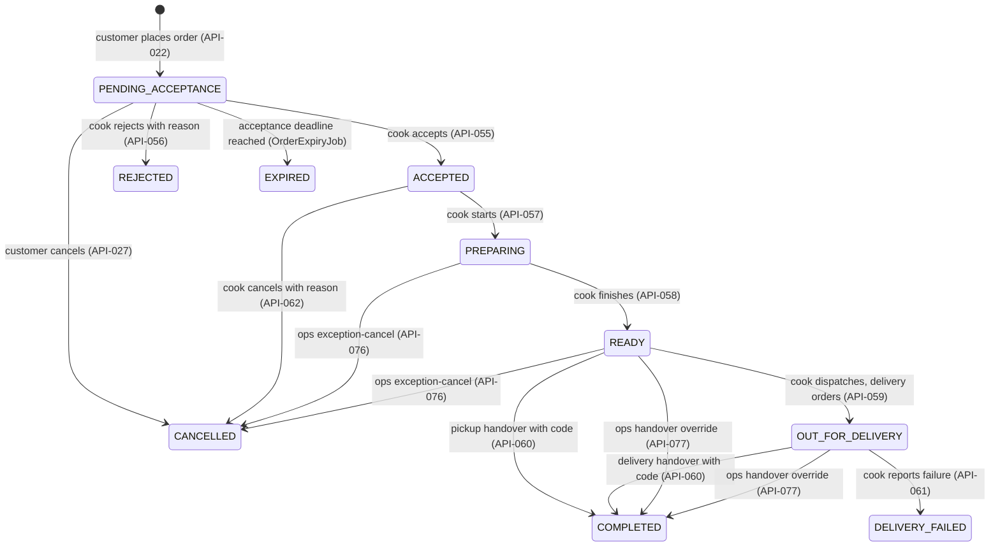

# Order lifecycle

> **Owner role:** Business documentation
> **Status:** IMPLEMENTED — every state and command below exists in `backend/modules/orders`; items outside that (live payments, courier tracking) are labelled in the body.

This page follows one order from discovery to completion, using the real state machine. It answers: *what does the business expect to happen at each step, what does the server enforce, and what error does a client get when it breaks the rule?* The canonical product-level definition is `docs/product/04-state-machines.md`; where this page differs, the code is the source of truth and the difference is listed at the bottom.

For code-level detail see [order implementation](../04-codebase/order-implementation.md); for the end-to-end trace with HTTP calls see [complete order journey](../02-user-journeys/complete-order-journey.md); for money see [pricing and payments](pricing-and-payments.md).

## Overview

Terminal states: `COMPLETED`, `REJECTED`, `EXPIRED`, `CANCELLED`, `DELIVERY_FAILED` (`OrderLifecycleService.TERMINAL`). A terminal order is immutable: the command guard refuses it and a database trigger (`customer_order_terminal_guard`, `backend/app/src/main/resources/db/migration/V12__order_lifecycle.sql`) refuses direct updates (one narrow exception: the V21 privacy-erasure update of contact/address snapshots and note, see [database architecture](../03-architecture/database-architecture.md)). Refunds, disputes and payment changes never rewrite the order state; they live in separate records (`order_payment`, `cash_obligation`, `refund`).

Every command has these properties (`OrderLifecycleService`):

- It locks the order row (`SELECT ... FOR UPDATE`) and, for cooks, includes the caller's kitchen in the lookup, so another kitchen's order is `404`.
- It needs `expectedVersion`; a stale version returns `409 VERSION_CONFLICT`; a command on a terminal order returns `409 STATE_CONFLICT`.
- It writes the state change, an `order_event` row (sequence number, actor type, reason code), an `outbox_event` row (`ORDER_<STATE>`) and any stock or cash effect in **one transaction**.
- It runs through `IdempotentCommands` (key scope = actor + command + `Idempotency-Key`, `expires_at` +24 h is recorded but not enforced): replaying the same command returns the original outcome.

## Step 1 — Discovery

Public browse (`GET /api/v1/meals`, API-003). Only published meals from approved, active kitchens with an open future slot are purchasable. No account is needed. See [marketplace model](marketplace-model.md#discovery).

*Example:* a guest in the Arabic UI filters by zone and a maximum price; the server returns a cursor-paged result; changing a filter sends a new query (BR-016, owner case E2E-DISC-006).

## Step 2 — Basket and quantity rules

The basket is client state (`apps/customer-web/src/cart.ts`, `apps/customer-mobile/src/basket.ts`), but the rules are server-defined and re-checked at quote time:

| Rule | Value | Source |
|---|---|---|
| One cook and one slot per basket | Replacing either requires explicit customer confirmation in the client; the server rejects mixed baskets (`MIXED_KITCHENS_OR_SLOT`) | `QuoteService.terms`; owner cases E2E-BASKET-010, E2E-BASKET-021 |
| Lines per order | 1..20 (`CommercePolicies.MAX_LINES_PER_ORDER`) | `QuoteService.create` |
| Quantity per line | 1..`max_item_quantity` of the active commerce policy (the preview policy has 10) | `commerce_policy` (V10); E2E-BASKET-011 |
| Duplicate meal lines | Rejected (`DUPLICATE_OR_MISSING_MEAL`) | `QuoteService.create` |
| Meal must be offered in the chosen slot | Else `MEAL_NOT_OFFERED_IN_SLOT` | `QuoteService.terms` |
| Basket holds no stock | Adding to a basket reserves nothing | E2E-BASKET-029 |

## Step 3 — Availability and capacity

Capacity is the business' defence against overselling. Each cook slot (`cook_slot`) has `max_portions`; each meal in the slot (`meal_slot`) has its own limit. Counters per row move through the stages `reserved → allocated → consumed` (`SlotInventory.Stage`).

| Event | Counter movement | Code |
|---|---|---|
| Order placed | available → **reserved** (all meal rows and the slot row, in a fixed lock order; all-or-nothing) | `SlotInventory.reserve` |
| Cook accepts | reserved → **allocated** | `OrderLifecycleService` `accept` → `move` |
| Cook starts preparation | allocated → **consumed** (no automatic restoration afterwards) | `prepare` |
| Reject / expire / customer cancel (pending) | reserved → released, exactly once | `release(o, Stage.RESERVED)` |
| Cook cancel (accepted) | allocated → released, exactly once | `release(o, Stage.ALLOCATED)` |
| Ops exception cancel (preparing or ready) | **Consumed stock stays consumed and the cash obligation is left unchanged**; finance reviews manually | `opsExceptionCancel` |

Rules: slot capacity can never be reduced below what is reserved+allocated+consumed (`SlotService`, owner case E2E-COOK-106); cutoff = slot start − lead time (`lead_minutes` 30..1440); after cutoff the slot refuses quotes and capacity edits (E2E-BASKET-023). Two customers racing for the last portion produce exactly one order (test `twenty_customers_racing_for_the_last_portion_produce_exactly_one_order`, `backend/app/src/test/java/com/matbakhy/app/orders/OrderPlacementIntegrationTest.java`; E2E-ORDER-115).

*Example:* slot has 3 portions left; customer A asks for 2, customer B asks for 2 at the same moment. Both quotes succeed (a quote holds no stock). Placement serialises: A's order is created; B's placement returns `409 STOCK_CHANGED` with `INSUFFICIENT_PORTIONS`; B's basket and details stay and B can reduce the quantity.

## Step 4 — Quote and price calculation

`POST /api/v1/quotes` (API-021), `QuoteService.create`. The request contains only meal ids, quantities, slot, fulfillment mode, address (delivery) and payment method. The server:

1. requires verified contact (e-mail and Egyptian phone);
2. loads the **active commerce policy** (an ordering pause flag or missing/unapproved policy blocks quoting: `ORDERING_PAUSED`, `NO_APPROVED_POLICY`);
3. prices each line from the *current published meal revision* (`meal_revision`), `line = unit × quantity` with `Math.multiplyExact` (overflow-safe);
4. adds the delivery fee for the address zone (zone fee, or the kitchen's override) for delivery, nothing for pickup (pickup must be enabled by the kitchen);
5. applies tax from the policy, `tax = floor((subtotal+fee) × bps + 5000) / 10000` (half-up; 0 bps in the synthetic policy);
6. computes the acceptance deadline preview `min(now + acceptance window, slot cutoff)` and refuses if less than `min_acceptance_minutes` would remain (`ACCEPTANCE_WINDOW_TOO_SHORT`);
7. derives payment terms (COD or deposit) from the kitchen payment profile;
8. stores an immutable `quote` + `quote_item` rows with an **expiry (default 5 minutes)** and returns the full cost and the policy versions the customer must accept.

Quotes hold no stock and are immutable (database trigger `quote_immutable`, V10). Client-supplied prices are not in the request model; the server also rejects unknown fields (strict JSON, `backend/app/src/main/java/com/matbakhy/app/config/StrictJsonConfiguration.java`; test `the_server_computes_exact_totals_and_forged_amounts_are_rejected` in `QuoteIntegrationTest`).

## Step 5 — Stale quote and expiry

At placement the server **revalidates** the quote (`QuoteService.requireValid`): it locks the policy and the pricing rows, then compares against current data.

| Situation | Response | Customer experience |
|---|---|---|
| Quote older than its expiry | `409 QUOTE_EXPIRED` | "The quote expired. Calculate the total again." |
| Policy version changed | `409 PRICE_CHANGED`, reason `POLICY_CHANGED` | Must re-quote and re-accept |
| Meal revision or unit price changed | `409 PRICE_CHANGED`, reason `MEAL_CHANGED` | Any new meal revision invalidates the quote, even with an unchanged price. The UI attributes a kitchen price change only when the unit amounts actually differ (`packages/api-client/src/priceChanges.ts`); otherwise it shows a generic changed-details notice. Old and new totals are shown |
| Delivery fee or total changed | `409 PRICE_CHANGED`, reason `TOTAL_CHANGED` | Told the delivery fee/tax changed (not the kitchen) |
| Address edited or zone changed | `409 STATE_CONFLICT`, reason `ADDRESS_CHANGED` | Re-select the address |
| Deposit percentage, COD cap or recipient changed | `409 PRICE_CHANGED`, reason `PAYMENT_CHANGED` | Re-quote |

Nothing is created and nothing is reserved on refusal. The web and mobile clients show what changed and require an explicit "I accept the new total" before a fresh quote is placed (`apps/customer-web/src/Checkout.tsx`, `priceChanges` in `packages/api-client`). Full policy and examples in [pricing and payments](pricing-and-payments.md#2-price-changes-before-placement-owner-decision-d13). Tests: `backend/app/src/test/java/com/matbakhy/app/orders/PriceChangeIntegrationTest.java`, owner cases E2E-BASKET-014, E2E-ORDER-112.

## Step 6 — Placement

`POST /api/v1/orders` (API-022) with `Idempotency-Key` header and body `{quoteId, clientRequestId, acceptedPolicyVersions}`. `OrderService.placeOnce` in one transaction:

1. takes an advisory lock on `(customer, clientRequestId)` to serialise duplicate submits;
2. if an order already exists for that customer and `clientRequestId`: returns it when the request fingerprint matches, otherwise `409 IDEMPOTENCY_CONFLICT` (survives removal of the header record, V29);
3. revalidates the quote (step 5) and that the customer accepted the *current* terms and cancellation-policy versions (`POLICY_NOT_ACCEPTED`);
4. refuses a quote already used by another order (`QUOTE_ALREADY_USED`; E2E-BASKET-028);
5. reserves stock (step 3);
6. writes `customer_order` (state `PENDING_ACCEPTANCE`, amounts, `policy_version`, commission snapshot, terms versions, `accept_by`, contact and address snapshots as JSON), `order_item` rows with the **meal revision snapshot**, `stock_allocation` rows, the first `order_event`, an `ORDER_PLACED` outbox event, the immutable `order_payment` record and the `cash_obligation` (amount = total − deposit).

If any part fails, everything rolls back (test `an_injected_failure_after_the_stock_update_rolls_everything_back_and_a_retry_completes_once`). If the response is lost, the client looks up the order with `GET /api/v1/orders/by-request/{clientRequestId}` (API-024) and retries with the same key; exactly one order results (E2E-ORDER-024, E2E-ORDER-123, native E2E-ORDER-107).

*Expected result:* HTTP 201 with the order in `PENDING_ACCEPTANCE`, a public number `MB-<n>`, and `acceptBy`. Acceptance is not assumed.

## Step 7 — Kitchen accepts or rejects

- **Accept** (API-055): only the owning cook, state `PENDING_ACCEPTANCE`, kitchen allowed to accept (`KitchenStatus.canAcceptOrders`: operating state `ACTIVE` or `PAUSED`; a suspended or closed kitchen cannot accept), and `now < acceptBy` (one millisecond before passes; exactly at the deadline is refused; test `acceptance_is_allowed_one_millisecond_before_the_deadline_and_refused_exactly_at_it`). Effect: reserved→allocated; customer gets the kitchen's contact and (pickup) location.
- **Reject** (API-056): reason code from `KITCHEN_BUSY`, `INGREDIENT_UNAVAILABLE`, `OUTSIDE_CAPACITY`, `OTHER`. Effect: stock released once; cash obligation `NOT_DUE`; payment state moves (deposit orders go through reconciliation, see payments page).
- **Expiry**: the job `OrderExpiryJob` runs every 30 s (configurable) and expires pending orders whose `accept_by <= now` by *server time*; concurrent accept/cancel/expire produce exactly one winner (E2E-ORDER-028, test `accept_cancel_and_expire_racing_produce_one_legal_outcome_and_at_most_one_release`).

Acceptance deadline: `min(created + acceptance window (15 min in the synthetic policy), slot cutoff)`; at least `min_acceptance_minutes` (5) must remain at placement.

## Step 8 — Preparation

- **Prepare** (API-057): from `ACCEPTED`; the kitchen must be able to fulfil accepted orders (`KitchenStatus.canFulfillAcceptedOrders`: any operating state except `CLOSED`, so even a suspended kitchen can finish what it already accepted) and, for deposit orders, the kitchen must already have reported receipt of the deposit (`PaymentService.requireReadyForPreparation` → `DEPOSIT_NOT_RECEIVED`; E2E-FIN-106). Stock allocated→consumed.
- **Cook cancel** (API-062): only from `ACCEPTED` (before preparation), reason from `INGREDIENT_UNAVAILABLE`, `KITCHEN_ISSUE`, `OTHER`; releases the allocation once (E2E-ORDER-110).
- **Ready** (API-058): from `PREPARING`; the server generates a six-digit **handover code** (`HandoverCodes.issue`) stored as a keyed hash plus an encrypted display value; the code is visible only to the order owner (`OrderService.handoverCode`, only while `READY` or `OUT_FOR_DELIVERY` and usable) and never to cook or staff DTOs (E2E-ORDER-030).

> Pause and suspension: a pause stops new sales only (pending orders can still be accepted); a suspension also stops acceptance; already accepted orders remain fulfillable in both (E2E-COOK-050; test `pause_stops_new_sales_suspension_stops_acceptance_and_accepted_orders_stay_fulfillable`).

## Step 9 — Pickup or delivery

The fulfillment mode is fixed at quote time and cannot change afterwards.

| Mode | Path | Details |
|---|---|---|
| `PICKUP` | `READY → COMPLETED` | Cook enters the customer's code (API-060 `handover`). The kitchen's pickup location is shown to the customer only after acceptance |
| `DELIVERY` | `READY → OUT_FOR_DELIVERY → COMPLETED` | Cook dispatches with a required `deliveryReference` (API-059), then enters the code at hand-over. Delivery is **cook-arranged**; the platform records a reference, it does not dispatch couriers (no driver app, no live map: PLANNED at most) |
| wrong path | e.g. `handover` on a READY delivery order | `409 STATE_CONFLICT` with `WRONG_FULFILLMENT_MODE` (E2E-ORDER-032) |

**Failed delivery** (API-061): from `OUT_FOR_DELIVERY` with reason `CUSTOMER_UNREACHABLE`, `ADDRESS_NOT_FOUND`, `REFUSED`, `OTHER` → `DELIVERY_FAILED`. No automatic refund, payment or commission (E2E-ORDER-034); the payment layer moves a deposit to reconciliation.

## Step 10 — Handover verification and completion

`OrderLifecycleService.handover`:

- At most 5 wrong attempts per order (`matbakhy.handover.max-attempts` = 5), after which the challenge is **locked** (`CHALLENGE_LOCKED`) and even the correct code is refused; at most 30 attempts per actor per hour (`RATE_LIMITED`).
- A code expires `expiry-after-slot-end` (2 h) after the slot end, but never sooner than one hour after it was issued (`CHALLENGE_EXPIRED`).
- A correct code is consumed atomically with the transition to `COMPLETED`; replay returns `CODE_CONSUMED`.
- If the code is locked/expired/lost, only staff with `order.handover_override` and **recent MFA** can complete the order, with a reason (≥ 10 characters) and an evidence reference; the override is audited and completes only the legal path for the mode (E2E-ORDER-108). Cooks cannot reset codes.

Completion does **not** mean paid: cash may still be due. The cook reports collected cash later (API-063), and finance verifies it separately ([pricing and payments](pricing-and-payments.md#5-cash-collection-and-verification)). After completion the customer can review the meal once (E2E-DISC-110) and re-order (a new quote and a new order).

## Cancellation

| Who | When | How | Result |
|---|---|---|---|
| Customer | `PENDING_ACCEPTANCE` | `POST /orders/{id}/cancel` (API-027), reason `CHANGED_MIND`, `ORDERED_BY_MISTAKE`, `TOO_SLOW`, `OTHER` | `CANCELLED`, stock released, no penalty |
| Customer | `ACCEPTED`, `PREPARING`, `READY`, `OUT_FOR_DELIVERY` | Direct cancel refused: `409 STATE_CONFLICT` field `state` = `CANCELLATION_REQUEST_REQUIRED`. The customer files `POST /orders/{id}/cancellation-requests` (API-028) | Opens a `CANCELLATION_REQUEST` support case (HIGH severity). The order itself does not change (E2E-ORDER-035) |
| Cook | `ACCEPTED` only | API-062 | `CANCELLED`, allocation released |
| Operations | `PREPARING` or `READY` only | API-076 `exception-cancel` with reason `SAFETY`, `OPERATIONAL`, `OTHER` and a case reference | `CANCELLED`; consumed stock stays consumed; manual finance review (E2E-ORDER-109) |
| System | Acceptance deadline | `OrderExpiryJob` | `EXPIRED` |

A cancellation request by itself never cancels anything: someone with the authority (the cook before preparation, ops afterwards) must perform the cancel, and a support case can only be resolved with code `ORDER_CANCELLED` if the order really is `CANCELLED` (`SupportService`).

## Exceptional states and disputes

| Exception | Where it surfaces | Handling |
|---|---|---|
| Acceptance about to expire / overdue | Ops order monitor, filter `OVERDUE_ACCEPTANCE` (API-074) | Staff can see it; the system expires it automatically |
| Delivery failed | Ops monitor, `DELIVERY_FAILED` | Support task; refund/payment decisions are manual |
| Cash shortfall | `cash_report` state `DISPUTED` | Finance decision with reason (E2E-FIN-043) |
| Deposit not found / wrong amount | `order_payment` state `DISPUTED` | A HIGH `PAYMENT` support case opens automatically (E2E-FIN-040, E2E-FIN-109) |
| Food-safety complaint | Support category `FOOD_SAFETY` | `CRITICAL` severity, escalated at creation |
| Handover code locked/expired | Cook sees error; staff override | See step 10 |
| Order ended after a reported deposit | `RECONCILE_PENDING` | Staff decision: refund owed or closed without funds ([pricing and payments](pricing-and-payments.md#deposit-states)) |

Support cases are order-scoped; private staff notes are never visible to the customer or cook (BR-041; E2E-OPS-057, E2E-ORDER-118).

## Notifications

Every transition writes an `outbox_event`; a dispatcher turns it into one in-app notification per right recipient, deduplicated (E2E-ORDER-117). Notification failure cannot change order state (BR-037/038). Channels beyond in-app (e-mail, push) use adapters that are fake in non-production environments. See [integration and events](../03-architecture/integration-and-events.md).

## Known limitations and documentation gaps

- `MEAL_CHANGED` fires on any revision change (for example a description-only edit) while the "kitchen changed the price" wording is only correct when unit prices differ; the reason code alone does not tell which happened.
- `docs/product/04-state-machines.md` allows "Owning cook/ops" to dispatch and complete. The code gives dispatch and normal handover only to the owning cook; staff can only exception-cancel (`PREPARING`/`READY`) or override a handover.
- That document also lists "Cancel accepted: Owning cook or ops". The code lets ops cancel only from `PREPARING`/`READY`; for `ACCEPTED` the cook cancels.
- The customer sees `PENDING_ACCEPTANCE` as "Waiting for the kitchen" and `COMPLETED` as "Delivered" in the UI strings (`apps/customer-web/src/i18n.ts`), including for pickup orders. NOT VERIFIED whether the pickup wording is intentionally the same.
