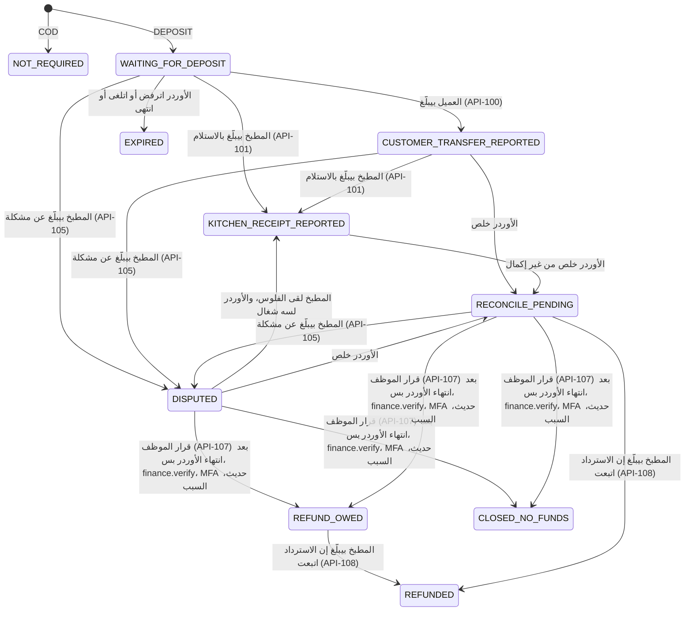

# التسعير والدفع

> **Owner role:** Business documentation
> **Status:** PARTIALLY IMPLEMENTED — التسعير والعربون والكاش والاسترداد منفّذة ومختبرة بفلوس تجريبية؛ الفلوس الحقيقية متقفّلة (Gated) وتحقيق الدخل للمنصة PLANNED.
> **Language / اللغة:** [English](pricing-and-payments.md) · العربية

كل الفلوس في مطبخي هي **جنيه مصري كرقم صحيح من القروش (piastres)** (`1 EGP = 100 piastres`؛ الحقول اسمها `*_minor` و`amountMinor`). مفيش أي فلوس بـ Floating-point في أي مكان في الـ Backend. العملة دايمًا `EGP` (فحوصات الـ Database زي `currency = 'EGP'` في `backend/app/src/main/resources/db/migration/V13__cash_and_ledger.sql`).

> **الفلوس الحقيقية متقفّلة.** كل بيئة حاليًا بتستخدم سياسات تجريبية ومستلمين وهميين. قرار المالك D16 (شوف `docs/strategy/mvp-direct-deposit-payment.md`) بيسمح بـ*التصميم*؛ لكن قبول تحويلات حقيقية محتاج مراجعة مكتوبة قانونية وحماية مستهلك وأنشطة غذائية وحساب المستلم. مفيش حاجة في الدليل ده بتصرّح بتحصيل حقيقي. حالات المالك E2E-FIN-047 وCFG-045 بتتحقق إن مفيش فلوس حقيقية ولا Traffic لمزوّد بيخرج من المعاينة.

الصفحات المصاحبة: [دورة حياة الأوردر](order-lifecycle-ar.md)، [تنفيذ الدفع](../04-codebase/payment-implementation-ar.md)، [تنفيذ التسعير](../04-codebase/pricing-implementation-ar.md). المستندات الأصلية للمنتج: `docs/product/09-deposit-payment-states.md` و`docs/product/rq-004-stale-quote.md` و`docs/product/04-state-machines.md` (جداول الكاش والاسترداد والتسوية).

## 1. إزاي السعر بيتبني

```
line total      = meal unit price (current published revision) x quantity
subtotal        = sum of line totals
delivery fee    = fee of the customer's zone (`service_zone.delivery_fee_minor`, optionally overridden per kitchen in `kitchen_zone.fee_override_minor`); 0 for pickup
tax             = floor(((subtotal + delivery fee) x taxRateBps + 5000) / 10000)    (half-up; 0 bps in the synthetic policy)
total           = subtotal + delivery fee + tax
platform fee    = none
```

مثال محسوب (كل المبالغ سلوك حقيقي للسيرفر، مأخوذة من اختبار العمولة الصفر): صينيتين بسعر 120.00 جنيه = 24000 قرش، رسوم التوصيل 30.00 جنيه = 3000، من غير ضريبة، **الإجمالي 27000 قرش = 270.00 جنيه**، من غير أي بند للمنصة (`backend/app/src/test/java/com/matbakhy/app/finance/ZeroCommissionIntegrationTest.java`، حالة المالك E2E-FIN-046).

القواعد:

- الـ Client **مبيبعتش سعر أبدًا**. طلب العرض مفيهوش حقول مبالغ؛ والحقول غير المعروفة في الـ JSON بتتترفض. المبالغ المزوّرة بتترفض (`QuoteIntegrationTest`، حالات المالك E2E-BASKET-020 وE2E-ORDER-113).
- الحسابات بتستخدم `Math.multiplyExact` / `Math.addExact`، فالـ Overflow بيفشل بصوت عالي (`QuoteService.terms`).
- سعر الوجبة لازم يكون من 1 إلى 1,000,000 قرش (من 0.01 لـ 10,000.00 جنيه) (`MealService`، خطأ الحقل `RANGE_1_1000000`).
- الضريبة قيمة سياسة متظبطة؛ ومعاملتها قرار مفتوح للمالك (O04)، فقيمة السياسة الفعلية NOT VERIFIED. سياسة التطوير التجريبية فيها 0 bps (`backend/app/src/main/resources/db/devdata/R__dev_commerce_policy.sql`).
- القروش الكاملة بس هي الموجودة. التقريب دايمًا لأعلى عند المنتصف (half-up) وبيحصل عند الضريبة وعند العربون.

### إصدارات السعر والـ Snapshots

| الـ Object | الإصدارات | عدم القابلية للتعديل |
|---|---|---|
| الوجبة | أي تغيير في المحتوى (السعر منهم) بيعمل صف جديد في `meal_revision` مع `snapshot` بصيغة JSON؛ و`meal.revision` بيشاور على الحالي (`MealService.writeContent`، V7) | `meal_revision` للإضافة بس (Trigger اسمه `meal_revision_append_only`) |
| سياسة التجارة | صفوف بإصدارات في `commerce_policy` (bps الضريبة، وbps العمولة، ومدة صلاحية العرض، ونوافذ القبول، وإصدارات الإلغاء/الشروط)؛ واحد بس `ACTIVE` (Unique Index) | أي تغيير بيعمل إصدار جديد، ومتسجّل في الـ Audit في `config_change` (V19) |
| رسوم التوصيل | رسوم المنطقة في `service_zone`، وتجاوز اختياري لكل مطبخ في `kitchen_zone` (`JdbcMealCatalog.deliveryFee`)؛ والـ Staff بيغيّروها عن طريق إصدارات الإعدادات (API-090) | الرسوم الجديدة بتنطبق على العروض الجديدة بس |
| العرض (Quote) | صف واحد لكل حساب فيه `policy_version` و`meal_revision` للبند وأسعار الوحدة والرسوم والضريبة والإجمالي وشروط الدفع | غير قابل للتعديل (Trigger اسمه `quote_immutable`، V10) |
| الأوردر | `customer_order` بيخزّن المبالغ و`policy_version` وSnapshot العمولة وإصدارات الشروط؛ و`order_item` بيخزّن JSON اسمه `meal_snapshot` والكمية وسعر الوحدة | Trigger الإضافة بس على `order_item` (V11)؛ وTrigger الحالة النهائية (V12) |

*ليه ده مهم:* العميل اللي طلب بـ 85.00 جنيه هيشوف 85.00 جنيه دايمًا على الأوردر ده، حتى بعد ما المطبخ يرفع الوجبة لـ 95.00 جنيه، لأن الأوردر شايل Snapshot خاص بيه ومبيرجعش يقرا الوجبة لحساب الفلوس أبدًا. الاختبار: `order_history_keeps_the_snapshot_after_the_meal_changes` (`backend/app/src/test/java/com/matbakhy/app/orders/OrderPlacementIntegrationTest.java`)، حالة المالك E2E-BASKET-015.

الطبّاخين بيشوفوا تاريخ أسعارهم من خلال API-099 (`MealService.priceHistory`): سجل لأول Revision متسعّرة ولكل Revision بعدها سعرها اختلف؛ وتعديلات الوصف بس مبتضيفش حاجة (قرار المالك D14؛ الاختبار `backend/app/src/test/java/com/matbakhy/app/catalog/PriceHistoryIntegrationTest.java`، حالة المالك E2E-COOK-103). هو مشتق من الـ Revisions غير القابلة للتعديل، فمينفعش يتعدّل أو يتمسح.

## 2. تغييرات السعر قبل التسجيل (قرار المالك D13)

**سياسة معتمدة من المالك** (`docs/product/01-context-and-decisions.md`، D13؛ `docs/product/rq-004-stale-quote.md`): السعر المعروض في السلة، أو عرض لسه مخلصش، **مبيضمنش** السعر ده. لو السعر اتغيّر قبل تسجيل الأوردر:

1. السيرفر بيرفض التسجيل بـ `409 PRICE_CHANGED`، من غير ما يعمل أوردر ولا حجز ولا التزام؛
2. العميل بيتقاله **إيه** اللي اتغيّر و**مين** غيّره — المطبخ بس لو سعر وجبة بيديرها المطبخ هو اللي اتغيّر؛ غير كده بيتقاله عن رسوم التوصيل أو الضريبة أو مكوّن السياسة اللي اتغيّر فعلًا؛
3. العميل بيشوف الأسعار المتأثرة القديمة والجديدة والإجمالي الجديد من **عرض جديد من السيرفر**؛
4. العميل لازم **يوافق صراحةً** على الإجمالي الجديد قبل التسجيل؛ مفيش خصم صامت ولا إعادة إرسال صامتة، وضغطة "تسجيل الأوردر" الأصلية مبتتعاملش أبدًا كموافقة على سعر العميل ماشافوش؛
5. السلة وتفاصيل التنفيذ بتفضل؛ والعميل يقدر يعدّل أو يمشي؛
6. بعد ما الأوردر يتثبّت الـ Snapshots بتاعته مبتتغيّرش أبدًا؛ وتحديثات السعر والتسجيلات المتزامنة بتتسلسل؛ والأوردر المتثبّت اللي ردّه ضاع بيتسترجع بـ**سعره الأصلي**.

إزاي ده منفّذ:

| الجزء | فين |
|---|---|
| إعادة التحقق وأكواد الأسباب (`MEAL_CHANGED` و`TOTAL_CHANGED` و`POLICY_CHANGED` و`ADDRESS_CHANGED` و`PAYMENT_CHANGED`) | `QuoteService.requireValid` في `backend/modules/orders/src/main/java/com/matbakhy/orders/internal/QuoteService.java` |
| تسلسل تحديثات السعر مقابل التسجيل | `commerce_policy ... FOR SHARE` زائد `meals.lockPricing(...)` جوه `requireValid` |
| نسب التغيير للعميل | `priceChanges` في `packages/api-client/src/priceChanges.ts`؛ والواجهة في `apps/customer-web/src/Checkout.tsx` وCheckout الموبايل |
| الاختبارات الآلية | `backend/app/src/test/java/com/matbakhy/app/orders/PriceChangeIntegrationTest.java` (رفع/خفض، تعديل سعر حقيقي من الطبّاخ، تغيير رسوم التوصيل بس، سباقات التحديث-الأول والتسجيل-الأول، استرجاع الرد الضايع) |
| حالات E2E للمالك | E2E-BASKET-014, E2E-BASKET-015, E2E-BASKET-022, E2E-ORDER-112, E2E-OPS-106 |

*مثال.* عرض سارة بيقول 270.00 جنيه. قبل ما تدوس تسجيل الأوردر، أم أحمد بتقلل سعر الملوخية 10.00 جنيه للصينية. تسجيل سارة بيرجع `PRICE_CHANGED`/`MEAL_CHANGED`. الشاشة بتقول إن المطبخ غيّر سعر "صينية الملوخية" من 120.00 جنيه لـ 110.00 جنيه والإجمالي من 270.00 جنيه لـ 250.00 جنيه، وبتعرض "أوافق على الإجمالي الجديد"، ومبتسجّلش العرض الجديد إلا بعد ما توافق. لاحظ إن حتى السعر *الأقل* بيتم رفضه لحد ما يتوافق عليه من جديد: القاعدة هي "أكّد أي تغيير"، مش "احمي من الزيادات بس".

فيه اختبارات آلية على مستوى الـ Client لمسار ده في تطبيقات الويب والـ Native حسب `docs/status/latest.md` (تقارير TC-154)، لكن ملفات اختبار الـ Client بتاع الويب ماتقراتش تاني للصفحة دي: NOT VERIFIED هنا غير اللي في اختبارات السيرفر اللي فوق.

## 3. طرق الدفع

الدفع بيتختار لما العرض بيتعمل (`paymentMethod`، الافتراضي `COD`). المطبخ بيتحكم في اللي بيعرضه من خلال **ملف الدفع** بتاعه (`kitchen_payment_profile`، V24؛ API-102/103):

| الحقل | المعنى |
|---|---|
| `deposit_bps` | النسبة من الإجمالي اللي العميل بيدفعها مقدمًا، بالـ basis points. `0` معناها المطبخ مبيعرضش عربون |
| `cod_max_total_minor` | سقف اختياري: الدفع كاش عند الاستلام بيترفض فوق إجمالي الأوردر ده (`COD_NOT_ELIGIBLE`)؛ لو فاضي يبقى الكاش عند الاستلام لأي إجمالي |
| المستلم (`recipient_method` والمعرّف والاسم) | فين العربون بيروح: تفاصيل InstaPay أو محفظة موبايل أو تحويل بنكي خاصة بـ*المطبخ*. بتتعرض للعملاء بس لما `recipient_status = APPROVED` |

قواعد السيرفر في `PaymentService.terms`:

- **COD:** مسموح إلا لو الإجمالي عدّى السقف. الكاش المستحق عند التسليم = الإجمالي كله.
- **DEPOSIT:** مسموح بس لو `deposit_bps > 0` **و**فيه مستلم معتمد (`DEPOSIT_NOT_OFFERED` غير كده). `deposit = max(1, floor((total x bps + 5000) / 10000))` (half-up، بحد أدنى قرش واحد)؛ والباقي `total - deposit` مستحق عند التسليم.
- المستلم الجديد أو المتغيّر بيرجع لـ `NONE` لحد ما موظفي المالية يعتمدوه (API-104: `finance.verify`، وMFA حديث، وسبب من 10 لـ 500 حرف، ومتسجّل في الـ Audit، ومش لمطبخ المعتمِد نفسه أبدًا). لحد ده ما يحصل العملاء مبيشوفوش العربون لذلك المطبخ، وعروض العربون القديمة بتتسعّر من جديد (`PAYMENT_CHANGED`؛ حالات المالك E2E-COOK-108 وE2E-FIN-103 وE2E-FIN-105).

*مثال بتقريب حقيقي.* الإجمالي 270.00 جنيه = 27000 قرش عند `deposit_bps = 5000` (50 في المية): العربون 13500 (135.00 جنيه)، والباقي 13500 مستحق كاش عند التسليم. وإجمالي 10001 قرش عند 50 في المية بيدّي عربون 5001 وباقي 5000.

القيم التجريبية للاختبار هي 50 في المية وسقف COD بـ 200.00 جنيه؛ وده مش قيم بيزنس معتمدة (`docs/product/09-deposit-payment-states.md`، "Known limits").

## 4. اللي المنصة بتسجّله، واللي مبتدّعيهوش أبدًا

- **مطبخي مبيحتفظش بالفلوس ولا بينقلها ولا بيأكدها.** العميل بيدفع للمطبخ مباشرة. مفيش Escrow ولا محفظة ولا Gateway.
- تقرير العميل "أنا حوّلت" هو **معلومة، مش دفع**.
- تقرير المطبخ "استلمت" **بيتسجّل كإفادة من المطبخ**؛ والـ API والواجهة مبيوصفوهوش أبدًا إنه متحقَّق منه بنكيًا. المبلغ لازم يساوي العربون اللي السيرفر حسبه (`DOES_NOT_MATCH_DEPOSIT` غير كده؛ حالة المالك E2E-FIN-041).
- الـ Staff مينفعش يعلّموا الفلوس أبدًا إنها اتستلمت؛ قرارات الـ Staff الوحيدة هي `REFUND_OWED` أو `CLOSED_NO_FUNDS` (`PaymentService.Decision`).

### حالات العربون

الحالة محفوظة في `order_payment` (صف واحد لكل أوردر، والشروط غير قابلة للتعديل بـ Trigger اسمه `order_payment_terms_immutable`، V24) وكل تغيير بيتضاف في `payment_event` (للإضافة بس). وهي منفصلة عن حالة الأوردر.



السلوكيات الأساسية (كلها في `backend/modules/orders/src/main/java/com/matbakhy/orders/internal/PaymentService.java`؛ الاختبارات `backend/app/src/test/java/com/matbakhy/app/payments/DepositPaymentIntegrationTest.java` و`PaymentReconciliationIntegrationTest.java`):

- **مفيش تحضير قبل ما المطبخ يبلّغ بالاستلام** (`DEPOSIT_NOT_RECEIVED`)، لكن القبول بيفضل إجراء منفصل من المطبخ (E2E-FIN-106).
- العربون مستحق بحلول موعد قبول الأوردر (`deposit_expires_at`). لو المطبخ قبل الأول والعربون مجاش أبدًا، مفيش حاجة بتنهي الأوردر تلقائيًا؛ والمطبخ يقدر يلغيه. ده قيد موثّق، مش عيب بنخبيه (`docs/product/09-deposit-payment-states.md`).
- الوصول لـ `DISPUTED` أو `RECONCILE_PENDING` أو `REFUND_OWED` بيفتح حالة دعم `PAYMENT` واحدة بخطورة HIGH لكل أوردر (Partial Unique Index، V28) في نفس الـ Transaction؛ ونصها مفيهوش رقم حساب ولا مرجع ولا مبلغ (E2E-FIN-040).
- الطرف التاني بيتبلّغ داخل التطبيق عن طريق الـ Outbox (مجموعة `NOTIFIED`)؛ وفشل الإشعار مبيغيّرش حالة الدفع أبدًا.
- العربون **مش** قيد في الدفتر (Ledger)؛ ومبيظهرش أبدًا في `ledger_entry` (حالة المالك E2E-FIN-045).
- مطبخ تاني مينفعش يستلم أو يتنازع أو يسترد عربون أوردر غريب (الاختبار `another_approved_kitchen_cannot_receipt_report_a_problem_or_refund_a_foreign_deposit`).

## 5. تحصيل الكاش والتحقق منه

الكاش بيتتبع في `cash_obligation` (صف واحد لكل أوردر، بيتعمل وقت التسجيل بمبلغ = الإجمالي − العربون) و`cash_report` (V13). إكمال الأوردر والكاش مستقلين (BR-032).

| الخطوة | الفاعل | القاعدة |
|---|---|---|
| إنشاء الالتزام | السيستم وقت التسجيل | الحالة `DUE`؛ بتبقى `NOT_DUE` لو الأوردر اترفض أو انتهى أو الطبّاخ لغاه قبل التحضير. الإلغاء الاستثنائي من العمليات (من `PREPARING`/`READY`) بيسيبه من غير تغيير، والمخزون المستهلَك بيفضل مستهلَك، والمالية بتراجعه يدويًا |
| الطبّاخ بيبلّغ بالتحصيل (API-063) | الطبّاخ المالك | لأوردر `COMPLETED` خاص بيه بس؛ تقرير واحد لكل أوردر؛ الطريقة `CASH`، والعملة `EGP`؛ و`collectedAt` بين إنشاء الأوردر والآن؛ مبلغ مظبوط ⇒ الالتزام `REPORTED`، أي فرق ⇒ `DISPUTED` |
| المالية بتتحقق (API-083) | `finance.verify`، **مش المبلّغ** | `VERIFY` لازم يساوي المبلغ المستحق؛ أي مبلغ تاني لازم يكون `DISPUTE` بسبب من 3 حروف على الأقل؛ الالتزام بيبقى `VERIFIED` أو `DISPUTED` |

الأوردر المكتمل من غير تقرير بيفضل `DUE` ببساطة؛ والسيستم مبيخترعش إيصال أبدًا (الاختبار `a_completed_order_without_a_report_stays_due_with_no_invented_receipt`، `backend/app/src/test/java/com/matbakhy/app/finance/CashAndLedgerIntegrationTest.java`). المبلّغ مينفعش يتحقق من تقريره: متفروض في الـ Service وبقيد الـ Check اسمه `cash_report_separation_ck` (V13) (E2E-FIN-114).

الدفع المتبقي بعد العربون هو نفس مسار الكاش: الكاش المستحق يساوي `total − deposit` (الاختبار `cash_reporting_and_verification_use_the_obligation_after_a_deposit`، حالة المالك E2E-FIN-039).

> فرق في التسمية: `docs/product/04-state-machines.md` بيسمّي حالات الكاش `DUE → COLLECTION_REPORTED → VERIFIED`؛ والكود بيستخدم قيم `cash_obligation.state` وهي `DUE` و`REPORTED` و`VERIFIED` و`DISPUTED` و`NOT_DUE`. استخدم أسماء الكود.

## 6. الاسترداد والنزاعات

فيه آليتين منفصلتين؛ ماتخلطش بينهم.

1. **استرداد العربون (فلوس عند المطبخ).** عشان المطبخ ماسك العربون، فـ*المطبخ* هو اللي بيرجّع العربون للعميل. المسار: الأوردر بينتهي ⇒ `RECONCILE_PENDING` ⇒ قرار الـ Staff `REFUND_OWED` (أو `CLOSED_NO_FUNDS`) ⇒ المطبخ بيبلّغ بالاسترداد اللي بعته، مع مرجع التحويل ⇒ `REFUNDED`. المنصة بتسجّل الإفادات وبتحتفظ بحالة الدعم؛ ومبتحرّكش الفلوس (E2E-FIN-107 وE2E-FIN-108 وE2E-FIN-115).
2. **مسار استرداد المنصة للكاش المتحقَّق منه** (`FinanceOpsService.requestRefund` / `refundAction`، API-084/085، الصلاحية `finance.refund_approve`): ضد تحصيل *متحقَّق منه* بس؛ والمبلغ لازم يكون **كل المبلغ المتبقي القابل للاسترداد** (`verified amount − non-rejected prior refunds`)؛ الحالات `REQUESTED → APPROVED → PAID → VERIFIED` (أو `REJECTED`)؛ مقدّم الطلب ≠ المعتمِد، والدافع ≠ المتحقِّق (`separate(...)`)؛ الموافقة مش معناها إنه اندفع؛ وتسجيل الدفع محتاج مرجع دليل؛ وعند التحقق أي عمولة متسجّلة بتتعكس مرة واحدة (مبلغ صفري لا أثر له تحت عمولة الصفر) (الاختبار `refunds_are_full_bounded_by_verified_collection_and_reverse_commission_once`، `FinanceOperationsIntegrationTest`؛ E2E-FIN-044).

النزاعات من الأنواع التانية (تأخير، وصنف ناقص، وجودة، وسلامة غذاء، وكاش، وتسليم) هي حالات دعم ([دورة حياة الأوردر](order-lifecycle-ar.md#الحالات-الاستثنائية-والنزاعات)). حالات الدعم مبتحرّكش فلوس.

## 7. المطابقة والثوابت المالية

الثوابت اللي الكود أو الـ Database بيفرضها (كل واحد متحقق منه بالاختبار أو الحالة المذكورة):

| الثابت | الفرض | الفحص |
|---|---|---|
| جنيه مصري كأرقام صحيحة بس | أعمدة `bigint`، و`CHECK (currency = 'EGP')`، وحسابات `*Exact` | `QuoteIntegrationTest` |
| السيرفر بيحسب كل مبلغ | نماذج الطلب مفيهاش مبالغ؛ والحقول غير المعروفة بتترفض | E2E-BASKET-020 |
| إجمالي الأوردر المسجّل مبيتغيّرش | أعمدة الـ Snapshot، وTrigger الحالة النهائية، و`order_item`/`order_event` للإضافة بس | E2E-ORDER-121 (حتى دور الـ Database الخاص بالتطبيق مينفعش يعدّل التاريخ؛ `backend/app/src/test/java/com/matbakhy/app/db/RuntimeRoleIntegrationTest.java`) |
| أوردر واحد لكل عرض ولكل `(customer, clientRequestId)` | قيود Unique وAdvisory Lock | E2E-BASKET-028, E2E-ORDER-123 |
| عرض العربون = سجل دفع الأوردر | `order_payment` منسوخ من العرض المتحقق منه؛ والشروط غير قابلة للتعديل | E2E-FIN-041 |
| التزام كاش واحد لكل أوردر | `order_id UNIQUE` في `cash_obligation` | E2E-FIN-045 |
| تقرير كاش واحد لكل أوردر | `order_id UNIQUE` في `cash_report` | E2E-FIN-102 |
| تقرير الكاش ≠ المتحقِّق | فحص في الـ Service + `cash_report_separation_ck` | E2E-FIN-114 |
| دفتر متوازن للإضافة بس، بيتسجّل مرة لكل حدث إكمال | Constraint Trigger مؤجّل اسمه `ledger_entry_balanced`، وTriggers الإضافة بس، و`(kind, source_event_id)` فريد | `CashAndLedgerIntegrationTest` |
| الاسترداد ≤ التحصيل المتحقَّق منه ناقص الاستردادات السابقة | `requestRefund` | `FinanceOperationsIntegrationTest` |
| مفيش رسوم للمنصة عند الإطلاق | فحص السياسة `commerce_policy_launch_commission_ck` (V23) ورفض الـ API | `ZeroCommissionIntegrationTest`, E2E-OPS-107 |
| مفيش Traffic لمزوّد/فلوس حقيقية من المعاينة | الـ Fake Adapters مقصورة على البيئات غير الـ Production (`EnvironmentGuard` و`ProviderConfiguration`) | CFG-045, E2E-FIN-047 |

"المطابقة" (Reconciliation) في المنتج ده معناها *بشر بيقارنوا إفادات*: المالية بتقارن تقرير الكاش من الطبّاخ بالمبلغ المستحق؛ والدعم والمالية بيحلّوا نزاعات العربون بقراءة `payment_event` وحالة الدعم. مفيش Bank Feed ولا مطابقة تلقائية، بالتصميم (قاعدة المالك: مطابقة نزاعات بشرية، مش تحقق بنكي مزعوم).

### الـ Idempotency

كل الأوامر المتعلقة بالفلوس Idempotent (`JdbcIdempotentCommands`، `backend/app/src/main/java/com/matbakhy/app/idempotency/JdbcIdempotentCommands.java`):

- الـ Header `Idempotency-Key` (من 8 لـ 128 حرف `A-Za-z0-9-`) إجباري؛ والنطاق هو **الفاعل + الأمر + المفتاح**؛ والطلب بيتعمله Hash.
- نفس النطاق ونفس الجسم ⇒ النتيجة المخزّنة بترجع (من غير أثر تاني). نفس النطاق وجسم مختلف ⇒ `409 IDEMPOTENCY_CONFLICT`. المكرّرات المتزامنة بتتسلسل على الصف الفريد.
- الأمر الفاشل مبيخزّنش نتيجة، فإعادة محاولة مصحّحة بنفس المفتاح ممكن تنجح.
- السجلات شايلة `expires_at` لمدة 24 ساعة (`RETENTION`) بتتسجّل لكن مش بتتفرض: مفيش كود بينهيها أو بيمسحها. وللأوردرات فيه حارس تاني *دائم*: `UNIQUE (customer, client_request_id)` زائد بصمة الطلب (V29)، فإعادة المحاولة بعد انتهاء الاحتفاظ لسه بترجّع نفس الأوردر أو Conflict (الاختبار `retries_after_timeout_and_after_idempotency_retention_create_exactly_one_order`).

## 8. سياسة عمولة الصفر مقابل تحقيق الدخل مستقبلًا

| البند | الـ MVP (IMPLEMENTED) | المستقبل (PLANNED، من غير كود) |
|---|---|---|
| عمولة مطبخي | **0 bps**. السياسة الحقيقية لازم تكون 0 (V23) والـ API بيرفض النِّسَب الغير صفرية. النسبة بتتسجّل Snapshot لكل أوردر (`commission_bps_snapshot`)، فالقدرة موجودة لكنها غير مفعّلة | اشتراك اختياري لكل مطبخ بس بعد طلب حقيقي وموافقة المالك؛ مفيش محفّز رقمي ولا سعر معتمد |
| رسوم المنصة على العميل | مفيش | مفيش مخطط |
| الإعلانات المدفوعة / الترتيب الممول | مفيش | اختياري لكل مطبخ، بعلامة واضحة، ومبيحلّش أبدًا محل الترتيب العضوي (`docs/strategy/free-core-sponsored-discovery.md`) |
| دفعات التسوية | الكود موجود؛ المجموعات بمبلغ صفر مينفعش تتجمّع في دفعة (`ZERO_AMOUNT`)؛ وكشوف العمولة صفرية | هتتفعّل بس مع عمولة أو رسوم |
| محفظة المنصة، Escrow، Gateway | مفيش | غير معتمد |
| الرسوم الخارجية | رسوم التوصيل (جزء من إجمالي الأوردر، بيحصّلها المطبخ اللي بيرتّب التوصيل) ورسوم البنك/المحفظة على العميل، معلنة ومش موصوفة كرسوم منصة | من غير تغيير |

لو نسبة العمولة اترفعت في يوم، الدفتر بيسجّل زوج متوازن واحد لكل أوردر مكتمل على **الـ Subtotal بس** (من غير التوصيل)، بتقريب half-up، مع مدين مستحقات عمولة الطبّاخ ودائن إيراد عمولة المنصة (`LedgerService.postCommission`). الكاش اللي بيحصّله الطبّاخ بيعمل *مستحقات* عمولة، مش كاش للمنصة (BR-034). ولا واحدة من دول ليها مبالغ غير صفرية في أي بيئة النهارده.

## القيود المعروفة وفجوات التوثيق

- الضريبة ورسوم الإلغاء والفواتير ودورة التسوية قرارات مفتوحة للمالك (O04)؛ والقيم التجريبية بس هي الموجودة.
- مفيش مهلة تلقائية للعربون في الأوردر المقبول، ولا نافذة عربون أطول للأوردرات المستقبلية البعيدة؛ الاتنين مقترحات في `docs/product/09-deposit-payment-states.md`.
- مسار استرداد المنصة بيدعم الاسترداد الكامل للكاش المتحقَّق منه بس؛ الاسترداد الجزئي غير منفّذ.
- الجداول الزمنية للاسترداد اللي بتظهر للعميل والإفصاحات والنص القانوني مش موجودة في الـ Repository (متقفّلة بـ O02/O04/O06).
- `docs/product/04-state-machines.md` لسه بيوصف الكاش اللي بيحصّله الطبّاخ كأساس وحيد وبيستخدم أسماء حالات أقدم؛ و`docs/product/09-deposit-payment-states.md` والكود هما المرجعين الحاليين.
