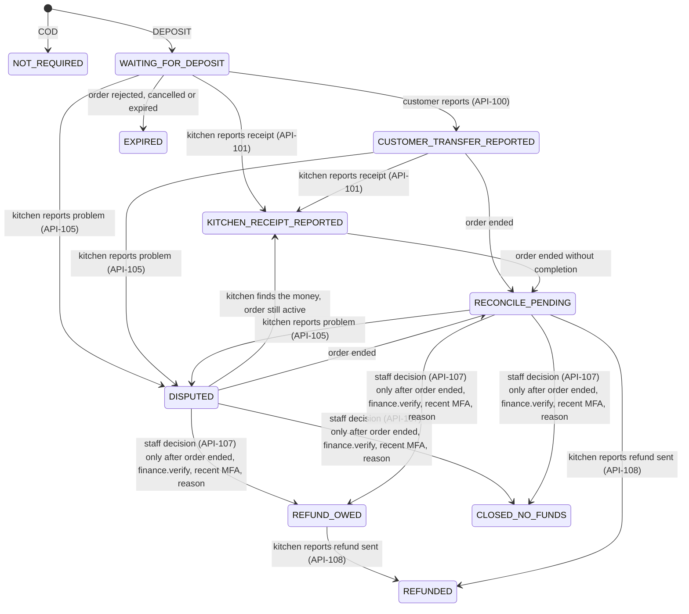

# Pricing and payments

> **Owner role:** Business documentation
> **Status:** PARTIALLY IMPLEMENTED — pricing, deposits, cash and refunds are implemented and tested with synthetic money; live money is gated and platform monetization is PLANNED.

All money in Matbakhy is **Egyptian pounds as an integer number of piastres** (`1 EGP = 100 piastres`; fields named `*_minor`, `amountMinor`). There is no floating-point money anywhere in the backend. The currency is always `EGP` (database checks such as `currency = 'EGP'` in `backend/app/src/main/resources/db/migration/V13__cash_and_ledger.sql`).

> **Live money is gated.** Every environment currently uses synthetic policies and fake recipients. The owner decision D16 (see `docs/strategy/mvp-direct-deposit-payment.md`) allows the *design*; accepting real transfers needs written legal, consumer-protection, food-business and recipient-account review. Nothing in this handbook authorizes real collections. Owner cases E2E-FIN-047 and CFG-045 verify that no real money or provider traffic leaves the preview.

Companion pages: [order lifecycle](order-lifecycle.md), [payment implementation](../04-codebase/payment-implementation.md), [pricing implementation](../04-codebase/pricing-implementation.md). Canonical product documents: `docs/product/09-deposit-payment-states.md`, `docs/product/rq-004-stale-quote.md`, `docs/product/04-state-machines.md` (cash, refund and settlement tables).

## 1. How a price is built

```
line total      = meal unit price (current published revision) x quantity
subtotal        = sum of line totals
delivery fee    = fee of the customer's zone (`service_zone.delivery_fee_minor`, optionally overridden per kitchen in `kitchen_zone.fee_override_minor`); 0 for pickup
tax             = floor(((subtotal + delivery fee) x taxRateBps + 5000) / 10000)    (half-up; 0 bps in the synthetic policy)
total           = subtotal + delivery fee + tax
platform fee    = none
```

Worked example (all amounts are real server behaviour, taken from the zero-commission test): 2 trays at EGP 120.00 = 24000 piastres, delivery fee EGP 30.00 = 3000, no tax, **total 27000 piastres = EGP 270.00**, with no platform line (`backend/app/src/test/java/com/matbakhy/app/finance/ZeroCommissionIntegrationTest.java`, owner case E2E-FIN-046).

Rules:

- The client **never** sends a price. The quote request has no amount fields; unknown JSON fields are rejected. Forged amounts are refused (`QuoteIntegrationTest`, owner cases E2E-BASKET-020, E2E-ORDER-113).
- Arithmetic uses `Math.multiplyExact` / `Math.addExact`, so overflow fails loudly (`QuoteService.terms`).
- A meal price must be between 1 and 1,000,000 piastres (EGP 0.01 to EGP 10,000.00) (`MealService`, field error `RANGE_1_1000000`).
- Tax is a configured policy value; its treatment is an open owner decision (O04), so the live policy value is NOT VERIFIED. The synthetic development policy has 0 bps (`backend/app/src/main/resources/db/devdata/R__dev_commerce_policy.sql`).
- Only whole piastres exist. Rounding is always half-up and happens at tax and at the deposit.

### Price versioning and snapshots

| Object | Versioning | Immutability |
|---|---|---|
| Meal | Every content change (price included) creates a new row in `meal_revision` with a JSON `snapshot`; `meal.revision` points at the current one (`MealService.writeContent`, V7) | `meal_revision` is append-only (trigger `meal_revision_append_only`) |
| Commerce policy | Versioned rows in `commerce_policy` (tax bps, commission bps, quote TTL, acceptance windows, cancellation/terms versions); exactly one `ACTIVE` (unique index) | A change creates a new version, audited in `config_change` (V19) |
| Delivery fee | Zone fee in `service_zone`, optional per-kitchen override in `kitchen_zone` (`JdbcMealCatalog.deliveryFee`); staff change it through configuration versions (API-090) | New fee applies to new quotes only |
| Quote | One row per calculation with `policy_version`, item `meal_revision`, unit prices, fee, tax, total, payment terms | Immutable (trigger `quote_immutable`, V10) |
| Order | `customer_order` stores amounts, `policy_version`, commission snapshot, terms versions; `order_item` stores the `meal_snapshot` JSON, quantity, unit price | `order_item` append-only trigger (V11); terminal-state trigger (V12) |

*Why it matters:* a customer who ordered at EGP 85.00 will always see EGP 85.00 on that order, even after the kitchen raises the meal to EGP 95.00, because the order carries its own snapshot and never re-reads the meal for money. Test: `order_history_keeps_the_snapshot_after_the_meal_changes` (`backend/app/src/test/java/com/matbakhy/app/orders/OrderPlacementIntegrationTest.java`), owner case E2E-BASKET-015.

Cooks see their price history through API-099 (`MealService.priceHistory`): an entry for the first priced revision and for every later revision whose price differs; description-only edits add nothing (owner decision D14; test `backend/app/src/test/java/com/matbakhy/app/catalog/PriceHistoryIntegrationTest.java`, owner case E2E-COOK-103). It is derived from the immutable revisions, so it cannot be edited or deleted.

## 2. Price changes before placement (owner decision D13)

**Owner-approved policy** (`docs/product/01-context-and-decisions.md`, D13; `docs/product/rq-004-stale-quote.md`): a price shown in the basket, or an unexpired quote, does **not** guarantee that price. If the price changes before the order is placed:

1. the server refuses the placement with `409 PRICE_CHANGED`, creating no order, no reservation and no obligation;
2. the customer is told **what** changed and **who** changed it — the kitchen only when a kitchen-managed meal price changed; otherwise the delivery fee, tax or policy component that actually changed;
3. the customer sees the previous and new affected prices and the new total from a **fresh server quote**;
4. the customer must **explicitly accept** the new total before placing; there is no silent charge and no silent resubmission, and the original "Place order" click is never treated as acceptance of an unseen price;
5. the basket and fulfilment details stay; the customer may edit or leave;
6. after an order is committed its snapshots never change; concurrent price updates and placements are serialised; a committed order whose response was lost is recovered at its **original** price.

How it is implemented:

| Part | Where |
|---|---|
| Revalidation and reason codes (`MEAL_CHANGED`, `TOTAL_CHANGED`, `POLICY_CHANGED`, `ADDRESS_CHANGED`, `PAYMENT_CHANGED`) | `QuoteService.requireValid` in `backend/modules/orders/src/main/java/com/matbakhy/orders/internal/QuoteService.java` |
| Serialisation of price updates vs placement | `commerce_policy ... FOR SHARE` plus `meals.lockPricing(...)` inside `requireValid` |
| Customer-facing attribution of the change | `priceChanges` in `packages/api-client/src/priceChanges.ts`; UI in `apps/customer-web/src/Checkout.tsx` and the mobile checkout |
| Automated tests | `backend/app/src/test/java/com/matbakhy/app/orders/PriceChangeIntegrationTest.java` (raise/lower, real cook price edit, delivery-fee-only change, update-first and placement-first races, lost response recovery) |
| Owner E2E cases | E2E-BASKET-014, E2E-BASKET-015, E2E-BASKET-022, E2E-ORDER-112, E2E-OPS-106 |

*Example.* Sara's quote shows EGP 270.00. Before she presses Place order, Um Ahmed lowers the molokhia price by EGP 10.00 per tray. Sara's placement returns `PRICE_CHANGED`/`MEAL_CHANGED`. The screen says the kitchen changed the price of "Molokhia tray" from EGP 120.00 to EGP 110.00 and the total from EGP 270.00 to EGP 250.00, offers "I accept the new total", and places the new quote only after she does. Note that even a *lower* price is refused until re-accepted: the rule is "re-confirm any change", not "protect only against increases".

Client-level automated tests of this path exist in the web and native apps per `docs/status/latest.md` (TC-154 reports), but the web client test files were not re-read for this page: NOT VERIFIED here beyond the server tests above.

## 3. Payment methods

Payment is chosen when the quote is created (`paymentMethod`, default `COD`). The kitchen controls what it offers through its **payment profile** (`kitchen_payment_profile`, V24; API-102/103):

| Field | Meaning |
|---|---|
| `deposit_bps` | Percentage of the total the customer pays up front, in basis points. `0` means the kitchen offers no deposit |
| `cod_max_total_minor` | Optional cap: cash on receipt is refused above this order total (`COD_NOT_ELIGIBLE`); empty means COD at any total |
| Recipient (`recipient_method`, identifier, name) | Where the deposit goes: InstaPay, mobile wallet or bank transfer details of the *kitchen*. Offered to customers only when `recipient_status = APPROVED` |

Server rules in `PaymentService.terms`:

- **COD:** allowed unless the total exceeds the cap. Cash due at hand-over = the full total.
- **DEPOSIT:** allowed only if `deposit_bps > 0` **and** an approved recipient exists (`DEPOSIT_NOT_OFFERED` otherwise). `deposit = max(1, floor((total x bps + 5000) / 10000))` (half-up, at least 1 piastre); the remainder is `total - deposit` due at hand-over.
- A recipient that is new or changed returns to `NONE` until finance staff approve it (API-104: `finance.verify`, recent MFA, reason 10–500 characters, audited, never for the approver's own kitchen). Until then customers do not see deposits for that kitchen and stale deposit quotes are re-priced (`PAYMENT_CHANGED`; owner cases E2E-COOK-108, E2E-FIN-103, E2E-FIN-105).

*Example with real rounding.* Total EGP 270.00 = 27000 piastres at `deposit_bps = 5000` (50 percent): deposit 13500 (EGP 135.00), remainder 13500 due in cash at hand-over. A total of 10001 piastres at 50 percent gives a deposit of 5001 and a remainder of 5000.

The synthetic test values are 50 percent and a COD cap of EGP 200.00; these are not approved business values (`docs/product/09-deposit-payment-states.md`, "Known limits").

## 4. What the platform records, and what it never claims

- **Matbakhy does not hold, move or confirm money.** The customer pays the kitchen directly. There is no escrow, wallet or gateway.
- The customer's "I transferred" report is **information, not payment**.
- The kitchen's "I received it" report is **recorded as the kitchen's statement**; the API and UI never describe it as bank-verified. The amount must equal the server-computed deposit (`DOES_NOT_MATCH_DEPOSIT` otherwise; owner case E2E-FIN-041).
- Staff can never mark money as received; the only staff decisions are `REFUND_OWED` or `CLOSED_NO_FUNDS` (`PaymentService.Decision`).

### Deposit states

State is kept in `order_payment` (one row per order, terms immutable by trigger `order_payment_terms_immutable`, V24) and every change is appended to `payment_event` (append-only). It is separate from the order state.



Key behaviours (all in `backend/modules/orders/src/main/java/com/matbakhy/orders/internal/PaymentService.java`; tests `backend/app/src/test/java/com/matbakhy/app/payments/DepositPaymentIntegrationTest.java` and `PaymentReconciliationIntegrationTest.java`):

- **No preparation before the kitchen reports receipt** (`DEPOSIT_NOT_RECEIVED`), but acceptance remains a separate kitchen action (E2E-FIN-106).
- The deposit is due by the order's acceptance deadline (`deposit_expires_at`). If the kitchen accepts first and the deposit never arrives, nothing expires the order automatically; the kitchen may cancel it. This is a documented limit, not a bug to hide (`docs/product/09-deposit-payment-states.md`).
- Reaching `DISPUTED`, `RECONCILE_PENDING` or `REFUND_OWED` opens exactly one HIGH `PAYMENT` support case per order (partial unique index, V28) in the same transaction; its text contains no account number, reference or amount (E2E-FIN-040).
- The other party is notified in-app through the outbox (`NOTIFIED` set); notification failure never changes payment state.
- A deposit is **not** a ledger entry; it never appears in `ledger_entry` (owner case E2E-FIN-045).
- Another kitchen cannot receipt, dispute or refund a foreign order's deposit (test `another_approved_kitchen_cannot_receipt_report_a_problem_or_refund_a_foreign_deposit`).

## 5. Cash collection and verification

Cash is tracked in `cash_obligation` (one row per order, created at placement with amount = total − deposit) and `cash_report` (V13). Order completion and cash are independent (BR-032).

| Step | Actor | Rule |
|---|---|---|
| Obligation created | System at placement | State `DUE`; becomes `NOT_DUE` if the order is rejected, expired or cancelled by the cook before preparation. Operations exception cancellation (from `PREPARING`/`READY`) leaves it unchanged, consumed stock stays consumed, and finance reviews it manually |
| Cook reports collection (API-063) | Owning cook | Only for a `COMPLETED` own order; one report per order; method `CASH`, currency `EGP`; `collectedAt` between order creation and now; exact amount ⇒ obligation `REPORTED`, any difference ⇒ `DISPUTED` |
| Finance verifies (API-083) | `finance.verify`, **not the reporter** | `VERIFY` must equal the amount due; any other amount must be a `DISPUTE` with a reason of at least 3 characters; obligation becomes `VERIFIED` or `DISPUTED` |

A completed order without a report simply stays `DUE`; the system never invents a receipt (test `a_completed_order_without_a_report_stays_due_with_no_invented_receipt`, `backend/app/src/test/java/com/matbakhy/app/finance/CashAndLedgerIntegrationTest.java`). The reporter cannot verify their own report: enforced in the service and by the check constraint `cash_report_separation_ck` (V13) (E2E-FIN-114).

The remaining payment after a deposit is the same cash flow: cash due equals `total − deposit` (test `cash_reporting_and_verification_use_the_obligation_after_a_deposit`, owner case E2E-FIN-039).

> Naming difference: `docs/product/04-state-machines.md` calls the cash states `DUE → COLLECTION_REPORTED → VERIFIED`; the code uses `cash_obligation.state` values `DUE`, `REPORTED`, `VERIFIED`, `DISPUTED`, `NOT_DUE`. Use the code names.

## 6. Refunds and disputes

Two separate mechanisms exist; do not mix them.

1. **Deposit refunds (kitchen-held money).** Because the kitchen holds the deposit, the *kitchen* refunds it. Flow: order ends ⇒ `RECONCILE_PENDING` ⇒ staff decision `REFUND_OWED` (or `CLOSED_NO_FUNDS`) ⇒ the kitchen reports the refund it sent, with a transfer reference ⇒ `REFUNDED`. The platform records statements and keeps the support case; it does not move the funds (E2E-FIN-107, E2E-FIN-108, E2E-FIN-115).
2. **Platform refund workflow for verified cash** (`FinanceOpsService.requestRefund` / `refundAction`, API-084/085, permission `finance.refund_approve`): only against a *verified* collection; the amount must be the **full remaining refundable amount** (`verified amount − non-rejected prior refunds`); states `REQUESTED → APPROVED → PAID → VERIFIED` (or `REJECTED`); requester ≠ approver and payer ≠ verifier (`separate(...)`); approval does not mean paid; recording payment needs an evidence reference; on verification any posted commission is reversed once (a no-op amount under zero commission) (test `refunds_are_full_bounded_by_verified_collection_and_reverse_commission_once`, `FinanceOperationsIntegrationTest`; E2E-FIN-044).

Disputes of other kinds (late, missing item, quality, food safety, cash, handover) are support cases ([order lifecycle](order-lifecycle.md#exceptional-states-and-disputes)). Support cases do not move money.

## 7. Reconciliation and financial invariants

Invariants the code or database enforces (each is checked by the cited test or case):

| Invariant | Enforcement | Check |
|---|---|---|
| Integer EGP only | `bigint` columns, `CHECK (currency = 'EGP')`, `*Exact` arithmetic | `QuoteIntegrationTest` |
| Server computes every amount | Request models carry no amounts; unknown fields rejected | E2E-BASKET-020 |
| Placed order total never changes | Snapshot columns, terminal-state trigger, append-only `order_item`/`order_event` | E2E-ORDER-121 (even the application DB role cannot alter history; `backend/app/src/test/java/com/matbakhy/app/db/RuntimeRoleIntegrationTest.java`) |
| One order per quote and per `(customer, clientRequestId)` | Unique constraints and advisory lock | E2E-BASKET-028, E2E-ORDER-123 |
| Deposit quote = order payment record | `order_payment` copied from the validated quote; terms immutable | E2E-FIN-041 |
| One cash obligation per order | `order_id UNIQUE` in `cash_obligation` | E2E-FIN-045 |
| One cash report per order | `order_id UNIQUE` in `cash_report` | E2E-FIN-102 |
| Cash report ≠ verifier | Service check + `cash_report_separation_ck` | E2E-FIN-114 |
| Balanced, append-only ledger, posted once per completion event | Deferred constraint trigger `ledger_entry_balanced`, append-only triggers, unique `(kind, source_event_id)` | `CashAndLedgerIntegrationTest` |
| Refund ≤ verified collection less prior refunds | `requestRefund` | `FinanceOperationsIntegrationTest` |
| No platform charge at launch | Policy check `commerce_policy_launch_commission_ck` (V23) and API refusal | `ZeroCommissionIntegrationTest`, E2E-OPS-107 |
| No live provider/money traffic from preview | Fake adapters restricted to non-production (`EnvironmentGuard`, `ProviderConfiguration`) | CFG-045, E2E-FIN-047 |

"Reconciliation" in this product means *humans comparing statements*: finance compares the cook's cash report with the amount due; support and finance resolve deposit disputes by reading `payment_event` and the support case. There is no bank feed and no automatic matching, by design (owner rule: human dispute reconciliation, not purported bank verification).

### Idempotency

All money-relevant commands are idempotent (`JdbcIdempotentCommands`, `backend/app/src/main/java/com/matbakhy/app/idempotency/JdbcIdempotentCommands.java`):

- Header `Idempotency-Key` (8–128 characters `A-Za-z0-9-`) is required; scope is **actor + command + key**; the request is hashed.
- Same scope, same body ⇒ the stored result is returned (no second effect). Same scope, different body ⇒ `409 IDEMPOTENCY_CONFLICT`. Racing duplicates serialise on the unique row.
- A failed command stores no outcome, so a corrected retry with the same key can succeed.
- Records carry a 24-hour `expires_at` (`RETENTION`) that is recorded but not enforced: no code expires or purges them. For orders there is a *permanent* second guard: `UNIQUE (customer, client_request_id)` plus a request fingerprint (V29), so a retry after retention still returns the same order or a conflict (test `retries_after_timeout_and_after_idempotency_retention_create_exactly_one_order`).

## 8. Zero-commission policy versus future monetization

| Item | MVP (IMPLEMENTED) | Future (PLANNED, no code) |
|---|---|---|
| Matbakhy commission | **0 bps**. A real policy must be 0 (V23) and the API refuses non-zero rates. Rate is snapshotted per order (`commission_bps_snapshot`), so the capability exists but is inactive | Per-kitchen opt-in only after real demand and owner approval; no numeric trigger or price is approved |
| Customer platform fee | None | None planned |
| Paid ads / sponsored ranking | None | Opt-in per kitchen, clearly labelled, never replacing organic ranking (`docs/strategy/free-core-sponsored-discovery.md`) |
| Settlement batches | Code exists; zero-amount groups cannot be batched (`ZERO_AMOUNT`); commission statements are zero | Would activate only with a commission or fee |
| Platform wallet, escrow, gateway | None | Not approved |
| External fees | Delivery fee (part of the order total, collected by the kitchen that arranges delivery) and the customer's bank/wallet charges, disclosed and not described as platform fees | Unchanged |

If the commission rate were ever raised, the ledger posts one balanced pair per completed order on the **subtotal only** (delivery excluded), half-up, with the cook's commission receivable debited and platform commission revenue credited (`LedgerService.postCommission`). Cook-collected cash creates a commission *receivable*, not platform cash (BR-034). None of this has non-zero amounts in any environment today.

## Known limitations and documentation gaps

- Tax, cancellation fees, invoices and the settlement cycle are open owner decisions (O04); only synthetic values exist.
- There is no automatic deposit timeout for an accepted order and no longer deposit window for far-future orders; both are proposals in `docs/product/09-deposit-payment-states.md`.
- The platform refund workflow only supports full refunds of verified cash; partial refunds are not implemented.
- Customer-visible refund timelines, disclosures and legal text are not in the repository (gated by O02/O04/O06).
- `docs/product/04-state-machines.md` still describes cook-collected cash as the only baseline and uses older state names; `docs/product/09-deposit-payment-states.md` and the code are the current references.
