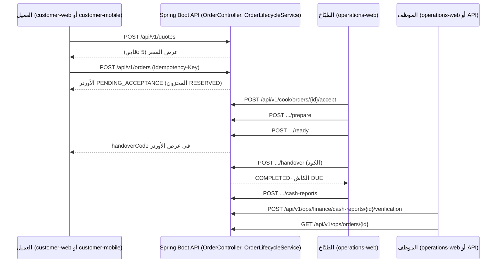

# رحلات المستخدم: رحلة الأوردر الكاملة

> **Owner role:** Testing and QA
> **Status:** PARTIALLY IMPLEMENTED — كل خطوة تحت موجودة في الكود؛ واختبارات الـ Backend بتغطي الخطوات فرادى، وأتمتة المتصفح بتغطي بس طلب العميل وإجراءات الطبّاخ (`customer-journey.e2e.ts`) وتخطيط كشف حساب مالي (`money-reflow.e2e.ts`)؛ التحقق المالي وقرارات الاسترداد وقراءة الأدمن لسجل الـ Audit مفيهاش أتمتة متصفح (قبول المالك أو الـ API بس)؛ وتشغيل قبول المالك على المعاينة الحية والأجهزة الفعلية مش متسجّل هنا إنه نجح (NOT VERIFIED).
> **Language / اللغة:** [English](complete-order-journey.md) · العربية

الصفحة دي بتربط رحلات الأطراف المنفردة في جولة واحدة: **العميل بيطلب، والمطبخ بينفّذ، والعمليات والمالية والأدمن بيفحصوا**. كل خطوة مربوطة بالصفحة اللي بتشرحها بالتفصيل: [ويب العميل](customer-web-ar.md)، [موبايل العميل](customer-mobile-ar.md)، [عمليات الطبّاخ](cook-operations-ar.md)، [إدارة الـ Backoffice](backoffice-admin-ar.md)، [المالية والدعم](finance-and-support-ar.md)، [المصادقة وMFA](authentication-and-mfa-ar.md). الـ State Machines: [دورة حياة الأوردر](../01-business/order-lifecycle-ar.md).

## السيناريو A: الاستلام، الدفع كاش عند الاستلام (الرحلة الأساسية 1)

| # | الطرف | الإجراء (الواجهة) | نداء الـ API | الحالة الناتجة |
|---|---|---|---|---|
| 1 | زائر | تصفح، بحث | `GET /api/v1/zones`, `GET /api/v1/meals`, `GET /api/v1/meals/{mealId}`, `GET /api/v1/kitchens/{kitchenId}/slots` | مفيش |
| 2 | من زائر لعميل | تسجيل الدخول | `/oauth2/authorization/keycloak` وبعدها `GET /api/v1/me` | Session؛ السلة في المتصفح بتفضل (E2E-BASKET-030) |
| 3 | العميل | إضافة للسلة | مفيش (سلة على العميل) | مطبخ واحد، Slot واحد |
| 4 | العميل | التحقق من التليفون (أول مرة) | `POST /api/v1/me/phone/challenges`, `POST …/{challengeId}/verify` | التليفون اتحقق منه |
| 5 | العميل | حساب الإجمالي | `POST /api/v1/quotes` | عرض سعر صالح 5 دقايق، ومفيش حاجة اتحجزت |
| 6 | العميل | تسجيل الأوردر | `POST /api/v1/orders` (`Idempotency-Key`, `clientRequestId`) | الأوردر `PENDING_ACCEPTANCE`؛ المخزون `RESERVED`؛ التزام الكاش اتحدد؛ الدفع `NOT_REQUIRED` |
| 7 | العميل | متابعة الأوردر | `GET /api/v1/orders/{orderId}` (بيتسأل كل 10 ثواني) | قراءة بس |
| 8 | الطبّاخ | القبول | `POST /api/v1/cook/orders/{orderId}/accept` | `ACCEPTED`؛ المخزون `ALLOCATED` |
| 9 | الطبّاخ | التحضير | `POST …/prepare` | `PREPARING`؛ المخزون `CONSUMED` |
| 10 | الطبّاخ | جاهز | `POST …/ready` | `READY`؛ كود التسليم اتصدر، ظاهر للعميل بس |
| 11 | العميل | بيعرض الكود عند الاستلام | `GET /api/v1/orders/{orderId}` بيرجّع `handoverCode` | مفيش |
| 12 | الطبّاخ | التسليم (بيكتب الكود المكوّن من 6 أرقام) | `POST …/handover` | `COMPLETED`؛ الكود اتستهلك؛ الكاش `DUE` |
| 13 | الطبّاخ | الإبلاغ عن الكاش | `POST /api/v1/cook/orders/{orderId}/cash-reports` | الكاش `REPORTED` |
| 14 | المالية (مش اللي أبلغ) | التحقق من الكاش | `POST /api/v1/ops/finance/cash-reports/{reportId}/verification` (API بس؛ مفيش شاشة) | الكاش `VERIFIED` |
| 15 | العمليات | فحص الأوردر | `GET /api/v1/ops/orders`, `GET /api/v1/ops/orders/{orderId}` | قراءة بس، بيانات تواصل مخفية جزئيًا |
| 16 | المالية | قراءة كشف الحساب | `GET /api/v1/ops/finance/statements?kitchenId=…` | إجماليات، من غير عمولة |
| 17 | الأدمن | قراءة سجل الـ Audit | `GET /api/v1/ops/audit` (API بس) | القراءة متسجّلة في الـ Audit |
| 18 | العميل | التقييم | `POST /api/v1/orders/{orderId}/reviews` | تقييم واحد |

كل `POST` بيغيّر أوردر بيشيل `Idempotency-Key` و`expectedVersion`. السيرفر بيرفض الأوامر خارج الترتيب (`STATE_CONFLICT`) والـ Version الغلط (`VERSION_CONFLICT`).

## السيناريو B: التوصيل

زي A، مع التغييرات دي: جسم عرض السعر فيه `fulfillmentMode: DELIVERY` وعنوان في منطقة المطبخ بيخدمها (رسوم التوصيل بتيجي من المنطقة)؛ وبعد الخطوة 10 الطبّاخ بينادي `POST …/dispatch` بمرجع للمندوب (`OUT_FOR_DELIVERY`) وبعدين `…/handover` بكود العميل (`COMPLETED`) أو `…/delivery-failure` (`DELIVERY_FAILED`، من غير استرداد أو خصم تلقائي). الرحلة الأساسية 2 (J2).

## السيناريو C: عربون مباشر 50% (الرحلتين الأساسيتين 3 و4)

| # | الطرف | الخطوة | الـ API / الحالة |
|---|---|---|---|
| 1 | الطبّاخ | بيحفظ المستلم؛ والـ Staff بيوافقوا عليه | `PUT /api/v1/cook/payment-profile`؛ `POST /api/v1/ops/kitchens/{kitchenId}/payment-recipient/approval` (MFA حديث) |
| 2 | العميل | عرض سعر بـ `paymentMethod: DEPOSIT` | عرض السعر بيوضح العربون والباقي والمستلم |
| 3 | العميل | تسجيل الأوردر | الدفع `WAITING_FOR_DEPOSIT` |
| 4 | العميل | بيحوّل برّه التطبيق، وبيدوس "I sent it" | `POST …/payment/transfer-report` → `CUSTOMER_TRANSFER_REPORTED` |
| 5 | الطبّاخ | بيقبل (مسموح في أي وقت قبل الموعد النهائي) | `ACCEPTED` |
| 6 | الطبّاخ | بيبلّغ عن الاستلام | `POST …/payment/receipt` → `KITCHEN_RECEIPT_REPORTED` |
| 7 | الطبّاخ | التحضير (محظور لحد الخطوة 6) | `PREPARING` |
| 8 | الطبّاخ، العميل، المالية | المبلغ المتبقي كاش، وبعدين زي السيناريو A الخطوات من 12 لـ 16 | الكاش `DUE → VERIFIED` |
| 9 | بديل | الطبّاخ بيبلّغ إنه ماستلمش / فيه عدم تطابق | `DISPUTED`، حالة دعم PAYMENT، والـ Staff بيقرروا `REFUND_OWED` أو `CLOSED_NO_FUNDS` (شوف [المالية والدعم](finance-and-support-ar.md)) |

التطبيق عمره ما بيقول "متحقق منه بنكيًا"؛ وتقرير المطبخ هو إفادة. التعاملات المالية الحقيقية مش مفعّلة حاليًا، وتفعيلها مشروط بالمراجعات المطلوبة.

## التسلسل

## قواعد الوقت والفشل المهم تعرفها

* الموعد النهائي للقبول: الأوردر اللي مااتقبلش في وقته بيبقى `EXPIRED` عن طريق `OrderExpiryJob` (E2E-ORDER-029)؛ والسعة بتتحرر مرة واحدة.
* القبول في سباق مع إلغاء العميل أو الانتهاء: انتقال واحد بالظبط هو اللي بيكسب (E2E-ORDER-028).
* خمس أكواد تسليم غلط بتقفل التحدي (Challenge)؛ والـ Staff بيعالجوه بـ `order.handover_override` + MFA حديث (E2E-ORDER-033، E2E-ORDER-108).
* بعد بداية التحضير الـ Staff بس هم اللي يقدروا يلغوا (`order.exception_cancel`؛ مرجع الحالة مطلوب لكن هو بس قيمة نصية حرة متسجّلة في الـ Audit، مش رابط متحقق منه، شوف صفحة الـ Backoffice).
* ضياع استجابة التسجيل: العميل بيعيد المحاولة بنفس المفاتيح أو بيدوّر بـ `GET /api/v1/orders/by-request/{clientRequestId}`؛ والتكرار مستحيل (E2E-ORDER-024، E2E-ORDER-123).

## ربط قبول المالك

المصدر: `docs/quality/owner-acceptance/core-suite.json` ونسخة العرض المُولَّدة `docs/quality/owner-acceptance/generated/core-owner-acceptance-suite.md`. تعريفات الحالات في `docs/quality/owner-acceptance/cases/*.json`.

| الرحلة | العنوان | الحالات | الصفحة/الصفحات |
|---|---|---|---|
| J0 | الأساس، الوصول العام، والهوية | CFG-001، E2E-DISC-001، CFG-002، E2E-DISC-003، CFG-034 | [ويب العميل](customer-web-ar.md) CW-1، CW-2؛ [المصادقة وMFA](authentication-and-mfa-ar.md) AM-1 |
| J1 | استلام + كاش عند الاستلام | E2E-BASKET-009، E2E-BASKET-019، E2E-ORDER-101، E2E-OPS-103 | السيناريو A |
| J2 | توصيل + كاش عند الاستلام | E2E-ORDER-102، E2E-FIN-038 | السيناريو B |
| J3 | استلام + عربون 50% | E2E-FIN-039، E2E-FIN-106، E2E-FIN-045 | السيناريو C |
| J4 | توصيل + عربون 50%، من غير رسوم منصة | E2E-FIN-101، E2E-FIN-046 | السيناريو C مع B |
| J5 | الحمايات: الأسعار، التكرار، العزل | E2E-BASKET-014، E2E-BASKET-015، E2E-BASKET-030، E2E-ORDER-022، E2E-ORDER-037، E2E-ORDER-120 | CW-4، CO-5 |
| J6 | مساحة عمل المطبخ والتحكم التشغيلي | E2E-COOK-051، E2E-COOK-052، E2E-COOK-054، E2E-OPS-055، E2E-OPS-058، E2E-COOK-049، E2E-OPS-059 | [عمليات الطبّاخ](cook-operations-ar.md)، [إدارة الـ Backoffice](backoffice-admin-ar.md) |
| J7 | التحقق بخطوتين | CFG-102، CFG-008، CFG-016، CFG-104 | [المصادقة وMFA](authentication-and-mfa-ar.md) |
| J8 | الأجهزة الفعلية | CFG-046، CFG-024، CFG-025، E2E-BASKET-027 | [موبايل العميل](customer-mobile-ar.md) |

سجل التشغيل لآخر تشغيل للمالك: `docs/quality/owner-acceptance/run-2026-10-19.md` (اقراه عشان تعرف إيه اللي نجح فعلًا؛ الصفحة دي مابتعيدش ذكر النتايج).

## التغطية الآلية للسلسلة كلها

| الطبقة | الملف | بتثبت إيه |
|---|---|---|
| تكامل الـ Backend (PostgreSQL حقيقي) | `backend/app/src/test/java/com/matbakhy/app/orders/OrderPlacementIntegrationTest.java`, `OrderLifecycleIntegrationTest.java` | الـ Snapshot عند التسجيل، والـ Idempotency، والانتقالات، والتسليم |
| الـ Backend | `backend/app/src/test/java/com/matbakhy/app/finance/CashAndLedgerIntegrationTest.java`, `backend/app/src/test/java/com/matbakhy/app/payments/DepositPaymentIntegrationTest.java` | مسارات الكاش والعربون |
| متصفح ضد Stack محلي حقيقي | `apps/operations-web/e2e/customer-journey.e2e.ts`, `cook-workspace.e2e.ts` | العميل بيطلب توصيل واستلام في ويب العميل والطبّاخ بيتصرف في ويب العمليات |
| Native | `apps/customer-mobile/scripts/order-roundtrip-android.sh`, `apps/customer-mobile/e2e-ios/UITests/OrderingTests.swift` | الطلب، والإيقاف الإجباري والاسترجاع، والعربون، والـ Deep Link على المحاكي/الـ Simulator |

شغّل اختبارات المتصفح بـ `scripts/dev.sh e2e` (Stack مؤقت). هل بتنجح على الـ Commit الحالي: NOT VERIFIED هنا.

## القيود المعروفة وفجوات التوثيق

* التغطية بالطبقة، مش بالخطوة: التحقق المالي من الكاش وقرارات الاسترداد وقراءة الـ Audit مش بتتجرّب في أي اختبار متصفح، فاعتبرها قبول مالك أو أتمتة ناقصة، مش تغطية مفترضة.
* التحقق من الكاش (الخطوة 14) وسجل الـ Audit (الخطوة 17) ومقاييس لوحة العمليات مفيهاش شاشة أو مش متنفّذة؛ وحالات المالك لازم تستخدم الـ API ليها.
* اختبار رحلة المتصفح موجود في مشروع operations-web لكنه بيشغّل ويب العميل كمان.
* مفيش اختبار آلي بيغطي العميل والطبّاخ والمالية والـ Audit في تشغيلة واحدة؛ والسلسلة متوصّلة بمجموعة اختبارات المالك من J1 لـ J4 بس.
