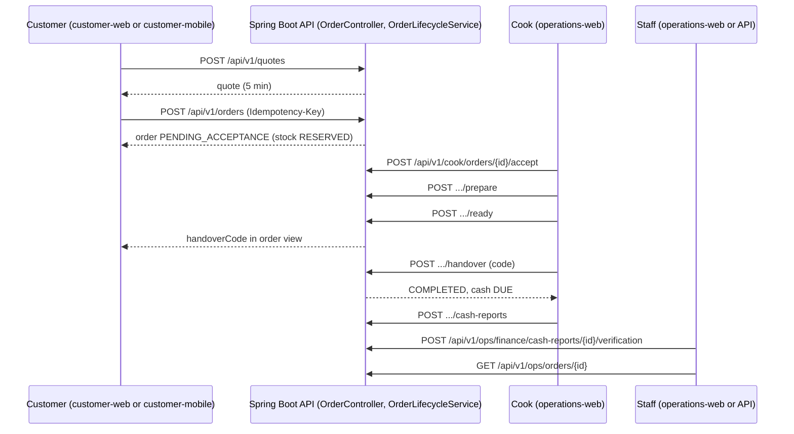

# User journeys: the complete order journey

> **Owner role:** Testing and QA
> **Status:** PARTIALLY IMPLEMENTED — every step below exists in code; backend tests cover the steps individually, browser automation covers only the customer ordering and cook actions (`customer-journey.e2e.ts`) and a finance statement layout (`money-reflow.e2e.ts`); finance verification, refund decisions and the administrator audit read have no browser automation (owner acceptance or API only); the owner acceptance run on the live preview and physical devices is not recorded as passed here (NOT VERIFIED).
> **Language / اللغة:** English · [العربية](complete-order-journey-ar.md)

This page stitches the single-actor journeys into one walk-through: **customer orders, kitchen fulfils, operations, finance and the administrator inspect**. Each step links to the page that details it: [Customer web](customer-web.md), [Customer mobile](customer-mobile.md), [Cook operations](cook-operations.md), [Backoffice administration](backoffice-admin.md), [Finance and support](finance-and-support.md), [Authentication and MFA](authentication-and-mfa.md). State machines: [Order lifecycle](../01-business/order-lifecycle.md).

## Scenario A: pickup, cash on receipt (core journey 1)

| # | Actor | Action (UI) | API call | Resulting state |
|---|---|---|---|---|
| 1 | Guest | Browse, search | `GET /api/v1/zones`, `GET /api/v1/meals`, `GET /api/v1/meals/{mealId}`, `GET /api/v1/kitchens/{kitchenId}/slots` | none |
| 2 | Guest to Customer | Sign in | `/oauth2/authorization/keycloak` then `GET /api/v1/me` | session; basket in browser survives (E2E-BASKET-030) |
| 3 | Customer | Add to basket | none (client basket) | one kitchen, one slot |
| 4 | Customer | Verify phone (first time) | `POST /api/v1/me/phone/challenges`, `POST …/{challengeId}/verify` | phone verified |
| 5 | Customer | Calculate total | `POST /api/v1/quotes` | quote valid 5 minutes, nothing reserved |
| 6 | Customer | Place order | `POST /api/v1/orders` (`Idempotency-Key`, `clientRequestId`) | order `PENDING_ACCEPTANCE`; stock `RESERVED`; cash obligation set; payment `NOT_REQUIRED` |
| 7 | Customer | Watch order | `GET /api/v1/orders/{orderId}` (polled every 10 s) | read-only |
| 8 | Cook | Accept | `POST /api/v1/cook/orders/{orderId}/accept` | `ACCEPTED`; stock `ALLOCATED` |
| 9 | Cook | Prepare | `POST …/prepare` | `PREPARING`; stock `CONSUMED` |
| 10 | Cook | Ready | `POST …/ready` | `READY`; handover code issued, visible to the customer only |
| 11 | Customer | Shows code at pickup | `GET /api/v1/orders/{orderId}` returns `handoverCode` | none |
| 12 | Cook | Handover (types 6-digit code) | `POST …/handover` | `COMPLETED`; code consumed; cash `DUE` |
| 13 | Cook | Report cash | `POST /api/v1/cook/orders/{orderId}/cash-reports` | cash `REPORTED` |
| 14 | Finance (not the reporter) | Verify cash | `POST /api/v1/ops/finance/cash-reports/{reportId}/verification` (API only; no screen) | cash `VERIFIED` |
| 15 | Operations | Inspect order | `GET /api/v1/ops/orders`, `GET /api/v1/ops/orders/{orderId}` | read-only, masked contact |
| 16 | Finance | Read statement | `GET /api/v1/ops/finance/statements?kitchenId=…` | totals, no commission |
| 17 | Administrator | Read audit trail | `GET /api/v1/ops/audit` (API only) | read audited |
| 18 | Customer | Review | `POST /api/v1/orders/{orderId}/reviews` | one review |

Every `POST` that changes an order carries an `Idempotency-Key` and `expectedVersion`. The server refuses out-of-order commands (`STATE_CONFLICT`) and a wrong version (`VERSION_CONFLICT`).

## Scenario B: delivery

Same as A, with these changes: quote body has `fulfillmentMode: DELIVERY` and an address in a zone the kitchen serves (the delivery fee comes from the zone); after step 10 the cook calls `POST …/dispatch` with a courier reference (`OUT_FOR_DELIVERY`) and then `…/handover` with the customer's code (`COMPLETED`) or `…/delivery-failure` (`DELIVERY_FAILED`, no automatic refund or charge). Core journey 2 (J2).

## Scenario C: 50% direct deposit (core journeys 3 and 4)

| # | Actor | Step | API / state |
|---|---|---|---|
| 1 | Cook | Saves recipient; staff approve it | `PUT /api/v1/cook/payment-profile`; `POST /api/v1/ops/kitchens/{kitchenId}/payment-recipient/approval` (recent MFA) |
| 2 | Customer | Quote with `paymentMethod: DEPOSIT` | quote shows deposit, remainder, recipient |
| 3 | Customer | Place order | payment `WAITING_FOR_DEPOSIT` |
| 4 | Customer | Transfers outside the app, presses "I sent it" | `POST …/payment/transfer-report` → `CUSTOMER_TRANSFER_REPORTED` |
| 5 | Cook | Accepts (allowed any time before the deadline) | `ACCEPTED` |
| 6 | Cook | Reports receipt | `POST …/payment/receipt` → `KITCHEN_RECEIPT_REPORTED` |
| 7 | Cook | Prepare (blocked until step 6) | `PREPARING` |
| 8 | Cook, customer, finance | Remaining amount in cash, then as Scenario A steps 12 to 16 | cash `DUE → VERIFIED` |
| 9 | Alternative | Cook reports not received / mismatch | `DISPUTED`, PAYMENT support case, staff decide `REFUND_OWED` or `CLOSED_NO_FUNDS` (see [Finance and support](finance-and-support.md)) |

The app never says "bank verified"; the kitchen's report is a statement. Live money is gated.

## Sequence

## Time and failure rules worth knowing

* Acceptance deadline: an order not accepted in time becomes `EXPIRED` through `OrderExpiryJob` (E2E-ORDER-029); capacity is released once.
* Accept racing customer cancel or expiry: exactly one transition wins (E2E-ORDER-028).
* Five wrong handover codes lock the challenge; staff recover with `order.handover_override` + recent MFA (E2E-ORDER-033, E2E-ORDER-108).
* After preparation starts only staff can cancel (`order.exception_cancel`; the case reference is required but only an audited free-text value, not a validated link, see the backoffice page).
* Lost placement response: client retries with the same keys or looks up `GET /api/v1/orders/by-request/{clientRequestId}`; duplicates are impossible (E2E-ORDER-024, E2E-ORDER-123).

## Owner acceptance mapping

Source: `docs/quality/owner-acceptance/core-suite.json` and the rendered `docs/quality/owner-acceptance/generated/core-owner-acceptance-suite.md`. Case definitions are in `docs/quality/owner-acceptance/cases/*.json`.

| Journey | Title | Cases | Page(s) |
|---|---|---|---|
| J0 | Baseline, public access and identity | CFG-001, E2E-DISC-001, CFG-002, E2E-DISC-003, CFG-034 | [Customer web](customer-web.md) CW-1, CW-2; [Authentication and MFA](authentication-and-mfa.md) AM-1 |
| J1 | Pickup + cash on receipt | E2E-BASKET-009, E2E-BASKET-019, E2E-ORDER-101, E2E-OPS-103 | Scenario A |
| J2 | Delivery + cash on receipt | E2E-ORDER-102, E2E-FIN-038 | Scenario B |
| J3 | Pickup + 50% deposit | E2E-FIN-039, E2E-FIN-106, E2E-FIN-045 | Scenario C |
| J4 | Delivery + 50% deposit, zero platform charges | E2E-FIN-101, E2E-FIN-046 | Scenario C with B |
| J5 | Guards: prices, repeats, isolation | E2E-BASKET-014, E2E-BASKET-015, E2E-BASKET-030, E2E-ORDER-022, E2E-ORDER-037, E2E-ORDER-120 | CW-4, CO-5 |
| J6 | Kitchen workspace and operations control | E2E-COOK-051, E2E-COOK-052, E2E-COOK-054, E2E-OPS-055, E2E-OPS-058, E2E-COOK-049, E2E-OPS-059 | [Cook operations](cook-operations.md), [Backoffice administration](backoffice-admin.md) |
| J7 | Two-step verification | CFG-102, CFG-008, CFG-016, CFG-104 | [Authentication and MFA](authentication-and-mfa.md) |
| J8 | Physical devices | CFG-046, CFG-024, CFG-025, E2E-BASKET-027 | [Customer mobile](customer-mobile.md) |

Run record for the most recent owner run: `docs/quality/owner-acceptance/run-2026-10-19.md` (read it for what actually passed; this page does not restate results).

## Automated coverage of the whole chain

| Layer | File | What it proves |
|---|---|---|
| Backend integration (real PostgreSQL) | `backend/app/src/test/java/com/matbakhy/app/orders/OrderPlacementIntegrationTest.java`, `OrderLifecycleIntegrationTest.java` | placement snapshot, idempotency, transitions, handover |
| Backend | `backend/app/src/test/java/com/matbakhy/app/finance/CashAndLedgerIntegrationTest.java`, `backend/app/src/test/java/com/matbakhy/app/payments/DepositPaymentIntegrationTest.java` | cash and deposit flows |
| Browser against a real local stack | `apps/operations-web/e2e/customer-journey.e2e.ts`, `cook-workspace.e2e.ts` | customer orders delivery and pickup in the customer web while the cook acts in the operations web |
| Native | `apps/customer-mobile/scripts/order-roundtrip-android.sh`, `apps/customer-mobile/e2e-ios/UITests/OrderingTests.swift` | ordering, kill and recovery, deposit, deep link on emulator/simulator |

Run browser tests with `scripts/dev.sh e2e` (throwaway stack). Whether they pass on the current commit: NOT VERIFIED here.

## Known limitations and documentation gaps

* Coverage is per layer, not per step: finance cash verification, refund decisions and audit reading are not exercised by any browser test, so treat them as owner acceptance or missing automation, not inferred coverage.
* Cash verification (step 14), the audit trail (step 17) and ops dashboard metrics have no screen or are not implemented; owner cases must use the API for them.
* The browser journey test lives in the operations-web project but drives the customer web as well.
* No automated test spans customer, cook, finance and audit in one run; the chain is joined only by the owner suite J1 to J4.
