# رسومات المعمارية

> **Owner role:** Backend architecture
> **Status:** PARTIALLY IMPLEMENTED — الرسومات بتوضّح اللي الكود بيعمله النهاردة؛ الأجزاء PLANNED أو DISABLED متعلّم عليها في نص الـ Node
> **Language / اللغة:** [English](diagrams.md) · العربية

كل الرسومات نص Mermaid. عدّلها مكانها؛ GitHub بيرسمها. كل رسم ليه Caption بيذكر الملفات اللي اتشتق منها، فأي تغيير في الملفات دي سبب إنك تراجع الرسم (السياسة: [صيانة التوثيق](../05-developer-workflow/documentation-maintenance-ar.md)). الشرح النصي لكل مجال موجود في صفحات المعمارية: [نظرة عامة على السيستم](system-overview-ar.md)، [الـ Backend](backend-architecture-ar.md)، [الـ Frontend](frontend-architecture-ar.md)، [الموبايل](mobile-architecture-ar.md)، [قاعدة البيانات](database-architecture-ar.md)، [الهوية والأمان](identity-and-security-ar.md)، [التكامل والأحداث](integration-and-events-ar.md)، [البنية التحتية](infrastructure-and-deployment-ar.md).

المحتويات: [1 سياق السيستم](#1-سياق-السيستم)، [2 الـ Containers](#2-معمارية-الـ-containers)، [3 مكوّنات الـ Backend](#3-مكونات-الـ-backend)، [4 الويب](#4-معمارية-الويب)، [5 الموبايل](#5-معمارية-الموبايل)، [6 OIDC](#6-الـ-authentication-oidc)، [7 رفع الـ MFA](#7-رفع-الـ-mfa-step-up)، [8 تسجيل الأوردر](#8-تسجيل-الأوردر-sequence)، [9 حالات الأوردر](#9-حالات-تنفيذ-الأوردر)، [10 تغيّر السعر](#10-تغير-السعر-وإعادة-تأكيد-الـ-quote-القديم)، [11 العربون](#11-العربون-والكاش-والتسوية)، [12 ER](#12-علاقات-قاعدة-البيانات)، [13 CI/CD](#13-cicd)، [14 بنية المعاينة](#14-بنية-المعاينة).

## 1 سياق السيستم

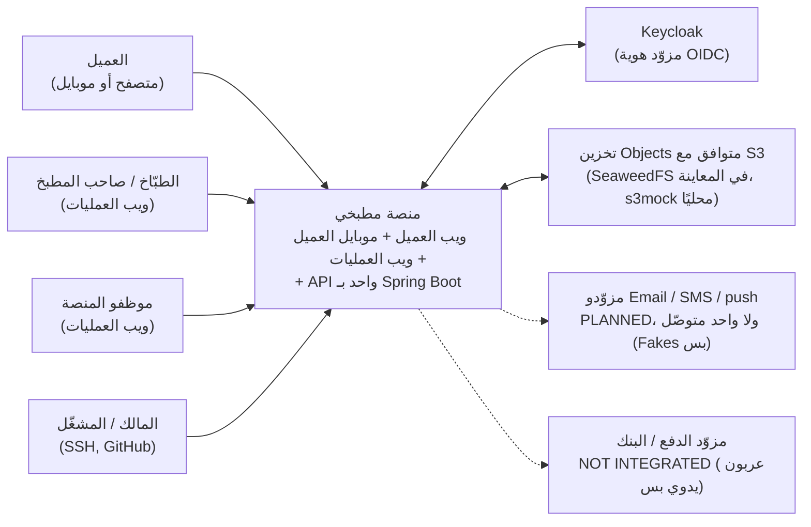

الـ Caption: مشتق من `backend/app/src/main/java/com/matbakhy/app/providers/ProviderConfiguration.java` (مزوّدين Fake أو مرفوضين برّه LOCAL/CI/PREVIEW)، `deploy/web-preview/compose.yaml`، `infra/compose.yaml`، `backend/modules/orders/src/main/java/com/matbakhy/orders/internal/PaymentService.java` (من غير نداء لأي Gateway؛ بيسجّل التبليغات بس).

## 2 معمارية الـ Containers

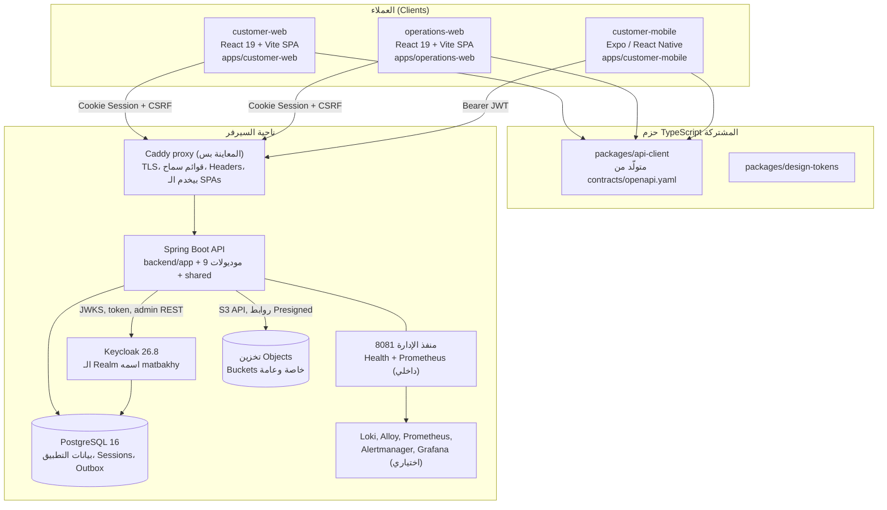

الـ Caption: مشتق من `deploy/web-preview/compose.yaml`، `deploy/web-preview/Caddyfile`، `backend/pom.xml`، `apps/customer-web/package.json`، `apps/operations-web/package.json`، `apps/customer-mobile/package.json`، `packages/api-client/package.json`. في التطوير المحلي مفيش Caddy: الـ SPAs بتشتغل على منافذ Vite وبتكلّم الـ API مباشرة (`infra/compose.yaml`).

## 3 مكوّنات الـ Backend

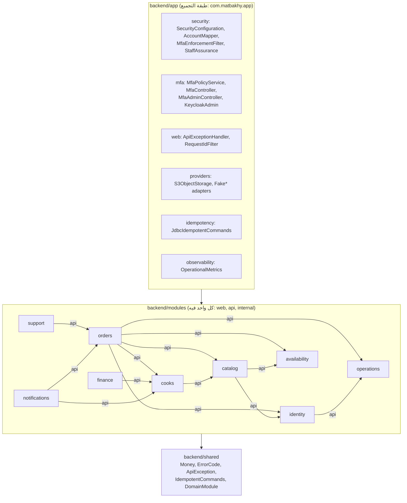

الـ Caption: الخطوط هي الـ Maven Dependencies المعرّفة في كل `backend/modules/*/pom.xml`، ودايمًا بتتستخدم من خلال Package الـ `api` بتاع الموديول التاني (القاعدة بتتفرض بواسطة `backend/app/src/test/java/com/matbakhy/app/architecture/ModuleRules.java`). الاعتماديات الرئيسية بس هي اللي مرسومة؛ وكل موديول كمان بيعتمد على `identity` و`operations` للصلاحيات والـ Audit زي ما الـ pom بتاعه معرّف.

## 4 معمارية الويب

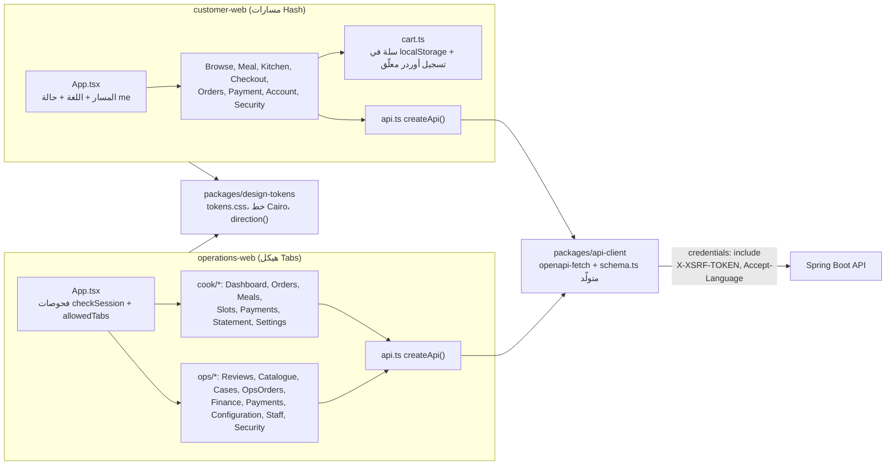

الـ Caption: مشتق من `apps/customer-web/src/App.tsx`، `apps/customer-web/src/api.ts`، `apps/customer-web/src/cart.ts`، `apps/operations-web/src/App.tsx`، `apps/operations-web/src/api.ts`، `packages/api-client/package.json`.

## 5 معمارية الموبايل

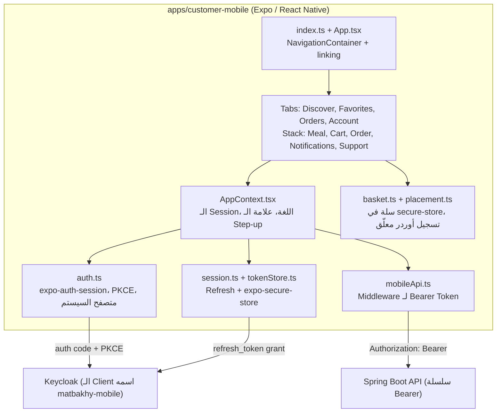

الـ Caption: مشتق من `apps/customer-mobile/src/App.tsx`، `apps/customer-mobile/src/AppContext.tsx`، `apps/customer-mobile/src/auth.ts`، `apps/customer-mobile/src/tokenStore.ts`، `apps/customer-mobile/src/mobileApi.ts`، `apps/customer-mobile/src/basket.ts`، `apps/customer-mobile/src/screens/navigation.ts`.

## 6 الـ Authentication (OIDC)

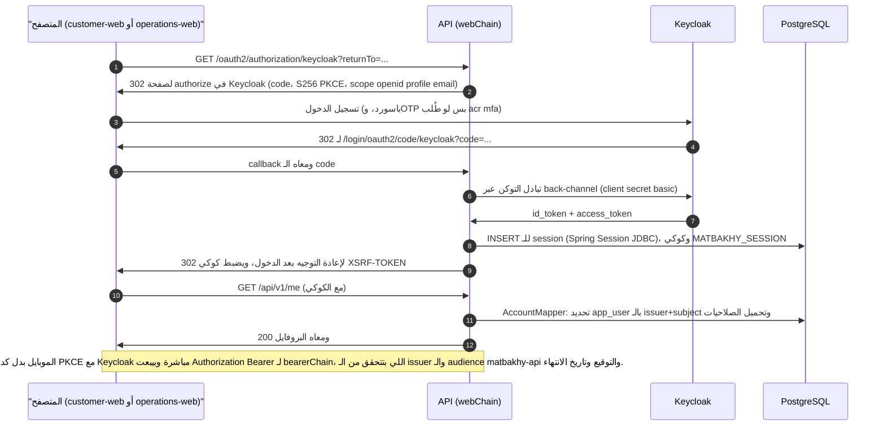

الـ Caption: مشتق من `backend/app/src/main/java/com/matbakhy/app/security/SecurityConfiguration.java`، `backend/app/src/main/java/com/matbakhy/app/security/AccountMapper.java`، `backend/app/src/main/java/com/matbakhy/app/security/WebAccountFilter.java`، `apps/customer-mobile/src/auth.ts`، `infra/identity/matbakhy-realm.json`.

## 7 رفع الـ MFA (Step-up)

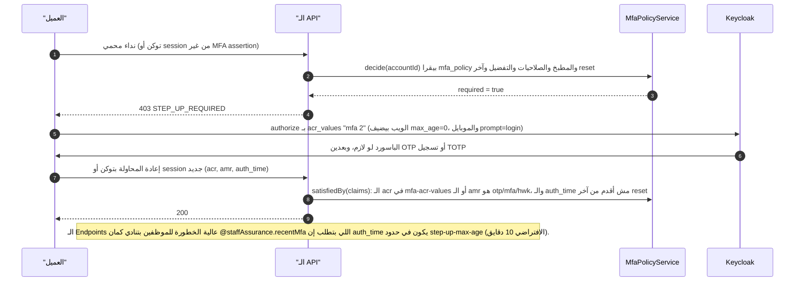

الـ Caption: مشتق من `backend/app/src/main/java/com/matbakhy/app/security/MfaEnforcementFilter.java`، `backend/app/src/main/java/com/matbakhy/app/security/StaffAssurance.java`، `backend/app/src/main/java/com/matbakhy/app/mfa/MfaPolicyService.java`، `backend/app/src/main/resources/db/migration/V31__mfa_policy.sql`، `apps/customer-mobile/src/auth.ts`.

## 8 تسجيل الأوردر (Sequence)

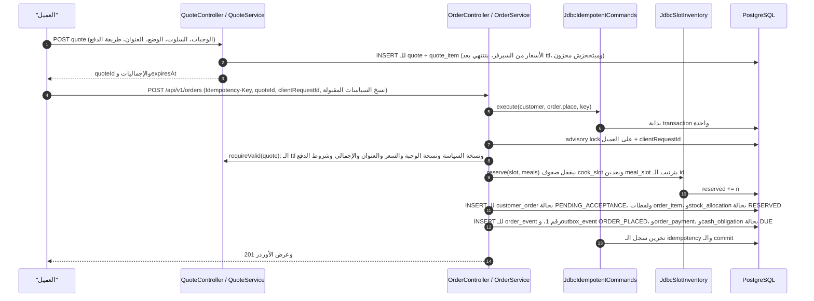

الـ Caption: مشتق من `backend/modules/orders/src/main/java/com/matbakhy/orders/internal/OrderService.java` (`place`، `placeOnce`)، `backend/modules/orders/src/main/java/com/matbakhy/orders/internal/QuoteService.java`، `backend/modules/availability/src/main/java/com/matbakhy/availability/internal/JdbcSlotInventory.java`، `backend/app/src/main/java/com/matbakhy/app/idempotency/JdbcIdempotentCommands.java`.

## 9 حالات تنفيذ الأوردر

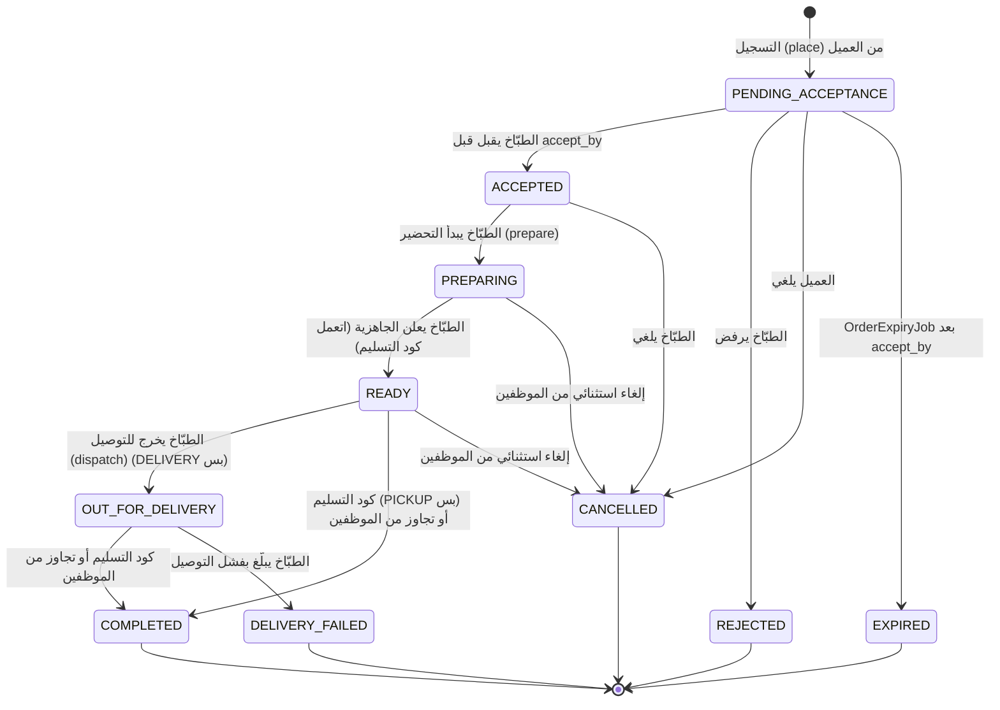

الـ Caption: مشتق من `backend/modules/orders/src/main/java/com/matbakhy/orders/internal/OrderLifecycleService.java`، `backend/modules/orders/src/main/java/com/matbakhy/orders/internal/OrderExpiryJob.java` وفحص الحالة في `backend/app/src/main/resources/db/migration/V11__orders.sql`؛ والحالات النهائية متجمّدة بالـ Trigger الموجود في `backend/app/src/main/resources/db/migration/V12__order_lifecycle.sql`. المعنى في البيزنس: [دورة حياة الأوردر](../01-business/order-lifecycle-ar.md).

## 10 تغيّر السعر وإعادة تأكيد الـ Quote القديم

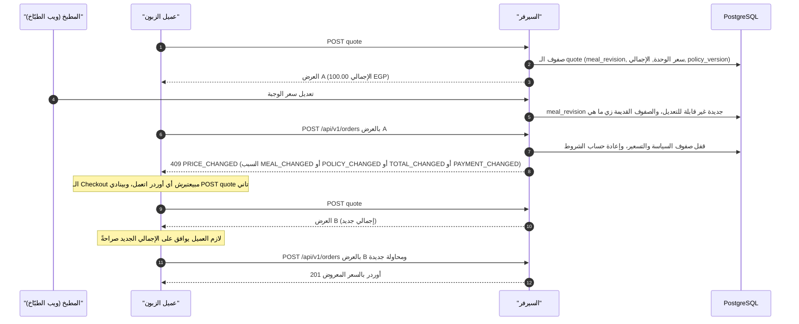

الـ Caption: مشتق من `backend/modules/orders/src/main/java/com/matbakhy/orders/internal/QuoteService.java` (`requireValid`)، `apps/customer-web/src/Checkout.tsx` (فرع `PRICE_CHANGED`)، `apps/customer-web/src/i18n.ts` (نصوص تغيّر السعر)، `packages/api-client/test/priceChanges.test.ts`. الرد QUOTE_EXPIRED أو STOCK_CHANGED بيمشي في نفس مسار إعادة الـ Quote في الواجهة: NOT VERIFIED لكل شاشات العميل.

## 11 العربون والكاش والتسوية

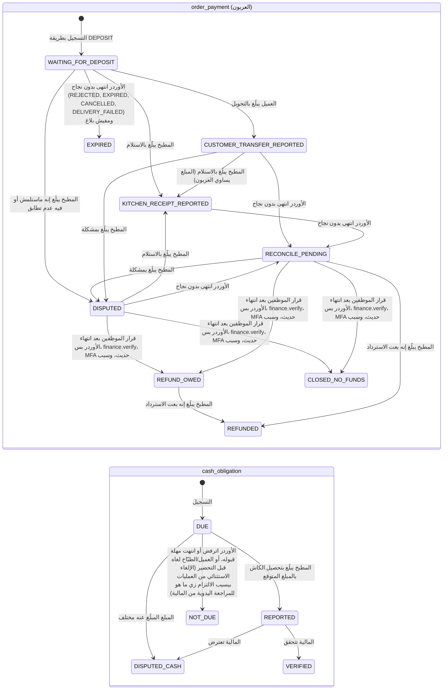

الـ Caption: مشتق من `backend/modules/orders/src/main/java/com/matbakhy/orders/internal/PaymentService.java`، `backend/app/src/main/resources/db/migration/V24__deposit_payments.sql`، `backend/app/src/main/resources/db/migration/V25__payment_reconciliation.sql`، `backend/app/src/main/resources/db/migration/V13__cash_and_ledger.sql`، `backend/modules/finance/src/main/java/com/matbakhy/finance/internal/CashService.java`. الحالة `DISPUTED_CASH` هي القيمة `DISPUTED` في `cash_obligation` و`cash_report`، واتسمّت كده هنا بس لأن أسماء الحالات في Mermaid لازم تكون فريدة. الانتقالات "order ended unsuccessfully" بتشتغل بس لـ REJECTED وEXPIRED وCANCELLED وDELIVERY_FAILED (`OrderLifecycleService.java:369` بيتخطّى COMPLETED)، فالأوردر المكتمل بيحتفظ بحالة الاستلام بتاعته. كل حالة عربون هي إفادة من العميل أو المطبخ أو الموظف؛ ولا واحدة معناها "اتحقق منه بنكيًا" ومفيش حساب لمطبخي بيمسك الفلوس. دفعات التسوية (`settlement_batch`: DRAFT وREVIEWED وPAYMENT_RECORDED وRECONCILED وCANCELLED) بتجمّع مجموعات قيود العمولة (commission ledger groups)؛ ومع قاعدة صفر العمولة (`backend/app/src/main/resources/db/migration/V23__launch_commission.sql`) هي خامدة في البيانات الحية. راجع [التسعير والدفع](../01-business/pricing-and-payments-ar.md).

## 12 علاقات قاعدة البيانات

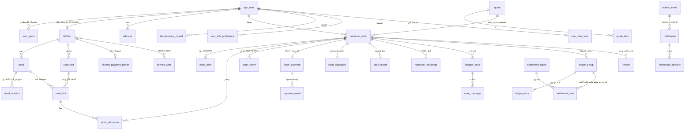

الـ Caption: مشتق من الـ Foreign Keys في `backend/app/src/main/resources/db/migration/V1__baseline_identity_and_idempotency.sql` لحد `V31__mfa_policy.sql` (مثلًا `V11__orders.sql`، `V8__slots.sql`، `V13__cash_and_ledger.sql`، `V14__notifications.sql`، `V17__support.sql`، `V18__finance_operations.sql`، `V20__favorites_and_reviews.sql`، `V24__deposit_payments.sql`). الجداول الرئيسية بس هي المرسومة. الأعمدة مذكورة في [معمارية قاعدة البيانات](database-architecture-ar.md).

## 13 CI/CD

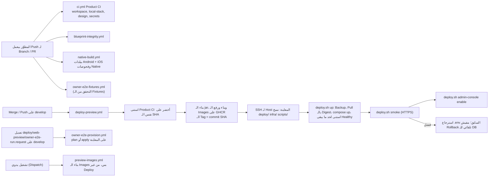

الـ Caption: مشتق من `.github/workflows/ci.yml`، `.github/workflows/deploy-preview.yml`، `.github/workflows/native-build.yml`، `.github/workflows/blueprint-integrity.yml`، `.github/workflows/owner-e2e-fixtures.yml`، `.github/workflows/owner-e2e-provision.yml`، `.github/workflows/preview-images.yml`، `deploy/web-preview/deploy.sh`.

## 14 بنية المعاينة

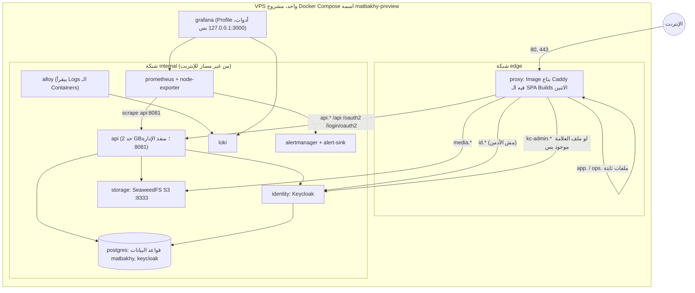

الـ Caption: مشتق من `deploy/web-preview/compose.yaml`، `deploy/web-preview/compose.4gb.yaml`، `deploy/web-preview/Caddyfile`، `deploy/web-preview/observability/prometheus.yml`. المعاينة مش Production: راجع [البنية التحتية والـ Deployment](infrastructure-and-deployment-ar.md).
