# Architecture diagrams

> **Owner role:** Backend architecture
> **Status:** PARTIALLY IMPLEMENTED — diagrams show what the code does today; planned or disabled parts are marked in the node text

All diagrams are Mermaid text. Edit them in place; GitHub renders them. Every diagram has a caption naming the files it was derived from, so a change in those files is a reason to re-check the diagram (policy: [documentation maintenance](../05-developer-workflow/documentation-maintenance.md)). Prose for each area lives in the architecture pages: [system overview](system-overview.md), [backend](backend-architecture.md), [frontend](frontend-architecture.md), [mobile](mobile-architecture.md), [database](database-architecture.md), [identity and security](identity-and-security.md), [integration and events](integration-and-events.md), [infrastructure](infrastructure-and-deployment.md).

Contents: [1 system context](#1-system-context), [2 containers](#2-container-architecture), [3 backend components](#3-backend-components), [4 web](#4-web-architecture), [5 mobile](#5-mobile-architecture), [6 OIDC](#6-authentication-oidc), [7 MFA step-up](#7-mfa-step-up), [8 order placement](#8-order-placement-sequence), [9 order states](#9-order-fulfilment-states), [10 price change](#10-price-change-and-stale-quote-reconfirmation), [11 deposits](#11-deposits-cash-and-settlement), [12 ER](#12-database-relationships), [13 CI/CD](#13-cicd), [14 preview infrastructure](#14-preview-infrastructure).

## 1 System context

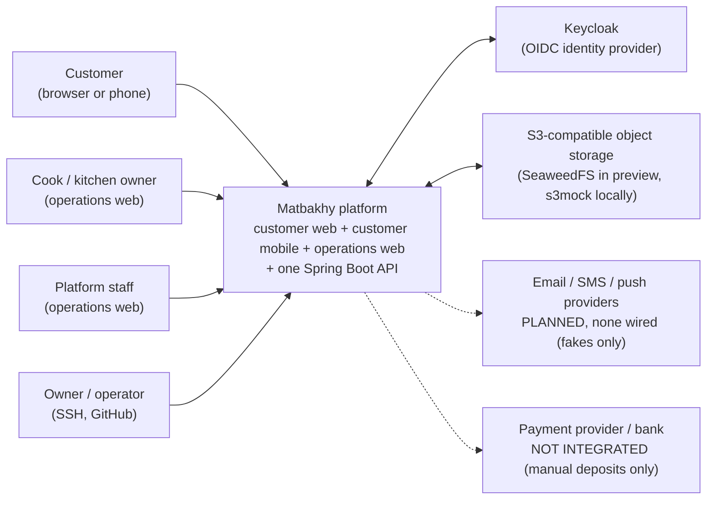

Caption: derived from `backend/app/src/main/java/com/matbakhy/app/providers/ProviderConfiguration.java` (fake or refused providers outside LOCAL/CI/PREVIEW), `deploy/web-preview/compose.yaml`, `infra/compose.yaml`, `backend/modules/orders/src/main/java/com/matbakhy/orders/internal/PaymentService.java` (no gateway call; reports only).

## 2 Container architecture

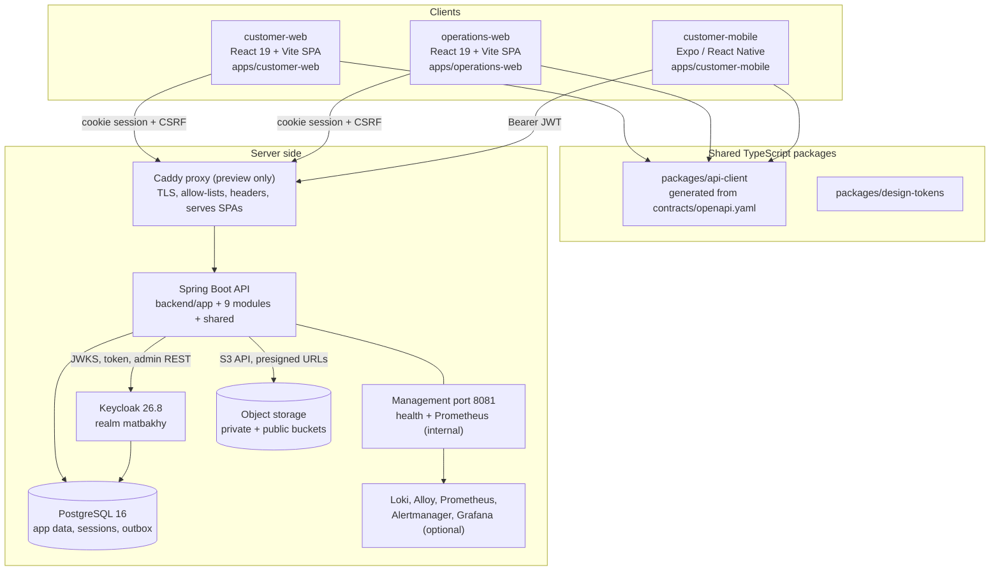

Caption: derived from `deploy/web-preview/compose.yaml`, `deploy/web-preview/Caddyfile`, `backend/pom.xml`, `apps/customer-web/package.json`, `apps/operations-web/package.json`, `apps/customer-mobile/package.json`, `packages/api-client/package.json`. In local development there is no Caddy: the SPAs run on Vite ports and talk to the API directly (`infra/compose.yaml`).

## 3 Backend components

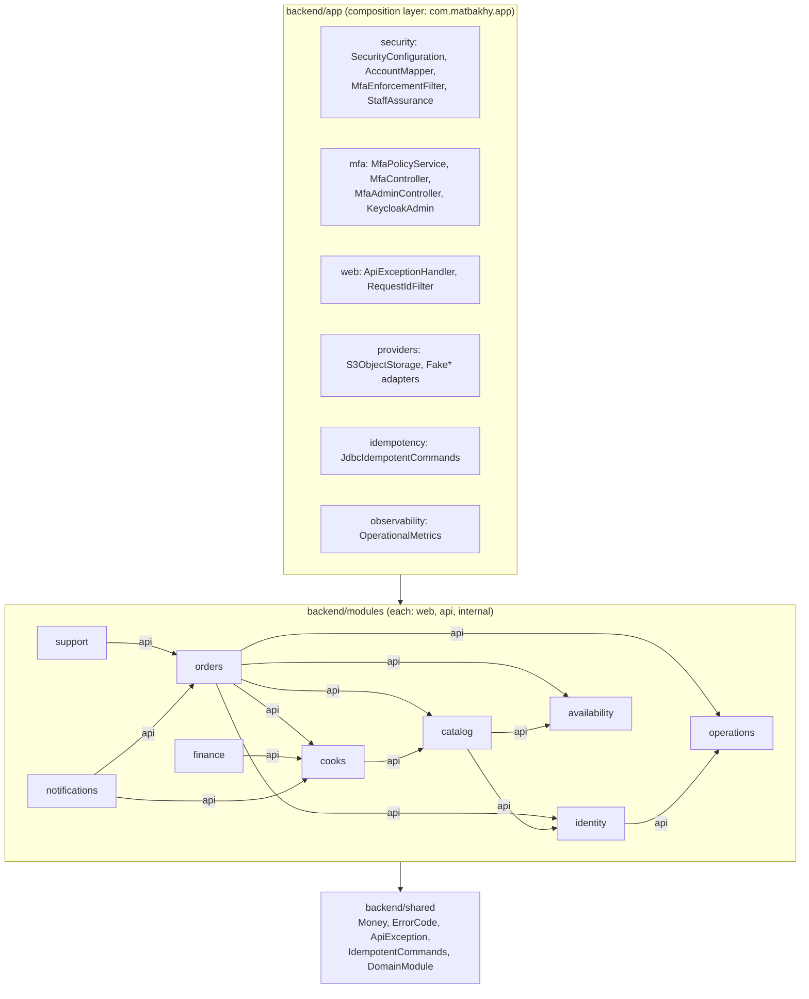

Caption: edges are the Maven dependencies declared in each `backend/modules/*/pom.xml`, always used through the other module's `api` package (rule enforced by `backend/app/src/test/java/com/matbakhy/app/architecture/ModuleRules.java`). Only the main dependencies are drawn; every module also depends on `identity` and `operations` for permissions and audit as its pom declares.

## 4 Web architecture

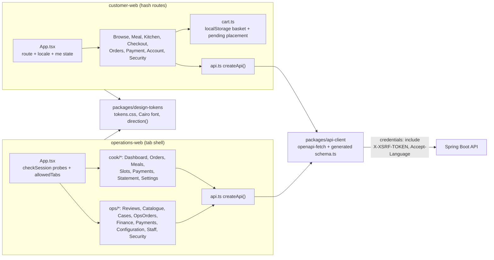

Caption: derived from `apps/customer-web/src/App.tsx`, `apps/customer-web/src/api.ts`, `apps/customer-web/src/cart.ts`, `apps/operations-web/src/App.tsx`, `apps/operations-web/src/api.ts`, `packages/api-client/package.json`.

## 5 Mobile architecture

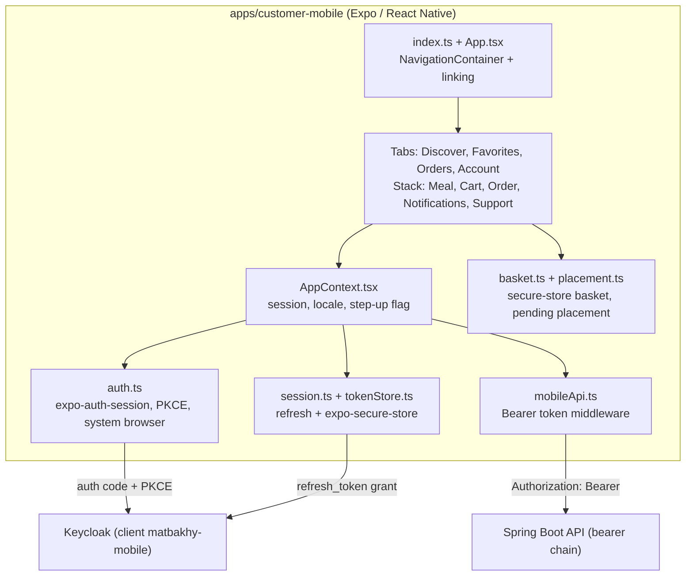

Caption: derived from `apps/customer-mobile/src/App.tsx`, `apps/customer-mobile/src/AppContext.tsx`, `apps/customer-mobile/src/auth.ts`, `apps/customer-mobile/src/tokenStore.ts`, `apps/customer-mobile/src/mobileApi.ts`, `apps/customer-mobile/src/basket.ts`, `apps/customer-mobile/src/screens/navigation.ts`.

## 6 Authentication (OIDC)

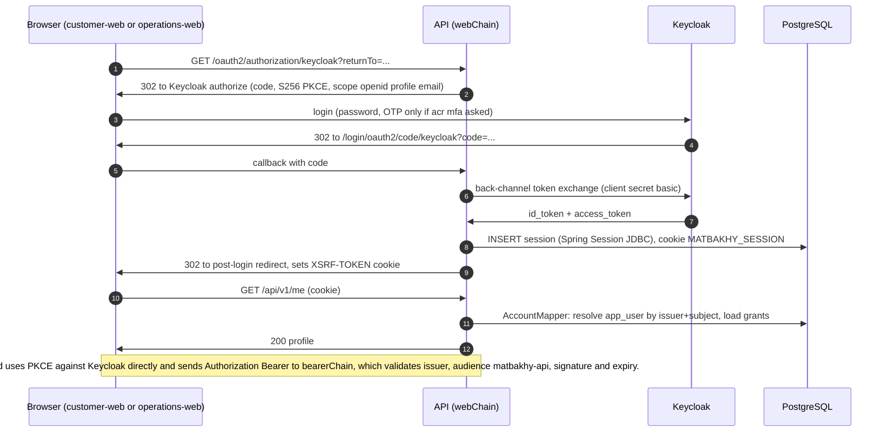

Caption: derived from `backend/app/src/main/java/com/matbakhy/app/security/SecurityConfiguration.java`, `backend/app/src/main/java/com/matbakhy/app/security/AccountMapper.java`, `backend/app/src/main/java/com/matbakhy/app/security/WebAccountFilter.java`, `apps/customer-mobile/src/auth.ts`, `infra/identity/matbakhy-realm.json`.

## 7 MFA step-up

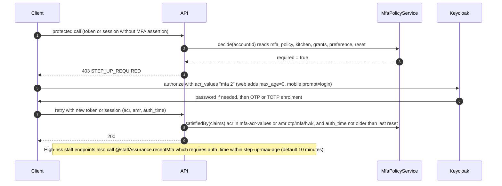

Caption: derived from `backend/app/src/main/java/com/matbakhy/app/security/MfaEnforcementFilter.java`, `backend/app/src/main/java/com/matbakhy/app/security/StaffAssurance.java`, `backend/app/src/main/java/com/matbakhy/app/mfa/MfaPolicyService.java`, `backend/app/src/main/resources/db/migration/V31__mfa_policy.sql`, `apps/customer-mobile/src/auth.ts`.

## 8 Order placement (sequence)

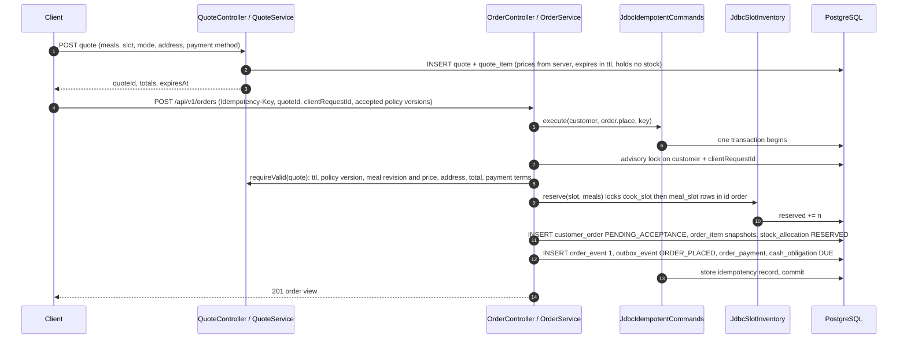

Caption: derived from `backend/modules/orders/src/main/java/com/matbakhy/orders/internal/OrderService.java` (`place`, `placeOnce`), `backend/modules/orders/src/main/java/com/matbakhy/orders/internal/QuoteService.java`, `backend/modules/availability/src/main/java/com/matbakhy/availability/internal/JdbcSlotInventory.java`, `backend/app/src/main/java/com/matbakhy/app/idempotency/JdbcIdempotentCommands.java`.

## 9 Order fulfilment states

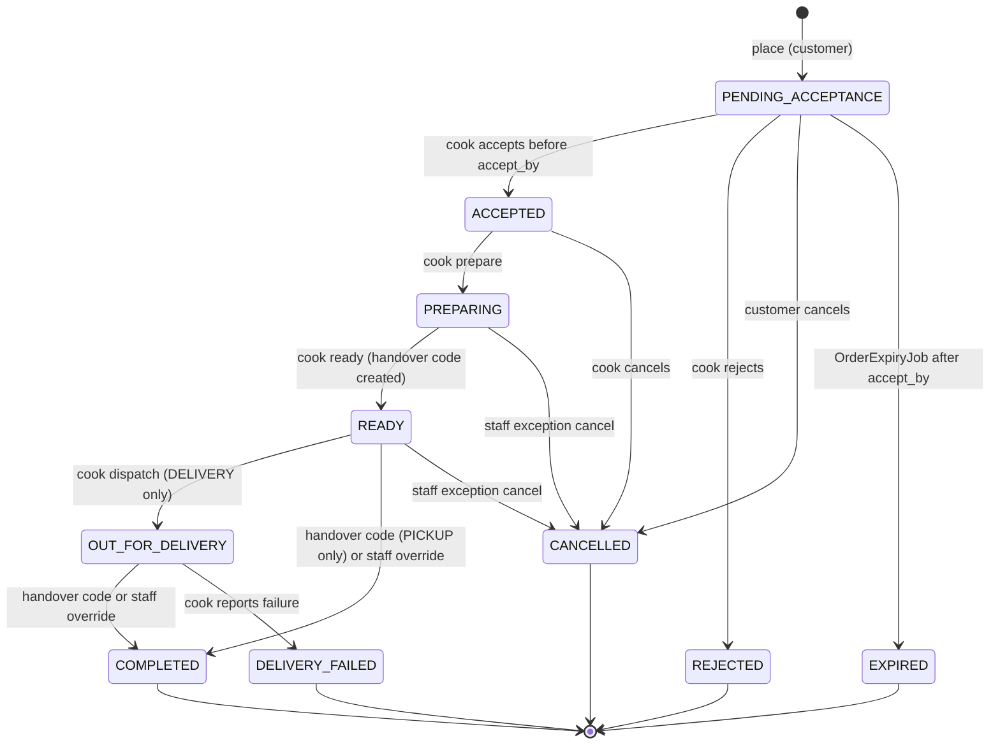

Caption: derived from `backend/modules/orders/src/main/java/com/matbakhy/orders/internal/OrderLifecycleService.java`, `backend/modules/orders/src/main/java/com/matbakhy/orders/internal/OrderExpiryJob.java` and the state check in `backend/app/src/main/resources/db/migration/V11__orders.sql`; terminal states are frozen by the trigger in `backend/app/src/main/resources/db/migration/V12__order_lifecycle.sql`. Business meaning: [order lifecycle](../01-business/order-lifecycle.md).

## 10 Price change and stale-quote reconfirmation

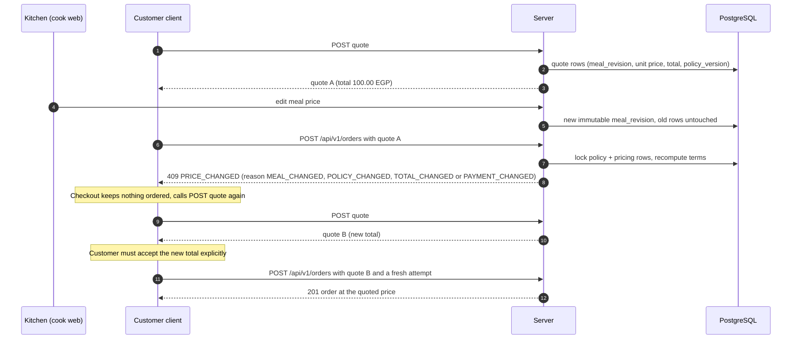

Caption: derived from `backend/modules/orders/src/main/java/com/matbakhy/orders/internal/QuoteService.java` (`requireValid`), `apps/customer-web/src/Checkout.tsx` (`PRICE_CHANGED` branch), `apps/customer-web/src/i18n.ts` (price change strings), `packages/api-client/test/priceChanges.test.ts`. A QUOTE_EXPIRED or STOCK_CHANGED answer takes the same re-quote path in the UI: NOT VERIFIED for every client screen.

## 11 Deposits, cash and settlement

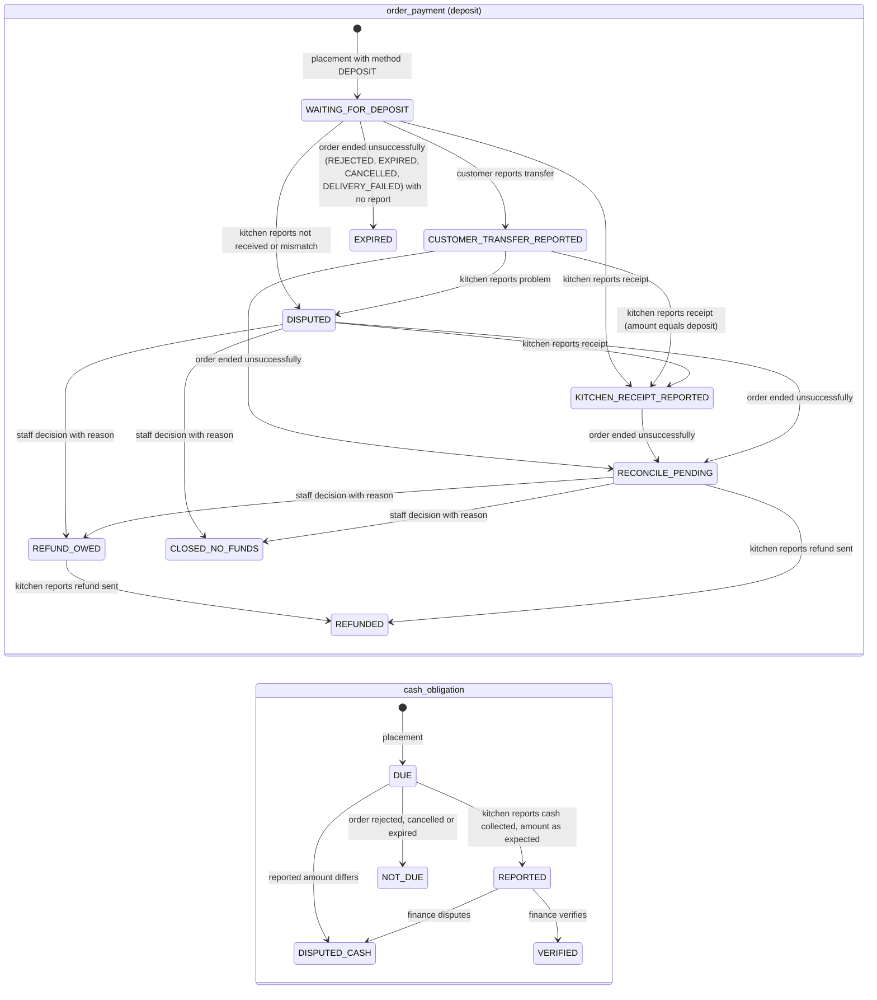

Caption: derived from `backend/modules/orders/src/main/java/com/matbakhy/orders/internal/PaymentService.java`, `backend/app/src/main/resources/db/migration/V24__deposit_payments.sql`, `backend/app/src/main/resources/db/migration/V25__payment_reconciliation.sql`, `backend/app/src/main/resources/db/migration/V13__cash_and_ledger.sql`, `backend/modules/finance/src/main/java/com/matbakhy/finance/internal/CashService.java`. `DISPUTED_CASH` is the `DISPUTED` value of `cash_obligation` and `cash_report`, renamed here only because Mermaid state names must be unique. The "order ended unsuccessfully" transitions run only for REJECTED, EXPIRED, CANCELLED and DELIVERY_FAILED (`OrderLifecycleService.java:369` skips COMPLETED), so a completed order keeps its receipt state. Every deposit state is a statement by the customer, kitchen or staff; none means "bank verified" and no Matbakhy account holds the money. Settlement batches (`settlement_batch`: DRAFT, REVIEWED, PAYMENT_RECORDED, RECONCILED, CANCELLED) group commission ledger groups; with the zero-commission rule (`backend/app/src/main/resources/db/migration/V23__launch_commission.sql`) they are dormant for live data. See [pricing and payments](../01-business/pricing-and-payments.md).

## 12 Database relationships

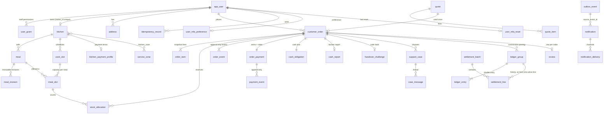

Caption: derived from the foreign keys in `backend/app/src/main/resources/db/migration/V1__baseline_identity_and_idempotency.sql` through `V31__mfa_policy.sql` (for example `V11__orders.sql`, `V8__slots.sql`, `V13__cash_and_ledger.sql`, `V14__notifications.sql`, `V17__support.sql`, `V18__finance_operations.sql`, `V20__favorites_and_reviews.sql`, `V24__deposit_payments.sql`). Only main tables are drawn. Columns are listed in [database architecture](database-architecture.md).

## 13 CI/CD

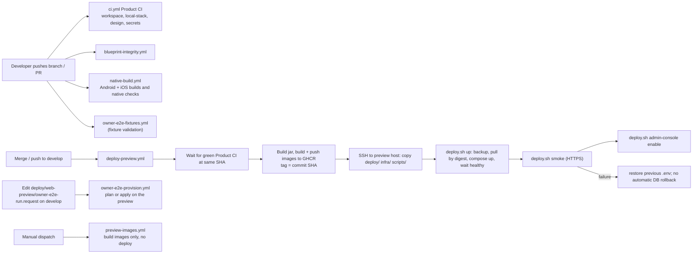

Caption: derived from `.github/workflows/ci.yml`, `.github/workflows/deploy-preview.yml`, `.github/workflows/native-build.yml`, `.github/workflows/blueprint-integrity.yml`, `.github/workflows/owner-e2e-fixtures.yml`, `.github/workflows/owner-e2e-provision.yml`, `.github/workflows/preview-images.yml`, `deploy/web-preview/deploy.sh`.

## 14 Preview infrastructure

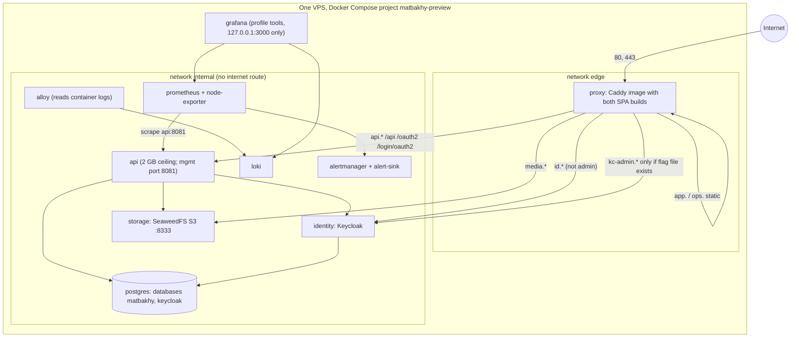

Caption: derived from `deploy/web-preview/compose.yaml`, `deploy/web-preview/compose.4gb.yaml`, `deploy/web-preview/Caddyfile`, `deploy/web-preview/observability/prometheus.yml`. The preview is not production: see [infrastructure and deployment](infrastructure-and-deployment.md).
