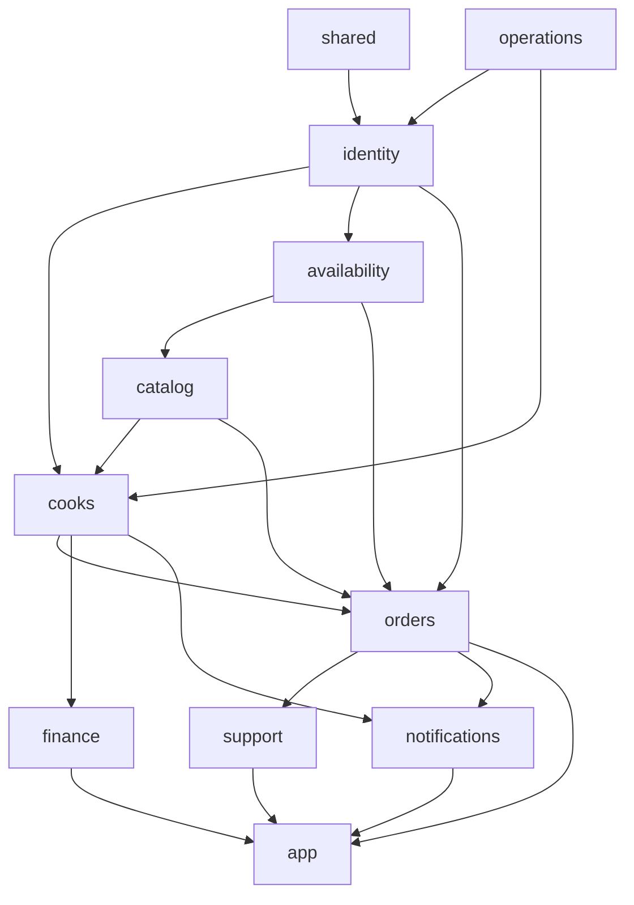

# دليل موديولات الـ Backend

> **Owner role:** Backend architecture
> **Status:** IMPLEMENTED — بيوصف الموديولات التسعة للـ Domain، و`shared` و`app` زي ما هم موجودين في `backend/`
> **Language / اللغة:** [English](backend-module-guide.md) · العربية

الـ Backend عبارة عن تطبيق Spring Boot واحد متبني من مشروع Maven متعدد الموديولات (`backend/pom.xml`). موديولات الـ Domain
هي مكتبات (Libraries)؛ و`app` بس هو اللي بيشتغل. خلفية المعمارية: [معمارية الـ Backend](../03-architecture/backend-architecture-ar.md).
القواعد دي بتتفرض بالاختبارات، مش بس بالعُرف:

- أي موديول تاني ممكن يستخدم موديول **عن طريق الـ package بتاع `api` بس** (`ModuleRules.onlyPublicApiCrossesModules` في
  `backend/app/src/test/java/com/matbakhy/app/architecture/ModuleRules.java`)، وبيتشغّل بواسطة
  `backend/app/src/test/java/com/matbakhy/app/architecture/ModuleBoundaryTest.java`.
- مفيش دورات (Cycles) بين الموديولات؛ والموديولات مبتعتمدش على `app`؛ و`shared` مبيعتمدش على أي موديول.
- اعتماديات Maven بتحدّد الموديول يقدر حتى يشوف إيه (الـ `pom.xml` بتاع كل موديول فيه الموديولات الشقيقة اللي مسموح له يستخدمها).
- مفيش Java Test Sources جوه موديولات الـ Domain (غير `backend/shared/src/test/java/com/matbakhy/shared/MoneyTest.java` بس)؛
  **كل اختبارات التكامل موجودة في** `backend/app/src/test/java/com/matbakhy/app/` وبتشتغل على PostgreSQL حقيقي
  (Testcontainers؛ `backend/app/src/test/java/com/matbakhy/app/support/IntegrationTest.java`).

تقسيم الـ Packages الشائع جوه الموديول: `api/` (الـ Interfaces والـ Records اللي غيره يقدر يستخدمها)، `internal/` (الـ Services
وأدابتورز الـ JDBC والـ Jobs؛ Package-private)، `web/` (الـ REST Controllers). الـ Persistence عبارة عن SQL عادي بـ `JdbcTemplate`، مش JPA، في كل
موديول اتقرا لأجل الصفحة دي.

الرسم مبسّط من اعتماديات `matbakhy-*` في الـ `pom.xml` بتاع كل موديول (الأسهم بتشاور من الـ Dependency للمستخدم بتاعها؛ `shared` و`operations` بيستخدمهم أغلب الموديولات ومش كل الأسهم مرسومة).

## جدول الموديولات في لمحة

| الموديول | بيعتمد على (pom) | الجداول اللي بيلمسها (من الـ SQL بتاعه) | Routes الـ Controllers (ids الـ API في [سجل الـ Endpoints](../04-codebase/api-contracts-ar.md)) |
|---|---|---|---|
| `shared` | مفيش | مفيش | مفيش |
| `identity` | shared, operations | `app_user`, `address`, `phone_challenge`, `user_grant`, `deletion_request`, `spring_session` | `/me`, `/me/phone/*`, `/me/addresses*`, `/me/deletion-requests`, `/ops/staff*` |
| `operations` | shared | `audit_event` | `/ops/audit` |
| `cooks` | shared, identity, catalog, operations | `cook_application`, `cook_application_revision`, `kitchen`, `kitchen_zone` | `/cook/application*`, `/cook/settings`, `/ops/cooks*`, `/ops/kitchens/{id}/operating-state`, `/kitchens/{slug}` |
| `catalog` | shared, identity, operations, availability | `meal`, `meal_media`, `meal_revision`, `media_asset`, `media_cleanup`, `favorite`, `service_zone`, `kitchen_zone`, `activity_daily` | `/meals*`, `/zones`, `/cook/meals*`, `/uploads*`, `/me/favorites*`, `/ops/catalogue`, `/ops/meals/*/moderation`, `/activity` |
| `availability` | shared, identity | `cook_slot`, `meal_slot` | `/kitchens/{id}/slots`, `/cook/slots*` |
| `orders` | shared, identity, catalog, cooks, operations, availability | `customer_order`, `order_item`, `order_event`, `quote`, `quote_item`, `commerce_policy`, `stock_allocation`, `cash_obligation`, `handover_*`, `order_payment`, `payment_event`, `kitchen_payment_profile`, `review`, `review_report`, `config_change`, `feature_flag`, `outbox_event` | عروض الأسعار (Quotes) والأوردرات وإجراءات الطبّاخ على الأوردر والدفعات والمراجعات والإعدادات |
| `finance` | shared, identity, cooks, operations | `cash_report`, `cash_obligation`, `ledger_group`, `ledger_entry`, `refund`, `settlement_batch`, `settlement_line` (بيقرا `customer_order`, `order_event`, `quote`) | تقارير الكاش والاستردادات والتسويات وكشوف الحساب والـ Insights |
| `support` | shared, identity, orders, operations | `support_case`, `case_message` | `/support/cases*`, `/orders/{id}/cancellation-requests`, `/ops/cases*` |
| `notifications` | shared, identity, orders, cooks, operations | `notification`, `notification_delivery`, `device_registration`, `outbox_event` | `/notifications*`, `/me/devices/*`, `/ops/integrations`, `/ops/outbox/*/retry` |
| `app` | كل الموديولات | `idempotency_record`، جداول الـ MFA (`mfa_policy`, `user_mfa_preference`, `user_mfa_reset`)، والـ Sessions | `/me/security*`, `/ops/security/*`, `/ops/accounts/*/mfa-reset`, Routes الـ OIDC |

## `shared` — `backend/shared`

- المسؤولية: عناصر أساسية (Primitives) من غير أي معرفة بالـ Domain.
- نقاط الدخول: `Money` (`backend/shared/src/main/java/com/matbakhy/shared/Money.java`)، و`ApiException` + `ErrorCode`
  (`.../shared/error/`)، والـ Interface اسمه `IdempotentCommands` (`.../shared/idempotency/IdempotentCommands.java`)،
  و`PersonalDataEraser` (Hook مسح الخصوصية، بتنفّذه identity و cooks و catalog و orders و support و notifications)،
  و`RuntimeEnvironment` و`RequestContext` و`Languages` والـ Annotation اسمه `DomainModule`.
- الاختبارات: `backend/shared/src/test/java/com/matbakhy/shared/MoneyTest.java`؛ أكواد الأخطاء بتتقارن بالـ Enum بتاع الـ OpenAPI
  في `packages/api-client/test/registry.test.ts`.
- ماتغيّرش من غير مراجعة معمارية: `ErrorCode` (عقد عام؛ اختبار الـ api-client بيفشل لو الـ Enum و
  `ApiError.code` في `contracts/openapi.yaml` اختلفوا)، و`IdempotentCommands`، و`Money`.

## `identity` — الحسابات وبيانات التواصل والـ Grants

- المسؤولية: الحساب المحلي المربوط بالـ OIDC subject، والبروفايل، والتليفون المتحقق منه، والعناوين، وصلاحيات الموظفين (Grants)، وحذف
  الحساب/المسح. كلمات السر وتسجيل الدخول بالـ OTP وعوامل الـ MFA **مش** هنا: دي موجودة في Keycloak.
- المصدر: `backend/modules/identity/src/main/java/com/matbakhy/identity/`.
- نقاط الدخول: `web/ProfileController.java` و`web/ContactController.java` و`web/StaffController.java`؛
  والـ Services هي `internal/ProfileService.java` و`PhoneVerificationService.java` و`AddressService.java` و`GrantService.java` و
  `AccountLifecycleService.java` و`AccountErasureService.java` + `AccountErasureJob.java`.
- الـ APIs اللي بيقدّمها (`identity/api`): `Permission` (Enum صلاحيات الموظفين) و`AccessPolicy` و`CurrentAccount` و`AccountDirectory` و
  `AddressDirectory` و`CheckoutContactPolicy` و`GrantDirectory` و`EgyptianPhone` و`PhoneVerificationSender` (Port؛ الـ Fake
  هو `backend/app/src/main/java/com/matbakhy/app/providers/FakePhoneVerificationSender.java`، ومسموح بس في البيئات التجريبية LOCAL و CI و PREVIEW؛ البيئتين STAGING و PRODUCTION بيرفضوا يشتغلوا من غير Provider حقيقي، O07).
- الـ DB: الـ Migrations هي V1 و V2 و V3 و V4 و V21 و V27. الاختبارات: `IdentityIntegrationTest` و `ContactIntegrationTest` و
  `StaffAccessIntegrationTest` و `EgyptianPhoneTest` و `AccountErasureIntegrationTest` (في `backend/app/src/test/java/com/matbakhy/app/identity/` و `.../privacy/`).
- نقاط التوسعة: صلاحية موظف جديدة (Enum + واجهة المنح + التوثيق)؛ قاعدة تواصل جديدة في `CheckoutContactPolicy`.
- ماتغيّرش من غير مراجعة: `GrantService` (الحماية من إزالة آخر أدمن ومن رفع الصلاحيات الذاتي، BR-043)،
  وحساب الـ Hash للـ OTP وحدوده في `PhoneVerificationService`، ومنطق المسح (V21/V27).

## `operations` — التدقيق (Audit)

- المسؤولية: سجل التدقيق (Audit Log) بنظام الإضافة بس (Append-only) وحجب البيانات (Redaction).
- المصدر: `backend/modules/operations/src/main/java/com/matbakhy/operations/`؛ `api/AuditLog.java` و`api/Redaction.java` و
  `internal/JdbcAuditLog.java` و`web/AuditController.java` (`GET /api/v1/ops/audit`).
- الاعتماديات: `shared` بس. بيستخدمه تقريبًا كل موديول (`audit.record(...)`).
- الاختبارات: `AuditAndCorrelationReadinessIntegrationTest` و `LogRedactionIntegrationTest` و `MfaResetAuditIntegrationTest`.
- ماتغيّرش: قواعد الحجب (الخصوصية، BR-056) وضمان الإضافة بس (Trigger في الـ Database بيحمي الجدول؛ شوف V4).
- ملحوظة: `GET /api/v1/ops/audit/export` (API-095) حالته **PLANNED**، مش متنفّذ.

## `cooks` — الطلبات والمطابخ

- المسؤولية: مسودات وتقديمات طلبات الطبّاخين (Revisions غير قابلة للتعديل)، وطابور المراجع وقراراته، وإنشاء المطبخ عند
  الموافقة، والإيقاف المؤقت/التعليق، وبروفايل المطبخ العام، وإعدادات المطبخ.
- المصدر: `backend/modules/cooks/src/main/java/com/matbakhy/cooks/`. نقاط الدخول: `web/CookApplicationController.java` و
  `CookReviewController.java` و`CookSettingsController.java` و`KitchenPublicController.java`؛ و`internal/CookApplicationService.java` و
  `CookReviewService.java` و`KitchenService.java`.
- الـ APIs اللي بيقدّمها: `KitchenDirectory` (هل مطبخ الطبّاخ ده مسموح له يبيع/يقبل/ينفّذ — بيستخدمه orders و finance)،
  `KitchenOrderImpact`. بينفّذ `SellerDirectory` (من API بتاع catalog) و`PrivateMediaAccess`.
- الاختبارات: `CookWorkflowIntegrationTest` و `CookWorkspaceIntegrationTest`. اختبارات E2E بتاعة المالك: E2E-COOK-049 و E2E-OPS-108.
- ماتغيّرش: فحوصات القرار/الـ Step-up/منع المراجعة الذاتية في `CookReviewService`؛ وأهلية المطبخ في `KitchenService`.

## `catalog` — الوجبات والميديا والاكتشاف والمفضلة والنشاط

- المسؤولية: وجبات بـ Revisions غير قابلة للتعديل، وحراس النشر (Publication Guards)، وخط رفع الميديا (رفع موقّع، الحجم/النوع/الفحص)،
  والاكتشاف (Discovery) على السيرفر، والمناطق، والمفضلة، وعدّادات النشاط العضوي الآمنة للخصوصية.
- المصدر: `backend/modules/catalog/src/main/java/com/matbakhy/catalog/`. نقاط الدخول: `web/MealController.java` و
  `DiscoveryController.java` و`UploadController.java` و`FavoriteController.java` و`ModerationController.java` و`ActivityController.java`؛
  و`internal/meal/MealService.java` (كتابة الـ Revision في `MealService.writeContent`، سطر 420؛ وتاريخ الأسعار عند سطر 186)،
  و`internal/discovery/DiscoveryService.java` و`internal/media/MediaService.java`.
- الـ APIs اللي بيقدّمها: `MealCatalog` (`current` و`revisionSnapshot` و`lockPricing` و`deliveryFee`) و`MediaLibrary` و Ports اسمها `ObjectStorage` و
  `MalwareScanner` (أدابتور S3 هو `backend/app/src/main/java/com/matbakhy/app/providers/S3ObjectStorage.java`؛ والفاحص الـ Fake محدود بـ LOCAL/CI/PREVIEW) و`SellerDirectory` و`KitchenRatings`.
- الـ DB: V5-V9 (مشترك مع cooks) و V16 و V20 و V26 و V30. الاختبارات: `MealIntegrationTest` و `DiscoveryIntegrationTest` و
  `ModerationIntegrationTest` و `PriceHistoryIntegrationTest` و `MediaIntegrationTest` و `MediaCleanupIntegrationTest` و
  `ActivityInsightsIntegrationTest` و `ReviewsAndFavoritesIntegrationTest`.
- ماتغيّرش: دلالات الإضافة بس لـ `meal_revision` (الأوردرات بتشاور على `(meal_id, revision)`)، و`MealCatalog.lockPricing`
  (بيتستخدم لتسلسل تعديلات السعر مقابل تسجيل الأوردر، D13)، وفحص الميديا/الحجر (Quarantine) (BR-010).

## `availability` — الـ Slots وعدّادات المخزون

- المسؤولية: Slots الطبّاخ المؤرّخة بتوقيت Africa/Cairo ومتخزّنة كلحظات UTC، والسعة على مستوى الوجبة وعلى مستوى الـ Slot.
- المصدر: `backend/modules/availability/src/main/java/com/matbakhy/availability/`. الدخول: `web/SlotController.java` و
  `internal/SlotService.java` و **`internal/JdbcSlotInventory.java`** (`reserve` سطر 34، و`move` سطر 79) و `internal/CairoTime.java`.
- الـ APIs اللي بيقدّمها: `SlotInventory` (reserve/move/release — لازم تكون في Transaction قائمة) و`SlotDirectory` و`SlotParticipants`.
- الاختبار: `SlotIntegrationTest` (TC-013..015, TC-115)؛ والتزامن (Concurrency) في `OrderPlacementIntegrationTest` (TC-025).
- ماتغيّرش: ترتيب الأقفال (صف الـ Slot، وبعدين صفوف meal-slot بالـ id) وحسابات العدّادات (`reserved` و`allocated` و
  `consumed`) — حرجة لمنع الـ Deadlock والبيع الزايد (Oversell).

## `orders` — عروض الأسعار والأوردرات ودورة الحياة والدفع والمراجعات والإعدادات

- المسؤولية: عروض الأسعار (Quotes) اللي السيرفر بيحدّدها وبتكون هي المرجع، والتسجيل الذري (Atomic) مع الـ Idempotency، والـ Snapshots غير القابلة للتعديل، والـ State Machine، وأكواد
  التسليم (Handover)، وحالة دفع العربون، وسياسة/إعدادات التجارة، والمراجعات.
- المصدر: `backend/modules/orders/src/main/java/com/matbakhy/orders/`. نقاط الدخول: `web/QuoteController.java` و
  `OrderController.java` و`CookOrderController.java` و`OpsOrderController.java` و`PaymentController.java` و`ReviewController.java` و
  `ConfigurationController.java` و`PublicConfigurationController.java`؛ والـ Services هي `QuoteService` و`OrderService` و`OrderLifecycleService` و
  `PaymentService` و`ConfigurationService` و`HandoverCodes` و`ReviewService` و`CookDashboardService` و`OpsOrderService`، والـ Job اسمه `OrderExpiryJob`.
- الـ APIs اللي بيقدّمها: `QuoteDirectory` و`OrderDirectory` و`OrderCases` (بينفّذها `support`) و`SyntheticPolicyPermission`.
- شروحات: [الأوردرات](order-implementation-ar.md) و[التسعير](pricing-implementation-ar.md) و[الدفع](payment-implementation-ar.md).
- الاختبارات: `QuoteIntegrationTest` و `OrderPlacementIntegrationTest` و `OrderLifecycleIntegrationTest` و `PriceChangeIntegrationTest` و
  `ConfigurationIntegrationTest` و `PublicConfigurationIntegrationTest` و `DepositPaymentIntegrationTest` و
  `PaymentReconciliationIntegrationTest` و `OrderFingerprintTest`.
- نقاط التوسعة: إجراء جديد على الأوردر = حالة (Case) جديدة في `OrderLifecycleService.cook` + Route في `OrderController`/`CookOrderController` +
  العقد؛ وسيلة دفع جديدة محتاجة قرار منتج الأول (D16 بيحصر الـ MVP في COD والعربون اللي بيبلّغ عنه المطبخ).
- ماتغيّرش من غير مراجعة معمارية: **أي حاجة بتلمس الفلوس أو الـ Idempotency أو الحالة**: `OrderService.placeOnce`،
  `QuoteService.requireValid`، `OrderLifecycleService.transition`/`move`/`release`، `PaymentService.move`، الـ Fingerprint بتاع V29،
  وتريجرات عدم التعديل (Immutability Triggers) في V11/V12/V24، والتعامل مع العمولة (D10).

## `finance` — الكاش ودفتر الحسابات والاستردادات والتسويات وكشوف الحساب والـ Insights

- المسؤولية: تقارير الكاش بتاعة الطبّاخ وتحقق المالية (فصل المهام)، ومجموعات دفتر الحسابات (Ledger) المتوازنة بنظام الإضافة بس،
  والاستردادات والتسويات مع فصل الموافقات، وكشوف حساب الطبّاخ، والـ Insights بتاعة الطبّاخ.
- المصدر: `backend/modules/finance/src/main/java/com/matbakhy/finance/`. الدخول: `web/CashController.java` و`FinanceOpsController.java` و
  `StatementController.java` و`InsightsController.java`؛ والـ Services هي `CashService` و`LedgerService` و`FinanceOpsService` و`StatementService` و
  `InsightsService`؛ والـ Job اسمه `LedgerPostingJob` (كل `matbakhy.finance.posting-job.interval`، والافتراضي 30s).
- الاختبارات: `CashAndLedgerIntegrationTest` و `FinanceOperationsIntegrationTest` و `ZeroCommissionIntegrationTest`.
- ماتغيّرش: ترحيل الـ Ledger وثوابت الـ Database في V13/V18 (متوازن، إضافة بس)، و`CashService.verify`
  (فصل المهام)، وآلات الحالة (State Machines) بتاعة الاسترداد/التسوية.

## `support` — الحالات وطلبات الإلغاء

- المصدر: `backend/modules/support/src/main/java/com/matbakhy/support/`؛ `web/SupportController.java` و`web/StaffCaseController.java` و
  `internal/SupportService.java` (بينفّذ `OrderCases`، وكمان بيفتح حالة PAYMENT أوتوماتيك للعرابين المتنازع عليها، V28).
- الاختبار: `backend/app/src/test/java/com/matbakhy/app/support/cases/SupportIntegrationTest.java` (TC-041, TC-124).
- ماتغيّرش: ظهور الملاحظات الخاصة بالموظفين للعملاء/الطبّاخين.

## `notifications` — الـ Outbox والـ Inbox وعمليات التوصيل والأجهزة

- المصدر: `backend/modules/notifications/src/main/java/com/matbakhy/notifications/`؛ `internal/OutboxDispatcher.java` (إرسال بـ Lease)،
  و`DeliveryWorker` و`NotificationService` و`TokenVault` (توكنات الأجهزة مشفّرة) و`web/NotificationController.java`؛ والـ Port اسمه `api/NotificationChannels`
  (البديل `backend/app/src/main/java/com/matbakhy/app/providers/LoggingNotificationChannels.java` مبيبعتش أي حاجة ومحدود بـ LOCAL/CI/PREVIEW).
- الحالة: صندوق الإشعارات جوه التطبيق (In-app Inbox) IMPLEMENTED؛ الـ Push الخارجي ورا `matbakhy.notifications.push-enabled` (الافتراضي مقفول) ومفيش
  أدابتور FCM/APNs — PLANNED (قرار المالك O07 لسه مفتوح).
- الاختبارات: `NotificationIntegrationTest` و `PushFlagIntegrationTest` و `RestartRecoveryIntegrationTest`.

## `app` — جذر التركيب (Composition Root)

- المصدر: `backend/app/src/main/java/com/matbakhy/app/`.
- `MatbakhyApplication`؛ و`security/` (السلاسل والفلاتر و`AccountMapper` و`StaffAssurance` و`ScopedAccessPolicy` و`MfaEnforcementFilter`)؛
  و`mfa/` (سياسة الـ MFA والتفضيل وإعادة الضبط وClient بتاع `KeycloakAdmin`)؛ و`config/` (`EnvironmentGuard` و`StrictJsonConfiguration` و
  `PlatformConfiguration`)؛ و`providers/` (أدابتورز الـ Ports والـ Fakes)؛ و`idempotency/JdbcIdempotentCommands.java`؛ و`web/`
  (`ApiExceptionHandler` و`RequestIdFilter`)؛ و`observability/OperationalMetrics.java`.
- الـ Migrations وملفات YAML بتاعة التطبيق موجودة هنا (شوف [خريطة الـ Repository](repository-map-ar.md)).
- ماتغيّرش من غير مراجعة: `SecurityConfiguration` و`MfaEnforcementFilter` و`StaffAssurance` و`EnvironmentGuard` و`ProviderConfiguration` (بيمنعوا الـ Providers
  الـ Fake في STAGING/PRODUCTION؛ البيئات هي LOCAL و CI و PREVIEW و STAGING و PRODUCTION في `MatbakhyProperties.DeploymentEnvironment`)، و`JdbcIdempotentCommands`، وكل Migration اتعمل لها Merge قبل كده.

## قاعدة "ماتغيّرش من غير مراجعة معمارية" على مستوى المشروع كله

| المجال | ليه | فين |
|---|---|---|
| حسابات الفلوس | قروش كأرقام صحيحة، مع فحص الـ Overflow (`Math.addExact`/`multiplyExact`)؛ قاعدة تقريب واحدة لكل مكان | `QuoteService` و `PaymentService.terms` و بند العمولة في `OrderService` |
| دفتر الحسابات (Ledger) | قيد مزدوج متوازن، إضافة بس، بيتسجّل مرة واحدة لكل حدث مصدر | `LedgerService` و V13/V18 و تريجر `ledger_entry_balanced` |
| الـ Idempotency | نطاق actor+command+key، وهاش الطلب، وكمان `(customer_id, client_request_id)` الدائم | `JdbcIdempotentCommands` و `OrderService.placeOnce` و V1 و V29 |
| الـ Authorization | على السيرفر بس؛ الـ Role Claims اللي في التوكن بتتجاهل؛ 404 للـ Objects بتاعة غيرك | `SecurityConfiguration` و `AccountMapper` وSQL المحدود النطاق في الـ Services |
| الـ Migrations | النسخ اللي اتطبّقت مبتتعدّلش؛ دور وقت التشغيل ملوش DDL؛ و`scripts/check_migration_compat.py` بيفحص التوافق بين القديم والجديد | `backend/app/src/main/resources/db/migration/` |
| السعة (Capacity) | ترتيب الأقفال والعدّادات | `JdbcSlotInventory` |

## القيود المعروفة وفجوات التوثيق

- كذا Controller عبارة عن Package-private (`class OrderController`)، فالبحث في الـ IDE عن "find usages" بنص الـ Route هو أسرع طريقة تلاقي بيها الـ Handler؛ استخدم الجدول اللي فوق.
- `docs/engineering/01-architecture.md` (ADR-001) بيذكر JPA للـ Persistence العادي؛ لكن الكود اللي اتقرا لأجل الصفحة دي بيستخدم `JdbcTemplate` في كل حتة. اعتمد على الكود.
