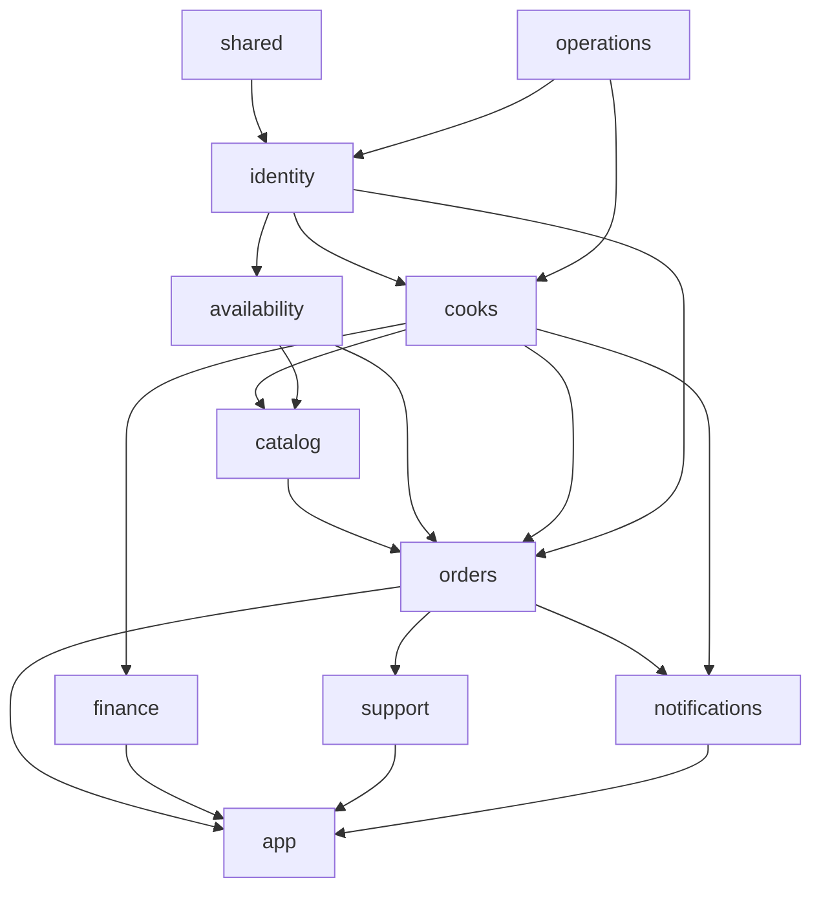

# Backend module guide

> **Owner role:** Backend architecture
> **Status:** IMPLEMENTED — describes the nine domain modules, `shared` and `app` as they exist in `backend/`

The backend is one Spring Boot application built from a Maven multi-module project (`backend/pom.xml`). Domain modules
are libraries; only `app` is runnable. Architecture background: [backend architecture](../03-architecture/backend-architecture.md).
Rules enforced by tests, not just convention:

- Another module may use a module **only through its `api` package** (`ModuleRules.onlyPublicApiCrossesModules` in
  `backend/app/src/test/java/com/matbakhy/app/architecture/ModuleRules.java`), run by
  `backend/app/src/test/java/com/matbakhy/app/architecture/ModuleBoundaryTest.java`.
- No module cycles; modules do not depend on `app`; `shared` depends on no module.
- Maven dependencies limit what a module can even see (each module's `pom.xml` lists the sibling modules it may use).
- No Java test sources exist inside the domain modules (only `backend/shared/src/test/java/com/matbakhy/shared/MoneyTest.java`);
  **all integration tests are in** `backend/app/src/test/java/com/matbakhy/app/` and run against real PostgreSQL
  (Testcontainers; `backend/app/src/test/java/com/matbakhy/app/support/IntegrationTest.java`).

Common package layout inside a module: `api/` (interfaces and records others may use), `internal/` (services, JDBC
adapters, jobs; package-private), `web/` (REST controllers). Persistence is plain `JdbcTemplate` SQL, not JPA, in every
module read for this page.

The diagram is simplified from the `matbakhy-*` dependencies in each module `pom.xml` (arrows point from the dependency to
its user; `shared` and `operations` are used by most modules and not all arrows are drawn).

## Module table at a glance

| Module | Depends on (pom) | Tables it touches (from its SQL) | Controllers' routes (API ids in [endpoint registry](../04-codebase/api-contracts.md)) |
|---|---|---|---|
| `shared` | none | none | none |
| `identity` | shared, operations | `app_user`, `address`, `phone_challenge`, `user_grant`, `deletion_request`, `spring_session` | `/me`, `/me/phone/*`, `/me/addresses*`, `/me/deletion-requests`, `/ops/staff*` |
| `operations` | shared | `audit_event` | `/ops/audit` |
| `cooks` | shared, identity, catalog, operations | `cook_application`, `cook_application_revision`, `kitchen`, `kitchen_zone` | `/cook/application*`, `/cook/settings`, `/ops/cooks*`, `/ops/kitchens/{id}/operating-state`, `/kitchens/{slug}` |
| `catalog` | shared, identity, operations, availability | `meal`, `meal_media`, `meal_revision`, `media_asset`, `media_cleanup`, `favorite`, `service_zone`, `kitchen_zone`, `activity_daily` | `/meals*`, `/zones`, `/cook/meals*`, `/uploads*`, `/me/favorites*`, `/ops/catalogue`, `/ops/meals/*/moderation`, `/activity` |
| `availability` | shared, identity | `cook_slot`, `meal_slot` | `/kitchens/{id}/slots`, `/cook/slots*` |
| `orders` | shared, identity, catalog, cooks, operations, availability | `customer_order`, `order_item`, `order_event`, `quote`, `quote_item`, `commerce_policy`, `stock_allocation`, `cash_obligation`, `handover_*`, `order_payment`, `payment_event`, `kitchen_payment_profile`, `review`, `review_report`, `config_change`, `feature_flag`, `outbox_event` | quotes, orders, cook order actions, payments, reviews, configuration |
| `finance` | shared, identity, cooks, operations | `cash_report`, `cash_obligation`, `ledger_group`, `ledger_entry`, `refund`, `settlement_batch`, `settlement_line` (reads `customer_order`, `order_event`, `quote`) | cash reports, refunds, settlements, statements, insights |
| `support` | shared, identity, orders, operations | `support_case`, `case_message` | `/support/cases*`, `/orders/{id}/cancellation-requests`, `/ops/cases*` |
| `notifications` | shared, identity, orders, cooks, operations | `notification`, `notification_delivery`, `device_registration`, `outbox_event` | `/notifications*`, `/me/devices/*`, `/ops/integrations`, `/ops/outbox/*/retry` |
| `app` | all modules | `idempotency_record`, MFA tables (`mfa_policy`, `user_mfa_preference`, `user_mfa_reset`), sessions | `/me/security*`, `/ops/security/*`, `/ops/accounts/*/mfa-reset`, OIDC routes |

## `shared` — `backend/shared`

- Responsibility: primitives with no domain knowledge.
- Entry points: `Money` (`backend/shared/src/main/java/com/matbakhy/shared/Money.java`), `ApiException` + `ErrorCode`
  (`.../shared/error/`), `IdempotentCommands` interface (`.../shared/idempotency/IdempotentCommands.java`),
  `PersonalDataEraser` (privacy erasure hook implemented by identity, cooks, catalog, orders, support, notifications),
  `RuntimeEnvironment`, `RequestContext`, `Languages`, `DomainModule` annotation.
- Tests: `backend/shared/src/test/java/com/matbakhy/shared/MoneyTest.java`; error codes are cross-checked against the OpenAPI
  enum by `packages/api-client/test/registry.test.ts`.
- Avoid changing without architectural review: `ErrorCode` (a public contract; the api-client test fails if the enum and
  `contracts/openapi.yaml` `ApiError.code` differ), `IdempotentCommands`, `Money`.

## `identity` — accounts, contact, grants

- Responsibility: local account mapped from the OIDC subject, profile, verified phone, addresses, staff grants, account
  deletion/erasure. Passwords, OTP login and MFA factors are **not** here: they live in Keycloak.
- Source: `backend/modules/identity/src/main/java/com/matbakhy/identity/`.
- Entry points: `web/ProfileController.java`, `web/ContactController.java`, `web/StaffController.java`;
  services `internal/ProfileService.java`, `PhoneVerificationService.java`, `AddressService.java`, `GrantService.java`,
  `AccountLifecycleService.java`, `AccountErasureService.java` + `AccountErasureJob.java`.
- APIs offered (`identity/api`): `Permission` (staff permission enum), `AccessPolicy`, `CurrentAccount`, `AccountDirectory`,
  `AddressDirectory`, `CheckoutContactPolicy`, `GrantDirectory`, `EgyptianPhone`, `PhoneVerificationSender` (port; the fake
  is `backend/app/src/main/java/com/matbakhy/app/providers/FakePhoneVerificationSender.java`, allowed only in the synthetic environments LOCAL, CI and PREVIEW; STAGING and PRODUCTION refuse to start without a real provider, O07).
- DB: migrations V1, V2, V3, V4, V21, V27. Tests: `IdentityIntegrationTest`, `ContactIntegrationTest`,
  `StaffAccessIntegrationTest`, `EgyptianPhoneTest`, `AccountErasureIntegrationTest` (in `backend/app/src/test/java/com/matbakhy/app/identity/` and `.../privacy/`).
- Extension points: new staff permission (enum + grant UI + docs); new contact rule in `CheckoutContactPolicy`.
- Avoid changing without review: `GrantService` (last-administrator and self-escalation protection, BR-043),
  OTP hashing/limits in `PhoneVerificationService`, erasure logic (V21/V27).

## `operations` — audit

- Responsibility: append-only audit log and redaction.
- Source: `backend/modules/operations/src/main/java/com/matbakhy/operations/`; `api/AuditLog.java`, `api/Redaction.java`,
  `internal/JdbcAuditLog.java`, `web/AuditController.java` (`GET /api/v1/ops/audit`).
- Dependencies: only `shared`. Used by nearly every module (`audit.record(...)`).
- Tests: `AuditAndCorrelationReadinessIntegrationTest`, `LogRedactionIntegrationTest`, `MfaResetAuditIntegrationTest`.
- Avoid changing: redaction rules (privacy, BR-056) and the append-only guarantee (a database trigger protects the table; see V4).
- Note: `GET /api/v1/ops/audit/export` (API-095) is **PLANNED**, not implemented.

## `cooks` — applications and kitchens

- Responsibility: cook application drafts/submissions (immutable revisions), reviewer queue and decisions, kitchen creation on
  approval, pause/suspend, public kitchen profile, kitchen settings.
- Source: `backend/modules/cooks/src/main/java/com/matbakhy/cooks/`. Entry points: `web/CookApplicationController.java`,
  `CookReviewController.java`, `CookSettingsController.java`, `KitchenPublicController.java`; `internal/CookApplicationService.java`,
  `CookReviewService.java`, `KitchenService.java`.
- APIs offered: `KitchenDirectory` (is this cook's kitchen allowed to sell/accept/fulfil — used by orders, finance),
  `KitchenOrderImpact`. Implements `SellerDirectory` (catalog API) and `PrivateMediaAccess`.
- Tests: `CookWorkflowIntegrationTest`, `CookWorkspaceIntegrationTest`. Owner E2E: E2E-COOK-049, E2E-OPS-108.
- Avoid changing: decision/step-up/no-self-review checks in `CookReviewService`; kitchen eligibility in `KitchenService`.

## `catalog` — meals, media, discovery, favorites, activity

- Responsibility: meals with immutable revisions, publication guards, media upload pipeline (signed upload, size/type/scan),
  server-side discovery, zones, favorites, privacy-safe organic activity counters.
- Source: `backend/modules/catalog/src/main/java/com/matbakhy/catalog/`. Entry points: `web/MealController.java`,
  `DiscoveryController.java`, `UploadController.java`, `FavoriteController.java`, `ModerationController.java`, `ActivityController.java`;
  `internal/meal/MealService.java` (revision write at `MealService.writeContent`, line 420; price history at line 186),
  `internal/discovery/DiscoveryService.java`, `internal/media/MediaService.java`.
- APIs offered: `MealCatalog` (`current`, `revisionSnapshot`, `lockPricing`, `deliveryFee`), `MediaLibrary`, `ObjectStorage` and
  `MalwareScanner` ports (S3 adapter `backend/app/src/main/java/com/matbakhy/app/providers/S3ObjectStorage.java`; fake scanner is limited to LOCAL/CI/PREVIEW), `SellerDirectory`, `KitchenRatings`.
- DB: V5-V9 (shared with cooks), V16, V20, V26, V30. Tests: `MealIntegrationTest`, `DiscoveryIntegrationTest`,
  `ModerationIntegrationTest`, `PriceHistoryIntegrationTest`, `MediaIntegrationTest`, `MediaCleanupIntegrationTest`,
  `ActivityInsightsIntegrationTest`, `ReviewsAndFavoritesIntegrationTest`.
- Avoid changing: `meal_revision` append-only semantics (orders point at `(meal_id, revision)`), `MealCatalog.lockPricing`
  (used to serialize price edits against placement, D13), media validation/quarantine (BR-010).

## `availability` — slots and stock counters

- Responsibility: dated cook slots in Africa/Cairo stored as UTC instants, meal-level and slot-level capacity.
- Source: `backend/modules/availability/src/main/java/com/matbakhy/availability/`. Entry: `web/SlotController.java`,
  `internal/SlotService.java`, **`internal/JdbcSlotInventory.java`** (`reserve` line 34, `move` line 79), `internal/CairoTime.java`.
- APIs offered: `SlotInventory` (reserve/move/release — mandatory transaction propagation), `SlotDirectory`, `SlotParticipants`.
- Test: `SlotIntegrationTest` (TC-013..015, TC-115); concurrency in `OrderPlacementIntegrationTest` (TC-025).
- Avoid changing: lock order (slot row, then meal-slot rows by id) and the counter arithmetic (`reserved`, `allocated`,
  `consumed`) — deadlock- and oversell-critical.

## `orders` — quotes, orders, lifecycle, payments, reviews, configuration

- Responsibility: authoritative quotes, atomic placement with idempotency, immutable snapshots, state machine, handover
  codes, deposit payment state, commerce policy/configuration, reviews.
- Source: `backend/modules/orders/src/main/java/com/matbakhy/orders/`. Entry points: `web/QuoteController.java`,
  `OrderController.java`, `CookOrderController.java`, `OpsOrderController.java`, `PaymentController.java`, `ReviewController.java`,
  `ConfigurationController.java`, `PublicConfigurationController.java`; services `QuoteService`, `OrderService`, `OrderLifecycleService`,
  `PaymentService`, `ConfigurationService`, `HandoverCodes`, `ReviewService`, `CookDashboardService`, `OpsOrderService`, job `OrderExpiryJob`.
- APIs offered: `QuoteDirectory`, `OrderDirectory`, `OrderCases` (implemented by `support`), `SyntheticPolicyPermission`.
- Walkthroughs: [orders](order-implementation.md), [pricing](pricing-implementation.md), [payments](payment-implementation.md).
- Tests: `QuoteIntegrationTest`, `OrderPlacementIntegrationTest`, `OrderLifecycleIntegrationTest`, `PriceChangeIntegrationTest`,
  `ConfigurationIntegrationTest`, `PublicConfigurationIntegrationTest`, `DepositPaymentIntegrationTest`,
  `PaymentReconciliationIntegrationTest`, `OrderFingerprintTest`.
- Extension points: new order action = new case in `OrderLifecycleService.cook` + `OrderController`/`CookOrderController` route +
  contract; new payment rail needs a product decision first (D16 limits the MVP to COD and kitchen-reported deposit).
- Avoid changing without architectural review: **everything that touches money, idempotency or state**: `OrderService.placeOnce`,
  `QuoteService.requireValid`, `OrderLifecycleService.transition`/`move`/`release`, `PaymentService.move`, the V29 fingerprint, the
  immutability triggers in V11/V12/V24, commission handling (D10).

## `finance` — cash, ledger, refunds, settlements, statements, insights

- Responsibility: cook cash reports and finance verification (separation of duties), balanced append-only ledger groups,
  refunds and settlements with approval separation, cook statements, cook insights.
- Source: `backend/modules/finance/src/main/java/com/matbakhy/finance/`. Entry: `web/CashController.java`, `FinanceOpsController.java`,
  `StatementController.java`, `InsightsController.java`; services `CashService`, `LedgerService`, `FinanceOpsService`, `StatementService`,
  `InsightsService`; job `LedgerPostingJob` (every `matbakhy.finance.posting-job.interval`, default 30s).
- Tests: `CashAndLedgerIntegrationTest`, `FinanceOperationsIntegrationTest`, `ZeroCommissionIntegrationTest`.
- Avoid changing: ledger posting and the database invariants in V13/V18 (balanced, append-only), `CashService.verify`
  (separation of duties), refund/settlement state machines.

## `support` — cases and cancellation requests

- Source: `backend/modules/support/src/main/java/com/matbakhy/support/`; `web/SupportController.java`, `web/StaffCaseController.java`,
  `internal/SupportService.java` (implements `OrderCases`, also opens the automatic PAYMENT case for disputed deposits, V28).
- Test: `backend/app/src/test/java/com/matbakhy/app/support/cases/SupportIntegrationTest.java` (TC-041, TC-124).
- Avoid changing: visibility of private staff notes to customers/cooks.

## `notifications` — outbox, inbox, deliveries, devices

- Source: `backend/modules/notifications/src/main/java/com/matbakhy/notifications/`; `internal/OutboxDispatcher.java` (leased dispatch),
  `DeliveryWorker`, `NotificationService`, `TokenVault` (encrypted device tokens), `web/NotificationController.java`; `api/NotificationChannels`
  port (stand-in `backend/app/src/main/java/com/matbakhy/app/providers/LoggingNotificationChannels.java` sends nothing and is limited to LOCAL/CI/PREVIEW).
- Status: in-app inbox IMPLEMENTED; external push is behind `matbakhy.notifications.push-enabled` (default off) and no
  FCM/APNs adapter exists — PLANNED (owner decision O07 open).
- Tests: `NotificationIntegrationTest`, `PushFlagIntegrationTest`, `RestartRecoveryIntegrationTest`.

## `app` — composition root

- Source: `backend/app/src/main/java/com/matbakhy/app/`.
- `MatbakhyApplication`; `security/` (chains, filters, `AccountMapper`, `StaffAssurance`, `ScopedAccessPolicy`, `MfaEnforcementFilter`);
  `mfa/` (MFA policy, preference, reset, `KeycloakAdmin` client); `config/` (`EnvironmentGuard`, `StrictJsonConfiguration`,
  `PlatformConfiguration`); `providers/` (port adapters and fakes); `idempotency/JdbcIdempotentCommands.java`; `web/`
  (`ApiExceptionHandler`, `RequestIdFilter`); `observability/OperationalMetrics.java`.
- Migrations and application YAML live here (see [repository map](repository-map.md)).
- Avoid changing without review: `SecurityConfiguration`, `MfaEnforcementFilter`, `StaffAssurance`, `EnvironmentGuard` and `ProviderConfiguration` (block fake
  providers in STAGING/PRODUCTION; environments are LOCAL, CI, PREVIEW, STAGING, PRODUCTION in `MatbakhyProperties.DeploymentEnvironment`), `JdbcIdempotentCommands`, every migration already merged.

## Cross-cutting "do not change without architectural review"

| Area | Why | Where |
|---|---|---|
| Money arithmetic | integer piastres, overflow-checked (`Math.addExact`/`multiplyExact`); one rounding rule per place | `QuoteService`, `PaymentService.terms`, `OrderService` commission line |
| Ledger | balanced double-entry, append-only, posted once per source event | `LedgerService`, V13/V18, `ledger_entry_balanced` trigger |
| Idempotency | actor+command+key scope, request hash, plus permanent `(customer_id, client_request_id)` | `JdbcIdempotentCommands`, `OrderService.placeOnce`, V1, V29 |
| Authorization | server-side only; token role claims ignored; 404 for foreign objects | `SecurityConfiguration`, `AccountMapper`, services' scoped SQL |
| Migrations | applied versions are immutable; runtime role has no DDL; `scripts/check_migration_compat.py` checks old/new compatibility | `backend/app/src/main/resources/db/migration/` |
| Capacity | lock order and counters | `JdbcSlotInventory` |

## Known limitations and documentation gaps

- Several controllers are package-private (`class OrderController`), so IDE "find usages" by route string is the quickest way to find a handler; use the table above.
- `docs/engineering/01-architecture.md` (ADR-001) mentions JPA for normal persistence; the code read for this page uses `JdbcTemplate` throughout. Trust the code.
