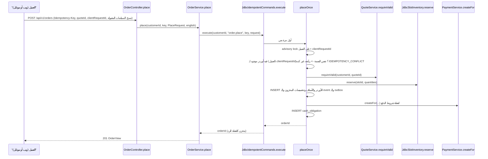

# شرح تنفيذ الأوردر

> **Owner role:** Backend architecture
> **Status:** IMPLEMENTED — تسجيل الأوردر والـ Idempotency وحجز السعة والـ Snapshots ودورة الحياة والانتهاء موجودين وعليهم اختبارات تكامل
> **Language / اللغة:** [English](order-implementation.md) · العربية

جولة على مستوى الكود في تسجيل الأوردر وتحريكه عبر دورة حياته. أرقام الأسطر اتقرت على الـ Branch ده (`path:line`)؛ لو الكود اتحرّك، دوّر باسم الـ Method. المعنى البيزنس: [دورة حياة الأوردر](../01-business/order-lifecycle-ar.md)، والقواعد `BR-018`..`BR-031` في `docs/product/03-business-rules.md`، والـ State Machine في `docs/product/04-state-machines.md`. منطق السعر في [تنفيذ التسعير](pricing-implementation-ar.md)، والفلوس والعربون في [تنفيذ الدفع](payment-implementation-ar.md).

## طبقتين Idempotency (ماتخلطش بينهم)

| الطبقة | النطاق | مدة الحياة | متخزّنة في | الكود |
|---|---|---|---|---|
| الـ Header اسمه `Idempotency-Key` | الفاعل + الأمر (`order.place`) + المفتاح؛ جسم الطلب بيتعمله Hash (SHA-256 للـ JSON) | الـ `expires_at` بيتختم قدّام بـ 24 ساعة (`JdbcIdempotentCommands.RETENTION`) بس مبيتقراش أبدًا: السجلات مبتنتهيش ولا بتتمسح بالكود الحالي، فإعادة التشغيل (Replay) بتشتغل طول ما الصف موجود | الجدول `idempotency_record` (V1) | `backend/app/src/main/java/com/matbakhy/app/idempotency/JdbcIdempotentCommands.java:49` |
| `clientRequestId` + بصمة الطلب (Fingerprint) | `(customer_id, client_request_id)` فريد لكل عميل | دائمة | `customer_order.client_request_id`، `customer_order.request_fingerprint` (V29) | `backend/modules/orders/src/main/java/com/matbakhy/orders/internal/OrderService.java:155` |

ليه اتنين: سجل الـ Header هو بس بيانات احتفاظ (`expires_at` بعد 24 ساعة، ومفيش انتهاء أو مسح تلقائي النهارده، شوف القيود المعروفة) وممكن مشغّل يشيله أو Job مسح في المستقبل، والعميل اللي كان Offline لأيام لازم برضه ميقدرش يعمل أوردر تاني لنفس المحاولة المنطقية (`BR-023`، `BR-024`). الـ V29 (`backend/app/src/main/resources/db/migration/V29__order_request_fingerprint.sql`) ضاف البصمة الدائمة عشان إعادة استخدام `clientRequestId` مع طلب مختلف جوهريًا تبقى تعارض حتمي حتى بعد ما الـ Cache يروح. الأوردرات اللي اتسجّلت قبل V29 بصمتها null وبتفضل على المقارنة القديمة بالـ Quote بس (`OrderService.java:162-164`).

## مسار الطلب

## خطوة بخطوة

1. **الـ Controller.** الـ `OrderController.place` (`backend/modules/orders/src/main/java/com/matbakhy/orders/web/OrderController.java:61`) بيربط `PlaceBody` (`:57`): `quoteId`، `clientRequestId`، `acceptedPolicyVersions{terms,cancellation}`، و`fulfillmentNote` اختياري (أقصى 500). الحساب جاي من `@AuthenticationPrincipal CurrentAccount`؛ مفيش customer id في الـ Body. بيرد بـ `201` مع Header اسمه `Location`.
2. **الـ Transaction + الـ Idempotency.** الـ `OrderService.place` (`OrderService.java:131`) عليه `@Transactional` وبينادي `idempotency.execute(customerId, "order.place", key, in, UUID.class, () -> placeOnce(...))` (`:132`). الـ `JdbcIdempotentCommands.execute` هو `Propagation.MANDATORY`: بيرفض يشتغل برّه Transaction. المفتاح الناقص أو الغلط شكله هو `MALFORMED_REQUEST` (نمط المفتاح `[A-Za-z0-9-]{8,128}`). بيدخّل صف النطاق بـ `ON CONFLICT DO NOTHING` (`:57`)؛ التكرار المتزامن بيقف على الـ Insert ده، وبعدين يقرا النتيجة بعد ما الـ Transaction يتعمل لها Commit. نفس المفتاح + Hash مختلف للجسم -> `IDEMPOTENCY_CONFLICT`. الأمر اللي فشل بيمسح سجله بنفسه (`:83`) عشان إعادة المحاولة تقدر تشتغل. النتيجة المخزّنة هي **رقم الأوردر** بس؛ والـ Response بيتبني من الأوردر كل مرة (`OrderService.java:133`)، فالـ Replay بيعرض الحالة الحالية.
3. **تسلسل المحاولات لمرجع طلب واحد.** الـ `placeOnce` بياخد `pg_advisory_xact_lock(hashtextextended('order-request:<customer>:<clientRequestId>', 0))` (`:157`).
4. **فحص الاسترداد.** بيدوّر على `(customer_id, client_request_id)` (`:159`). نفس الـ Quote ونفس البصمة المخزّنة -> بيرجّع رقم الأوردر الموجود (`:164-166`)؛ أي حاجة تانية -> `IDEMPOTENCY_CONFLICT` مع خطأ حقل `clientRequestId: ALREADY_USED` (`:168`). البصمة هي `OrderService.fingerprint` (`:140`): SHA-256 على `v1|<len>:<quoteId>|<len>:<clientRequestId>|<len>:<termsVersion>|<len>:<cancellationPolicyVersion>|<len>:<trimmed note>` (حقول بادئتها الطول عشان مفيش قيمة تقلّد فاصل). اختبار الوحدة: `backend/app/src/test/java/com/matbakhy/orders/internal/OrderFingerprintTest.java`.
5. **التحقق من الـ Quote وانتهاؤه.** `quotes.requireValid(customerId, quoteId)` (`:171`) -> `QuoteService.requireValid` (`QuoteService.java:146`): الـ Quote لازم يكون بتاع المستدعي (غير كده `NOT_FOUND`)، ولازم ميكونش عدّى `expires_at` (`QUOTE_EXPIRED`، `:157`)، وبيتعاد حسابه على البيانات الحالية (أسباب `PRICE_CHANGED`/`STATE_CONFLICT`: `POLICY_CHANGED`، `MEAL_CHANGED`، `TOTAL_CHANGED`، `ADDRESS_CHANGED`، `PAYMENT_CHANGED`). التفاصيل في [تنفيذ التسعير](pricing-implementation-ar.md).
6. **قبول السياسات.** نسخ الـ `terms` والـ `cancellation` المبعوتة لازم تساوي نسخ الـ Quote (`:172`)، غير كده `STATE_CONFLICT` حقل `acceptedPolicyVersions: POLICY_NOT_ACCEPTED`.
7. **أوردر واحد لكل Quote.** `SELECT EXISTS ... WHERE quote_id = ?` (`:176`) -> `QUOTE_ALREADY_USED`؛ والـ Schema فيه كمان `quote_id ... UNIQUE` على `customer_order` (V11).
8. **جهة اتصال متحقَّق منها.** `contact.verifiedContact(customerId)` (`:180`؛ `CheckoutContactPolicy`، منفّذة في identity) بيرجّع الاسم المعروض والتليفون المتحقَّق منهم عشان يتعملهم Snapshot، أو يرفض بـ `CONTACT_VERIFICATION_REQUIRED`.
9. **حجز السعة.** `inventory.reserve(q.slotId(), wanted)` (`:183`) -> `JdbcSlotInventory.reserve` (`backend/modules/availability/src/main/java/com/matbakhy/availability/internal/JdbcSlotInventory.java:34`). بيقفل صف `cook_slot` الأول (`... state = 'OPEN' AND cutoff_at > now ... FOR UPDATE`، `:39-42`، غير كده `SLOT_CLOSED`)، وبعدين صفوف `meal_slot` مرتّبة بالـ id (`:47-51`)، وبيفحص `capacity - reserved - allocated - consumed` لكل وجبة وللـ Slot كله (`STOCK_CHANGED`)، وبيزوّد `reserved` على المستويين (`:69-73`). كل البنود لازم تنجح أو الـ Transaction تتراجع (الكل أو لا شيء؛ الاختبار `a_two_meal_order_is_refused_without_partial_reservation_...`). الـ Method محتاجة Transaction موجودة.
10. **الـ Snapshots.** العنوان: عنوان التوصيل الظاهر للطبّاخ بيتحوّل لـ Serialized من العنوان المملوك (`:185-190`). Snapshot جهة الاتصال: JSON لجهة الاتصال المتحقَّق منها. البنود: لكل بند في الـ Quote، `meals.revisionSnapshot(mealId, revision)` بينسخ الـ Snapshot غير القابل للتعديل من `meal_revision` إلى `order_item.meal_snapshot` (`:206-213`)، ومعاه سعر الوحدة وإجمالي السطر **المتسعّرين في الـ Quote** (مش بيتقروا تاني من الوجبة). الـ `order_item` محمي بـ Trigger للتعديل/المسح (V11).
11. **صف الأوردر.** `INSERT INTO customer_order` (`:196-205`) في حالة `PENDING_ACCEPTANCE`، مع `public_number` بصيغة `MB-<sequence>`، و`accept_by` من الـ Quote، والأسعار من الـ Quote المتحقَّق منه، و`policy_version`، و`terms_version`، و`cancellation_policy_version`، وSnapshot العمولة (`commission_bps_snapshot`، `commission_minor`، `:194`). عند الإطلاق السياسة الفعّالة 0 bps (D10): الـ CHECK في قاعدة البيانات من V23 بيسمح بقيمة غير صفرية للـ Fixtures الاصطناعية (Synthetic) بس. الاختبار: `ZeroCommissionIntegrationTest`.
12. **صفوف تخصيص المخزون والحدث والـ Outbox.** صف `stock_allocation` واحد لكل وجبة-Slot محجوزة في حالة `RESERVED` (`:214-217`)؛ و`order_event` بتسلسل 1 (`NULL -> PENDING_ACCEPTANCE`، الفاعل `CUSTOMER`، `:218-220`)؛ و`outbox_event` باسم `ORDER_PLACED` شايل رقم الطلب الحالي (`:221-225`) لموزّع الإشعارات.
13. **Snapshot الدفع والتزام الكاش.** `payments.createFor(...)` (`:227`) بيكتب `order_payment` (الطريقة COD أو DEPOSIT، الحالة `NOT_REQUIRED` أو `WAITING_FOR_DEPOSIT`)؛ وبعدين `cash_obligation` بقيمة `total - deposit` في حالة `DUE` (`:230`). شوف [تنفيذ الدفع](payment-implementation-ar.md).
14. **الرد.** `view(customerId, orderId, english)` بيبني `OrderView` (`:314`)، شامل عرض الدفع، وبمجرد ما الأوردر يبقى READY، كود التسليم (Handover) ظاهر للمالك بس.

كل حاجة من الخطوة 2 لحد 14 هي Transaction واحدة في قاعدة البيانات. الاختبار `OrderPlacementIntegrationTest.an_injected_failure_after_the_stock_update_rolls_everything_back_and_a_retry_completes_once` بيثبت التراجع.

## البحث للاسترداد

الـ `GET /api/v1/orders/by-request/{clientRequestId}` -> `OrderService.byRequest` (`OrderService.java:242`) بيرجّع أوردر المستدعي نفسه لذلك المرجع أو 404. العملاء بيستخدموه بعد Timeout أو إعادة تشغيل: الويب `apps/customer-web/src/Checkout.tsx:219`، والموبايل `apps/customer-mobile/src/placement.ts:49-69`. مرجع عميل تاني بيرد 404 (الاختبار `another_customer_cannot_find_an_order_by_its_client_request_id`).

## دورة الحياة بعد التسجيل

كل الانتقالات في `backend/modules/orders/src/main/java/com/matbakhy/orders/internal/OrderLifecycleService.java`. كل أمر بيقفل صف الأوردر في نطاق الفاعل (`lock(...)` مع `o.kitchen_id = ?` أو `o.customer_id = ?`)، وبيفحص `expectedVersion` (`guard`)، وبيفحص الحالة (`require`)، وبيحرّك المخزون، وبينادي `transition` (`:348`)، اللي بيعمل Update بـ `WHERE version = ? AND state = ?` (تفاؤلي؛ غير كده `VERSION_CONFLICT`)، وبيضيف `order_event` التالي، وبيكتب حدث Outbox باسم `ORDER_<STATE>`، ولأي حالة نهائية غير COMPLETED بينادي `PaymentService.orderClosed`.

| الأمر (المسار) | الـ Method | من -> إلى | المخزون | التزام الكاش |
|---|---|---|---|---|
| إلغاء العميل (`POST /orders/{id}/cancel`) | `customerCancel` `:84` | PENDING_ACCEPTANCE -> CANCELLED (الحالات الأبعد بترد `CANCELLATION_REQUEST_REQUIRED`) | تحرير RESERVED | NOT_DUE |
| قبول الطبّاخ | `cook` الحالة `accept` `:120` | PENDING_ACCEPTANCE -> ACCEPTED (قبل `accept_by`، والمطبخ لازم يكون قادر يقبل) | RESERVED -> ALLOCATED | |
| رفض الطبّاخ | `:132` | PENDING_ACCEPTANCE -> REJECTED | تحرير RESERVED | NOT_DUE |
| تحضير الطبّاخ | `:139` | ACCEPTED -> PREPARING؛ ممنوع لحد ما يتبلّغ عن استلام العربون (`payments.requireReadyForPreparation`) | ALLOCATED -> CONSUMED | |
| جاهز من الطبّاخ | `:146` | PREPARING -> READY؛ بيصدر تحدي التسليم لمرة واحدة (`HandoverCodes`) | | |
| إرسال الطبّاخ | `:152` | READY -> OUT_FOR_DELIVERY (وضع التوصيل بس، ومحتاج مرجع مندوب) | | |
| تسليم الطبّاخ | `handover` `:387` | READY (استلام) أو OUT_FOR_DELIVERY -> COMPLETED؛ الكود بيتقارن بالـ Hash بتاعه، 5 محاولات | | الإتمام مش معناه إن الكاش اتدفع |
| فشل توصيل الطبّاخ | `:163` | OUT_FOR_DELIVERY -> DELIVERY_FAILED | المستهلَك يفضل مستهلَك | |
| إلغاء الطبّاخ | `:171` | ACCEPTED -> CANCELLED (قبل التحضير) | تحرير ALLOCATED | NOT_DUE |
| إلغاء الاستثناء من العمليات / تجاوز التسليم | `opsExceptionCancel` `:188`، `opsHandoverOverride` `:208` | بصلاحية (`order.exception_cancel`، `order.handover_override` + MFA حديث) | | |
| الانتهاء | `OrderExpiryJob.run` -> `dueForExpiry` `:231` / `expireOne` `:237` | PENDING_ACCEPTANCE عدّى `accept_by` -> EXPIRED (الفاعل SYSTEM) | تحرير RESERVED | NOT_DUE |

الـ `OrderExpiryJob` (`backend/modules/orders/src/main/java/com/matbakhy/orders/internal/OrderExpiryJob.java`) بيشتغل كل `matbakhy.orders.expiry-job.interval` (الافتراضي 30 ثانية) وممكن يتقفل بـ `matbakhy.orders.expiry-job.enabled=false` (الاختبارات بتعمل كده). الـ `release` (`:334`) بيرجّع الحصص **مرة واحدة بالظبط**: التخصيصات اللي لسه في الحالة المتوقعة بس هي اللي بتتحرّر. الحالات النهائية محمية بـ Trigger في قاعدة البيانات اسمه `customer_order_terminal_guard` (V12). مجموعة الحالات النهائية: `OrderLifecycleService.TERMINAL` (`:42`).

## الاختبارات اللي تقراها الأول

- `backend/app/src/test/java/com/matbakhy/app/orders/OrderPlacementIntegrationTest.java` — الذرّية، والتراجع، وإعادة المحاولة بعد انتهاء احتفاظ الـ Idempotency، وتعارض البصمة، وأوردرات ما قبل V29، وسباق آخر حصة بين 20 عميل، ورفض الحجز الجزئي، وخصوصية البحث عن الأوردر.
- `backend/app/src/test/java/com/matbakhy/app/orders/OrderLifecycleIntegrationTest.java` — الانتقالات، وحارس النسخة (Version)، والانتهاء، وأكواد التسليم، ومحاسبة المخزون.
- `backend/app/src/test/java/com/matbakhy/app/orders/PriceChangeIntegrationTest.java` — تعديلات السعر وهي بتسابق التسجيل.
- المتصفح: `apps/operations-web/e2e/customer-journey.e2e.ts`.

## نقاط التوسعة الآمنة والمناطق المحتاجة مراجعة

آمن: حقول قراءة جديدة في `OrderView` (مع تحديث العقد)، وإجراء طبّاخ جديد بيمشي على نمط `switch` الموجود، وأنواع أحداث إشعارات جديدة في الـ Outbox.
محتاج مراجعة: ترتيب الأقفال في `placeOnce` و`JdbcSlotInventory`، ونطاق الـ Idempotency، وصيغة البصمة (البادئة `v1` معناها إن أي تغيير محتاج `v2` وخطة Migration)، وأي UPDATE على `customer_order`/`order_item` برّه `transition`.

## القيود المعروفة وفجوات التوثيق

- مالقيناش كود بيمسح صفوف `idempotency_record` المنتهية (الفهرس على `expires_at` بس موجود في V1)؛ الجدول باين إنه بيكبر من غير مسح. NOT VERIFIED لو في Job خارجي بيعمل ده.
- `docs/engineering/03-api-contract.md` بيوصف الـ Idempotency بشكل عام؛ السلوك ذو الطبقتين اللي فوق ظاهر في الكود و`OrderPlacementIntegrationTest` بس.
