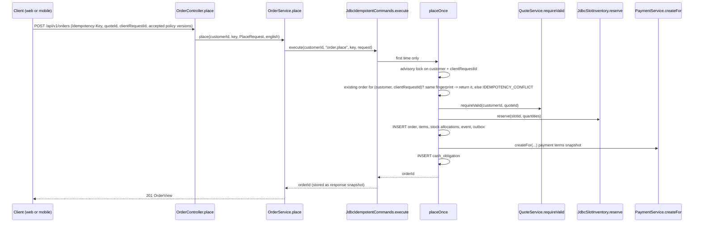

# Order implementation walkthrough

> **Owner role:** Backend architecture
> **Status:** IMPLEMENTED — placement, idempotency, capacity reservation, snapshots, lifecycle and expiry exist and are integration-tested
> **Language / اللغة:** English · [العربية](order-implementation-ar.md)

A code-level walk through placing an order and moving it through its lifecycle. Line references were read on this branch
(`path:line`); if code moves, search by the method name. Business meaning:
[order lifecycle](../01-business/order-lifecycle.md), rules `BR-018`..`BR-031` in `docs/product/03-business-rules.md`, state
machine in `docs/product/04-state-machines.md`. Price logic is in [pricing implementation](pricing-implementation.md),
money and deposits in [payment implementation](payment-implementation.md).

## Two idempotency layers (do not confuse them)

| Layer | Scope | Lifetime | Stored in | Code |
|---|---|---|---|---|
| `Idempotency-Key` header | actor + command (`order.place`) + key; request body hashed (SHA-256 of the JSON) | `expires_at` is stamped 24 h ahead (`JdbcIdempotentCommands.RETENTION`) but never read: records are not expired or purged by current code, so replay works for as long as the row exists | table `idempotency_record` (V1) | `backend/app/src/main/java/com/matbakhy/app/idempotency/JdbcIdempotentCommands.java:49` |
| `clientRequestId` + request fingerprint | `(customer_id, client_request_id)` unique per customer | permanent | `customer_order.client_request_id`, `customer_order.request_fingerprint` (V29) | `backend/modules/orders/src/main/java/com/matbakhy/orders/internal/OrderService.java:155` |

Why two: the header record is only retention metadata (24 h `expires_at`, no automatic expiry or purge today, see Known limitations) and can be removed by an operator or a future purge job, and a client that was offline for days must still be unable to create a second order for
the same logical attempt (`BR-023`, `BR-024`). V29 (`backend/app/src/main/resources/db/migration/V29__order_request_fingerprint.sql`)
added the durable fingerprint so reuse of a `clientRequestId` with a materially different request is a deterministic conflict
even after the cache is gone. Orders placed before V29 have a null fingerprint and keep the older quote-only comparison
(`OrderService.java:162-164`).

## Request path

## Step by step

1. **Controller.** `OrderController.place` (`backend/modules/orders/src/main/java/com/matbakhy/orders/web/OrderController.java:61`) binds
   `PlaceBody` (`:57`): `quoteId`, `clientRequestId`, `acceptedPolicyVersions{terms,cancellation}`, optional `fulfillmentNote` (max 500). The
   account comes from `@AuthenticationPrincipal CurrentAccount`; there is no customer id in the body. It answers `201` with a `Location` header.
2. **Transaction + idempotency.** `OrderService.place` (`OrderService.java:131`) is `@Transactional` and calls
   `idempotency.execute(customerId, "order.place", key, in, UUID.class, () -> placeOnce(...))` (`:132`). `JdbcIdempotentCommands.execute` is
   `Propagation.MANDATORY`: it refuses to run outside a transaction. A missing/malformed key is `MALFORMED_REQUEST` (key pattern `[A-Za-z0-9-]{8,128}`).
   It inserts the scope row with `ON CONFLICT DO NOTHING` (`:57`); a concurrent duplicate blocks on that insert, then reads the committed
   result. Same key + different body hash -> `IDEMPOTENCY_CONFLICT`. A failed command deletes its own record (`:83`) so a retry can run.
   The stored result is only the **order id**; the response is rebuilt from the order each time (`OrderService.java:133`), so a replay shows current state.
3. **Serialize attempts for one request reference.** `placeOnce` takes `pg_advisory_xact_lock(hashtextextended('order-request:<customer>:<clientRequestId>', 0))` (`:157`).
4. **Recovery check.** Look up `(customer_id, client_request_id)` (`:159`). Same quote and same stored fingerprint -> return the existing order id
   (`:164-166`); anything else -> `IDEMPOTENCY_CONFLICT` with field error `clientRequestId: ALREADY_USED` (`:168`).
   The fingerprint is `OrderService.fingerprint` (`:140`): SHA-256 over `v1|<len>:<quoteId>|<len>:<clientRequestId>|<len>:<termsVersion>|<len>:<cancellationPolicyVersion>|<len>:<trimmed note>`
   (length-prefixed fields so no value can imitate a delimiter). Unit test: `backend/app/src/test/java/com/matbakhy/orders/internal/OrderFingerprintTest.java`.
5. **Quote validation and expiry.** `quotes.requireValid(customerId, quoteId)` (`:171`) -> `QuoteService.requireValid` (`QuoteService.java:146`):
   quote must belong to the caller (else `NOT_FOUND`), must not be past `expires_at` (`QUOTE_EXPIRED`, `:157`), and is recomputed against current data
   (`PRICE_CHANGED`/`STATE_CONFLICT` reasons: `POLICY_CHANGED`, `MEAL_CHANGED`, `TOTAL_CHANGED`, `ADDRESS_CHANGED`, `PAYMENT_CHANGED`). Details in [pricing implementation](pricing-implementation.md).
6. **Policy acceptance.** The submitted `terms` and `cancellation` versions must equal the quote's (`:172`), else `STATE_CONFLICT` field `acceptedPolicyVersions: POLICY_NOT_ACCEPTED`.
7. **One order per quote.** `SELECT EXISTS ... WHERE quote_id = ?` (`:176`) -> `QUOTE_ALREADY_USED`; the schema also has `quote_id ... UNIQUE` on `customer_order` (V11).
8. **Verified contact.** `contact.verifiedContact(customerId)` (`:180`; `CheckoutContactPolicy`, implemented in identity) returns the verified display name and phone to snapshot, or refuses with `CONTACT_VERIFICATION_REQUIRED`.
9. **Capacity reservation.** `inventory.reserve(q.slotId(), wanted)` (`:183`) -> `JdbcSlotInventory.reserve`
   (`backend/modules/availability/src/main/java/com/matbakhy/availability/internal/JdbcSlotInventory.java:34`). It locks the `cook_slot` row first
   (`... state = 'OPEN' AND cutoff_at > now ... FOR UPDATE`, `:39-42`, else `SLOT_CLOSED`), then the `meal_slot` rows ordered by id (`:47-51`), checks
   `capacity - reserved - allocated - consumed` per meal and for the whole slot (`STOCK_CHANGED`), and increments `reserved` on both levels (`:69-73`).
   All lines succeed or the transaction rolls back (all-or-nothing; test `a_two_meal_order_is_refused_without_partial_reservation_...`). The method requires an existing transaction.
10. **Snapshots.** Address: the cook-visible delivery address is serialized from the owned address (`:185-190`). Contact snapshot: JSON of the verified contact.
    Items: for every quoted item `meals.revisionSnapshot(mealId, revision)` copies the immutable `meal_revision` snapshot into `order_item.meal_snapshot` (`:206-213`),
    together with the **quoted** unit price and line total (not re-read from the meal). `order_item` is protected by an update/delete trigger (V11).
11. **Order row.** `INSERT INTO customer_order` (`:196-205`) in state `PENDING_ACCEPTANCE`, with `public_number` `MB-<sequence>`, `accept_by` from the quote,
    prices from the validated quote, `policy_version`, `terms_version`, `cancellation_policy_version`, and the commission snapshot (`commission_bps_snapshot`, `commission_minor`, `:194`).
    At launch the active policy has 0 bps (D10): the database CHECK from V23 allows non-zero only for synthetic fixtures. Test: `ZeroCommissionIntegrationTest`.
12. **Stock allocation rows, event, outbox.** One `stock_allocation` per reserved meal-slot in state `RESERVED` (`:214-217`); `order_event` sequence 1 (`NULL -> PENDING_ACCEPTANCE`, actor `CUSTOMER`, `:218-220`);
    `outbox_event` `ORDER_PLACED` carrying the current request id (`:221-225`) for the notification dispatcher.
13. **Payment snapshot and cash obligation.** `payments.createFor(...)` (`:227`) writes `order_payment` (method COD or DEPOSIT, state `NOT_REQUIRED` or `WAITING_FOR_DEPOSIT`); then
    `cash_obligation` for `total - deposit` in state `DUE` (`:230`). See [payment implementation](payment-implementation.md).
14. **Respond.** `view(customerId, orderId, english)` builds `OrderView` (`:314`), including the payment view and, once READY, the handover code visible to the owner only.

Everything from step 2 to 14 is one database transaction. `OrderPlacementIntegrationTest.an_injected_failure_after_the_stock_update_rolls_everything_back_and_a_retry_completes_once` proves the rollback.

## Recovery lookup

`GET /api/v1/orders/by-request/{clientRequestId}` -> `OrderService.byRequest` (`OrderService.java:242`) returns the caller's own order for that
reference or 404. Clients use it after a timeout or restart: web `apps/customer-web/src/Checkout.tsx:219`, mobile `apps/customer-mobile/src/placement.ts:49-69`.
Another customer's reference answers 404 (test `another_customer_cannot_find_an_order_by_its_client_request_id`).

## Lifecycle after placement

All transitions are in `backend/modules/orders/src/main/java/com/matbakhy/orders/internal/OrderLifecycleService.java`. Each command locks the order row scoped to the
actor (`lock(...)` with `o.kitchen_id = ?` or `o.customer_id = ?`), checks the `expectedVersion` (`guard`), checks state (`require`), moves stock, and calls
`transition` (`:348`), which updates with `WHERE version = ? AND state = ?` (optimistic; else `VERSION_CONFLICT`), appends the next `order_event`, writes an outbox event
`ORDER_<STATE>`, and for any terminal state except COMPLETED calls `PaymentService.orderClosed`.

| Command (route) | Method | From -> to | Stock | Cash obligation |
|---|---|---|---|---|
| Customer cancel (`POST /orders/{id}/cancel`) | `customerCancel` `:84` | PENDING_ACCEPTANCE -> CANCELLED (later states answer `CANCELLATION_REQUEST_REQUIRED`) | release RESERVED | NOT_DUE |
| Cook accept | `cook` case `accept` `:120` | PENDING_ACCEPTANCE -> ACCEPTED (before `accept_by`, kitchen must be able to accept) | RESERVED -> ALLOCATED | |
| Cook reject | `:132` | PENDING_ACCEPTANCE -> REJECTED | release RESERVED | NOT_DUE |
| Cook prepare | `:139` | ACCEPTED -> PREPARING; blocked until deposit receipt is reported (`payments.requireReadyForPreparation`) | ALLOCATED -> CONSUMED | |
| Cook ready | `:146` | PREPARING -> READY; issues the single-use handover challenge (`HandoverCodes`) | | |
| Cook dispatch | `:152` | READY -> OUT_FOR_DELIVERY (delivery mode only, needs a courier reference) | | |
| Cook handover | `handover` `:387` | READY (pickup) or OUT_FOR_DELIVERY -> COMPLETED; code compared against its hash, 5 attempts | | completion does not mean cash was paid |
| Cook delivery failure | `:163` | OUT_FOR_DELIVERY -> DELIVERY_FAILED | consumed stays consumed | |
| Cook cancel | `:171` | ACCEPTED -> CANCELLED (before preparation) | release ALLOCATED | NOT_DUE |
| Ops exception cancel / handover override | `opsExceptionCancel` `:188`, `opsHandoverOverride` `:208` | permissioned (`order.exception_cancel`, `order.handover_override` + recent MFA) | | |
| Expiry | `OrderExpiryJob.run` -> `dueForExpiry` `:231` / `expireOne` `:237` | PENDING_ACCEPTANCE past `accept_by` -> EXPIRED (actor SYSTEM) | release RESERVED | NOT_DUE |

`OrderExpiryJob` (`backend/modules/orders/src/main/java/com/matbakhy/orders/internal/OrderExpiryJob.java`) runs every `matbakhy.orders.expiry-job.interval` (default 30 s) and can be disabled with
`matbakhy.orders.expiry-job.enabled=false` (tests do). `release` (`:334`) returns portions **exactly once**: only allocations still in the expected state are released.
Terminal states are protected by database trigger `customer_order_terminal_guard` (V12). Terminal set: `OrderLifecycleService.TERMINAL` (`:42`).

## Tests to read first

- `backend/app/src/test/java/com/matbakhy/app/orders/OrderPlacementIntegrationTest.java` — atomicity, rollback, retries after idempotency retention, fingerprint conflict, pre-V29 orders, 20-customer last-portion race, partial-reservation refusal, privacy of order lookup.
- `backend/app/src/test/java/com/matbakhy/app/orders/OrderLifecycleIntegrationTest.java` — transitions, version guard, expiry, handover codes, stock accounting.
- `backend/app/src/test/java/com/matbakhy/app/orders/PriceChangeIntegrationTest.java` — price edits racing placement.
- Browser: `apps/operations-web/e2e/customer-journey.e2e.ts`.

## Safe extension points and review-required areas

Safe: new read fields on `OrderView` (with contract update), a new cook action following the existing `switch` pattern, new notification event types in the outbox.
Review required: the order of locks in `placeOnce` and `JdbcSlotInventory`, the idempotency scope, the fingerprint format (`v1` prefix means a change needs `v2` and a migration plan), any UPDATE of `customer_order`/`order_item` outside `transition`.

## Known limitations and documentation gaps

- No code was found that deletes expired `idempotency_record` rows (only the `expires_at` index exists in V1); the table appears to grow without a purge. NOT VERIFIED whether an external job does it.
- `docs/engineering/03-api-contract.md` describes idempotency generally; the two-layer behaviour above is only visible in code and `OrderPlacementIntegrationTest`.
