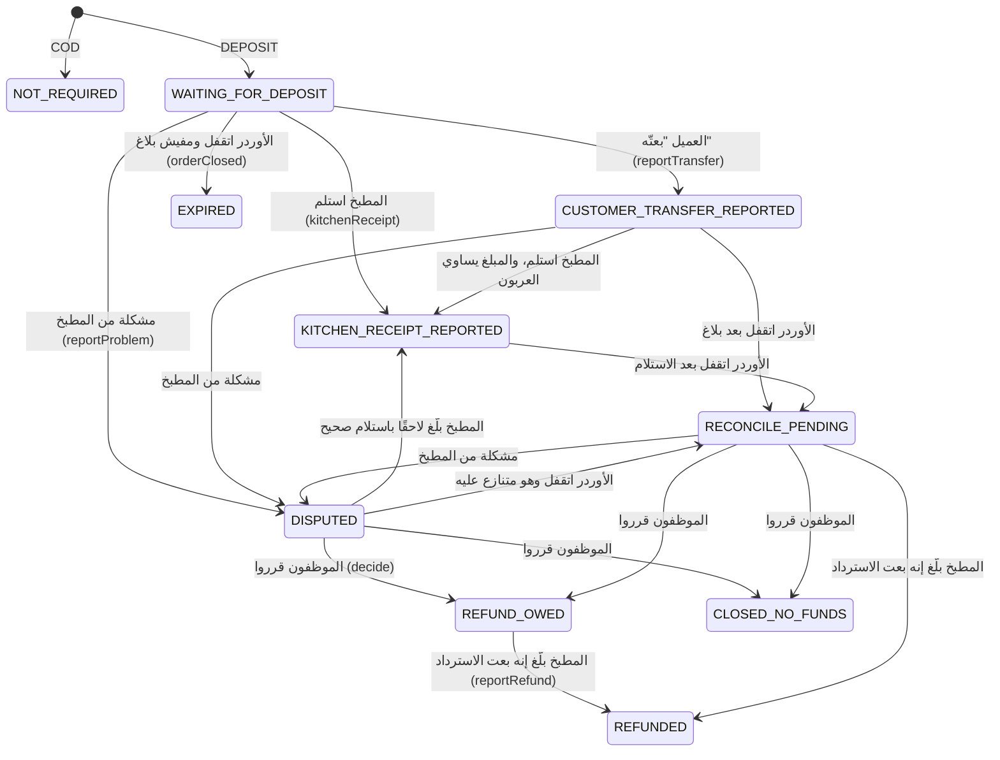

# شرح تنفيذ الدفع والكاش والـ Ledger

> **Owner role:** Backend architecture
> **Status:** PARTIALLY IMPLEMENTED — الدفع كاش عند الاستلام والعربون اللي بيبلّغ عنه المطبخ والمطابقة والـ Ledger موجودين؛ التعاملات المالية الحقيقية مش مفعّلة حاليًا وتفعيلها مرتبط بشروط الـ Gate ومفيش Payment Gateway ولا تحقق بنكي ولا مطابقة آلية (بقرار)
> **Language / اللغة:** [English](payment-implementation.md) · العربية

الكود بيعمل إيه في الفلوس. منظور المنتج: [التسعير والدفع](../01-business/pricing-and-payments-ar.md)، `docs/strategy/mvp-direct-deposit-payment.md`، `docs/product/09-deposit-payment-states.md`. القرارات: D05 (الكاش أولًا)، D10 (صفر عمولة)، D16 (العربون اليدوي بيتدفع مباشرة للمطبخ، وبيبلّغ عنه المطبخ — مش "متحقق منه بنكيًا" أبدًا). مصطلح مهم: **مطبخي مبيحتفظش بفلوس العملاء أبدًا.** كل حالة تحت بتسجّل اللي طرف *بلّغ* بيه.

## تلات حاجات منفصلة (مفصولين في الكود)

| الموضوع | الجدول/الجداول | الـ Service | المعنى |
|---|---|---|---|
| حالة الأوردر | `customer_order`، `order_event` | `OrderLifecycleService` | الأوردر وصل فين في التنفيذ |
| حالة العربون | `order_payment`، `payment_event`، `kitchen_payment_profile` | `PaymentService` (في موديول `orders`) | اللي قاله العميل/المطبخ/الموظفين عن الدفع المسبق |
| الكاش عند الاستلام | `cash_obligation`، `cash_report` | `CashService` (في `finance`) | الباقي اللي المطبخ بيحصّله وقت التسليم، والطبّاخ بيبلّغ عنه وموظفو المالية بيتحققوا منه |
| الـ Ledger | `ledger_group`، `ledger_entry` | `LedgerService`، `LedgerPostingJob` | سجل بقيد مزدوج لمستحقات العمولة (صفر عند الإطلاق) |
| استرداد المنصة والتسوية | `refund`، `settlement_batch`، `settlement_line` | `FinanceOpsService` | عملية موظفي المالية على الكاش المتحقَّق منه |

إتمام الأوردر مبيعلّمش الكاش إنه اتدفع أبدًا (BR-032): `COMPLETED` والتحقق من الكاش مستقلين.

## اختيار طريقة الدفع وتسعيرها

- الطريقة هي `COD` أو `DEPOSIT` (`PaymentService.Method`، `backend/modules/orders/src/main/java/com/matbakhy/orders/internal/PaymentService.java:31`)، وبتتبعت في طلب الـ Quote (`QuoteController.Body.paymentMethod`، الافتراضي COD).
- شروط المطبخ هي `kitchen_payment_profile` (V24): `deposit_bps` (من 0 إلى 10000)، و`cod_max_total_minor` اختياري، ومستلم `{method: INSTAPAY | MOBILE_WALLET | BANK_TRANSFER, identifier, name}`. الطبّاخ بيعدّلها بـ `PUT /api/v1/cook/payment-profile` -> `PaymentService.updateProfile` (`:106`، `expectedVersion` تفاؤلي، متسجّل في الـ Audit). **تغيير المستلم بيرجّع حالته لـ `NONE`**: المستلم مبيتعرضش على العملاء لحد ما الموظفين يوافقوا عليه (`approveRecipient` `:167`؛ `finance.verify` + MFA حديث؛ الشخص مينفعش يوافق على مطبخه هو؛ السبب من 10 لـ 500 حرف؛ متسجّل في الـ Audit).
- `PaymentService.terms(profile, method, total)` (`:205`): الـ COD بيترفض فوق سقف المطبخ (`COD_NOT_ELIGIBLE`)؛ والـ DEPOSIT محتاج `deposit_bps > 0` ومستلم موافَق عليه (`DEPOSIT_NOT_OFFERED`)؛ والعربون هو `max(1, round_half_up(total x bps / 10000))` والباقي هو `total - deposit`.
- `QuoteService.create` بيخزّن الشروط دي على الـ Quote؛ و`QuoteService.requireValid` بيرفض التسجيل بـ `PRICE_CHANGED` / `PAYMENT_CHANGED` لو شروط المطبخ اتغيّرت من وقت الـ Quote (`:184-196`). شوف [تنفيذ التسعير](pricing-implementation-ar.md).

## عند التسجيل

الـ `OrderService.placeOnce` بينادي `PaymentService.createFor` (`PaymentService.java:220`): بيدخّل `order_payment` بالشروط المنسوخة من الـ Quote — الحالة `NOT_REQUIRED` للـ COD، و`WAITING_FOR_DEPOSIT` للـ DEPOSIT مع `deposit_expires_at = accept_by` — وأول `payment_event` للعربونات. الشروط بتبقى غير قابلة للتعديل بعد كده (Trigger اسمه `order_payment_terms_immutable`، V24: `state` و`version` و`updated_at` بس هما اللي ممكن يتغيّروا). وبعدين `OrderService` بيدخّل `cash_obligation` بقيمة `total - deposit` في حالة `DUE` (`OrderService.java:230`).

## الـ State Machine بتاعة العربون — `PaymentService`

الحالات (قيود CHECK في V24، V25): `NOT_REQUIRED`، `WAITING_FOR_DEPOSIT`، `CUSTOMER_TRANSFER_REPORTED`، `KITCHEN_RECEIPT_REPORTED`، `DISPUTED`، `RECONCILE_PENDING`، `EXPIRED`، `REFUND_OWED`، `REFUNDED`، `CLOSED_NO_FUNDS`.

(الانتقالات متاخدة من `PaymentService.kitchenReceipt` `:265`، `reportProblem` `:290`، `orderClosed` `:393`، `decide` `:323`، `reportRefund` `:347`.)

| الـ Method | المسار (API id) | الفاعل والحارس | ملاحظات |
|---|---|---|---|
| `reportTransfer` `:247` | `POST /api/v1/orders/{id}/payment/transfer-report` (API-100) | عميل الأوردر (`lockForCustomer`، وغير كده 404) | Idempotent: التكرار مبيغيّرش حاجة؛ معلومة للمطبخ، **مش** دفع |
| `kitchenReceipt` `:265` | `POST /api/v1/cook/orders/{id}/payment/receipt` (API-101) | مطبخ الأوردر؛ `expectedVersion`؛ المبلغ لازم يساوي العربون (`DOES_NOT_MATCH_DEPOSIT`)؛ بيترفض بعد ما الأوردر يخلص | بيتسجّل كإفادة من المطبخ |
| `reportProblem` `:290` | `POST /api/v1/cook/orders/{id}/payment/problem` (API-105) | المطبخ؛ النوع `NOT_RECEIVED` أو `AMOUNT_MISMATCH` (+ المبلغ اللي اتشاف) | بيفتح حالة دعم PAYMENT واحدة (`NEEDS_CASE`، `:428`، عن طريق `OrderCases.openPaymentCase`؛ V28) |
| `queue` `:305` | `GET /api/v1/ops/payments` (API-106) | `finance.verify` | الحالات DISPUTED، RECONCILE_PENDING، REFUND_OWED |
| `decide` `:323` | `POST /api/v1/ops/orders/{id}/payment/decision` (API-107) | `finance.verify` + MFA حديث؛ السبب من 10 لـ 500؛ الأوردر لازم يكون خلص؛ **ولا قرار بيسجّل إن الفلوس اتستلمت** | النتايج `REFUND_OWED` أو `CLOSED_NO_FUNDS`؛ متسجّل في الـ Audit |
| `reportRefund` `:347` | `POST /api/v1/cook/orders/{id}/payment/refund` (API-108) | المطبخ؛ المرجع مطلوب | إفادة المطبخ إنه رجّع الفلوس |
| `requireReadyForPreparation` `:380` | بينادي عليها `OrderLifecycleService` في `prepare` (`OrderLifecycleService.java:142`) | | أوردر العربون مينفعش يوصل PREPARING لحد `KITCHEN_RECEIPT_REPORTED` (`DEPOSIT_NOT_RECEIVED`) |
| `orderClosed` `:393` | بتتنادى من `OrderLifecycleService.transition` (`:370`) لكل حالة نهائية غير COMPLETED | النظام | مدفوعات العربون المنتهية بتتقفل بهدوء؛ أي تحويل متبلّغ عنه بيروح للمطابقة، ومبيتقفلش بصمت أبدًا |

كل تغيير حالة بيعدّي على `PaymentService.move` (`:413`): مقارنة-وتعيين (Compare-and-set) على `(state, version)`، وإضافة `payment_event` (للإضافة بس، V24)، وفتح حالة دعم لو الحالة الجديدة محتاجة إنسان، وكتابة `outbox_event` باسم `PAYMENT_<STATE>` للحالات في `NOTIFIED` (`:448`) عشان الطرف التاني يتبلّغ جوه التطبيق. الاختبارات: `DepositPaymentIntegrationTest` (TC-158..160)، `PaymentReconciliationIntegrationTest` (TC-161، TC-162).

## الكاش عند الاستلام — `CashService` (موديول finance)

1. بعد COMPLETED، الطبّاخ بيبلّغ عن الكاش اللي اتحصّل: `POST /api/v1/cook/orders/{id}/cash-reports` -> `CashService.report` (`backend/modules/finance/src/main/java/com/matbakhy/finance/internal/CashService.java:72`)، Idempotent بالـ `Idempotency-Key`. الفحوصات: الأوردر تابع لمطبخ الطبّاخ، و`expectedVersion`، والحالة `COMPLETED`، والالتزام `DUE`، والعملة EGP والطريقة `CASH`، و`collectedAt` بين إنشاء الأوردر والوقت الحالي. `discrepancy = reported - due` حيث `due` هو الالتزام غير القابل للتعديل (الإجمالي ناقص العربون). التقرير المطابق بالظبط بيحط الالتزام على `REPORTED`؛ والفرق بيحطه على `DISPUTED`.
2. مستخدم المالية بيتحقق أو بيعترض: `POST /api/v1/ops/finance/cash-reports/{id}/verification` -> `CashService.verify` (`:125`)، الصلاحية `finance.verify`. **فصل المهام:** اللي بلّغ مينفعش يتحقق من تقريره هو (`refuseSelfVerification` `:115` بيسجّل الرفض في الـ Audit؛ و`verify` بيكرر الفحص). الـ `VERIFY` محتاج `verifiedAmountMinor == due`؛ أي مبلغ تاني لازم يتسجّل كـ `DISPUTE` مع سبب. الالتزام بيبقى `VERIFIED` أو `DISPUTED`.
3. الاختبارات: `CashAndLedgerIntegrationTest` (TC-032، 033، 058، 120). حالات المالك: E2E-FIN-038، E2E-FIN-043، E2E-FIN-102، E2E-FIN-114.

## الـ Ledger — `LedgerService` / `LedgerPostingJob`

- الـ `LedgerPostingJob.run` (`backend/modules/finance/src/main/java/com/matbakhy/finance/internal/LedgerPostingJob.java:20`، كل 30 ثانية إلا لو `matbakhy.finance.posting-job.enabled=false`) بيلاقي أحداث الأوردر `COMPLETED` اللي من غير ledger group (`unpostedCompletions`) وبينادي `postCommission`.
- الـ `LedgerService.postCommission` (`LedgerService.java:31`) بيدخّل `ledger_group` واحد (`kind = COMMISSION`، فريد `(kind, source_event_id)` فالحدث المصدر بيتسجّل مرة واحدة) مع DEBIT على `COOK_COMMISSION_RECEIVABLE` وCREDIT على `PLATFORM_COMMISSION_REVENUE` بقيمة `customer_order.commission_minor` (من النسبة المتعمل لها Snapshot؛ رسوم التوصيل مستبعدة لأن الأساس هو الإجمالي الفرعي). الكاش اللي حصّله الطبّاخ مبيبقاش إيراد للمنصة أبدًا في النموذج ده.
- ثوابت قاعدة البيانات (V13): `ledger_group` و`ledger_entry` للإضافة بس (Triggers)، وTrigger قيد مؤجّل اسمه `ledger_entry_balanced` بيطلب إن المدين = الدائن لكل مجموعة.
- عند الإطلاق العمولة 0 (D10)، فالمجموعات بتتسجّل بقيود قيمتها صفر؛ والقوائم والتسويات بتتجاهل القيود اللي `amount_minor = 0` (`StatementService.java:145`، `FinanceOpsService.java:297`).
- الاستردادات: `FinanceOpsService.requestRefund` (`:67`) بيطلب تحصيل كاش **متحقَّق منه** واسترداد كامل الرصيد القابل للاسترداد؛ والإجراءات `APPROVE`، `REJECT`، `PAYMENT_RECORDED`، `VERIFY` (`refundAction` `:104`) بتفرض إن اللي وافق واللي دفع واللي تحقق مختلفين (`separate`)؛ والـ `VERIFY` بيكتب مجموعة `COMMISSION_REVERSAL` (`reverseCommission` `:150`). التسويات: `createSettlement` (`:184`)، `settlementAction` (`:234`: `REVIEW`، `PAYMENT_RECORDED`، `RECONCILE`، `CANCEL`). الاختبارات: `FinanceOperationsIntegrationTest` (TC-034..036)، `ZeroCommissionIntegrationTest` (TC-157).
- مفهومين "الاسترداد" مختلفين: `order_payment` الحالتين `REFUND_OWED/REFUNDED` هما **العربون** اللي المطبخ بيرجّعه، وبيبلّغ عنه المطبخ؛ وجدول `refund` هو **عملية المالية بتاعة المنصة** على الكاش المتحقَّق منه.

## الـ Gate بتاع الفلوس الحقيقية

مفيش مسار في الكود بيحرّك فلوس حقيقية. مستلم المطبخ بيتعرض للعميل، والعميل بيدفع برّه المنصة، والمطبخ بيقول إنه استلم. الـ D16 وبوابات الإصدار (`planning/gates.json`، `docs/delivery/07-owner-decisions-implementation-sequence.md`) بتمنع تفعيل الفلوس الحقيقية قبل المراجعة القانونية/مراجعة المزوّد؛ وضابط بيئات المعاينة/البيانات التجريبية غير الحقيقية (Synthetic Data) هو `backend/app/src/main/java/com/matbakhy/app/config/EnvironmentGuard.java`. حالة المالك CFG-045 بتتأكد إن مدفوعات العربون التجريبية مبتعملش أي تأثيرات جانبية خارجة.

## المناطق المحتاجة مراجعة

`PaymentService.move` ومجموعات الحالات (`ENDED`، `AFTER_TRANSFER`، `NEEDS_CASE`، `NOTIFIED`)، و`CashService.verify`، و`LedgerService`، وكل الـ Triggers في V13/V18/V24، وقاعدة `order_payment_terms_immutable`، وأي صياغة ممكن تلمّح بـ "اتدفع" أو "متحقق منه بنكيًا".

## القيود المعروفة وفجوات التوثيق

- التزام الكاش لأوردر العربون بيغطي الباقي بس؛ لو العربون اتسترد أو اتعمل عليه نزاع بعد كده، الكود مبيعيدش فتح الالتزام ولا بيعدّله (NOT VERIFIED خارج قراءة `PaymentService` و`CashService`؛ ملقيناش اختبار بيجمع عربون مسترد مع تقرير كاش).
- الضريبة والفواتير (O04) لسه متقرّرتش؛ ومفيش إصدار فواتير.
- تكامل المزوّدين (InstaPay، المحافظ، البنك) غايب عمدًا: PLANNED كبحث مستقبلي بس.
