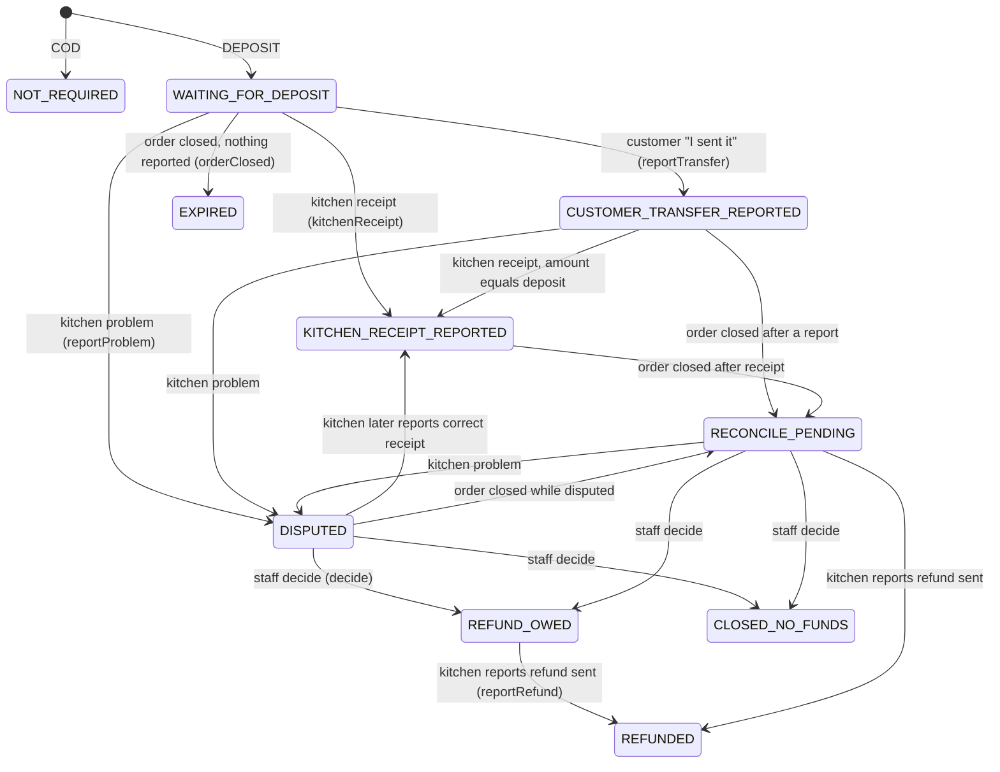

# Payment, cash and ledger implementation walkthrough

> **Owner role:** Backend architecture
> **Status:** PARTIALLY IMPLEMENTED — cash on receipt, kitchen-reported deposits, reconciliation and the ledger exist; live money is gated and no payment gateway, bank verification or automated reconciliation exists (by decision)
> **Language / اللغة:** English · [العربية](payment-implementation-ar.md)

What the code does with money. Product framing: [pricing and payments](../01-business/pricing-and-payments.md), `docs/strategy/mvp-direct-deposit-payment.md`,
`docs/product/09-deposit-payment-states.md`. Decisions: D05 (cash-first), D10 (zero commission), D16 (manual deposit paid directly to the
kitchen, reported by the kitchen — never "bank verified"). Important vocabulary: **Matbakhy never holds customer funds.** Every state below records
what a party *reported*.

## Three separate things (kept apart in code)

| Concern | Table(s) | Service | Meaning |
|---|---|---|---|
| Order state | `customer_order`, `order_event` | `OrderLifecycleService` | where the order is in its fulfilment |
| Deposit state | `order_payment`, `payment_event`, `kitchen_payment_profile` | `PaymentService` (in the `orders` module) | what the customer/kitchen/staff said about the pre-payment |
| Cash on receipt | `cash_obligation`, `cash_report` | `CashService` (in `finance`) | the remainder collected by the kitchen at hand-over, reported by the cook and verified by finance staff |
| Ledger | `ledger_group`, `ledger_entry` | `LedgerService`, `LedgerPostingJob` | double-entry record of commission receivable (zero at launch) |
| Platform refund and settlement | `refund`, `settlement_batch`, `settlement_line` | `FinanceOpsService` | finance-staff process over verified cash |

Completing an order never marks cash as paid (BR-032): `COMPLETED` and cash verification are independent.

## Choosing and quoting a payment method

- Method is `COD` or `DEPOSIT` (`PaymentService.Method`, `backend/modules/orders/src/main/java/com/matbakhy/orders/internal/PaymentService.java:31`), sent in the quote request (`QuoteController.Body.paymentMethod`, default COD).
- Kitchen terms are `kitchen_payment_profile` (V24): `deposit_bps` (0..10000), optional `cod_max_total_minor`, and a recipient `{method: INSTAPAY | MOBILE_WALLET | BANK_TRANSFER, identifier, name}`.
  The cook edits them with `PUT /api/v1/cook/payment-profile` -> `PaymentService.updateProfile` (`:106`, optimistic `expectedVersion`, audited).
  **Changing the recipient resets its status to `NONE`**: the recipient is not offered to customers until staff approve it (`approveRecipient` `:167`; `finance.verify` + recent MFA; a person cannot approve their own kitchen; reason 10-500 chars; audited).
- `PaymentService.terms(profile, method, total)` (`:205`): COD is refused above the kitchen's cap (`COD_NOT_ELIGIBLE`); DEPOSIT needs `deposit_bps > 0` and an approved recipient (`DEPOSIT_NOT_OFFERED`); the deposit is `max(1, round_half_up(total x bps / 10000))` and the remainder is `total - deposit`.
- `QuoteService.create` stores these terms on the quote; `QuoteService.requireValid` refuses placement with `PRICE_CHANGED` / `PAYMENT_CHANGED` if the kitchen's terms changed since the quote (`:184-196`). See [pricing implementation](pricing-implementation.md).

## At placement

`OrderService.placeOnce` calls `PaymentService.createFor` (`PaymentService.java:220`): inserts `order_payment` with the terms copied from the quote — state `NOT_REQUIRED` for COD, `WAITING_FOR_DEPOSIT` for DEPOSIT with `deposit_expires_at = accept_by` — and a first `payment_event` for deposits.
Terms are immutable afterwards (trigger `order_payment_terms_immutable`, V24: only `state`, `version`, `updated_at` may change). Then `OrderService` inserts `cash_obligation` for `total - deposit` in state `DUE` (`OrderService.java:230`).

## Deposit state machine — `PaymentService`

States (CHECK constraints in V24 and V25): `NOT_REQUIRED`, `WAITING_FOR_DEPOSIT`, `CUSTOMER_TRANSFER_REPORTED`, `KITCHEN_RECEIPT_REPORTED`, `DISPUTED`, `RECONCILE_PENDING`, `EXPIRED`, `REFUND_OWED`, `REFUNDED`, `CLOSED_NO_FUNDS`.

(Transitions are taken from `PaymentService.kitchenReceipt` `:265`, `reportProblem` `:290`, `orderClosed` `:393`, `decide` `:323`, `reportRefund` `:347`.)

| Method | Route (API id) | Actor and guard | Notes |
|---|---|---|---|
| `reportTransfer` `:247` | `POST /api/v1/orders/{id}/payment/transfer-report` (API-100) | the order's customer (`lockForCustomer`, 404 otherwise) | idempotent: a repeat changes nothing; information for the kitchen, **not** payment |
| `kitchenReceipt` `:265` | `POST /api/v1/cook/orders/{id}/payment/receipt` (API-101) | the order's kitchen; `expectedVersion`; amount must equal the deposit (`DOES_NOT_MATCH_DEPOSIT`); refused once the order ended | recorded as the kitchen's statement |
| `reportProblem` `:290` | `POST /api/v1/cook/orders/{id}/payment/problem` (API-105) | kitchen; kind `NOT_RECEIVED` or `AMOUNT_MISMATCH` (+ amount seen) | opens one PAYMENT support case (`NEEDS_CASE`, `:428`, via `OrderCases.openPaymentCase`; V28) |
| `queue` `:305` | `GET /api/v1/ops/payments` (API-106) | `finance.verify` | states DISPUTED, RECONCILE_PENDING, REFUND_OWED |
| `decide` `:323` | `POST /api/v1/ops/orders/{id}/payment/decision` (API-107) | `finance.verify` + recent MFA; reason 10-500; order must have ended; **no decision marks money received** | outcomes `REFUND_OWED` or `CLOSED_NO_FUNDS`; audited |
| `reportRefund` `:347` | `POST /api/v1/cook/orders/{id}/payment/refund` (API-108) | kitchen; reference required | the kitchen's statement that it refunded |
| `requireReadyForPreparation` `:380` | called by `OrderLifecycleService` `prepare` (`OrderLifecycleService.java:142`) | | a deposit order cannot reach PREPARING until `KITCHEN_RECEIPT_REPORTED` (`DEPOSIT_NOT_RECEIVED`) |
| `orderClosed` `:393` | called from `OrderLifecycleService.transition` (`:370`) for every terminal state except COMPLETED | system | expired deposits close silently; any reported transfer goes to reconciliation, never a silent close |

Every state change goes through `PaymentService.move` (`:413`): compare-and-set on `(state, version)`, append `payment_event` (append-only, V24), open a support case if the new state needs a human, and write an
`outbox_event` `PAYMENT_<STATE>` for states in `NOTIFIED` (`:448`) so the other party is told in-app. Tests: `DepositPaymentIntegrationTest` (TC-158..160), `PaymentReconciliationIntegrationTest` (TC-161, TC-162).

## Cash on receipt — `CashService` (finance module)

1. After COMPLETED, the cook reports the cash collected: `POST /api/v1/cook/orders/{id}/cash-reports` -> `CashService.report`
   (`backend/modules/finance/src/main/java/com/matbakhy/finance/internal/CashService.java:72`), idempotent by `Idempotency-Key`. Checks: order belongs to the cook's kitchen, `expectedVersion`, state is `COMPLETED`,
   obligation is `DUE`, currency EGP and method `CASH`, `collectedAt` between order creation and now. `discrepancy = reported - due` where `due` is the immutable obligation (total minus deposit). An exact report sets the obligation to `REPORTED`; a difference sets `DISPUTED`.
2. A finance user verifies or disputes: `POST /api/v1/ops/finance/cash-reports/{id}/verification` -> `CashService.verify` (`:125`), permission `finance.verify`. **Separation of duties:** the reporter cannot verify their own report
   (`refuseSelfVerification` `:115` audits the denial; `verify` repeats the check). `VERIFY` requires `verifiedAmountMinor == due`; any other amount must be recorded as `DISPUTE` with a reason. The obligation becomes `VERIFIED` or `DISPUTED`.
3. Tests: `CashAndLedgerIntegrationTest` (TC-032, 033, 058, 120). Owner cases: E2E-FIN-038, E2E-FIN-043, E2E-FIN-102, E2E-FIN-114.

## Ledger — `LedgerService` / `LedgerPostingJob`

- `LedgerPostingJob.run` (`backend/modules/finance/src/main/java/com/matbakhy/finance/internal/LedgerPostingJob.java:20`, every 30 s unless `matbakhy.finance.posting-job.enabled=false`) finds `COMPLETED` order events without a ledger group (`unpostedCompletions`) and calls `postCommission`.
- `LedgerService.postCommission` (`LedgerService.java:31`) inserts one `ledger_group` (`kind = COMMISSION`, unique `(kind, source_event_id)`, so a source event posts once) with a DEBIT to `COOK_COMMISSION_RECEIVABLE` and a CREDIT to `PLATFORM_COMMISSION_REVENUE` for `customer_order.commission_minor`
  (from the snapshotted rate; delivery fee excluded because the base is the subtotal). Cook-collected cash never becomes platform revenue in this model.
- Database invariants (V13): `ledger_group` and `ledger_entry` are append-only (triggers), and a deferred constraint trigger `ledger_entry_balanced` requires debits = credits per group.
- At launch commission is 0 (D10), so groups are posted with zero-amount entries; lists and settlements ignore `amount_minor = 0` entries (`StatementService.java:145`, `FinanceOpsService.java:297`).
- Refunds: `FinanceOpsService.requestRefund` (`:67`) requires a **verified** cash collection and a full-amount refund of the refundable balance; actions `APPROVE`, `REJECT`, `PAYMENT_RECORDED`, `VERIFY` (`refundAction` `:104`) enforce that approver, payer and verifier differ (`separate`);
  `VERIFY` writes a `COMMISSION_REVERSAL` group (`reverseCommission` `:150`). Settlements: `createSettlement` (`:184`), `settlementAction` (`:234`: `REVIEW`, `PAYMENT_RECORDED`, `RECONCILE`, `CANCEL`). Tests: `FinanceOperationsIntegrationTest` (TC-034..036), `ZeroCommissionIntegrationTest` (TC-157).
- The two "refund" concepts are different: `order_payment` `REFUND_OWED/REFUNDED` is the **deposit** the kitchen returns, reported by the kitchen; the `refund` table is the **platform finance process** over verified cash.

## Live-money gate

No code path moves real money. The kitchen's recipient is displayed to the customer, the customer pays outside the platform, and the kitchen states receipt. D16 and the release gates
(`planning/gates.json`, `docs/delivery/07-owner-decisions-implementation-sequence.md`) forbid activating real money before legal/provider review; the preview/synthetic guard is
`backend/app/src/main/java/com/matbakhy/app/config/EnvironmentGuard.java`. Owner case CFG-045 checks that demo deposits produce no outbound side effects.

## Review-required areas

`PaymentService.move` and the state sets (`ENDED`, `AFTER_TRANSFER`, `NEEDS_CASE`, `NOTIFIED`), `CashService.verify`, `LedgerService`, all triggers in V13/V18/V24, the `order_payment_terms_immutable` rule, and any wording that could imply "paid" or "bank verified".

## Known limitations and documentation gaps

- Cash obligation for a deposit order covers only the remainder; if the deposit later is refunded or disputed, the code does not re-open or adjust the obligation (NOT VERIFIED beyond reading `PaymentService` and `CashService`; no test found that combines a refunded deposit with a cash report).
- Tax and invoices (O04) are undecided; no invoice generation exists.
- Provider integration (InstaPay, wallets, bank) is deliberately absent: PLANNED only as future research.
