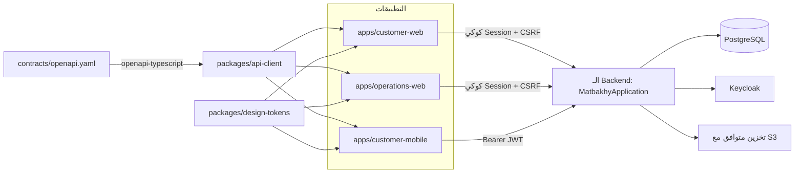

# خريطة الـ Repository

> **Owner role:** Handbook navigation
> **Status:** REFERENCE — خريطة المجلدات واحد واحد للـ Repository زي ما هو موجود على الـ Branch ده
> **Language / اللغة:** [English](repository-map.md) · العربية

الصفحة دي بتسرد كل مجلد في المستوى الأعلى، وإيه اللي فيه، وإزاي الأجزاء بتتوصل ببعض. للإجابات الموجّهة بالمهام
"أدوّر على X فين" شوف [التنقّل في الـ Repository](../00-getting-started/repository-navigation-ar.md)؛ ولتفاصيل
الـ Backend من جوه شوف [دليل موديولات الـ Backend](backend-module-guide-ar.md).

## المستوى الأعلى

| المسار | هو إيه | ملاحظات |
|---|---|---|
| `backend/` | Modular Monolith بـ Spring Boot (Java 21)، وبناء Maven متعدد الموديولات | `backend/pom.xml` بيعرّف الموديولات: `shared` وتسع موديولات Domain و `app` |
| `apps/customer-web/` | ويب العميل (React + Vite) | نقطة الدخول `apps/customer-web/src/main.tsx` |
| `apps/operations-web/` | مساحة عمل الطبّاخ والـ Backoffice بتاع المنصة (React + Vite)، زائد اختبارات Playwright للمتصفح | نقطة الدخول `apps/operations-web/src/main.tsx` |
| `apps/customer-mobile/` | تطبيق العميل لـ Android/iOS (React Native + Expo) | نقطة الدخول `apps/customer-mobile/index.ts` |
| `packages/api-client/` | API Client متكتّب ومتولّد من `contracts/openapi.yaml`، زائد مساعدات الفلوس/السعر | اعتمادية `workspace:*` في التطبيقات التلاتة كلها |
| `packages/design-tokens/` | توكنز البراند وتوليد الـ CSS واللوجو | مصدر الحقيقة `packages/design-tokens/tokens.json` |
| `contracts/` | `contracts/openapi.yaml` (العقد المتكتّب) و `contracts/endpoints.json` (سجل الـ Routes) | شوف [عقود الـ API](api-contracts-ar.md) |
| `infra/` | Stack التطوير المحلي: `infra/compose.yaml` و Realm الـ Keycloak `infra/identity/matbakhy-realm.json` وملاحظات محاكي التخزين وSQL مطابقة الـ DB | محلي بس |
| `deploy/web-preview/` | نشر Preview/staging: ملفات Compose وCaddy وسكريبتات النشر وRealm الـ Keycloak للمعاينة والمراقبة (Observability) وتجهيز E2E بتاع المالك | شوف `deploy/web-preview/README.md` بتاعه |
| `planning/` | حزمة التخطيط المقروءة آليًا: `backlog.json` و `decisions.json` و `rules.json` و `scenarios.json` و `gates.json` و `execution-state.json` و `inventory.json` | حالة `planning/backlog.json` تلميح، مش إثبات |
| `verification/` | سجلات الأدلة (`verification/runs/*`) والقوالب | بيكتبها `scripts/record_evidence.py` |
| `docs/` | المنتج والهندسة والتسليم والعمليات والجودة والأمان والحالة وده الدليل | سياق، مش إثبات؛ الكود هو اللي بيكسب لو اتعارضوا |
| `scripts/` | أدوات الـ Repo: `scripts/dev.sh` و `scripts/verify.py` و `scripts/next_task.py` و `scripts/validate_blueprint.py` و `scripts/doc001_check.py` وفحوصات الأسرار/التصميم/الـ Workspace وأدوات E2E بتاع المالك | |
| `.github/` | Workflows الـ CI (`ci.yml` و `deploy-preview.yml` و `native-build.yml` و `doc001.yml` و `owner-e2e-*.yml` و `preview-images.yml` و `blueprint-integrity.yml`) و `CODEOWNERS` وقالب الـ PR | |
| `package.json`, `pnpm-workspace.yaml`, `tsconfig.base.json`, `eslint.config.js` | جذر Workspace بتاع pnpm (`apps/*`, `packages/*`) | Node `>=24.21.0 <25` و pnpm `10.34.6` (من `package.json`) |
| `AGENTS.md`, `CLAUDE.md` | قواعد الـ Coding Agents وقاعدة التوثيق DOC-001 | اقراهم قبل ما تغيّر الحوكمة |

## الـ Backend

```text
backend/
  pom.xml                       parent POM; module order: shared, identity, cooks, catalog, availability,
                                orders, finance, support, notifications, operations, app
  shared/                       cross-cutting primitives (Money, ApiException/ErrorCode, IdempotentCommands, ...)
  modules/<module>/src/main/java/com/matbakhy/<module>/
      api/                      the ONLY package other modules may import
      internal/                 services, JDBC adapters, jobs
      web/                      REST controllers
  app/                          composition root: main class, security, MFA, config, migrations, ALL integration tests
```

حقائق أساسية، وكل واحدة تقدر تتحقق منها في الملف المذكور:

- الـ Main Class: `backend/app/src/main/java/com/matbakhy/app/MatbakhyApplication.java` (`@SpringBootApplication(scanBasePackages = "com.matbakhy")`).
- القيم الافتراضية للإعدادات: `backend/app/src/main/resources/application.yaml`؛ وتجاوزات التطوير في `backend/app/src/main/resources/application-dev.yaml`.
- Migrations بتاعة Flyway: من `backend/app/src/main/resources/db/migration/V1__baseline_identity_and_idempotency.sql` لحد `V31__mfa_policy.sql`، زائد الـ Callback اسمه `afterMigrate.sql` اللي بيدّي دور وقت التشغيل بأقل صلاحيات. بيانات الـ Seed للتطوير بس: `backend/app/src/main/resources/db/devdata/`.
- الاختبارات موجودة تقريبًا كلها في موديول `app` تحت `backend/app/src/test/java/com/matbakhy/app/<area>/`؛ و `backend/shared` عنده `MoneyTest` بتاعه.
- حدود الموديولات بتتفرض بـ `backend/app/src/test/java/com/matbakhy/app/architecture/ModuleBoundaryTest.java` باستخدام القواعد في `backend/app/src/test/java/com/matbakhy/app/architecture/ModuleRules.java`.

> ملحوظة عن مكان اختبارات الوحدة (Unit Tests): اتنين Unit Tests موجودين في شجرة اختبارات موديول `app` تحت أسماء Packages
> داخلية للموديول عشان يقدروا يوصلوا للكود الـ Package-private: `backend/app/src/test/java/com/matbakhy/orders/internal/OrderFingerprintTest.java`
> و `backend/app/src/test/java/com/matbakhy/catalog/internal/media/MediaInspectorPdfTest.java`.

## الـ Frontends والموبايل

```text
apps/customer-web/src/        main.tsx, App.tsx (hash router), Browse/Meal/Kitchen/Checkout/Payment/Orders/Account/Security .tsx,
                              api.ts (client + CSRF), cart.ts, i18n.ts, app.css, App.test.tsx (Vitest)
apps/operations-web/src/      main.tsx, App.tsx (section tabs by server-granted access), cook/*.tsx, ops/*.tsx, api.ts, i18n.ts
apps/operations-web/e2e/      Playwright journeys (cook workspace, customer journey, keyboard, layout, money reflow)
apps/operations-web/e2e-staging/   smoke test intended for a deployed environment
apps/customer-mobile/         index.ts, src/App.tsx, src/screens/*.tsx, auth/session/tokenStore, basket, placement
apps/customer-mobile/e2e-native/   SQL fixtures for the native runs;  e2e-ios/ XCTest host app and UI tests
apps/customer-mobile/scripts/      launch and order/auth round-trip scripts for Android/iOS
```

التفاصيل: [دليل كود الـ Frontend](frontend-code-guide-ar.md) و[دليل كود الموبايل](mobile-code-guide-ar.md).

## خريطة التوثيق والتخطيط

| المسار | الدور |
|---|---|
| `docs/product/` | مواصفات المنتج وقواعد العمل (`docs/product/03-business-rules.md`) وآلات الحالة (State Machines) والشاشات والصلاحيات وسجل القرارات |
| `docs/engineering/` | المعمارية والـ ADRs (`docs/engineering/01-architecture.md`) ونموذج البيانات وملاحظات عقد الـ API والأمان والموبايل والمعايير |
| `docs/delivery/` | بروتوكول التنفيذ وقرارات المالك وتسلسل التنفيذ وتقارير التقدّم |
| `docs/operations/` | البيئات والـ Runbooks والمراقبة (Observability) ومعاينة الويب والـ Staging وترحيل Keycloak MFA |
| `docs/quality/` | التحقق وبوابات الإصدار وتسليمات الـ QA ومجموعة قبول المالك (`docs/quality/owner-acceptance/`) |
| `docs/security/` | `docs/security/mfa-policy.md` و `docs/security/csp-rollout.md` |
| `docs/status/` | `docs/status/latest.md` والتقارير اليومية (شوف [حالة التنفيذ](../07-reference/implementation-status-ar.md) لمعرفة التقادم) |
| `docs/developer-handbook/` | الدليل ده، محكوم بـ DOC-001 (`scripts/doc001_check.py`) |

## صورة الاعتماديات



## القيود المعروفة وفجوات التوثيق

- ملحوظة مكان الـ Unit Tests اللي فوق هي المكان الوحيد اللي الدليل بيسجّل فيه إن اتنين Unit Tests موجودين في موديول `app`
  بأسماء Packages داخلية للموديول؛ ومفيش مستند تاني بيقول كده.
- `contracts/endpoints.json` لسه شايل `"status": "DESIGN_NOT_IMPLEMENTED"` و `planning/backlog.json` شايل
  `"status": "PLANNED_NOT_IMPLEMENTED"` على مستوى الملف مع إن أغلب الـ Stories و 113 من 116 Route متنفّذة؛
  شوف [حالة التنفيذ](../07-reference/implementation-status-ar.md).
