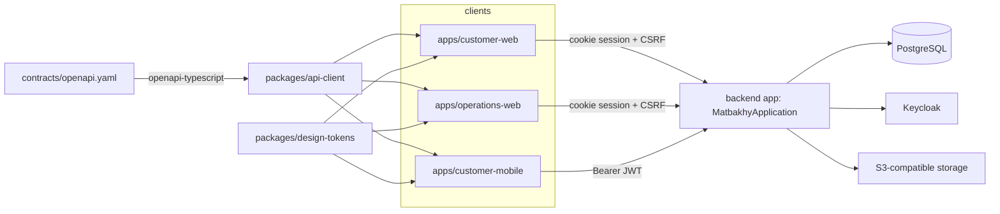

# Repository map

> **Owner role:** Handbook navigation
> **Status:** REFERENCE — directory-by-directory map of the repository as it exists on this branch
> **Language / اللغة:** English · [العربية](repository-map-ar.md)

This page lists every top-level directory, what lives in it, and how the pieces connect. For task-oriented
"where do I look for X" answers see [repository navigation](../00-getting-started/repository-navigation.md); for the
backend internals see [backend module guide](backend-module-guide.md).

## Top level

| Path | What it is | Notes |
|---|---|---|
| `backend/` | Spring Boot (Java 21) modular monolith, Maven multi-module build | `backend/pom.xml` declares the modules: `shared`, nine domain modules and `app` |
| `apps/customer-web/` | Customer web (React + Vite) | entry `apps/customer-web/src/main.tsx` |
| `apps/operations-web/` | Cook workspace and platform backoffice (React + Vite), plus Playwright browser tests | entry `apps/operations-web/src/main.tsx` |
| `apps/customer-mobile/` | Customer Android/iOS app (React Native + Expo) | entry `apps/customer-mobile/index.ts` |
| `packages/api-client/` | Typed API client generated from `contracts/openapi.yaml`, plus money/price helpers | `workspace:*` dependency of all three apps |
| `packages/design-tokens/` | Brand tokens, CSS generation, logo | source of truth `packages/design-tokens/tokens.json` |
| `contracts/` | `contracts/openapi.yaml` (typed contract) and `contracts/endpoints.json` (route registry) | see [API contracts](api-contracts.md) |
| `infra/` | Local-development stack: `infra/compose.yaml`, Keycloak realm `infra/identity/matbakhy-realm.json`, storage emulator notes, DB reconcile SQL | local only |
| `deploy/web-preview/` | Preview/staging deployment: Compose files, Caddy, deploy scripts, preview Keycloak realm, observability, owner E2E provisioning | see its `deploy/web-preview/README.md` |
| `planning/` | Machine-readable planning pack: `backlog.json`, `decisions.json`, `rules.json`, `scenarios.json`, `gates.json`, `execution-state.json`, `inventory.json` | `planning/backlog.json` status is a hint, not proof |
| `verification/` | Evidence records (`verification/runs/*`) and templates | written by `scripts/record_evidence.py` |
| `docs/` | Product, engineering, delivery, operations, quality, security, status and this handbook | context, not proof; code wins on disagreement |
| `scripts/` | Repo tooling: `scripts/dev.sh`, `scripts/verify.py`, `scripts/next_task.py`, `scripts/validate_blueprint.py`, `scripts/doc001_check.py`, secret/design/workspace checks, owner E2E tooling | |
| `.github/` | CI workflows (`ci.yml`, `deploy-preview.yml`, `native-build.yml`, `doc001.yml`, `owner-e2e-*.yml`, `preview-images.yml`, `blueprint-integrity.yml`), `CODEOWNERS`, PR template | |
| `package.json`, `pnpm-workspace.yaml`, `tsconfig.base.json`, `eslint.config.js` | pnpm workspace root (`apps/*`, `packages/*`) | Node `>=24.21.0 <25`, pnpm `10.34.6` (from `package.json`) |
| `AGENTS.md`, `CLAUDE.md` | Rules for coding agents and the DOC-001 documentation rule | read before changing governance |

## Backend

```text
backend/
  pom.xml                       parent POM; module order: shared, identity, cooks, catalog, availability,
                                orders, finance, support, notifications, operations, app
  shared/                       cross-cutting primitives (Money, ApiException/ErrorCode, IdempotentCommands, ...)
  modules/<module>/src/main/java/com/matbakhy/<module>/
      api/                      the ONLY package other modules may import
      internal/                 services, JDBC adapters, jobs
      web/                      REST controllers
  app/                          composition root: main class, security, MFA, config, migrations, ALL integration tests
```

Key facts, each verifiable in the named file:

- Main class: `backend/app/src/main/java/com/matbakhy/app/MatbakhyApplication.java` (`@SpringBootApplication(scanBasePackages = "com.matbakhy")`).
- Configuration defaults: `backend/app/src/main/resources/application.yaml`; development overrides `backend/app/src/main/resources/application-dev.yaml`.
- Flyway migrations: `backend/app/src/main/resources/db/migration/V1__baseline_identity_and_idempotency.sql` through `V31__mfa_policy.sql`, plus the `afterMigrate.sql` callback that grants the least-privilege runtime role. Development-only seed data: `backend/app/src/main/resources/db/devdata/`.
- Tests live almost entirely in the `app` module under `backend/app/src/test/java/com/matbakhy/app/<area>/`; `backend/shared` has its own `MoneyTest`.
- Module boundaries are enforced by `backend/app/src/test/java/com/matbakhy/app/architecture/ModuleBoundaryTest.java` using the rules in `backend/app/src/test/java/com/matbakhy/app/architecture/ModuleRules.java`.

> Note on unit-test placement: two unit tests sit in the `app` module's test tree under module-internal package
> names so they can reach package-private code: `backend/app/src/test/java/com/matbakhy/orders/internal/OrderFingerprintTest.java`
> and `backend/app/src/test/java/com/matbakhy/catalog/internal/media/MediaInspectorPdfTest.java`.

## Frontends and mobile

```text
apps/customer-web/src/        main.tsx, App.tsx (hash router), Browse/Meal/Kitchen/Checkout/Payment/Orders/Account/Security .tsx,
                              api.ts (client + CSRF), cart.ts, i18n.ts, app.css, App.test.tsx (Vitest)
apps/operations-web/src/      main.tsx, App.tsx (section tabs by server-granted access), cook/*.tsx, ops/*.tsx, api.ts, i18n.ts
apps/operations-web/e2e/      Playwright journeys (cook workspace, customer journey, keyboard, layout, money reflow)
apps/operations-web/e2e-staging/   smoke test intended for a deployed environment
apps/customer-mobile/         index.ts, src/App.tsx, src/screens/*.tsx, auth/session/tokenStore, basket, placement
apps/customer-mobile/e2e-native/   SQL fixtures for the native runs;  e2e-ios/ XCTest host app and UI tests
apps/customer-mobile/scripts/      launch and order/auth round-trip scripts for Android/iOS
```

Details: [frontend code guide](frontend-code-guide.md), [mobile code guide](mobile-code-guide.md).

## Documentation and planning map

| Path | Role |
|---|---|
| `docs/product/` | Product specification, business rules (`docs/product/03-business-rules.md`), state machines, screens, permissions, decision register |
| `docs/engineering/` | Architecture and ADRs (`docs/engineering/01-architecture.md`), data model, API contract notes, security, mobile, standards |
| `docs/delivery/` | Execution protocol, owner decisions and implementation sequence, progress reporting |
| `docs/operations/` | Environments, runbooks, observability, web preview, staging, Keycloak MFA migration |
| `docs/quality/` | Verification, release gates, QA handoffs, owner acceptance suite (`docs/quality/owner-acceptance/`) |
| `docs/security/` | `docs/security/mfa-policy.md`, `docs/security/csp-rollout.md` |
| `docs/status/` | `docs/status/latest.md` and daily reports (see [implementation status](../07-reference/implementation-status.md) for staleness) |
| `docs/developer-handbook/` | This handbook, governed by DOC-001 (`scripts/doc001_check.py`) |

## Dependency picture



## Known limitations and documentation gaps

- The unit-test placement note above is the only place the handbook records that two unit tests sit in the `app`
  module with module-internal package names; no other doc says so.
- `contracts/endpoints.json` still carries `"status": "DESIGN_NOT_IMPLEMENTED"` and `planning/backlog.json` carries
  `"status": "PLANNED_NOT_IMPLEMENTED"` at file level although most stories and 113 of 116 routes are implemented;
  see [implementation status](../07-reference/implementation-status.md).
