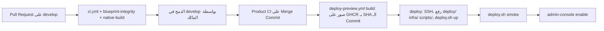

# CI/CD

> **Owner role:** Infrastructure and deployment
> **Status:** PARTIALLY IMPLEMENTED — الـ CI والـ Deployment بتاع بيئة المعاينة على Contabo موجودين (IMPLEMENTED) في `.github/workflows`؛ الـ Deployment للـ Production مش موجود وهو PLANNED. سلوك الـ Workflows تحت اتقرا من ملفات الـ YAML؛ ومفيش أي تشغيل اتعمل وقت كتابة الصفحة.
> **Language / اللغة:** [English](ci-cd.md) · العربية

## جرد الـ Workflows

| الملف | المُشغّل | الـ Jobs | بيثبت إيه | مابيثبتش إيه |
|---|---|---|---|---|
| `.github/workflows/ci.yml` ("Product CI") | كل Push وكل Pull Request | `workspace` (`scripts/check_workspace.sh`: الـ Backend `verify`، فحص الـ Contract، الـ Typecheck، الـ Lint، الاختبارات، الـ Builds، حزم JS بتاعة Android/iOS)؛ `local-stack` (`scripts/dev.sh verify`)؛ `design` (`scripts/check_design.sh`)؛ `secrets` (`scripts/check_secrets.sh`) | إن الـ Toolchain المثبّت بيبني من Checkout نضيف؛ وإن اختبارات التكامل على PostgreSQL حقيقي بتنجح؛ وإن الـ Local Stack بيشتغل وبيعدّي الـ Smoke | الـ Native Compilation، ومجموعة اختبارات الـ E2E على المتصفح، والسلوك على البيئة المنشورة |
| `.github/workflows/blueprint-integrity.yml` | Push، Pull Request | `validate_blueprint.py`، `check_scope.py`، سحب صورتين مساعدتين، وبعدها `python3 -m unittest discover -s scripts -p 'test_*.py'` | هيكل التخطيط وكل اختبار Guardrail في الـ Scripts | سلوك المنتج (العنوان بيقول كده) |
| `.github/workflows/native-build.yml` | PR على `develop`؛ Push على `implementation/mvp` بيلمس مسارات الموبايل؛ يدوي | `android` (Prebuild، `assembleDebug`، `assembleRelease`، الـ Local Stack، تشغيل الـ Emulator، دورة تسجيل الدخول، دورة الأوردر، لقطات الشاشة)؛ `ios` (Prebuild، Builds الـ Debug والـ Release على الـ Simulator، التشغيل، الـ Native Stack، تسجيل الدخول والأوردر بـ XCUITest) | إن التطبيق بيتبني وبيشتغل وبيسجّل دخول بـ PKCE وبيسترجع أوردر اتقطع على Emulator/Simulator | الأجهزة الحقيقية، والتوقيع، والتقديم للمتاجر |
| `.github/workflows/owner-e2e-fixtures.yml` | PR أو Push بيلمس `deploy/web-preview/**` أو الـ Migrations أو مستندات قبول المالك أو `scripts/owner_e2e_*` | بيطبّق كل الـ Flyway Migrations على PostgreSQL 16، وبيشغّل الـ Seed SQL مرتين، وبيقارن عدد الصفوف، وبيشغّل `scripts/owner_e2e_reconcile.py` | إن الـ Seed SQL سليم وIdempotent على الـ Schema | مستخدمين Keycloak، وبيئة المعاينة الحقيقية |
| `.github/workflows/deploy-preview.yml` | Push على `develop`؛ يدوي | `build` (بيستنى Product CI أخضر على نفس الـ Commit بالظبط، وبيبني الـ API jar، وبيبني ويرفع صورتين على GHCR موسومتين بـ SHA الـ Commit، وبيطلّع الـ Digests)؛ `deploy` (البيئة `preview`: SSH، رفع `deploy/` و`infra/` و`scripts/` وملف Fixtures manifest، تشغيل `deploy.sh up` و`deploy.sh smoke`، وبعدها `deploy.sh admin-console enable`) | إن الـ Commit اللي عدّى الـ CI هو اللي شغّال على بيئة المعاينة وبيعدّي الـ Smoke للقراءة بس | الجاهزية للـ Production؛ ومفيش Rollback تلقائي للـ Database |
| `.github/workflows/owner-e2e-provision.yml` | Push على `develop` بيغيّر `deploy/web-preview/owner-e2e-run.request` | بيستنى Deployment الـ Commit ده، وبعدها بيشغّل بـ SSH الأمر `owner-e2e-provision.sh plan` أو `apply` | إن Fixtures الـ E2E بتاعة المالك اتجهّزت (أو هتتجهّز) على بيئة المعاينة | إن حالات القبول بتنجح |
| `.github/workflows/doc001.yml` | `pull_request` (opened, synchronize, reopened, edited, ready_for_review) موجّه لـ `develop` أو `main` | بيشغّل `scripts/doc001_check.py pr` من الـ **Base** SHA على ملفات الـ PR؛ اسم الفحص `Documentation Consistency / DOC-001` | إن وصف الـ PR فيه إقرار Documentation Impact صالح، وإن مناطق الـ Matrix فيها تغييرات توثيق حقيقية، وإن روابط/Anchors/مسارات/معرّفات الدليل بتتحل، وإن ملفات الحوكمة عليها موافقة من حد غير صاحب الـ PR على الـ Head الحالي | إن التوثيق دقيق من ناحية المعنى؛ وهو عمره ما بينفّذ كود الـ PR. السياسة: [documentation-policy.md](documentation-policy-ar.md) |
| `.github/workflows/handbook-parity.yml` | `pull_request` أو Push على `develop` بيلمس `docs/developer-handbook/**` أو `scripts/validate_handbook_parity.py` أو اختباراته | الـ Job اسمه `Handbook Arabic parity (structural)`: بيسطّب `markdown-it-py`، وبيشغّل `scripts/test_validate_handbook_parity.py` و`scripts/validate_handbook_parity.py` (ومعاه `--base` في الـ Pull Requests) والأمر `python3 scripts/doc001_check.py docs` | إن كل صفحة إنجليزي في الدليل ليها نسخة عربي بنفس البنية والمحتوى التقني المحمي والروابط والـ Anchors؛ وإن الإنجليزي والعربي اتغيروا مع بعض في الـ PR | إن العربي معناه نفس الإنجليزي؛ وهو مش ضمن الـ Checks المطلوبة في الـ Ruleset بتاع `develop` |
| `.github/workflows/preview-images.yml` | يدوي، ومحتاج مُدخل Domain لبيئة المعاينة | بيبني ويرفع الصورتين لـ Domain مختار؛ وبيرفض Commit مالوش Product CI أخضر | إن الصور موجودة وبـ Digests في ملخص الـ Job | مفيش أي حاجة بتتنشر بيه |

كل الـ Actions الخارجية مثبّتة بـ SHA الـ Commit. و`NODE_VERSION` مع الـ SHA-256 بتاعه مثبّتين في الـ Workflows، وبيتم التحقق من Checksum أرشيف Node قبل الاستخدام.

## من الدمج لبيئة المعاينة

1. `deploy-preview.yml` بيعمل Polling على GitHub API لحد ما يلاقي تشغيل `ci.yml` ناجح من نوع Push على نفس الـ SHA (لحد 60 محاولة، بينهم 30 ثانية)، وبيفشل لو الـ CI فشل أو خلص الوقت.
2. صورتي `matbakhy-api` و`matbakhy-preview-front` بيتبنّوا مرة واحدة وبيتشار لهم بالـ Digest؛ وصورة الـ Front بتدمج Domain بيئة المعاينة جواها عن طريق Build Argument (شوف الـ Workflow؛ مش متكرر هنا).
3. على السيرفر، `deploy.sh up` (في `deploy/web-preview`) بيتأكد إن الصور مثبّتة بالـ Digest وإن `RELEASE_COMMIT` هو SHA كامل، وبياخد Lock مشترك، وبياخد نسخة احتياطية من الـ Database ويتحقق من استرجاعها لو الـ Database موجودة، وبيسحب الصور الناقصة، وبيشغّل الـ Stack، وبيستنى صحة الـ API، وبيتأكد إن الـ Buckets موجودة، وبيضيف سطر في سجل الإصدارات (`releases.log` تحت مجلد النسخ الاحتياطية).
4. لو `up` أو `smoke` فشل، السكريبت على السيرفر بيسترجع `.env` السابق وبيخرج بكود غير صفري؛ **والـ Database مابتترجعش تلقائيًا**.
5. التزامن: المجموعة `matbakhy-preview-deploy` مع `cancel-in-progress: false`؛ و`flock` على السيرفر في `deploy.sh` و`admin-console.sh` و`owner-e2e-provision.sh` بيرتّب التغييرات واحد ورا التاني. الـ Workflow بتاع التجهيز (provisioning) بيستخدم مجموعة خاصة بيه لأنه بيستنى الـ Deployment.

## الـ Rollback والنسخ الاحتياطية

سكريبت المشغّل: `deploy/web-preview/deploy.sh` (الـ Header بتاعه فيه كل الأوامر): `backup`، `restore-db <dump>`، `status`، `rollback-plan [N]` (للقراءة بس)، `smoke`، `prune-qa`، `admin-console`، `e2e-reset` (محمي: ملف علامة، وHosts عملاء غير عامة، وتأكيد بالكتابة).

- الـ Rollback للصور بس آمن لما الـ Schema ماتحركتش أو كل الـ Migrations من وقتها Expand-only. `scripts/check_migration_compat.py` بيفرض ملاحظات `-- rollback-compat: breaking|tightening|expand-only` على الـ Migrations اللي بعد الـ Baseline.
- غير كده، استرجع النسخة الاحتياطية اللي قبل الـ Deployment؛ والبيانات اللي اتكتبت بعدها بتضيع. التفاصيل وجدول القرار: [11-staging-deployment-and-rollback.md](../../operations/11-staging-deployment-and-rollback.md).
- الـ Rollback اتجرّب محليًا بـ `scripts/rehearse-preview.sh rollback`؛ أما الـ Rollback على جهاز بيئة المعاينة الحقيقي: NOT VERIFIED.

## تجهيز E2E للمالك بملف طلب

`deploy/web-preview/owner-e2e-run.request` ملف من سطر واحد أول كلمة فيه `plan` أو `apply`. تغييره على `develop` بيشغّل `owner-e2e-provision.yml` (الـ `workflow_dispatch` كان هيحتاج الملف على `main`، والمشروع ده مابيلمسهوش). `plan` للقراءة بس؛ و`apply` بياخد نسخة احتياطية متحقق منها، وبيشغّل Keycloak partial import (المستخدمين الموجودين بيتخطّوا)، وSQL seeds، وتحديث الـ Slots، ومطابقة للقراءة بس، وبيرفض إلا لو الـ API بيرجّع `APP_ENV=PREVIEW`، وبيكتب كلمات السر المتولّدة في ملف بصلاحية 600 على السيرفر، وعمره ما بيكتبها في الـ Logs. كل طلب جديد هو Commit؛ والملف بيحتفظ بسطر تعليق بيسجّل هو أنهي طلب. التفاصيل: [fixtures.md](../../quality/owner-acceptance/fixtures.md).

## التعامل مع الـ Secrets

- Secrets الـ Repository/بيئة `preview` فيها الـ SSH Host والمستخدم والمفتاح والمفتاح العام للـ Host (الأسماء `STAGING_SSH_HOST` و`STAGING_SSH_USER` و`STAGING_SSH_KEY` و`STAGING_SSH_HOST_PUBKEY`). القيم عمرها ما بتكون في الـ Repository ولا الـ Logs ولا الدليل ده. الـ SSH بيستخدم فحص صارم لمفتاح الـ Host مقابل المفتاح العام المخزّن.
- Secrets التطبيق بتعيش بس في `.env` على السيرفر (صلاحية 600)، ومتولّدة بـ `deploy.sh init-secrets`؛ وملفات الـ Realm/التخزين المتولّدة بتروح لمجلد خاص متولّد. تسجيل الدخول على GHCR بيستخدم Token الـ Job وإعداد Docker مؤقت.
- كلمات السر المحلية عشوائية لكل جهاز (`scripts/dev.sh`). كلمات سر الـ Database المؤقتة في الـ CI متعلّم عليها كده في الـ Workflow.
- Gitleaks بيفحص التاريخ والشجرة في كل تشغيل لـ Product CI.

## اختبارات الـ Smoke

- `deploy/web-preview/smoke.sh <preview-domain>`: فحوصات للقراءة بس على ويب العميل (الـ Headers، وإشعار الـ Demo)، وويب العمليات، والإعداد العام للـ API (`PREVIEW`، وdemo بـ true)، والـ Discovery، واستجابة 401/403 على الـ Endpoints الخاصة، وعدم نشر actuator والـ metrics، والـ OIDC issuer، وإخفاء master realm ومسارات الأدمن. وكمان بيتشغّل بواسطة `deploy.sh smoke`.
- Browser smoke بأوردر عربون محاكى: `apps/operations-web/e2e-staging`، بيتشغّل من جهاز في القائمة المسموحة ([test-execution.md](test-execution-ar.md)).

## حدود الجاهزية للـ Production

بيئة المعاينة اصطناعية (Synthetic)، ومقيّدة بـ IP، وسيرفر واحد، ومفيهاش مزودين حقيقيين ولا فلوس حقيقية. مفيش بيئة Production ولا Deployment عام ولا تقديم للمتاجر ولا دفع فعلي في الـ Repository؛ وده كله محتاج تفويض من المالك وبوابات قانونية/مزودين ([CLAUDE.md](../../../CLAUDE.md)). ماتوصفش Deployment أخضر على إنه جاهزية للـ Production. شوف [preview-environment.md](preview-environment-ar.md).

## القيود المعروفة وفجوات التوثيق

- `deploy-preview.yml` بينشر Keycloak admin console بعد كل Deployment (`admin-console enable`)؛ والسياسة والتحصين في [14-keycloak-admin-console.md](../../operations/14-keycloak-admin-console.md). الـ Job اسمه `build` في Workflow الـ Deploy بيشتغل مع كل Push على `develop` ومع التشغيل اليدوي، لكن الـ Job اسمه `deploy` بيشتغل بس لما الـ Ref يكون `develop`.
- `deploy/web-preview/README.md` لسه بيقول "Nothing here has been deployed"، وده قديم بالنسبة للـ Workflows.
- إعدادات حماية الـ Branch والفحوصات المطلوبة مش موجودة في الـ Repository: NOT VERIFIED.

## استثناءات الفحص المحددة والمتراجعة

المالك وافق على 5 بصمات محددة مش بيانات اعتماد (4 بصمات تاريخية و1 بصمة لفحص الملفات لنفس اسم تخزين النموذج) في `.gitleaksignore`: اسم تخزين تقدّم النموذج المعتمد، وتعليق تاريخي، وعلامات اختبارات إخفاء اصطناعية. [مراجعة الأمان](../../quality/testing-workspace/security-review.md) بتوثّق النطاق وتصنيف المصدر المستقل. مفيش استثناء لملف كامل أو مسار كامل أو قاعدة كاملة؛ أي نتيجة تانية لسه بتفشل الفحص.
