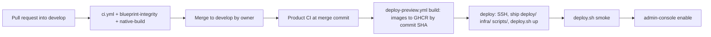

# CI/CD

> **Owner role:** Infrastructure and deployment
> **Status:** PARTIALLY IMPLEMENTED — CI and the Contabo preview deployment are IMPLEMENTED in `.github/workflows`; production deployment does not exist and is PLANNED. Workflow behaviour below was read from the YAML; no run was triggered while writing.
> **Language / اللغة:** English · [العربية](ci-cd-ar.md)

## Workflow inventory

| File | Trigger | Jobs | What it proves | What it does not prove |
|---|---|---|---|---|
| `.github/workflows/ci.yml` ("Product CI") | every push and pull request | `workspace` (`scripts/check_workspace.sh`: backend `verify`, contract check, typecheck, lint, tests, builds, Android/iOS JS bundles); `local-stack` (`scripts/dev.sh verify`); `design` (`scripts/check_design.sh`); `secrets` (`scripts/check_secrets.sh`) | pinned toolchain builds from a clean checkout; real-PostgreSQL integration tests pass; local stack boots and passes smoke | native compilation, browser E2E suite, deployed behaviour |
| `.github/workflows/blueprint-integrity.yml` | push, pull request | `validate_blueprint.py`, `check_scope.py`, pulls two helper images, then `python3 -m unittest discover -s scripts -p 'test_*.py'` | planning structure and every script guardrail test | product behaviour (title says so) |
| `.github/workflows/native-build.yml` | PR to `develop`; push to `implementation/mvp` touching mobile paths; manual | `android` (prebuild, `assembleDebug`, `assembleRelease`, local stack, emulator launch, sign-in round trip, ordering round trip, screenshots); `ios` (prebuild, simulator Debug and Release builds, launch, native stack, XCUITest sign-in and ordering) | the app compiles, launches, signs in with PKCE and recovers an interrupted order on an emulator/simulator | physical devices, signing, store submission |
| `.github/workflows/owner-e2e-fixtures.yml` | PR or push touching `deploy/web-preview/**`, migrations, owner-acceptance docs, `scripts/owner_e2e_*` | applies all Flyway migrations to PostgreSQL 16, runs the seed SQL twice, compares row counts, runs `scripts/owner_e2e_reconcile.py` | seed SQL is valid and idempotent against the schema | Keycloak users, the real preview |
| `.github/workflows/deploy-preview.yml` | push to `develop`; manual | `build` (waits for green Product CI at the exact commit, builds the API jar, builds and pushes two images to GHCR tagged with the commit SHA, outputs digests); `deploy` (environment `preview`: SSH, ship `deploy/`, `infra/`, `scripts/`, fixtures manifest, run `deploy.sh up` and `deploy.sh smoke`, then `deploy.sh admin-console enable`) | the commit that passed CI is running on the preview and passes the read-only smoke | production readiness; no automatic database rollback |
| `.github/workflows/owner-e2e-provision.yml` | push to `develop` that changes `deploy/web-preview/owner-e2e-run.request` | waits for the deployment of that commit, then SSH-runs `owner-e2e-provision.sh plan` or `apply` | owner E2E fixtures were (or would be) provisioned on the preview | that the acceptance cases pass |
| `.github/workflows/doc001.yml` | `pull_request` (opened, synchronize, reopened, edited, ready_for_review) targeting `develop` or `main` | runs `scripts/doc001_check.py pr` from the **base** SHA against the PR's files; check name `Documentation Consistency / DOC-001` | PR description has a valid Documentation Impact declaration, matrix areas have substantive documentation changes, handbook links/anchors/paths/ids resolve, governance files have a non-author approval of the current head | that the documentation is semantically accurate; it never executes PR code. Policy: [documentation-policy.md](documentation-policy.md) |
| `.github/workflows/handbook-parity.yml` | `pull_request` or push to `develop` touching `docs/developer-handbook/**`, `scripts/validate_handbook_parity.py` or its tests | job `Handbook Arabic parity (structural)`: installs `markdown-it-py`, runs `scripts/test_validate_handbook_parity.py`, `scripts/validate_handbook_parity.py` (and `--base` on pull requests) and `python3 scripts/doc001_check.py docs` | every English handbook page has an Arabic mirror with the same structure, protected technical content, links and anchors; English and Arabic changed together in the PR | that the Arabic means the same as the English; it is not in the required checks of the `develop` ruleset |
| `.github/workflows/preview-images.yml` | manual, needs a preview domain input | builds and pushes the two images for a chosen domain; refuses a commit without green Product CI | images exist with digests in the job summary | nothing is deployed by it |

All third-party actions are pinned by commit SHA. `NODE_VERSION` and its SHA-256 are pinned in the workflows and the Node archive checksum is verified before use.

## From merge to preview

1. `deploy-preview.yml` polls the GitHub API for a successful `ci.yml` push run at the same SHA (up to 60 attempts, 30 s apart) and fails if CI failed or timed out.
2. Images `matbakhy-api` and `matbakhy-preview-front` are built once and referenced by digest; the front image bakes in the preview domain via a build argument (see the workflow; not repeated here).
3. On the server `deploy.sh up` (in `deploy/web-preview`) validates that images are pinned by digest and `RELEASE_COMMIT` is a full SHA, takes a shared lock, takes and restores-verifies a database backup if a database exists, pulls missing images, starts the stack, waits for API health, ensures buckets exist, and appends a line to the release log (`releases.log` under the backup directory).
4. If `up` or `smoke` fails the remote script restores the previous `.env` and exits non-zero; **the database is not rolled back automatically**.
5. Concurrency: group `matbakhy-preview-deploy` with `cancel-in-progress: false`; server-side `flock` in `deploy.sh`, `admin-console.sh` and `owner-e2e-provision.sh` serialises changes. The provisioning workflow uses its own group because it waits for the deployment.

## Rollback and backups

Operator script: `deploy/web-preview/deploy.sh` (header lists every command): `backup`, `restore-db <dump>`, `status`, `rollback-plan [N]` (read-only), `smoke`, `prune-qa`, `admin-console`, `e2e-reset` (guarded: marker file, non-public customer hosts, typed confirmation).

- Image-only rollback is safe when the schema has not moved or every migration since is expand-only. `scripts/check_migration_compat.py` enforces `-- rollback-compat: breaking|tightening|expand-only` annotations on migrations after the baseline.
- Otherwise restore the pre-deploy backup; data written after it is lost. Details and decision table: [11-staging-deployment-and-rollback.md](../../operations/11-staging-deployment-and-rollback.md).
- Rollback was rehearsed locally with `scripts/rehearse-preview.sh rollback`; a rollback on the real preview host: NOT VERIFIED.

## Owner E2E provisioning by request file

`deploy/web-preview/owner-e2e-run.request` is a one-line file whose first word is `plan` or `apply`. Changing it on `develop` triggers `owner-e2e-provision.yml` (a `workflow_dispatch` would require the file on `main`, which this project does not touch). `plan` is read-only; `apply` takes a verified backup, runs the Keycloak partial import (existing users skipped), SQL seeds, slot refresh and a read-only reconciliation, refuses unless the API reports `APP_ENV=PREVIEW`, and writes generated passwords to a mode-600 file on the server, never to logs. Each new request is a commit; the file keeps a comment line recording which request it is. Details: [fixtures.md](../../quality/owner-acceptance/fixtures.md).

## Secrets handling

- Repository secrets/environment `preview` hold the SSH host, user, key and host public key (names `STAGING_SSH_HOST`, `STAGING_SSH_USER`, `STAGING_SSH_KEY`, `STAGING_SSH_HOST_PUBKEY`). Values are never in the repository, logs or this handbook. SSH uses strict host-key checking against the stored public key.
- Application secrets live only in the server's `.env` (mode 600), generated by `deploy.sh init-secrets`; rendered realm/storage files go to a private generated directory. GHCR login uses the job token and a temporary Docker config.
- Local passwords are random per machine (`scripts/dev.sh`). CI throwaway database passwords are labelled as such in the workflow.
- Gitleaks scans history and tree in every Product CI run. The history scan covers every fetched ref, so a reviewed false positive is recorded in `.gitleaksignore` by its exact fingerprint (commit, file, rule, line), never by a path or rule exclusion.

## Smoke tests

- `deploy/web-preview/smoke.sh <preview-domain>`: read-only checks of customer web (headers, demo notice), ops web, API public configuration (`PREVIEW`, demo true), discovery, 401/403 on private endpoints, actuator and metrics not published, OIDC issuer, master realm and admin paths hidden. Also run by `deploy.sh smoke`.
- Browser smoke with a simulated deposit order: `apps/operations-web/e2e-staging`, run from an allow-listed machine ([test-execution.md](test-execution.md)).

## Production-readiness boundaries

The preview is synthetic, IP-restricted, single-server and has no real providers or money. There is no production environment, public deployment, store submission or live payment in the repository; those need owner authorization and legal/provider gates ([CLAUDE.md](../../../CLAUDE.md)). Do not describe a green deployment as production readiness. See [preview-environment.md](preview-environment.md).

## Known limitations and documentation gaps

- `deploy-preview.yml` publishes the Keycloak admin console after every deploy (`admin-console enable`); the policy and hardening are in [14-keycloak-admin-console.md](../../operations/14-keycloak-admin-console.md). The deploy workflow's `build` job runs on every push to `develop` and on manual dispatch, but the `deploy` job only when the ref is `develop`.
- `deploy/web-preview/README.md` still says "Nothing here has been deployed", which is out of date relative to the workflows.
- Branch protection and required-check settings are not in the repository: NOT VERIFIED.

## Exact reviewed scanner exclusions

The owner approved 5 exact non-credential fingerprints (4 historical fingerprints and 1 directory-scan equivalent for the same prototype namespace) in `.gitleaksignore`: the approved prototype progress-storage namespace, a historical explanatory comment and synthetic redaction-test markers. [Security review](../../quality/testing-workspace/security-review.md) records the scope and independent source classification. No complete file, path or rule is excluded; all other findings still fail the scan.
