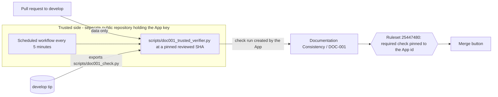

# DOC-001 trusted enforcement and the single-account operating model

> **Owner role:** Infrastructure and deployment
> **Status:** PARTIALLY IMPLEMENTED — verifier code and tests exist; the GitHub App, its hosting and the ruleset pin are NOT installed, so the workflow-bypass hole is still open

This page is the design for making `Documentation Consistency / DOC-001` impossible to bypass by editing the workflow or the gate script in the same pull request, and it records how governance approval works while the owner, the new developer and the AI agents share **one GitHub account**. Policy: [documentation policy](documentation-policy.md). Current protection: [documentation maintenance](documentation-maintenance.md#branch-protection-status).

## 1. The problem (demonstrated)

The in-repository workflow `.github/workflows/doc001.yml` uses the `pull_request` event, so GitHub runs the workflow file **from the pull request**. Disposable PR #33 replaced the job with a no-op step; the required check `Documentation Consistency / DOC-001` passed in two seconds. Anything that runs inside the PR's own workflow, including a "required workflow" copy of the same job name, can be rewritten by that PR. `main` must not be modified, which rules out the `pull_request_target` workaround (GitHub reads that event's workflow from the default branch; tried on PR #25, it never ran).

## 2. Options investigated

| Option | Verdict |
|---|---|
| `pull_request_target` workflow on `main` | Rejected by the owner: `main` is not modified. |
| `workflow_run` or `issue_comment` workflow | Also read from the default branch (`main`); same blocker. |
| Ruleset "required workflows" | Not available for personal-account repositories (the API answered 422 when it was tried on 2026-10-20). |
| Push ruleset restricting changes to governance paths | Blocks even the owner's own governance PRs from being pushed, and applies to every branch; creates the deadlock the owner wants to avoid. |
| Code Owners review | Needs a second approving identity to mean anything; with one account and zero required approvals it enforces nothing. |
| Environment with required reviewers | A PR can remove the `environment:` line from its own job. Same hole. |
| **External GitHub App posting the required check, with the ruleset pinned to the App's id** | **Chosen.** The check is created by an identity the PR cannot act as, from code that is read from the protected base branch. |

A check run created by a workflow's `GITHUB_TOKEN` belongs to the `github-actions` app. A ruleset entry that names a context **with an `integration_id`** is satisfied only by a check created by that app, so a forged check with the same name from the PR's own workflow does not count.

## 3. Design



- **Verifier** (`scripts/doc001_trusted_verifier.py`, tested by `scripts/test_doc001_trusted_verifier.py`): lists open PRs against `develop`; for each one exports `scripts/` and the handbook from the **current tip of `develop`**, fetches `refs/pull/<n>/head` as data, runs the base copy of `scripts/doc001_check.py pr` with `python3 -I`, and posts one check run named `Documentation Consistency / DOC-001` through the Checks API. It fails closed if the base branch has no gate. It re-posts only when the verdict, report or base tip changes. Nothing from the pull request is executed. Hardening from the independent Codex review of this design: an error while judging one PR becomes a posted failure (a stale green is replaced and the scan continues with the next PR); each head's verdict is published right after it is judged, not after the whole batch; credentials travel in the environment of the git child, never in arguments or messages, and the tokens are masked in logs; PRs and comments are paginated; several PRs sharing one head commit pass only if all pass; the description, comments and head are re-read after judging and a change fails closed.
- **Who may change what:** the gate that judges a PR is always the already-merged one, so a PR that rewrites `doc001_check.py`, the workflow or the verifier is judged by the old rules and, because those files are governance files, needs the owner's authorization (section 5). A merged change to the verifier would run with the App key, so the trusted repository **pins the verifier to a reviewed commit SHA** that only the owner moves.
- **Hosting:** a scheduled GitHub Actions workflow in a separate repository owned by the same account (public, no secrets in its files; the App id and private key are repository secrets). No server, no Contabo change, no spend. Template (kept here as a block, not a file, because it lives in the other repository):

```yaml
name: DOC-001 trusted verifier
on:
  schedule: [{ cron: "*/5 * * * *" }]
  workflow_dispatch:
permissions: { contents: read }
concurrency: { group: doc001-verifier, cancel-in-progress: false }
jobs:
  verify:
    runs-on: ubuntu-24.04
    timeout-minutes: 15
    steps:
      - name: Fetch the verifier at the pinned, reviewed commit
        env: { VERIFIER_SHA: "${{ vars.VERIFIER_SHA }}" }
        run: |
          set -euo pipefail
          curl -fsSL "https://raw.githubusercontent.com/afawzy70/Matbakhy-v1/$VERIFIER_SHA/scripts/doc001_trusted_verifier.py" -o verifier.py
      - name: Verify open pull requests against develop
        env:
          GITHUB_REPOSITORY: afawzy70/Matbakhy-v1
          DOC001_APP_ID: ${{ secrets.DOC001_APP_ID }}
          DOC001_APP_PRIVATE_KEY: ${{ secrets.DOC001_APP_PRIVATE_KEY }}
        run: python3 -I verifier.py --base-branch develop
```

Latency: a new push gets its verdict within about five minutes (use "Run workflow" for an immediate run). Until the App reports, the required check stays pending, so a PR cannot merge unchecked.

## 4. Owner steps (cannot be done by an agent) and rollout

1. Create a GitHub App (Settings → Developer settings → GitHub Apps) with repository permissions Checks: read and write, Pull requests: read, Issues: read (comments), Contents: read, Metadata: read; no webhook, no user authorization. Install it **only** on `afawzy70/Matbakhy-v1`. Generate a private key.
2. Create the trusted repository, add secrets `DOC001_APP_ID`, `DOC001_APP_PRIVATE_KEY`, the variable `VERIFIER_SHA` (the reviewed merge commit of this design) and the workflow above. Keep the key out of every file and chat.
3. **Observe first:** the App's check shares the name of the in-repository one. Compare both on a few PRs; the in-repository job stays required until step 5.
4. **Prove it:** open a disposable copy of PR #33 (workflow replaced by a no-op, no owner authorization comment). The App's check must be `failure` and the PR must show `mergeStateStatus: BLOCKED` with the in-repository check green. Record the result on this page. Until this has been observed, the hole is **not** claimed fixed.
5. **Pin:** edit the ruleset so the DOC-001 context carries the App's `integration_id` (all other required checks unchanged), then repeat step 4 and a normal passing PR to confirm no deadlock. Keep the previous ruleset JSON for rollback.

Current status: steps 1–5 NOT DONE (owner action needed: steps 1–2; the agent can perform 3–5 once the App exists and the owner authorizes the ruleset edit).

## 5. Governance changes in the single-account model

GitHub cannot show that the owner, Mohamed and an agent are different people while they use one account, so the gate does **not** ask for an impossible second GitHub approval and Codex output is never counted as one.

A PR is a **governance change** when it touches the DOC-001 workflow, gate, verifier or their tests, the matrix, the policy, `AGENTS.md`, `CLAUDE.md`, the PR template or `.github/CODEOWNERS` (the gate recognises these paths). Changes to the ruleset, branch-protection settings or agent instructions made outside a PR are also governance changes: they need the owner's explicit instruction in the session or the PR and are recorded in [documentation maintenance](documentation-maintenance.md#branch-protection-status). It passes DOC-001 only when all of these hold:

1. The normal DOC-001 declaration is valid (documentation updated in the same PR).
2. `governance_review` records the **actual roles**: who authored (owner, Mohamed, or which AI agent/session), who reviewed, and the Codex code-review and security-review evidence (link or `NOT_RUN`), plus the acknowledgement that GitHub cannot verify the identities.
3. The repository owner has commented on the PR `OWNER-AUTHORIZES-GOVERNANCE <first 12 characters of the head commit>`. The **whole comment** must be the marker and at least 12 hex characters of the head SHA (quoted, fenced, commented-out, negated or explained text does not count because no other text is allowed), and its binding to the head commit means any later push needs a fresh authorization. The gate checks the commenter login and `author_association: OWNER`; it cannot prove who typed it, so the rule is procedural: **agents never post this comment**, and an owner chat instruction is relayed by the owner posting it themselves.

Codex Code Review and Security Review are supporting evidence, labelled as such in the PR. They never replace the owner's authorization.

Bootstrapping note: the first governance PR is judged by the previously merged gate, which still demands a non-author approval that cannot exist. That one change needs the owner to relax the ruleset deliberately (Settings → Rules → Rulesets → disable, merge, re-enable), exactly as with the rest of the governance backlog; afterwards the single-account rule above applies. No bypass actor is configured.

## 6. How normal pull requests pass

Unchanged: the declaration and handbook updates described in the [documentation policy](documentation-policy.md), the eight required checks listed in [documentation maintenance](documentation-maintenance.md#branch-protection-status), no approving review required (zero), and a self-review labelled as self-review. Add the author/reviewer roles and any Codex review links in the PR description's roles section ([PR template](../../../.github/pull_request_template.md)).

## 7. Remaining limitations of the single-account model

- Owner authorization is an audit record, not an identity proof: an agent holding the same token could post the comment. The control is procedural (rules in `AGENTS.md` and `CLAUDE.md`), visible in the PR history, and reviewed by the owner.
- Code Owners cannot be used as an enforcement mechanism until a second human account exists.
- If the verifier cannot reach GitHub at all (outage, expired key, failed listing) it exits with an error and posts nothing: existing checks stay as they were (green stays green until the verifier runs again, new PRs stay pending). Watch the trusted repository's failed runs.
- **Revocation window:** if the owner deletes the authorization comment after a green result, the check stays green until the next scheduled run (up to about five minutes plus queue delay) and a merge in that window is possible; the merge would still be an owner-initiated action.
- The App closes the workflow-neutralisation hole only after steps 1–5 are done and the #33 clone is observed blocked.
- The verifier host is a scheduled workflow: GitHub disables schedules of public repositories after 60 days without repository activity (re-enable or dispatch manually), and runs can be delayed during platform load.
- Whoever holds the App key or the owner account can alter the control. The key must live only in the trusted repository's secrets.

## Known limitations and documentation gaps

- The live behaviour of the App check (permissions, `integration_id` pin, scheduler latency) is NOT VERIFIED; only the verifier logic is tested against a local repository copy.
