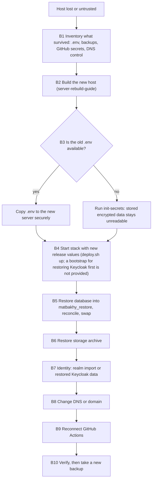

# النسخ الاحتياطي والاسترجاع والتعافي من الكوارث

> **Owner role:** Infrastructure and deployment
> **Status:** PARTIALLY IMPLEMENTED — النسخ الاحتياطي، والاسترجاع المتحقَّق منه في Database مؤقتة، وتخطيط الـ Rollback موجودين كـ Scripts؛ أما الجدولة والنسخ خارج الجهاز ونسخ الهوية (Keycloak) الاحتياطي واسترجاع التخزين وتجربة تعافٍ كاملة من الكوارث فكلها غير مثبتة على سيرفر Contabo. التعافي الكامل للخدمة من الكوارث (السيناريو B) BLOCKED: مفيش تسلسل مدعوم ومجرَّب يغطي كذا مخزن بيانات (القسم 7). التركيب الجديد (السيناريو A) DOCUMENTATION VERIFIED, NOT EXECUTION VERIFIED.
> **Language / اللغة:** [English](backup-restore-disaster-recovery.md) · العربية

الصفحة دي بتقول للمهندس إيه اللي بيحمي بيانات الـ Preview، وإيه اللي مش بيحميها، وإزاي يعيد البناء أو يرجع لنسخة سابقة. هي عن الـ Preview، اللي فيه بيانات تجريبية غير حقيقية (Synthetic Data) بس (الإعدادات العامة بتبلّغ `PREVIEW` و`demo: true`). الإجراءات مكتوبة بحيث تنطبق كمان على بيئة مستقبلية فيها بيانات حقيقية، لكن مفيش حاجة هنا معتمدة لده. جرد السيرفر موجود في [contabo-server-inventory.md](contabo-server-inventory-ar.md)، وخط الـ Deployment في [deployment-pipeline.md](deployment-pipeline-ar.md)، والـ Topology في [runtime-architecture.md](runtime-architecture-ar.md)، وتجهيز الـ Host في [server-rebuild-guide.md](server-rebuild-guide-ar.md)، والـ DNS والشهادات في [dns-https-sslip-io.md](dns-https-sslip-io-ar.md).

## دليل الأدلة (Evidence legend)

| الوسم | معناه في الصفحة دي |
|---|---|
| VERIFIED LIVE | اتلاحظ على الـ Contabo VPS بواسطة المستخدم `aiagent` اللي معندوش صلاحيات إدارية يوم 2026-10-21 (للقراءة فقط). |
| VERIFIED IN CODE | اتقرأ في ملف الـ Repository المذكور جنب الادعاء. بيثبت إيه اللي الكود بيعمله لما يشتغل، مش إن التشغيل حصل. |
| DOCUMENTED ONLY | مستند في الـ Repository بيقوله؛ ومااتأكّدش. |
| OUTDATED / INCORRECT | بيتعارض مع دليل أحدث، مثلًا نص من أيام Hetzner. |
| NOT VERIFIED | محدش أكّده؛ والصفحة بتوضّح إزاي أدمن مصرّح له يقدر يأكّده. |

ملحوظة Hetzner: [09-staging-hetzner-preparation.md](../../operations/09-staging-hetzner-preparation.md) و[12-owner-server-setup.md](../../operations/12-owner-server-setup.md) وأجزاء من [06-web-preview.md](../../operations/06-web-preview.md) و[11-staging-deployment-and-rollback.md](../../operations/11-staging-deployment-and-rollback.md) اتكتبت لـ Host Hetzner مقترح (مستخدم اسمه `matbakhy`، ومجلد `/srv/matbakhy-preview`، وبروفايل 2 vCPU و 4 GB). اعتبر تفاصيل الـ Host دي تاريخية (OUTDATED / INCORRECT بالنسبة لسيرفر Contabo الشغّال). منطق النسخ الاحتياطي فيها لسه هو منطق الـ Scripts وبيتستخدم تحت.

## 1. قواعد الأمان للصفحة دي

- **ماتشغّلش أي أمر بيغيّر الحالة في الصفحة دي على الـ Preview الحي** إلا لو أدمن مصرّح له قرر كده، وبعلم المالك. خطوات الاسترجاع وإعادة البناء والتبديل (Swap) لسيرفر جديد ومعزول.
- الـ Agents وحساب `aiagent` مبيشغّلوش الأوامر دي. هي محتاجة صلاحية Docker وصلاحية قراءة ملف `.env` بتاع السيرفر؛ و`aiagent` ماينفعش ياخد ولا واحدة منهم.
- النسخ الاحتياطية بتحتوي بيانات شخصية في البيئة الحقيقية. خليها بره أي Git Working Tree (`scripts/db-backup.sh` بيرفض مجلد الإخراج لو جوه واحد بس لما `git` يكون متسطّب في البيئة اللي بيشتغل فيها وفحص المجلد بتاعه ينجح، VERIFIED IN CODE؛ فالحماية دي مشروطة، وعلى المشغّل يتأكد من وجهة النسخ الاحتياطي بنفسه) وماتلصقش ملفات نسخ احتياطي أو محتويات `.env` أو قيم مفاتيح في Issue أو Pull Request أو شات.
- ماتوصفش الصفحة دي كإثبات للتعافي. القسم 9 بيعدّد بالظبط اللي متكتوب كـ Script أو موثّق بس.

## 2. اللي موجود النهارده

| القدرة | الحالة | الدليل |
|---|---|---|
| Dump منطقي لـ Database التطبيق `matbakhy` مع Checksum بـ SHA-256 وManifest فيه نسخة الـ Schema وعدد الصفوف | الـ Script موجود | VERIFIED IN CODE: `scripts/db-backup.sh` |
| النسخة الاحتياطية بتتحسب بس لما تتسترجع في Database مؤقتة فاضية وتتطابق؛ والاسترجاع الفاشل بيوقف الأمر ومقياس عمر النسخة مبيتكتبش | الـ Script موجود واختبار Guardrail بـ Stubs موجود | VERIFIED IN CODE: `deploy/web-preview/deploy.sh` (الدوال `backup_db` و`verify_backup` و`backup_metric`)، `scripts/test_preview_backup.py` |
| نسخة احتياطية قبل الـ Deploy مع كل `deploy.sh up` لما يكون Container بتاع PostgreSQL شغّال بالفعل | الـ Script موجود | VERIFIED IN CODE: `deploy/web-preview/deploy.sh` (الدالة `up`) |
| أرشيف تخزين الصور (tar لـ Volume التخزين، مع إيقاف خدمة التخزين لفترة قصيرة) | الـ Script موجود | VERIFIED IN CODE: `deploy/web-preview/deploy.sh` (الدالة `backup`) |
| استرجاع Dump في Database جديدة `matbakhy_restore`، مع مطابقة | الـ Script موجود | VERIFIED IN CODE: `deploy/web-preview/deploy.sh` (الدالة `restore_db`)، `scripts/db-restore.sh`، `infra/db/reconcile.sql` |
| تاريخ الإصدارات (`releases.log`) ومخطّط Rollback للقراءة فقط | الـ Script موجود | VERIFIED IN CODE: `deploy/web-preview/deploy.sh` (الدوال `record_release` و`rollback_plan`) |
| تنبيه `BackupStale` لما مفيش نسخة احتياطية متحقَّق منها لمدة 24 ساعة | القاعدة موجودة | VERIFIED IN CODE: `deploy/web-preview/observability/alerts.yml`, `deploy/web-preview/observability/alerts.test.yml` |
| فحص توافق الـ Migration للـ Rollback (سياسة expand-only بعد V28) | الـ Script موجود | VERIFIED IN CODE: `scripts/check_migration_compat.py` |
| جدولة يومية لـ `deploy.sh backup` | موصى بيها في مستند من أيام Hetzner؛ ومفيش جدولة ظاهرة لـ `aiagent` | DOCUMENTED ONLY: [12-owner-server-setup.md](../../operations/12-owner-server-setup.md) القسم 9؛ الحالة الحيّة NOT VERIFIED |
| الاحتفاظ بالنسخ الاحتياطية أو تنظيفها | مفيش. `prune-qa` بتشيل بس مخرجات الـ QA. فترة الاحتفاظ قرار مفتوح عند المالك | VERIFIED IN CODE (مفيش كود تنظيف لـ `BACKUP_DIR`)؛ DOCUMENTED ONLY: [06-web-preview.md](../../operations/06-web-preview.md) |
| نسخ النسخ الاحتياطية لجهاز تاني | مفيش خطوة. النسخ الاحتياطية بتشارك السيرفر مصيره | VERIFIED IN CODE (الغياب)؛ DOCUMENTED ONLY: [06-web-preview.md](../../operations/06-web-preview.md) |
| نسخ احتياطي لـ Database الـ Keycloak `keycloak` بواسطة `deploy.sh backup` | مش جزء منه: `deploy.sh backup` بيعمل Dump لـ Database `matbakhy` بس | VERIFIED IN CODE: `PGDATABASE=matbakhy` في `backup_db` |
| Dumps لـ Database الـ Keycloak بتعملها Scripts الهوية | الـ Script موجود. `admin-console.sh` مفيهوش أمر فرعي اسمه `backup` (سطر الاستخدام بتاعه فيه بس enable وverify وstatus وdisable وrollback وcreate-admin وfixture-clean)؛ الدالة الداخلية `backup` بتاعته بينادي عليها `enable` (وده برضه `deploy.sh admin-console enable`) قبل التحصين، وبتكتب `pg_dump` كامل بصيغة custom لـ Database `keycloak` (فيه المستخدمين والـ Credentials) في `<backup-dir>/keycloak/keycloak-db-<stamp>.dump`، مع ملف حالة `admin-console-state.env`، تحت `umask 077`. الـ Workflow بتاع `deploy-preview.yml` بيشغّل `./deploy.sh admin-console enable` كخطوة منفصلة بعد خطوة الـ Deploy. أما `deploy/web-preview/migrate-mfa.sh backup` فأمر فرعي حقيقي (وبيشتغل الأول برضه في `apply`)؛ وبيشغّل كمان `./deploy.sh backup` وبيكتب نفس نوع الـ Dump، وتصدير للـ Realm من غير المستخدمين (`realm-before-<stamp>.json`) وملف `mfa-migration-state.env`. ولا واحد من الـ Scripts دي بيتحقق من الـ Dump بالاسترجاع، ولا بيمسح الـ Dumps القديمة، ومفيش مستند ولا Script بيسترجع واحد منها | VERIFIED IN CODE: `deploy/web-preview/admin-console.sh`، `deploy/web-preview/migrate-mfa.sh`، `.github/workflows/deploy-preview.yml`. هل فيه Dump زي ده على الـ Host الحي، وحديث قد إيه، وهل ينفع يتسترجع: كل ده NOT VERIFIED LIVE |
| أمر لاسترجاع أرشيف التخزين | مفيش | VERIFIED IN CODE (الغياب) |
| تجربة استرجاع (Drill) على سيرفر Contabo | مش مسجّلة؛ وتجربة استرجاع الـ Staging مذكورة على إنها لسه مطلوبة | DOCUMENTED ONLY: [04-privacy-and-recovery.md](../../operations/04-privacy-and-recovery.md) |

على الـ Host الحي (VERIFIED LIVE): `/srv/matbakhy-backups` موجود، ومملوك لـ `devops:devops` بصلاحيات 750، وفيه 28 عنصر `aiagent` مش قادر يعرضهم. إيه هي (ومنها هل فيه مجلد فرعي `keycloak` فيه Dumps الهوية)، وهل هي حديثة، وهل فيه جدولة: كل ده NOT VERIFIED. الأدمن يقدر يفحص بالأوامر 11 و 12 في [admin-readonly-verification.md](admin-readonly-verification-ar.md)، واللي بتطبع الأسماء والجدولة بس.

## 3. إيه اللي بيحمل الحالة، وإيه اللي بيحميها

| الحالة | مكانها | مغطّاة بـ `deploy.sh backup` | النتيجة لو ضاعت |
|---|---|---|---|
| Database التطبيق `matbakhy` (أوردرات، حسابات، Ledger، Audit) | Docker Volume اسمه `postgres-data` | أيوه (Dump وChecksum وManifest) | الأوردرات والحسابات من آخر Dump سليم بتضيع |
| Database الـ Keycloak `keycloak` (مستخدمين، Credentials، إعدادات الـ Realm، تسجيلات كلمة السر لمرة واحدة اللي اتضافت بعد الاستيراد) | نفس نسخة PostgreSQL ونفس الـ Volume | لأ. بس كأثر جانبي لـ `admin-console.sh enable` (دالته الداخلية للنسخ الاحتياطي) و`migrate-mfa.sh backup` (القسم 2)، اللي بيكتبوا Dumps تحت `<backup-dir>/keycloak/`؛ وهل فيه واحد منها لسه موجود NOT VERIFIED LIVE | من غير Dump موجود، هويات تسجيل الدخول لازم تتعمل من جديد من ملف الـ Realm، وأي حاجة اتعملت في Keycloak بعد أول استيراد بتضيع. ومع وجود Dump، استرجاعه مش إجراء اتجرّب (القسم 7، الخطوة B7) |
| تخزين الصور (صور الوجبات، المستندات الخاصة) | Docker Volume اسمه `storage-data` | أيوه، كـ `storage-<archive-stamp>.tgz` | الصور والمستندات بتضيع؛ وصفوف الـ Database بتشاور على Objects مش موجودة |
| `.env` (كل الأسرار والإصدار المثبَّت) | مجلد الـ Deployment، بصلاحيات 600 | لأ | شوف القسم 4: بعض البيانات المخزّنة بتبقى غير مقروءة |
| الإعدادات المتولّدة (`GENERATED_DIR`: ملف استيراد الـ Realm، ملف هوية التخزين، مجلد `flags`؛ والملف `admin-console-public` جواه بيتعمل بواسطة `admin-console enable` مش بواسطة `render`) | المجلد المتولّد، بصلاحيات 700 | لأ | ملفات الـ Realm والتخزين ومجلد `flags` الفاضي بيتعملوا من جديد بـ `deploy.sh render` من `.env` والـ Repository. كونسول الأدمن بيفضل مقفول لحد ما `./deploy.sh admin-console enable` يتشغّل تاني |
| شهادات TLS وحساب ACME | Docker Volume اسمه `caddy-data` | لأ | بتتصدر تاني تلقائيًا؛ مع حدود معدل Let's Encrypt (DOCUMENTED ONLY، شوف [dns-https-sslip-io.md](dns-https-sslip-io-ar.md)) |
| اللوجات والمقاييس وحالة التنبيهات وبيانات Grafana | الـ Volumes `loki-data` و`alloy-data` و`prometheus-data` و`alertmanager-data` و`alert-sink-data` و`grafana-data` | لأ | التاريخ بيضيع؛ والخدمات بتبدأ فاضية |
| `releases.log` ومقياس النسخ الاحتياطي وقفل التغيير | `BACKUP_DIR` | بتتكتب هناك | تاريخ الإصدارات بيضيع، فـ `rollback-plan` ملهاش حاجة تقراها |
| أسرار الـ Deployment | بيئة GitHub اسمها `preview` (الأسماء بس: `STAGING_SSH_HOST` و`STAGING_SSH_USER` و`STAGING_SSH_KEY` و`STAGING_SSH_HOST_PUBKEY`) | مش موضوع سيرفر | الـ Pipeline مش هيقدر يوصل للسيرفر لحد ما تتبدّل |

الدليل للجدول: VERIFIED IN CODE في `deploy/web-preview/compose.yaml` (الـ Volumes والـ Mounts) و`deploy/web-preview/deploy.sh` و`.github/workflows/deploy-preview.yml`. أي Volumes موجودة على الـ Host الحي NOT VERIFIED LIVE (المستخدم `aiagent` مش قادر يقرا Docker Socket)؛ الأمر 8 في [admin-readonly-verification.md](admin-readonly-verification-ar.md) بيعرض أسماءها.

## 4. الـ Credentials والمفاتيح اللي لازم تتحفظ

أسماء بس. القيم بيتولّدها `deploy.sh init-secrets` (قيم عشوائية من `openssl`) في `.env` بتاع السيرفر، ومفيش مستند أو أداة في الـ Repository بتخزّنها في أي مكان تاني (VERIFIED IN CODE: `deploy/web-preview/deploy.sh`، الدالة `init_secrets`). خزّنها في مدير أسرار يختاره المالك؛ والـ Repository مبيحددش واحد (NOT VERIFIED أنهي واحد المالك بيستخدمه).

| الاسم | الكود بيقول بيعمل إيه | لو ضاع أو اتبدّل |
|---|---|---|
| `HANDOVER_ENCRYPTION_KEY` | مفتاح 32 بايت (Base64). أكواد التسليم بتتخزّن كـ AES-GCM ciphertext وبتتعرض لصاحب الأوردر بفك تشفيرها (VERIFIED IN CODE: `backend/modules/orders/src/main/java/com/matbakhy/orders/internal/HandoverCodes.java`) | الـ ciphertexts المخزّنة لأكواد التسليم مش هينفع تتفك. مفتاح تاني صالح بيبدأ من غير خطأ لكن مش هيقدر يقرا الصفوف القديمة. الـ Startup Guard بيرفض القيم الناقصة أو قيم التطوير في البيئات المنشورة (VERIFIED IN CODE: `backend/app/src/main/java/com/matbakhy/app/config/CommerceConfiguration.java`) |
| `HANDOVER_HASH_KEY` | مفتاح الـ HMAC اللي بيتحقق من كود تسليم اتقدّم للتحقق مقابل الـ Hash المخزَّن (VERIFIED IN CODE: نفس الكلاس) | أكواد الأوردرات الموجودة متقدرش تتحقق منها بعد كده |
| `PUSH_TOKEN_ENCRYPTION_KEY` | مفتاح 32 بايت (Base64) بيشفّر الـ Push Tokens ويحمي سلامتها (VERIFIED IN CODE: `backend/modules/notifications/src/main/java/com/matbakhy/notifications/internal/TokenVault.java`) | الـ Push Tokens المخزّنة متتقراش |
| `PUSH_TOKEN_HASH_KEY` | Hash بمفتاح للـ Push Tokens لعمليات البحث عن التفرّد (VERIFIED IN CODE: نفس الكلاس) | الـ Tokens الموجودة مبتطابقش عمليات البحث بعد كده |
| `ACTIVITY_HASH_KEY` | سر بتستخدمه خدمة النشاط العضوي (Organic Activity) لعمل Hash لمعرّفات الزوار (VERIFIED IN CODE: `backend/modules/catalog/src/main/java/com/matbakhy/catalog/internal/activity/ActivityService.java`) | Hashes الزوار المخزّنة مبتطابقش الأحداث الجديدة؛ واستمرارية العدّ لكل زائر بتضيع (استنتاج من تصميم الـ Hash بمفتاح) |
| `PHONE_CODE_PEPPER` | سر بيتخلط في Hash أكواد التحقق من التليفون (VERIFIED IN CODE: `backend/modules/identity/src/main/java/com/matbakhy/identity/internal/PhoneVerificationService.java`) | أكواد التحقق اللي اتصدرت قبل التغيير متتحققش؛ هي قصيرة العمر، فالأثر صغير (استنتاج) |
| `POSTGRES_PASSWORD`, `KEYCLOAK_DB_PASSWORD`, `APP_DB_PASSWORD` | بتتستخدم بس عند أول تهيئة لمجلد بيانات فاضي لإنشاء الأدوار (Roles) (VERIFIED IN CODE: `deploy/web-preview/postgres/10-keycloak.sh`, `deploy/web-preview/postgres/20-runtime-role.sh`) | الـ Volume المسترجَع بيحتفظ بكلمات سر الأدوار القديمة، فلازم تحافظ على قيم `.env` المطابقة. تغيير قيمة `.env` بعد كده مبيغيّرش الدور (شوف [runtime-architecture.md](runtime-architecture-ar.md) القسم 6) |
| `OIDC_WEB_CLIENT_SECRET`, `OIDC_ADMIN_CLIENT_SECRET` | أسرار Client بتتكتب في ملف استيراد الـ Realm بواسطة `deploy.sh render` (VERIFIED IN CODE: استبدال `sed` في `render` بيغيّر السرّين دول و`PREVIEW_USER_PASSWORD` بس) | لازم تتطابق بين Keycloak والـ API. بعد استيراد Realm جديد، `render` بيكتب قيم `.env` الحالية، فالحفاظ على `.env` بيحافظ على اتساقها |
| `KEYCLOAK_OPS_CLIENT_SECRET` | سر Client العمليات في الـ Master Realm بتاع Keycloak. الأمر `render` مابيحطوش في ملف الـ Realm؛ لكن `deploy.sh admin-console enable` بيولّده في `.env` لو ناقص، وبيمرّره لـ `identity/admin_console.py` اللي بينشئ الـ Client ده أو بيحدّثه في Keycloak الشغّال (VERIFIED IN CODE: `deploy/web-preview/admin-console.sh`، `deploy/web-preview/identity/admin_console.py`) | الـ Client ده موجود في Database الـ Keycloak، واللي `deploy.sh backup` مابيعملهاش Dump (الـ Scripts بتاعة الهوية بس هي اللي بتعمل ده؛ شوف القسم 2). بعد إعادة بناء ببيانات Keycloak جديدة، شغّل `./deploy.sh admin-console enable` تاني عشان الـ Client و`.env` يتفقوا؛ وهل ده بيشتغل على بيانات Keycloak مسترجَعة NOT VERIFIED. ده جزء من تجهيز الـ Master Realm المنفصل، مش من التعافي باستيراد الـ Realm |
| `KEYCLOAK_ADMIN_USER`, `KEYCLOAK_ADMIN_PASSWORD` | أدمن الـ Bootstrap بتاع Keycloak (VERIFIED IN CODE: `deploy/web-preview/compose.yaml`) | ممكن يتعمل من جديد على Keycloak جديد؛ ومع بيانات Keycloak مسترجَعة بيتطبّق الأدمن المخزَّن |
| `PREVIEW_USER_PASSWORD` | كلمة سر مستخدمي الـ Realm التجريبيين غير الحقيقيين (VERIFIED IN CODE: `render`) | ممكن تدّي المستخدمين كلمة سر جديدة؛ مش بند فقدان بيانات |
| `STORAGE_ACCESS_KEY`, `STORAGE_SECRET_KEY` | بتتكتب في ملف هوية التخزين (VERIFIED IN CODE: `render`, `deploy/web-preview/storage/s3.json.template`) | بدّل الاتنين بشكل متسق وشغّل `render`؛ والـ Objects المخزّنة بتفضل مقروءة |
| `GRAFANA_ADMIN_PASSWORD` | أدمن Grafana | ممكن تتعيّن من جديد؛ مش بند فقدان بيانات |

قواعد بتنتج من الجدول:

1. أول صفّين بيحدّدوا هل البيانات المشفّرة المخزّنة هتفضل مقروءة. في إعادة بناء لازم تحافظ على البيانات، انسخ `.env` القديم كله للسيرفر الجديد عبر قناة آمنة بدل ما تشغّل `init-secrets` تاني. `init-secrets` بترفض تكتب فوق `.env` موجود.
2. للتركيب النضيف (Clean Installation)، القيم الجديدة صح ومتوقعة.
3. أثر تغيير مفتاح وفيه صفوف قديمة بينتج من طريقة شغل الخوارزميات. الكود مفيهوش أداة إعادة تشفير أو تدوير مفاتيح (VERIFIED IN CODE بالبحث: ملقيناش حاجة). ماتدوّرش المفاتيح دي من غير خطة معتمدة من المالك.

## 5. مرجع الأوامر

كل الأوامر لمستخدم يقدر يشغّل Docker ويقرا `.env` في مجلد الـ Deployment. أنهي حساب Linux بيعمل كده على الـ Host الحي NOT VERIFIED (مستخدم SSH بتاع الـ Deployment هو السر `STAGING_SSH_USER`)؛ وعلى سيرفر جديد هو أي حساب مشغّل عملته. `<deploy-dir>` هو `/srv/matbakhy-staging/deploy/web-preview` على الـ Host الحي (VERIFIED LIVE) ومسار من اختيارك على سيرفر جديد. `<backup-dir>` هو `BACKUP_DIR` من `.env` (الافتراضي `/srv/matbakhy-backups`، VERIFIED IN CODE في `deploy/web-preview/.env.example`؛ والقيمة الحيّة NOT VERIFIED). جوه Container بتاع PostgreSQL نفس المجلد هو `/backups`.

| ID | الأمر | الجهاز والمستخدم | النوع | المتطلب المسبق | النتيجة المتوقعة والتحقق | الفشل المحتمل والإجراء |
|---|---|---|---|---|---|---|
| R1 | `cd <deploy-dir> && ./deploy.sh status` | الـ VPS، مشغّل معاه صلاحية Docker و`.env` | للقراءة فقط | الـ Stack منشور | الـ Containers ونسخة الـ Schema وقيم الإصدار المظبوطة وآخر خمس إصدارات من `releases.log`. اتأكد إن رقم الـ Schema يساوي أعلى Migration متوقعها | "permission denied" على Docker Socket: انت مش مشغّل مصرّح له؛ ماتضيفش حسابات لمجموعة docker عشان ده |
| R2 | `cd <deploy-dir> && ./deploy.sh rollback-plan 1` | نفسه | للقراءة فقط (بيطبع بس) | `releases.log` موجود وفيه أكتر من سطر | قيم `.env` التلاتة للإصدار المستهدف، والـ Schema الحالي، وحكم (Image-only، أو محتاج استرجاع نسخة احتياطية). الرقم `N` بيعدّ لورا في الإصدارات المسجّلة بس: السطر بيتكتب لما `up` تخلص، فـ `up` فاشل مابيسيبش سطر (VERIFIED IN CODE: `record_release`، `rollback_plan`)، أما إصدار فشل الـ Smoke Test بتاعه بعد كده فبيفضل مسجّل. اقرا آخر سطور `releases.log` (بيعرضها R1 كمان) عشان تختار `N`، وتأكد إن الـ Commit المستهدف المطبوع هو اللي عايزه قبل ما تعدّل `.env` | "no release log": مفيش حاجة ترجع لها؛ استخدم القسم 8 |
| R3 | `cd <deploy-dir> && ./deploy.sh backup` | نفسه | بيغيّر الحالة: بيكتب ملفات، وبيوقف خدمة التخزين حوالي دقيقة | مساحة قرص كفاية في `<backup-dir>`؛ و`.env` يتحمّل؛ و`<backup-dir>/metrics` موجود وملكيته لحساب المشغّل (شوف الخطوة A1) | المخرجات "backup verified: ... restored and reconciled" وبعدها "backups in ...". اتحقق بـ R4 وR5 | فحص الاسترجاع بيفشل والأمر بيقف: اقرا سطر MISMATCH أو FAIL، وماتثقش في الـ Dump ده. لو خطوة الأرشيف فشلت بعد إيقاف التخزين، شغّل `docker compose start storage` في `<deploy-dir>` بنفسك (الـ Script مفيهوش trap، VERIFIED IN CODE) |
| R4 | `cd <backup-dir>/db-<dir-stamp> && sha256sum -c matbakhy-<dump-stamp>.dump.sha256` | الـ VPS، مستخدم يقدر يقرا `<backup-dir>` | للقراءة فقط | مجلد Dump موجود | "matbakhy-<dump-stamp>.dump: OK" | "FAILED": الـ Dump تالف؛ استخدم أقدم منه |
| R5 | `ls -l <backup-dir>/db-<dir-stamp> <backup-dir>/storage-<archive-stamp>.tgz` | نفسه | للقراءة فقط | نفسه | ملفات الـ Dump والـ Checksum والـ Manifest في المجلد؛ والأرشيف جنبه. ملف حجمه صفر معناه نسخة احتياطية فاشلة | الأرشيف ناقص: R3 وقف قبل خطوة الأرشيف |
| R6 | `cd <deploy-dir> && ./deploy.sh restore-db /backups/db-<dir-stamp>/matbakhy-<dump-stamp>.dump` | الـ VPS، مشغّل معاه صلاحية Docker | بيغيّر الحالة لكن عمره ما بيلمس الـ Database الحيّة: بينشئ Database جديدة `matbakhy_restore` | مسار الـ Dump بيتقرأ جوه Container الـ PostgreSQL، فلازم يكون تحت `/backups`، وده هو `<backup-dir>` على الـ Host (`BACKUP_DIR`)؛ أي مسار تاني مش هيتلاقي. جنب الـ Dump، الـ `scripts/db-restore.sh` بيطلب ملف الـ Checksum المصاحب `<dump file name>.sha256` (مثلًا `matbakhy-<dump-stamp>.dump.sha256`) وبيستخدم ملف الـ Manifest الاختياري `matbakhy-<dump-stamp>.manifest` لو موجود (VERIFIED IN CODE: `scripts/db-restore.sh`). وContainer الـ PostgreSQL بتاع الـ Stack شغّال | سطور "OK <check>" لكل فحص مطابقة، وبعدها "RECONCILED matbakhy_restore". **من غير الـ Manifest الـ Script بيطبع "WARNING: no manifest next to ...; row counts not compared"، وبيتخطى كل مقارنات عدد الصفوف، ولسه ممكن يطبع RECONCILED** (VERIFIED IN CODE)، فـ RECONCILED لوحدها فحص ثوابت (Invariants) مش مطابقة لعدد الصفوف. اقبل الاسترجاع بس لما الـ Manifest المطابق يكون موجود، ومفيش تحذير اتطبع، والمخرجات تنتهي بـ RECONCILED. واتحقق كمان بـ `docker compose exec -T postgres psql -U matbakhy -d matbakhy_restore -At -c "SELECT max(version::int) FROM flyway_schema_history"` | "refusing: ... already has N tables": Database استرجاع موجودة. الأمر `restore-db` مابياخدش هدف (بيستخدم `matbakhy_restore` دايمًا)، فافحصها أو احذف الـ Database المؤقتة دي عن قصد قبل ما تشغّل R6 تاني. "checksum mismatch" أو ملف `.sha256` ناقص: استخدم Dump تاني. "NOT RECONCILED": ماتستخدمهاش |
| R7 | `cd <deploy-dir> && ./deploy.sh up` | نفسه | بيغيّر الحالة: بيعمل Render للإعدادات، وبياخد نسخة احتياطية قبل الـ Deploy، وبيسحب الـ Images الناقصة، وبيشغّل الـ Stack | `.env` كامل وصالح، وقيم الإصدار مثبّتة بالـ Digest | "up: <commit> (schema A -> B)" وسطر جديد في `releases.log` | "another preview change holds ...": استنى التغيير التاني. "API did not become healthy": اقرا لوجات الـ API والهوية المطبوعة |
| R8 | `cd <deploy-dir> && ./deploy.sh smoke` | جهاز في نطاق عناوين مسموح | فحوصات HTTPS للقراءة فقط | الأسماء العامة بتتحل للسيرفر | Exit code 0 | 403 "Not available" من الـ Proxy رد سياسة دخول لعنوان المتصل، مش عطل |
| R9 | `cd <deploy-dir> && ./deploy.sh init-secrets` | الـ VPS، حساب المشغّل | بيغيّر الحالة: بينشئ `.env` بصلاحيات 600 | مفيش `.env` لسه (سيرفر جديد بس) | "wrote .env (mode 600); now set ..." | "exists; refusing to overwrite": بالتصميم. عمرك ما تمسح `.env` حي عشان تشغّله |
| R10 | `cd <deploy-dir> && ./deploy.sh seed` | نفسه | بيغيّر الحالة: بيحمّل كتالوج بيانات تجريبية غير حقيقية (Synthetic Data). **عملية تتعمل مرة واحدة بس، مش Idempotent**: الـ `seed-preview.sql` بيحمي بعض الـ Inserts بس بـ `ON CONFLICT` (`app_user` و`kitchen_payment_profile`)؛ والباقي (`cook_application` و`kitchen` و`meal` وغيرهم) مفيهوش معالجة للتعارض، فالتشغيل التاني ممكن يفشل ويعمل Rollback (VERIFIED IN CODE: `deploy/web-preview/seed-preview.sql`، و`seed` في `deploy.sh`) | الـ Stack سليم؛ الـ Preview بس؛ والـ Seed لسه ماتشغّلش. للتأكد للقراءة فقط هل اتشغّل قبل كده (استنتاج من ملف الـ Seed، NOT VERIFIED على الـ Host الحيّ): `docker compose exec -T postgres psql -U matbakhy -d matbakhy -At -c "SELECT count(*) FROM kitchen WHERE id = '00000000-0000-4000-8000-0000000bd001'"`؛ لو النتيجة 1 يبقى المطبخ التجريبي موجود | الـ Seed Script بيخلّص من غير خطأ | خطأ تفرّد (uniqueness) معناه إن البيانات موجودة بالفعل؛ ماتعيدش الـ Seed وماتعملش Seed فوق بيانات مسترجَعة |

أسماء النسخ الاحتياطية: تشغيلة `./deploy.sh backup` واحدة بتاخد تلات Timestamps منفصلة بتوقيت UTC (VERIFIED IN CODE: `backup_db` و`backup` في `deploy/web-preview/deploy.sh`، و`scripts/db-backup.sh`). `<dir-stamp>` هو اسم المجلد `db-<dir-stamp>`، و`<dump-stamp>` بيكتبه `scripts/db-backup.sh` في أسماء الملفات اللي جوه المجلد ده، و`<archive-stamp>` هو اسم `storage-<archive-stamp>.tgz`. ممكن يختلفوا بثواني أو أكتر، فماتفترضش إن قيمة واحدة تنفع للتلاتة. اعرض `<backup-dir>` والمجلد بـ `ls`، واقرا الأسماء الحقيقية، واربط الأرشيف بمجلد الـ Dump بتاع نفس التشغيلة بالوقت (الأرشيف بيتكتب بعد مجلد الـ Dump)؛ مفيش ملف بيسجّل الربط ده.

الأوامر اللي جاية مش أوامر مستقلة في Scripts الـ Repository. هي مشتقّة من أوامر موجودة وهي PROPOSED, NOT REHEARSED، وبتظهر بس في سياق سيرفر جديد. الأمر P1 هو نفس `pg_dump` اللي الدالة الداخلية للنسخ الاحتياطي في `admin-console.sh enable` و`migrate-mfa.sh backup` بيشغّلوه فعلًا جوه مساراتهم (القسم 2)؛ وP1 بس بيخليه Dump تقدر تاخده لوحده، مثلًا بجدولة.

| ID | الأمر | الجهاز والمستخدم | النوع | المتطلب المسبق | النتيجة المتوقعة والتحقق | الفشل المحتمل والإجراء |
|---|---|---|---|---|---|---|
| P1 | `docker compose exec -T postgres sh -c "pg_dump -U matbakhy --format=custom keycloak" > <backup-dir>/keycloak-<stamp>.dump` شغّله من `<deploy-dir>` مع `umask 077` | الـ VPS، مشغّل معاه صلاحية Docker | بيغيّر الحالة: بيكتب ملف فيه بيانات Credentials | Container الـ PostgreSQL شغّال | Dump غير فاضي بصيغة custom. اتحقق بـ `pg_restore --list <file>` على جهاز فيه PostgreSQL Client | ملف فاضي: اسم مستخدم الـ Container أو الـ Database غلط. الملف فيه Credentials للمستخدمين: احميه زي `.env` |
| P2 | `docker compose run --rm --no-deps -v "<backup-dir>:/backups" --entrypoint tar storage xzf /backups/storage-<archive-stamp>.tgz -C /data` وشغّله من `<deploy-dir>` | الـ VPS الجديد، مشغّل معاه صلاحية Docker | **مدمّر لمحتوى Volume التخزين اللي بيكتب فوقه** | سيرفر جديد ومعزول؛ خدمة التخزين متوقفة؛ الأرشيف موجود | الملفات بتظهر في الـ Volume؛ وبعد تشغيل التخزين، رابط صورة معروفة تحت `/matbakhy-public/` بيرد 200 | أرشيف غلط أو خدمة تخزين شغّالة: وقّف وراجع تاني. ده بيعكس أمر النسخ الاحتياطي؛ مش موجود في الـ Repository |

## 6. السيناريو A: تركيب جديد (فاضي)

استخدمه عشان تعمل Preview جديد وفاضي. مفيش حاجة تتسترجع، وكل سر جديد. تجهيز الـ Host (المستخدمين والمجموعات وDocker والـ Firewall) موجود في [server-rebuild-guide.md](server-rebuild-guide-ar.md). الترتيب اللي تحت هو المهم للبيانات.

| الخطوة | الإجراء | الدليل |
|---|---|---|
| A1 | جهّز الـ Host والمجلدات: مجلد الـ Deployment و`<backup-dir>` لازم يكونوا موجودين وقابلين للكتابة بواسطة حساب المشغّل. أنشئ `<backup-dir>/metrics` بنفسك، وملكيته لحساب المشغّل، قبل أول تشغيل: `compose.yaml` بيعمل له Bind Mount جوه Container الـ node-exporter، ومصدر Bind Mount ناقص الـ Docker daemon بيعمله وعادةً بيبقى ملكه root (سلوك Docker الموثّق، ولسه ماتجرّبش عمليًا هنا)، وبعدها `backup_metric` اللي بيشغّلها المشغّل مش هتقدر تكتب ملف عمر النسخة الاحتياطية | VERIFIED IN CODE (`up` بينشئ مجلد القفل بـ `mkdir -p`؛ والفحص المسبق في الـ Workflow محتاج مجلد Deployment قابل للكتابة؛ و`compose.yaml` بيعمل Mount لـ `${BACKUP_DIR}/metrics:/textfile:ro` و`backup_metric` بتكتب هناك)؛ تجهيز الـ Host في [server-rebuild-guide.md](server-rebuild-guide-ar.md) |
| A2 | اعمل سجلات الـ DNS قبل أول تشغيل (الستة أسماء Hosts وهما app وops وapi وid وkc-admin وmedia بتتحل للسيرفر الجديد؛ ومع sslip.io مفيش سجل بيتعمل، الأسماء بتتبع عنوان الـ IP المكتوب في الاسم)، شوف [dns-https-sslip-io.md](dns-https-sslip-io-ar.md) | DOCUMENTED ONLY في [12-owner-server-setup.md](../../operations/12-owner-server-setup.md) (طلبات الشهادات بتفشل من غيره) |
| A3 | حط ملفات الـ Repository `deploy` و`infra` و`scripts` في مجلد الـ Deployment يدويًا مرة واحدة. الـ Workflow بينسخهم بس بعد ما `.env` يوجد، فالنسخة الأولى مينفعش تيجي من الـ Pipeline. استخدم الملفات المتتبَّعة بس، مثلًا `git archive` لـ Commit إصدار (طريقة أيام Hetzner)؛ وماتعملش tar لمجلد العمل كله، لأنه هيودّي `.env` والمجلد المتولَّد (أسرار) للسيرفر الجديد بالغلط | VERIFIED IN CODE (الفحص المسبق في الـ Workflow)؛ الطريقة DOCUMENTED ONLY في [12-owner-server-setup.md](../../operations/12-owner-server-setup.md) القسم 4 |
| A4 | شغّل R9 (`init-secrets`). بعدها عدّل `.env` لضبط مدخلات المالك: `PREVIEW_DOMAIN` و`ACME_EMAIL` و`ALLOWED_CLIENT_IPS` و`BACKUP_DIR` و`GENERATED_DIR`، وقوائم الوصول لو لزم. خزّن فورًا نسخة من `.env` الجديد في مدير الأسرار | VERIFIED IN CODE: `deploy/web-preview/.env.example` |
| A5 | انشر إصدار: يا إما سيب الـ Pipeline يعمل كده (ظبّط أسرار بيئة GitHub الأربعة، وبعدها شغّل الـ Workflow `deploy-preview.yml` يدويًا أو اعمل Push على `develop`)، يا إما ثبّت قيم الإصدار التلاتة يدويًا وشغّل R7. أول `up` مفيهوش PostgreSQL شغّال، فمفيش نسخة احتياطية قبل الـ Deploy بتتاخد والـ Schema بيبدأ من 0 | VERIFIED IN CODE: `deploy/web-preview/deploy.sh`, `.github/workflows/deploy-preview.yml` |
| A6 | عند أول تشغيل لـ PostgreSQL سكريبتات التهيئة بتنشئ الأدوار `keycloak` و`matbakhy_app`؛ بعدها Flyway بيعمل Migration؛ وKeycloak بيستورد الـ Realm من الملف المتولّد | VERIFIED IN CODE: `deploy/web-preview/postgres/*.sh`, `command: ["start", "--import-realm"]` في `compose.yaml` |
| A7 | شغّل R10 (`seed`) مرة واحدة بس لكتالوج البيانات التجريبية غير الحقيقية (Synthetic Data) (الـ Preview بس)، وتأكد الأول إنه ماتشغّلش قبل كده | VERIFIED IN CODE |
| A8 | شغّل R8 (`smoke`). بعدها شغّل R3 (`backup`) مرة وR4 وR5، عشان تبقى فيه أول نسخة احتياطية متحقَّق منها ومقياس عمر النسخة | VERIFIED IN CODE |
| A9 | ضيف جدولة لـ R3 ونسخة خارج الجهاز. مفيش جدولة أو نسخة في الـ Repository؛ اختارهم عن قصد (شوف القسم 10) | VERIFIED IN CODE (الغياب) |

## 7. السيناريو B: التعافي من الكوارث على VPS بديل

استخدمه لما Host Contabo يضيع أو ميبقاش موثوق وسيرفر جديد لازم ياخد مكانه. ابني البديل دايمًا كـ **سيرفر جديد ومعزول** الأول. ماتشاورش أسماء الإنتاج عليه قبل التحقق، وعمرك ما تسترجع فوق السيرفر الناجي.

> **STATUS: BLOCKED للتعافي الكامل للخدمة.** مفيش تسلسل مدعوم ومجرَّب يغطي كذا مخزن بيانات: Bootstrap أو استرجاع Keycloak، واسترجاع التخزين، والتحويل (Cutover) للتطبيق، وصلاحيات التشغيل (Grants)، والتحقق. **الموجود (VERIFIED IN CODE):** استرجاع Database التطبيق R6 مع S1 لـ S3، وإنشاء Dumps الـ Keycloak (القسم 2)، واستيراد الـ Realm عند أول تشغيل لـ Keycloak، والأمر `deploy.sh up` المتكتوب كـ Script. **الناقص:** إجراء لاسترجاع Dump الـ Keycloak؛ وBootstrap يسمح باسترجاع بيانات Keycloak وDatabase التطبيق فاضية (تشغيل PostgreSQL لوحده بيخلّي محاولة `deploy.sh up` الجاية تحاول تعمل نسخة احتياطية قبل النشر، ومتوقع إنها توقف، شوف B4)؛ وأمر لاسترجاع التخزين (P2 مقترح ومش في الـ Repository)؛ وتسلسل Cutover وتحقق متجرَّب؛ وأي نسخة خارج الـ Host. **القرار المطلوب من المالك:** هل الـ Preview لازم يحتفظ بالمستخدمين والصور بعد إعادة البناء، ومين يبني ويجرّب التسلسل الناقص (القسم 10، البند 4). الخطوات اللي تحت أجزاء للقراءة، مش إجراء تعافي. التركيب الجديد (السيناريو A) DOCUMENTATION VERIFIED, NOT EXECUTION VERIFIED.

**اللي موجود واللي ناقص.** الموجود (VERIFIED IN CODE): استرجاع Database التطبيق R6 مع S1 لـ S3، وإنشاء Dumps الـ Keycloak (القسم 2)، واستيراد الـ Realm عند أول تشغيل. الناقص: إجراء لاسترجاع Dump الـ Keycloak، وBootstrap يسمح باسترجاع بيانات Keycloak وDatabase التطبيق لسه فاضية (شوف B4)، وأمر لاسترجاع التخزين، وأي نسخة خارج الـ Host. فالخطوات B4 لـ B7 مش تسليم للتعافي: هي NOT VERIFIED ولسه ماتجرّبتش عمليًا. القرار المطلوب من المالك: هل الـ Preview لازم يحتفظ بالمستخدمين بعد إعادة البناء، ومين يبني ويجرّب التسلسل الناقص (القسم 10، البند 4).

الرسم بيتقرا من فوق لتحت. القرار عند B3 هو اللي مينفعش يتراجع عنه بعد كده: من غير `.env` القديم، الحقول المشفّرة في Database مسترجَعة بتبقى غير مقروءة (القسم 4). B5 وB6 بيستخدموا بس الأوامر المتكتوبة كـ Scripts وهي R6 وP2 المقترح؛ وB7 مفيهوش إجراء متكتوب كـ Script.

| الخطوة | الإجراء | الدليل والتحذير |
|---|---|---|
| B1 | جرد اللي نجا: `.env` القديم (نسخة آمنة)، وأحدث مجلد نسخة احتياطية متحقَّق منها وأرشيف التخزين، و`releases.log`، والتحكم في سجلات الـ DNS أو الدومين، وإعدادات Repository الـ GitHub وأسرار البيئة. لو النسخ الاحتياطية كانت على الـ Host الضايع بس، محتوى الـ Database راح والسيناريو A هو الاختيار الوحيد | NOT VERIFIED هل فيه أي نسخة خارج الـ Host؛ مفيش خطوة خارج الجهاز في الـ Repository |
| B2 | ابني الـ Host الجديد زي [server-rebuild-guide.md](server-rebuild-guide-ar.md): حساب المشغّل والمجلدات وDocker والبورتات 80 و 443 متاحة. **ماتدّيش `aiagent` صلاحية sudo أو Docker على الـ Host الجديد برضه** | VERIFIED IN CODE للمجلدات والبورتات اللي ملف compose محتاجها |
| B3 | انسخ `.env` القديم لمجلد الـ Deployment الجديد عبر قناة آمنة، بصلاحيات 600، والمالك حساب المشغّل. لو مش متاح، شغّل R9 واقبل إن أكواد التسليم والـ Push Tokens في البيانات المسترجَعة متتقراش (القسم 4). عدّل `PREVIEW_DOMAIN` وقوائم الوصول بس لو اتغيّرت | VERIFIED IN CODE |
| B4 | حط محتوى `<backup-dir>` (مجلد الـ Dump المختار وأرشيف التخزين) في `<backup-dir>` الجديد. **قرر خيار Keycloak بتاع الخطوة B7 الأول.** لو الهويات الجديدة من ملف الـ Realm مقبولة، شغّل R7 عشان تبدأ Stack فاضي على آخر إصدار؛ وأول تشغيل لـ Keycloak بيستورد الـ Realm. لو لازم تسترجع Database الـ Keycloak، ماتشغّلش R7 لسه: شغّل PostgreSQL لوحده، واسترجع Dump الـ Keycloak (شوف B7)، وبعدها بس شغّل R7. في الخيار الأول مفيش PostgreSQL اشتغل قبل كده، فـ R7 مش بياخد نسخة احتياطية قبل الـ Deploy. في الخيار التاني تشغيل PostgreSQL لوحده بيغيّر ده: `deploy.sh up` بياخد نسخة احتياطية قبل الـ Deploy كل ما يلاقي Container بتاع PostgreSQL شغّال (`backup_db`)، وملف `scripts/db-backup.sh` بيستعلم عن جداول التطبيق (زي `customer_order`) اللي Database `matbakhy` الجديدة الفاضية مفيهاش لسه، فمتوقع إن R7 يقف عند النسخة دي قبل ما يشغّل التطبيق. الـ Repository مفيهاش Bootstrap مدعوم للحالة دي، وأي ترتيب يتفادى الوقوف ده (مثلًا ترتيب يخلّي Flyway ينشئ الجداول الأول) هيبقى اختراع محدش جرّبه؛ هو NOT VERIFIED، والإجراء الناقص مذكور في القسم 10 | VERIFIED IN CODE بالنسبة لـ R7 واستيراد الـ Realm عند أول تشغيل لـ Keycloak (`command: ["start", "--import-realm"]` في `compose.yaml`)؛ وتشغيل PostgreSQL لوحده ووقوف R7 المتوقع عند النسخة الاحتياطية قبل الـ Deploy مستنتجين من الكود، ومش متجرّبين (NOT VERIFIED) |
| B5 | اتحقق من الـ Dump بـ R4. استرجعه في `matbakhy_restore` بـ R6 واقرا مخرجات المطابقة. بعدها وقّف الـ API وبدّل الـ Databases. **التبديل ده مدمّر: بيغيّر اسم Database التطبيق الحيّة (الفاضية) لاسم تاني (`matbakhy_failed`). شغّله بس على السيرفر الجديد المعزول، والـ API متوقف ومفيش حد متصل** (الخطوات تحت) | التبديل DOCUMENTED ONLY في [11-staging-deployment-and-rollback.md](../../operations/11-staging-deployment-and-rollback.md) القسم 4.3 (مكتوب لـ Hetzner)؛ والاسترجاع نفسه VERIFIED IN CODE |
| B6 | وقّف خدمة التخزين واسترجع الأرشيف بـ P2، وبعدها شغّل التخزين. افحص Object معروف واحد تحت `/matbakhy-public/` | PROPOSED, NOT REHEARSED (مفيش أمر استرجاع) |
| B7 | الهوية، شوف القرار تحت | شوف تحت |
| B8 | غيّر الـ DNS أو الدومين، شوف "DNS والدومين" تحت (أسماء sslip.io بتتبع عنوان الـ IP المكتوب في الاسم) | شوف "DNS والدومين" تحت |
| B9 | أعد توصيل GitHub Actions، شوف تحت | VERIFIED IN CODE لأسماء الأسرار |
| B10 | شغّل R8 (`smoke`)، والرحلات في [live-preview-access.md](../05-developer-workflow/live-preview-access-ar.md)، وبعدها R3 (`backup`) عشان السيرفر الجديد يبقى له نسخته الاحتياطية المتحقَّق منها | VERIFIED IN CODE للـ Scripts؛ والنتيجة NOT VERIFIED لحد ما حد يعملها |

أوامر تبديل الـ Database للخطوة B5 (سيرفر جديد ومعزول بس). شغّلها في `<deploy-dir>` بعد ما R6 طبع "RECONCILED matbakhy_restore":

| ID | الأمر | الجهاز والمستخدم | النوع | المتطلب المسبق | النتيجة المتوقعة والتحقق | الفشل المحتمل والإجراء |
|---|---|---|---|---|---|---|
| S1 | `docker compose stop api` | الـ VPS الجديد، مشغّل معاه صلاحية Docker | بيغيّر الحالة (بيوقف الـ API) | R6 اتطابق | Container الـ API متوقف؛ و`docker compose ps api` بيعرضه غير شغّال | مفيش حاجة متوقعة |
| S2 | `docker compose exec -T postgres psql -U matbakhy -d postgres -c "ALTER DATABASE matbakhy RENAME TO matbakhy_failed" -c "ALTER DATABASE matbakhy_restore RENAME TO matbakhy"` | نفسه | **مدمّر في الأثر**: Database التطبيق الحالية بيتغيّر اسمها لاسم تاني | مفيش اتصال بأي من الـ Databases (الـ API متوقف؛ تغيير الاسم بيفشل لو حد متصل) | عمليتا تغيير الاسم بينجحوا الاتنين؛ و`psql -U matbakhy -d postgres -At -c "SELECT datname FROM pg_database"` بيعرض `matbakhy` و`matbakhy_failed` | "database is being accessed by other users": دوّر على الاتصال ووقّفه، وماتجبرش |
| S3 | `./deploy.sh up` | نفسه | بيغيّر الحالة | `.env` بيثبّت الإصدار المقصود | الـ API بيعيد تطبيق صلاحيات دور التشغيل عند البدء، ويبقى سليم، وسطر بيتضاف لـ `releases.log` | Schema أحدث من Migrations الإصدار: استخدم إصدار على الأقل بحداثة رقم Schema الـ Dump (ملف الـ Manifest بيعرضه) |

سيب `matbakhy_failed` لحد ما السبب يتفهم؛ واحذفها عن قصد بعد كده. الـ Dumps المسترجَعة بتستخدم `--no-owner --no-privileges`، فالملكية بتبقى للمستخدم اللي بيسترجع والـ API بيعيد منح الصلاحيات لما يبدأ (VERIFIED IN CODE: `scripts/db-restore.sh`؛ المنح DOCUMENTED ONLY في [11-staging-deployment-and-rollback.md](../../operations/11-staging-deployment-and-rollback.md)).

### الخطوة B7: الهوية، استرجاع مقابل جديد

التطبيق بيلاقي الحساب بزوج الـ Issuer والـ Subject (VERIFIED IN CODE: `backend/modules/identity/src/main/java/com/matbakhy/identity/internal/JdbcAccountDirectory.java`، والمفتاح الفريد في `backend/app/src/main/resources/db/migration/V1__baseline_identity_and_idempotency.sql`). لو مفيش صف مطابق، بينشئ حساب جديد وفاضي (VERIFIED IN CODE: نفس الـ Method). الـ Issuer هو `https://id.<domain>/realms/matbakhy` (VERIFIED IN CODE: `deploy/web-preview/compose.yaml`).

| الخيار | اللي بيحصل | النتيجة | الدليل |
|---|---|---|---|
| هويات جديدة من ملف الـ Realm (المسار اللي الكود بيدعمه) | `render` بيكتب ملف الـ Realm وKeycloak بيستورده عند البدء. سلوك Keycloak الموثّق إنه بيتخطى الاستيراد لو الـ Realm موجود بالفعل، فعلى Database جديدة تمامًا بيستورد | المستخدمين التجريبيين غير الحقيقيين الخمسة بيرجعوا بالـ Ids الثابتة المذكورة في `deploy/web-preview/identity/matbakhy-realm.preview.json`، والـ Ids دي تساوي الـ Subjects في بيانات الـ Seed، فالحسابات التجريبية غير الحقيقية المسترجَعة بتتطابق تاني. المستخدمين وتسجيلات كلمة السر لمرة واحدة اللي اتعملت في Keycloak بعد كده مبتتعملش من جديد؛ الناس دول بياخدوا حساب تطبيق جديد وفاضي عند أول تسجيل دخول، وصفوفهم القديمة بتفضل يتيمة | VERIFIED IN CODE (ملف الـ Realm وملف الـ Seed وتحديد الحساب المطابق)؛ سلوك تخطي الاستيراد DOCUMENTED ONLY (توثيق Keycloak، ماتقراش في الـ Repository ده) |
| استرجاع Database الـ Keycloak | محتاج Dump للـ Keycloak اتعمل قبل كده (بـ `admin-console.sh enable` أو `migrate-mfa.sh backup` أو P1؛ القسم 2 فيه المسارات) واسترجاع قبل ما خدمة الهوية تشتغل لأول مرة. الترتيب المقصود: اعمل Render للإعدادات، وشغّل خدمة PostgreSQL لوحدها، واسترجع الـ Dump في Database `keycloak` (مع الانتباه لملكية الـ Objects للدور `keycloak`)، وبعدها شغّل باقي الخدمات عشان Keycloak يلاقي بيانات موجودة ويتخطى الاستيراد. R7 مينفعش للخطوة الأخيرة زي ما هو (شوف B4: بياخد نسخة احتياطية قبل الـ Deploy ومتوقع تفشل على Database التطبيق الفاضية) | بيحافظ على كل المستخدمين والـ Credentials والتسجيلات | NOT VERIFIED: مفيش إجراء لاسترجاع الـ Dump في الـ Repository (الـ Scripts بتذكر بس `pg_restore` في Database `keycloak` فاضية وخدمة الهوية واقفة) ومفيش حاجة اتجرّبت؛ وهل فيه Dump لسه موجود على الـ Host الحي NOT VERIFIED LIVE |
| تغيير الدومين بيغيّر الـ Issuer | كل صف حساب تطبيق موجود شايل الـ Issuer القديم | الصفوف الموجودة مبتتطابقش بعد كده؛ والمستخدمين بياخدوا حسابات جديدة وفاضية إلا لو الصفوف اتحدّثت بـ Migration معتمد من المالك (مفيش) | VERIFIED IN CODE (الـ Issuer في المفتاح)؛ شوف [dns-https-sslip-io.md](dns-https-sslip-io-ar.md) لخطوات استبدال الدومين |

بالنسبة للـ Preview، اللي حساباته تجريبية غير حقيقية، الخيار الأول مقبول. لأي بيئة فيها ناس حقيقيين، اعمل جرد لـ Dumps الـ Keycloak اللي لسه موجودة (القسم 2)، وخدها بجدولة، وجرّب استرجاعها قبل ما تعتمد عليها. القرار المطلوب من المالك: هل الـ Preview يحافظ على المستخدمين بعد إعادة البناء ولا يقبل هويات ملف الـ Realm؟ ولو هيحافظ عليهم، مين يبني ويجرّب إجراء الـ Bootstrap الناقص (القسم 10).

### DNS والدومين

بالنسبة للـ Preview، الأسماء بتنتهي بـ `167-86-90-174.sslip.io`، اللي بتتحل لعنوان الـ IP المكتوب في الاسم (VERIFIED LIVE: الأسماء بتتحل لـ 167.86.90.174). السيرفر البديل ليه عنوان IP مختلف، فأسماء sslip.io لازم تتغيّر، وده بيغيّر الـ Issuer والـ Front Image المضمَّنة والشهادات. الإجراء هو Runbook استبدال الدومين في [dns-https-sslip-io.md](dns-https-sslip-io-ar.md)، ومحتاج تغيير في الـ Workflow لأن الـ Front Image بتتبني بالدومين (VERIFIED IN CODE: `.github/workflows/deploy-preview.yml`). لو نفس عنوان الـ IP اتنقل للجهاز الجديد (موضوع عند المزوّد، NOT VERIFIED إنه ممكن)، مفيش تغيير دومين مطلوب.

الشهادات: الـ Proxy الجديد بيطلب شهادات Let's Encrypt جديدة لما البورتات 80 و 443 تكون متاحة والأسماء بتتحل؛ والشهادات القديمة بتضيع مع Volume `caddy-data` القديم (VERIFIED IN CODE: الـ Volume `caddy-data`؛ سلوك الإصدار DOCUMENTED ONLY). لو عملت محاولات إعادة بناء كتير ورا بعض ممكن توصل لحدود المعدل الموصوفة في [dns-https-sslip-io.md](dns-https-sslip-io-ar.md).

### إعادة توصيل GitHub Actions

**بروفة مقابل تحويل فعلي (Cutover).** الخطوات اللي تحت بتغيّر بيئة GitHub اسمها `preview`. البيئة دي بيستخدمها `deploy-preview.yml` (نشر تلقائي مع كل Push على `develop`، ومجموعة التزامن `matbakhy-preview-deploy`) و`owner-e2e-provision.yml` (VERIFIED IN CODE). لو غيّرت أسرارها عشان بروفة، الأتمتة الحية للـ Preview هتتحوّل لسيرفر البروفة. البروفة لازم تستخدم Repository منفصل (أو Workflow معزول) ليه بيئة وأسرار ومجموعة تزامن خاصة بيه. تنفيذ الخطوات دي في بيئة `preview` الحقيقية هو التحويل الفعلي نفسه، ومحتاج تصريح صريح.

| الخطوة | الإجراء | الدليل |
|---|---|---|
| G1 | في بيئة GitHub اسمها `preview`، بدّل `STAGING_SSH_HOST` باسم الـ Host الجديد أو عنوانه | VERIFIED IN CODE: `.github/workflows/deploy-preview.yml` |
| G2 | اعمل زوج مفاتيح Deployment جديد لحساب المشغّل في السيرفر الجديد؛ وحط الجزء العام في authorized keys بتاعة الحساب ده والجزء الخاص في `STAGING_SSH_KEY`. الحساب المستخدم هو قيمة `STAGING_SSH_USER` | VERIFIED IN CODE للأسماء؛ أنهي حساب بيستخدمه الـ Pipeline الحي NOT VERIFIED |
| G3 | ظبّط `STAGING_SSH_HOST_PUBKEY` على المفتاح العام لـ SSH Host بتاع السيرفر الجديد (الـ Workflow بيستخدم فحص Host Key صارم، فقيمة غلط بتوقف الـ Deploy) | VERIFIED IN CODE |
| G4 | اتأكد إن `.env` موجود في مجلد الـ Deployment وإن المجلد قابل للكتابة بواسطة الحساب ده (الفحص المسبق بيفشل غير كده) | VERIFIED IN CODE |
| G5 | شغّل الـ Workflow `deploy-preview.yml` يدويًا (`workflow_dispatch` موجود) واقرا السطر الأخير `DEPLOYED <sha>` | VERIFIED IN CODE |

ماتلصقش مواد مفاتيح أو قيم أسرار في أي مكان. الـ GitHub Token بيتوفر من الـ Workflow نفسه (`github.token`) وهو مش سر بتخزّنه.

## 8. الـ Rollback

الـ Rollback بيخص إصدار وحش على سيرفر سليم. هو مشكلة مختلفة عن التعافي من الكوارث.

### 8.1 المستويات

| المستوى | الإجراء | الأثر على البيانات | الدليل |
|---|---|---|---|
| 0 | صلّح المشكلة بإصدار جديد (Fix Forward): Commit جديد، Image جديدة، Deploy | مفيش | VERIFIED IN CODE (الـ Pipeline) |
| 1 | Rollback للـ Image بس: خد القيم التلاتة من R2، حطها في `.env`، شغّل R7 | مفيش؛ البيانات محفوظة | VERIFIED IN CODE: `rollback_plan` |
| 2 | Rollback للـ Image بس بعد ما بنية أو إصدار الـ Database Schema اتغيّر، مع Migrations expand-only بس بينهم | مفيش، لو الـ API الأقدم فعلًا بيتحمّل الـ Schema الأحدث | VERIFIED IN CODE: `scripts/check_migration_compat.py`؛ اتجرّب بس على لابتوب في [11-staging-deployment-and-rollback.md](../../operations/11-staging-deployment-and-rollback.md) (API أقدم اشتغل على Schema 28)؛ Contabo NOT VERIFIED |
| 3 | استرجاع النسخة الاحتياطية قبل الـ Deploy على نفس السيرفر (R6، ومن S1 إلى S3) | **البيانات المكتوبة بعد النسخة دي بتضيع** | VERIFIED IN CODE (الاسترجاع)؛ التبديل DOCUMENTED ONLY |
| 4 | التعافي من الكوارث على سيرفر جديد (القسم 7) | البيانات من آخر نسخة احتياطية خارج الجهاز بتضيع | مش متجرّب |

### 8.2 توافق الـ Migration

- Migrations بتاعة Flyway للأمام بس (VERIFIED IN CODE: رأس `scripts/check_migration_compat.py`). مفيش Down Migration.
- كل Migration بعد V28 لازم تكون expand-only أو تحمل Annotation: `rollback-compat: tightening <reason>` أو `rollback-compat: breaking <reason>`. الفحص بيقرا مجلد الـ Migrations `backend/app/src/main/resources/db/migration` (VERIFIED IN CODE).
- الفحص أداة مساعدة للمراجعة، مش إثبات. اعرض الـ Migrations من الإصدار الهدف بـ `python3 scripts/check_migration_compat.py --list --baseline <schema of the target release>` على اللابتوب بتاعك (للقراءة فقط، مفيش سيرفر مطلوب)، وبعدها اقرا التصنيفات. الـ `<schema of the target release>` هو قيمة الـ Schema اللي R2 بيطبعها.
- النسخة الاحتياطية قبل الـ Deploy المذكورة في `releases.log` هي نقطة الاسترجاع للإصدار اللي طبّق الـ Migration.

### 8.3 جدول القرار

| الحالة | الإجراء | فقدان البيانات المحتمل |
|---|---|---|
| الإصدار الجديد وحش و`rollback-plan` بيقول إن مفيش تغيير في بنية أو إصدار الـ Database Schema | المستوى 1 | مفيش |
| الإصدار الجديد وحش وكل Migration من وقتها expand-only | المستوى 2، وبعدها R8 (`smoke`) | مفيش متوقع؛ جرّب على نسخة الأول لما الوقت يسمح |
| Migration من وقتها من نوع tightening | جرّب الـ Image الأقدم على نسخة الأول؛ لو كتاباتها اترفضت، المستوى 3 | مفيش لو التجربة نجحت؛ غير كده الكتابات من وقت النسخة الاحتياطية |
| Migration من وقتها من نوع breaking، أو البيانات تالفة | المستوى 3 | كل حاجة اتكتبت بعد النسخة الاحتياطية قبل الـ Deploy؛ بلّغ المختبِرين |
| الـ Deploy وقف في النص (الـ Pipeline استرجع `.env` بس) | R1 عشان تشوف إيه شغّال؛ اقرا لوجات الـ API والهوية؛ صلّح بإصدار جديد (Fix Forward) أو اختار مستوى من اللي فوق. `up` قابل للتكرار | مفيش بنفسه؛ الـ Pipeline مبيعملش Rollback للـ Database (VERIFIED IN CODE، شوف [deployment-pipeline.md](deployment-pipeline-ar.md#سلوك-الفشل-والرجوع)) |
| الـ Volume ضاع أو تالف، والـ Host لسه متاح | أعد البناء على سيرفر جديد (القسم 7) بدل الإصلاح في مكانه | كل حاجة من آخر نسخة احتياطية موجودة خارج الـ Volume الضايع |
| الـ Host ضاع | القسم 7، أو السيناريو A لو مفيش نسخة احتياطية نجت | ممكن كل بيانات التطبيق |
| قيمة سر اتسرّبت بس | التدوير (Rotation) بره الصفحة دي؛ ماتدوّرش مفاتيح بيانات القسم 4 من غير خطة | تدويرها بيخلّي الصفوف المشفّرة القديمة غير مقروءة |

عبارات الفقدان المحتمل بتنتج من طريقة شغل الـ Scripts. نقطة الاسترجاع تساوي عمر أحدث Dump متحقَّق منه (الجدولة NOT VERIFIED، فافترض النسخة الاحتياطية قبل الـ Deploy بتاع آخر Deploy). زمن الاسترجاع على Host Contabo عمره ما اتقاس؛ والأرقام المحلية في [04-privacy-and-recovery.md](../../operations/04-privacy-and-recovery.md) (حوالي 0.4 ثانية للنسخ الاحتياطي و 2.3 ثانية للاسترجاع على Dataset بحجم الـ CI) مابتديش تقدير ليه.

## 9. إيه اللي متثبّت وإيه اللي لأ

| الادعاء | الحالة | الدليل |
|---|---|---|
| Scripts النسخ الاحتياطي والاسترجاع بتشتغل على لابتوب فيه PostgreSQL | اتجرّبت محليًا بواسطة المشروع (مراجعة ذاتية، مش مستقلة) | DOCUMENTED ONLY: [04-privacy-and-recovery.md](../../operations/04-privacy-and-recovery.md)، و`BackupRestoreIntegrationTest` المذكور هناك؛ واختبار الـ Guardrail بالـ Stubs `scripts/test_preview_backup.py` موجود |
| نسخة احتياطية من Preview سيرفر Contabo موجودة وحديثة | NOT VERIFIED | المجلد موجود وفيه 28 عنصر (VERIFIED LIVE)؛ والمحتوى مجهول |
| نسخة احتياطية بتشتغل بجدولة على Contabo | NOT VERIFIED | محتاج الأمر 12 في [admin-readonly-verification.md](admin-readonly-verification-ar.md) |
| استرجاع على Contabo أو على VPS بديل نجح | NOT VERIFIED؛ مفيش سجل | ملقيناش دليل |
| Database الـ Keycloak ممكن تتسترجع | NOT VERIFIED. الـ Dumps بتتعمل بـ `admin-console.sh enable` (دالته الداخلية للنسخ الاحتياطي) و`migrate-mfa.sh backup` (VERIFIED IN CODE) لكن مش بـ `deploy.sh backup`؛ وهل فيه واحد لسه موجود، وحديث قد إيه، وهل بيتسترجع: كل ده NOT VERIFIED LIVE؛ ومفيش إجراء استرجاع اتجرّب | VERIFIED IN CODE (إنشاء الـ Dump وغياب إجراء الاسترجاع) |
| التركيب الجديد (السيناريو A) بيشتغل | DOCUMENTATION VERIFIED, NOT EXECUTION VERIFIED | اتقرأ قصاد الـ Scripts (VERIFIED IN CODE)؛ ومفيش تشغيل متسجّل |
| استرجاع التخزين | مش متكتوب كـ Script؛ P2 مقترح وغير مجرَّب | VERIFIED IN CODE (الغياب) |
| التعافي من الكوارث بيشتغل من الأول للآخر، بزمن استرجاع متقاس | BLOCKED للتعافي الكامل للخدمة (مفيش تسلسل مدعوم ومجرَّب، القسم 7)؛ NOT PROVEN | تجربة استرجاع الـ Staging مذكورة على إنها لسه مطلوبة (DOCUMENTED ONLY) |

## 10. الخطوات الجاية الموصى بيها (الصفحة دي مش بتعملها)

دي مقترحات للمالك وأدمن مصرّح له؛ ولا واحدة معتمدة أو متنفّذة.

1. اقرا الجدولة الحية وأسماء مجلدات النسخ الاحتياطي بالأوامر الموجودة في [admin-readonly-verification.md](admin-readonly-verification-ar.md) وسجّل الإجابة بعد التنقية.
2. قرر فترة الاحتفاظ بالنسخ الاحتياطية ووجهة خارج الجهاز (الاتنين قرارات مفتوحة عند المالك).
3. اعمل جرد لـ Dumps الـ Keycloak اللي ممكن تكون موجودة تحت `<backup-dir>/keycloak/` (الأسماء والتواريخ بس؛ فيها Credentials)، وبعدها قرر هل تضيف Database الـ Keycloak للنسخة الاحتياطية المتحقَّق منها وتضيف أمر استرجاع للتخزين في الـ Scripts، مع اختبارات، عن طريق Pull Request عادي.
4. قرر كقرار مالك هل الـ Preview محتاج استرجاعًا كاملًا لكل مخازن البيانات (Database التطبيق وDatabase الـ Keycloak والتخزين). الـ Repository فيها: R6 وS1 لـ S3 لـ Database التطبيق، وDumps للـ Keycloak من غير إجراء استرجاع، وP2 غير المجرَّب للتخزين. ومفيهاش ترتيب متجرَّب بيجمعهم، خصوصًا Bootstrap بيسمح باسترجاع بيانات Keycloak قبل تشغيل الـ Stack وDatabase التطبيق فاضية. الترتيب ده ناقص وNOT VERIFIED؛ ماحدش يعتبر B4 لـ B7 مثبتة.
5. شغّل تجربة كاملة واحدة للسيناريو B على سيرفر معزول وسجّل الأزمنة المقاسة وأي خطوة فشلت هنا.

## القيود المعروفة وفجوات التوثيق

- `deploy.sh backup` بيعمل Dump لـ Database `matbakhy` بس؛ وDumps الـ Keycloak موجودة بس كأثر جانبي لـ `admin-console.sh enable` (دالته الداخلية للنسخ الاحتياطي) و`migrate-mfa.sh backup`، من غير إجراء استرجاع وحالتها الحية مجهولة. [11-staging-deployment-and-rollback.md](../../operations/11-staging-deployment-and-rollback.md) بيقول إن بيانات الهوية "not touched" بمسارات الاسترجاع، وده صحيح، لكنه كمان معناه إن `deploy.sh backup` مابيعملهاش نسخة احتياطية.
- أرشيف التخزين مفيهوش أمر استرجاع. النص "Image storage is restored from the storage archive" في نفس المستند بتاع أيام Hetzner مش مدعوم بـ Script.
- `deploy.sh backup` مفيهوش trap: فشل بين إيقاف خدمة التخزين وتشغيلها بيسيبها متوقفة.
- أمر الاسترجاع بيستهدف دايمًا `matbakhy_restore`. جعلها الـ Database الحيّة تغيير اسم يدوي موثّقة بس في مستند أيام Hetzner؛ ومسار Contabo الحي عمره ما اتجرّب.
- `.env.example` و`compose.yaml` لسه بيخلّوا `GENERATED_DIR` افتراضيًا `/srv/matbakhy-preview/generated`، بينما مجلد الـ Deployment الحي هو `/srv/matbakhy-staging`. أنهي مسار بيستخدمه `.env` الحي NOT VERIFIED؛ أكّد قبل النسخ أو الاسترجاع (الأمر 2 في [admin-readonly-verification.md](admin-readonly-verification-ar.md)).
- خطوة "أول نسخة من ملفات الـ Deployment" مالهاش مسار آلي: الـ Workflow بيطلب `.env` موجود، واللي بدوره محتاج ملفات الـ Deployment. الطريقة اليدوية في دليل الإعداد بتاع أيام Hetzner هي الوحيدة الموثّقة.
- الاحتفاظ بالنسخ الاحتياطية والجدولة والنسخة خارج الجهاز لسه مش متقررة أو مش متحقَّق منها، زي ما اتقال في القسمين 2 و 9.
- سلوك المفاتيح في القسم 4 مشتق من الكود ومن طريقة شغل الخوارزميات؛ ومفيش اختبار في الـ Repository بيجرّب مفتاح ضايع، فالنتايج المذكورة تعتبر استنتاجات في المواضع اللي متوضّح فيها ده.
