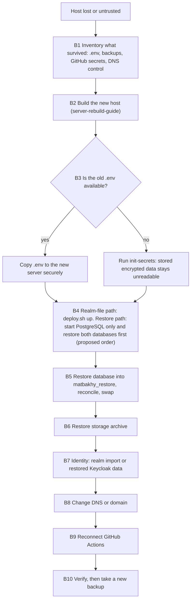

# Backup, restore and disaster recovery

> **Owner role:** Infrastructure and deployment
> **Status:** PARTIALLY IMPLEMENTED — backup, verified restore into a scratch database and rollback planning exist as scripts; scheduling, off-host copies, identity (Keycloak) backup, storage restore and a full disaster recovery drill are not proven on the Contabo host. Complete-service disaster recovery (Scenario B) is BLOCKED: no supported, rehearsed multi-store sequence exists (section 7). Clean installation (Scenario A) is DOCUMENTATION VERIFIED, NOT EXECUTION VERIFIED.
> **Language / اللغة:** English · [العربية](backup-restore-disaster-recovery-ar.md)

This page tells an engineer what protects the Preview's data, what does not, and how to rebuild or roll back. It is about the Preview, whose required operating policy is synthetic data only. The public configuration reports `PREVIEW` and `demo: true` (VERIFIED LIVE), which shows configuration flags, not what the databases, the identity store and the storage actually contain: the actual contents are NOT VERIFIED. The procedures are written so that they also apply to a future environment with real data, but nothing here is approved for that. A design for a complete, ordered multi-store recovery sequence and its rehearsal plan exists in [complete-recovery-sequence.md](complete-recovery-sequence.md); it remains BLOCKED and NOT VERIFIED until the missing tooling is implemented and rehearsed with evidence. The server inventory is in [contabo-server-inventory.md](contabo-server-inventory.md), the pipeline in [deployment-pipeline.md](deployment-pipeline.md), the topology in [runtime-architecture.md](runtime-architecture.md), host preparation in [server-rebuild-guide.md](server-rebuild-guide.md), and DNS and certificates in [dns-https-sslip-io.md](dns-https-sslip-io.md).

## Evidence legend

| Label | Meaning on this page |
|---|---|
| VERIFIED LIVE | Observed on the Contabo VPS by the non-privileged user `aiagent` on 2026-10-21 (read-only). |
| VERIFIED IN CODE | Read in the repository file named next to the claim. It proves what the code does when it runs, not that a run happened. |
| DOCUMENTED ONLY | A repository document says it; it was not confirmed. |
| OUTDATED / INCORRECT | Conflicts with newer evidence, for example Hetzner-era text. |
| NOT VERIFIED | Nobody has confirmed it; the page says how an authorized administrator can. |

Hetzner note: [09-staging-hetzner-preparation.md](../../operations/09-staging-hetzner-preparation.md), [12-owner-server-setup.md](../../operations/12-owner-server-setup.md) and parts of [06-web-preview.md](../../operations/06-web-preview.md) and [11-staging-deployment-and-rollback.md](../../operations/11-staging-deployment-and-rollback.md) were written for a proposed Hetzner host (a user called `matbakhy`, directory `/srv/matbakhy-preview`, a 2 vCPU and 4 GB profile). Treat those host details as historical (OUTDATED / INCORRECT for the running Contabo host). Their backup logic is still the logic of the scripts and is used below.

## 1. Safety rules for this page

- **Never run any state-changing command on this page against the live Preview** unless an authorized administrator has decided to, with the owner's knowledge. Restore, rebuild and swap steps are for a new, isolated server or for a rehearsal. The only exception is a level-3 rollback on the existing server (section 8.1), allowed only when the owner explicitly authorizes it after a successful rehearsal.
- Agents and the `aiagent` account do not run these commands. They need Docker access and read access to the server `.env`; `aiagent` must not receive either.
- Backups hold personal data in a real environment. Keep them outside any Git working tree (`scripts/db-backup.sh` refuses an output directory inside one only when `git` is installed in the environment where it runs and its directory check succeeds, VERIFIED IN CODE; that protection is conditional, so the operator must check the backup destination independently) and never paste backup files, `.env` contents or key values into an issue, a pull request or a chat.
- Do not describe this page as proof of recovery. Section 9 lists exactly what is only scripted or documented.

## 2. What exists today

| Capability | State | Evidence |
|---|---|---|
| Logical database dump of the application database `matbakhy` with SHA-256 checksum and a manifest of schema version and row counts | Script exists | VERIFIED IN CODE: `scripts/db-backup.sh` |
| A backup counts only after it is restored into an empty scratch database and reconciled; a failed restore stops the command and the backup-age metric is not written | Script exists and a stubbed guardrail test exists | VERIFIED IN CODE: `deploy/web-preview/deploy.sh` (functions `backup_db`, `verify_backup`, `backup_metric`), `scripts/test_preview_backup.py` |
| Pre-deploy backup on every `deploy.sh up` when a PostgreSQL container already runs | Script exists | VERIFIED IN CODE: `deploy/web-preview/deploy.sh` (function `up`) |
| Image-storage archive (tar of the storage volume, with the storage service stopped for a short time) | Script exists | VERIFIED IN CODE: `deploy/web-preview/deploy.sh` (function `backup`) |
| Restore of a dump into a new database `matbakhy_restore`, with reconciliation | Script exists | VERIFIED IN CODE: `deploy/web-preview/deploy.sh` (function `restore_db`), `scripts/db-restore.sh`, `infra/db/reconcile.sql` |
| Release history (`releases.log`) and a read-only rollback planner | Script exists | VERIFIED IN CODE: `deploy/web-preview/deploy.sh` (functions `record_release`, `rollback_plan`) |
| Alert `BackupStale` when no verified backup exists for 24 hours | Rule exists | VERIFIED IN CODE: `deploy/web-preview/observability/alerts.yml`, `deploy/web-preview/observability/alerts.test.yml` |
| Migration compatibility check for rollbacks (expand-only policy after V28) | Script exists | VERIFIED IN CODE: `scripts/check_migration_compat.py` |
| A daily schedule for `deploy.sh backup` | Recommended in a Hetzner-era document; no schedule is visible to `aiagent` | DOCUMENTED ONLY: [12-owner-server-setup.md](../../operations/12-owner-server-setup.md) section 9; live state NOT VERIFIED |
| Backup retention or pruning | None. `prune-qa` removes only QA artifacts. The retention period is an open owner decision | VERIFIED IN CODE (no pruning code for `BACKUP_DIR`); DOCUMENTED ONLY: [06-web-preview.md](../../operations/06-web-preview.md) |
| Copy of backups to another machine | No step exists. Backups share the server's fate | VERIFIED IN CODE (absence); DOCUMENTED ONLY: [06-web-preview.md](../../operations/06-web-preview.md) |
| Backup of the Keycloak database `keycloak` by `deploy.sh backup` | Not part of it: `deploy.sh backup` dumps only the `matbakhy` database | VERIFIED IN CODE: `PGDATABASE=matbakhy` in `backup_db` |
| Keycloak database dumps made by the identity scripts | Script exists. `admin-console.sh` has no `backup` subcommand (its usage line lists only enable, verify, status, disable, rollback, create-admin and fixture-clean); its internal function `backup` is called by `enable` (also reached as `deploy.sh admin-console enable`) before the hardening, and writes a full `pg_dump` custom-format dump of the `keycloak` database (users and credentials included) to `<backup-dir>/keycloak/keycloak-db-<stamp>.dump`, with a state file `admin-console-state.env`, under `umask 077`. The workflow `deploy-preview.yml` runs `./deploy.sh admin-console enable` as a separate step after its deployment step. `deploy/web-preview/migrate-mfa.sh backup` is a real subcommand (also run first by `apply`); it also runs `./deploy.sh backup` and writes the same kind of dump, a realm export without users (`realm-before-<stamp>.json`) and `mfa-migration-state.env`. Neither script checks the dump by restoring it, none prunes old dumps, and no document or script restores one | VERIFIED IN CODE: `deploy/web-preview/admin-console.sh`, `deploy/web-preview/migrate-mfa.sh`, `.github/workflows/deploy-preview.yml`. Whether any such dump exists on the live host, how recent it is and whether it can be restored are NOT VERIFIED LIVE |
| Command to restore the storage archive | None exists | VERIFIED IN CODE (absence) |
| A restore drill on the Contabo host | Not recorded; the staging restore drill is listed as still required | DOCUMENTED ONLY: [04-privacy-and-recovery.md](../../operations/04-privacy-and-recovery.md) |

On the live host (VERIFIED LIVE): `/srv/matbakhy-backups` exists, owned by `devops:devops` with mode 750, and contains 28 entries that `aiagent` cannot list. What they are (including whether a `keycloak` sub-folder with identity dumps is among them), whether they are recent, and whether a schedule exists are NOT VERIFIED. An administrator can check with commands 11 and 12 on [admin-readonly-verification.md](admin-readonly-verification.md), which print names and schedules only.

## 3. What holds state, and what protects it

| State | Where it lives | Covered by `deploy.sh backup` | Consequence if lost |
|---|---|---|---|
| Application database `matbakhy` (orders, accounts, ledger, audit) | Docker volume `postgres-data` | Yes (dump, checksum, manifest) | Orders and accounts since the last good dump are lost |
| Keycloak database `keycloak` (users, credentials, realm settings, one-time-password enrolments added after import) | Same PostgreSQL instance and volume | No. Only as a side effect of `admin-console.sh enable` (its internal backup function) and `migrate-mfa.sh backup` (section 2), which write dumps under `<backup-dir>/keycloak/`; whether any survives is NOT VERIFIED LIVE | Without a surviving dump, sign-in identities must be re-created from the realm file and anything created in Keycloak after the first import is lost. With a dump, restoring it is not a rehearsed procedure (section 7, step B7) |
| Image storage (meal photos, private documents) | Docker volume `storage-data` | Yes, as `storage-<archive-stamp>.tgz` | Photos and documents are lost; database rows then point to missing objects |
| `.env` (all secrets and the pinned release) | Deployment directory, mode 600 | No | See section 4: some stored data becomes unreadable |
| Rendered configuration (`GENERATED_DIR`: realm import file, storage identity file, the `flags` directory; the file `admin-console-public` inside it is created by `admin-console enable`, not by `render`) | Generated directory, mode 700 | No | The realm and storage files and the empty `flags` directory are re-created by `deploy.sh render` from `.env` and the repository. The admin console stays closed until `./deploy.sh admin-console enable` is run again |
| TLS certificates and ACME account | Docker volume `caddy-data` | No | Re-issued automatically; subject to Let's Encrypt rate limits (DOCUMENTED ONLY, see [dns-https-sslip-io.md](dns-https-sslip-io.md)) |
| Logs, metrics, alert state, Grafana data | Volumes `loki-data`, `alloy-data`, `prometheus-data`, `alertmanager-data`, `alert-sink-data`, `grafana-data` | No | History is lost; the services start empty |
| `releases.log`, backup metric, change lock | `BACKUP_DIR` | They are written there | The release history is lost, so `rollback-plan` has nothing to read |
| Deployment secrets | GitHub environment `preview` (names only: `STAGING_SSH_HOST`, `STAGING_SSH_USER`, `STAGING_SSH_KEY`, `STAGING_SSH_HOST_PUBKEY`) | Not a server matter | The pipeline cannot reach the server until they are replaced |

Evidence for the table: VERIFIED IN CODE in `deploy/web-preview/compose.yaml` (volumes and mounts), `deploy/web-preview/deploy.sh` and `.github/workflows/deploy-preview.yml`. Which volumes exist on the live host is NOT VERIFIED LIVE (the `aiagent` user cannot read the Docker socket); command 8 on [admin-readonly-verification.md](admin-readonly-verification.md) lists their names.

## 4. Credentials and keys that must be preserved

Names only. The values are generated by `deploy.sh init-secrets` (random values from `openssl`) into the server `.env`, and no document or tool in the repository stores them anywhere else (VERIFIED IN CODE: `deploy/web-preview/deploy.sh`, function `init_secrets`). Store them in a secrets manager that the owner chooses; the repository does not define one (NOT VERIFIED which one the owner uses).

| Name | What the code says it does | If it is lost or replaced |
|---|---|---|
| `HANDOVER_ENCRYPTION_KEY` | A 32-byte key (Base64). Handover codes are stored as AES-GCM ciphertext and shown to the order owner by decrypting it (VERIFIED IN CODE: `backend/modules/orders/src/main/java/com/matbakhy/orders/internal/HandoverCodes.java`) | Stored handover-code ciphertexts cannot be decrypted. A different valid key starts without error but cannot read old rows. The startup guard refuses missing or development values in deployed environments (VERIFIED IN CODE: `backend/app/src/main/java/com/matbakhy/app/config/CommerceConfiguration.java`) |
| `HANDOVER_HASH_KEY` | Key of the HMAC that verifies a presented handover code against the stored hash (VERIFIED IN CODE: same class) | Codes of existing orders can no longer be verified |
| `PUSH_TOKEN_ENCRYPTION_KEY` | A 32-byte key (Base64) that seals push tokens (VERIFIED IN CODE: `backend/modules/notifications/src/main/java/com/matbakhy/notifications/internal/TokenVault.java`) | Stored push tokens cannot be read |
| `PUSH_TOKEN_HASH_KEY` | Keyed hash of push tokens for uniqueness lookups (VERIFIED IN CODE: same class) | Existing tokens no longer match lookups |
| `ACTIVITY_HASH_KEY` | Secret used by the organic activity service to hash visitor identifiers (VERIFIED IN CODE: `backend/modules/catalog/src/main/java/com/matbakhy/catalog/internal/activity/ActivityService.java`) | Stored visitor hashes no longer match new events; continuity of per-visitor counting is lost (an inference from the keyed-hash design) |
| `PHONE_CODE_PEPPER` | Secret mixed into the hash of phone verification codes (VERIFIED IN CODE: `backend/modules/identity/src/main/java/com/matbakhy/identity/internal/PhoneVerificationService.java`) | Verification codes issued before the change cannot be verified; they are short-lived, so the effect is small (an inference) |
| `POSTGRES_PASSWORD`, `KEYCLOAK_DB_PASSWORD`, `APP_DB_PASSWORD` | Used only at the first initialisation of an empty data directory to create the roles (VERIFIED IN CODE: `deploy/web-preview/postgres/10-keycloak.sh`, `deploy/web-preview/postgres/20-runtime-role.sh`) | A restored data volume keeps the old role passwords, so the matching `.env` values must be kept. Changing the `.env` value later does not change the role (see [runtime-architecture.md](runtime-architecture.md) section 6) |
| `OIDC_WEB_CLIENT_SECRET`, `OIDC_ADMIN_CLIENT_SECRET` | Client secrets written into the realm import file by `deploy.sh render` (VERIFIED IN CODE: the `sed` substitution in `render` replaces only these two secrets and `PREVIEW_USER_PASSWORD`) | They must match between Keycloak and the API. After a new realm import, `render` writes the current `.env` values, so keeping `.env` keeps them consistent |
| `KEYCLOAK_OPS_CLIENT_SECRET` | Secret of the operations client in the Keycloak master realm. `render` does not put it into the realm file; `deploy.sh admin-console enable` generates it into `.env` when missing, passes it to `identity/admin_console.py`, which creates or updates that client in the running Keycloak (VERIFIED IN CODE: `deploy/web-preview/admin-console.sh`, `deploy/web-preview/identity/admin_console.py`) | The client lives in the Keycloak database, which `deploy.sh backup` does not dump (only the identity scripts do, see section 2). After a rebuild with new Keycloak data, run `./deploy.sh admin-console enable` again so the client and `.env` agree; whether that works against restored Keycloak data is NOT VERIFIED. It is part of the separate master-realm provisioning, not of the realm-import recovery |
| `KEYCLOAK_ADMIN_USER`, `KEYCLOAK_ADMIN_PASSWORD` | Bootstrap administrator of Keycloak (VERIFIED IN CODE: `deploy/web-preview/compose.yaml`) | Re-creatable on a new Keycloak; with restored Keycloak data the stored administrator applies |
| `PREVIEW_USER_PASSWORD` | Password of the synthetic realm users (VERIFIED IN CODE: `render`) | Users can be given a new password; not a data-loss item |
| `STORAGE_ACCESS_KEY`, `STORAGE_SECRET_KEY` | Rendered into the storage identity file (VERIFIED IN CODE: `render`, `deploy/web-preview/storage/s3.json.template`) | Replace both consistently and run `render`; stored objects remain readable |
| `GRAFANA_ADMIN_PASSWORD` | Grafana administrator | Re-settable; not a data-loss item |

Rules that follow from the table:

1. The first two rows decide whether stored encrypted data stays readable. For a rebuild that must keep the data, copy the old `.env` as a whole to the new server through a secure channel instead of running `init-secrets` again. `init-secrets` refuses to overwrite an existing `.env`.
2. For a clean installation, new values are correct and expected.
3. The effect of changing a key while old rows exist follows from how the algorithms work. The code does not contain a re-encryption or key-rotation tool (VERIFIED IN CODE by search: none found). Do not rotate these keys without an owner-approved plan.

## 5. Command reference

All commands are for a user who can run Docker and read `.env` in the deployment directory. Which Linux account does that on the live host is NOT VERIFIED (the deployment SSH user is the secret `STAGING_SSH_USER`); on a new server it is whatever operator account you created. `<deploy-dir>` is `/srv/matbakhy-staging/deploy/web-preview` on the live host (VERIFIED LIVE) and a path of your choice on a new server. `<backup-dir>` is `BACKUP_DIR` from `.env` (default `/srv/matbakhy-backups`, VERIFIED IN CODE in `deploy/web-preview/.env.example`; the live value is NOT VERIFIED). Inside the PostgreSQL container the same directory is `/backups`.

| ID | Command | Machine and user | Type | Prerequisite | Expected result and verification | Likely failure and action |
|---|---|---|---|---|---|---|
| R1 | `cd <deploy-dir> && ./deploy.sh status` | The VPS, an operator with Docker and `.env` access | Read-only | Stack deployed | Containers, schema version, configured release values and the last five releases from `releases.log`. Verify that the schema number equals the highest migration you expect | "permission denied" on the Docker socket: you are not an authorized operator; do not add accounts to the docker group for this |
| R2 | `cd <deploy-dir> && ./deploy.sh rollback-plan 1` | Same | Read-only (prints only) | `releases.log` exists with more than one line | The three `.env` values of the target release, current schema, and a verdict (image-only, or backup restore needed). `N` counts back through recorded releases only: a line is written when `up` finishes, so a failed `up` leaves no line (VERIFIED IN CODE: `record_release`, `rollback_plan`), while a release whose smoke test failed afterwards is still recorded. Read the last lines of `releases.log` (also shown by R1) to choose `N`, and check the printed target commit is the one you want before editing `.env` | "no release log": there is nothing to roll back to; use section 8 |
| R3 | `cd <deploy-dir> && ./deploy.sh backup` | Same | State-changing: writes files, stops the storage service while the archive is written (a code comment says about a minute; the duration is unmeasured and depends on archive size and host performance) | Enough free disk in `<backup-dir>`; `.env` loadable; `<backup-dir>/metrics` exists and is owned by the operator account (see step A1) | Output "backup verified: ... restored and reconciled" then "backups in ...". Verify with R4 and R5 | The restore check fails and the command stops: read the MISMATCH or FAIL line, do not trust that dump. If the archive step fails after storage was stopped, run `docker compose start storage` in `<deploy-dir>` yourself (the script has no trap, VERIFIED IN CODE) |
| R4 | `cd <backup-dir>/db-<dir-stamp> && sha256sum -c matbakhy-<dump-stamp>.dump.sha256` | The VPS, a user who can read `<backup-dir>` | Read-only | A dump folder exists | "matbakhy-<dump-stamp>.dump: OK" | "FAILED": the dump is damaged; use an older one |
| R5 | `ls -l <backup-dir>/db-<dir-stamp> <backup-dir>/storage-<archive-stamp>.tgz` | Same | Read-only | Same | Dump, checksum and manifest files in the folder; the archive next to it. A zero-size file is a failed backup | Missing archive: R3 stopped before the archive step |
| R6 | `cd <deploy-dir> && ./deploy.sh restore-db /backups/db-<dir-stamp>/matbakhy-<dump-stamp>.dump` | The VPS, an operator with Docker access | State-changing but it never touches the live database: it creates the new database `matbakhy_restore` | The dump path is read inside the PostgreSQL container, so it must lie under `/backups`, which is the host `<backup-dir>` (`BACKUP_DIR`); a path elsewhere is not found. Next to the dump, `scripts/db-restore.sh` requires the companion `<dump file name>.sha256` (for example `matbakhy-<dump-stamp>.dump.sha256`) and uses the optional manifest `matbakhy-<dump-stamp>.manifest` if present (VERIFIED IN CODE: `scripts/db-restore.sh`). The stack's PostgreSQL container is running | Lines "OK <check>" for every reconciliation check, then "RECONCILED matbakhy_restore". **Without the manifest the script prints "WARNING: no manifest next to ...; row counts not compared", skips every row-count comparison and can still print RECONCILED** (VERIFIED IN CODE), so RECONCILED alone is an invariant check, not row-count reconciliation. Accept a restore only when the matching manifest was present, no warning was printed and the output ends with RECONCILED. Also verify with `docker compose exec -T postgres psql -U matbakhy -d matbakhy_restore -At -c "SELECT max(version::int) FROM flyway_schema_history"` | "refusing: ... already has N tables": a restore database exists. `restore-db` takes no target (it always uses `matbakhy_restore`), so inspect it or drop that scratch database deliberately before running R6 again. "checksum mismatch" or a missing `.sha256` file: use another dump. "NOT RECONCILED": do not use it |
| R7 | `cd <deploy-dir> && ./deploy.sh up` | Same | State-changing: renders configuration, takes a pre-deploy backup, pulls missing images, starts the stack | `.env` complete and valid, release values pinned by digest | "up: <commit> (schema A -> B)" and a new line in `releases.log` | "another preview change holds ...": wait for the other change. "API did not become healthy": read the printed API and identity logs |
| R8 | `cd <deploy-dir> && ./deploy.sh smoke` | A machine in an allowed address range | Read-only HTTPS checks | Public names resolve to the server | Exit code 0 | A 403 "Not available" from the proxy is an access-policy answer for the caller address, not an outage |
| R9 | `cd <deploy-dir> && ./deploy.sh init-secrets` | The VPS, the operator account | State-changing: creates `.env` with mode 600 | No `.env` yet (new server only) | "wrote .env (mode 600); now set ..." | "exists; refusing to overwrite": by design. Never delete a live `.env` to run it |
| R10 | `cd <deploy-dir> && ./deploy.sh seed` | Same | State-changing: loads the synthetic catalogue. **One-time operation, not idempotent**: `seed-preview.sql` protects only some inserts with `ON CONFLICT` (`app_user`, `kitchen_payment_profile`); the others (`cook_application`, `kitchen`, `meal` and more) have no conflict handling, so a second run can fail and roll back (VERIFIED IN CODE: `deploy/web-preview/seed-preview.sql`, `seed` in `deploy.sh`) | Stack healthy; Preview only; seed has not run yet. Read-only check whether it already ran (an inference from the seed file, NOT VERIFIED on the live host): `docker compose exec -T postgres psql -U matbakhy -d matbakhy -At -c "SELECT count(*) FROM kitchen WHERE id = '00000000-0000-4000-8000-0000000bd001'"`; a result of 1 means the demo kitchen exists | The seed script completes without error | A uniqueness error means the data already exists; do not repeat seed or seed over restored data |

Backup names: one `./deploy.sh backup` run takes three separate UTC timestamps (VERIFIED IN CODE: `backup_db` and `backup` in `deploy/web-preview/deploy.sh`, and `scripts/db-backup.sh`). `<dir-stamp>` names the folder `db-<dir-stamp>`, `<dump-stamp>` is written by `scripts/db-backup.sh` into the file names inside that folder, and `<archive-stamp>` names `storage-<archive-stamp>.tgz`. They can differ by seconds or more, so never assume one value fits all three. List `<backup-dir>` and the folder with `ls`, read the real names, and note that pairing an archive with a dump folder by time is only an uncertain reconstruction: the archive is written after the dump folder, but the timestamps are independent, no file records the pairing, and the backup does not hold the shared mutation lock, so another backup or a deploy can interleave. Treat multi-store recovery as reliable only once a recorded set association exists (PROPOSED: the set manifest of the companion design).

The following commands are not stand-alone commands of the repository's scripts. They are derived from existing commands and are PROPOSED, NOT REHEARSED, and appear only in a new-server context. P1 is the same `pg_dump` that the internal backup function of `admin-console.sh enable` and `migrate-mfa.sh backup` already run inside their own flows (section 2); P1 only makes it a dump you can take on its own, for example on a schedule.

| ID | Command | Machine and user | Type | Prerequisite | Expected result and verification | Likely failure and action |
|---|---|---|---|---|---|---|
| P1 | `docker compose exec -T postgres sh -c "pg_dump -U matbakhy --format=custom keycloak" > <backup-dir>/keycloak-<stamp>.dump` run from `<deploy-dir>` with `umask 077` | The VPS, an operator with Docker access | State-changing: writes a file with credential data | PostgreSQL container running | A non-empty custom-format dump. Verify with `pg_restore --list <file>` on a machine that has the PostgreSQL client | Empty file: the container user or database name is wrong. The file holds user credentials: protect it like `.env` |
| P2 | `docker compose run --rm --no-deps -v "<backup-dir>:/backups" --entrypoint tar storage xzf /backups/storage-<archive-stamp>.tgz -C /data` run from `<deploy-dir>` | The new VPS, an operator with Docker access | **DESTRUCTIVE to the storage volume content it overwrites** | New isolated server; the storage service stopped; archive present | Files appear in the volume; after starting storage, a known photo URL under `/matbakhy-public/` answers 200 | Wrong archive or a running storage service: stop and re-check. This mirrors the backup command; it is not in the repository |

## 6. Scenario A: fresh installation (empty)

Use this to create a new, empty Preview. There is nothing to restore, and every secret is new. The host preparation (users, groups, Docker, firewall) is in [server-rebuild-guide.md](server-rebuild-guide.md). The ordering below is what matters for data.

| Step | Action | Evidence |
|---|---|---|
| A1 | Prepare the host and the directories: the deployment directory and `<backup-dir>` must exist and be writable by the operator account. Create `<backup-dir>/metrics` yourself, owned by the operator account, before the first start: `compose.yaml` bind-mounts it into the node-exporter container, and a missing bind-mount source is created by the Docker daemon, normally owned by root (documented Docker behaviour, not rehearsed here), after which `backup_metric` run by the operator cannot write the backup-age file | VERIFIED IN CODE (`up` creates the lock directory with `mkdir -p`; the workflow pre-check needs a writable deployment directory; `compose.yaml` mounts `${BACKUP_DIR}/metrics:/textfile:ro` and `backup_metric` writes there); host preparation in [server-rebuild-guide.md](server-rebuild-guide.md) |
| A2 | Create the DNS records before the first start (the six hostnames app, ops, api, id, kc-admin and media resolve to the new server; with sslip.io no record is created, the names follow the IP address written in the name), see [dns-https-sslip-io.md](dns-https-sslip-io.md) | DOCUMENTED ONLY in [12-owner-server-setup.md](../../operations/12-owner-server-setup.md) (certificate requests fail without it) |
| A3 | Put the repository files `deploy`, `infra` and `scripts` in the deployment directory by hand once. The workflow copies them only after `.env` exists, so the first copy cannot come from the pipeline. Use tracked files only, for example `git archive` of a release commit (the Hetzner-era method); never tar the working directory, because that would carry `.env` and the generated directory (secrets) to the new server by accident | VERIFIED IN CODE (workflow pre-check); method DOCUMENTED ONLY in [12-owner-server-setup.md](../../operations/12-owner-server-setup.md) section 4 |
| A4 | Run R9 (`init-secrets`). Then edit `.env` to set the owner inputs: `PREVIEW_DOMAIN`, `ACME_EMAIL`, `ALLOWED_CLIENT_IPS`, `BACKUP_DIR`, `GENERATED_DIR`, and the access lists if needed. Immediately store a copy of the new `.env` in the secrets manager | VERIFIED IN CODE: `deploy/web-preview/.env.example` |
| A5 | Deploy a release: either let the pipeline do it (set the four GitHub environment secrets, then dispatch the workflow `deploy-preview.yml` on `develop` as in G5, or push to `develop`), or pin the three release values by hand and run R7. The first `up` has no running PostgreSQL, so no pre-deploy backup is taken and the schema starts at 0 | VERIFIED IN CODE: `deploy/web-preview/deploy.sh`, `.github/workflows/deploy-preview.yml` |
| A6 | On the first PostgreSQL start the init scripts create the `keycloak` and `matbakhy_app` roles; Flyway then migrates; Keycloak imports the realm from the rendered file | VERIFIED IN CODE: `deploy/web-preview/postgres/*.sh`, `command: ["start", "--import-realm"]` in `compose.yaml` |
| A7 | Run R10 (`seed`) once, and only once, for the synthetic catalogue (Preview only); check first that it has not run | VERIFIED IN CODE |
| A8 | Run R8 (`smoke`). Then run R3 (`backup`) once and R4 and R5, so a first verified backup and the backup-age metric exist | VERIFIED IN CODE |
| A9 | Add a schedule for R3 and an off-host copy. No schedule or copy exists in the repository; choose them deliberately (see section 10) | VERIFIED IN CODE (absence) |

## 7. Scenario B: disaster recovery on a replacement VPS

Use this when the Contabo host is lost or untrustworthy and a new server must take over. Always build the replacement as a **new, isolated server** first. Do not point production names at it before verification, and do not restore over the surviving server in a disaster-recovery scenario. A level-3 rollback of a bad release on a healthy existing server (section 8.1) is a different case and needs the owner's explicit authorization after a successful rehearsal.

> **STATUS: BLOCKED for complete-service recovery.** A proposed design and rehearsal plan exist in [complete-recovery-sequence.md](complete-recovery-sequence.md), but the design remains BLOCKED and NOT VERIFIED until it is implemented and rehearsed with evidence. No supported, rehearsed multi-store sequence exists for Keycloak bootstrap or restore, storage restore, application cutover, runtime grants and validation. **Exists (VERIFIED IN CODE):** the application-database restore R6 into a scratch database (S1 to S3 is an unrehearsed manual sequence whose swap is DOCUMENTED ONLY), Keycloak dump creation (section 2), the realm import at first start of Keycloak, and the scripted `deploy.sh up`. **Missing:** a restore procedure for a Keycloak dump; a supported bootstrap that starts PostgreSQL alone (the companion design proposes restoring both databases before the first `deploy.sh up`, which also avoids the expected stop of the pre-deploy backup that an empty application database would cause, see B4; that order is PROPOSED and unrehearsed); a storage restore command (P2 is proposed, not in the repository); a tested cutover and validation sequence; any off-host copy. **Owner decision needed:** whether the Preview must keep users and images across a rebuild, and who builds and rehearses the missing sequence (section 10, item 4). The steps below are separate fragments to read to understand what exists, not a recovery procedure. Clean installation (Scenario A) is DOCUMENTATION VERIFIED, NOT EXECUTION VERIFIED.

**What exists, what is missing.** Exists (VERIFIED IN CODE): the application-database restore R6 into a scratch database and Keycloak dump creation (section 2) and the realm import at first start; S1 to S3 is an unrehearsed manual sequence whose swap is DOCUMENTED ONLY. Missing: a restore procedure for a Keycloak dump, a supported bootstrap for the proposed restore-both-databases-before-`up` order (see B4), a storage restore command, and any off-host copy. Steps B4 to B7 therefore are not a recovery handover: they are NOT VERIFIED and not rehearsed. Owner decision needed: whether the Preview must keep users across a rebuild, and who builds and rehearses the missing sequence (section 10, item 4).

The diagram reads top to bottom. The decision at B3 is the one that cannot be undone later: without the old `.env`, the encrypted fields in a restored database are unreadable (section 4). B5 and B6 use only the scripted commands R6 and the proposed P2; B7 has no scripted procedure. In the restore path B4 only starts PostgreSQL, and B5 to B7 run before the first `deploy.sh up` (the proposed order of the companion design).

| Step | Action | Evidence and warning |
|---|---|---|
| B1 | Inventory what survived: the old `.env` (secure copy), the newest verified backup folder and storage archive, `releases.log`, control of the DNS records or the domain, the GitHub repository settings and environment secrets. If the backups lived only on the lost host, the database content is gone and Scenario A is the only option | NOT VERIFIED whether any copy exists off the host; there is no off-host step in the repository |
| B2 | Build the new host as in [server-rebuild-guide.md](server-rebuild-guide.md): operator account, directories, Docker, ports 80 and 443 reachable. **Do not grant `aiagent` sudo or Docker access on the new host either** | VERIFIED IN CODE for the directories and ports the compose file needs |
| B3 | Copy the old `.env` to the new deployment directory over a secure channel, mode 600, owner the operator account. If it is not available, run R9 and accept that handover codes and push tokens in the restored data cannot be read (section 4). Edit `PREVIEW_DOMAIN` and the access lists only if they change | VERIFIED IN CODE |
| B4 | Place `<backup-dir>` content (the chosen dump folder and storage archive) into the new `<backup-dir>`. **Decide the Keycloak option of step B7 first.** If new identities from the realm file are acceptable, run R7 to start an empty stack on the latest release; the first start of Keycloak imports the realm, and since no PostgreSQL ran before, R7 takes no pre-deploy backup. If the Keycloak database must be restored, follow the order of the companion design (PROPOSED, unrehearsed): start only PostgreSQL, restore the application database (R6, then the swap S2) and the Keycloak dump (B7), and only then run R7 for the first time; the application database then has its tables when R7 takes its pre-deploy backup, so the stop described next does not occur. **Never run R7 while the application database is still empty:** `deploy.sh up` takes a pre-deploy backup whenever a PostgreSQL container is already running (`backup_db`), and `scripts/db-backup.sh` queries application tables (for example `customer_order`) that an empty `matbakhy` database does not have, so R7 is expected to stop at that backup before it starts the application. The repository provides no supported bootstrap for the restore-first order and nobody has rehearsed it; it is NOT VERIFIED and the missing procedure is listed in section 10 | VERIFIED IN CODE for R7 and the realm import at the first start of Keycloak (`command: ["start", "--import-realm"]` in `compose.yaml`); the PostgreSQL-only start, the restore-first order and the expected stop of R7 at the pre-deploy backup are derived from the code, not rehearsed (NOT VERIFIED) |
| B5 | Verify the dump with R4. Restore it into `matbakhy_restore` with R6 and read the reconciliation output. Then swap the databases (stop the API first if it ever ran; in the restore-first order of B4 it has not started yet). **This swap is destructive: it renames the current (empty) application database to another name (`matbakhy_failed`). Run it only on the isolated new server, with the API stopped and nobody connected** (steps below) | The swap is DOCUMENTED ONLY in [11-staging-deployment-and-rollback.md](../../operations/11-staging-deployment-and-rollback.md) section 4.3 (written for Hetzner); the restore itself is VERIFIED IN CODE |
| B6 | Stop the storage service and restore the archive with P2, then start storage. Check one known object under `/matbakhy-public/` | PROPOSED, NOT REHEARSED (no restore command exists) |
| B7 | Identity, see the decision below | See below |
| B8 | Change DNS or the domain, see "DNS and domain" below (sslip.io names follow the IP address written in the name) | See "DNS and domain" below |
| B9 | Reconnect GitHub Actions, see below | VERIFIED IN CODE for the secret names |
| B10 | Run R8 (`smoke`), the journeys in [live-preview-access.md](../05-developer-workflow/live-preview-access.md), then R3 (`backup`) so the new server has its own verified backup | VERIFIED IN CODE for the scripts; the outcome is NOT VERIFIED until someone does it |

Database swap commands for step B5 (new isolated server or rehearsal; on the existing server only for an owner-authorized level-3 rollback, section 8.1). Run in `<deploy-dir>` after R6 printed "RECONCILED matbakhy_restore":

| ID | Command | Machine and user | Type | Prerequisite | Expected result and verification | Likely failure and action |
|---|---|---|---|---|---|---|
| S1 | `docker compose stop api` | The new VPS, an operator with Docker access | State-changing (stops the API) | R6 reconciled | API container stopped; `docker compose ps api` shows it not running | None expected |
| S2 | `docker compose exec -T postgres psql -U matbakhy -d postgres -c "ALTER DATABASE matbakhy RENAME TO matbakhy_failed" -c "ALTER DATABASE matbakhy_restore RENAME TO matbakhy"` | Same | **DESTRUCTIVE in effect**: the current application database is renamed away | No connection to either database (the API is stopped; the rename fails if someone is connected) | Both renames succeed; `psql -U matbakhy -d postgres -At -c "SELECT datname FROM pg_database"` lists `matbakhy` and `matbakhy_failed` | "database is being accessed by other users": find and stop the connection, do not force it |
| S3 | `./deploy.sh up` | Same | State-changing | `.env` pins the intended release | The API re-applies the runtime role's grants at start, becomes healthy, and a `releases.log` line is added | A schema newer than the release's migrations: use a release at least as new as the dump's schema number (the manifest file shows it) |

Keep `matbakhy_failed` until the cause is understood; drop it deliberately later. Restored dumps use `--no-owner --no-privileges`, so ownership belongs to the restoring user and the API re-grants privileges when it starts (VERIFIED IN CODE: `scripts/db-restore.sh`; grants DOCUMENTED ONLY in [11-staging-deployment-and-rollback.md](../../operations/11-staging-deployment-and-rollback.md)).

### Step B7: identity, restore versus new

The application finds an account by the pair of issuer and subject (VERIFIED IN CODE: `backend/modules/identity/src/main/java/com/matbakhy/identity/internal/JdbcAccountDirectory.java`, unique key in `backend/app/src/main/resources/db/migration/V1__baseline_identity_and_idempotency.sql`). After a successful sign-in through the identity service, if no row matches, it creates a new, empty account (VERIFIED IN CODE: the same method); it never creates or restores a Keycloak identity. The issuer is `https://id.<domain>/realms/matbakhy` (VERIFIED IN CODE: `deploy/web-preview/compose.yaml`).

| Option | What happens | Result | Evidence |
|---|---|---|---|
| New identities from the realm file (the path the code supports) | `render` writes the realm file and Keycloak imports it at start. Keycloak's documented behaviour is to skip an import when the realm already exists, so on a brand-new database it imports | The five synthetic users come back with the fixed ids listed in `deploy/web-preview/identity/matbakhy-realm.preview.json`, and those ids equal the subjects in the seed data, so restored synthetic accounts match again. Users and one-time-password enrolments created in Keycloak later are not re-created, so those people cannot sign in until their Keycloak user is explicitly recreated (the import does not recreate them, and the application creates an account only after a successful sign-in; it cannot restore a missing Keycloak identity). A recreated user normally gets a new subject, so the person gets a new empty application account and the old rows stay orphaned, unless the original subject id is preserved (whether Keycloak accepts a chosen id in this setup is NOT VERIFIED) or an owner-approved reassociation moves the old account to the new subject | VERIFIED IN CODE (realm file, seed file, account resolution); import-skip behaviour DOCUMENTED ONLY (Keycloak documentation, not read in this repository) |
| Restore the Keycloak database | Needs a Keycloak dump made earlier (by `admin-console.sh enable`, `migrate-mfa.sh backup` or P1; section 2 gives the paths) and a restore before the identity service first starts. The intended order (PROPOSED, the companion design) is: render the configuration, start only the PostgreSQL service, restore the application database (B5), restore the dump into the `keycloak` database (taking care of object ownership for the `keycloak` role), then start the rest so Keycloak finds existing data and skips the import. R7 can be used for the last step only because the application database already has its tables (see B4: on an empty application database its pre-deploy backup is expected to fail) | Keeps all users, credentials and enrolments | NOT VERIFIED: no restore procedure for the dump exists in the repository (the scripts only mention `pg_restore` into an empty `keycloak` database while identity is stopped) and none was rehearsed; whether any dump survives on the live host is NOT VERIFIED LIVE |
| Changing the domain changes the issuer | Every existing application account row carries the old issuer | Existing rows no longer match; users get new empty accounts unless the rows are updated by an owner-approved migration (none exists) | VERIFIED IN CODE (issuer in the key); see [dns-https-sslip-io.md](dns-https-sslip-io.md) for the domain replacement steps |

For the Preview, whose accounts are synthetic, the first option is acceptable. For any environment with real people, inventory which Keycloak dumps survive (section 2), take them on a schedule, and rehearse their restore before relying on it. The owner decision needed is whether the Preview keeps users across a rebuild or accepts the realm-file identities, and, if it keeps them, who builds and rehearses the missing bootstrap sequence (section 10).

### DNS and domain

For the Preview the hostnames end in `167-86-90-174.sslip.io`, which resolves to the IP address written in the name (VERIFIED LIVE: the names resolve to 167.86.90.174). A replacement server has a different IP address, so the sslip.io names would have to change, which changes the issuer, the baked-in front image and the certificates. The procedure is the domain replacement runbook in [dns-https-sslip-io.md](dns-https-sslip-io.md), and it needs a workflow change because the front image is built with the domain (VERIFIED IN CODE: `.github/workflows/deploy-preview.yml`). If the same IP address is moved to the new machine (a provider matter, NOT VERIFIED as possible), no domain change is needed.

Certificates: the new proxy requests new Let's Encrypt certificates when ports 80 and 443 are reachable and the names resolve; the old certificates are lost with the old `caddy-data` volume (VERIFIED IN CODE: volume `caddy-data`; issuance behaviour DOCUMENTED ONLY). Do many rebuild attempts in a row and you may meet the rate limits described in [dns-https-sslip-io.md](dns-https-sslip-io.md).

### Reconnecting GitHub Actions

**Rehearsal versus cutover.** The steps below change the GitHub environment `preview`. That environment is used by `deploy-preview.yml` (automatic deployment on every push to `develop`, concurrency group `matbakhy-preview-deploy`) and by `owner-e2e-provision.yml` (VERIFIED IN CODE). Changing its secrets for a rehearsal would redirect the live Preview automation to the rehearsal server. A rehearsal must use a separate repository (or an isolated workflow) with its own environment, secrets and concurrency group. Doing these steps in the real `preview` environment is the cutover itself and needs explicit authorization.

| Step | Action | Evidence |
|---|---|---|
| G1 | In the GitHub environment `preview`, replace `STAGING_SSH_HOST` with the new host name or address | VERIFIED IN CODE: `.github/workflows/deploy-preview.yml` |
| G2 | Create a new deployment key pair for the new server's operator account; put the public part in that account's authorized keys and the private part in `STAGING_SSH_KEY`. Which account is used is the value of `STAGING_SSH_USER` | VERIFIED IN CODE for the names; which account the live pipeline uses is NOT VERIFIED |
| G3 | Set `STAGING_SSH_HOST_PUBKEY` to the new server's SSH host public key (the workflow uses strict host key checking, so a wrong value stops the deploy) | VERIFIED IN CODE |
| G4 | Make sure `.env` exists in the deployment directory and the directory is writable by that account (the pre-check fails otherwise) | VERIFIED IN CODE |
| G5 | Dispatch the workflow `deploy-preview.yml` manually (`workflow_dispatch` exists) with the branch `develop`, after the head commit of `develop` has a successful push-triggered Product CI run: the `deploy` job runs only on `refs/heads/develop`, and the `build` job first waits for that CI run at the exact commit. From another ref the run can at most build images, and a finished image build is not a deployment. Read the last line `DEPLOYED <sha>` | VERIFIED IN CODE |

Do not paste key material or secret values anywhere. The GitHub token is supplied by the workflow itself (`github.token`) and is not a secret you store.

## 8. Rollback

Rollback is about a bad release on a healthy server. It is a different problem from disaster recovery.

### 8.1 Levels

| Level | Action | Data effect | Evidence |
|---|---|---|---|
| 0 | Fix forward: new commit, new image, deploy | None | VERIFIED IN CODE (the pipeline) |
| 1 | Image-only rollback: take the three values from R2, put them in `.env`, run R7 | None; data is kept | VERIFIED IN CODE: `rollback_plan` |
| 2 | Image-only rollback after the schema moved, with only expand-only migrations in between | None, if the older API really tolerates the newer schema | VERIFIED IN CODE: `scripts/check_migration_compat.py`; rehearsed only on a laptop in [11-staging-deployment-and-rollback.md](../../operations/11-staging-deployment-and-rollback.md) (older API on schema 28 started); Contabo NOT VERIFIED |
| 3 | Restore the pre-deploy backup on the same server (R6, S1 to S3), only when the owner explicitly authorizes it after a successful rehearsal on an isolated server | **Data written after that backup is lost** | VERIFIED IN CODE (restore); swap DOCUMENTED ONLY |
| 4 | Disaster recovery on a new server (section 7) | Data since the last off-host backup is lost | Not rehearsed |

### 8.2 Migration compatibility

- Flyway migrations are forward-only (VERIFIED IN CODE: the header of `scripts/check_migration_compat.py`). There is no down migration.
- Every migration after V28 must be expand-only or carry an annotation: `rollback-compat: tightening <reason>` or `rollback-compat: breaking <reason>`. The check reads the migration folder `backend/app/src/main/resources/db/migration` (VERIFIED IN CODE).
- The check is a review aid, not a proof. List the migrations since the target release with `python3 scripts/check_migration_compat.py --list --baseline <schema of the target release>` on your laptop (read-only, no server needed), then read the classes. The `<schema of the target release>` is the schema value R2 prints.
- The pre-deploy backup named in `releases.log` is the restore point for the release that applied the migration.

### 8.3 Decision table

| Situation | Action | Potential data loss |
|---|---|---|
| New release is bad and `rollback-plan` says the schema has not moved | Level 1 | None |
| New release is bad and every migration since is expand-only | Level 2, then R8 (`smoke`) | None expected; rehearse on a copy first when time allows |
| A migration since then is tightening | Rehearse the older image on a copy first; if its writes are refused, Level 3 | None if the rehearsal passes; otherwise writes since the backup |
| A migration since then is breaking, or the data is damaged | Level 3 | Everything written after the pre-deploy backup; tell the testers |
| Deploy stopped half-way (the pipeline restored only `.env`) | R1 to see what runs; read the API and identity logs; fix forward or choose a level above. `up` is repeatable | None by itself; the pipeline does not roll the database back (VERIFIED IN CODE, see [deployment-pipeline.md](deployment-pipeline.md#failure-behaviour-and-rollback)) |
| Volume lost or corrupt, host still reachable | Rebuild on a new server (section 7) rather than repairing in place | Everything since the last backup that exists off the lost volume |
| Host lost | Section 7, or Scenario A if no backup survived | Possibly all application data |
| Only a secret value leaked | Rotation is outside this page; do not rotate the section 4 data keys without a plan | Rotating them makes old encrypted rows unreadable |

Potential-loss statements follow from how the scripts work. The recovery point equals the age of the newest verified dump (a schedule is NOT VERIFIED, so assume the pre-deploy backup of the last deploy). A recovery time on the Contabo host has never been measured; the local figures in [04-privacy-and-recovery.md](../../operations/04-privacy-and-recovery.md) (about 0.4 s backup and 2.3 s restore on a CI-sized dataset) do not predict it.

## 9. What is proven and what is not

| Claim | Status | Evidence |
|---|---|---|
| The backup and restore scripts work on a laptop with PostgreSQL | Tested locally by the project (self-review, not independent) | DOCUMENTED ONLY: [04-privacy-and-recovery.md](../../operations/04-privacy-and-recovery.md), `BackupRestoreIntegrationTest` named there; the stubbed guardrail `scripts/test_preview_backup.py` exists |
| A backup of the Contabo Preview exists and is recent | NOT VERIFIED | Directory exists and has 28 entries (VERIFIED LIVE); content unknown |
| A backup runs on a schedule on Contabo | NOT VERIFIED | Needs command 12 on [admin-readonly-verification.md](admin-readonly-verification.md) |
| A restore on Contabo or on a replacement VPS succeeded | NOT VERIFIED; no record | No evidence found |
| The Keycloak database can be recovered | NOT VERIFIED. Dumps are created by `admin-console.sh enable` (internal backup function) `migrate-mfa.sh backup` and `owner-e2e-provision.sh apply` (VERIFIED IN CODE) but not by `deploy.sh backup`; whether any survives, how recent it is and whether it restores are NOT VERIFIED LIVE; no restore procedure is rehearsed | VERIFIED IN CODE (dump creation and absence of a restore procedure) |
| A clean installation (Scenario A) works | DOCUMENTATION VERIFIED, NOT EXECUTION VERIFIED | Read against the scripts (VERIFIED IN CODE); no run recorded |
| Storage restore | Not scripted; P2 is proposed and unrehearsed | VERIFIED IN CODE (absence) |
| Disaster recovery works end to end, with a measured recovery time | BLOCKED for complete-service recovery (no supported, rehearsed sequence, section 7); NOT PROVEN | The staging restore drill is listed as still required (DOCUMENTED ONLY) |

## 10. Recommended next steps (not done by this page)

These are proposals for the owner and an authorized administrator; none is approved or implemented.

1. Read the live schedule and backup folder names with the commands on [admin-readonly-verification.md](admin-readonly-verification.md) and record the sanitized answer.
2. Decide the backup retention period and an off-host destination (both are open owner decisions).
3. Inventory the Keycloak dumps that may already exist under `<backup-dir>/keycloak/` (names and dates only; they hold credentials), then decide whether to add the Keycloak database to the verified backup and add a storage restore command to the scripts, with tests, through a normal pull request.
4. Decide, as an owner decision, whether a full multi-store recovery (application database, Keycloak database, storage) is required for the Preview. The repository gives: R6 and S1 to S3 for the application database, Keycloak dumps without a restore procedure, and the unrehearsed P2 for storage. It does not give a rehearsed sequence that combines them, in particular a supported bootstrap for the restore-both-databases-before-`up` order that the companion design proposes. That sequence is missing and NOT VERIFIED; nobody should treat B4 to B7 as proven.
5. Run one complete Scenario B drill on an isolated server and record the measured times and any step that failed here.
6. Decide, as an owner decision, where the only copy of `.env` is escrowed (which secrets manager, who may retrieve it, how access is audited and what happens if the single holder is lost). Until the owner records that decision, no one can say that the encryption keys in section 4 survive the loss of the server; the documents give no escrow procedure, and none is implied (NOT VERIFIED).

## Known limitations and documentation gaps

- `deploy.sh backup` dumps only the `matbakhy` database; Keycloak dumps exist only as a side effect of `admin-console.sh enable` (internal backup function), `migrate-mfa.sh backup` and `owner-e2e-provision.sh apply`, with no restore procedure and unknown live state. [11-staging-deployment-and-rollback.md](../../operations/11-staging-deployment-and-rollback.md) says identity data is "not touched" by the restore paths, which is true, but it also means `deploy.sh backup` does not back it up.
- The storage archive has no restore command. The text "Image storage is restored from the storage archive" in the same Hetzner-era document is not backed by a script.
- `deploy.sh backup` has no trap: a failure between stopping and starting the storage service leaves it stopped.
- The restore command always targets `matbakhy_restore`. Making it the live database is a manual rename documented only in the Hetzner-era document; the live Contabo path was never rehearsed.
- `.env.example` and `compose.yaml` still default `GENERATED_DIR` to `/srv/matbakhy-preview/generated`, while the live deployment directory is `/srv/matbakhy-staging`. Which path the live `.env` uses is NOT VERIFIED; confirm before copying or restoring (command 2 on [admin-readonly-verification.md](admin-readonly-verification.md)).
- The step "first copy of the deployment files" has no automated path: the workflow requires an existing `.env`, which requires the deployment files. The manual tracked-files-only bootstrap is documented in the [server rebuild guide](server-rebuild-guide.md), Step 11 (not executed).
- Backup retention, the schedule and an off-host copy are undecided or unverified, as stated in sections 2 and 9.
- Key behaviour in section 4 is derived from the code and from how the algorithms work; no test in the repository exercises a lost key, so the stated consequences are inferences where marked.
