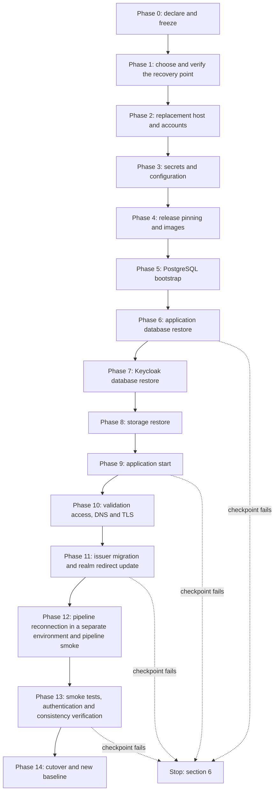

# تسلسل التعافي الكامل: تصميم مقترح وخطة تجربة

> **Owner role:** Infrastructure and deployment
> **Status:** PLANNED — تصميم بس، مش متنفّذ ومش متجرَّب
> **Language / اللغة:** [English](complete-recovery-sequence.md) · العربية

الصفحة دي هي التصميم اللي صندوق الـ BLOCKED في [backup-restore-disaster-recovery.md](backup-restore-disaster-recovery-ar.md) بيشاور عليه. بتوصف طريقة واحدة كاملة ومترتبة لإرجاع الـ Preview بتاع Matbakhy على سيرفر بديل من نسخ احتياطية لمخازن البيانات التلاتة (Database التطبيق، وDatabase الـ Keycloak، وتخزين الكائنات)، مع نقطة تحقق (Checkpoint) بعد كل مرحلة، وخطة تجربة تثبت إن التسلسل شغّال. هي مقترح للمالك ولأدمن مصرّح له. **ولا حاجة في الصفحة دي اتنفّذت، وفيه أدوات محتاجاها لسه مش موجودة.** عشان كده التعافي من الكوارث بيفضل NOT VERIFIED وBLOCKED لحد ما الأدوات الناقصة تتبني وتتراجع وتتجرّب بأدلة مسجّلة (القسم 8).

صفحات مرتبطة: [contabo-server-inventory.md](contabo-server-inventory-ar.md)، [server-rebuild-guide.md](server-rebuild-guide-ar.md)، [deployment-pipeline.md](deployment-pipeline-ar.md)، [runtime-architecture.md](runtime-architecture-ar.md)، [dns-https-sslip-io.md](dns-https-sslip-io-ar.md) و[admin-readonly-verification.md](admin-readonly-verification-ar.md).

## Evidence legend

| Label | المعنى في الصفحة دي |
|---|---|
| VERIFIED LIVE | اتشاف على سيرفر Contabo بحساب `aiagent` غير المميّز يوم 2026-10-21 (للقراءة فقط). |
| VERIFIED IN CODE | اتقرا في ملف الـ Repository المذكور جنب الجملة. بيثبت إيه اللي الكود بيعمله لما يشتغل، مش إن تشغيل حصل. |
| DOCUMENTED ONLY | مستند في الـ Repository أو دليل منتج خارجي بيقوله؛ ومااتأكدش منه. |
| OUTDATED / INCORRECT | بيتعارض مع دليل أحدث، زي نص من أيام Hetzner. |
| NOT VERIFIED | محدّش أكّده؛ والصفحة بتقول إزاي الأدمن المصرّح له يتأكد. |
| PROPOSED | عنصر تصميم أو أمر مش موجود في الـ Repository. لازم يتبني ويتراجع ويتجرّب قبل ما حد يعتمد عليه. |

## 1. النطاق والحالة

> **STATUS: PLANNED / NOT VERIFIED.** التسلسل اللي تحت تصميم. مفيش مرحلة اتشغّلت، ومفيش نقطة تحقق اتجرّبت، ومفيش زمن تعافي اتقاس. الجهاز ده مفيهوش صلاحية Docker، فمقدرناش ننفّذ أي تجربة وإحنا بنكتبه. التعافي الكامل للخدمة بيفضل BLOCKED (شوف صفحة النسخ الاحتياطي، القسم 7) لحد ما الأدوات المذكورة كناقصة في الجدول اللي تحت تتوجد وتجربة تعدّي بأدلة.

المفروض إن البيانات في الـ Preview تجريبية غير حقيقية (Synthetic Data) بس؛ دي سياسة التشغيل المطلوبة، ولا حاجة هنا معتمدة لبيانات حقيقية. المحتوى الفعلي لـ Databases ومخزن الهوية والتخزين الحية NOT VERIFIED (الفحوصات الحية بتبيّن أعلام الإعدادات بس). التصميم مكتوب بحيث يكون آمن للبيانات التجريبية غير الحقيقية وينفع يتعاد استخدامه لبيئة فيها بيانات حقيقية بعد كده.

| العنصر | الحالة | الدليل |
|---|---|---|
| Dump لـ Database التطبيق مع Checksum وManifest واسترجاع في Database مؤقتة ومطابقة | موجود | VERIFIED IN CODE: `scripts/db-backup.sh`، `scripts/db-restore.sh`، `infra/db/reconcile.sql`، `deploy/web-preview/deploy.sh` (`backup_db`، `verify_backup`، `restore_db`) |
| أرشيف التخزين (tar لـ Volume التخزين) | موجود، من غير Checksum ولا Manifest ولا أمر استرجاع | VERIFIED IN CODE: `deploy/web-preview/deploy.sh` (الدالة `backup`) |
| Dump لـ Database الـ Keycloak | موجود كأثر جانبي بس لـ `admin-console.sh enable` و`migrate-mfa.sh backup` و`owner-e2e-provision.sh apply`؛ مش جزء من النسخة الاحتياطية المتحقَّق منها | VERIFIED IN CODE: `deploy/web-preview/admin-console.sh`، `deploy/web-preview/migrate-mfa.sh`، `deploy/web-preview/owner-e2e-provision.sh` |
| تاريخ الإصدارات مع Digests الصور، ومخطّط الـ Rollback | موجود | VERIFIED IN CODE: `deploy/web-preview/deploy.sh` (`record_release`، `rollback_plan`) |
| توليد الأسرار وتوليد ملفات إعدادات الـ Realm والتخزين (Render) | موجود | VERIFIED IN CODE: `deploy/web-preview/deploy.sh` (`init_secrets`، `render`) |
| الـ Smoke Test | موجود | VERIFIED IN CODE: `deploy/web-preview/smoke.sh` |
| تجربة محلية للـ Stack على جهاز واحد (مش تجربة تعافي) | موجود | VERIFIED IN CODE: `scripts/rehearse-preview.sh` |
| استرجاع Database الـ Keycloak قبل ما الـ Identity يشتغل لأول مرة | ناقص | PROPOSED (IB-04) |
| Bootstrap بيشغّل PostgreSQL لوحده ويخلّي الـ Deploy يكمّل وDatabase التطبيق فاضية | ناقص | PROPOSED (IB-01، IB-02) |
| Checksum وManifest وأمر استرجاع لأرشيف التخزين | ناقص | PROPOSED (IB-05) |
| مجموعة نسخ احتياطية واحدة تربط المخازن التلاتة بترتيب آمن | ناقص | PROPOSED (IB-06) |
| نسخة خارج السيرفر وجدولة وسياسة احتفاظ | ناقص | PROPOSED (IB-07، IB-14) |
| أدوات التحويل (Cutover) المنسّق وسكريبتات التحقق | ناقص | PROPOSED (IB-09، IB-13) |
| تجربة تعافي | ماحصلتش خالص | NOT VERIFIED |

## 2. جرد الأصول

كل حاجة تحت لازم تكون موجودة، أو تتعمل من جديد، على السيرفر البديل. أسماء بس؛ القيم عمرها ما بتتكتب في الصفحة دي.

| الأصل | مكانه | بيتسترجع من | لو ضاع | الدليل |
|---|---|---|---|---|
| Database التطبيق `matbakhy` (الأوردرات والحسابات والـ Ledger والـ Audit وسجلات الوسائط) | Volume `postgres-data` | Dump التطبيق من `deploy.sh backup` | البيانات من بعد آخر Dump سليم بتضيع | VERIFIED IN CODE: `deploy/web-preview/compose.yaml`، `deploy/web-preview/deploy.sh` |
| الـ Roles `matbakhy` و`matbakhy_app` و`keycloak` وصلاحياتها | نفس نسخة PostgreSQL | بتتعمل عند أول تشغيل لـ Data Directory فاضي بسكريبتات الـ Init؛ وصلاحيات التشغيل بيعيدها Flyway بعد كل Migration | الـ Roles بتتعمل من جديد بس مع Data Directory فاضي؛ والـ Volume المسترجع بيحتفظ بكلمات سر الـ Roles القديمة | VERIFIED IN CODE: `deploy/web-preview/postgres/10-keycloak.sh`، `deploy/web-preview/postgres/20-runtime-role.sh`، `backend/app/src/main/resources/db/migration/afterMigrate.sql` |
| Database الـ Keycloak `keycloak` (حالة الـ Realm والمستخدمين وبيانات الاعتماد وتسجيلات كلمة المرور لمرة واحدة وتقوية الـ Master Realm وعميل العمليات) | نفس نسخة PostgreSQL | Dump لـ Keycloak (مش جزء من `deploy.sh backup`)، أو استيراد جديد لملف الـ Realm | من غير Dump بيرجع محتوى ملف الـ Realm بس (مستخدمين تجريبيين غير حقيقيين)؛ والمستخدمين والتسجيلات اللي اتعملت بعد كده بتضيع | VERIFIED IN CODE: `deploy/web-preview/identity/matbakhy-realm.preview.json`، `deploy/web-preview/admin-console.sh` |
| تخزين الكائنات (البكت العام `matbakhy-public` والبكت الخاص `matbakhy-private`؛ صور الوجبات ومستندات الطباخين) | Volume `storage-data` | أرشيف التخزين من `deploy.sh backup` | الصور والمستندات بتضيع؛ وصفوف الـ Database بتشاور على كائنات مش موجودة | VERIFIED IN CODE: `deploy/web-preview/compose.yaml`، `deploy/web-preview/deploy.sh` (الأمر `up` بينشئ البكتات)، `backend/app/src/main/resources/db/migration/V6__media_assets.sql` |
| أسرار ومفاتيح السيرفر (القسم 2.1) | ملف `.env` في مجلد الـ Deployment، صلاحية 600 | نسخة خارج السيرفر من `.env` القديم بس | بعض البيانات المخزّنة بتبقى مش مقروءة (القسم 2.1) | VERIFIED IN CODE: `deploy/web-preview/deploy.sh` (`init_secrets`) |
| الإعدادات المتولّدة (Render): ملف استيراد الـ Realm وملف هوية التخزين ومجلد الـ flags | `GENERATED_DIR`، صلاحية 700 | بيتعمل من جديد بـ `deploy.sh render` من `.env` والـ Repository | مفيش حاجة بتضيع؛ ولوحة الأدمن بتفضل مقفولة لحد ما `admin-console enable` يشتغل تاني | VERIFIED IN CODE: `deploy/web-preview/deploy.sh` (`render`) |
| تاريخ الإصدارات وقفل التغيير | `BACKUP_DIR` (`releases.log` و`.preview-mutation.lock` و`metrics`) | نسخة من `BACKUP_DIR` | الـ Digests بتاعة الإصدار الشغّال بتضيع؛ و`rollback-plan` مالوش حاجة يقراها | VERIFIED IN CODE: `deploy/web-preview/deploy.sh` (`release_log`، `up`) |
| الأسماء العامة والـ DNS والـ TLS | الأسماء app وops وapi وid وkc-admin وmedia تحت `PREVIEW_DOMAIN`؛ والشهادات في Volume `caddy-data` | التحكم في الـ DNS أو نفس عنوان الـ IP؛ والشهادات بتتصدر من جديد | شهادات جديدة بتتطلب أوتوماتيك؛ وأسماء sslip.io بتتبع عنوان الـ IP المكتوب في الاسم | VERIFIED LIVE: الأسماء بتتحل لـ 167.86.90.174؛ VERIFIED IN CODE: `deploy/web-preview/Caddyfile`؛ شوف [dns-https-sslip-io.md](dns-https-sslip-io-ar.md) |
| اتصال GitHub Actions: البيئة `preview` والأسرار `STAGING_SSH_HOST` و`STAGING_SSH_USER` و`STAGING_SSH_KEY` و`STAGING_SSH_HOST_PUBKEY` ومجموعة الـ Concurrency اسمها `matbakhy-preview-deploy` | إعدادات الـ Repository في GitHub | بتتعمل من جديد باليد | الـ Pipeline مابيوصلش للسيرفر الجديد لحد ما تتبدّل | VERIFIED IN CODE: `.github/workflows/deploy-preview.yml`؛ قيم الأسرار ومستخدم SSH NOT VERIFIED |
| صور الـ Container: صور الـ API والـ Front بالـ Digest في GitHub Container Registry، وصور الأطراف التانية بالـ Digest في `compose.yaml` | الـ Registries | `releases.log` (الـ Digests بتوع صورتينا) و`compose.yaml` (الباقي) | الإصدار مايشتغلش لو Digest مبقاش ينفع يتسحب؛ وهل الـ Registry بتحتفظ بالـ Digests القديمة NOT VERIFIED | VERIFIED IN CODE: `deploy/web-preview/compose.yaml`، `.github/workflows/deploy-preview.yml` |
| اللوجات والمقاييس وحالة التنبيهات وبيانات Grafana | ستة Volumes للمراقبة | مابتتسترجعش | التاريخ بيضيع؛ والخدمات بتشتغل فاضية | VERIFIED IN CODE: `deploy/web-preview/compose.yaml` |

### 2.1 المفاتيح والأسرار: ضياع أنهي واحد بيخلّي أنهي بيانات مش مقروءة

القيم بتتولّد في `.env` بـ `deploy.sh init-secrets` ومالهاش مكان تاني في الـ Repository (VERIFIED IN CODE). الجدول الكامل مع مراجع الكود في صفحة النسخ الاحتياطي، القسم 4؛ ده الجزء اللي يهم الترتيب.

| الاسم | إيه اللي بيبقى مش مقروء أو مش صالح لو ضاع أو اتبدّل | الدليل |
|---|---|---|
| `HANDOVER_ENCRYPTION_KEY` | النصوص المشفّرة لأكواد التسليم المخزّنة ماينفعش تتفك | VERIFIED IN CODE: `backend/modules/orders/src/main/java/com/matbakhy/orders/internal/HandoverCodes.java` |
| `HANDOVER_HASH_KEY` | أكواد التسليم بتاعة الأوردرات الموجودة مابقاش ينفع تتحقق | VERIFIED IN CODE: نفس الـ Class |
| `PUSH_TOKEN_ENCRYPTION_KEY` و`PUSH_TOKEN_HASH_KEY` | الـ Push Tokens المخزّنة مابقاش ينفع تتقرا ولا يتدوّر عليها | VERIFIED IN CODE: `backend/modules/notifications/src/main/java/com/matbakhy/notifications/internal/TokenVault.java` |
| `ACTIVITY_HASH_KEY` | الـ Hashes المخزّنة للزوّار مبقتش بتطابق الأحداث الجديدة (استمرارية العدّ لكل زائر بتضيع، استنتاج) | VERIFIED IN CODE: `backend/modules/catalog/src/main/java/com/matbakhy/catalog/internal/activity/ActivityService.java` |
| `PHONE_CODE_PEPPER` | أكواد التحقق من الموبايل المعلّقة ماينفعش تتحقق (عمرها قصير وتأثيرها صغير، استنتاج) | VERIFIED IN CODE: `backend/modules/identity/src/main/java/com/matbakhy/identity/internal/PhoneVerificationService.java` |
| `POSTGRES_PASSWORD` و`KEYCLOAK_DB_PASSWORD` و`APP_DB_PASSWORD` | الـ Volume المسترجع بيحتفظ بكلمات سر الـ Roles القديمة، فلازم القيم تطابق الـ Cluster المسترجع؛ وهي بتُستخدم لإنشاء الـ Roles بس مع Data Directory فاضي | VERIFIED IN CODE: `deploy/web-preview/postgres/10-keycloak.sh`، `deploy/web-preview/postgres/20-runtime-role.sh` |
| `OIDC_WEB_CLIENT_SECRET` و`OIDC_ADMIN_CLIENT_SECRET` و`KEYCLOAK_OPS_CLIENT_SECRET` | بعد استرجاع Keycloak الـ Realm بيحتفظ بأسرار وقت الـ Dump؛ والـ API وأدوات المشغّل بيفشلوا في الـ Authentication لو `.env` فيه قيم مختلفة | VERIFIED IN CODE: `deploy/web-preview/deploy.sh` (`render`)، `deploy/web-preview/compose.yaml`؛ طريقة الفشل نفسها استنتاج |
| `STORAGE_ACCESS_KEY` و`STORAGE_SECRET_KEY` | بيتحطوا في ملف هوية التخزين؛ الكائنات بتفضل مقروءة لو الاتنين اتبدّلوا مع بعض وشغّلت `render` | VERIFIED IN CODE: `deploy/web-preview/storage/s3.json.template` |
| `KEYCLOAK_ADMIN_USER` و`KEYCLOAK_ADMIN_PASSWORD` و`PREVIEW_USER_PASSWORD` و`GRAFANA_ADMIN_PASSWORD` | ينفع تتعمل لها إعادة ضبط؛ مش ضياع بيانات | VERIFIED IN CODE: `deploy/web-preview/compose.yaml`، `deploy/web-preview/deploy.sh` |

مفتاحَي التسليم ومفاتيح الـ Push Token هم اللي بيحددوا هل الصفوف المشفّرة تفضل مقروءة. الكود مفيهوش أداة إعادة تشفير ولا تدوير مفاتيح (VERIFIED IN CODE، بالبحث في صفحة النسخ الاحتياطي). فالقاعدة في التصميم: **أي تعافي لازم يحافظ على البيانات بيسترجع `.env` القديم كله؛ وعمره ما بيشغّل `init-secrets` تاني.** و`init-secrets` بيرفض يكتب فوق `.env` موجود.

## 3. نموذج اتساق النسخ الاحتياطي

### 3.1 مين بيشاور على مين

| المرجع | الاتجاه | فين | الدليل |
|---|---|---|---|
| سجلات الوسائط بتسمّي الكائنات | `media_asset.private_key` و`media_asset.public_key` في Database التطبيق بيشاوروا على كائنات في التخزين | من Database التطبيق للتخزين | VERIFIED IN CODE: `backend/app/src/main/resources/db/migration/V6__media_assets.sql` |
| المسح المؤجَّل | صفوف `media_cleanup` (البكت ومفتاح الكائن والحالة PENDING أو DONE أو FAILED أو SKIPPED_REFERENCED) بتسمّي كائنات للمسح | من Database التطبيق للتخزين | VERIFIED IN CODE: `backend/app/src/main/resources/db/migration/V30__media_cleanup.sql`، `backend/modules/catalog/src/main/java/com/matbakhy/catalog/internal/media/MediaCleanup.java` |
| الحسابات بتسمّي الهويات | `app_user.issuer` و`app_user.subject` (فريدين مع بعض) بيسمّوا مستخدم الـ Keycloak | من Database التطبيق لـ Keycloak | VERIFIED IN CODE: `backend/app/src/main/resources/db/migration/V1__baseline_identity_and_idempotency.sql` |
| الهوية مابتسمّيش بيانات التطبيق | Keycloak بيخزّن مستخدمين وClients؛ ومش متوقع يكون فيه مفتاح كائن تطبيق أو مفتاح تخزين | مفيش | NOT VERIFIED: استنتاج من ملف الـ Realm اللي بيعرّف Clients ومستخدمين |

فيه نوعين من عدم التطابق ممكن يظهروا لما المخازن تتاخد في لحظات مختلفة.

- **الكائن اليتيم (Orphan)** هو كائن في التخزين مفيش صف في الـ Database بيشاور عليه. ضرره صفر: بياخد مساحة بس. بحسب التصميم الكود بيكتب الكائن قبل ما الموافقة اللي بتشاور عليه تتعمل Commit، وبيسجّل صف تنظيف ليه في Transaction لوحدها (`enqueueUnlessApproved` في `MediaCleanup`)، وJob التنظيف عمرها ما بتمسح كائن لسه Asset فعّال بيشاور عليه (`runDue`). الكائن اليتيم اللي صف التنظيف بتاعه مش موجود في الـ Database المسترجعة بيفضل زي ما هو.
- **المرجع المعلّق (Dangling Reference)** هو صف Committed في الـ Database (الحالة QUARANTINED أو APPROVED) والكائن بتاعه ناقص في التخزين. ضرره حقيقي: عنوان صورة عامة هيرد بخطأ، ومستند خاص هيبقى مش متاح. ده اللي نموذج الاتساق لازم يتجنبه.
- **تذكرة الرفع المعلّقة أو المنتهية (Upload Ticket)** هي صف حالته PENDING_UPLOAD. الدالة `MediaService.createTicket` بتضيفه، مع `ticket_expires_at`، قبل ما العميل يرفع أي حاجة (VERIFIED IN CODE)، فوجود صف من غير كائن حاجة عادية طول ما التذكرة سارية، حتى لو النسخ الاحتياطية مترتبة صح. بعد انتهاء التذكرة خطوة الإتمام بترفض الصف ده بسبب `MISSING_OBJECT` (VERIFIED IN CODE: `MediaService`). فالصفوف دي مش مراجع معلّقة؛ بتتحكم عليها حالة التذكرة (Q4)، والرفع اللي اتقطع بيتصلّح لما العميل يطلب تذكرة جديدة (استنتاج؛ مفيش مسار زي ده اتجرّب).

وكمان الـ Database المسترجعة ممكن تطلب مسح حاجات مبقتش مطابقة للواقع: صفوف `media_cleanup` المعلّقة بتنفّذها الـ Job الشغّالة بعد ما الـ API يبدأ (الـ Job شغّالة افتراضيًا، الخاصية `matbakhy.media.cleanup-job.enabled`، VERIFIED IN CODE). هي بتمسح كائنات مفيش Asset فعّال بيشاور عليها بس، فمش هتعمل مرجع معلّق بنفسها، لكنها كاتب شغّال في الخلفية على التخزين وقت التحقق (شوف IB-10).

### 3.2 ترتيب النسخ الاحتياطي الآمن

نقطة التعافي مجموعة، مش ملف واحد. الترتيب اللي تحت بيخلّي المراجع قابلة للحل بس في الظروف المذكورة في كل خطوة؛ والخطوتين 2 و 3 ضمانات مشروطة، مش ضمانات مطلقة.

1. **Database التطبيق الأول.** `deploy.sh backup` بيعمل كده فعلًا (`backup_db`، وبعدها أرشيف التخزين). الـ Dump لقطة واحدة متسقة لـ Database التطبيق كلها، فالأوردرات والـ Ledger والـ Audit وسجلات الوسائط متفقة مع بعض (VERIFIED IN CODE: `pg_dump` في `scripts/db-backup.sh`؛ دلالات اللقطة DOCUMENTED ONLY).
2. **Database الـ Keycloak التانية، مع تجميد تغييرات الهويات.** كل حساب في التطبيق بيتعمل بعد ما مستخدم Keycloak بتاعه يكون موجود (أول تسجيل دخول ناجح بيعمل الصف، VERIFIED IN CODE: `JdbcAccountDirectory`، المذكورة في صفحة النسخ الاحتياطي). فـ Dump الـ Keycloak المأخود بعد Dump التطبيق بيحتوي كل هوية Dump التطبيق بيشاور عليها، **بشرط إن مفيش هوية اتمسحت في النص**. وإيقاف الـ API مابيضمنش الشرط ده: `JdbcAccountDirectory` بتثبت ترتيب إنشاء الحسابات، مش الاحتفاظ بالهويات، وأدمن Keycloak وسكريبتات الهوية (`admin-console.sh` و`migrate-mfa.sh` و`owner-e2e-provision.sh`) ممكن يمسحوا أو يبدّلوا مستخدمين من غير ما يمرّوا على الـ API. فالترتيب بيبقى ضمان طول ما تغييرات الهويات متجمّدة من قبل Dump التطبيق لحد بعد Dump الـ Keycloak بس (من غير استخدام للوحة الأدمن أو لسكريبتات، ومن غير Provisioning)، والتجميد ده لازم يتسجّل في Manifest المجموعة. الهويات الزيادة في Dump Keycloak الأحدث ضررها صفر: بياخدوا حساب تطبيق فاضي عند أول تسجيل دخول. الحجة دي استنتاج من قاعدة إنشاء الحسابات، NOT VERIFIED باختبار؛ والتعامل مع عدم التطابق في الخطوة 4.
3. **أرشيف التخزين الأخير، مع تجميد Job التنظيف.** تخزين أحدث من الـ Database بيدّي كائنات يتيمة بس. تخزين أقدم من الـ Database هيدّي مراجع معلّقة لكل رفع Committed حصل بينهم. الكود بياخد أرشيف التخزين فعلًا بعد Dump الـ Database. وحالة المسح اللي حصل بين الاتنين (تحت) بتفضل مفتوحة إلا لو Job التنظيف في الخلفية اتجمّدت وقت الالتقاط (القسم 3.3).
4. **التعامل مع عدم التطابق.** لو بعد التعافي فحص Q9 لقى حساب تطبيق مستخدم Keycloak بتاعه ناقص (هوية اتمسحت بين الالتقاطات، أو تجميد ماتحافظش عليه)، ماتعملش حسابات باليد وماتمسحش حساب التطبيق. وقّف عند CP-13، وسجّل الـ Subjects بس (من غير أسماء ولا بيانات تواصل أبدًا)، وخد قرار المالك بين: إعادة إنشاء مستخدم Keycloak بنفس الـ Subject الأصلي عشان الحساب يحتفظ بتاريخه (هل Keycloak بيقبل Id بنختاره في الإعداد ده NOT VERIFIED)؛ أو ربط حساب التطبيق بـ Subject جديد بموافقة المالك؛ أو ترك الحساب غير قابل للوصول. التجربة فيها حالة بتمسح مستخدم تجريبي غير حقيقي بين Dump التطبيق وDump الـ Keycloak (RS-15).

الحالة الضيقة اللي فاضلة: Asset كان Committed (QUARANTINED أو APPROVED) لما الـ Database اتعمل لها Dump واتمسح (وكائنه اتشال بـ Job التنظيف) قبل ما الأرشيف يتاخد، ده مرجع معلّق في المجموعة المسترجعة. فحص المراجع بعد التعافي (Q4 في القسم 5) بيلقطه. وتجميد Job التنظيف وقت الالتقاط بيقفله (القسم 3.3).

### 3.3 خيارات الـ Quiescing

| الخيار | إزاي | التكلفة | بيقفل أنهي فجوة | الحالة |
|---|---|---|---|---|
| ولا حاجة، زي النهارده | الـ API بيفضل شغّال؛ والتخزين بيتوقف للـ tar بس | الرفع متوقع يفشل وقت توقف التخزين (تعليق في الكود بيقول حوالي دقيقة؛ والمدة ماتقاسش وبتعتمد على حجم الأرشيف وأداء الـ Host، وتأثيرها على الرفع استنتاج)؛ وحالة المسح اللي حصل بين الاتنين وفجوة الهويات بيفضلوا مفتوحين | مفيش زيادة | VERIFIED IN CODE: `deploy/web-preview/deploy.sh` (`backup`) |
| إيقاف الـ API وتجميد تغييرات الهويات طول مجموعة النسخ الاحتياطي | وقّف `api` (ده بيوقف Job التنظيف كمان)، وماتستخدمش لوحة Keycloak ولا سكريبتات الهوية، وشغّل الالتقاطات التلاتة، وشغّل `api` | انقطاع كتابة على الموقع كله طول المدة (الـ Dump وفحص الاسترجاع وDump الـ Keycloak والـ tar) زائد تجميد إداري مفيش حاجة بتفرضه | الفجوات بين الـ Database وKeycloak والتخزين؛ وفجوة Keycloak طول ما التجميد محترم بس، لأن إيقاف `api` مابيوقفش أدمن Keycloak ولا السكريبتات | PROPOSED (IB-06)؛ المدة NOT VERIFIED |
| تجميد Job التنظيف في الخلفية وقت الالتقاط | عطّل Job التنظيف عن طريق خاصيتها طول الفترة | محتاج تغيير إعدادات وإعادة تشغيل الـ API | حالة المسح اللي حصل بين الاتنين | PROPOSED (IB-10) |
| خد الالتقاطات التلاتة ورا بعض بترتيب القسم 3.2 وسجّل التوقيتات التلاتة (Timestamps) | أمر واحد بيكتب Manifest واحد | صغيرة؛ والموقع بيفضل شغّال | بتقلل الفجوة ومابتقفلهاش | PROPOSED (IB-06) |

التنفيذ الأول المفروض يستخدم الصف الأخير (تكلفة صغيرة، من غير انقطاع). المالك هو اللي بيقرر هل خيار إيقاف الـ API مقبول للـ Preview ولأي بيئة بيانات حقيقية مستقبلًا (OD-5).

### 3.4 الـ Checksums والـ Manifests

- Dump التطبيق ليه فعلًا ملف SHA-256 وManifest فيه نسخة الـ Schema وأعداد الصفوف في الجداول التسعة (VERIFIED IN CODE: `scripts/db-backup.sh`).
- Dump الـ Keycloak وأرشيف التخزين ملهمش Checksum ولا Manifest (VERIFIED IN CODE، غياب). المطلوب (IB-05، IB-06): SHA-256 لكل ملف، وعدد كائنات الأرشيف وإجمالي البايتات، وتوقيتات الـ Dumps، وManifest واحد للمجموعة بيسمّي مجلد Dump التطبيق وDump الـ Keycloak وأرشيف التخزين ونسخة الـ Schema وسطر الإصدار من `releases.log` وبصمة `.env` (Hash بس، عمرها ما تكون المحتوى)، وسجل تجميد الهويات.
- أعداد الـ Manifest الموجود مش لقطة من الـ Dump. السكريبت `scripts/db-backup.sh` بيشغّل `pg_dump` الأول وبعدين بيقرا نسخة الـ Schema وكل عدد من اتصالات منفصلة (VERIFIED IN CODE)، فمع وجود كتابة متزامنة الأعداد ممكن تختلف عن محتوى الـ Dump، ومقارنة الاسترجاع ممكن تفشل أو تقارن بأرقام غلط. تجميد الكتابة وقت الالتقاط (القسم 3.3) بيتفادى المشكلة النهارده. المقترح (IB-06): تاخد الـ Metadata جوه نفس لقطة الـ Dump (مثلًا Transaction واحدة بلقطة مُصدَّرة يشاركها `pg_dump` واستعلامات العدّ)، أو تحسب الأعداد من الـ Database المؤقتة المسترجعة بدل كده، وتتجرّب بكتابة متزامنة في التجربة (RS-15).
- توقيتات التشغيلة الواحدة بتختلف بثواني (صفحة النسخ الاحتياطي بتشرح التلات توقيتات)، ومفيش ملف بيسجّل أنهي أرشيف تابع لأنهي مجلد Dump. ربط الأرشيف بالـ Dump بتقارب الوقت مجرد إعادة بناء مبنية على تخمين ومش مؤكدة: النسخة الاحتياطية مابتمسكش قفل التغيير المشترك والتوقيتات مستقلة، فنسخة تانية أو Deploy ممكن يدخلوا في النص. التعافي من كذا مخزن موثوق بس لما يبقى فيه ربط متسجّل للمجموعة، وهو Manifest مجموعة النسخ الاحتياطي (IB-06)؛ لحد وقتها الربط تخمين لازم يتأكد، مش قاعدة.

### 3.5 النسخة خارج السيرفر

النسخ الاحتياطية في `BACKUP_DIR` مصيرها مصير السيرفر (VERIFIED IN CODE: مفيش حاجة بتنسخها؛ DOCUMENTED ONLY في [06-web-preview.md](../../operations/06-web-preview.md)). تسلسل التعافي مش صالح من غير نسخة خارج السيرفر من المجموعة كلها ومن `.env`. التصميم بيطلب نسخة مشفّرة في وجهة المالك بيختارها (OD-2)، بتتكتب بعد ما المجموعة تتحقق، مع اختبار استرجاع منها كجزء من التجربة. النسخ الاحتياطية فيها بيانات شخصية في البيئة الحقيقية، فالنسخة مشفّرة والوصول ليها محدود؛ والوجهة وإدارة المفتاح والاحتفاظ قرارات للمالك، والصفحة دي مابتاخدهاش.

### 3.6 إثبات إن النسخة تتسترجع من غير ما نلمس الـ Production

الاسترجاع في Database مؤقتة لـ Database التطبيق موجود فعلًا: `backup_db` بيسترجع الـ Dump في `matbakhy_restore_check`، وبيطابقه، وبيمسحه (VERIFIED IN CODE). نفس الفكرة مطلوبة للمخزنين التانيين، دايمًا على الجهاز اللي فيه النسخة ومش على البيانات الحية أبدًا:

- Dump الـ Keycloak: استرجعه في Database مؤقتة `keycloak_restore_check`، وعُدّ الجداول، واتأكد إن الـ Realm `matbakhy` موجود (PROPOSED، IB-03).
- أرشيف التخزين: اعرض محتواه، وقارن عدد الكائنات والبايتات بالـ Manifest، واستخرجه في مجلد أو Volume مؤقت (PROPOSED، IB-05).
- المجموعة كلها: التجربة الكاملة في القسم 8 هي الإثبات الوحيد إن المجموعة كافية.

## 4. تسلسل الاسترجاع



الرسمة بتتقرا من فوق لتحت. كل مرحلة ليها خطوة إجراء بتشتغل فيها الأوامر اللي بتغيّر الحالة، وبتخلص بنقطة تحقق (CP-00 لحد CP-14) بتفحص النتائج المسجّلة بس؛ والمرحلة اللي بعدها ماتبدأش إلا لما نقطة التحقق تعدّي. الخطوط المنقّطة بتبيّن الأربع أماكن اللي الفشل فيها غالبًا هيحتاج قرار؛ وكل نقطة تحقق ليها شرط توقف ومسار رجوع في القسم 6. الترتيب مفروض من الكود: PostgreSQL لازم يشتغل قبل ما أي Database تتسترجع (المرحلة 5)، وDatabase الـ Keycloak لازم تتسترجع قبل ما خدمة الـ Identity تشتغل لأول مرة (المرحلة 7 قبل المرحلة 9)، وDatabase التطبيق لازم يبقى فيها جداول قبل ما `deploy.sh up` ياخد نسخته الاحتياطية قبل النشر (المرحلة 6 قبل المرحلة 9)، والـ Issuer وعناوين الـ Redirect لازم تبقى صح (المرحلة 11) قبل أي اختبار تسجيل دخول أو Smoke للـ Pipeline (المرحلتين 12 و 13).

العناصر النائبة: `<deploy-dir>` هو مجلد الـ Deployment (على السيرفر الحي `/srv/matbakhy-staging/deploy/web-preview`، VERIFIED LIVE؛ وعلى سيرفر بديل مسار تختاره)، و`<backup-dir>` هو `BACKUP_DIR` من `.env`، وهو `/backups` جوه Container الـ PostgreSQL. كل الأوامر بتشتغل على السيرفر البديل (K10 وK17 بيشتغلوا على الأجهزة المذكورة في صفوفهم)، عمرها ما تشتغل على الـ Preview الحي.

### 4.1 المراحل

| المرحلة | الغرض | اللي بيحصل | الأدوات |
|---|---|---|---|
| 0 | الإعلان والتجميد | المالك أو اللي بينوب عنه بيعلن الكارثة وبيكتب الوقت (بداية عدّاد زمن التعافي). وقّف النشر الأوتوماتيك على السيرفر الضايع (أوقف الـ Workflow `deploy-preview.yml` في GitHub، إجراء يدوي محتاج تصريح). ماتمسحش السيرفر القديم ولا تعمل له تثبيت من جديد؛ سيب كل نسخة ناجية زي ما هي | يدوي |
| 1 | اختيار نقطة التعافي والتحقق منها | حدّد أحدث مجموعة نسخ احتياطية نجت خارج السيرفر الضايع: مجلد Dump التطبيق وDump الـ Keycloak وأرشيف التخزين و`releases.log` و`.env` القديم. اتحقق من الـ Checksums. اختار إصدار الـ Migrations بتاعته على الأقل في حداثة نسخة الـ Schema بتاعة الـ Dump | جزء موجود (`sha256sum -c`)؛ وManifest المجموعة PROPOSED |
| 2 | السيرفر البديل والحسابات | ابني السيرفر وحساب المشغّل والمجلدات (ومنها `<backup-dir>/metrics`) وDocker والمنفذين 80 و 443 زي ما في [server-rebuild-guide.md](server-rebuild-guide-ar.md). ماتدّيش `aiagent` صلاحية sudo ولا Docker | موجود كتوثيق، NOT EXECUTION VERIFIED |
| 3 | الأسرار والإعدادات | حط `.env` القديم (صلاحية 600، ملك حساب المشغّل) عبر قناة آمنة. قرر الدومين وطريقة التحقق (القسم 4.4). اضبط `GENERATED_DIR` و`BACKUP_DIR` وقوائم الوصول للسيرفر الجديد. **الإجراء:** شغّل `deploy.sh render` (K2). هو بيكتب ملفات تحت `GENERATED_DIR` وممكن يضيف سرّين للـ Clients في `.env` لو `.env` القديم ناقصهم، فـ CP-03 بيفحص النتيجة بس | موجود |
| 4 | تثبيت الإصدار والصور | حط `RELEASE_COMMIT` و`API_IMAGE` و`FRONT_IMAGE` في `.env` (Digests، من `releases.log` أو من Build جديد). اسحب الصور وافحصها. Docker Compose بيتحقق من المتغيرات المطلوبة في الملف كله حتى لو خدمة واحدة بس هي اللي بتشتغل (سلوك Compose القياسي، DOCUMENTED ONLY)، فالقيم دي لازم تكون موجودة قبل المرحلة 5 | موجود (`deploy.sh up` بيفحص الـ Digests)؛ توفّر الصور NOT VERIFIED |
| 5 | Bootstrap لـ PostgreSQL | شغّل PostgreSQL لوحده عشان سكريبتات الـ Init تعمل الـ Roles وقواعد البيانات الفاضية `matbakhy` و`keycloak` (القسم 4.2) | أمر Docker قياسي موجود؛ والـ Bootstrap المدعوم PROPOSED (IB-01، IB-02) |
| 6 | استرجاع Database التطبيق | **الإجراء:** استرجع الـ Dump في `matbakhy_restore` وطابقه (K4)، وبعدين بدّل الـ `matbakhy` الفاضية (K5). CP-06 بيفحص النتائج المسجّلة وبيلتقط دليل نقطة التعافي (Q7 والعلامات) قبل ما الـ API يشتغل أصلًا | الاسترجاع موجود؛ والتبديل DOCUMENTED ONLY |
| 7 | استرجاع Database الـ Keycloak | **الإجراء:** استرجع Dump الـ Keycloak في Database `keycloak` الفاضية وخدمة الـ Identity عمرها ما اشتغلت (K6، القسم 4.3) | PROPOSED (IB-04) |
| 8 | استرجاع التخزين | **الإجراء:** استخرج أرشيف التخزين في Volume التخزين الفاضي وخدمة التخزين واقفة (K7) | PROPOSED (IB-05) |
| 9 | تشغيل التطبيق | **الإجراء:** شغّل `deploy.sh up` (K8): Flyway بيطبّق الـ Migrations الأحدث، وKeycloak بيلاقي بيانات موجودة ويتخطى الاستيراد، والتخزين والـ Proxy بيشتغلوا. الفحوصات داخلية؛ ومفيش اسم عام لازم لسه | موجود |
| 10 | الوصول للتحقق والـ DNS والـ TLS | **الإجراء:** جهّز طريقة التحقق المختارة (القسم 4.4): أسماء خاصة بالسيرفر البديل، أو تجاوز محلي للأسماء من Validators مسموح لهم؛ وCaddy بيطلب الشهادات للأسماء اللي بتتحل للسيرفر البديل بس. الأسماء العامة الحقيقية بتفضل مكانها | موجود كتوثيق؛ وطريقة الأسماء الثابتة PROPOSED |
| 11 | ترحيل الـ Issuer وتحديث عناوين الـ Redirect في الـ Realm | **الإجراء:** والـ API واقف ومعاك نقط استرجاع جديدة، شغّل K15 (إعادة كتابة `app_user.issuer`) وK16 (تحديث عناوين الـ Redirect بتاعة الـ Clients)، وبعدين شغّل الـ API (القسم 4.4). بيتخطى، بسبب متسجّل، لو الدومين ماتغيّرش. لازم يتم قبل أي اختبار تسجيل دخول أو Smoke للـ Pipeline | PROPOSED (IB-11) |
| 12 | إعادة ربط الـ Pipeline في بيئة منفصلة وSmoke للـ Pipeline | **الإجراء:** في Repository التجربة، اللي لازم يكون Repository منفصل أو فيه نسخة Workflow معزولة معدّلة صراحةً (IB-12) بتشيل خطوة الكونسول الأخيرة (القسم 4.4)، لأن `deploy-preview.yml` مكتوب فيه `environment: preview` ثابت ومفيهوش مُدخل لاختيار البيئة، فبيئة GitHub مؤقتة ماينفعش تتختار (VERIFIED IN CODE)، بدّل الأسرار الأربعة ومفتاح الـ Host وقوائم الوصول، وبعدين شغّل الـ Workflow على `develop` واستنى الـ Product CI للـ Commit بالظبط (K17). البيئة الحقيقية `preview` بتتغيّر في المرحلة 14 بس (القسم 4.5) | موجود كتوثيق |
| 13 | الـ Smoke Tests والتحقق من تسجيل الدخول والاتساق | **الإجراء:** شغّل `deploy.sh smoke` (K10) ورحلات المالك بتسجيل الدخول والفحوصات للقراءة فقط في القسم 5 | الـ Smoke موجود؛ والفحوصات PROPOSED (IB-09) |
| 14 | التحويل (Cutover) ونقطة الأساس الجديدة | **الإجراء:** انقل الزيارات العامة (تغيير الـ DNS في مسار الأسماء الثابتة، أو اعتماد الأسماء الجديدة)، وأعد ربط البيئة الحقيقية `preview` (G1 لـ G5 في صفحة النسخ الاحتياطي، بتصريح)، وافتح الأتمتة تاني، وشغّل النسخة الاحتياطية كنقطة أساس (K11) وانسخها خارج السيرفر، وسجّل الأزمنة المقاسة | موجود في أجزاء |

### 4.2 مشكلة النسخة الاحتياطية قبل النشر والـ Bootstrap المطلوب

المراجعين لقوا فخ في ترتيب العمليات. **`deploy.sh up` بياخد نسخة احتياطية قبل النشر طول ما فيه Container بتاع PostgreSQL شغّال** (`compose ps -q postgres` مش فاضي، VERIFIED IN CODE: الدالة `up`). وبعدها `backup_db` بيشغّل `scripts/db-backup.sh` و`verify_backup`. على PostgreSQL فيها Database `matbakhy` الفاضية بس، الـ Dump بيطلع فاضي، وخطوات الـ Manifest والمطابقة بتسأل عن جداول تطبيق (`customer_order` وغيرها) مش موجودة. خطوة التحقق من الاسترجاع بتشغّل الاستعلامات دي تحت `set -e` ومتوقع إنها توقف (مستنتج من قراءة `scripts/db-restore.sh` و`infra/db/reconcile.sql`). ولأن `up` بيشغّل `backup_db` قبل ما يبدأ أي حاجة، فـ `up` متوقع يوقف قبل ما التطبيق يشتغل. أنهي سطر بيفشل الأول مش مهم للتصميم؛ المهم إن `up` مابيكملش. ده مستنتج من الكود ومااتشغّلش أبدًا (NOT VERIFIED).

في أول تثبيت ده مابيحصلش، لأن مفيش Container PostgreSQL شغّال قبل أول `up`. بيحصل بالظبط في حالة التعافي، اللي فيها PostgreSQL لازم يشتغل الأول عشان الـ Databases تتسترجع.

**التصميم المطلوب (PROPOSED، IB-01 وIB-02).**

1. أمر Bootstrap مدعوم (أمر فرعي `recover-bootstrap` في `deploy.sh`) بيعمل: يحمّل `.env`، ويشغّل `render`، ويشغّل خدمة `postgres` بس، وينتظر الـ Health Check بتاعها، ويطبع الخطوات الجاية. هو مابيشغّلش النسخة الاحتياطية قبل النشر. لحد ما يتوجد، الأمر القياسي المكافئ هو `docker compose up -d postgres` في `<deploy-dir>`، ومحتاج `.env` كامل (كل قيم الإصدار مضبوطة) لأن Compose بيتحقق من كل الخدمات.
2. الترتيب المطلوب **استرجع الأول، وبعدين `up`**: استرجع Database التطبيق (المرحلة 6) وDatabase الـ Keycloak (المرحلة 7) قبل أول `deploy.sh up`. وقتها PostgreSQL فيها جداول التطبيق لما `up` يشتغل، ونسخته الاحتياطية قبل النشر بتشتغل، والنسخة دي بتبقى كمان دليل إن الـ Database المسترجعة ينفع تتعمل لها Dump وتتسترجع.
3. حماية (Guard) في `up` للحالة اللي فاضلة: لو PostgreSQL الشغّالة فيها Database تطبيق من غير ولا جدول، لازم `up` يرفض برسالة واضحة بتسمّي أمر الـ Bootstrap، أو يتخطى النسخة الاحتياطية قبل النشر لما علم تعافي صريح يتحط بس، ويسجّل التخطي في `releases.log`. عمره ما يتخطى النسخة الاحتياطية بصمت على Database فيها بيانات. الحماية دي محتاجة اختبار بأمر Docker وهمي (Stub)، على طريقة `scripts/test_preview_backup.py`.

فيه بديل مش محتاج أمر جديد: شغّل أول `up` عادي (مفيش حاجة شغّالة، فمفيش نسخة قبل النشر)، وبعدين وقّف خدمتي الـ API والـ Identity، وبدّل Database التطبيق المسترجعة، وامسح Database `keycloak` واسترجعها، وشغّل تاني. هو بيستخدم أوامر موجودة بس، لكنه الأول بيستورد Realm جديد وبيعمل حالة هوية تانية مختلفة بعدين بتتشال، وبيشغّل التطبيق على بيانات غلط لفترة قصيرة. هو مكتوب كحل احتياطي، مش كتصميم (NOT VERIFIED في الحالتين).

### 4.3 Keycloak: الحالة المسترجعة مقابل الاستيراد الجديد

Keycloak بيشتغل بـ `start --import-realm` وملف الـ Realm المتولّد (Rendered) (VERIFIED IN CODE: `deploy/web-preview/compose.yaml`). سلوك Keycloak الموثّق هو تخطي الاستيراد لما الـ Realm موجود فعلًا في الـ Database (DOCUMENTED ONLY).

| الجانب | استرجاع Database الـ Keycloak قبل ما الـ Identity يشتغل لأول مرة | استيراد جديد لملف الـ Realm |
|---|---|---|
| المستخدمين | كل المستخدمين الموجودين وقت الـ Dump | المستخدمين الخمسة التجريبيين غير الحقيقيين بالـ Ids الثابتة في ملف الـ Realm؛ والـ Ids دي بتساوي الـ Subjects في `deploy/web-preview/seed-preview.sql` (VERIFIED IN CODE) |
| المستخدمين اللي اتعملوا بعد كده (مثلًا بـ `owner-e2e-provision.sh apply`) | موجودين لو اتعملوا قبل الـ Dump | بيضيعوا؛ والناس دي مش هتقدر تسجّل دخول لحد ما مستخدم Keycloak بتاعهم يتعمل من جديد صراحةً (الاستيراد مابيعملهمش من جديد، والتطبيق مابيعملش حساب من غير تسجيل دخول ناجح)؛ ومستخدم اتعمل من جديد بـ Subject جديد بياخد حساب تطبيق جديد فاضي وصفوفه القديمة بتفضل يتيمة (VERIFIED IN CODE: حل الحساب بالـ Issuer والـ Subject) |
| تسجيلات كلمة المرور لمرة واحدة، وكلمات السر اللي اتغيّرت بعد الاستيراد | بتفضل | بتضيع؛ والمستخدمين التجريبيين غير الحقيقيين بياخدوا `PREVIEW_USER_PASSWORD` تاني |
| الجلسات (Sessions) | مانفترضش إن الـ Sessions هتفضل موجودة؛ وهل Keycloak بيخزّنها في الإعداد ده NOT VERIFIED | جديدة |
| أسرار الـ Clients | بتاعة وقت الـ Dump؛ و`.env` لازم يطابقها | اللي في `.env` وقت الـ Render (توليد الإعدادات) (متسقة بحكم التركيب) |
| عناوين الـ Redirect | بتاعة وقت الـ Dump؛ لو الدومين اتغيّر هتبقى غلط ولازم تتحدّث (القسم 4.4) | بتتكتب من `PREVIEW_DOMAIN` الجديد |
| تقوية الـ Master Realm وعميل العمليات ومفتاح لوحة الأدمن | بتفضل في الـ Database؛ لكن ملف المفتاح في `GENERATED_DIR/flags` لأ (الـ Render (توليد الإعدادات) بيعمل مجلد فاضي) | بتروح؛ شغّل `./deploy.sh admin-console enable` تاني |
| الدليل | NOT VERIFIED: مفيش إجراء لاسترجاع الـ Dump ده موجود ولا متجرَّب | VERIFIED IN CODE لمسار الاستيراد؛ وسلوك أول تشغيل ماتجرّبش |

آلية الاسترجاع (PROPOSED، IB-04). سكريبت الـ Init بيعمل Database `keycloak` فاضية مملوكة للـ Role `keycloak`. الـ Dumps هي Dumps بصيغة Custom اتعملت بالـ Role الأعلى صلاحية `matbakhy` من غير `--no-owner` (VERIFIED IN CODE: `pg_dump -U ... -Fc keycloak` في `admin-console.sh`). الاسترجاع هو `pg_restore` في الـ Database الفاضية دي بنفس الـ Superuser وخدمة الـ Identity عمرها ما اشتغلت، فملكية الكائنات بترجع لـ `keycloak`. أمر الاسترجاع لازم يرفض Database `keycloak` مش فاضية، ويرفض يشتغل لو Container الـ Identity موجود. هل الـ Dump بيتسترجع بنضافة في الـ Database اللي سكريبت الـ Init عملها (مثلًا بخصوص الـ Schema `public`) NOT VERIFIED، وده من أول الحاجات اللي التجربة هتجاوب عليها.

### 4.4 الدومين وعنوان الـ IP الجديد وإيه اللي بيتغيّر

أسماء الـ Preview بتنتهي بـ `167-86-90-174.sslip.io`، اللي بتتحل لعنوان الـ IP المكتوب في الاسم (VERIFIED LIVE). السيرفر البديل ليه عنوان IP تاني، فالتعافي تحت sslip.io معناه `PREVIEW_DOMAIN` جديد. وده بيغيّر أربع حاجات مع بعض (كلها VERIFIED IN CODE):

- الـ OIDC Issuer `https://id.<domain>/realms/matbakhy` ومعاه مفتاح الحساب: `app_user.issuer` في كل صف موجود فيه الـ Issuer القديم، فبعد تغيير الدومين الحسابات الموجودة مابقتش بتطابق والمستخدمين هياخدوا حسابات جديدة فاضية إلا لو Migration معتمدة من المالك بتعيد كتابة الـ Issuer (مفيش واحدة موجودة؛ و`app_user` بس هو اللي فيه عمود Issuer في الـ Migrations؛ والمرحلة 11 وK15 هما المكان المقترح لده)؛
- عناوين الـ Redirect والـ Post-logout جوه الـ Realm: الاستيراد الجديد بيكتب الجداد، وDatabase الـ Keycloak المسترجعة بتحتفظ بالقديمة، والاستيراد بيتخطى، فلازم تتحدّث (PROPOSED، IB-11؛ المرحلة 11، K16)؛
- صورة الـ Front، اللي عنوان الـ API متحط فيها وقت الـ Build عن طريق Build Argument `PREVIEW_DOMAIN` (`deploy/web-preview/front.Dockerfile`). الـ Workflow `deploy-preview.yml` بيثبّت الـ Argument على دومين الـ Preview الحالي؛ والـ Workflow اليدوي `preview-images.yml` بياخد الدومين كمُدخل؛
- الشهادات، اللي بتتصدر من جديد للأسماء الجديدة.

فالتصميم بيعامل الدومين كقرار بيتاخد في المرحلة 3 (OD-4): يا إما نحتفظ بنفس الأسماء (اسم دومين ثابت تحت سيطرة المالك، أو نفس عنوان الـ IP اللي المزوّد بينقله، NOT VERIFIED إنه ممكن)، يا إما نقبل التغيير وعواقبه. لأي بيئة فيها ناس حقيقيين، دومين ثابت مش معتمد على عنوان IP بيشيل الفئة دي من المشاكل كلها.

#### الوصول للتحقق قبل التحويل (Cutover)

الأسماء العامة ماينفعش تشاور على السيرفر البديل قبل ما CP-13 يعدّي، ومع ذلك المراحل من 11 لـ 13 محتاجة أسماء HTTPS شغّالة (OIDC Discovery وتسجيل الدخول وSmoke للـ Pipeline). المالك بيختار طريقة من طريقتين للتحقق في المرحلة 3 (OD-4). الاتنين PROPOSED وNOT VERIFIED.

- **أسماء السيرفر البديل نفسه (كل تجربة، ومسار تغيير الدومين).** السيرفر البديل بيتحقق منه تحت أسماء خاصة بيه، وهي `PREVIEW_DOMAIN` بتاع السيرفر البديل. مفيش سجل عام موجود بيتغيّر، والشهادات بتتصدر عادي لأن الأسماء دي بتتحل للسيرفر البديل من الأول. التحويل (Cutover) النهائي هو قرار اعتماد الأسماء دي. الـ Issuer بيتغيّر مع الدومين، فالمرحلة 11 إلزامية.
- **الأسماء نفسها تفضل (مسار الدومين الثابت).** الـ DNS العام للأسماء الحقيقية بيفضل على الوجهة القديمة لحد التحويل في المرحلة 14. قبل كده، الـ Validators المسموح لهم بيوصلوا للسيرفر البديل بتجاوز محلي للأسماء (سطر في ملف hosts أو `curl --resolve`). هيئة الشهادات مش هتقدر تتحقق من الأسماء الحقيقية وهي بتشاور على وجهة تانية، فالسيرفر البديل محتاج شهادة مابتعتمدش على الـ DNS العام: يا إما شهادة بـ DNS Challenge، يا إما هيئة شهادات داخلية مؤقتة الـ Validators بس هم اللي بيثقوا فيها. ولا واحدة منهم مضبوطة في `deploy/web-preview/Caddyfile`. ولو ماتبنتش، المسار ده مش هيقدر يحقق القاعدة: تغيير الـ DNS وقتها هيحصل في أول المرحلة 14 وقوائم الوصول لسه مقفولة على غير الـ Validators، وفحوصات الأسماء الحقيقية بتاعة CP-11 لـ CP-13 بتتكرر قبل ما القوائم تتفتح. والمالك لازم يقبل الاستثناء ده (OD-4).

في الطريقتين قوائم الوصول (`CUSTOMER_ALLOWED_IPS` و`STAFF_ALLOWED_IPS`) بتخلّي السيرفر البديل مقفول على الكل ما عدا الـ Validators لحد المرحلة 14 (VERIFIED IN CODE: فئات الوصول في الـ Caddyfile).

**استثناء: كونسول أدمن Keycloak.** تشغيلة الـ Pipeline في المرحلة 12 بتخلص بخطوة بتشغّل `./deploy.sh admin-console enable`، وهي بتعمل ملف العلم `/srv/flags/admin-console-public`؛ ومن بعدها الهوست `kc-admin.<domain>` بيرد من الإنترنت، لأن الـ Caddyfile مابيطبّقش عليه أي قائمة IP مسموحة (VERIFIED IN CODE: `.github/workflows/deploy-preview.yml` و`deploy/web-preview/Caddyfile`). متطلب تصميم (PROPOSED): في المرحلتين 12 و 13 الكونسول يفضل مقفول. ماتشغّلش الخطوة الأخيرة دي على السيرفر البديل: نسخة الـ Workflow المعزولة في IB-12 بتشيلها، أو فايروول المزوّد يسمح ببورت 443 للـ Validators بس لحد المرحلة 14. CP-12 وCP-13 بيسجّلوا إن ملف العلم مش موجود (`./deploy.sh admin-console status` بيقول مقفول) وإن طلب لهوست الكونسول من جهاز مش Validator بيرد 404. فتح الكونسول على السيرفر البديل قرار منفصل للمالك بعد المرحلة 14.

#### ترحيل الـ Issuer وتحديث عناوين الـ Redirect (المرحلة 11)

ده التصميم المترتب للتغييرين اللي IB-11 بيقترحهم. هو لازم قبل أي اختبار تسجيل دخول وقبل Smoke الـ Pipeline، لأن تسجيل دخول بيوصل للتطبيق بالـ Issuer الجديد والصفوف القديمة لسه عليها الـ Issuer القديم بيعمل حساب فاضي، والحساب ده بعدين بيمنع إعادة الكتابة. هو بينطبق كل ما الدومين يتغيّر؛ ومع دومين ثابت بيتخطى، ووقتها CP-11 بيسجّل إن Q3 بيبيّن الـ Issuer المتوقع من غير تغيير. كله PROPOSED.

1. المتطلبات المسبقة: CP-10 عدّى؛ والـ API واقف (`docker compose stop api`) عشان مفيش حاجة تكتب حسابات؛ وخدمة الـ Identity شغّالة؛ وموافقة المالك على إعادة الكتابة متسجّلة (OD-4)؛ ونقط استرجاع جديدة: النسخة الاحتياطية المتحقَّق منها قبل النشر من المرحلة 9 لـ Database التطبيق، وDump جديد لـ Keycloak يتاخد دلوقتي (أمر P1 في صفحة النسخ الاحتياطي).
2. K15: أعد كتابة `app_user.issuer` من الـ Issuer القديم للجديد في Transaction واحدة؛ وهو بيرفض يشتغل لو فيه أي صف بالـ Issuer الجديد.
3. K16: حدّث عناوين الـ Redirect والـ Post-logout والـ Web Origins بتاعة الـ Clients في الـ Realm المسترجع للدومين الجديد عن طريق واجهة Keycloak Admin REST بعميل العمليات (الآلية NOT VERIFIED)؛ وسجّل القيم القديمة الأول عشان تقدر ترجّعها.
4. شغّل الـ API (`docker compose start api`)، واستنى لحد ما يبقى Healthy، وبعدين شغّل CP-11.

الرجوع: وقّف الـ API؛ وتراجع عن K15 بتبديل Database التطبيق ورجوعها لنقطة الاسترجاع اللي قبل الترحيل (إجراء تغيير الأسماء في K5، مع الاحتفاظ بالـ Database المترحَّلة باسم تاني)؛ وتراجع عن K16 بإعادة تطبيق العناوين القديمة المسجّلة، أو باسترجاع Dump الـ Keycloak اللي اتاخد في الخطوة 1 في Database `keycloak` اتفضّت وخدمة الـ Identity واقفة. ماتشغّلش اختبار تسجيل دخول قبل ما CP-11 يعدّي.

### 4.5 GitHub Actions، التجربة مقابل التحويل (Cutover)

البيئة `preview` بيستخدمها `deploy-preview.yml` (كل Push على `develop`، مجموعة الـ Concurrency اسمها `matbakhy-preview-deploy`) و`owner-e2e-provision.yml` (VERIFIED IN CODE). **تغيير أسرارها بيحوّل الأتمتة الحية.** التجربة لازم تستخدم Repository منفصل أو Workflow معزول معدّل صراحةً، مش بيئة تانية في الـ Repository الحي، لأن الـ Workflow مفيهوش مُدخل للبيئة (القسم 8). وفي البيئة الحقيقية إعادة الربط جزء من التحويل (Cutover) في المرحلة 14 ومحتاجة تصريح؛ وSmoke الـ Pipeline في المرحلة 12 بيتعمل في Repository التجربة. خطوة النشر في الـ Pipeline بتشغّل `./deploy.sh smoke` على السيرفر، وهو بيطلب `ops.` من عنوان السيرفر نفسه، فقائمة وصول الـ Staff لازم تحتوي عنوان السيرفر الجديد (استنتاج من `deploy-preview.yml` و`smoke.sh`؛ وسلوك الـ Proxy مع عنوان السيرفر نفسه NOT VERIFIED، والنتائج الحية في [contabo-server-inventory.md](contabo-server-inventory-ar.md) اتعملت من السيرفر نفسه). والتشغيل اليدوي (`workflow_dispatch`) لازم يختار `develop`: Job الـ `deploy` بتشتغل على `refs/heads/develop` بس، وJob الـ `build` بتستنى الأول تشغيلة Product CI ناجحة بـ Push للـ Commit بالظبط (VERIFIED IN CODE: `.github/workflows/deploy-preview.yml`)؛ وبناء الصور الناجح لوحده مش Deployment، اللي بينتهي بالسطر `DEPLOYED <sha>`.

### 4.6 الأوامر

| ID | الأمر | الجهاز والمستخدم | النوع | الحالة | النتيجة المتوقعة | التحقق | الفشل المحتمل وإيه تعمل |
|---|---|---|---|---|---|---|---|
| K1 | `cd <backup-dir>/db-<dir-stamp> && sha256sum -c matbakhy-<dump-stamp>.dump.sha256` | السيرفر البديل، مستخدم يقدر يقرا `<backup-dir>` | للقراءة فقط | VERIFIED IN CODE (`db-restore.sh` بيشغّل نفس الفحص) | "matbakhy-<dump-stamp>.dump: OK" | Exit code 0 | "FAILED": الـ Dump تالف؛ اختار مجموعة أقدم (القسم 6) |
| K2 | `cd <deploy-dir> && ./deploy.sh render` | السيرفر البديل، حساب المشغّل | بيغيّر حالة السيستم: بيكتب `GENERATED_DIR` وممكن يضيف `OIDC_ADMIN_CLIENT_SECRET` و`KEYCLOAK_OPS_CLIENT_SECRET` في `.env` لو `.env` القديم ناقصهم (إجراء المرحلة 3) | VERIFIED IN CODE | الملفين `identity/matbakhy-realm.json` و`storage/s3.json` موجودين تحت `GENERATED_DIR` | `ls -l <generated-dir>/identity <generated-dir>/storage` | ".env missing": المرحلة 3 ناقصة |
| K3 | `cd <deploy-dir> && docker compose up -d postgres` | السيرفر البديل، حساب المشغّل | بيغيّر حالة السيستم: بيشغّل PostgreSQL وبيعمل الـ Volume | أمر Docker قياسي؛ والغلاف المدعوم `recover-bootstrap` PROPOSED | Container `postgres` بيبقى Healthy | `docker compose ps postgres` بيبيّن Healthy | "variable is not set": `.env` ناقص؛ صلّح المرحلة 4 |
| K4 | `cd <deploy-dir> && ./deploy.sh restore-db /backups/db-<dir-stamp>/matbakhy-<dump-stamp>.dump` | السيرفر البديل، حساب المشغّل | بيغيّر حالة السيستم لكن عمره ما بيلمس `matbakhy`: بيعمل `matbakhy_restore` | VERIFIED IN CODE | سطور "OK <check>" لكل فحص، من غير تحذير Manifest، وفي الآخر "RECONCILED matbakhy_restore" | نفس المخرجات؛ وغياب الـ Manifest مش قبول | "checksum mismatch" أو "NOT RECONCILED": ماتستخدمهوش (القسم 6) |
| K5 | `cd <deploy-dir> && docker compose exec -T postgres psql -U matbakhy -d postgres -c "ALTER DATABASE matbakhy RENAME TO matbakhy_failed" -c "ALTER DATABASE matbakhy_restore RENAME TO matbakhy"` | السيرفر البديل، حساب المشغّل | **أثره مدمّر**: بيغيّر اسم Database التطبيق الفاضية | DOCUMENTED ONLY (صفحة النسخ الاحتياطي، الخطوة S2) | الاسمين بيتغيّروا بنجاح | K13 بيعرض `matbakhy` و`matbakhy_failed` | "being accessed by other users": مفيش حاجة تانية المفروض تشتغل في المرحلة دي؛ دوّر على الاتصال وماتجبرهوش |
| K6 | `cd <deploy-dir> && docker compose exec -T postgres pg_restore -U matbakhy --exit-on-error -d keycloak /backups/keycloak/keycloak-db-<stamp>.dump` | السيرفر البديل، حساب المشغّل | بيغيّر حالة السيستم: بيملا Database `keycloak` الفاضية | PROPOSED (IB-04) | مفيش مخرجات أخطاء | استعلام عدّ الجداول في CP-07 أكبر من 0 | "database is not empty" أو أخطاء ملكية: وقّف؛ ماتشغّلش الـ Identity (القسم 6) |
| K7 | `cd <deploy-dir> && docker compose run --rm --no-deps -v "<backup-dir>:/backups" --entrypoint tar storage xzf /backups/storage-<archive-stamp>.tgz -C /data` | السيرفر البديل، حساب المشغّل | **بيهدم محتوى الـ Volume اللي بيكتب فوقه** | PROPOSED (IB-05)؛ بيعكس أمر الأرشفة الموجود | ملفات بتظهر في Volume التخزين | عرض وعدّ CP-08 | أرشيف غلط أو خدمة التخزين شغّالة: وقّف وراجع تاني |
| K8 | `cd <deploy-dir> && ./deploy.sh up` | السيرفر البديل، حساب المشغّل | بيغيّر حالة السيستم: بيعمل Render للإعدادات (توليد ملفات الإعدادات) وياخد النسخة قبل النشر ويسحب الصور الناقصة ويشغّل كل حاجة | VERIFIED IN CODE | "up: <commit> (schema A -> B)" وسطر جديد في `releases.log` | K9 | "another preview change holds ...": استنى. "API did not become healthy": اقرا لوجات الـ API والـ Identity المطبوعة |
| K9 | `cd <deploy-dir> && ./deploy.sh status` | السيرفر البديل، حساب المشغّل | للقراءة فقط | VERIFIED IN CODE | الـ Containers ونسخة الـ Schema وقيم الإصدار المضبوطة وآخر الإصدارات | نسخة الـ Schema بتساوي أعلى Migration في الإصدار المختار | Permission denied على Docker socket: مش مشغّل مصرّح له |
| K10 | `cd <deploy-dir> && ./deploy.sh smoke` | جهاز في نطاق عناوين مسموح | فحوصات HTTPS للقراءة فقط | VERIFIED IN CODE | Exit code 0 | الـ Exit code | 403 "Not available" من الـ Proxy ده رد سياسة وصول، مش انقطاع |
| K11 | `cd <deploy-dir> && ./deploy.sh backup` | السيرفر البديل، حساب المشغّل | بيغيّر حالة السيستم: بيكتب ملفات ويوقف التخزين لفترة قصيرة | VERIFIED IN CODE | "backup verified: ... restored and reconciled" | أوامر R4 وR5 في صفحة النسخ الاحتياطي | فحص الاسترجاع فشل: ماتثقش في الـ Dump ده |
| K12 | `cd <deploy-dir> && docker compose exec -T postgres psql -X -At -F ' ' -U matbakhy -d matbakhy -f /reconcile.sql` | السيرفر البديل، حساب المشغّل | للقراءة فقط | VERIFIED IN CODE (`/reconcile.sql` متركّب بـ `compose.yaml`) | عشر سطور، كل واحد فيه violations يساوي 0 | كل رقم يساوي 0 | سطر غير صفري: وقّف؛ القسم 6 |
| K13 | `cd <deploy-dir> && docker compose exec -T postgres psql -U matbakhy -d postgres -At -c "SELECT datname FROM pg_database ORDER BY 1"` | السيرفر البديل، حساب المشغّل | للقراءة فقط | أمر PostgreSQL قياسي | أسماء الـ Databases المتوقعة للمرحلة | قارن بنقطة التحقق | Connection refused: PostgreSQL مش Healthy |
| K14 | `ss -tlnp` | السيرفر البديل، مستخدم مسموح له يقرا الـ Sockets | للقراءة فقط | أداة قياسية | المنافذ 22 و 80 و 443 بتسمع زي المتوقع (443 و 80 بعد ما الـ Proxy يشتغل بس) | قارن بنقطة التحقق | منفذ واخده Process تانية: وقّف |
| K15 | `deploy.sh migrate-issuer <old-issuer> <new-issuer>` (أمر فرعي افتراضي) | السيرفر البديل، حساب المشغّل | **أثره مدمّر**: بيعيد كتابة `app_user.issuer` | PROPOSED (IB-11) | عدد الصفوف اللي اتحدّثت بيساوي عدد الصفوف بالـ Issuer القديم؛ ومفيش صف فاضل بالـ Issuer القديم | Q3 بيبيّن الـ Issuer الجديد بس (و`preview-seed`) | "new issuer already present": وقّف؛ تسجيل دخول عمل حساب؛ قرر مع المالك (القسم 6) |
| K16 | `deploy.sh update-redirects <new-domain>` (أمر فرعي افتراضي) | السيرفر البديل، حساب المشغّل | بيغيّر حالة السيستم: بيحدّث عناوين الـ Redirect والـ Post-logout والـ Web Origins في الـ Realm المسترجع | PROPOSED (IB-11) | قائمة عناوين الـ Clients فيها الدومين الجديد بس | قائمة الـ Clients اللي CP-11 بيقراها | رفض من الـ Admin API: قارن `KEYCLOAK_OPS_CLIENT_SECRET` بالـ Realm المسترجع (القسم 2.1) |
| K17 | `gh workflow run deploy-preview.yml --ref develop` وبعدها `gh run watch <run-id>` | جهاز مصرّح له معاه GitHub CLI، لـ Repository التجربة أو الـ Workflow المعزول بتاعه، وعمره ما يكون بيئة `preview` في الـ Repository الحي | بيغيّر حالة السيستم: بيبني صور وبينشر على Host البيئة دي | VERIFIED IN CODE (الـ Workflow)؛ استخدامه للتعافي NOT VERIFIED | التشغيلة بتنتهي بالسطر `DEPLOYED <sha>` بعد ما Job الـ Build استنت الـ Product CI للـ Commit بالظبط | لوج التشغيلة اللي CP-12 بيقراه | "Product CI failed" أو Timeout: الـ Commit مالوش تشغيلة CI ناجحة بـ Push؛ "deploy skipped": الـ Ref مكنش `develop` |

### 4.7 نقاط التحقق (Validation Checkpoints)

كل نقطة تحقق للقراءة فقط: بتفحص النتائج اللي إجراء المرحلة سجّلها ومابتغيّرش حاجة. الأوامر اللي بتغيّر الحالة (K2 لـ K8 وK11 وK15 لـ K17 وتغييرات الـ DNS والأسرار) هي إجراءات مراحل وبتشتغل قبل نقطة التحقق، عمرها ما تشتغل جواها. الاستثناء الوحيد هو Container مؤقت بيشتغل بـ `--rm` لعرض محتوى، ومتعلّم في صفه. سجّل الوقت (`date -u +%Y-%m-%dT%H:%M:%SZ`) والمخرجات في مجلد الأدلة (القسم 8.5). **لو شرط التوقف اتحقق، وقّف؛ ماتكملش للمرحلة اللي بعدها.**

| ID | بعد المرحلة | الفحص للقراءة فقط | الدليل المتوقع | شرط التوقف |
|---|---|---|---|---|
| CP-00 | 0 | ملاحظة مكتوبة بإيه اللي نجا (أسماء وتواريخ وأحجام؛ من غير محتوى) والوقت المعلن | جرد مؤرَّخ؛ وقائمة النسخ خارج السيرفر | مفيش Dump Database صالح نجا: انتقل لتثبيت نظيف (صفحة النسخ الاحتياطي، Scenario A) |
| CP-01 | 1 | K1 لـ Dump التطبيق؛ ملفات Checksum للعناصر التانية لما IB-05 يتوجد؛ قراءة الـ Manifest (نسخة الـ Schema وأعداد الصفوف وtaken_at)؛ `ls -l` لـ Dump الـ Keycloak والأرشيف | "OK" لكل Checksum؛ أحجام ملفات مش صفرية؛ التوقيتات بترتيب القسم 3.2؛ نسخة الـ Schema مش أحدث من أعلى Migration في الإصدار المختار | Checksum فشل؛ ترتيب التوقيتات اتخالف؛ الإصدار المختار أقدم من Schema الـ Dump |
| CP-02 | 2 | `docker --version` و`docker compose version` و`id` و`ls -ld <deploy-dir> <backup-dir> <backup-dir>/metrics` وK14 و`timedatectl status` | Docker موجود؛ حساب المشغّل مالك المجلدات؛ المنفذين 80 و 443 فاضيين؛ الساعة متزامنة | Docker ناقص؛ `aiagent` معاه sudo أو Docker؛ المنافذ مستخدمة |
| CP-03 | 3 | `stat -c '%a %U' .env`؛ فحص وجود بالاسم بيطبع كل اسم مع كلمة present أو MISSING بس (حلقة للقراءة فقط على أسماء القسم 2.1 بتختبر كل سطر بـ `grep -q`؛ والقيم عمرها ما بتتطبع؛ والأداة المقترحة IB-08)؛ `grep -c '^[^#]*REPLACE_ME' .env` (سطور التعليقات مستبعدة: `.env.example` فيه تعليق بيذكر العلامة، VERIFIED IN CODE)؛ المخرجات المسجّلة لـ K2 و`ls -l <generated-dir>/identity <generated-dir>/storage` | صلاحية 600؛ كل الأسماء present؛ صفر Placeholders برّه سطور التعليقات؛ الملفات موجودة؛ بصمة `.env` بعد K2 بتساوي المسجّلة لما IB-06 يتوجد، أو السطور اللي K2 ضافها متسجّلة بالاسم | مفتاح MISSING؛ الملف جاي من `init-secrets` والبيانات لازم تفضل مقروءة؛ K2 ضاف سر Client قيمته الجديدة مش هتطابق الـ Realm المسترجع (قرر قبل المرحلة 9) |
| CP-04 | 4 | `docker compose config -q`؛ `docker image inspect --format '{{index .RepoDigests 0}}' <image>` لصورتي الـ API والـ Front بعد السحب | Compose بيقبل الملف؛ الـ Digests بتساوي القيم في `.env` وفي سطر `releases.log` المختار | Digest مش ينفع يتسحب؛ صورة الـ Front اتبنت لدومين غير اللي اتختار في المرحلة 3 |
| CP-05 | 5 | K13؛ `docker compose exec -T postgres psql -U matbakhy -d postgres -At -c "SELECT rolname FROM pg_roles ORDER BY 1"` | قاعدتي `matbakhy` و`keycloak` (الاتنين فاضيين)؛ والـ Roles `keycloak` و`matbakhy` و`matbakhy_app` موجودة | سكريبت Init فشل (اقرا لوج PostgreSQL)؛ Data Directory مش فاضي عند أول تشغيل |
| CP-06 | 6 | المخرجات المسجّلة لـ K4 وK5؛ K12؛ مقارنة الـ Manifest اللي جوه K4 أصلًا؛ `SELECT max(version::int) FROM flyway_schema_history WHERE success` بعد التبديل؛ K13؛ دليل نقطة التعافي (Q7 والعلامات M1 وM2 في القسم 8.2) يتلتقط دلوقتي، قبل ما الـ API يشتغل أصلًا | "RECONCILED matbakhy_restore" من غير تحذير Manifest؛ K12 كله 0؛ الـ Schema بتساوي الـ Manifest؛ `matbakhy` و`matbakhy_failed` ظاهرين؛ M1 موجودة وM2 غايبة لما علامات التجربة تكون موجودة | Mismatch أو FAIL أو NOT RECONCILED؛ Manifest ناقص؛ Schema أحدث من الإصدار المختار؛ M2 موجودة أو M1 غايبة |
| CP-07 | 7 | المخرجات المسجّلة لـ K6؛ عدّ الجداول في `keycloak` (`SELECT count(*) FROM pg_tables WHERE schemaname = 'public'`)؛ افحص الملكية (`SELECT DISTINCT tableowner FROM pg_tables WHERE schemaname = 'public'`) | عدد الجداول أكبر من 0؛ المالك `keycloak`. الـ Realm نفسه ما ينفعش يتثبت إلا من OIDC Discovery في CP-11 | العدد 0؛ أخطاء استرجاع؛ المالك مختلف؛ Container الـ Identity موجود |
| CP-08 | 8 | المخرجات المسجّلة لـ K7؛ `tar tzf <backup-dir>/storage-<archive-stamp>.tgz` عدد الكائنات والأحجام مقابل الـ Manifest؛ `docker compose run --rm --no-deps --entrypoint ls storage -la /data` (بيعمل Container مؤقت ويمسحه ومابيغيّرش بيانات: الاستثناء المعلَّم من قاعدة القراءة فقط) | الأعداد والبايتات بتساوي الـ Manifest؛ الـ Volume مش فاضي | الأعداد مختلفة؛ الأرشيف مش مقروء |
| CP-09 | 9 | المخرجات المسجّلة لـ K8؛ K9؛ `docker compose ps`؛ `docker compose logs --tail 80 api identity`؛ آخر سطر في `releases.log`. مفيش اسم عام بيتستخدم: الفحوصات بتشتغل على السيرفر | `postgres` و`identity` و`api` Healthy (دول الخدمات الوحيدة اللي ليها Health Check في `compose.yaml`، VERIFIED IN CODE) وباقي الخدمات كلها في حالة running، وشغلها بيتأكد بالفحوصات الوظيفية من CP-10 لـ CP-13؛ Flyway بيبلّغ نجاح؛ النسخة قبل النشر بتاعة `up` اتحققت | الـ API مش Healthy؛ خطأ Migration؛ لوجات الـ Identity بتبيّن استيراد Realm جديد فوق بيانات مسترجعة |
| CP-10 | 10 | زي ما بيشوفها الـ Validators بالطريقة المختارة (القسم 4.4): `getent hosts app.<domain>` والأسماء الخمسة التانية (أو التجاوز المحلي)، `curl -sI https://app.<domain>/`، ومُصدر الشهادة وتواريخها (`openssl s_client`)؛ ومن جهاز مش Validator اتأكد إن السيرفر البديل مابيردش على الأسماء الحقيقية وإن الـ DNS العام ليها لسه بيشاور على الوجهة القديمة (مسار الأسماء الثابتة) | أسماء التحقق الستة بتتحل للسيرفر البديل عند الـ Validators؛ شهادة صالحة؛ ولا سجل عام للأسماء الحقيقية بيشاور على السيرفر البديل | اسم مابيتحلش؛ طلب الشهادة فشل (Rate Limit أو المنفذ 80 مقفول أو هيئة الشهادات مش قادرة تتحقق من الأسماء)؛ السيرفر البديل مفتوح لغير الـ Validators؛ أو سجل عام بقى بيشاور على السيرفر البديل |
| CP-11 | 11 | المخرجات المسجّلة لـ K15 وK16؛ مستند OIDC Discovery للـ Realm `matbakhy` على اسم التحقق؛ Q3؛ عرض للقراءة فقط لعناوين الـ Redirect بتاعة الـ Clients (Admin REST) | الـ Issuer بيساوي `https://id.<domain>/realms/matbakhy`؛ Q3 بيبيّن الـ Issuer ده بس (و`preview-seed`)؛ عرض عناوين الـ Redirect فيه الدومين الجديد بس؛ الـ API Healthy بعد إعادة التشغيل؛ أو، لو الدومين ماتغيّرش، Q3 زي ما هو وسبب التخطي متسجّل | Issuer مش مطابق؛ أي عنوان Redirect بالدومين القديم؛ K15 اترفض لأن فيه صف بالـ Issuer الجديد؛ اختبار تسجيل دخول اتعمل قبل نقطة التحقق دي |
| CP-12 | 12 | GitHub: اعرض أسماء أسرار البيئة المنفصلة (أسماء بس)؛ تشغيلة K17 المسجّلة على `develop` وآخر سطر فيها `DEPLOYED <sha>`؛ لوج Job الـ `build` اللي بيبيّن إنه استنى الـ Product CI للـ Commit بالظبط | الأسرار الأربعة موجودة؛ النشر على السيرفر الجديد بينتهي بـ `DEPLOYED <sha>`؛ الـ Commit كان ليه تشغيلة Product CI ناجحة بـ Push | عدم تطابق مفتاح الـ Host؛ قائمة الوصول بتمنع الـ Smoke Test بتاع السيرفر لنفسه؛ التشغيلة مكنتش على `develop` أو Job الـ Deploy اتخطى |
| CP-13 | 13 | K10؛ الاستعلامات Q1 لحد Q11 (القسم 5)، وQ6 الأول، قبل أي رحلة؛ وبعدها الرحلات بتسجيل الدخول في [live-preview-access.md](../05-developer-workflow/live-preview-access-ar.md) | الـ Smoke Exit 0؛ تسجيل الدخول شغّال لعميل تجريبي غير حقيقي وطباخ ومستخدم Staff، وكل واحد بيوصل لحسابه الموجود المترحَّل؛ كل استعلام بيحقق توقّعه | أي استعلام بيفشل؛ تسجيل دخول بيوصّل لحساب فاضي؛ Q9 بيلاقي حساب من غير مستخدم Keycloak (القسم 3.2، الخطوة 4) |
| CP-14 | 14 | المخرجات المسجّلة لـ K11 وبعدها أوامر R4 وR5 في صفحة النسخ الاحتياطي؛ اختبار استرجاع النسخة خارج السيرفر؛ سجل الأزمنة | مجموعة نسخ احتياطية جديدة متحقَّق منها موجودة خارج السيرفر الجديد؛ الأزمنة متسجّلة لـ RTO وRPO | تحقق النسخة الاحتياطية فشل؛ النسخة ماتتسترجعش |

## 5. التحقق من الاتساق بعد التعافي

كل الفحوصات للقراءة فقط. Q6 بيقارن بمجموعة النسخ الاحتياطي، فبيشتغل الأول عند CP-13، قبل أي Background Writers (امسكهم بـ IB-10) وقبل أي رحلة بتعمل أوردرات؛ والتغييرات الشرعية اللي بعد كده بتتحقق لوحدها. الفحوصات بتشتغل بعد المرحلة 9 (الـ Database والـ Keycloak شغّالين) وعند CP-13، ما عدا دليل نقطة التعافي (Q7) اللي بيتلتقط عند CP-06 قبل ما الـ API يشتغل أصلًا. شغّل كل استعلام بنمط الأمر `cd <deploy-dir> && docker compose exec -T postgres psql -X -At -U matbakhy -d matbakhy -c "<query>"`. أسماء الجداول والأعمدة تحت اتقرت في ملفات الـ Migration تحت `backend/app/src/main/resources/db/migration` (VERIFIED IN CODE)؛ أما الاستعلامات نفسها فمااتشغّلتش أبدًا (NOT VERIFIED).

```sql
-- Q1 row counts, compare with the rows.* lines of the manifest
SELECT 'customer_order', count(*) FROM customer_order UNION ALL SELECT 'order_item', count(*) FROM order_item UNION ALL SELECT 'ledger_entry', count(*) FROM ledger_entry UNION ALL SELECT 'cash_obligation', count(*) FROM cash_obligation;
-- Q3 accounts per identity issuer and status
SELECT issuer, status, count(*) FROM app_user GROUP BY issuer, status ORDER BY issuer, status;
-- Q4 committed media records must have an object; PENDING_UPLOAD rows are judged by ticket state
SELECT state, count(*) AS assets, count(public_key) AS with_public_key FROM media_asset GROUP BY state ORDER BY state;
SELECT id, state, private_key, public_key FROM media_asset WHERE state IN ('QUARANTINED', 'APPROVED') ORDER BY created_at;
SELECT id, private_key, ticket_expires_at, ticket_expires_at < now() AS expired FROM media_asset WHERE state = 'PENDING_UPLOAD' ORDER BY ticket_expires_at;
-- Q5 deferred deletions
SELECT state, count(*) FROM media_cleanup GROUP BY state ORDER BY state;
-- Q6 money totals, compare with the totals recorded before the disaster
SELECT (SELECT coalesce(sum(total_minor), 0) FROM customer_order) AS order_total_minor, (SELECT coalesce(sum(amount_minor), 0) FROM ledger_entry WHERE direction = 'DEBIT') AS ledger_debit_minor, (SELECT coalesce(sum(amount_minor), 0) FROM ledger_entry WHERE direction = 'CREDIT') AS ledger_credit_minor;
-- Q7 audit continuity; run at CP-06 before the API starts, never as the only recovery-point evidence
SELECT count(*), min(occurred_at), max(occurred_at) FROM audit_event;
-- Q8 schema version
SELECT max(version::int) FROM flyway_schema_history WHERE success;
-- Q9 subjects of login accounts to compare with the Keycloak user ids (DELETED accounts and the synthetic seed rows are excluded)
SELECT subject FROM app_user WHERE issuer = 'https://id.<domain>/realms/matbakhy' AND status <> 'DELETED' ORDER BY subject;
-- Q10 runtime role must not be able to change append-only history
SELECT has_table_privilege('matbakhy_app', 'audit_event', 'UPDATE') AS can_update_audit, has_table_privilege('matbakhy_app', 'customer_order', 'SELECT') AS can_read_orders;
```

| ID | الفحص | المتوقع | الحالة |
|---|---|---|---|
| Q1 | أعداد صفوف الجداول التسعة في الـ Manifest مقابل الـ Manifest (سكريبت الاسترجاع بيقارنها فعلًا؛ وQ1 بيكرر أربعة منهم بعد ما الـ API يشتغل؛ وأعداد الـ Manifest نفسها ممكن تتسابق مع كتابة متزامنة، القسم 3.4) | متساوية وقت الاسترجاع؛ وأكبر من أو تساوي بعد ما الـ API يشتغل | الاستعلام: الأسماء VERIFIED IN CODE؛ التشغيل NOT VERIFIED |
| Q2 | K12، الفحوصات العشرة في `infra/db/reconcile.sql`: عدّادات المخزون وبنود الأوردر والمجاميع الفرعية وحالة الأوردر وآخر حدث والتزام نقدي (Cash Obligation) واحد لكل أوردر ومجموعات Ledger متوازنة وحالة الدفع مقابل التاريخ | كل عدد مخالفات يساوي 0 | VERIFIED IN CODE (السكريبت)؛ NOT VERIFIED على نظام متعافى |
| Q3 | الحسابات لكل Issuer وحالة. الحسابات الحقيقية لازم تحمل الـ Issuer المتوقع بالظبط `https://id.<domain>/realms/matbakhy`؛ وصفوف الـ Seed اللي فيها بيانات تجريبية غير حقيقية (Synthetic Data) بالـ Issuer `preview-seed` مالهاش تسجيل دخول (VERIFIED IN CODE: `deploy/web-preview/seed-preview.sql`). الحسابات بحالة DELETED الـ Subject بتاع مزوّد الهوية فيها اتمسح (DOCUMENTED ONLY: [04-privacy-and-recovery.md](../../operations/04-privacy-and-recovery.md)) وبتتستبعد من المطابقة | Issuer متوقع واحد لحسابات الدخول؛ مفيش Issuer غير متوقع | الاستعلام: الأسماء VERIFIED IN CODE؛ التشغيل NOT VERIFIED |
| Q4 | كل سجل وسائط Committed (QUARANTINED أو APPROVED) ليه كائنه. صف PENDING_UPLOAD بيتحكم عليه بتذكرته: تذكرة لسه سارية من غير كائن حاجة عادية، وتذكرة منتهية من غير كائن رفع متروك (بيتبلّغ عنه مع تاريخ الانتهاء؛ وخطوة الإتمام بترفضه بسبب `MISSING_OBJECT`). محتاج قائمة بمفاتيح البكت، وبعدين مقارنة مع `private_key` و`public_key`. مفيش أداة عرض موجودة في الـ Repository | صفر مراجع معلّقة بين السجلات الـ Committed؛ الكائنات اليتيمة والتذاكر المتروكة أو المعلّقة بتتبلّغ، مش بتفشّل | طريقة العرض NOT VERIFIED (PROPOSED، IB-09)؛ أسماء الاستعلام VERIFIED IN CODE |
| Q5 | صفوف `media_cleanup`: مفيش صفوف FAILED غير متوقعة؛ وصفوف PENDING متفهومة قبل ما الـ API يشغّلها (IB-10) | FAILED يساوي 0 أو متفسّر | الاستعلام: الأسماء VERIFIED IN CODE؛ التشغيل NOT VERIFIED |
| Q6 | إجمالي الأوردرات وإجمالي مدين ودائن الـ Ledger: المدين يساوي الدائن؛ والإجماليات بتساوي القيم المسجّلة في Manifest مجموعة النسخ الاحتياطي. الـ Manifest فيه أعداد صفوف بس، فالإجماليات ماينفعش تتقارن النهارده. قارن قبل أي رحلة بتعدّل بيانات وقبل أي Background Writer؛ والتغييرات اللي بعد كده بتتحقق لوحدها | المدين يساوي الدائن؛ بتساوي الإجماليات المسجّلة لما تتسجّل (PROPOSED، IB-06) | الاستعلام: الأسماء VERIFIED IN CODE؛ مصدر المقارنة PROPOSED |
| Q7 | نقطة التعافي، بتتقاس قبل ما الـ API يشتغل (CP-06). حد لقطة التطبيق هو `taken_at` في الـ Manifest، اللي `scripts/db-backup.sh` بيسجّله قبل ما `pg_dump` يبدأ (VERIFIED IN CODE)، زائد مدة الـ Dump اللي السكريبت بيطبعها؛ ده هامش عدم يقين محدود، مش لحظة بالظبط. أحدث حدث Audit مابيثبتوش (النظام الساكن أحدث حدث فيه قديم)، وأي تشغيل للـ API أو رحلة بتعمل أحداث أحدث، فقراءة بتتاخد بعد كده مش دليل تعافي. التجربة بتثبت الحد بعلامات: M1 اتعملت قبل النسخة الاحتياطية لازم تبقى موجودة؛ وM2 اتعملت بعدها لازم تبقى غايبة (القسم 8.2). الـ RPO هو وقت الكارثة المعلن ناقص الحد ده | M1 موجودة وM2 غايبة؛ و`max(occurred_at)` مش أحدث من الحد زائد مدة الـ Dump | الاستعلام: الأسماء VERIFIED IN CODE؛ التشغيل NOT VERIFIED |
| Q8 | نسخة الـ Schema بتساوي الـ Manifest أو الـ Migrations الأحدث للإصدار المختار؛ ولا Migration فاشلة (كمان في Q2) | زي الموصوف | الاستعلام: الأسماء VERIFIED IN CODE؛ التشغيل NOT VERIFIED |
| Q9 | مطابقة المستخدم للهوية بالـ Issuer والـ Subject: استخرج الـ Subjects باستعلام Q9 اللي فوق وقارنها بـ Ids المستخدمين من قائمة Keycloak Admin REST؛ كل حساب دخول حالته مش DELETED لازم يكون ليه مستخدم Keycloak الـ Id بتاعه يساوي `subject` (VERIFIED IN CODE للمستخدمين التجريبيين غير الحقيقيين: Ids ملف الـ Realm بتساوي Subjects الـ Seed). Schema Database الـ Keycloak ومخرجات الـ Admin REST مش في الـ Repository ده، فجانب Keycloak مالوش استعلام | صفر حسابات تطبيق من غير مستخدم Keycloak؛ وأي عدم تطابق بيروح للتعامل المذكور في القسم 3.2، الخطوة 4 | استعلام الـ Subjects: الأسماء VERIFIED IN CODE؛ التشغيل NOT VERIFIED. وطريقة المقارنة PROPOSED (IB-09) |
| Q10 | الـ Role بتاع التشغيل فقد صلاحيات الـ Database القديمة ورجّعها له Callback ما بعد الـ Migration بتاع Flyway: بيقدر يقرا الأوردرات ومابيقدرش يعدّل أحداث الـ Audit | `can_update_audit` يساوي false، و`can_read_orders` يساوي true | الاستعلام: الأسماء VERIFIED IN CODE (`afterMigrate.sql`)؛ التشغيل NOT VERIFIED |
| Q11 | مسح الحسابات: طلبات المسح اللي اتنفذت بعد النسخة الاحتياطية بترجع موجودة في Database أقدم مسترجعة. اتأكد مع المالك هل الناس اللي اتمسحت لازم تتمسح تاني؛ ملفات الكود اللي اتقرت هنا مفيهاش آلية لده | القرار متسجّل (OD-9) | NOT VERIFIED |

## 6. التعامل مع الفشل والـ Rollback لكل مرحلة

قواعد عامة. **عمرك ما تهدم النسخة الوحيدة**: السيرفر القديم وVolumes بتاعته وكل نسخة احتياطية بتفضل زي ما هي لحد ما السيرفر الجديد يعدّي CP-14 والمالك يوافق. سيب `matbakhy_failed` وأي بيانات اتغيّر اسمها أو اتبدّلت لحد ما السبب يتفهم. لما نقطة تحقق تفشل، سجّل المخرجات بالظبط، ووقّف، وصلّح للأمام جوه نفس المرحلة؛ وماتكملش للمرحلة اللي بعدها بنقطة تحقق فاشلة.

| المرحلة | لو نقطة التحقق فشلت | إزاي ترجع للحالة السابقة | ماتعملش أبدًا |
|---|---|---|---|
| 0 | مفيش Dump صالح نجا | مفيش حاجة ترجع لها؛ اختار تثبيت نظيف بموافقة المالك | ماتمسحش السيرفر القديم طول ما أي نسخة ممكن تتقرا منه |
| 1 | فشل Checksum، أو ربط غلط، أو إصدار أقدم من الـ Dump | اختار المجموعة الأقدم اللي بعدها؛ وكرر CP-01 | ماتحاولش "تصلّح" Dump ولا تعدّل Manifest |
| 2 | السيرفر مش جاهز | ابني السيرفر من جديد أو صلّح الحساب؛ مفيش حاجة تانية موجودة لسه | ماتدّيش `aiagent` صلاحيات عشان تكمّل |
| 3 | مفتاح ناقص أو Placeholders في `.env` | استرجع `.env` القديم؛ ولو ضاع فعلًا، اكتب إن الصفوف المشفّرة هتفضل مش مقروءة وكمّل كقرار من المالك | ماتشغّلش `init-secrets` فوق `.env` موجود؛ وماتدوّرش مفاتيح وقت التعافي |
| 4 | Digest مش بيتسحب أو الدومين مش متطابق | اختار إصدار تاني مسجّل، أو ابني صور بـ `preview-images.yml` للدومين المختار | ماتستخدمش Tag بدل Digest |
| 5 | PostgreSQL مش Healthy أو قواعد ناقصة | `docker compose down` وبعدين امسح Volume PostgreSQL الجديد الفاضي وكرر؛ الـ Volume جديد ومفيهوش حاجة من النسخ الاحتياطية | ماتمسحش Volume فيه بيانات مسترجعة |
| 6 | الاسترجاع مش متطابق | امسح `matbakhy_restore` المؤقتة بس، واختار Dump تاني، وكرر K4. لو التبديل اتعمل وفحوصات بعده فشلت: غيّر اسم `matbakhy` ورجّع الاسم للقاعدة الفاشلة | ماتمسحش `matbakhy_failed` ولا الـ Dump |
| 7 | أخطاء استرجاع Keycloak | امسح Database `keycloak` واعملها فاضية من جديد (زي ما سكريبت الـ Init عمل) وجرّب تاني، أو اختار استيراد جديد (القسم 4.3) بموافقة المالك | ماتشغّلش الـ Identity على Database نص مسترجعة |
| 8 | الأرشيف مش متطابق | فضّي Volume التخزين الجديد وجرّب بأرشيف تاني؛ استرجاع التخزين بيهدم الـ Volume الجديد بس | ماتستخرجش في Volume فيه النسخة الوحيدة من الكائنات |
| 9 | الـ API أو الـ Identity مش Healthy | وقّف الـ Stack (`docker compose stop`)، وسيب الـ Databases، واقرا اللوجات؛ صلّح الإعدادات؛ و`up` ينفع يتكرر | ماتمسحش Volumes عشان "تبدأ نضيف" |
| 10 | فشل الـ DNS أو الشهادات أو الوصول للتحقق | صلّح السجلات أو التجاوز المحلي أو المنافذ؛ استنى الـ Rate Limits بدل ما تعيد المحاولة في Loop (شوف [dns-https-sslip-io.md](dns-https-sslip-io-ar.md)) | ماتوجّهش الأسماء العامة الحقيقية للسيرفر الجديد قبل ما CP-13 يعدّي؛ والنقل هو أول إجراء في المرحلة 14 |
| 11 | فحص الـ Issuer أو الـ Redirect فشل | وقّف الـ API؛ وبدّل Database التطبيق ورجّعها لنقطة الاسترجاع اللي قبل الترحيل (إجراء K5) وأعد تطبيق عناوين الـ Redirect المسجّلة أو استرجعها (القسم 4.4) | ماتشغّلش اختبارات تسجيل دخول للتشخيص؛ وماتعدّلش صفوف `app_user` باليد |
| 12 | الـ Pipeline مش بيتصل أو التشغيلة وقفت | رجّع القيم السابقة لأسرار البيئة (سجّلها قبل ما تغيّر)؛ وفشل انتظار الـ Product CI معناه إن الـ Commit مالوش تشغيلة ناجحة بـ Push: اختار Commit تاني على `develop` | ماتغيّرش البيئة الحقيقية وقت تجربة |
| 13 | فحص اتساق فشل | سيب السيرفر الجديد مقفول عن المستخدمين؛ قرر مع المالك: صلّح للأمام، أو اختار مجموعة أقدم (ابدأ من المرحلة 1 على سيرفر جديد)، أو اقبل الضياع الموثّق | ماتفتحش النظام وفحوصات فاشلة |
| 14 | النسخة الاحتياطية الجديدة فشلت | سيب الموارد القديمة؛ وكرر المحاولة؛ وماتفككش حاجة | ماتفككش أي حاجة قبل CP-14 |

جدول القرار.

| الموقف | الإجراء | تأثير البيانات |
|---|---|---|
| السيرفر ضاع، والمخازن التلاتة و`.env` متاحين خارج السيرفر | شغّل التسلسل زي ما هو مكتوب | الضياع بيساوي عمر المجموعة؛ ولا بيانات مش مقروءة |
| السيرفر ضاع، Dump التطبيق متاح، ومفيش Dump لـ Keycloak | شغّل التسلسل باستيراد Realm جديد (القسم 4.3) | المستخدمين اللي اتعملوا بعد أول استيراد بيضيعوا؛ والبيانات المشفّرة مقروءة لو `.env` موجود |
| السيرفر ضاع، و`.env` مش متاح | كمّل لو المالك قبل بس | أكواد التسليم والـ Push Tokens في البيانات المسترجعة ماينفعش تتقرا |
| أرشيف التخزين ناقص | كمّل؛ واعرض المراجع المعلّقة بـ Q4 | الصور والمستندات راحت؛ والصفوف بتشاور على كائنات مش موجودة |
| عنوان IP جديد تحت sslip.io | تغيير الدومين (القسم 4.4) | الحسابات الموجودة مابتطابقش لحد ما الـ Issuer يتعاد كتابته بـ Migration معتمدة |
| إصدار وحش بس، والسيرفر سليم | مش الصفحة دي؛ استخدم مستويات الـ Rollback في صفحة النسخ الاحتياطي، القسم 8 | شوف هناك |
| تجربة فشلت | صلّح التصميم أو الأدوات، وكرر التجربة؛ وسجّل التشغيلتين | مفيش (بيانات تجريبية غير حقيقية) |

## 7. قواعد الأمان والسلامة

- **بيانات تجريبية غير حقيقية (Synthetic Data) بس في التجربة.** التجربة بتستخدم ملفات الـ Seed ومستخدمي الـ Realm التجريبيين. بيانات الـ Production عمرها ما بتتنسخ على لابتوب أو سيرفر تجربة أو أي مكان مش مُدار.
- مجموعة النسخ الاحتياطي الحقيقية فيها بيانات شخصية (وDump الـ Keycloak فيه بيانات اعتماد). هي بتفضل في أماكن المالك وافق عليها بس، مشفّرة وهي مخزّنة وهي بتتنقل، بره أي Git Working Tree، بسياسة احتفاظ متسجّلة.
- الأسرار عمرها ما تظهر في Tickets أو Pull Requests أو شات أو لوجات أو ملفات أدلة. الأدلة بتسجّل أسماء وصلاحيات وأعداد وHashes وأزمنة، عمرها ما تسجّل قيم. `.env` بيتنسخ عبر قناة مشفّرة وبصلاحية 600 بس.
- ولا أمر في الصفحة دي بيشتغل على الـ Preview الحي. الـ Agents وحساب `aiagent` مابيشغّلوهمش؛ هي محتاجة صلاحية Docker وصلاحية `.env` اللي `aiagent` ماينفعش ياخدهم.
- أتمتة التجربة ماينفعش تشارك أسرار بيئة GitHub ولا مجموعات Concurrency ولا Triggers الـ Workflows مع الـ Pipeline الحي (القسم 8.2).
- السيرفر القديم وأقراصه دليل والنسخة الوحيدة لحد CP-14: ماتمسحهمش، وماتشغّلش هناك أوامر بتغيّر حالة السيستم.
- تبديل الـ Database واسترجاع Keycloak واستخراج التخزين بتهدم الهدف اللي بتكتب فوقه؛ وكل واحد مسموح ضد السيرفر الجديد المعزول بس.
- حدود الـ Rate Limit لهيئة الشهادات وللـ Registries بتنطبق على المحاولات المتكررة؛ خطّط لعدد المحاولات.

## 8. خطة التجربة

**ولا تجربة اتنفّذت.** الصفحة دي اتكتبت على جهاز مفيهوش صلاحية Docker. فالتعافي من الكوارث بيفضل NOT VERIFIED وBLOCKED لحد ما الأدوات في القسم 9 تتنفّذ وتجربة تعدّي بأدلة. سكريبت التجربة الوحيد في الـ Repository، `scripts/rehearse-preview.sh`، بيجرّب Stack واحد على جهاز واحد (Build وتشغيل وSmoke وحمل واستمرارية بعد إعادة التشغيل وRollback ورحلات متصفح)؛ وهو مابيسترجعش نسخة احتياطية في Host جديد (VERIFIED IN CODE، من الـ Header بتاعه).

### 8.1 الأهداف

إثبات إن تسلسل القسم 4 بيسترجع Preview ببيانات تجريبية غير حقيقية من مجموعة نسخ احتياطية، وقياس الزمن (RTO) وضياع البيانات (RPO)، ومعرفة أنهي جمل NOT VERIFIED في الصفحة دي غلط.

### 8.2 مواصفات البيئة المعزولة

| العنصر | المتطلب |
|---|---|
| السيرفر | VPS منفصل مؤقت، أو للمراحل اللي مش محتاجة أسماء عامة Stack Docker محلي على جهاز مهندس. (الصرف محتاج تصريح المالك، OD-6). الـ Stack المحلي بيستخدم `scripts/rehearse-preview.sh` كأساس (الدومين `mb.localhost`؛ بيستخدم Tags صور محلية وبيشغّل `docker compose` مباشرة، فهو مابيجرّبش فحص الـ Digest بتاع `deploy.sh up`: اقرا السكريبت قبل ما تعتمد عليه) |
| اللي VPS المؤقت بس بيثبته | الـ DNS العام وإصدار الشهادات، وتدفق مفتاح SSH Host، واتصال الـ Pipeline وقوائم الوصول |
| البيانات | بيانات تجريبية غير حقيقية بس: `deploy/web-preview/seed-preview.sql` ومستخدمي الـ Realm التجريبيين. ملفات الـ Seed مفيهاش سجلات وسائط (VERIFIED IN CODE: مفيش Insert في `media_asset`)، فالتجربة لازم تعمل كائن عام وكائن خاص على الأقل من خلال تدفق الرفع في التطبيق (الطريقة NOT VERIFIED) قبل النسخة الاحتياطية |
| تغييرات حوالين النسخة الاحتياطية (M1 وM2) | اعمل مجموعتين من التغييرات المعروفة التجريبية غير الحقيقية وسجّل وقت UTC لكل واحدة: M1 (أوردر وكائن) قبل ما النسخة الاحتياطية تتاخد، ولازم تفضل موجودة، وM2 (أوردر ومستخدم Keycloak وكائن) بعد ما المجموعة تتاخد، ولازم تضيع. M2 ماينفعش تكون موجودة عند CP-06، وبكده بتبيّن نقطة التعافي والفرق بين الهوية المسترجعة والجديدة. `owner-e2e-provision.sh apply` بيعمل مستخدمين Keycloak زيادة وصفوف Database على Stack معزول (VERIFIED IN CODE: Header السكريبت) |
| GitHub | Repository منفصل (Fork أو نسخة)، ليه بيئة `preview` خاصة بيه، وأربعة أسرار خاصة بيه، ومجموعة Concurrency خاصة بيه، ومن غير أي اتصال بالسيرفر الحي. التجربة عمرها ما تستخدم البيئة `preview` الحقيقية |
| دومين الـ Workflow | `deploy-preview.yml` بيثبّت الـ Build Argument للدومين؛ فـ Repository التجربة محتاج نسخة معدّلة (IB-12)، أو صور اتبنت بـ `preview-images.yml` لدومين التجربة |
| الأسرار | بتتولّد للتجربة بـ `deploy.sh init-secrets` على Stack التجربة المصدر؛ عمرها ما تكون الأسرار الحقيقية |
| تخزين الأدلة | مجلد بره Git، والوصول محدود بأدوار التجربة |

### 8.3 المتطلبات المسبقة

- عناصر الـ IB اللازمة للمراحل اللي بتتجرّب موجودة واتراجعت (القسم 9). لحد ما يحصل ده، التجربة الجزئية الموصوفة بوضوح هي الممكنة بس.
- Stack تجربة مصدر شغّال بإصدار حديث ببيانات Seed، ومجموعة نسخ احتياطية متاخدة منه بترتيب القسم 3.2، والتغييرات اللي بعد النسخة الاحتياطية من القسم 8.2.
- Repository التجربة، والسيرفر المؤقت (أو الـ Stack المحلي)، وبيانات اعتماد Registry تقدر تسحب الصور (OD-8)، ووجهة نسخة خارج السيرفر لمجموعة التجربة.
- التزم بتسجيل الوقت (UTC) عند كل نقطة تحقق.

### 8.4 خطوات التجربة بالترتيب

| الخطوة | الإجراء | بتقابل المرحلة | تخلص لما |
|---|---|---|---|
| RS-01 | ابني Stack التجربة المصدر، واعمل له Seed، واعمل الكائنات وتغييرات M1، وخد مجموعة النسخ الاحتياطي (وتغييرات الهويات متجمّدة)، وبعدين اعمل تغييرات M2 وسجّل أوقات UTC بتاعتها وغيابها المتوقع، وانسخ المجموعة خارج السيرفر، وبعدين دمّر المصدر أو اقفله | 0، 1 | CP-00 وCP-01 يعدّوا على النسخة |
| RS-02 | ابني السيرفر البديل من [server-rebuild-guide.md](server-rebuild-guide-ar.md) | 2 | CP-02 يعدّي |
| RS-03 | حط `.env` القديم، واختار الدومين، وشغّل Render | 3 | CP-03 يعدّي |
| RS-04 | ثبّت الإصدار واسحب الصور | 4 | CP-04 يعدّي |
| RS-05 | Bootstrap لـ PostgreSQL (K3 أو الغلاف الجديد) | 5 | CP-05 يعدّي |
| RS-06 | استرجع Database التطبيق وبدّل | 6 | CP-06 يعدّي |
| RS-07 | استرجع Database الـ Keycloak؛ وبعدين كرر التجربة كلها مرة بخيار الاستيراد الجديد وقارن | 7 | CP-07 يعدّي |
| RS-08 | استرجع التخزين | 8 | CP-08 يعدّي |
| RS-09 | شغّل `deploy.sh up` | 9 | CP-09 يعدّي |
| RS-10 | الوصول للتحقق والأسماء والشهادات (أسماء السيرفر البديل نفسه، أو التجاوز المحلي) | 10 | CP-10 يعدّي |
| RS-11 | ترحيل الـ Issuer (K15) وتحديث الـ Redirect (K16)، وبعدين إعادة تشغيل الـ API | 11 | CP-11 يعدّي |
| RS-12 | أعد ربط الـ Pipeline بتاع Repository التجربة وشغّل نشر على `develop` (K17) | 12 | CP-12 يعدّي |
| RS-13 | الـ Smoke Tests ورحلات بتسجيل دخول والاستعلامات Q1 لحد Q11 | 13 | CP-13 يعدّي |
| RS-14 | نسخة احتياطية جديدة كنقطة أساس ونسخة خارج السيرفر واختبار استرجاعها | 14 | CP-14 يعدّي |
| RS-15 | اختبارات سلبية واختبارات سباق: Dump تالف، ومفتاح `.env` ناقص، وأرشيف ناقص، و`up` على Database فاضية، وهوية اتمسحت بين Dump التطبيق وDump الـ Keycloak، وكتابة متزامنة وقت أعداد الـ Manifest، وتذكرة رفع سارية وتانية منتهية من غير كائنات؛ كل واحد لازم يوقف أو يبلّغ عند نقطة التحقق الموثّقة | 1، 3، 5، 8، 13 | شروط التوقف بتشتغل زي المكتوب |
| RS-16 | كرر التشغيلة كلها مع مهندس تاني ماكتبش الأدوات | الكل | التشغيلة التانية تعدّي باستخدام الصفحة المكتوبة بس |

### 8.5 الأدلة اللي تتسجّل لكل نقطة تحقق

لكل CP: الأمر اللي اتشغّل، ومخرجاته كاملة من غير أسرار، ووقت UTC، والجهاز والمستخدم، وCommit الـ Repository المستخدم، وقرار النجاح أو الفشل مع اسم الشخص اللي أخده. احتفظ كمان بـ: Manifest مجموعة النسخ الاحتياطي، والـ Checksums، وسطور `releases.log`، والإصدارات اللي Docker بيطبعها، ولكل محاولة فاشلة نص الخطأ والإصلاح. الأدلة بتتخزن بره Git ومتلخّصة (من غير بيانات) في سجلات الأدلة بتاعة المشروع.

### 8.6 معايير النجاح والفشل

- **النجاح:** كل نقاط التحقق من CP-00 لحد CP-14 بتعدّي بالترتيب على الخطوات المكتوبة؛ Q1 لحد Q11 بتحقق توقّعاتها أو ليها تفسير متسجّل ومقبول من المالك؛ الاختبارات السلبية بتوقف في المكان المصمَّم؛ مهندس تاني بيكرر التشغيلة؛ والـ RTO والـ RPO المقاسين متكتبين ومتقارنين بأهداف المالك (OD-1).
- **الفشل:** أي نقطة تحقق تفشل وتتصلّح بخطوة مش في الصفحة؛ شرط توقف مابيشتغلش؛ سر بيظهر في ملف أدلة؛ أو الـ Pipeline الحي أو السيرفر الحي اتلمس.
- النجاح بيثبت تعافي الـ Preview في تاريخ التجربة للإصدار اللي اتجرّب. مش وعد للإصدارات الجاية؛ كرر بعد أي تغييرات في أدوات النسخ الاحتياطي أو الاسترجاع أو الـ Schema.

### 8.7 قياس زمن التعافي ونقطة التعافي

| القياس | إزاي | النهارده |
|---|---|---|
| RTO (زمن التعافي) | الزمن من CP-00 (الإعلان) لحد ما CP-13 يعدّي، ولحد CP-14؛ وكمان لكل مرحلة | NOT VERIFIED: عمره ما اتقاس على أي سيرفر. الأرقام المحلية في [04-privacy-and-recovery.md](../../operations/04-privacy-and-recovery.md) عن بيانات صغيرة على لابتوب ومابتتنبّأش بيه |
| RPO (نقطة التعافي) | الزمن بين حد لقطة التطبيق المقاس عند CP-06 قبل ما الـ API يشتغل (Q7، و`taken_at` في الـ Manifest، والعلامات M1 وM2) ووقت الكارثة المعلن | NOT VERIFIED: مفيش جدولة نسخ احتياطي ظاهرة وعمر النسخ الحية مجهول |
| وقت الانتظار البشري | الوقت المصروف في انتظار قرارات أو بيانات اعتماد | NOT VERIFIED |

### 8.8 الأدوار

| الدور | المسؤولية |
|---|---|
| المالك | بيعلن التمرين، وبيقرر الأسئلة المفتوحة (القسم 9)، وبيقبل النتيجة |
| المشغّل | بيشغّل الأوامر اللي بتغيّر الحالة على سيرفر التجربة بصلاحية Docker و`.env` |
| الكاتب (Scribe) | بيسجّل الأزمنة والمخرجات والقرارات في مجلد الأدلة |
| المهندس التاني | بيكرر التشغيلة من الصفحة المكتوبة بس (RS-16) |
| المراجع المستقل | بيراجع الأدوات والأدلة؛ مراجعة المؤلف لنفسه مش مراجعة مستقلة |

### 8.9 شروط الإلغاء

الغي ورجّع الحالة اللي قبل التجربة لو: أي أمر هيلمس السيرفر الحي أو بيئة GitHub الحقيقية أو بيانات حقيقية؛ لقيت سر حقيقي أو بيانات Production في التجربة؛ Repository التجربة ممكن يشغّل الـ Pipeline الحي؛ الميزانية اللي المالك وافق عليها اتعدّت؛ أو خطوة بتغيّر الحالة هتشتغل والأدوار اللي فوق مش موجودة.

## 9. قائمة التنفيذ وقرارات المالك

أسماء الملفات الافتراضية بتظهر في الكتلة اللي تحت بس، لأنها مش موجودة.

```text
deploy/web-preview/deploy.sh                 new subcommands: recover-bootstrap, restore-keycloak, restore-storage, verify-recovery
scripts/recovery/verify-recovery.sh          read-only checks of section 5, machine-readable result
scripts/recovery/rehearse-recovery.sh        orchestrates the phases with timers and an evidence folder
scripts/test_recovery_guardrails.py          stubbed-Docker tests for the guards and refusals
```

كل بند تحت PROPOSED ومحتاج Pull Request عادي باختبارات، ومجموعة صفحات الـ Handbook متحدّثة تحت DOC-001، ومراجعة مش مراجعة المؤلف نفسه. التغييرات في الـ Workflows أو في بوابة التوثيق محتاجة تصريح المالك.

| ID | التغيير | معايير القبول |
|---|---|---|
| IB-01 | حماية Database فاضية في `deploy.sh up` | مع PostgreSQL شغّالة وDatabase التطبيق فيها صفر جداول، `up` يرفض برسالة بتسمّي أمر الـ Bootstrap، أو يتخطى النسخة قبل النشر بعلم تعافي صريح بس ويسجّل التخطي في `releases.log`؛ وعلى Database فيها بيانات النسخة عمرها ما بتتخطى؛ واختبار بـ Docker وهمي يغطي الحالات التلاتة |
| IB-02 | الأمر الفرعي `recover-bootstrap` | يحمّل `.env`، ويشغّل `render`، ويشغّل `postgres` بس، وينتظر الـ Health، ويرفض لما Volume بيانات فيه بيانات فعلًا، ويطبع الخطوات الجاية؛ عمره ما يشغّل نسخة احتياطية؛ متجرَّب بـ Docker وهمي وفي التجربة |
| IB-03 | Dump الـ Keycloak جوه النسخة المتحقَّق منها | `deploy.sh backup` يكتب كمان Dump لـ Keycloak بـ SHA-256، ويسترجعه في Database مؤقتة، ويتأكد إن الـ Realm `matbakhy` موجود وإن الجداول بتتعد، ويكتب مقياس؛ فحص فاشل يفشّل النسخة الاحتياطية؛ الـ Dumps بصلاحية 600 |
| IB-04 | الأمر الفرعي `restore-keycloak` | يسترجع Dump اتفحص في Database `keycloak` فاضية وContainer الـ Identity مش موجود بس؛ يرفض Database مش فاضية؛ يطبع عدد الجداول والمالك؛ يرفض غير كده برسالة واضحة؛ متجرَّب على Stack التجربة |
| IB-05 | Checksum وManifest وTrap لأرشيف التخزين و`restore-storage` | الأرشيف ليه SHA-256 وManifest (عدد الكائنات والبايتات)؛ فشل بعد إيقاف التخزين دايمًا يعيد تشغيله؛ `restore-storage` يستخرج في Volume فاضي وخدمة التخزين واقفة بس ويتحقق من الأعداد؛ كائن عام معروف بيرد 200 بعد كده |
| IB-06 | مجموعة نسخ احتياطية واحدة بترتيب آمن | أمر واحد يلتقط Database التطبيق وKeycloak والتخزين بترتيب القسم 3.2 ويكتب Manifest واحد (توقيتات وأحجام وChecksums ونسخة Schema وسطر الإصدار وإجماليات الفلوس لـ Q6 وبصمة `.env` كـ Hash بس، وسجل تجميد الهويات)؛ والأعداد بتتاخد من لقطة واحدة أو من الـ Database المسترجعة (القسم 3.4)؛ إيقاف الـ API اختياري؛ والـ Manifest هو الطريقة الوحيدة لربط المجموعات |
| IB-07 | نسخة خارج السيرفر | نسخة مشفّرة من المجموعة المتحقَّق منها ومن `.env` لوجهة المالك، بتتكتب بعد التحقق بس، مع اختبار استرجاع واحتفاظ موثّق؛ ولا بيانات شخصية غير مشفّرة بتخرج من السيرفر |
| IB-08 | تخزين الأسرار الاحتياطي وفحص `.env` | إجراء مكتوب لتخزين `.env` في مدير أسرار المالك وفحص للقراءة فقط بيبلّغ الوجود والصلاحية والبصمة بالاسم من غير ما يطبع قيم |
| IB-09 | أداة `verify-recovery` للقراءة فقط | تشغّل Q1 لحد Q10 وفحص مراجع التخزين (قائمة البكت مقابل مفاتيح `media_asset`) ومطابقة مستخدم Keycloak (استعلام Subjects بتاع Q9 مقابل قائمة الـ Admin REST)، وتطبع نتيجة لكل فحص وتخرج بكود غير صفري عند أي فشل؛ ومابتغيّرش حاجة |
| IB-10 | تجميد المهام الخلفية وقت التعافي | إعداد موثّق ومتجرَّب بيعطّل Job تنظيف الوسائط (وأي كاتب تاني لو اتلقى) لحد CP-13، وخطوة تعيد تفعيلها؛ والـ API لسه بيبدأ |
| IB-11 | أدوات تغيير الدومين أو دومين ثابت | يا إما K15 وK16 بمتطلباتهم المسبقة والرجوع ونقطة التحقق CP-11 زي القسم 4.4، ويشمل تحديث متجرَّب لعناوين Redirect الـ Realm مع Migration معتمدة من المالك بتعيد كتابة `app_user.issuer`، بتشتغل قبل أي اختبار تسجيل دخول وقبل Smoke الـ Pipeline، يا إما دومين ثابت موثّق بيتفادى الاتنين (مع طريقة التحقق في القسم 4.4)؛ وصورة الـ Front بتتبني للدومين المختار |
| IB-12 | تحديد الدومين بـ Parameter في الـ Pipeline | `deploy-preview.yml` مابيثبّتش Argument الدومين، أو فيه Workflow تجربة منفصل، فـ Repository التجربة يشتغل من غير تعديل ملفات حية |
| IB-13 | أداة تجربة (Harness) | `rehearse-recovery.sh` تشغّل RS-01 لحد RS-15 على Stack التجربة بعدّادات وتكتب مجلد الأدلة؛ وترفض تشتغل لما `.env` يشاور على الدومين الحي |
| IB-14 | جدولة ومقياس للمجموعة كلها | جدولة للمجموعة (systemd timer أو cron) مع مقياس عمر لكل مخزن وتنبيه زي `BackupStale` للمجموعة |
| IB-15 | المسح بعد الاسترجاع | قرار، ولو لزم آلية، تعيد تطبيق مسح الحسابات اللي اتنفذ بعد النسخة الاحتياطية المسترجعة |

قرارات المالك المطلوبة:

- OD-1: زمن التعافي ونقطة التعافي المستهدفين للـ Preview، ولأي بيئة بيانات حقيقية مستقبلًا.
- OD-2: وجهة النسخ خارج السيرفر والتشفير وحيازة المفتاح والاحتفاظ بالنسخ الاحتياطية.
- OD-3: فين `.env` بيتخزّن احتياطيًا ومين يقدر يسترجعه.
- OD-4: دومين ثابت مقابل sslip.io، وهل المستخدمين لازم يفضلوا بعد إعادة البناء (استرجاع Keycloak مقابل الاستيراد الجديد)، وأنهي طريقة تحقق من القسم 4.4 تتطبّق.
- OD-5: هل انقطاع كتابة قصير وقت النسخ الاحتياطي مقبول، مع تجميد تغييرات الهويات (القسم 3.3).
- OD-6: ميزانية ومزوّد سيرفر التجربة المؤقت.
- OD-7: Repository التجربة ومين يقدر يضبطه.
- OD-8: بيانات اعتماد Registry للقراءة فقط لسحب الصور وقت التعافي، وهل الـ Registry بتحتفظ بالـ Digests القديمة.
- OD-9: سياسة مسح الحسابات بعد استرجاع نسخة احتياطية أقدم.
- OD-10: مين يبني الأدوات ومين يراجعها مراجعة مستقلة.

## Known limitations and documentation gaps

- ولا حاجة في الصفحة دي اتنفّذت. كل الاستعلامات والأوامر المعلّمة PROPOSED وحجة الترتيب في القسم 3.2 مستنتجة من الكود ومحتاجة التجربة.
- الجملة اللي بتقول إن `deploy.sh up` بيوقف على Database تطبيق فاضية مستنتجة من قراءة `deploy.sh` و`scripts/db-backup.sh` و`scripts/db-restore.sh`؛ ومااتحددش أول سطر بيفشل.
- أرشيف التخزين مفيهوش Checksum ولا Manifest ولا أمر استرجاع، و`deploy.sh backup` مفيهوش Trap لو خطوة الأرشفة فشلت بعد ما التخزين اتوقف (VERIFIED IN CODE).
- ضمانات الترتيب في القسم 3.2 مشروطة بتجميد تغييرات الهويات وتجميد Job التنظيف؛ وأعداد الـ Manifest ممكن تتسابق مع الكتابة؛ وربط أرشيف التخزين بالـ Dump بالوقت مجرد إعادة بناء مبنية على تخمين لحد ما يبقى فيه ربط متسجّل (IB-06). ولا حاجة من ده اتجرّبت.
- هل فيه أي Dump لـ Keycloak أو جدولة نسخ احتياطي أو نسخة خارج السيرفر على السيرفر الحي NOT VERIFIED؛ وأوامر القراءة فقط للأدمن في [admin-readonly-verification.md](admin-readonly-verification-ar.md) بتبيّن أسماء وتواريخ بس.
- سلوك Keycloak لما الـ Realm يكون موجود فعلًا، واسترجاع Dump في الـ Database اللي سكريبت الـ Init عملها، واستمرارية جلسات Keycloak هي DOCUMENTED ONLY أو NOT VERIFIED.
- طريقة عمل كائنات وسائط للتجربة وعرض مفاتيح البكت مش في الـ Repository.
- مستندات أيام Hetzner بتوصف تبديل بتعيد الصفحة دي استخدامه (صفحة النسخ الاحتياطي، الخطوة S2)؛ وعمره ما اتجرّب على Contabo.
- `.env.example` و`compose.yaml` بيحطوا `GENERATED_DIR` افتراضيًا على `/srv/matbakhy-preview/generated`، بينما مجلد الـ Deployment الحي `/srv/matbakhy-staging`؛ اتأكد من القيمة الحية قبل ما تنسخ الإعدادات (الأمر 2 في [admin-readonly-verification.md](admin-readonly-verification-ar.md)).
