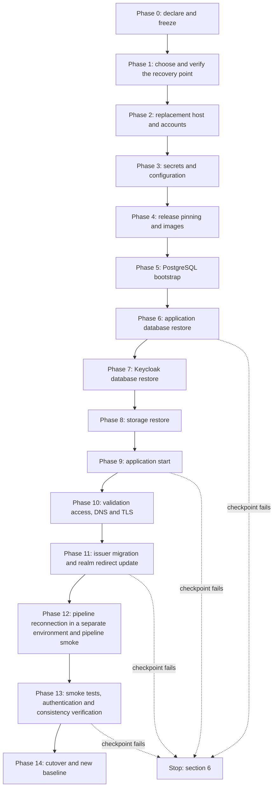

# Complete recovery sequence: proposed design and rehearsal plan

> **Owner role:** Infrastructure and deployment
> **Status:** PLANNED — design only, not implemented, not rehearsed
> **Language / اللغة:** English · [العربية](complete-recovery-sequence-ar.md)

This page is the design that the BLOCKED box in [backup-restore-disaster-recovery.md](backup-restore-disaster-recovery.md) refers to. It describes one complete, ordered way to bring the Matbakhy Preview back on a replacement server from backups of all three data stores (application database, Keycloak database, object storage), with a validation checkpoint after every phase, and a rehearsal plan that would prove it. It is a proposal for the owner and an authorized administrator. **Nothing on this page has been executed, and several tools it needs do not exist yet.** Disaster recovery therefore stays NOT VERIFIED and BLOCKED until the missing tooling is built, reviewed and rehearsed with recorded evidence (section 8).

Related pages: [contabo-server-inventory.md](contabo-server-inventory.md), [server-rebuild-guide.md](server-rebuild-guide.md), [deployment-pipeline.md](deployment-pipeline.md), [runtime-architecture.md](runtime-architecture.md), [dns-https-sslip-io.md](dns-https-sslip-io.md) and [admin-readonly-verification.md](admin-readonly-verification.md).

## Evidence legend

| Label | Meaning on this page |
|---|---|
| VERIFIED LIVE | Observed on the Contabo VPS by the non-privileged user `aiagent` on 2026-10-21 (read-only). |
| VERIFIED IN CODE | Read in the repository file named next to the claim. It proves what the code does when it runs, not that a run happened. |
| DOCUMENTED ONLY | A repository document or an upstream product manual says it; it was not confirmed. |
| OUTDATED / INCORRECT | Conflicts with newer evidence, for example Hetzner-era text. |
| NOT VERIFIED | Nobody has confirmed it; the page says how an authorized administrator can. |
| PROPOSED | A design element or command that does not exist in the repository. It must be built, reviewed and rehearsed before anyone relies on it. |

## 1. Scope and status

> **STATUS: PLANNED / NOT VERIFIED.** The sequence below is a design. No phase was run, no checkpoint was exercised, and no recovery time was measured. This machine has no Docker access, so no rehearsal could be executed while writing it. Complete-service recovery stays BLOCKED (see the backup page, section 7) until the tooling listed as missing in the table below exists and a rehearsal passes with evidence.

The data in the Preview is meant to be synthetic only; that is the required operating policy, and nothing here is approved for real data. The actual contents of the live databases, identity store and storage are NOT VERIFIED (the live checks show configuration flags only). The design is written to be safe for synthetic data and reusable for an environment with real data later.

| Building block | State | Evidence |
|---|---|---|
| Application database dump, checksum, manifest, scratch restore, reconciliation | Exists | VERIFIED IN CODE: `scripts/db-backup.sh`, `scripts/db-restore.sh`, `infra/db/reconcile.sql`, `deploy/web-preview/deploy.sh` (`backup_db`, `verify_backup`, `restore_db`) |
| Storage archive (tar of the storage volume) | Exists, without checksum, manifest or restore command | VERIFIED IN CODE: `deploy/web-preview/deploy.sh` (function `backup`) |
| Keycloak database dump | Exists only as a side effect of `admin-console.sh enable`, `migrate-mfa.sh backup` and `owner-e2e-provision.sh apply`; not part of the verified backup | VERIFIED IN CODE: `deploy/web-preview/admin-console.sh`, `deploy/web-preview/migrate-mfa.sh`, `deploy/web-preview/owner-e2e-provision.sh` |
| Release history with image digests, rollback planner | Exists | VERIFIED IN CODE: `deploy/web-preview/deploy.sh` (`record_release`, `rollback_plan`) |
| Secret generation and rendering of realm and storage configuration | Exists | VERIFIED IN CODE: `deploy/web-preview/deploy.sh` (`init_secrets`, `render`) |
| Smoke test | Exists | VERIFIED IN CODE: `deploy/web-preview/smoke.sh` |
| Local rehearsal of the stack on one machine (not a recovery rehearsal) | Exists | VERIFIED IN CODE: `scripts/rehearse-preview.sh` |
| Restore of the Keycloak database before identity first starts | Missing | PROPOSED (IB-04) |
| Bootstrap that starts PostgreSQL alone and lets a deploy continue with an empty application database | Missing | PROPOSED (IB-01, IB-02) |
| Storage archive checksum, manifest and restore command | Missing | PROPOSED (IB-05) |
| One backup set that ties the three stores together, with a safe ordering | Missing | PROPOSED (IB-06) |
| Off-server copy, schedule and retention | Missing | PROPOSED (IB-07, IB-14) |
| Coordinated cutover tooling and validation scripts | Missing | PROPOSED (IB-09, IB-13) |
| A recovery rehearsal | Never done | NOT VERIFIED |

## 2. Assets inventory

Everything below must exist, or be re-creatable, on the replacement server. Names only; values are never written on this page.

| Asset | Where it lives | Recoverable from | If it is lost | Evidence |
|---|---|---|---|---|
| Application database `matbakhy` (orders, accounts, ledger, audit, media records) | Volume `postgres-data` | Application dump from `deploy.sh backup` | Data since the last good dump is lost | VERIFIED IN CODE: `deploy/web-preview/compose.yaml`, `deploy/web-preview/deploy.sh` |
| Roles `matbakhy`, `matbakhy_app`, `keycloak` and their grants | Same PostgreSQL instance | Created at first start of an empty data directory by init scripts; runtime grants re-applied by Flyway after every migration | Roles are re-created only with an empty data directory; a restored data volume keeps the old role passwords | VERIFIED IN CODE: `deploy/web-preview/postgres/10-keycloak.sh`, `deploy/web-preview/postgres/20-runtime-role.sh`, `backend/app/src/main/resources/db/migration/afterMigrate.sql` |
| Keycloak database `keycloak` (realm state, users, credentials, one-time-password enrolments, master realm hardening, the operations client) | Same PostgreSQL instance | A Keycloak dump (not part of `deploy.sh backup`), or a fresh import of the realm file | Without a dump only the realm file content comes back (synthetic users); later users and enrolments are lost | VERIFIED IN CODE: `deploy/web-preview/identity/matbakhy-realm.preview.json`, `deploy/web-preview/admin-console.sh` |
| Object storage (public bucket `matbakhy-public`, private bucket `matbakhy-private`; meal photos and cook documents) | Volume `storage-data` | Storage archive from `deploy.sh backup` | Photos and documents are lost; database rows then point to missing objects | VERIFIED IN CODE: `deploy/web-preview/compose.yaml`, `deploy/web-preview/deploy.sh` (`up` creates the buckets), `backend/app/src/main/resources/db/migration/V6__media_assets.sql` |
| Server-side secrets and keys (section 2.1) | `.env` in the deployment directory, mode 600 | Only an off-server copy of the old `.env` | Some stored data becomes unreadable (section 2.1) | VERIFIED IN CODE: `deploy/web-preview/deploy.sh` (`init_secrets`) |
| Rendered configuration: realm import file, storage identity file, flags directory | `GENERATED_DIR`, mode 700 | Re-created by `deploy.sh render` from `.env` and the repository | Nothing is lost; the admin console stays closed until `admin-console enable` runs again | VERIFIED IN CODE: `deploy/web-preview/deploy.sh` (`render`) |
| Release history and change lock | `BACKUP_DIR` (`releases.log`, `.preview-mutation.lock`, `metrics`) | Copy of `BACKUP_DIR` | The digests of the running release are lost; `rollback-plan` has nothing to read | VERIFIED IN CODE: `deploy/web-preview/deploy.sh` (`release_log`, `up`) |
| Public names, DNS and TLS | Hostnames app, ops, api, id, kc-admin and media under `PREVIEW_DOMAIN`; certificates in volume `caddy-data` | DNS control or the same IP address; certificates are re-issued | New certificates are requested automatically; the sslip.io names follow the IP address written in the name | VERIFIED LIVE: the names resolve to 167.86.90.174; VERIFIED IN CODE: `deploy/web-preview/Caddyfile`; see [dns-https-sslip-io.md](dns-https-sslip-io.md) |
| GitHub Actions connectivity: environment `preview`, secrets `STAGING_SSH_HOST`, `STAGING_SSH_USER`, `STAGING_SSH_KEY`, `STAGING_SSH_HOST_PUBKEY`, concurrency group `matbakhy-preview-deploy` | GitHub repository settings | Re-created by hand | The pipeline cannot reach the new server until they are replaced | VERIFIED IN CODE: `.github/workflows/deploy-preview.yml`; the secret values and the SSH user are NOT VERIFIED |
| Container images: API and front images by digest in GitHub Container Registry, third-party images by digest in `compose.yaml` | Registries | `releases.log` (our two digests) and `compose.yaml` (the others) | The release cannot start if a digest is no longer pullable; whether the registry keeps old digests is NOT VERIFIED | VERIFIED IN CODE: `deploy/web-preview/compose.yaml`, `.github/workflows/deploy-preview.yml` |
| Logs, metrics, alert state, Grafana data | Six observability volumes | Not recovered | History is lost; the services start empty | VERIFIED IN CODE: `deploy/web-preview/compose.yaml` |

### 2.1 Keys and secrets: which loss makes which data unreadable

The values are generated into `.env` by `deploy.sh init-secrets` and exist nowhere else in the repository (VERIFIED IN CODE). The full table with code references is in the backup page, section 4; this is the part that matters for ordering.

| Name | What becomes unreadable or unusable if it is lost or replaced | Evidence |
|---|---|---|
| `HANDOVER_ENCRYPTION_KEY` | Stored handover-code ciphertexts cannot be decrypted | VERIFIED IN CODE: `backend/modules/orders/src/main/java/com/matbakhy/orders/internal/HandoverCodes.java` |
| `HANDOVER_HASH_KEY` | Handover codes of existing orders can no longer be verified | VERIFIED IN CODE: same class |
| `PUSH_TOKEN_ENCRYPTION_KEY` and `PUSH_TOKEN_HASH_KEY` | Stored push tokens cannot be read or looked up | VERIFIED IN CODE: `backend/modules/notifications/src/main/java/com/matbakhy/notifications/internal/TokenVault.java` |
| `ACTIVITY_HASH_KEY` | Stored visitor hashes no longer match new events (continuity of per-visitor counting is lost, an inference) | VERIFIED IN CODE: `backend/modules/catalog/src/main/java/com/matbakhy/catalog/internal/activity/ActivityService.java` |
| `PHONE_CODE_PEPPER` | Pending phone verification codes cannot be verified (short-lived, small effect, an inference) | VERIFIED IN CODE: `backend/modules/identity/src/main/java/com/matbakhy/identity/internal/PhoneVerificationService.java` |
| `POSTGRES_PASSWORD`, `KEYCLOAK_DB_PASSWORD`, `APP_DB_PASSWORD` | A restored data volume keeps the old role passwords, so the values must match the restored cluster; they are used to create roles only on an empty data directory | VERIFIED IN CODE: `deploy/web-preview/postgres/10-keycloak.sh`, `deploy/web-preview/postgres/20-runtime-role.sh` |
| `OIDC_WEB_CLIENT_SECRET`, `OIDC_ADMIN_CLIENT_SECRET`, `KEYCLOAK_OPS_CLIENT_SECRET` | After a Keycloak restore the realm holds the secrets of the dump time; the API and the operator tooling fail to authenticate if `.env` holds different values | VERIFIED IN CODE: `deploy/web-preview/deploy.sh` (`render`), `deploy/web-preview/compose.yaml`; the failure mode itself is an inference |
| `STORAGE_ACCESS_KEY`, `STORAGE_SECRET_KEY` | Rendered into the storage identity file; objects stay readable if both are replaced consistently and `render` runs | VERIFIED IN CODE: `deploy/web-preview/storage/s3.json.template` |
| `KEYCLOAK_ADMIN_USER`, `KEYCLOAK_ADMIN_PASSWORD`, `PREVIEW_USER_PASSWORD`, `GRAFANA_ADMIN_PASSWORD` | Re-settable; not data loss | VERIFIED IN CODE: `deploy/web-preview/compose.yaml`, `deploy/web-preview/deploy.sh` |

The two handover keys and the push-token keys decide whether encrypted rows stay readable. The code contains no re-encryption or key-rotation tool (VERIFIED IN CODE, by search in the backup page). The rule for the design is therefore: **a recovery that must keep data restores the old `.env` as a whole; it never runs `init-secrets` again.** `init-secrets` refuses to overwrite an existing `.env`.

## 3. Backup consistency model

### 3.1 What references what

| Reference | Direction | Where | Evidence |
|---|---|---|---|
| Media records name objects | `media_asset.private_key` and `media_asset.public_key` in the application database point to objects in storage | Application database to storage | VERIFIED IN CODE: `backend/app/src/main/resources/db/migration/V6__media_assets.sql` |
| Deferred deletion | `media_cleanup` rows (bucket, object key, state PENDING, DONE, FAILED or SKIPPED_REFERENCED) name objects to delete | Application database to storage | VERIFIED IN CODE: `backend/app/src/main/resources/db/migration/V30__media_cleanup.sql`, `backend/modules/catalog/src/main/java/com/matbakhy/catalog/internal/media/MediaCleanup.java` |
| Accounts name identities | `app_user.issuer` and `app_user.subject` (unique together) name the Keycloak user | Application database to Keycloak | VERIFIED IN CODE: `backend/app/src/main/resources/db/migration/V1__baseline_identity_and_idempotency.sql` |
| Identity does not name application data | Keycloak stores users and clients; no application object key or storage key is expected in it | None | NOT VERIFIED: an inference from the realm file, which defines clients and users |

Two kinds of mismatch can appear when the stores are captured at different moments.

- An **orphan** is an object in storage that no database row references. It is harmless: it costs space only. By design the code writes an object before the approval that references it commits and registers a cleanup row for it in its own transaction (`enqueueUnlessApproved` in `MediaCleanup`), and the cleanup job never deletes an object that an active asset still references (`runDue`). An orphan whose cleanup row is missing from the restored database simply stays.
- A **dangling reference** is a committed database row (state QUARANTINED or APPROVED) whose object is missing in storage. It is harmful: a public photo address would answer an error, and a private document would be unavailable. This is what the consistency model must avoid.
- An **outstanding or expired upload ticket** is a row in the state PENDING_UPLOAD. `MediaService.createTicket` inserts it, with `ticket_expires_at`, before the client uploads anything (VERIFIED IN CODE), so a row without an object is normal while the ticket is valid, even with perfectly ordered backups. After the expiry the completion step rejects such a row as `MISSING_OBJECT` (VERIFIED IN CODE: `MediaService`). These rows are therefore not dangling references; these rows are judged by ticket state (Q4), and an interrupted upload is recovered by the client requesting a new ticket (an inference; no such path was exercised).

A restored database can also ask for deletions that no longer match reality: pending `media_cleanup` rows are executed by the running job after the API starts (the job is on by default, property `matbakhy.media.cleanup-job.enabled`, VERIFIED IN CODE). It deletes only objects no active asset references, so it cannot create a dangling reference by itself, but it is a background writer on storage during validation (see IB-10).

### 3.2 Safe backup ordering

The recovery point is a set, not a single file. The order below keeps references resolvable only under the conditions stated in each step; steps 2 and 3 are conditional guarantees, not unconditional ones.

1. **Application database first.** `deploy.sh backup` already does this (`backup_db`, then the storage archive). The dump is one consistent snapshot of the whole application database, so orders, ledger, audit and media records agree with each other (VERIFIED IN CODE: `pg_dump` in `scripts/db-backup.sh`; snapshot semantics DOCUMENTED ONLY).
2. **Keycloak database second, with identity mutations frozen.** Every application account is created after its Keycloak user exists (the first successful sign-in creates the row, VERIFIED IN CODE: `JdbcAccountDirectory`, cited in the backup page). A Keycloak dump taken after the application dump therefore contains every identity that the application dump references, **provided no identity was deleted in between**. Stopping the API does not guarantee that proviso: `JdbcAccountDirectory` proves the creation order, not identity retention, and Keycloak administrators and the identity scripts (`admin-console.sh`, `migrate-mfa.sh`, `owner-e2e-provision.sh`) can delete or replace users independently of the API. The ordering is therefore a guarantee only while identity mutations are frozen from before the application dump until after the Keycloak dump (no console or script use, no provisioning), and the freeze must be recorded in the set manifest. The extra identities in a newer Keycloak dump are harmless: they get an empty application account at their next sign-in. This argument is an inference from the account-creation rule, NOT VERIFIED by a test; the mismatch handling is in step 4.
3. **Storage archive last, with all object deletions frozen.** Storage newer than the database gives orphans only. Storage older than the database would give dangling references for every committed upload in between. The code already takes the storage archive after the database dump. The deleted-between case below stays open unless every object deletion is frozen during capture (section 3.3). Holding the background cleanup job alone is not a freeze: `MediaService.delete` removes the private and public objects synchronously inside the API request (VERIFIED IN CODE), so the freeze must stop or drain API writes.
4. **Mismatch handling.** If, after recovery, the check Q9 finds an application account whose Keycloak user is missing (an identity deleted between captures, or a freeze that was not kept), do not create accounts by hand and do not delete the application account. Stop at CP-13, record the subjects only (never names or contact data), and take the owner's decision between: recreating the Keycloak user with the original subject id so the account keeps its history (whether Keycloak accepts a chosen id in this setup is NOT VERIFIED); an owner-approved reassociation of the application account to a new subject; or leaving the account unreachable. The rehearsal includes a case that deletes a synthetic user between the application dump and the Keycloak dump (RS-15).

The narrow remaining case: an asset that was committed (QUARANTINED or APPROVED) when the database was dumped and was deleted (and its object removed, either synchronously by `MediaService.delete` or later by the cleanup job) before the archive was taken is a dangling reference in the restored set. The post-recovery reference check (Q4 in section 5) finds it. Freezing all object deletions during capture closes it (section 3.3).

### 3.3 Quiescing options

| Option | How | Cost | Closes which gap | State |
|---|---|---|---|---|
| None, as today | API keeps running; storage stopped for the tar only | Uploads are expected to fail while storage is stopped (a code comment says about a minute; the duration is unmeasured and depends on archive size and host performance, and the effect on uploads is an inference); the deleted-between case and the identity gap stay open | Nothing extra | VERIFIED IN CODE: `deploy/web-preview/deploy.sh` (`backup`) |
| Stop the API and freeze identity mutations during the whole backup set | Stop `api` (this also stops the cleanup job), leave the Keycloak console and the identity scripts unused, run the three captures, start `api` | Whole-site write outage for the duration (dump, verification restore, Keycloak dump, tar) plus an administrative freeze that nothing enforces | The gaps between database, Keycloak and storage; the Keycloak gap only while the freeze is kept, because stopping `api` does not stop Keycloak administrators or scripts | PROPOSED (IB-06); duration NOT VERIFIED |
| Hold the background cleanup job during capture | Disable the cleanup job through its property for the window | Needs a configuration change and an API restart. It is not a deletion freeze: synchronous deletes through the API continue, so it must be combined with stopping or draining API writes for the whole capture | Only the job's share of the deleted-between case; the whole case closes only together with the API stop above | PROPOSED (IB-10) |
| Take the three captures back to back, in the order of section 3.2, and record all three timestamps | One command that writes one manifest | Small; keeps the site up | Reduces the window, does not close it | PROPOSED (IB-06) |

The first implementation should use the last row (small, no outage). The owner decides whether the stop-the-API option is acceptable for the Preview and for any future real-data environment (OD-5).

### 3.4 Checksums and manifests

- The application dump already has a SHA-256 file and a manifest with the schema version and the row counts of the nine tables (VERIFIED IN CODE: `scripts/db-backup.sh`).
- The Keycloak dump and the storage archive have no checksum and no manifest (VERIFIED IN CODE, absence). Required (IB-05, IB-06): a SHA-256 for each file, the object count and byte total of the archive, the dump timestamps, and one backup-set manifest that names the application dump folder, the Keycloak dump, the storage archive, the schema version, the release line from `releases.log`, and a fingerprint of the `.env` (a hash only, never contents), and the identity-freeze record.
- The counts of the existing manifest are not a snapshot of the dump. `scripts/db-backup.sh` runs `pg_dump` first and then reads the schema version and each count through separate connections (VERIFIED IN CODE), so with concurrent writes the counts can differ from the dump contents, and a restore comparison can fail or compare against the wrong numbers. Quiescing writes (section 3.3) avoids it today. Proposed (IB-06): take the metadata inside the same snapshot as the dump (for example one transaction with an exported snapshot that `pg_dump` and the count queries share), or compute the counts from the restored scratch database instead, and test with concurrent writes in the rehearsal (RS-15).
- The timestamps of one run differ by seconds (the backup page explains the three timestamps), and no file records which archive belongs to which dump folder. Pairing by time proximity is only an uncertain reconstruction: the backup does not hold the shared mutation lock and the timestamps are independent, so another backup or a deploy can interleave. Multi-store recovery is reliable only when a recorded set association exists, which is the backup-set manifest (IB-06); until then the pairing is a guess to be confirmed, not a rule.

### 3.5 Off-server copy

Backups in `BACKUP_DIR` share the fate of the server (VERIFIED IN CODE: nothing copies them; DOCUMENTED ONLY in [06-web-preview.md](../../operations/06-web-preview.md)). A recovery sequence is not valid without an off-server copy of the whole set and of the `.env`. The design requires an encrypted copy at a destination chosen by the owner (OD-2), written after the set is verified, with a retrieval test as part of the rehearsal. Backups hold personal data in a real environment, so the copy is encrypted and access is limited; the destination, key handling and retention are owner decisions that this page does not make.

### 3.6 Proving a backup is restorable without touching production

The scratch restore of the application database already exists: `backup_db` restores the dump into `matbakhy_restore_check`, reconciles it, and drops it (VERIFIED IN CODE). The same idea is required for the other two stores, always on the machine that holds the backup and never against the live data:

- Keycloak dump: restore into a scratch database `keycloak_restore_check`, count the tables, and check that the realm `matbakhy` is present (PROPOSED, IB-03).
- Storage archive: list it, compare the object count and bytes with the manifest, and extract it into a scratch directory or scratch volume (PROPOSED, IB-05).
- The whole set: the full rehearsal of section 8 is the only proof that the set is sufficient.

## 4. Restoration sequence



The diagram reads top to bottom. Every phase has an action step, in which its state-changing commands run, and ends with a validation checkpoint (CP-00 to CP-14) that only inspects the recorded results; the next phase does not start until the checkpoint passes. The dotted lines show the four places where a failure is most likely to need a decision; every checkpoint has a stop condition and a return path in section 6. The order is forced by the code: PostgreSQL must run before either database can be restored (phase 5), the Keycloak database must be restored before the identity service first starts (phase 7 before phase 9), the application database must hold tables before `deploy.sh up` takes its pre-deploy backup (phase 6 before phase 9), and the issuer and redirect addresses must be correct (phase 11) before any sign-in test or pipeline smoke (phases 12 and 13).

Placeholders: `<deploy-dir>` is the deployment directory (on the live host `/srv/matbakhy-staging/deploy/web-preview`, VERIFIED LIVE; on a replacement server a path of your choice), `<backup-dir>` is `BACKUP_DIR` from `.env`, which is `/backups` inside the PostgreSQL container. All commands run on the replacement server (K10 and K17 run on the machines named in their rows), never on the live Preview.

### 4.1 Phases

| Phase | Purpose | What happens | Tooling |
|---|---|---|---|
| 0 | Declare and freeze | The owner or a delegate declares the disaster and writes down the time (start of the recovery-time clock). Stop automatic deployments to the lost host (pause the workflow `deploy-preview.yml` in GitHub, a manual action that needs authorization). Do not delete or reinstall the old host; keep every surviving copy untouched | Manual |
| 1 | Choose and verify the recovery point | Locate the newest backup set that survived off the lost host: application dump folder, Keycloak dump, storage archive, `releases.log`, the old `.env`. Verify the checksums. Pick a release whose migrations are at least as new as the dump's schema version | Partly exists (`sha256sum -c`); the set manifest is PROPOSED |
| 2 | Replacement host and accounts | Build the host, the operator account, the directories (including `<backup-dir>/metrics`), Docker and ports 80 and 443 as in [server-rebuild-guide.md](server-rebuild-guide.md). Do not give `aiagent` sudo or Docker access | Exists as documentation, NOT EXECUTION VERIFIED |
| 3 | Secrets and configuration | Place the old `.env` (mode 600, operator-owned) over a secure channel. Decide the domain and the validation method (section 4.4). Set `GENERATED_DIR`, `BACKUP_DIR` and the access lists for the new host. **Action:** run `deploy.sh render` (K2). It writes files under `GENERATED_DIR` and can append two client secrets to `.env` when an old `.env` lacks them, so CP-03 only inspects the result | Exists |
| 4 | Release pinning and images | Put `RELEASE_COMMIT`, `API_IMAGE` and `FRONT_IMAGE` into `.env` (digests, from `releases.log` or a new build). Pull and inspect the images. Docker Compose validates the required variables of the whole file even when only one service starts (standard Compose behaviour, DOCUMENTED ONLY), so these values must be present before phase 5 | Exists (`deploy.sh up` checks digests); image availability is NOT VERIFIED |
| 5 | PostgreSQL bootstrap | Start PostgreSQL alone so the init scripts create the roles and the empty databases `matbakhy` and `keycloak` (section 4.2) | Standard Docker command exists; the supported bootstrap is PROPOSED (IB-01, IB-02) |
| 6 | Application database restore | **Action:** restore the dump into `matbakhy_restore` and reconcile (K4), then swap the empty `matbakhy` away (K5). CP-06 inspects the recorded results and captures the recovery-point evidence (Q7 and the markers) before the API has ever started | Restore exists; the swap is DOCUMENTED ONLY |
| 7 | Keycloak database restore | **Action:** restore the Keycloak dump into the empty `keycloak` database while the identity service has never started (K6, section 4.3) | PROPOSED (IB-04) |
| 8 | Storage restore | **Action:** extract the storage archive into the empty storage volume while the storage service is stopped (K7) | PROPOSED (IB-05) |
| 9 | Application start | **Action:** run `deploy.sh up` (K8): Flyway applies newer migrations, Keycloak finds existing data and skips the import, storage and proxy start. The checks are internal; no public name is needed yet | Exists |
| 10 | Validation access, DNS and TLS | **Action:** set up the chosen validation method (section 4.4): own hostnames for the replacement, or a local name override from allow-listed validators; Caddy requests certificates only for names that resolve to the replacement. The real public names stay where they are | Exists as documentation; the same-name method is PROPOSED |
| 11 | Issuer migration and realm redirect update | **Action:** with the API stopped and fresh restore points, run K15 (rewrite `app_user.issuer`) and K16 (update the client redirect addresses), then start the API (section 4.4). Skipped, with a recorded reason, when the domain did not change. Required before any sign-in test or pipeline smoke | PROPOSED (IB-11) |
| 12 | Pipeline reconnection in a separate environment and pipeline smoke | **Action:** in the rehearsal repository, which must be a separate repository or carry an explicitly modified isolated copy of the workflow (IB-12) that omits the final console step (section 4.4), because `deploy-preview.yml` hard-codes `environment: preview` and has no environment input, so a temporary GitHub environment cannot be selected (VERIFIED IN CODE), replace the four secrets, the host key and the allow-lists, then dispatch the workflow on `develop` and wait for the Product CI of the exact commit (K17). The real environment `preview` changes only in phase 14 (section 4.5) | Exists as documentation |
| 13 | Smoke tests, authentication and consistency verification | **Action:** run `deploy.sh smoke` (K10), the owner journeys with sign-in, and the read-only checks of section 5 | Smoke exists; the checks are PROPOSED (IB-09) |
| 14 | Cutover and new baseline | **Action:** move public traffic (the DNS change of the same-name path, or adoption of the new names), reconnect the real environment `preview` (G1 to G5 of the backup page, with authorization), reopen automation, run the baseline backup (K11) and copy it off-server, record the measured times | Exists in parts |

### 4.2 The pre-deploy backup problem and the required bootstrap

Reviewers found a trap in the order of operations. **`deploy.sh up` takes a pre-deploy backup whenever a PostgreSQL container is already running** (`compose ps -q postgres` is not empty, VERIFIED IN CODE: function `up`). `backup_db` then runs `scripts/db-backup.sh` and `verify_backup`. On a PostgreSQL that holds only the empty `matbakhy` database, the dump is empty and the manifest and reconciliation steps query application tables (`customer_order` and others) that do not exist. The restore verification step runs those queries under `set -e` and is expected to stop (derived from reading `scripts/db-restore.sh` and `infra/db/reconcile.sql`). Because `up` runs `backup_db` before it starts anything, `up` is expected to stop before the application starts. Which line fails first is not important for the design; that `up` does not complete is. This is derived from the code and was never run (NOT VERIFIED).

On a first install this does not happen, because no PostgreSQL container runs before the first `up`. It happens exactly in the recovery case, where PostgreSQL must be started first so the databases can be restored.

**Required design (PROPOSED, IB-01 and IB-02).**

1. A supported bootstrap command (a `recover-bootstrap` subcommand of `deploy.sh`) that: loads `.env`, runs `render`, starts only the `postgres` service, waits for its health check, and prints the next steps. It does not run the pre-deploy backup. Until it exists, the equivalent standard command is `docker compose up -d postgres` run in `<deploy-dir>`, which needs a complete `.env` (all release values set) because Compose validates every service.
2. The required order is **restore first, then `up`**: restore the application database (phase 6) and the Keycloak database (phase 7) before the first `deploy.sh up`. Then PostgreSQL holds application tables when `up` runs, its pre-deploy backup works, and that backup doubles as evidence that the restored database is dumpable and restorable.
3. A guard in `up` for the remaining case: if the running PostgreSQL has an application database with zero tables, `up` must either refuse with a clear message that names the bootstrap command, or skip the pre-deploy backup only when an explicit recovery flag is set, and in that case record the skip in `releases.log`. It must never skip the backup silently on a populated database. This guard needs a test with a stubbed Docker command, in the style of `scripts/test_preview_backup.py`.

An alternative that needs no new command is to run a normal first `up` (nothing is running, so no pre-deploy backup), then stop the API and identity services, swap in the restored application database, drop and restore the `keycloak` database, and start again. It uses only existing commands, but it first imports a fresh realm and creates a second, divergent identity state that is then discarded, and it starts the application against the wrong data for a short time. It is listed as a fallback, not as the design (NOT VERIFIED either way).

### 4.3 Keycloak: restored state versus a fresh import

Keycloak starts with `start --import-realm` and the rendered realm file (VERIFIED IN CODE: `deploy/web-preview/compose.yaml`). Keycloak's documented behaviour is to skip the import when the realm already exists in the database (DOCUMENTED ONLY).

| Aspect | Restore the Keycloak database before identity first starts | Fresh import of the realm file |
|---|---|---|
| Users | All users that existed at the dump time | The five synthetic users with the fixed ids of the realm file; those ids equal the subjects in `deploy/web-preview/seed-preview.sql` (VERIFIED IN CODE) |
| Users created later (for example by `owner-e2e-provision.sh apply`) | Present if created before the dump | Lost; those people cannot sign in until their Keycloak user is explicitly recreated (the import does not recreate them, and the application creates no account without a successful sign-in); a user recreated with a new subject gets a new empty application account and the old rows stay orphaned (VERIFIED IN CODE: account resolution by issuer and subject) |
| One-time-password enrolments, passwords changed after import | Kept | Lost; synthetic users get `PREVIEW_USER_PASSWORD` again |
| Sessions | Not assumed to survive; whether Keycloak sessions are persisted in this configuration is NOT VERIFIED | New |
| Client secrets | Those of the dump time; `.env` must match | Those in `.env` at render time (consistent by construction) |
| Redirect addresses | Those of the dump time; if the domain changed they are wrong and must be updated (section 4.4) | Written from the new `PREVIEW_DOMAIN` |
| Master realm hardening, operations client, admin console switch | Kept in the database; the switch file in `GENERATED_DIR/flags` is not (render creates an empty directory) | Gone; run `./deploy.sh admin-console enable` again |
| Evidence | NOT VERIFIED: no restore procedure for the dump exists or was rehearsed | VERIFIED IN CODE for the import path; first-start behaviour not rehearsed |

Restore mechanics (PROPOSED, IB-04). The init script creates an empty database `keycloak` owned by the role `keycloak`. The dumps are custom-format dumps made by the superuser role `matbakhy` without `--no-owner` (VERIFIED IN CODE: `pg_dump -U ... -Fc keycloak` in `admin-console.sh`). The restore is a `pg_restore` into that empty database as the same superuser while identity has never started, so object ownership returns to `keycloak`. The restore command must refuse a non-empty `keycloak` database and refuse to run while the identity container exists. Whether the dump restores cleanly into the database that the init script created (for example regarding the `public` schema) is NOT VERIFIED and is one of the first things the rehearsal answers.

### 4.4 Domain, new IP address and what changes

The Preview hostnames end in `167-86-90-174.sslip.io`, which resolves to the IP address written in the name (VERIFIED LIVE). A replacement server has another IP address, so recovering under sslip.io means a new `PREVIEW_DOMAIN`. That changes four things together (all VERIFIED IN CODE):

- the OIDC issuer `https://id.<domain>/realms/matbakhy` and, with it, the account key: `app_user.issuer` of every existing row holds the old issuer, so after a domain change existing accounts no longer match and users would get new empty accounts unless an owner-approved migration rewrites the issuer (none exists; only `app_user` carries an issuer column in the migrations; phase 11 and K15 are the proposed place for it);
- the redirect and post-logout addresses inside the realm: a fresh import writes the new ones, a restored Keycloak database keeps the old ones, and the import is skipped, so they must be updated (PROPOSED, IB-11; phase 11, K16);
- the front image, which has the API address compiled in through the build argument `PREVIEW_DOMAIN` (`deploy/web-preview/front.Dockerfile`). The workflow `deploy-preview.yml` hard-codes the argument to the current Preview domain; the manual workflow `preview-images.yml` takes the domain as an input;
- the certificates, which are re-issued for the new names.

The design therefore treats the domain as a decision made in phase 3 (OD-4): keep the same hostnames (a stable domain name under owner control, or the same IP address moved by the provider, NOT VERIFIED as possible), or accept the change and its consequences. For an environment with real people, a stable domain that does not depend on an IP address removes the whole class of problems.

#### Validation access before cutover

Public names must not point at the replacement before CP-13 has passed, yet phases 11 to 13 need working HTTPS names (OIDC discovery, sign-in, pipeline smoke). The owner picks one of two validation methods in phase 3 (OD-4). Both are PROPOSED and NOT VERIFIED.

- **Own hostnames (every rehearsal, and the domain-change path).** The replacement is validated under its own hostnames, the `PREVIEW_DOMAIN` of the replacement. No existing public record changes, and certificates issue normally because those names resolve to the replacement from the start. The final cutover is the decision to adopt those names. The issuer changes with the domain, so phase 11 is mandatory.
- **Same names kept (stable-domain path).** Public DNS for the real names stays on its old target until the cutover in phase 14. Before that, allow-listed validators reach the replacement through a local name override (a hosts-file entry or `curl --resolve`). The certificate authority cannot validate the real names while DNS points elsewhere, so the replacement needs a certificate that does not depend on public DNS: either a DNS-challenge certificate or a temporary internal certificate authority trusted only by the validators. Neither is configured in `deploy/web-preview/Caddyfile`. If neither is built, this path cannot meet the rule: the DNS change then happens at the start of phase 14 with the access lists still closed to everyone but the validators, and the real-name checks of CP-11 to CP-13 are repeated before the lists are opened. The owner must accept that exception (OD-4).

In both methods the access lists (`CUSTOMER_ALLOWED_IPS`, `STAFF_ALLOWED_IPS`) keep the replacement closed to everyone except the validators until phase 14 (VERIFIED IN CODE: the access classes in the Caddyfile).

**Exception: the Keycloak administration console.** The pipeline run of phase 12 ends with a step that runs `./deploy.sh admin-console enable`, which creates the flag file `/srv/flags/admin-console-public`; from then on the host `kc-admin.<domain>` answers from the internet, because the Caddyfile applies no IP allow-list to it (VERIFIED IN CODE: `.github/workflows/deploy-preview.yml`, `deploy/web-preview/Caddyfile`). Design requirement (PROPOSED): during phases 12 and 13 the console stays closed. Do not run that final step against the replacement: the isolated workflow copy of IB-12 omits `admin-console enable`. That omission is the closed-console design, because `enable` creates the flag regardless of any firewall. CP-12 and CP-13 record that the flag file is absent (`./deploy.sh admin-console status` reports closed) and that a request to the console host from a machine that is not a validator answers 404. A firewall that allows port 443 only from the validators until phase 14 is a separate design with its own acceptance criteria: the flag is not the control, and a firewall-blocked outsider gets no answer at all (no Caddy 404), so its checkpoints would test the firewall rule from outside instead. Opening the console on the replacement is a separate owner decision taken after phase 14.

#### Issuer migration and redirect update (phase 11)

This is the ordered design for the two changes that IB-11 proposes. It is required before any sign-in test and before the pipeline smoke, because a sign-in that reaches the application with the new issuer while the old rows still carry the old issuer creates an empty account that then blocks the rewrite. It applies whenever the domain changed; with a stable domain it is skipped, and CP-11 records that Q3 shows the expected issuer unchanged. All of it is PROPOSED.

1. Prerequisites: CP-10 passed; the API stopped (`docker compose stop api`) so that nothing writes accounts; the identity service running; the owner's approval of the rewrite recorded (OD-4); fresh restore points: the verified pre-deploy backup of phase 9 for the application database and a new Keycloak dump taken now (the P1 command of the backup page).
2. K15: rewrite `app_user.issuer` from the old issuer to the new one in a single transaction; it refuses to run when any row with the new issuer already exists.
3. K16: update the redirect, post-logout and web-origin addresses of the clients of the restored realm to the new domain through the Keycloak Admin REST interface with the operations client (the mechanism is NOT VERIFIED); record the old values first so they can be put back.
4. Start the API (`docker compose start api`), wait until it is healthy, then run CP-11.

Rollback: stop the API; undo K15 by restoring the pre-migration dump (the verified pre-deploy backup of step 1) into an empty target database under a new distinct name, stopping all connections to the migrated database, and renaming with names that differ from `matbakhy_restore` and `matbakhy_failed` (phase 6 already consumed them, so repeating K5 as written cannot do this), keeping the migrated database under another name; undo K16 by re-applying the recorded old addresses, or by restoring the Keycloak dump of step 1 into an emptied `keycloak` database while identity is stopped. Never run a sign-in test before CP-11 passes.

### 4.5 GitHub Actions, rehearsal versus cutover

The environment `preview` is used by `deploy-preview.yml` (every push to `develop`, concurrency group `matbakhy-preview-deploy`) and by `owner-e2e-provision.yml` (VERIFIED IN CODE). **Changing its secrets redirects the live automation.** A rehearsal must use a separate repository or an explicitly modified isolated workflow, not a second environment in the live repository, because the workflow has no environment input (section 8). In the real environment the reconnection is part of the cutover (phase 14) and needs authorization; the pipeline smoke of phase 12 runs in the rehearsal repository. The pipeline's deploy step runs `./deploy.sh smoke` on the server, which requests `ops.` from the server's own address, so the staff access list must contain the new server's address (an inference from `deploy-preview.yml` and `smoke.sh`; the proxy behaviour for the server's own address is NOT VERIFIED, and the live results in [contabo-server-inventory.md](contabo-server-inventory.md) were made from the server itself). A manual dispatch (`workflow_dispatch`) must select `develop`: the `deploy` job runs only on `refs/heads/develop`, and the `build` job first waits for a successful push-triggered Product CI run at the exact commit (VERIFIED IN CODE: `.github/workflows/deploy-preview.yml`); a successful image build alone is not a deployment, which ends with the line `DEPLOYED <sha>`.

### 4.6 Commands

| ID | Command | Machine and user | Type | Status | Expected result | Verification | Likely failure and action |
|---|---|---|---|---|---|---|---|
| K1 | `cd <backup-dir>/db-<dir-stamp> && sha256sum -c matbakhy-<dump-stamp>.dump.sha256` | Replacement server, a user who can read `<backup-dir>` | Read-only | VERIFIED IN CODE (`db-restore.sh` runs the same check) | "matbakhy-<dump-stamp>.dump: OK" | Exit code 0 | "FAILED": the dump is damaged; choose an older set (section 6) |
| K2 | `cd <deploy-dir> && ./deploy.sh render` | Replacement server, the operator account | State-changing: writes `GENERATED_DIR` and can append `OIDC_ADMIN_CLIENT_SECRET` and `KEYCLOAK_OPS_CLIENT_SECRET` to `.env` when an old `.env` lacks them (the phase 3 action) | VERIFIED IN CODE | Files `identity/matbakhy-realm.json` and `storage/s3.json` exist under `GENERATED_DIR` | `ls -l <generated-dir>/identity <generated-dir>/storage` | ".env missing": phase 3 incomplete |
| K3 | `cd <deploy-dir> && docker compose up -d postgres` | Replacement server, the operator account | State-changing: starts PostgreSQL and creates the volume | Standard Docker command; the supported wrapper `recover-bootstrap` is PROPOSED | Container `postgres` becomes healthy | `docker compose ps postgres` shows healthy | "variable is not set": `.env` incomplete; fix phase 4 |
| K4 | `cd <deploy-dir> && ./deploy.sh restore-db /backups/db-<dir-stamp>/matbakhy-<dump-stamp>.dump` | Replacement server, the operator account | State-changing but never touches `matbakhy`: creates `matbakhy_restore` | VERIFIED IN CODE | Lines "OK <check>" for each check, no manifest warning, final "RECONCILED matbakhy_restore" | Same output; a missing manifest is not an acceptance | "checksum mismatch" or "NOT RECONCILED": do not use it (section 6) |
| K5 | `cd <deploy-dir> && docker compose exec -T postgres psql -U matbakhy -d postgres -c "ALTER DATABASE matbakhy RENAME TO matbakhy_failed" -c "ALTER DATABASE matbakhy_restore RENAME TO matbakhy"` | Replacement server, the operator account | **DESTRUCTIVE in effect**: renames the empty application database away | DOCUMENTED ONLY (the backup page, step S2) | Both renames succeed | K13 lists `matbakhy` and `matbakhy_failed` | "being accessed by other users": nothing else may be running in this phase; find the connection, do not force it |
| K6 | `cd <deploy-dir> && docker compose exec -T postgres pg_restore -U matbakhy --exit-on-error -d keycloak /backups/keycloak/keycloak-db-<stamp>.dump` | Replacement server, the operator account | State-changing: fills the empty `keycloak` database | PROPOSED (IB-04) | No error output | Table count query of CP-07 is above 0 | "database is not empty" or ownership errors: stop; do not start identity (section 6) |
| K7 | `cd <deploy-dir> && docker compose run --rm --no-deps -v "<backup-dir>:/backups" --entrypoint tar storage xzf /backups/storage-<archive-stamp>.tgz -C /data` | Replacement server, the operator account | **DESTRUCTIVE to the volume content it overwrites** | PROPOSED (IB-05); mirrors the existing archive command | Files appear in the storage volume | CP-08 listing and counts | Wrong archive or running storage service: stop and re-check |
| K8 | `cd <deploy-dir> && ./deploy.sh up` | Replacement server, the operator account | State-changing: renders, takes the pre-deploy backup, pulls missing images, starts everything | VERIFIED IN CODE | "up: <commit> (schema A -> B)" and a new line in `releases.log` | K9 | "another preview change holds ...": wait. "API did not become healthy": read the printed API and identity logs |
| K9 | `cd <deploy-dir> && ./deploy.sh status` | Replacement server, the operator account | Read-only | VERIFIED IN CODE | Containers, schema version, configured release values, last releases | Schema equals the highest migration of the chosen release | Permission denied on the Docker socket: not an authorized operator |
| K10 | `cd <deploy-dir> && ./deploy.sh smoke` | A machine in an allowed address range | Read-only HTTPS checks | VERIFIED IN CODE | Exit code 0 | Exit code | A 403 "Not available" from the proxy is an access-policy answer, not an outage |
| K11 | `cd <deploy-dir> && ./deploy.sh backup` | Replacement server, the operator account | State-changing: writes files, stops storage briefly | VERIFIED IN CODE | "backup verified: ... restored and reconciled" | The backup page, commands R4 and R5 | Restore check fails: do not trust that dump |
| K12 | `cd <deploy-dir> && docker compose exec -T postgres psql -X -At -F ' ' -U matbakhy -d matbakhy -f /reconcile.sql` | Replacement server, the operator account | Read-only | VERIFIED IN CODE (`/reconcile.sql` is mounted by `compose.yaml`) | Ten lines, each with violations 0 | Every number is 0 | A non-zero line: stop; section 6 |
| K13 | `cd <deploy-dir> && docker compose exec -T postgres psql -U matbakhy -d postgres -At -c "SELECT datname FROM pg_database ORDER BY 1"` | Replacement server, the operator account | Read-only | Standard PostgreSQL command | The expected database names for the phase | Compare with the checkpoint | Connection refused: PostgreSQL is not healthy |
| K14 | `ss -tlnp` | Replacement server, a user who may read sockets | Read-only | Standard tool | Ports 22, 80 and 443 listening as expected (443 and 80 only after the proxy starts) | Compare with the checkpoint | A port taken by another process: stop |
| K15 | `deploy.sh migrate-issuer <old-issuer> <new-issuer>` (hypothetical subcommand) | Replacement server, the operator account | **DESTRUCTIVE in effect**: rewrites `app_user.issuer` | PROPOSED (IB-11) | The updated row count equals the count of rows with the old issuer; no row keeps the old issuer | Q3 shows only the new issuer (and `preview-seed`) | "new issuer already present": stop; a sign-in created an account; decide with the owner (section 6) |
| K16 | `deploy.sh update-redirects <new-domain>` (hypothetical subcommand) | Replacement server, the operator account | State-changing: updates redirect, post-logout and web-origin addresses in the restored realm | PROPOSED (IB-11) | The listing of the clients' addresses contains only the new domain | The client listing read by CP-11 | Admin API refused: compare `KEYCLOAK_OPS_CLIENT_SECRET` with the restored realm (section 2.1) |
| K17 | `gh workflow run deploy-preview.yml --ref develop` then `gh run watch <run-id>` | An authorized machine with the GitHub CLI, for the rehearsal repository or its isolated workflow, never the `preview` environment of the live repository | State-changing: builds images and deploys to the host of that environment | VERIFIED IN CODE (workflow); the use for recovery is NOT VERIFIED | The run ends with the line `DEPLOYED <sha>` after the build job waited for the Product CI of the exact commit | The run log read by CP-12 | "Product CI failed" or a timeout: the commit has no successful push CI run; "deploy skipped": the ref was not `develop` |

### 4.7 Validation checkpoints

Each checkpoint is read-only: it inspects the results that the phase action recorded and changes nothing. The state-changing commands (K2 to K8, K11, K15 to K17, the DNS and secret changes) are phase actions and run before the checkpoint, never inside it. The only exception is a temporary container started with `--rm` for a listing, which is labelled in its row. Record the time (`date -u +%Y-%m-%dT%H:%M:%SZ`) and the output in the evidence folder (section 8.5). **If the stop condition is met, stop; do not continue to the next phase.**

| ID | After phase | Read-only check | Expected evidence | Stop condition |
|---|---|---|---|---|
| CP-00 | 0 | Written note of what survived (names, dates, sizes; no contents) and the declared time | A dated inventory; the list of off-server copies | No usable database dump survives: switch to a clean installation (the backup page, Scenario A) |
| CP-01 | 1 | K1 for the application dump; checksum files for the other items once IB-05 exists; manifest read (schema version, row counts, taken_at); `ls -l` of the Keycloak dump and the archive | "OK" for every checksum; non-zero file sizes; timestamps in the order of section 3.2; schema version not newer than the chosen release's highest migration | A checksum fails; a timestamp order is violated; the chosen release is older than the dump's schema |
| CP-02 | 2 | `docker --version`, `docker compose version`, `id`, `ls -ld <deploy-dir> <backup-dir> <backup-dir>/metrics`, K14, `timedatectl status` | Docker present; the operator account owns the directories; ports 80 and 443 free; clock synchronized | Docker missing; `aiagent` has sudo or Docker access; ports in use |
| CP-03 | 3 | `stat -c '%a %U' .env`; a presence check by name that prints only each name with the word present or MISSING (a read-only loop over the names of section 2.1 that tests each line with `grep -q`; the values are never printed; the proposed tool is IB-08); `grep -c '^[^#]*REPLACE_ME' .env` (comment lines are excluded: `.env.example` carries a comment that mentions the marker, VERIFIED IN CODE); the recorded output of K2 and `ls -l <generated-dir>/identity <generated-dir>/storage` | Mode 600; every name present; zero placeholders outside comment lines; the files exist; the fingerprint of the `.env` after K2 equals the recorded one once IB-06 exists, or the lines that K2 appended are recorded by name | A key is MISSING; the file came from `init-secrets` while the data must stay readable; K2 appended a client secret whose new value cannot match the restored realm (decide before phase 9) |
| CP-04 | 4 | `docker compose config -q`; `docker image inspect --format '{{index .RepoDigests 0}}' <image>` for the API and front images after the pull | Compose accepts the file; digests equal the values in `.env` and in the chosen `releases.log` line | A digest cannot be pulled; the front image was built for another domain than the one chosen in phase 3 |
| CP-05 | 5 | K13; `docker compose exec -T postgres psql -U matbakhy -d postgres -At -c "SELECT rolname FROM pg_roles ORDER BY 1"` | Databases `matbakhy` and `keycloak` (both empty); roles `keycloak`, `matbakhy` and `matbakhy_app` present | An init script failed (read the PostgreSQL log); data directory not empty on first start |
| CP-06 | 6 | The recorded output of K4 and K5; K12; the manifest comparison already inside K4; `SELECT max(version::int) FROM flyway_schema_history WHERE success` after the swap; K13; the recovery-point evidence (Q7 and the markers M1 and M2 of section 8.2) captured now, before the API has ever started | "RECONCILED matbakhy_restore", no manifest warning; K12 all 0; schema equals the manifest; `matbakhy` and `matbakhy_failed` listed; M1 present and M2 absent when the rehearsal markers exist | Mismatch, FAIL or NOT RECONCILED; missing manifest; schema newer than the chosen release; M2 present or M1 absent |
| CP-07 | 7 | The recorded output of K6; count tables in `keycloak` (`SELECT count(*) FROM pg_tables WHERE schemaname = 'public'`); check ownership (`SELECT DISTINCT tableowner FROM pg_tables WHERE schemaname = 'public'`) | Table count above 0; owner `keycloak`. The realm itself is only provable through OIDC discovery in CP-11 | Count is 0; restore errors; owner differs; identity container exists |
| CP-08 | 8 | The recorded output of K7; `tar tzf <backup-dir>/storage-<archive-stamp>.tgz` object count and sizes against the manifest; `docker compose run --rm --no-deps --entrypoint ls storage -la /data` (it creates and removes a temporary container and changes no data: the labelled exception to the read-only rule) | Counts and bytes equal the manifest; volume not empty | Counts differ; archive unreadable |
| CP-09 | 9 | The recorded output of K8; K9; `docker compose ps`; `docker compose logs --tail 80 api identity`; last line of `releases.log`. No public name is used: the checks run on the server | `postgres`, `identity` and `api` healthy (the only services with health checks in `compose.yaml`, VERIFIED IN CODE) and every other service running, their function being confirmed by the functional checks of CP-10 to CP-13; Flyway reports success; the pre-deploy backup of `up` was verified | API unhealthy; migration error; identity logs show a new realm import over restored data |
| CP-10 | 10 | As seen from the validators through the chosen method (section 4.4): `getent hosts app.<domain>` and the other five names (or the local override), `curl -sI https://app.<domain>/`, certificate issuer and dates (`openssl s_client`); from a machine that is not a validator, confirm that the replacement does not answer for the real names and that public DNS for them still points to the old target (same-name path) | The six validation names resolve to the replacement for the validators; valid certificate; no public record for the real names points to the replacement | Name does not resolve; certificate request fails (rate limit, port 80 blocked, or the authority cannot validate the names); the replacement is open to non-validators; a public record already points to the replacement |
| CP-11 | 11 | The recorded output of K15 and K16; the OIDC discovery document of the realm `matbakhy` at the validation hostname; Q3; the read-only listing of the clients' redirect addresses (Admin REST) | The issuer equals `https://id.<domain>/realms/matbakhy`; Q3 shows only that issuer (and `preview-seed`); the redirect listing contains only the new domain; the API is healthy after the restart; or, when the domain did not change, Q3 is unchanged and the skip reason is recorded | Issuer mismatch; any old-domain redirect address; K15 refused because a row with the new issuer existed; a sign-in test was run before this checkpoint |
| CP-12 | 12 | GitHub: list the environment secret names (names only) of the separate environment; the recorded run of K17 on `develop` and its last line `DEPLOYED <sha>`; the `build` job log showing that it waited for Product CI at the exact commit | Four secrets present; a deploy to the new server ends with `DEPLOYED <sha>`; the commit had a successful push Product CI run | Host key mismatch; allow-list blocks the server's own smoke test; the run was not on `develop` or the deploy job was skipped |
| CP-13 | 13 | K10; queries Q1 to Q11 (section 5), Q6 first, before any journey; then the journeys with sign-in in [live-preview-access.md](../05-developer-workflow/live-preview-access.md) | Smoke exit 0; sign-in works for a synthetic customer, a cook and a staff user, each landing on the existing migrated account; every query meets its expectation | Any query fails; a sign-in lands on an empty account; Q9 finds an account without a Keycloak user (section 3.2, step 4) |
| CP-14 | 14 | The recorded output of K11, then the backup page commands R4 and R5; off-server copy retrieval test; the time record | A new verified backup set exists off the new server; times recorded for RTO and RPO | Backup verification fails; copy cannot be retrieved |

## 5. Post-recovery consistency verification

All checks are read-only. Q6 compares with the backup set, so it runs first at CP-13, before the background writers (hold them with IB-10) and before any journey that creates orders; later legitimate changes are validated separately. The checks run after phase 9 (database and Keycloak up) and at CP-13, except the recovery-point evidence (Q7), which is captured at CP-06 before the API has ever started. Run each query with the command pattern `cd <deploy-dir> && docker compose exec -T postgres psql -X -At -U matbakhy -d matbakhy -c "<query>"`. The table and column names below were read in the migration files under `backend/app/src/main/resources/db/migration` (VERIFIED IN CODE); the queries themselves were never run (NOT VERIFIED).

```sql
-- Q1 row counts, compare with the rows.* lines of the manifest
SELECT 'customer_order', count(*) FROM customer_order UNION ALL SELECT 'order_item', count(*) FROM order_item UNION ALL SELECT 'ledger_entry', count(*) FROM ledger_entry UNION ALL SELECT 'cash_obligation', count(*) FROM cash_obligation;
-- Q3 accounts per identity issuer and status
SELECT issuer, status, count(*) FROM app_user GROUP BY issuer, status ORDER BY issuer, status;
-- Q4 committed media records must have an object; PENDING_UPLOAD rows are judged by ticket state
SELECT state, count(*) AS assets, count(public_key) AS with_public_key FROM media_asset GROUP BY state ORDER BY state;
SELECT id, state, private_key, public_key FROM media_asset WHERE state IN ('QUARANTINED', 'APPROVED') ORDER BY created_at;
SELECT id, private_key, ticket_expires_at, ticket_expires_at < now() AS expired FROM media_asset WHERE state = 'PENDING_UPLOAD' ORDER BY ticket_expires_at;
-- Q5 deferred deletions
SELECT state, count(*) FROM media_cleanup GROUP BY state ORDER BY state;
-- Q6 money totals, compare with the totals recorded before the disaster
SELECT (SELECT coalesce(sum(total_minor), 0) FROM customer_order) AS order_total_minor, (SELECT coalesce(sum(amount_minor), 0) FROM ledger_entry WHERE direction = 'DEBIT') AS ledger_debit_minor, (SELECT coalesce(sum(amount_minor), 0) FROM ledger_entry WHERE direction = 'CREDIT') AS ledger_credit_minor;
-- Q7 audit continuity; run at CP-06 before the API starts, never as the only recovery-point evidence
SELECT count(*), min(occurred_at), max(occurred_at) FROM audit_event;
-- Q8 schema version
SELECT max(version::int) FROM flyway_schema_history WHERE success;
-- Q9 subjects of login accounts to compare with the Keycloak user ids (DELETED accounts and the synthetic seed rows are excluded)
SELECT subject FROM app_user WHERE issuer = 'https://id.<domain>/realms/matbakhy' AND status <> 'DELETED' ORDER BY subject;
-- Q10 runtime role must not be able to change append-only history
SELECT has_table_privilege('matbakhy_app', 'audit_event', 'UPDATE') AS can_update_audit, has_table_privilege('matbakhy_app', 'customer_order', 'SELECT') AS can_read_orders;
```

| ID | Check | Expected | Status |
|---|---|---|---|
| Q1 | Row counts of the nine manifest tables against the manifest (the restore script already compares them; Q1 repeats four of them after the API has run; the manifest counts themselves can race with concurrent writes, section 3.4) | Equal at restore time; larger or equal after the API ran | Query: VERIFIED IN CODE names; NOT VERIFIED run |
| Q2 | K12, the ten checks of `infra/db/reconcile.sql`: stock counters, order items and subtotals, order state and latest event, one cash obligation per order, balanced ledger groups, payment state against history | Every violation count is 0 | VERIFIED IN CODE (script); NOT VERIFIED on a recovered system |
| Q3 | Accounts per issuer and status. Real accounts must carry exactly the expected issuer `https://id.<domain>/realms/matbakhy`; synthetic seed rows with the issuer `preview-seed` have no login (VERIFIED IN CODE: `deploy/web-preview/seed-preview.sql`). Accounts with status DELETED have their provider subject erased (DOCUMENTED ONLY: [04-privacy-and-recovery.md](../../operations/04-privacy-and-recovery.md)) and are excluded from matching | One expected issuer for login accounts; no unexpected issuer | Query: names VERIFIED IN CODE; NOT VERIFIED run |
| Q4 | Every committed media record (QUARANTINED or APPROVED) has its object. A PENDING_UPLOAD row is judged by its ticket: an unexpired ticket without an object is normal, and an expired one without an object is an abandoned upload (reported with its expiry; the completion step rejects it as `MISSING_OBJECT`). Needs a listing of the bucket keys, then a comparison with `private_key` and `public_key`. No listing tool exists in the repository | Zero dangling references among committed records; orphans and abandoned or outstanding tickets are reported, not failed | Listing method NOT VERIFIED (PROPOSED, IB-09); query names VERIFIED IN CODE |
| Q5 | `media_cleanup` rows: no unexpected FAILED rows; PENDING rows are understood before the API runs them (IB-10) | FAILED is 0 or explained | Query: names VERIFIED IN CODE; NOT VERIFIED run |
| Q6 | Order total and ledger debit and credit totals: debit equals credit; the totals equal the values recorded in the backup-set manifest. The manifest holds row counts only, so the totals cannot be compared today. Compare before any mutating journey or background writer; later changes are validated separately | Debit equals credit; equal to the recorded totals once recorded (PROPOSED, IB-06) | Query: names VERIFIED IN CODE; comparison source PROPOSED |
| Q7 | Recovery point, measured before the API starts (CP-06). The application snapshot boundary is the `taken_at` of the manifest, which `scripts/db-backup.sh` stamps before `pg_dump` starts (VERIFIED IN CODE), plus the dump duration that the script prints; it is a bounded uncertainty, not an exact instant. The newest audit event does not establish it (an idle system has an old newest event), and any API start or journey creates newer events, so a reading taken later is not recovery evidence. The rehearsal demonstrates the boundary with markers: M1, created before the backup, must be present; M2, created after it, must be absent (section 8.2). RPO is the declared disaster time minus the boundary | M1 present, M2 absent; `max(occurred_at)` not newer than the boundary plus the dump duration | Query: names VERIFIED IN CODE; NOT VERIFIED run |
| Q8 | Schema version equals the manifest or the newer migrations of the chosen release; no unsuccessful migration (also in Q2) | As described | Query: names VERIFIED IN CODE; NOT VERIFIED run |
| Q9 | User-to-identity match by issuer and subject: extract the subjects with the Q9 query above and compare them with the user ids of the Keycloak Admin REST list; every login account that is not DELETED must have a Keycloak user whose id equals `subject` (VERIFIED IN CODE for the synthetic users: the realm file ids equal the seed subjects). The Keycloak database schema and the Admin REST output are not in this repository, so the Keycloak side has no query | Zero application accounts without a Keycloak user; any mismatch goes to the handling in section 3.2, step 4 | The subject query: names VERIFIED IN CODE; NOT VERIFIED run. The comparison method is PROPOSED (IB-09) |
| Q10 | The runtime role has lost the grants of the old database and got them back from Flyway's after-migration callback: it can read orders and cannot update audit events | `can_update_audit` is false, `can_read_orders` is true | Query: names VERIFIED IN CODE (`afterMigrate.sql`); NOT VERIFIED run |
| Q11 | Account erasure: erasure requests that were executed after the backup are present again in a restored older database. Confirm with the owner whether erased people must be erased again; the code files read here contain no mechanism for it | Decision recorded (OD-9) | NOT VERIFIED |

## 6. Failure handling and rollback per phase

General rules. **Never destroy the only copy**: the old host, its volumes and every backup stay untouched until the new server has passed CP-14 and the owner has agreed. Keep `matbakhy_failed` and any renamed or replaced data until the cause is understood. When a checkpoint fails, record the exact output, stop, and fix forward inside the same phase; do not continue to the next phase with a failed checkpoint.

| Phase | If the checkpoint fails | How to return to the previous state | Never do |
|---|---|---|---|
| 0 | No usable dump survives | Nothing to return to; choose a clean installation with the owner's agreement | Do not delete the old host while any copy might still be read from it |
| 1 | Checksum failure, wrong pairing, release older than the dump | Choose the next older set; repeat CP-01 | Do not "repair" a dump or edit a manifest |
| 2 | Host not ready | Rebuild the host or fix the account; nothing else exists yet | Do not give `aiagent` privileges to proceed |
| 3 | Key missing or placeholders in `.env` | Recover the old `.env`; if it is truly lost, state in writing that encrypted rows stay unreadable and continue as a decision by the owner | Do not run `init-secrets` over an existing `.env`; do not rotate keys during recovery |
| 4 | Digest cannot be pulled or domain mismatch | Pick another recorded release, or build images with `preview-images.yml` for the chosen domain | Do not use a tag instead of a digest |
| 5 | PostgreSQL unhealthy or databases missing | `docker compose down` then remove the new empty PostgreSQL volume and repeat; the volume is new and holds nothing from the backups | Do not remove a volume that holds restored data |
| 6 | Restore not reconciled | Drop only the scratch `matbakhy_restore`, choose another dump, repeat K4. If the swap was done and later checks fail: rename `matbakhy` back and the failed one back | Do not drop `matbakhy_failed` or the dump |
| 7 | Keycloak restore errors | Drop the `keycloak` database and recreate it empty (as the init script did) and retry, or choose a fresh import (section 4.3) with the owner's agreement | Do not start identity on a half-restored database |
| 8 | Archive mismatch | Empty the new storage volume and retry with another archive; storage restore is destructive only to the new volume | Do not extract into a volume that holds the only copy of objects |
| 9 | API or identity unhealthy | Stop the stack (`docker compose stop`), keep the databases, read the logs; fix configuration; `up` is repeatable | Do not delete volumes to "start clean" |
| 10 | DNS, certificates or validation access fail | Fix records, the override or ports; wait for rate limits instead of retrying in a loop (see [dns-https-sslip-io.md](dns-https-sslip-io.md)) | Do not point the real public names at the new server before CP-13 has passed; the move is the first action of phase 14 |
| 11 | Issuer or redirect check fails | Stop the API; restore the pre-migration dump into an empty target with distinct database names and swap it in after stopping all connections (not a repeat of K5, whose names phase 6 consumed) and re-apply or restore the recorded redirect addresses (section 4.4) | Do not run sign-in tests to diagnose; do not edit `app_user` rows by hand |
| 12 | Pipeline cannot connect or the run stops | Restore the previous values of the environment secrets (record them before changing); a failed Product CI wait means the commit has no successful push run: choose another `develop` commit | Do not change the real environment during a rehearsal |
| 13 | A consistency check fails | Keep the new server closed to users; decide with the owner: repair forward, choose an older set (restart from phase 1 on a new server), or accept the documented loss | Do not open the system with failing checks |
| 14 | New baseline backup fails | Keep the old resources; retry; do not decommission | Do not decommission anything before CP-14 |

Decision table.

| Situation | Action | Data effect |
|---|---|---|
| Host lost, all three stores and `.env` available off-server | Run the sequence as written | Loss equals the age of the set; unreadable data none |
| Host lost, application dump available, no Keycloak dump | Run the sequence with a fresh realm import (section 4.3) | Users created after the first import are lost; encrypted data readable if `.env` is present |
| Host lost, `.env` not available | Continue only if the owner accepts it | Handover codes and push tokens in the restored data cannot be read |
| Storage archive missing | Continue; list dangling references with Q4 | Photos and documents are gone; rows point to missing objects |
| New IP address under sslip.io | Domain change (section 4.4) | Existing accounts do not match until the issuer is rewritten by an approved migration |
| Only a bad release, host healthy | Not this page; use the rollback levels in the backup page, section 8 | See there |
| A rehearsal fails | Fix the design or the tooling, repeat the rehearsal; record both runs | None (synthetic data) |

## 7. Security and safety rules

- **Synthetic data only for rehearsal.** The rehearsal uses the seed files and the synthetic realm users. Production data is never copied to a laptop, a rehearsal server or any unmanaged place.
- A real backup set contains personal data (the Keycloak dump holds credentials). It lives only in places the owner approved, encrypted at rest and in transit, outside any Git working tree, with a recorded retention.
- Secrets never appear in tickets, pull requests, chat, logs or evidence files. Evidence records names, modes, counts, hashes and times, never values. A `.env` is copied only over an encrypted channel and with mode 600.
- No command on this page runs on the live Preview. Agents and the `aiagent` account do not run them; they need Docker access and `.env` access that `aiagent` must not receive.
- Rehearsal automation must not share GitHub environment secrets, concurrency groups or workflow triggers with the live pipeline (section 8.2).
- The old host and its disks are evidence and the only copy until CP-14: do not wipe them, and do not run commands there that change state.
- Database swap, Keycloak restore and storage extraction are destructive for the target they overwrite; each is allowed only against the new, isolated server.
- Rate limits of the certificate authority and of image registries apply to repeated attempts; plan the number of attempts.

## 8. Rehearsal plan

**No rehearsal was executed.** This page was written on a machine with no Docker access. Disaster recovery therefore stays NOT VERIFIED and BLOCKED until the tooling in section 9 is implemented and a rehearsal passes with evidence. The only rehearsal script in the repository, `scripts/rehearse-preview.sh`, rehearses a single stack on one machine (build, start, smoke, load, restart persistence, rollback, browser flows); it does not restore a backup into a new host (VERIFIED IN CODE, by its header).

### 8.1 Goals

Prove that the sequence of section 4 recovers a synthetic Preview from a backup set, measure the time (RTO) and the data loss (RPO), and find which of the NOT VERIFIED statements on this page are wrong.

### 8.2 Isolated environment specification

| Item | Requirement |
|---|---|
| Server | A separate, throw-away VPS (spending needs the owner's authorization, OD-6), or for phases that do not need public names a local Docker stack on an engineer machine. The local stack uses `scripts/rehearse-preview.sh` as the base (domain `mb.localhost`; it uses local image tags and runs `docker compose` directly, so it does not exercise the digest check of `deploy.sh up`: read the script before relying on it) |
| What only a throw-away VPS proves | Public DNS and certificate issuance, the SSH host key flow, the pipeline connection and the allow-lists |
| Data | Synthetic only: `deploy/web-preview/seed-preview.sql` and the synthetic realm users. The seed files contain no media records (VERIFIED IN CODE: no `media_asset` insert), so the rehearsal must create at least one public and one private object through the application's upload flow (method NOT VERIFIED) before the backup |
| Mutations around the backup (M1 and M2) | Create two groups of known synthetic changes and record the UTC time of each: M1 (an order, an object) before the backup is taken, which must be retained, and M2 (an order, a Keycloak user, an object) after the set is taken, which must be lost. M2 must not exist at CP-06, so it shows the recovery point and the difference between restored and fresh identity. `owner-e2e-provision.sh apply` creates extra Keycloak users and database rows on an isolated stack (VERIFIED IN CODE: header of the script) |
| GitHub | A separate repository (a fork or a copy) with its own environment `preview`, its own four secrets, its own concurrency group, and no connection to the live host. A rehearsal must never use the real environment `preview` |
| Workflow domain | `deploy-preview.yml` hard-codes the domain build argument; the rehearsal repository needs an edited copy (IB-12), or images built with `preview-images.yml` for the rehearsal domain |
| Secrets | Generated for the rehearsal by `deploy.sh init-secrets` on the source rehearsal stack; never the real ones |
| Evidence storage | A folder outside Git, access limited to the rehearsal roles |

### 8.3 Prerequisites

- The IB items needed by the phases being rehearsed exist and were reviewed (section 9). Until then only a partial, clearly labelled rehearsal is possible.
- A source rehearsal stack running a recent release with seed data, a backup set taken from it in the order of section 3.2, and the post-backup mutations of section 8.2.
- The rehearsal repository, the throw-away server (or local stack), a registry credential that can pull the images (OD-8), and an off-server copy destination for the rehearsal set.
- A stopwatch discipline: every checkpoint is time-stamped in UTC.

### 8.4 Ordered rehearsal steps

| Step | Action | Maps to phase | Done when |
|---|---|---|---|
| RS-01 | Build the source rehearsal stack, seed it, create the objects and the M1 changes, take the backup set (with identity mutations frozen and all object deletions frozen by stopping or draining the API), then create the M2 changes and record their UTC times and their expected absence, copy the set off-server, then destroy or power off the source | 0, 1 | CP-00 and CP-01 pass on the copy |
| RS-02 | Build the replacement host from [server-rebuild-guide.md](server-rebuild-guide.md) | 2 | CP-02 passes |
| RS-03 | Place the old `.env`, choose the domain, render | 3 | CP-03 passes |
| RS-04 | Pin the release and pull the images | 4 | CP-04 passes |
| RS-05 | Bootstrap PostgreSQL (K3 or the new wrapper) | 5 | CP-05 passes |
| RS-06 | Restore the application database and swap | 6 | CP-06 passes |
| RS-07 | Restore the Keycloak database; then repeat the whole rehearsal once with the fresh-import option and compare | 7 | CP-07 passes |
| RS-08 | Restore storage | 8 | CP-08 passes |
| RS-09 | Run `deploy.sh up` | 9 | CP-09 passes |
| RS-10 | Validation access, names and certificates (own hostnames, or the local override) | 10 | CP-10 passes |
| RS-11 | Issuer migration (K15) and redirect update (K16), then the API restart | 11 | CP-11 passes |
| RS-12 | Reconnect the rehearsal repository's pipeline and run a deploy on `develop` (K17) | 12 | CP-12 passes |
| RS-13 | Smoke tests, journeys with sign-in, queries Q1 to Q11 | 13 | CP-13 passes |
| RS-14 | New baseline backup, off-server copy and its retrieval test | 14 | CP-14 passes |
| RS-15 | Negative and race tests: a damaged dump, a missing `.env` key, a missing archive, an empty-database `up`, an identity deleted between the application dump and the Keycloak dump, concurrent writes during the manifest counts, an unexpired and an expired upload ticket without objects; each must stop or report at the documented checkpoint | 1, 3, 5, 8, 13 | The stop conditions fire as written |
| RS-16 | Repeat the whole run with a second engineer who did not write the tooling | all | Second run passes using only the written page |

### 8.5 Evidence to capture for each checkpoint

For each CP: the command run, its full output with secrets absent, the UTC time, the machine and user, the commit of the repository used, and the pass or fail decision with the name of the person who made it. Keep also: the backup-set manifest, the checksums, the `releases.log` lines, the versions printed by Docker, and for each failed attempt the error text and the fix. Evidence is stored outside Git and summarised (without data) in the project's evidence records.

### 8.6 Pass and fail criteria

- **Pass:** every checkpoint CP-00 to CP-14 passes in order on the written steps; Q1 to Q11 meet their expectations or have a recorded, owner-accepted explanation; the negative tests stop where designed; a second engineer repeats the run; the measured RTO and RPO are written down and compared with the owner's targets (OD-1).
- **Fail:** any checkpoint fails and is fixed by a step that is not in the page; a stop condition does not fire; a secret appears in an evidence file; the live pipeline or the live host is touched.
- A pass proves recovery of the Preview on the rehearsal date for the rehearsed release. It is not a promise for later releases; repeat after changes to backup, restore or schema tooling.

### 8.7 Measuring recovery time and recovery point

| Measure | How | Today |
|---|---|---|
| RTO (recovery time) | Time from CP-00 (declared) to CP-13 passed, and to CP-14; also per phase | NOT VERIFIED: never measured on any server. The local figures in [04-privacy-and-recovery.md](../../operations/04-privacy-and-recovery.md) concern a small dataset on a laptop and do not predict it |
| RPO (recovery point) | Time between the application snapshot boundary measured at CP-06 before the API starts (Q7, manifest `taken_at`, the markers M1 and M2) and the declared disaster time | NOT VERIFIED: no backup schedule is visible and the age of the live backups is unknown |
| Human waiting time | Time spent waiting for decisions or credentials | NOT VERIFIED |

### 8.8 Roles

| Role | Responsibility |
|---|---|
| Owner | Declares the exercise, decides the open questions (section 9), accepts the result |
| Operator | Runs the state-changing commands on the rehearsal server with Docker and `.env` access |
| Scribe | Records times, outputs and decisions in the evidence folder |
| Second engineer | Repeats the run from the written page only (RS-16) |
| Independent reviewer | Reviews the tooling and the evidence; self-review by the author is not independent review |

### 8.9 Abort conditions

Abort and restore the pre-rehearsal state if: any command would touch the live host, the real GitHub environment or real data; a real secret or production data is found in the rehearsal; the rehearsal repository can trigger the live pipeline; the budget the owner approved is exceeded; or a state-changing step would run without the roles above present.

## 9. Implementation backlog and owner decisions

Hypothetical file names are shown only in the block below, because they do not exist.

```text
deploy/web-preview/deploy.sh                 new subcommands: recover-bootstrap, restore-keycloak, restore-storage, verify-recovery
scripts/recovery/verify-recovery.sh          read-only checks of section 5, machine-readable result
scripts/recovery/rehearse-recovery.sh        orchestrates the phases with timers and an evidence folder
scripts/test_recovery_guardrails.py          stubbed-Docker tests for the guards and refusals
```

Every item below is PROPOSED and needs a normal pull request with tests, an updated handbook page set under DOC-001, and review that is not the author's own review. Changes to workflows or to the documentation gate need the owner's authorization.

| ID | Change | Acceptance criteria |
|---|---|---|
| IB-01 | Empty-database guard in `deploy.sh up` | With a running PostgreSQL whose application database has zero tables, `up` refuses with a message naming the bootstrap command, or skips the pre-deploy backup only with an explicit recovery flag and records the skip in `releases.log`; on a populated database the backup is never skipped; a stubbed-Docker test covers all three cases |
| IB-02 | `recover-bootstrap` subcommand | Loads `.env`, runs `render`, starts only `postgres`, waits for health, refuses when a data volume already holds data, prints the next steps; never runs a backup; tested with stubbed Docker and in the rehearsal |
| IB-03 | Keycloak dump inside the verified backup | `deploy.sh backup` also writes a Keycloak dump with a SHA-256, restores it into a scratch database, checks that the realm `matbakhy` is present and the tables count, and writes a metric; a failed check fails the backup; dumps are mode 600 |
| IB-04 | `restore-keycloak` subcommand | Restores a checked dump into an empty `keycloak` database only while the identity container does not exist; refuses a non-empty database; prints table count and owner; refuses otherwise with a clear message; tested on the rehearsal stack |
| IB-05 | Storage archive checksum, manifest, trap and `restore-storage` | The archive has a SHA-256 and a manifest (object count, bytes); a failure after stopping storage always restarts it; `restore-storage` extracts only into an empty volume while storage is stopped and verifies the counts; a known public object answers 200 afterwards |
| IB-06 | One backup set with a safe order | One command captures application database, Keycloak and storage in the order of section 3.2 and writes one manifest (timestamps, sizes, checksums, schema version, release line, money totals for Q6, `.env` fingerprint as a hash only, the identity-freeze record); the counts come from one snapshot or from the restored dump (section 3.4); optional API stop is selectable; the manifest is the only way sets are paired |
| IB-07 | Off-server copy | An encrypted copy of the verified set and of the `.env` to the owner's destination, written only after verification, with a retrieval test and a documented retention; no plaintext personal data leaves the server |
| IB-08 | Secrets escrow and `.env` check | A written procedure for storing the `.env` in the owner's secrets manager and a read-only check that reports presence, mode and fingerprint by name without printing values |
| IB-09 | `verify-recovery` read-only tool | Runs Q1 to Q10 and the storage reference check (bucket listing against `media_asset` keys) and the Keycloak user match (the Q9 subject query against the Admin REST list), prints a result per check and exits non-zero on any failure; changes nothing |
| IB-10 | Recovery hold for background jobs | A documented, tested setting that disables the media cleanup job (and other writers if found) until CP-13, and a step that re-enables it; the API still starts. For the backup window it is paired with an API stop or write drain, because the job is not the only deleter (`MediaService.delete`) |
| IB-11 | Domain change tooling or stable domain | Either K15 and K16 with their prerequisites, rollback and checkpoint CP-11 as in section 4.4, including a tested update of realm redirect addresses plus an owner-approved migration that rewrites `app_user.issuer`, run before any sign-in test and pipeline smoke, or a documented stable domain that avoids both (with the validation method of section 4.4); the front image is built for the chosen domain |
| IB-12 | Parameterised domain in the pipeline | `deploy-preview.yml` no longer hard-codes the domain argument, or a separate rehearsal workflow exists, so the rehearsal repository runs without edits of live files |
| IB-13 | Rehearsal harness | `rehearse-recovery.sh` runs RS-01 to RS-15 on the rehearsal stack with timers and writes the evidence folder; refuses to run when `.env` points at the live domain |
| IB-14 | Schedule and metric for the whole set | A schedule for the backup set (systemd timer or cron) with an age metric per store and an alert like `BackupStale` for the set |
| IB-15 | Erasure after restore | A decision and, if required, a mechanism that re-applies account erasures executed after the restored backup |

Owner decisions needed:

- OD-1: target recovery time and recovery point for the Preview, and for any future real-data environment.
- OD-2: off-server destination, encryption, key custody and retention for backups.
- OD-3: where the `.env` is escrowed and who may retrieve it.
- OD-4: stable domain name versus sslip.io, and whether users must survive a rebuild (Keycloak restore versus fresh import), and which validation method of section 4.4 applies.
- OD-5: whether a short write outage during backup is acceptable, together with a freeze of identity mutations (section 3.3).
- OD-6: budget and provider for a throw-away rehearsal server.
- OD-7: the rehearsal repository and who may configure it.
- OD-8: a read-only registry credential for pulling images during recovery, and whether the registry keeps old digests.
- OD-9: policy for account erasure after a restore of an older backup.
- OD-10: who builds the tooling and who reviews it independently.

## Known limitations and documentation gaps

- Nothing on this page was executed. All queries, commands marked PROPOSED and the ordering argument of section 3.2 are reasoned from the code and need the rehearsal.
- The statement that `deploy.sh up` stops on an empty application database is derived from reading `deploy.sh`, `scripts/db-backup.sh` and `scripts/db-restore.sh`; the first failing line was not determined.
- The storage archive has no checksum, manifest or restore command, and `deploy.sh backup` has no trap if the archive step fails after storage was stopped (VERIFIED IN CODE).
- The ordering guarantees of section 3.2 are conditional on freezing identity mutations and all object deletions (stopping or draining API writes; holding the cleanup job alone is not enough); the manifest counts can race with writes; and pairing a storage archive with a dump by time is an uncertain reconstruction until a recorded set association exists (IB-06). None of this was tested.
- Whether any Keycloak dump, backup schedule or off-server copy exists on the live host is NOT VERIFIED; the admin read-only commands in [admin-readonly-verification.md](admin-readonly-verification.md) show names and dates only.
- Keycloak behaviour when the realm already exists, the restore of a dump into the database the init script created, and the persistence of Keycloak sessions are DOCUMENTED ONLY or NOT VERIFIED.
- The method to create media objects for a rehearsal and to list bucket keys is not in the repository.
- The Hetzner-era documents describe a swap that this page reuses (the backup page, step S2); it was never rehearsed on Contabo.
- `.env.example` and `compose.yaml` default `GENERATED_DIR` to `/srv/matbakhy-preview/generated`, while the live deployment directory is `/srv/matbakhy-staging`; confirm the live value before copying configuration (command 2 in [admin-readonly-verification.md](admin-readonly-verification.md)).
