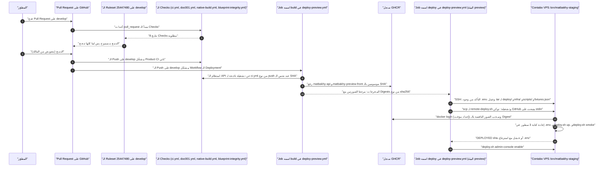

# مسار الـ Deployment

> **Owner role:** Infrastructure and deployment
> **Status:** IMPLEMENTED — المسار من الـ Pull Request لحد الـ Preview على Contabo متأتمت في `.github/workflows/deploy-preview.yml`؛ واللي بيحصل على السيرفر بعد خطوة الـ Deploy ممكن التحقق من جزء منه بس من غير صلاحيات مرتفعة.
> **Language / اللغة:** [English](deployment-pipeline.md) · العربية

الصفحة دي بتتابع تغيير واحد من الـ Pull Request لحد الـ Preview الشغّال، وبتوضّح إزاي تتأكد من كل مرحلة. هي بتكمّل [ci-cd.md](../05-developer-workflow/ci-cd-ar.md) (جرد الـ Workflows) و[git-and-pr-workflow.md](../05-developer-workflow/git-and-pr-workflow-ar.md) (الـ Branches والـ Reviews). والسيرفر نفسه متوصّف في [contabo-server-inventory.md](contabo-server-inventory-ar.md) و[runtime-architecture.md](runtime-architecture-ar.md).

## مفتاح الأدلة

| الوسم | المعنى في الصفحة دي |
|---|---|
| VERIFIED LIVE | اتلاحظ على الـ Contabo VPS بواسطة المستخدم `aiagent` اللي معندوش صلاحيات إدارية يوم 2026-10-21 (قراءة فقط). |
| VERIFIED IN CODE | اتقرا في ملف الـ Repository المكتوب جنب الادّعاء. ده بيثبت اللي الكود بيعمله لما يشتغل، مش إن تشغيلة معيّنة حصلت. |
| DOCUMENTED ONLY | مستند في الـ Repository بيقول كده؛ ماتأكدناش منه هنا. |
| OUTDATED / INCORRECT | بيتعارض مع دليل أحدث (مثلًا نص فترة Hetzner). |
| NOT VERIFIED | محدّش أكّده؛ والصفحة بتقول إزاي شخص مصرّح له يقدر يتأكد. |

ملاحظة عن Hetzner: المستندين [11-staging-deployment-and-rollback.md](../../operations/11-staging-deployment-and-rollback.md) و[06-web-preview.md](../../operations/06-web-preview.md) اتكتبوا لـ Host مقترح على Hetzner وبيوصفوا إصدار يدوي بيشغّله المالك (تشغّل `preview-images.yml`، وتعدّل `.env`، وتشغّل `deploy.sh up`). اعتبر التدفق اليدوي ده خلفية تاريخية (OUTDATED / INCORRECT كوصف للمسار التلقائي الحالي)؛ الهدف الحالي هو Contabo والمسار التلقائي الحالي تحت.

## المسار كامل



الرسم بيتقرا من فوق لتحت. الخطوات من 1 لـ 5 هي بوابة الـ Pull Request والدمج، والخطوات من 6 لـ 10 هي الـ CI بعد الدمج والـ Build، والخطوات من 11 لـ 16 هي الـ Deployment على السيرفر. الخطوات اللي على السيرفر حالتها VERIFIED IN CODE بس؛ ومفيش واحدة منهم VERIFIED LIVE.

## المرحلة 1: الـ Pull Request والـ Reviews والـ Checks المطلوبة

| المرحلة | تلقائي ولا يدوي ولا مقترح | التفاصيل | الدليل |
|---|---|---|---|
| فتح PR على `develop` | يدوي (المطوّر) | القالب `.github/pull_request_template.md` فيه بلوك Documentation Impact الخاص بـ DOC-001 | VERIFIED IN CODE |
| Product CI | تلقائي | `.github/workflows/ci.yml`: الـ Jobs هي `workspace` و`local-stack` و`design` و`secrets` مع كل Push وPull Request؛ ومجموعة الـ Concurrency لكل Ref بتلغي التشغيلات الأقدم | VERIFIED IN CODE |
| Blueprint integrity | تلقائي | `.github/workflows/blueprint-integrity.yml` الـ Job اسمه `blueprint-integrity` مع كل Push وPull Request | VERIFIED IN CODE |
| Native builds | تلقائي | `.github/workflows/native-build.yml` الـ Jobs هي `android` و`ios` بتشتغل على Pull Request لـ `develop` (ويدويًا)؛ والـ Push على `develop` مابيشغّلهمش | VERIFIED IN CODE |
| بوابة التوثيق | تلقائي | `.github/workflows/doc001.yml` على الـ Pull Requests لـ `develop` أو `main`؛ بتشغّل سكريبت البوابة من الـ SHA الأساسي وبتقرا الـ PR كبيانات | VERIFIED IN CODE |
| Handbook parity | تلقائي، مش مطلوب | `.github/workflows/handbook-parity.yml` بيشتغل لما ملفات الدليل تتغيّر؛ وهو مش ضمن الـ Checks المطلوبة | VERIFIED IN CODE |
| فحص Owner E2E seed | تلقائي، مش مطلوب | `.github/workflows/owner-e2e-fixtures.yml`، بفلتر على المسارات | VERIFIED IN CODE |
| الـ Checks المطلوبة وعدم وجود تجاوز | بتفرضه GitHub | الـ Ruleset رقم 25447480 "develop protection (PR + required checks + DOC-001)"، الهدف `develop`، مفيش Bypass Actor، 8 Status Checks مطلوبة (مسرودة تحت)، Pull Request مطلوب مع 0 موافقات مراجعة، والموافقات القديمة بتتسحب (Dismissed) عند الـ Push | DOCUMENTED ONLY (في [documentation-maintenance.md](../05-developer-workflow/documentation-maintenance-ar.md))؛ ممكن إعادة قراءته بأمر `gh api` الموجود في قسم التحقق |
| الـ Review البشري | يدوي، مش مفروض تقنيًا | عدد الموافقات المطلوبة هو 0. تغيير الحوكمة بيحتاج موافقة من غير المؤلف بواسطة بوابة DOC-001 وقاعدة الـ Code Owners (`.github/CODEOWNERS`). وجود هوية GitHub واحدة مشتركة معناه إن الموافقة المستقلة مش ممكن تتحقق حاليًا | DOCUMENTED ONLY |
| الـ QA المستقل والمراجعة الآلية للكود كبوابة | مقترح / مش جزء من المسار | سجلات Codex QA موجودة تحت `docs/quality`؛ ومفيش حاجة في الـ Workflows بتستدعي مراجع | VERIFIED IN CODE (غياب في الـ Workflows) |
| الدمج | يدوي (بتفويض من المالك) | الـ Agents مابيدمجوش من غير تفويض من المالك (شوف [git-and-pr-workflow.md](../05-developer-workflow/git-and-pr-workflow-ar.md)) | DOCUMENTED ONLY |

الـ 8 Status Checks المطلوبة، زي ما هي مسجّلة في [documentation-maintenance.md](../05-developer-workflow/documentation-maintenance-ar.md) (DOCUMENTED ONLY):

1. `Documentation Consistency / DOC-001`
2. `Workspace from clean checkout (P01-CHECK-1/2)`
3. `Local stack bootstrap and smoke (P01-CHECK-3)`
4. `Design tokens, specimens and prototype journeys (P00-CHECK-2)`
5. `Secret scan`
6. `blueprint-integrity`
7. `Android debug APK (Gradle)`
8. `iOS simulator build (Xcode, unsigned)`

مش لازم يكون الـ Branch محدّث بآخر `develop` قبل الدمج. فحص الـ Seed المفلتر بالمسارات وJobs الـ Deploy مش مطلوبين عن قصد.

قيد معروف، مؤجَّل (DEFERRED) بقرار من المالك (2026-10-20): عشان DOC-001 بيشتغل على حدث `pull_request`، فـ PR بيعيد كتابة `.github/workflows/doc001.yml` ممكن يعطّل الفحص (الـ PR التجريبي #33 اتعدّى في ثانيتين). الإجراء المؤقت هو إن المالك يراجع كل Diff بيلمس `.github/workflows/`. تغيير الدليل ده مابيعالجش المشكلة دي.

## المرحلة 2: الدمج والـ Build والنشر على GHCR

كل اللي تحت حالته VERIFIED IN CODE في `.github/workflows/deploy-preview.yml`.

| البند | السلوك |
|---|---|
| المشغّل (Trigger) | Push على `develop`، أو `workflow_dispatch` يدوي |
| الصلاحيات | `contents: read` و`packages: write` و`actions: read` |
| الـ Concurrency | المجموعة `matbakhy-preview-deploy`، و`cancel-in-progress: false` (الـ Deployment الشغّال عمره ما بيتلغي بـ Push أحدث) |
| الـ Job اسمه `build` | `runs-on: ubuntu-24.04`، مهلة 75 دقيقة |
| بوابة الـ CI جوه الـ Build | بيعمل Polling لـ `gh api repos/<repo>/actions/workflows/ci.yml/runs?head_sha=<SHA>` لحد 60 مرة مع انتظار 30 ث؛ وبيحتاج تشغيلة Product CI من نوع حدث `push` عند نفس الـ SHA بنتيجة `success`؛ والنتايج `failure` أو `cancelled` أو `timed_out` بتفشّل الـ Build؛ ولو مفيش نتيجة بعد 60 محاولة بيفشل برسالة "Timed out waiting for Product CI" |
| ملف الـ API (jar) | `./mvnw -B -ntp -DskipTests package` في `backend` (الاختبارات اتشغّلت في Product CI، مش هنا) |
| الصور | `ghcr.io/<lower-case owner>/matbakhy-api:<full SHA>` مبنية من `backend`؛ و`ghcr.io/<lower-case owner>/matbakhy-preview-front:<full SHA>` مبنية من `deploy/web-preview/front.Dockerfile` بالـ Build Argument `PREVIEW_DOMAIN=167-86-90-174.sslip.io` (الدومين ثابت في الـ Workflow)؛ والاتنين عليهم Label اسمه `org.opencontainers.image.revision=<SHA>` |
| تسجيل الدخول للـ Registry | `docker login ghcr.io` بتوكن الـ Job (`github.token`) |
| الـ Digests | بعد `docker push`، الـ Workflow بيقرا `RepoDigests[0]` لكل صورة وبيمرّر `name@sha256:<digest>` لـ Job الـ Deploy كمخرجات Job اسمها `api` و`front` |

دومين الـ Preview مضمَّن جوه صورة الـ Front وقت الـ Build. أي دومين مختلف محتاج تغيير في الـ Workflow (شوف [dns-https-sslip-io.md](dns-https-sslip-io-ar.md)) ومحتاج أكتر من الصورة: `PREVIEW_DOMAIN` في `.env` على السيرفر هو اللي بيحدد أسماء الـ Hosts في Caddy وأسماء الـ Hosts في Keycloak والـ Origins الخاصة بالـ API (`Caddyfile`، `compose.yaml`)، وملف الـ Realm `identity/matbakhy-realm.preview.json` فيه الـ Redirect URIs بتاعة الـ Clients، لكن الـ Realm اللي اتعمله Import قبل كده مابيتعملوش Import تاني (التعليق الافتتاحي في `migrate-mfa.sh`)، فتغيير الـ Redirect URIs بتاعته محتاج خطوة منفصلة. صورة الـ Front الأقدم فيها الدومين القديم مضمَّن، فلو رجّعت الصورة بعد تغيير الدومين الدومين القديم هيرجع. إعادة إنشاء الـ proxy بـ `PREVIEW_DOMAIN` جديد بتشيل أسماء الـ Hosts القديمة، فالتحويل للدومين الجديد فيه Downtime للأسماء القديمة إلا لو اتصمّم واتجرّب توجيه بدومينين بشكل منفصل؛ والـ Repository مفيهوش تصميم زي ده. استبدال الدومين والرجوع عنه لسه ماتجرّبوش عمليًا: NOT VERIFIED.

الـ Workflow اليدوي `.github/workflows/preview-images.yml` بيبني نفس الصورتين لأي دومين وبيطبع `RELEASE_COMMIT` و`API_IMAGE` و`FRONT_IMAGE` في ملخص الـ Job؛ ومابيعملش Deploy لأي حاجة (VERIFIED IN CODE). وهو تابع للتدفق اليدوي بتاع فترة Hetzner.

## المرحلة 3: الـ Deploy على /srv/matbakhy-staging

الـ Job اسمه `deploy` (VERIFIED IN CODE): `needs: build`، بيشتغل بس لما `github.ref` يكون `refs/heads/develop`، و`environment: preview`، ومهلة 30 دقيقة.

| الخطوة | بتعمل إيه | الدليل |
|---|---|---|
| الـ Secrets المستخدمة (الأسماء بس) | `STAGING_SSH_HOST` و`STAGING_SSH_USER` و`STAGING_SSH_KEY` و`STAGING_SSH_HOST_PUBKEY`؛ زائد `github.token` التلقائي | VERIFIED IN CODE |
| مستخدم Linux اللي الـ Deployment بيتصل بيه | متخزّن في الـ Secret اسمه `STAGING_SSH_USER` | NOT VERIFIED (مجلد الـ Deployment مملوك لـ `devops`، وده دليل غير مباشر بس) |
| إعداد الـ SSH | بيفشل لو أي قيمة مطلوبة فاضية؛ بيكتب المفتاح في `~/.ssh/id_ed25519` بـ umask 077؛ بيكتب `known_hosts` على شكل `<host> <host public key>`؛ وكل نداء `ssh` بعد كده بيستخدم `StrictHostKeyChecking=yes` و`BatchMode=yes`، أما نداء `scp` فبيظبط `StrictHostKeyChecking=yes` بس | VERIFIED IN CODE |
| الفحص المسبق | عن طريق SSH: `test -f /srv/matbakhy-staging/deploy/web-preview/.env && test -w /srv/matbakhy-staging`؛ والـ Deploy بيقف هنا لو `.env` على السيرفر مش موجود | VERIFIED IN CODE |
| النقل | `tar -cf - deploy infra scripts docs/quality/owner-acceptance/fixtures.json` بيتبعت Stream على SSH لـ `tar -xf - -C /srv/matbakhy-staging` | VERIFIED IN CODE |
| الحفاظ على `.env` والبيانات | ملف `.env` على السيرفر مستبعد في Git (`.gitignore`) ومش موجود في الـ Checkout النضيف اللي الـ Workflow بيشتغل فيه، فالـ tar Stream في الوضع العادي مابيحتويهوش؛ والأرشيف بيحمل `.env.example` وده مابيكتبش فوقه. الأمر `tar` نفسه مابيقراش `.gitignore`: لو عملت أرشيف يدوي من نسخة شغل فيها `.env` حقيقي (مثلًا أثناء إعادة بناء يدوية) هيدخل فيه، فاستبعده صراحةً (`--exclude=.env`) أو اعمل الأرشيف من الملفات المتتبَّعة بس (`git archive`). و`tar -x` بيضيف ويستبدل ملفات بس، فالملفات اللي اتمسحت من Git مابتتمسحش من السيرفر | VERIFIED IN CODE |
| السكريبت اللي بيتشغّل على السيرفر (Remote Script) | الـ Job بيكتب `remote-deploy.sh` وبينسخه لـ `/tmp/matbakhy-cd-<SHA>.sh` على السيرفر، وبيشغّله بـ `bash`، وبعدين بيمسحه؛ وتوكن GitHub بيتبعت على الـ Standard Input بتاع SSH، مش كـ Argument أبدًا | VERIFIED IN CODE |
| تسجيل الدخول للـ Registry على السيرفر | `docker login ghcr.io -u afawzy70 --password-stdin` في مجلد `DOCKER_CONFIG` مؤقت بيتمسح عند الخروج؛ واسم المستخدم مكتوب ثابت في السكريبت ده | VERIFIED IN CODE |
| تثبيت الإصدار في `.env` | مقطع Python بيشيل أي سطور موجودة `RELEASE_COMMIT=` و`API_IMAGE=` و`FRONT_IMAGE=`، وبيضيف التلاتة الجداد، وبيظبط صلاحية 600 على `.env`؛ ومفيش سطر تاني بيتلمس | VERIFIED IN CODE |
| التشغيل | `./deploy.sh up` (شوف تحت) | VERIFIED IN CODE |
| الـ Smoke | `./deploy.sh smoke` بيشغّل `smoke.sh` لـ `PREVIEW_DOMAIN`: Headers ويب العميل وإشعار الـ Demo، وويب العمليات، والـ Configuration العامة بترجّع `PREVIEW` مع `demo: true`، والـ Endpoints الخاصة بترد 401 أو 403، والـ Actuator والـ Metrics بيردوا 404، والـ OIDC Issuer، والـ Master Realm مخفي، وRedirect تسجيل الدخول | VERIFIED IN CODE |
| خطوة Console الأدمن | `./deploy.sh admin-console enable` بيحصّن الـ Master Realm في Keycloak، وبيفتح ملف المفتاح، وبيتحقق عن طريق الرابط العام؛ والسكريبت بيقفله تاني لو التحقق الحي بتاعه فشل أو لو السكريبت اتقطع قبل ما التحقق ينجح. بعد ما التحقق ينجح، لو مفيش أي أدمن يقدر يسجّل دخول السكريبت بيشغّل `create-admin`؛ وفشل الخطوة المتأخرة دي مابيقفلش المفتاح، فبعد أي فشل في الخطوة دي افحص حالة المفتاح بـ `./deploy.sh admin-console status` واقفله بـ `./deploy.sh admin-console disable` لو مش عايزه (`deploy/web-preview/admin-console.sh`، فرع `enable`). الأمر `enable` بيكتب الأول Dump لقاعدة بيانات Keycloak في `$BACKUP_DIR/keycloak/keycloak-db-<stamp>.dump`؛ هل اتنفّذ، وهل هو حديث، وهل بيتسترجع ده NOT VERIFIED LIVE. السياسة: [14-keycloak-admin-console.md](../../operations/14-keycloak-admin-console.md) | VERIFIED IN CODE |

### بيعمل إيه `deploy.sh up`

VERIFIED IN CODE (`deploy/web-preview/deploy.sh`، الدالة `up`):

1. `check`: بيحمّل `.env`، وبيرفض الـ Placeholders، وبيشترط إن `API_IMAGE` و`FRONT_IMAGE` يحتوُوا على `@sha256:` (تثبيت بالـ Digest) وإن `RELEASE_COMMIT` يكون SHA من 40 حرف Hex.
2. بياخد `flock` غير حاجب على `${BACKUP_DIR:-/srv/matbakhy-backups}/.preview-mutation.lock`؛ ولو تغيير تاني ماسكه، `up` بيقف برسالة "another preview change holds ...".
3. `render`: بيعيد كتابة إعداد Keycloak Realm والـ Storage المولّد تحت `GENERATED_DIR` (صلاحية المجلد 700).
4. لو Container بتاع PostgreSQL شغّال بالفعل: بياخد Backup للـ Database قبل الـ Deploy وبيتحقق إنه سليم باسترجاعه في Database مؤقتة ومطابقته (`backup_db` و`verify_backup`)، وبيسجّل نسخة الـ Schema قبل الـ Deploy.
5. `compose pull --policy missing`، وبعدها `compose up -d`.
6. `wait_healthy`: بيعمل Polling لصحة Container الـ API كل 5 ث لحد 90 محاولة (حوالي 7.5 دقيقة)؛ وعند انتهاء المهلة بيطبع آخر 80 سطر من Logs لـ `api` و`identity` وبيفشل.
7. بيحاول ينشئ الـ Bucketين بتوع الـ Storage (`matbakhy-public` و`matbakhy-private`) من خلال SeaweedFS shell. الأمر ممكن يتكرر من غير مشاكل، بس مخرجاته بتتجاهل وأي فشل بيتتجاهل (`>/dev/null 2>&1 || true`)، فنجاح `up` مابيثبتش إن أي واحد من الـ Bucketين موجود. اتأكد من الـ Buckets بشكل منفصل (السيناريو 21 في [infrastructure-troubleshooting.md](infrastructure-troubleshooting-ar.md) والخطوة 21 في [server-rebuild-guide.md](server-rebuild-guide-ar.md)؛ و[admin-readonly-verification.md](admin-readonly-verification-ar.md) مفيهوش أمر لعرض الـ Buckets).
8. `record_release`: بيضيف سطر واحد مفصول بـ Tab (الوقت، والـ Commit، والـ Digestين، ونسخة الـ Schema قبل وبعد، ومسار الـ Backup) في `releases.log` تحت `BACKUP_DIR`.

الـ Migrations: Flyway بيطبّق الـ Migrations في اتجاه واحد بس (Forward-only) جوه الـ API عند التشغيل؛ ومفيش خطوة Migration منفصلة في الـ Workflow (DOCUMENTED ONLY في [06-web-preview.md](../../operations/06-web-preview.md)؛ ومسار تشغيل الـ Container ماتعادتش قراءته للصفحة دي). فحص صحة Container الـ API بينادي `http://127.0.0.1:8081/actuator/health` جوه الـ Container (VERIFIED IN CODE، `deploy/web-preview/compose.yaml`)، وده دليل منفصل عن الرد العام. الـ Host العام بيرجّع 404 لـ `/actuator/health` (VERIFIED LIVE) لأن الـ Caddyfile بيعمل Proxy لـ `/api/*` و`/oauth2/*` و`/login/oauth2/*` و`/logout` بس (VERIFIED IN CODE، `deploy/web-preview/Caddyfile`)، مش بسبب فحص الصحة الداخلي.

المسار اللي بيشاور عليه `GENERATED_DIR` و`BACKUP_DIR` على السيرفر الفعلي NOT VERIFIED: الملف `.env.example` فيه القيم الافتراضية `/srv/matbakhy-preview/generated` و`/srv/matbakhy-backups`، و`.env` الفعلي على السيرفر مايقدرش `aiagent` يقراه. الأدمن يقدر يقرا القيم الفعلية بالأمر `grep -E '^(GENERATED_DIR|BACKUP_DIR)=' /srv/matbakhy-staging/deploy/web-preview/.env`، وده مابيطبعش أسرار (شوف [admin-readonly-verification.md](admin-readonly-verification-ar.md)).

### سلوك الفشل والرجوع

فرع الفشل بالظبط في السكريبت البعيد (VERIFIED IN CODE):

```bash
if ! ./deploy.sh up || ! ./deploy.sh smoke; then
  echo "Deployment failed. Restoring prior configuration; no automatic DB rollback."
  cp "$old" .env
  exit 1
fi
echo "DEPLOYED $sha"
```

معنى ده عمليًا:

| السؤال | الإجابة | الدليل |
|---|---|---|
| إيه اللي بيتسترجع تلقائيًا؟ | ملف `.env` بس، بيتنسخ من نسخة مؤقتة صلاحيتها 600 اتاخدت قبل ما السطور التلاتة يتعاد كتابتهم | VERIFIED IN CODE |
| هل الـ Database بتترجع تلقائيًا؟ | لأ. الرسالة بتقول كده، ومفيش خطوة بتسترجع Dump | VERIFIED IN CODE |
| هل الـ Containers بترجع تلقائيًا؟ | لأ. مفيش خطوة بتعيد تشغيل الـ Stack بعد ما `.env` يترجع. لو `compose up -d` كان بدّل الـ Containers فعلًا، هتفضل شغّالة بالصور الجديدة لحد ما حد يشغّل `./deploy.sh up` تاني بـ `.env` المسترجع أو المصحَّح. قبل ما تعيد التشغيل بتثبيتات الصور المسترجعة، قيّم هل صورة الـ Application الأقدم تقدر تشتغل على Database Schema ممكن يكون الإصدار الجديد طبّق عليها Migrations بالفعل (شوف صف الـ Migration تحت)؛ ماتعيدش التشغيل بشكل أعمى | VERIFIED IN CODE (غياب خطوة إعادة التشغيل) |
| هل الـ Deployment الفاشل بيتخطّى خطوة Console الأدمن؟ | أيوه، ترتيب خطوات الـ Workflow بيقف عند أول خطوة بتفشل | VERIFIED IN CODE |
| هل فشل خطوة Console الأدمن بيلغي الـ Deployment؟ | لأ. الـ Deployment كان نجح بالفعل. السكريبت بيقفل المفتاح لو التحقق بتاعه فشل أو اتقطع، لكن مش لو فشل إنشاء الأدمن التلقائي المتأخر: ساعتها المفتاح ممكن يفضل مفتوح وتشغيلة الـ Workflow تتعلّم فاشلة. افحص حالة المفتاح واقفله بـ `admin-console disable` لو لزم | VERIFIED IN CODE |
| هل الـ Migration ممكن الرجوع عنها؟ | Flyway في اتجاه واحد بس (Forward-only). الرجوع لإصدار Docker Images سابق من غير استرجاع قاعدة البيانات آمن بس لو بنية أو إصدار الـ Database Schema ماتغيّرتش أو كل Migration لاحقة هي Expand-only (`scripts/check_migration_compat.py` واختبارات الـ Guardrail في CI)؛ غير كده استرجع الـ Backup اللي قبل الـ Deploy واقبل ضياع البيانات المكتوبة من وقتها | DOCUMENTED ONLY ([11-staging-deployment-and-rollback.md](../../operations/11-staging-deployment-and-rollback.md)، سياسة مكتوبة لـ Host فترة Hetzner) وVERIFIED IN CODE (`rollback_plan` في `deploy.sh`) |
| رجوع حقيقي على السيرفر Contabo | مااتجرّبش عمليًا؛ NOT VERIFIED | NOT VERIFIED |

أدوات المشغّل الموجودة للجزء اليدوي (بتتشغّل على السيرفر بواسطة مهندس مصرّح له، وعمرها ما بتتشغّل على الـ Preview الفعلي من تمرين في الدليل): `./deploy.sh status` (read-only)، و`./deploy.sh rollback-plan [N]` (بيطبع بس)، و`./deploy.sh restore-db <dump>`. جداول القرار الكاملة: [backup-restore-disaster-recovery.md](backup-restore-disaster-recovery-ar.md).

اختيار هدف `rollback-plan` (VERIFIED IN CODE، `rollback_plan` و`record_release` في `deploy.sh`): الرقم `N` بيعدّ لورا في أسطر `releases.log`، والسطر بيتضاف بس لما `./deploy.sh up` يخلص. الـ Deployment اللي `up` بتاعه فشل ماسابش سطر، فـ `rollback-plan 1` معناه "الإصدار المسجَّل قبل أحدث إصدار مسجَّل"، وده مش بالضرورة "الإصدار اللي قبل التشغيلة الفاشلة". عشان تلاقي الهدف الصح، المهندس المصرّح له يقرا `releases.log` (أو آخر خمس أسطر في `./deploy.sh status`) ويقارن الـ Commits بتاريخ تشغيلات الـ Workflow ويمرّر الـ `N` اللي `target release` المطبوع معاه هو الـ Commit المطلوب. الخطة بتطبع بس؛ ومفيش حاجة بتختار الهدف تلقائيًا.

### Workflow مرتبط بعد الـ Deploy

`.github/workflows/owner-e2e-provision.yml` بيشتغل لما `deploy/web-preview/owner-e2e-run.request` يتغيّر على `develop`. بيعمل Polling لتشغيلة ناجحة لـ `deploy-preview.yml` بنفس الـ SHA (لحد 90 محاولة، بينها 30 ث، يعني 45 دقيقة؛ بس الـ Job كله ليه `timeout-minutes: 30`، فمهلة الـ Job بتوقف الـ Polling أبكر، بعد حوالي 60 محاولة)، وبيتصل بنفس الـ Secrets الأربعة في البيئة `preview`، وبيشغّل `./owner-e2e-provision.sh plan` أو `apply` من `/srv/matbakhy-staging/deploy/web-preview`. مابينسخش ملفات بنفسه وبيستخدم مجموعة Concurrency خاصة بيه `matbakhy-preview-owner-e2e` عشان مايحجبش الـ Deployment اللي مستنيه (VERIFIED IN CODE). التفاصيل: [fixtures.md](../../quality/owner-acceptance/fixtures.md).

## التحقق التشغيلي

كل الأوامر هنا read-only. شغّل `gh` على اللابتوب بتاعك بعد `gh auth login`؛ وشغّل `curl` من أي مكان (النتايج بتختلف حسب IP المتصل للـ Hosts المقيّدة بالوصول). مفيش واحد منهم بيحتاج `sudo`، ومفيش واحد منهم ينفع يتشغّل بصلاحيات مرتفعة بواسطة Agent.

| الأمر | الجهاز والمستخدم | Read-only | النتيجة المتوقعة | لو فشل |
|---|---|---|---|---|
| `gh run list --workflow deploy-preview.yml --branch develop --limit 5 --json databaseId,headSha,status,conclusion,createdAt` | اللابتوب بتاعك، حساب GitHub بتاعك | أيوه | آخر التشغيلات بصيغة JSON؛ `headSha` هو الـ Commit، و`conclusion` بتبقى `success` للتشغيلة الناجحة بالكامل (الإخراج الافتراضي كجدول مفيهوش عمود SHA). التشغيلة اللي اتعلّمت `failure` بسبب خطوة Console الأدمن ممكن تكون نشرت فعلًا: شوف الـ Log بتاعها ودوّر على `DEPLOYED <sha>`، وكرّر نفس الحاجة لكل تشغيلة أحدث من آخر `success` | `gh auth status`؛ اتأكد من صلاحية الوصول للـ Repository |
| `gh run view <run-id> --log` | اللابتوب بتاعك | أيوه | Logs خطوات الـ Build والـ Deploy؛ وآخر سطر Deploy هو `DEPLOYED <sha>` عند النجاح | دوّر على اسم الخطوة الفاشلة واقرا [infrastructure-troubleshooting.md](infrastructure-troubleshooting-ar.md) |
| `gh api repos/afawzy70/Matbakhy-v1/rulesets/25447480` | اللابتوب بتاعك؛ بيحتاج Token يقدر يقرا قواعد الـ Repository | أيوه | JSON فيه التنفيذ `active`، ومفيش Bypass Actors، وسياقات الـ Status Checks المطلوبة | 404 أو 403 معناه إن الـ Token مايقدرش يقرا القواعد، وده مش دليل إن القواعد اختفت |
| `gh pr checks <pr-number>` | اللابتوب بتاعك | أيوه | الـ Checks المطلوبة لـ PR | الـ Checks المعلّقة طبيعية أثناء ما الـ Jobs بتشتغل؛ ماتعيدش تشغيل Jobs سليمة |
| `curl -sS https://api.167-86-90-174.sslip.io/api/v1/configuration/public` | أي جهاز | أيوه | JSON فيه `orderingAvailable` و`orderLimits` و`environment` بالاسم `PREVIEW` وdemo بقيمة `true` (VERIFIED LIVE يوم 2026-10-21 من الـ VPS نفسه) | 403 "Not available" من Caddy هو رد سياسة وصول لـ IP المتصل، مش عطل |
| `curl -sS -o /dev/null -w '%{http_code}\n' https://api.167-86-90-174.sslip.io/actuator/health` | أي جهاز | أيوه | 404 بالتصميم (VERIFIED LIVE) | 200 معناه إن الـ Actuator منشور، وده عيب |

إزاي تلاقي الـ Commit المنشور. اللي الـ Repository بتوفّره، وفين هو NOT VERIFIED:

| المصدر | بيوضّح إيه | مين يقدر يقراه | الدليل |
|---|---|---|---|
| آخر تشغيلة لـ `deploy-preview.yml` على `develop` بنتيجة `success` (`gh run list --json` فوق) | الـ SHA بتاع آخر تشغيلة نجحت بالكامل. (دليل مساعد على اللي اتنشر، مش إثبات للي شغّال دلوقتي). الـ Workflow بيطبع `DEPLOYED <sha>` قبل خطوة Console الأدمن، فتشغيلة أحدث ممكن تكون نشرت وبعدين فشلت في الخطوة دي؛ يعني آخر تشغيلة ناجحة ممكن تكون أقدم من اللي منشور فعلًا. اقرا الـ Log بتاع كل تشغيلة فاشلة أحدث بحثًا عن `DEPLOYED <sha>` | أي مستخدم GitHub معاه صلاحية الوصول للـ Repository | VERIFIED IN CODE (الـ Workflow بيطبع `DEPLOYED <sha>`)؛ وإن الـ Containers لسه مطابقة له NOT VERIFIED؛ ومراجع الـ Images الشغالة بيأكدها الأدمن بس بالأوامر الموجودة في [admin-readonly-verification.md](admin-readonly-verification-ar.md) |
| سطور `RELEASE_COMMIT` و`API_IMAGE` و`FRONT_IMAGE` في `.env` على السيرفر | الإصدار المثبَّت | الملف صلاحيته 600 ومملوك لـ `devops`؛ و`aiagent` مايقدرش يقراه | NOT VERIFIED LIVE |
| `./deploy.sh status` في `/srv/matbakhy-staging/deploy/web-preview` | الصور الشغّالة، ونسخة الـ Schema، والقيم المظبوطة، وآخر 5 إصدارات | بيحتاج صلاحية Docker (مش متاحة لـ `aiagent`) | VERIFIED IN CODE؛ مااتشغّلش |
| `releases.log` تحت مجلد الـ Backup | سطر واحد لكل `up` ناجح | `/srv/matbakhy-backups` صلاحيته 750 `devops:devops` | VERIFIED LIVE (الصلاحيات)؛ المحتوى NOT VERIFIED |
| الحقل `service.version` في Logs الـ API | `MATBAKHY_VERSION`، بيتظبط من `RELEASE_COMMIT` في `compose.yaml` | بيحتاج Docker أو Stack بتاع Grafana وLoki | VERIFIED IN CODE؛ مااتلاحظش |
| Label الصورة `org.opencontainers.image.revision` | الـ Commit اللي اتبنت منه | `docker image inspect` مع صلاحية Docker | VERIFIED IN CODE (الـ Build بيظبطه في `deploy-preview.yml` و`preview-images.yml`)؛ الـ Labels على الـ Containers الشغّالة NOT VERIFIED LIVE |
| الـ Endpoint العام | الـ Configuration العامة مابتحملش Commit ولا نسخة | أي حد | VERIFIED LIVE (المفاتيح اللي اتلاحظت هي `orderingAvailable` و`orderLimits` و`environment`) |

الأدمن اللي معاه وصول مصرّح له يقدر يأكّد الـ Commit بالأوامر الموجودة في [admin-readonly-verification.md](admin-readonly-verification-ar.md). الـ Agents وحساب `aiagent` ماينفعش يشغّلوها.

## القيود المعروفة وفجوات التوثيق

- NOT VERIFIED LIVE: مستخدم SSH الفعلي اللي المسار بيستخدمه، وقيم `.env` الحية، والـ Containers والـ Digests الشغّالة، وهل آخر SHA منشور مطابق لآخر تشغيلة ناجحة، ومحتويات `releases.log`، وأي رجوع على Contabo.
- صورة الـ Front مبنية للدومين الثابت `167-86-90-174.sslip.io`؛ وتغيير دومين الـ Preview بيحتاج تعديل الـ Workflow وبناء صور جديدة وتحديث `PREVIEW_DOMAIN` ومسارات Caddy والـ Redirect URIs بتاعة الـ Clients في الـ Realm (شوف المرحلة 2). إعادة إنشاء الـ proxy بـ `PREVIEW_DOMAIN` جديد بتشيل أسماء الـ Hosts القديمة، فالتحويل فيه Downtime إلا لو اتصمّم واتجرّب توجيه بدومينين بشكل منفصل. التغيير ده لسه ماتجرّبش عمليًا: NOT VERIFIED؛ والمالك هو اللي يقرّر إمتى ولا إذا كان الدومين هيتغيّر.
- السكريبت اللي بيتولّد جوه `deploy-preview.yml` وبيتشغّل على السيرفر كاتب اسم مستخدم الـ Registry `afawzy70` ثابت (والملف `deploy.sh` نفسه مفيهوش تسجيل دخول للـ Registry)؛ ونقل الـ Repository أو مالك مختلف يحتاج تغيير في الـ Workflow.
- الـ Deployment الفاشل بيسترجع `.env` بس؛ ومابيعيدش تشغيل الـ Containers ولا بيرجّع الـ Database (مقتبس فوق). تدفق `rollback-plan` اليدوي هو الاسترجاع الموثَّق. التعافي الكامل للخدمة BLOCKED: الـ Repository مابيقدّمش استرجاع كامل عبر كل المخازن (الـ Database وKeycloak والـ Storage) كتسلسل واحد من الخطوات اتجرّب عمليًا: ده NOT VERIFIED ومحتاج قرار من المالك بتجربة على سيرفر جديد معزول. الموجود: الأوامر المنفردة و[server-rebuild-guide.md](server-rebuild-guide-ar.md). الناقص: تسلسل كامل معزول اتجرّب عمليًا. التجربة لازم تستخدم Repository منفصل (أو Workflow معزول) بـ Environment وSecrets وConcurrency group خاصين بيها؛ الـ Environment `preview` بيستخدمه `deploy-preview.yml` و`owner-e2e-provision.yml`، فإعادة استخدامه هتحوّل أتمتة الـ Preview الفعلي لسيرفر التجربة.
- أسماء الـ Checks المطلوبة بتعتمد على أسماء الـ Jobs. الـ Job اسمه `blueprint-integrity` مفيهوش حقل `name:`، فالسياق بتاعه هو الـ Job id؛ وإعادة تسمية أي واحد من الـ 8 Jobs بتخلّيه مايبقاش مستوفي شرط الـ Ruleset من غير تنبيه واضح.
- عدد الموافقات المطلوبة هو 0 والـ Review المستقل مش ممكن يتحقق حاليًا بهوية GitHub واحدة؛ وقيد إمكانية تعطيل فحص DOC-001 بتعديل الـ Workflow مؤجَّل (DEFERRED) بقرار المالك ولسه مفتوح.
- حماية الـ Branch متظبطة على GitHub ومش في الـ Repository؛ وحقائق الـ Ruleset اللي فوق حالتها DOCUMENTED ONLY لحد ما تتقرا تاني بـ `gh api`.
- `docs/operations/11-staging-deployment-and-rollback.md` و`06-web-preview.md` لسه بيوصفوا الإصدار اليدوي بتاع فترة Hetzner (OUTDATED / INCORRECT للمسار التلقائي الحالي)؛ و`deploy/web-preview/README.md` كمان قديم، زي ما هو مذكور في [ci-cd.md](../05-developer-workflow/ci-cd-ar.md).
- ملف `.env.example` بيحط `GENERATED_DIR` افتراضيًا على `/srv/matbakhy-preview/generated`، في حين إن هدف الـ CD هو `/srv/matbakhy-staging`؛ و`/srv/matbakhy-preview` فيه نسخة أقدم من ملفات الـ Deploy (VERIFIED LIVE، قديمة). المسار اللي `.env` الحي بيستخدمه NOT VERIFIED.
