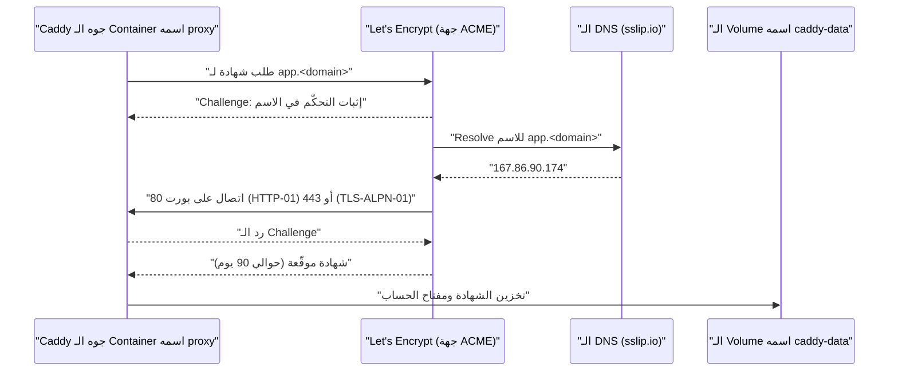

# الـ DNS والـ HTTPS وsslip.io

> **Owner role:** Infrastructure and deployment
> **Status:** PARTIALLY IMPLEMENTED — أسماء الـ Preview والـ HTTPS التلقائي وتوجيه Caddy حالتها IMPLEMENTED واتشافت شغّالة فعلًا؛ أما تجديد الشهادات وقواعد الـ Firewall الحية وبيئة Docker الحية فحالتها NOT VERIFIED.
> **Language / اللغة:** [English](dns-https-sslip-io.md) · العربية

الصفحة دي بتشرح من الأساس إزاي الـ Preview بتاع Matbakhy بياخد أسماءه (الـ DNS) وتشفيره (الـ TLS) وتوجيهه (Caddy). وكمان بتسرد كل مكان في الـ Repository مكتوب فيه دومين الـ Preview، وبتدّي الـ Runbook بتاع استبداله. صفحات مرتبطة: [معمارية التشغيل](runtime-architecture-ar.md)، [مسار الـ Deployment](deployment-pipeline-ar.md)، [جرد السيرفر](contabo-server-inventory-ar.md)، [دليل إعادة بناء السيرفر](server-rebuild-guide-ar.md)، [الوصول للـ Preview الحي](../05-developer-workflow/live-preview-access-ar.md)، وملخص المعمارية في [البنية التحتية والـ Deployment](../03-architecture/infrastructure-and-deployment-ar.md).

## مفتاح الأدلة

| الوسم | المعنى |
|---|---|
| VERIFIED LIVE | اتلاحظ يوم 2026-10-21 بواسطة مستخدم Linux aiagent اللي معندوش صلاحيات إدارية على الـ Contabo VPS نفسه (قراءة فقط، من غير sudo ومن غير Docker socket). الحقائق الموجودة في سجل الحقائق الحية (live-facts record) بس هي اللي بتتحسب. |
| VERIFIED IN CODE | اتقرا في الـ Repository دي (اسم الملف مكتوب جنب الادّعاء). |
| DOCUMENTED ONLY | مستند أو دليل المورّد بيقول كده؛ ماتأكدش هنا ولا على السيرفر الحي. |
| OUTDATED / INCORRECT | بيتعارض مع دليل أحدث، مثلًا النص بتاع فترة Hetzner. |
| NOT VERIFIED | محدّش أكّده. الصفحة بتقول إزاي الأدمن المصرّح له يقدر يتأكد منه. |

## 1. المفاهيم من الأساس

### 1.1 يعني إيه sslip.io

sslip.io خدمة DNS عامة بتشغّلها جهة خارجية. مالهاش حساب ولا لوحة تحكّم ولا إعدادات: أي Hostname فيه عنوان IPv4 بيرد على استعلام الـ DNS بنفس العنوان ده. (DOCUMENTED ONLY: وصف الخدمة مش موجود في الـ Repository دي؛ أما سلوكها مع الـ Preview ده فحالته VERIFIED LIVE تحت.)

إزاي اسم الـ Preview بيتبني:

| الجزء | القيمة | الدليل |
|---|---|---|
| دومين الـ Preview (المتغيّر PREVIEW_DOMAIN) | `167-86-90-174.sslip.io` | VERIFIED IN CODE: `.github/workflows/deploy-preview.yml` (الـ Build Argument بتاع صورة الـ Front) و`docs/operations/14-keycloak-admin-console.md` |
| عنوان IPv4 المضمَّن جوه الاسم | 167.86.90.174، بشرطات بدل النقط | VERIFIED LIVE: الاسم بيرجع العنوان 167.86.90.174 عن طريق الـ DNS (DNS Resolution)، وده الـ IPv4 العام لواجهة eth0 بتاعة الـ VPS |
| أسماء الـ Hosts المشتقّة منه | `app.` و`ops.` و`api.` و`id.` و`kc-admin.` و`media.` وبعدها الدومين | VERIFIED IN CODE: `deploy/web-preview/Caddyfile` |

عشان الخدمة الخارجية بترد على أي اسم تحت الدومين بتاعها، مفيش سجل DNS محتاج مالك الـ Preview يعمله أو يجدّده أو يضيّعه. والنتيجة إن فيه اعتمادية: لو خدمة sslip.io وقفت، أسماء الـ Preview مش هيرجع ليها عنوان من الـ DNS. توافرها وشروطها مش تحت سيطرة المشروع (NOT VERIFIED ما عدا الاستجابة الفعلية للـ DNS (DNS Resolution) اللي اتلاحظت يوم 2026-10-21).

### 1.2 الـ DNS في فقرة واحدة

الـ DNS بيربط اسم بعناوين. سجل A بيحمل عنوان IPv4، وسجل AAAA بيحمل عنوان IPv6. الـ Resolver بيسأل السيرفر المرجعي (authoritative)، وبعدها بيخزّن الرد في الـ Cache لمدة الـ time to live (TTL) بتاعة السجل. فالسجل اللي اتغيّر مش بيبان في كل مكان مرة واحدة؛ العملاء بيفضلوا بالرد القديم لحد ما النسخة المخزّنة عندهم تنتهي. سجل الحقائق الحية بيقول إن الأسماء تحت دومين الـ Preview بترجع العنوان 167.86.90.174 عن طريق الـ DNS (VERIFIED LIVE). أما وجود رد AAAA ليها فماتسجّلش (NOT VERIFIED)، مع إن الـ VPS ليه عنوان IPv6 عام 2a02:c207:2367:3442::1 على eth0 (VERIFIED LIVE).

### 1.3 الـ DNS مش TLS

الـ DNS بيقول بس إن الاسم ليه أنهي عنوان. أما الـ TLS فبيثبت إن السيرفر اللي على العنوان ده معاه شهادة للاسم وبيشفّر الـ Traffic. الاتنين لازم يبقوا صح: سجل A صح من غير شهادة سليمة بيدّي تحذير في المتصفح، والشهادة السليمة ماتنفعش لو الاسم بيشاور على سيرفر تاني. الشهادات بتتصدر لكل اسم؛ وCaddy بيطلب شهادة لكل Host مكتوب في الـ Caddyfile (VERIFIED IN CODE: Site Block واحد لكل Host).

### 1.4 الـ ACME وLet's Encrypt عن طريق Caddy

الـ ACME هو البروتوكول اللي بتستخدمه جهة إصدار الشهادات (CA) عشان تتأكد إن مقدّم الطلب بيتحكّم في الاسم، وبعدها تصدّر الشهادة. Let's Encrypt جهة إصدار مجانية بتتكلم ACME. الـ Proxy بتاع الـ Preview هو Caddy، وعنده HTTPS تلقائي: لكل عنوان Site بيجيب الشهادات ويجدّدها بنفسه، من غير Cron Jobs ولا أوامر يدوية. (DOCUMENTED ONLY: دليل Caddy؛ أما السلوك في الـ Repository دي فتحت.)

| الحقيقة | الدليل |
|---|---|
| الـ Global Block في الـ Caddyfile بيحدد إيميل حساب الـ ACME من المتغيّر ACME_EMAIL ومفيش حاجة تانية عن الـ ACME. مفيش CA ولا نوع Challenge ولا Staging Endpoint متظبط، فبتتطبّق الإعدادات الافتراضية بتاعة Caddy. | VERIFIED IN CODE: `deploy/web-preview/Caddyfile` (الـ Global Block) |
| ACME_EMAIL مطلوب (الـ compose بيرفض يشتغل من غيره). | VERIFIED IN CODE: `deploy/web-preview/compose.yaml` (الـ Service اسمه proxy، قسم environment) |
| شهادة `app.` صادرة من Let's Encrypt (CN YE1)، صالحة من 2026-10-18 07:09:06 GMT لحد 2027-01-16 07:09:05 GMT، يعني حوالي 90 يوم. | VERIFIED LIVE |
| Caddy شغّال جوه Container (الصورة caddy:2.10.2-alpine)؛ ومفيش Package اسمه caddy متسطّب على الـ Host. | VERIFIED IN CODE: `deploy/web-preview/front.Dockerfile`؛ VERIFIED LIVE: caddy مش متسطّب على الـ Host |
| Caddy بيجرّب Let's Encrypt الأول، وممكن يرجع لـ CA تانية لو الإصدار فشل. أنهي CA أصدرت شهادات الـ Hosts التانية ماتسجّلش. | DOCUMENTED ONLY (دليل Caddy)؛ الـ Hosts التانية NOT VERIFIED |

الرسم بيوضّح عملية إصدار واحدة. الـ CA بتعمل DNS Resolution للاسم الأول عن طريق الـ DNS العام، وبعدها بتتصل بالسيرفر على بورت 80 أو 443؛ ولو أي خطوة منهم فشلت، مفيش شهادة بتتصدر.

### 1.5 ليه بورتات 80 و 443 لازم تكون متاحة من الإنترنت

الـ CA بتتحقق من الإنترنت العام، مش من جوه الشبكة بتاعتك. الـ HTTP-01 بيستخدم بورت 80 والـ TLS-ALPN-01 بيستخدم بورت 443 (DOCUMENTED ONLY: معيار ACME ودليل Caddy). في الـ Repository دي:

* الـ Service اسمه proxy بينشر `80:80` و`443:443` (VERIFIED IN CODE: `deploy/web-preview/compose.yaml`، الـ Service اسمه proxy، قسم ports).
* الـ Host بيسمع علنًا على 22 و 80 و 443 (VERIFIED LIVE: مخرجات ss).
* قايمة السماح الخاصة بالعملاء (allow-list) مابتمنعش الـ CA، لأن Caddy بيكمّل الـ Challenge قبل ما الطلب يوصل للـ Route اللي بتطبّق الـ allow-list (DOCUMENTED ONLY بالنسبة للترتيب جوه Caddy؛ NOT VERIFIED بتجربة إصدار حية). ماتعملش Firewall لبورتات 80 و 443 على حسب عنوان المصدر لا في الـ Firewall بتاع الـ Cloud ولا بتاع الـ Host.
* الـ Firewall بتاع الـ Host اسمه ufw متسطّب (VERIFIED LIVE) لكن حالته وقواعده NOT VERIFIED LIVE (محتاج root). وكمان Firewall على مستوى المورّد للـ Contabo VPS حالته NOT VERIFIED.

### 1.6 الشهادات بتتخزّن فين

الـ compose.yaml بيركّب Volumes مسمّاة اتنين جوه Container الـ proxy: caddy-data على /data وcaddy-config على /config (VERIFIED IN CODE). Caddy بيحتفظ بالشهادات الصادرة وحساب الـ ACME بتاعه في مجلد البيانات بتاعه (DOCUMENTED ONLY: دليل Caddy)، فهي بتفضل موجودة بعد إعادة إنشاء الـ Container وترقيات الصورة. النتايج:

* مسح الـ Volume (مثلًا `docker compose down -v`) بيرمي الشهادات وبيجبر على طلبات جديدة، وده بيتحسب على حدود المعدّل (Rate Limits) بتاعة الـ CA.
* الأمر `deploy.sh backup` مابيذكرش Caddy (VERIFIED IN CODE: مفيش أي تطابق لكلمة caddy في `deploy/web-preview/deploy.sh`)، فعلى سيرفر اتعمله إعادة بناء الشهادات بتتصدر من جديد مش بتتسترجع. ونفس الكلام على السيرفر الحي: هل فيه أي Backup تاني بينسخ الـ Volume ده NOT VERIFIED.
* الاسم الحقيقي للـ Volume على الـ Host الحي (Compose بيحط قدامه عادةً اسم المشروع matbakhy-preview) وحجمه كانوا NOT VERIFIED LIVE؛ والأدمن المصرّح له يقدر يعرض الـ Volumes بالأمر read-only الموجود في [التحقق للقراءة فقط من الأدمن](admin-readonly-verification-ar.md).

### 1.7 التجديد

Caddy بيجدّد الشهادات تلقائيًا قبل ما تنتهي، وافتراضيًا لما يفضل حوالي تلت عمرها (DOCUMENTED ONLY: دليل Caddy). الحالة:

| البند | الحالة |
|---|---|
| التجديد تلقائي ومش محتاج Cron Job في الـ Repository دي | DOCUMENTED ONLY؛ VERIFIED IN CODE: مفيش أمر تجديد ولا Timer في `deploy/web-preview` |
| شهادة `app.` اتصدرت يوم 2026-10-18 وبتنتهي يوم 2027-01-16 | VERIFIED LIVE |
| إن تجديد حصل فعلًا على السيرفر ده | NOT VERIFIED: أول شهادة اتلاحظت لسه جوه فترتها الأولى |

عشان تتأكد بعدين من غير أي صلاحية، شغّل أمر openssl الموجود في القسم 5 وتأكد إن تاريخ الانتهاء بيتحرّك لقدّام قبل ما يعدّي؛ والأدمن كمان يقدر يقرا Logs بتاعة Container الـ proxy (راجع [التحقق للقراءة فقط من الأدمن](admin-readonly-verification-ar.md)).

### 1.8 حدود المعدّل (DOCUMENTED ONLY)

جهات إصدار الشهادات بتحدّد كام شهادة وكام عملية تحقق فاشلة وكام طلب مكرّر بتقبله في فترة معيّنة. Let's Encrypt بتنشر حدود زي دي (مثلًا لعمليات التحقق الفاشلة وللشهادات المتطابقة المتكررة). الأرقام بالظبط بتتغيّر مع الوقت ومابتتخزّنش في الـ Repository دي، فاقرا الحدود الحالية في توثيق Let's Encrypt قبل أي تغيير بالجملة. قواعد عملية بتطلع من الآلية دي:

* اتأكد إن الـ DNS بيرجع عنوان السيرفر وإن بورتات 80 و 443 مفتوحة قبل أول تشغيل، وإلا Caddy هيعيد المحاولة وممكن يستنفد حصة التحقق الفاشل (الإرشاد الموجود في `docs/operations/12-owner-server-setup.md`، القسم 2، بيقول نفس الكلام، وهو نص من فترة Hetzner).
* ماتمسحش الـ Volume اسمه caddy-data من غير سبب.
* ستة Hosts محتاجين ست شهادات (أو شهادة لكل اسم)؛ فاستبدال الدومين بيعمل ست طلبات جديدة مرة واحدة.
* هل فيه حد مشترك بيتطبّق على الأسماء تحت sslip.io NOT VERIFIED.

## 2. الأسماء والتوجيه والسلوك الحي

الستة Hosts كلهم متعرّفين في `deploy/web-preview/Caddyfile` (VERIFIED IN CODE). كل Site بيحطّ الـ Directives بتاعته جوه Route Block عشان يحافظ على ترتيبها المكتوب. الـ Access Logs مقفولة. النتايج الحية اتجابت بـ curl من الـ VPS نفسه، فعنوان المتصل هو عنوان السيرفر نفسه؛ والمتصل من شبكة تانية ممكن ياخد رد مختلف في المواضع اللي فيها Access Class (VERIFIED LIVE).

| الـ Host | اللي بيعمله الـ Caddyfile (VERIFIED IN CODE) | النتيجة الحية (VERIFIED LIVE) | القراءة |
|---|---|---|---|
| `app.<domain>` | Customer Access Class؛ ويب العميل الثابت من /srv/customer-web مع Fallback لصفحة واحدة على index.html؛ CSP بوضع Report-Only؛ X-Frame-Options DENY | GET `/` بيرجّع 200 | متوقّع |
| `ops.<domain>` | Staff Access Class؛ ويب العمليات الثابت من /srv/operations-web بنفس الـ Fallback | GET `/` بيرجّع 200 | متوقّع |
| `api.<domain>` | المسارات `/api/v1/ops` و`/api/v1/cook` بترد 403 "Not available" لأي متصل برّه الـ Staff Class؛ وبعد كده الـ Customer Class بيتطبّق على كل طلب في الـ Host برضه، فمتصل الـ Staff API لازم يكون موجود في القايمتين (شوف القسم 3)؛ بس `/api/*` و`/oauth2/*` و`/login/oauth2/*` و`/logout` هما اللي بيتعملهم Proxy لـ api:8080؛ أي مسار تاني بيرد 404 | `/api/v1/configuration/public` بيرجّع 200 JSON فيه orderingAvailable بقيمة true واسم البيئة PREVIEW وdemo بقيمة true؛ `/actuator/health` بيرجّع 404 | متوقّع. الـ Actuator مش متعمله Proxy عن قصد؛ والـ Management شغّال على بورت 8081 اللي الـ proxy مابيوصّلوش أبدًا (`deploy/web-preview/compose.yaml`) |
| `id.<domain>` | Customer Access Class؛ `/admin` و`/admin/*` و`/realms/master` و`/realms/master/*` بترد 404؛ وأي حاجة تانية بتروح لـ identity:8080 (Keycloak) | GET `/` بيرجّع 302 مع Location بقيمة `https://kc-admin.167-86-90-174.sslip.io/admin/` | متوقّع، شوف القسم 2.2 |
| `kc-admin.<domain>` | مش مقيّد بـ IP. الـ Host كله بيرد 404 "Not available" إلا لو ملف التفعيل (Flag File) admin-console-public موجود في /srv/flags جوه Container الـ proxy؛ `/` بيعمل Redirect بـ 302 لـ `/admin/master/console/`؛ مسارات الـ Console وتسجيل الدخول للـ Master Realm والأصول الثابتة بس هي اللي بتوصل لـ Keycloak؛ حد حجم الـ Request Body هو 10MB | GET `/` بيرجّع 302 مع Location بقيمة `/admin/master/console/` | متوقّع. الـ 302 (مش 404 بتاع الـ Host المقفول) بيدل إن ملف التفعيل (Flag File) موجود حاليًا وإن الـ Console منشورة. الحماية هي كلمة سر زائد كلمة سر لمرة واحدة (`docs/operations/14-keycloak-admin-console.md`) |
| `media.<domain>` | Customer Access Class؛ كل حاجة بيتعملها Proxy لـ storage:8333 (بوابة SeaweedFS S3) | GET `/` بيرجّع 403 وContent-Type بقيمة application/xml ومعاه Header اسمه x-amz-request-id | متوقّع، شوف القسم 2.1 |

### 2.1 ليه media بيرجّع 403 على الجذر

* الـ Caddyfile مابيردّش عن media بنفسه إلا برفض الوصول بتاع الـ Customer Class، وده بيبعت Body نص عادي "Not available" بحالة 403 ومفيهوش Header اسمه x-amz-request-id (VERIFIED IN CODE).
* الرد الحي فيه Content-Type بقيمة application/xml وHeader اسمه x-amz-request-id (VERIFIED LIVE). دي مميزات بوابة S3، فالرد جه من SeaweedFS ورا Caddy، مش من رفض Caddy نفسه.
* الطلب على مسار الجذر هو طلب مجهول لعرض الـ Buckets. S3 بترفضه من غير Credentials (خطأ XML بشكل access denied؛ الـ Body بالظبط وكود الخطأ ماتخزّنوش، فمش بندّعي حاجة عنهم).
* الكائنات العامة موجودة تحت المسار `/matbakhy-public/`: الـ API بيبني الروابط العامة على شكل `https://media.<domain>/matbakhy-public` (VERIFIED IN CODE: OBJECT_STORAGE_PUBLIC_BASE_URL في `deploy/web-preview/compose.yaml`). فالـ 403 على الجذر هو الرد المتوقّع؛ ومعناه مش إن Host الـ media واقع. العطل الحقيقي هيظهر كـ 502 أو خطأ اتصال (NOT VERIFIED؛ مستنتج من طريقة تصرّف الـ Proxy)، أو كـ Body النص العادي "Not available" لو المتصل برّه الـ Customer Class.
* إن كائن تحت البادئة العامة يرجّع 200 ماتسجّلش حيًا (NOT VERIFIED).

### 2.2 ليه id بيرجّع 302

* إعداد اسم الـ Host في Keycloak وهو KC_HOSTNAME قيمته https://id.<domain> وKC_HOSTNAME_ADMIN قيمته https://kc-admin.<domain> (VERIFIED IN CODE: `deploy/web-preview/compose.yaml`، الـ Service اسمه identity).
* Caddy بيوصّل `/` على id لـ Keycloak من غير تغيير؛ والـ Location في الـ Redirect الحي بيشاور على `/admin/` في Host الـ kc-admin (VERIFIED LIVE). Keycloak بيعمل Redirect لجذره هو لعنوان الأدمن لما يكون فيه Hostname للأدمن متظبط، فالـ 302 ده سلوك Keycloak، مش قاعدة في Caddy ومش خطأ. تفسير السبب ده استنتاج من الإعدادات ومن الـ Header اللي اتلاحظ؛ ماتأكدش بفحص تفاصيل التنفيذ الداخلية لـ Keycloak.
* تسجيل دخول العملاء مابيستخدمش الجذر. بيستخدم مسارات زي `/realms/matbakhy/...`؛ والملف `deploy/web-preview/smoke.sh` بيتحقق من الـ Issuer https://id.<domain>/realms/matbakhy ومن إن `/admin` ومسارات الـ Master Realm على id بترد 404 (VERIFIED IN CODE).
* ماتحاولش "تصلّح" الـ 302 بإضافة قاعدة Caddy على Host الـ id من غير ما تقرا `docs/operations/14-keycloak-admin-console.md`.

## 3. الـ Security Headers والـ Access Classes والـ CSP

| الموضوع | السلوك | الدليل |
|---|---|---|
| الـ Headers على كل Host | Strict-Transport-Security max-age=31536000، X-Content-Type-Options nosniff، Referrer-Policy strict-origin-when-cross-origin، X-Robots-Tag noindex وnofollow، وHeader اسمه Server متشال | VERIFIED IN CODE: Caddyfile، الـ Snippet اسمه headers |
| الـ Customer Class | المتغيّر CUSTOMER_ALLOWED_IPS. بيتطبّق على app وid وmedia، وعلى كل طلب في api (بعد فحص الـ Staff على المسارات الخاصة بيه). المتصلين من برّه بياخدوا 403 "Not available". | VERIFIED IN CODE: Caddyfile، الـ Snippet اسمه customer_access |
| الـ Staff Class | المتغيّر STAFF_ALLOWED_IPS. بيتطبّق على ops وعلى `/api/v1/ops` و`/api/v1/cook` في api. على ops هو الـ Class الوحيد. وعلى مسارات api دي بيتفحص الأول، وبعدها الـ Customer Class بيتطبّق على نفس الطلب، فمتصل الـ Staff API لازم يكون موجود في STAFF_ALLOWED_IPS وCUSTOMER_ALLOWED_IPS مع بعض (التقاطع)؛ خلّي كل عنوان Staff موجود في قايمة العملاء كمان. التعليق في الـ Caddyfile اللي بيقول إن المسارات دي بترد "للـ Staff Class بس" بيوصف الفحص الأول، مش التاني (السطر `import customer_access` اللي بعده). | VERIFIED IN CODE: Caddyfile، الـ Snippet اسمه staff_access وSite الـ api |
| الافتراضيات | الاتنين افتراضيًا بياخدوا قيمة ALLOWED_CLIENT_IPS، فمفيش Host من فئة العميل (app وid وmedia وapi) عام لحد ما المالك يظبط CUSTOMER_ALLOWED_IPS على "0.0.0.0/0 ::/0". الـ Host بتاع kc-admin مستثنى: هو مش في أي فئة من الاتنين، وهل بيرد ولا لأ بيتوقف على ملف التفعيل (Flag File) admin-console-public (شوف صف kc-admin في القسم 2) | VERIFIED IN CODE: `deploy/web-preview/compose.yaml`، `deploy/web-preview/.env.example` |
| القيم الحية الحالية | NOT VERIFIED (ملف `.env` صلاحيته 600 وماتقراش). الأدمن يقدر يقراه بالإجراء الموجود في [التحقق للقراءة فقط من الأدمن](admin-readonly-verification-ar.md). | VERIFIED LIVE لصلاحية الملف بس |
| Content Security Policy | بتتبعت كـ Content-Security-Policy-Report-Only على app وops؛ وبتشير لـ https://media.<domain> للصور ولـ https://api.<domain> للاتصالات، فالاتنين بيتبعوا المتغيّر PREVIEW_DOMAIN وقت تشغيل الـ Container. الترقية لسياسة Enforcing مخططة في `docs/security/csp-rollout.md`. | VERIFIED IN CODE: Caddyfile، الـ Snippet اسمه web_csp |
| اختبارات الوصول | `scripts/test_proxy_access.py` بيشغّل الـ Caddyfile الحقيقي في Container مؤقت مع Upstreams وهمية وعناوين عملاء ثابتة؛ وبيتخطّى لو Docker أو صورة Caddy مش موجودين أصلًا | VERIFIED IN CODE |

شرح أوسع لقرارات التحصين: [الهوية والأمان](../03-architecture/identity-and-security-ar.md#تأمين-المتصفح-والـ-proxy).

## 4. دومين الـ Preview مكتوب فين في الـ Repository

البحث المستخدم: الشكل اللي بالشرطات 167-86-90-174 في الـ Repository كلها، من غير بيانات Git ولا مجلدات الاعتماديات (VERIFIED IN CODE، اتشغّل على الـ Worktree بتاع develop عند 39b8420). الـ IP بالنقط 167.86.90.174 مش موجود في أي ملف. تقارير الحالة المولّدة تحت docs/status مفيهاش أي ظهور لأي من الشكلين. الصفحات اللي ضافها الدليل ده وبتقتبس الدومين كتوثيق مش متسردة هنا.

| الملف والسطر | النوع | لازم يتغيّر عند استبدال الدومين؟ |
|---|---|---|
| `.github/workflows/deploy-preview.yml:64` | الـ Build Argument بتاع صورة الـ Front وهو PREVIEW_DOMAIN=167-86-90-174.sslip.io. ده بيضمّن عنوان الـ API جوه Builds الويب وقت الـ Build. | أيوه. القيمة الوحيدة المكتوبة في الكود وقابلة للتنفيذ؛ والموقع المنشور هيفضل ينادي على Host الـ API القديم من غير تغييرها. |
| `docs/operations/14-keycloak-admin-console.md:4` | مثال لرابط Console الأدمن | توثيق بس؛ حدّثه عشان ماتفضلش فيه أمثلة غلط |
| `docs/developer-handbook/03-architecture/infrastructure-and-deployment.md:114` | ملاحظة القيود المعروفة اللي بتذكر الدومين | توثيق بس (نسخته العربية `docs/developer-handbook/03-architecture/infrastructure-and-deployment-ar.md:114` زيها) |
| `docs/quality/owner-acceptance/owner-guide-ar.md:5` والسطور من 8 لـ 12 | جدول روابط دليل المالك (بالعربي) | توثيق بس؛ المُلّاك بيتبعوا الروابط دي، فحدّثها |
| `docs/quality/owner-acceptance/cases/config-security.json:4994` و`:5223` | ملاحظات مراجعة بتذكر القيمة القديمة المكتوبة في الكود | توثيق بس (تاريخ)؛ مش محتاج تغيير |
| `docs/quality/owner-acceptance/generated/review-findings.md:9` و`:34` | نتايج مراجعة مولّدة بتذكرها | توثيق بس (تاريخ)؛ مش محتاج تغيير |

أي حاجة تانية بتاخد الدومين من المتغيّر PREVIEW_DOMAIN، وقت التشغيل في Caddyfile وcompose.yaml وملف الـ Realm المتولّد (بيتولّد بـ `deploy.sh render`) وsmoke.sh وadmin-console.sh وسكريبتات identity، ووقت الـ Build في front.Dockerfile وpreview-images.yml (VERIFIED IN CODE):

| المستهلك | إزاي بيستخدم الدومين |
|---|---|
| `deploy/web-preview/Caddyfile` | عناوين الـ Sites هي app. وops. وapi. وid. وkc-admin. وmedia. وبعدها المتغيّر؛ وقوايم مصادر الـ CSP |
| `deploy/web-preview/compose.yaml` | KC_HOSTNAME، KC_HOSTNAME_ADMIN، OIDC_ISSUER، WEB_ALLOWED_ORIGINS، WEB_COOKIE_DOMAIN، WEB_POST_LOGIN_REDIRECT، OBJECT_STORAGE_CLIENT_ENDPOINT، OBJECT_STORAGE_PUBLIC_BASE_URL |
| `deploy/web-preview/identity/matbakhy-realm.preview.json` | الـ Redirect URI بتاع الـ Client اسمه matbakhy-web وروابط ما بعد تسجيل الخروج، بيتم توليدها بـ `deploy.sh render` (`deploy/web-preview/deploy.sh`، استبدال sed للـ Placeholder بتاع الدومين) |
| `deploy/web-preview/front.Dockerfile` | الـ Build Argument اسمه PREVIEW_DOMAIN بيتحوّل لـ VITE_API_BASE_URL بقيمة https://api.<domain>؛ والـ Build بيفشل لو فاضي |
| `.github/workflows/preview-images.yml` | Workflow يدوي بمُدخل اسمه preview_domain، بيتحقق منه Regular Expression، وبيتمرّر كـ Build Argument |
| `deploy/web-preview/smoke.sh`، `deploy/web-preview/admin-console.sh`، `deploy/web-preview/identity/*.py` | بتستلم الدومين كـ Argument أو كمتغيّر بيئة |

## 5. أوامر التحقق الآمنة

الأوامر دي كلها للقراءة فقط. بتسأل الـ DNS العام والـ Hosts العامة؛ ومفيهاش حاجة بتغيّر أي شيء. صيغة الأوامر قياسية لكل أداة وحالتها هنا DOCUMENTED ONLY؛ أما النتايج المتوقعة للـ Preview فجاية من الحقائق الحية اللي فوق. استبدل الـ Placeholder بالدومين الحقيقي.

| الأمر | الجهاز | مستخدم Linux | النوع | النتيجة المتوقعة | لو فشل |
|---|---|---|---|---|---|
| `dig +short A app.<preview-domain>` | اللابتوب بتاعك أو الـ VPS | أي مستخدم | read-only | بيطبع 167.86.90.174 للـ Preview الحالي | مخرجات فاضية: الاسم مش بيرجع عنوان؛ راجع الإملاء، أو الـ IP المضمَّن في الاسم، أو الـ Resolver (أعد المحاولة بأمر nslookup اللي تحت، وده بيستخدم Resolver تاني) |
| `dig +short AAAA app.<preview-domain>` | اللابتوب بتاعك أو الـ VPS | أي مستخدم | read-only | مجهول للـ Preview (NOT VERIFIED). المخرجات الفاضية محتملة لاسم متبني من عنوان IPv4، بس ده لسه مااتعملوش فحص | لو ظهر رد IPv6، اتأكد إن السيرفر فعلًا بيسمع على العنوان ده |
| `nslookup app.<preview-domain> 1.1.1.1` | اللابتوب بتاعك | أي مستخدم | read-only | الاسم بيرجع نفس العنوان عن طريق Resolver عام مستقل | رد مختلف: سجل أقدم متخزّن في الـ Cache؛ استنى الـ TTL |
| `curl -sS -I https://app.<preview-domain>/` | اللابتوب بتاعك | أي مستخدم | read-only | HTTP 200 مع الـ Security Headers بتاعة القسم 3 لما المتصل جوه الـ Customer Class؛ و 403 "Not available" من برّاه | خطأ شهادة: شوف أمر openssl؛ Timeout: الـ Host أو بورت 443 مش متاح |
| `curl -sS -I https://id.<preview-domain>/` | اللابتوب بتاعك | أي مستخدم | read-only | 302 مع Location لـ Host الـ kc-admin (لما Host الـ id مسموح لعنوانك) | 403: انت برّه الـ Customer Class |
| `curl -sS -o /dev/null -w '%{http_code}\n' https://media.<preview-domain>/` | اللابتوب بتاعك | أي مستخدم | read-only | 403 (رفض S3، شوف القسم 2.1) | 000 أو 502: الـ Proxy أو الـ Storage واقع |
| الفحص: `openssl s_client -connect app.<preview-domain>:443 -servername app.<preview-domain> </dev/null 2>/dev/null \| openssl x509 -noout -issuer -subject -dates -ext subjectAltName`. التحقق: `curl -sS -o /dev/null -w '%{http_code} verify=%{ssl_verify_result}\n' https://app.<preview-domain>/` | اللابتوب بتاعك | أي مستخدم | read-only | أمر الفحص بيطبع الشهادة اللي السيرفر بيقدّمها بس؛ ومابيتحقّقش منها. اقرا سطر subjectAltName عشان تعرف اسم الـ Host. أمر التحقق بيسيب فحص TLS شغّال: مابيطبعش `verify=0` إلا لو السلسلة واسم الـ Host صح (كود الـ HTTP ممكن يكون 403 من سياسة الوصول)؛ وكود خروج 60 أو قيمة verify مش صفر معناه فشل في الشهادة. متستخدمش `curl -k` أبدًا. الـ Issuer هو Let's Encrypt؛ وnotBefore وnotAfter بينهم حوالي 90 يوم (لـ Host الـ app الحي، من 2026-10-18 لـ 2027-01-16 وقت الملاحظة) | مخرجات فاضية: مفيش TLS Handshake؛ الخيار `-servername` مطلوب لأن Caddy بيختار الشهادة حسب الاسم المطلوب |

الـ Smoke Test الموجود في الـ Repository `sh deploy/web-preview/smoke.sh <preview-domain>` بيعمل كذا فحص من دول وأكتر (شغّله على جهاز جوه الـ Staff Class؛ واظبط SMOKE_OPS=skip في أي مكان تاني). وهو للقراءة فقط (VERIFIED IN CODE: تعليق الـ Header في السكريبت).

## 6. الـ Runbook بتاع استبدال الدومين

استخدمه لما الـ Preview يسيب sslip.io (مثلًا لدومين شركة) أو لما IP السيرفر يتغيّر. ده خطة بس؛ والصفحة دي مابتعملش أي تغيير في الكود. كل حاجة هنا بتغيّر الحالة: نفّذها الأول على سيرفر جديد معزول أو في نافذة صيانة، ومش كتجربة على الـ Preview الحي أبدًا. تكلفة البروفة: ست شهادات جديدة.

**قرار قبل الخطوة 1: حسابات التطبيق الموجودة.** الـ API بيعرّف الحساب بالزوج Issuer وSubject (VERIFIED IN CODE: `backend/modules/identity/src/main/java/com/matbakhy/identity/internal/JdbcAccountDirectory.java`، البحث بـ `WHERE issuer = ? AND subject = ?`)، والـ Issuer بيتبني من الدومين (OIDC_ISSUER في `deploy/web-preview/compose.yaml`، وقيمته `https://id.<domain>/realms/matbakhy`). بعد تغيير الدومين، الـ Issuer المخزّن لكل حساب موجود مابقاش بيساوي الـ Issuer اللي في الـ Token، فالمستخدمين الحاليين مش بيتربطوا بحسابات التطبيق بتاعتهم (صفحة الاسترجاع بتقول نفس النقطة: [النسخ الاحتياطي والاسترجاع والتعافي من الكوارث](backup-restore-disaster-recovery-ar.md)). قبل أي حاجة تانية، المالك لازم يقرر ويسجّل واحد من اتنين: يا إما ينقل قيم الـ Issuer المخزّنة في قاعدة بيانات التطبيق كتغيير متجرَّب ومعمول له Backup (وهل الـ Subjects في Keycloak هتفضل زي ما هي بيعتمد على إن بيانات الـ Realm تتحفظ؛ NOT VERIFIED)، يا إما يقبل إعادة تعيين مقصودة لحسابات الـ Preview. من غير القرار ده، ماتغيّرش الدومين.

### 6.1 المتغيّرات والقيم المطلوب تحديدها

| البند | فين | ملاحظة |
|---|---|---|
| PREVIEW_DOMAIN | ملف `.env` على السيرفر (صلاحيته 600)، ومضمَّن جوه صورة الـ Front وقت الـ Build | قيمة جديدة؛ وهو كمان نطاق الـ Cookie Domain |
| ACME_EMAIL | ملف `.env` على السيرفر | عنوان بيتراقب لإشعارات الـ CA |
| ALLOWED_CLIENT_IPS، CUSTOMER_ALLOWED_IPS، STAFF_ALLOWED_IPS | ملف `.env` على السيرفر | من غير تغيير إلا لو الجمهور اتغيّر؛ وكل عنوان Staff لازم يفضل موجود في قايمة العملاء كمان (القسم 3) |
| GENERATED_DIR | ملف `.env` على السيرفر | ملف `.env.example` لسه بيعرض القيمة الافتراضية بتاعة فترة Hetzner وهي /srv/matbakhy-preview/generated، وهي OUTDATED لتنظيم Contabo (مجلد الـ Deployment الحي هو /srv/matbakhy-staging، VERIFIED LIVE)؛ أما القيمة المستخدمة في `.env` الحي فهي NOT VERIFIED |

### 6.2 الخطوات بالترتيب

| الخطوة | الإجراء | الجهاز والمستخدم | النوع |
|---|---|---|---|
| 1 | أنشئ الـ DNS: سجل A (وAAAA لو السيرفر ليه IPv6 عام) لكل واحد من app. وops. وapi. وid. وkc-admin. وmedia. تحت الدومين الجديد، بيشاور على السيرفر. اتحقق بأوامر dig بتاعة القسم 5 قبل ما تكمّل. مع sslip.io، الـ IP اللي في الاسم هو بس اللي يهم. | لوحة تحكّم مزوّد الـ DNS | بيغيّر الحالة عند المزوّد |
| 2 | اتأكد إن بورتات 80 و 443 بتوصل للسيرفر من الإنترنت (Firewall المزوّد وufw؛ الاتنين NOT VERIFIED LIVE للسيرفر الحالي). | الأدمن على الـ VPS بـ sudo | فحص read-only الأول |
| 3 | اعمل تغييرات الكود المذكورة في القسم 6.3 في Pull Request. | اللابتوب بتاعك | تغيير كود |
| 4 | ابني صورة الـ Front للدومين الجديد. يا إما تدمج الـ Pull Request في develop (الـ Workflow بتاع الـ Deployment بيبنيها وبينشرها كمان، شوف تحذير الترتيب تحت) يا إما تشغّل الـ Workflow اليدوي `.github/workflows/preview-images.yml` بمُدخل preview_domain، وده بيبني بس. | GitHub | بيغيّر الحالة (بينشر صور) |
| 5 | اظبط PREVIEW_DOMAIN وRELEASE_COMMIT وAPI_IMAGE وFRONT_IMAGE في `.env` على السيرفر، وقيم الإصدار التلاتة كلها من نفس الـ Build (الـ `deploy.sh` بيطلب الـ Commit والصورتين المثبّتتين بـ Digest؛ والـ Workflow بتاع الصور بيطلّع التلاتة)؛ وشغّل `./deploy.sh render` عشان يعيد كتابة ملف استيراد الـ Realm بالـ Redirect URIs الجديدة. | مستخدم الـ Deployment على الـ VPS (STAGING_SSH_USER، وأنهي حساب بالظبط NOT VERIFIED) | بيغيّر الحالة |
| 6 | Keycloak: ملف استيراد الـ Realm بيتقرا لما Keycloak يشتغل بـ --import-realm. السلوك الموثّق في Keycloak إن الـ Realm الموجود بالفعل بيتخطّاه الاستيراد (DOCUMENTED ONLY؛ لسه ماتجرّبش عمليًا هنا)، فلازم تحدّث صراحةً الـ Redirect URI وروابط ما بعد تسجيل الخروج المتخزّنة بتاعة الـ Client اسمه matbakhy-web في Console الأدمن (أو بطريقة تانية اتجرّبت قبل كده)؛ ماتعتمدش على الاستيراد في تغييرهم. | أدمن Keycloak المصرّح له | بيغيّر الحالة |
| 7 | شغّل `./deploy.sh up`، وبعدها استنى الـ proxy لحد ما يجيب الشهادات (أول الطلبات ممكن تظهر خطأ شهادة لفترة قصيرة). | مستخدم الـ Deployment على الـ VPS | بيغيّر الحالة |
| 8 | Console الأدمن: `./deploy.sh admin-console enable` بيعيد التحصين والتحقق على الـ Host الجديد. | مستخدم الـ Deployment على الـ VPS | بيغيّر الحالة |
| 9 | اتحقق: الأول الفحوصات read-only (أوامر القسم 5، وبعدها `sh deploy/web-preview/smoke.sh <new-domain>`). وبعد كده، بتصريح صريح بس، رحلات المتصفح في [الوصول للـ Preview الحي](../05-developer-workflow/live-preview-access-ar.md): الرحلات دي بتعمل طلبات وتغيّر أسعار وتمنح صلاحيات وتعدّل إعدادات الـ MFA على بيانات تجريبية غير حقيقية (Synthetic Data)، فهي بتغيّر حالة النظام ومش read-only. ماتشغّلهاش كفحص روتيني. | اللابتوب بتاعك | read-only للجزء الأول؛ بتغيّر الحالة (بيانات تجريبية غير حقيقية) للرحلات |
| 10 | حدّث الروابط الموجّهة للمُلّاك. مينفعش تسيب الأسماء القديمة شغّالة لحد ما المختبرين ينتقلوا بالإعداد الحالي: الـ Caddyfile بيبني كل Host من المتغير الواحد PREVIEW_DOMAIN (VERIFIED IN CODE)، فإعادة إنشاء الـ proxy بالقيمة الجديدة بتشيل تعريفات الـ Hosts القديمة، وإنك تسيب الـ DNS من غير تغيير مش هيخلّي الأسماء القديمة تفضل شغّالة. اعتبر التغيير عملية تحويل منسّقة (Cutover) فيها فترة توقف للأسماء القديمة. توجيه دومينين مؤقتًا في نفس الوقت (Dual-domain) مش متصمّم ولسه ماتجرّبش عمليًا (NOT VERIFIED)؛ محتاج تصميم منفصل وبروفة وقرار من المالك. | المسؤولين عن الصيانة | توثيق |

**تحذير الترتيب (VERIFIED IN CODE: `.github/workflows/deploy-preview.yml`).** أي Push على develop مش بيبني بس: نفس الـ Workflow بعد كده بينشر الصور الجديدة على السيرفر باستخدام PREVIEW_DOMAIN الموجود في `.env` على السيرفر في اللحظة دي، وبعدها بيشغّل `./deploy.sh admin-console enable` كخطوة منفصلة. لو الـ Pull Request اتدمج الأول، صورة الـ Front الجديدة (المبنية للـ Host الجديد بتاع الـ API) هتشتغل على سيرفر لسه متظبط على الدومين القديم، والدومين القديم هيقف قبل ما الـ DNS و`.env` وKeycloak والشهادات يبقوا جاهزين. اعتبر الخطوات 1 و 2 و 5 و 6 والدمج نافذة واحدة منسّقة: جهّز الـ DNS والبورتات الأول، وجرّب على سيرفر تاني، واظبط PREVIEW_DOMAIN الجديد في `.env` على السيرفر قبل الدمج على طول (أو ابني بالـ Workflow اليدوي وانشر بإيدك)، وجهّز الرجوع بتاع القسم 6.4. الـ Workflow بيرجّع `.env` السابق لما `up` أو `smoke` بس يفشلوا جوه سكريبت النشر البعيد؛ ومابيرجّعش حاجة لو خطوة admin-console اللي بعدهم فشلت.

### 6.3 تغييرات الكود والإعدادات المطلوبة (قايمة بس، مفيش حاجة اتعملت هنا)

| المجال | إيه اللي لازم يتغيّر | الدليل |
|---|---|---|
| الـ Workflow بتاع GitHub Actions | الـ Build Argument المكتوب حرفيًا في `.github/workflows/deploy-preview.yml:64`: استبدل القيمة المكتوبة في الكود بالدومين الجديد (والأفضل Repository Variable). وإلا كل Push على develop هيبني صورة Front للـ Host القديم بتاع الـ API. | VERIFIED IN CODE |
| الـ Caddyfile | من غير تعديل. الـ Hosts والـ CSP بيستخدموا المتغيّر. اتأكد إن الأسماء الستة كلها بتشاور على السيرفر. | VERIFIED IN CODE |
| الـ Build Arguments بتاعة الـ Frontend | PREVIEW_DOMAIN بيظبط VITE_API_BASE_URL لتطبيقي الويب؛ وبيتعاد بناؤهم بواسطة Build الصورة، ومفيش حاجة تانية تتعدّل. | VERIFIED IN CODE: `deploy/web-preview/front.Dockerfile` |
| روابط الـ API الأساسية وCORS | الـ API بيستلم OIDC_ISSUER وWEB_ALLOWED_ORIGINS وروابط الـ Object Storage من compose.yaml مع متغيّر الدومين؛ وهي بتتبع `.env`. | VERIFIED IN CODE |
| أسماء Hosts في Keycloak | KC_HOSTNAME وKC_HOSTNAME_ADMIN بيتبعوا المتغيّر. الـ Frontend URL بتاع الـ Master Realm بيتظبط بتحصين `deploy/web-preview/admin-console.sh`، فشغّل خطوة admin-console تاني. | VERIFIED IN CODE: `docs/operations/14-keycloak-admin-console.md` |
| الـ OIDC Redirect URIs | الـ Redirect URI بتاع الـ Client اسمه matbakhy-web وهو https://api.<domain>/login/oauth2/code/keycloak وروابط ما بعد تسجيل الخروج لـ app وops جاية من قالب الـ Realm اللي deploy.sh بيولّده. شوف الخطوة 6 للتنبيه الخاص بالـ Realm الموجود بالفعل: لازم إعدادات الـ Client المتخزّنة تتحدّث صراحةً. | VERIFIED IN CODE: `deploy/web-preview/identity/matbakhy-realm.preview.json` |
| الـ Cookies | WEB_COOKIE_DOMAIN بيساوي متغيّر الدومين، فالـ Cookie اسمها XSRF-TOKEN بتتظبط للدومين الأب المشترك بين app وops وapi. الدومين الجديد لازم يفضل أب للتلات Hosts. الانتقال لدومين مشترك بنمط Public Suffix (زي خدمة sslip.io نفسها) ليه آثار على مشاركة الـ Cookies في المتصفح وهي NOT VERIFIED. | VERIFIED IN CODE: تعليق في `deploy/web-preview/compose.yaml` |
| إعدادات الموبايل للـ Preview | تطبيق الموبايل بيقرا EXPO_PUBLIC_API_URL وEXPO_PUBLIC_OIDC_ISSUER وقت الـ Build (`apps/customer-mobile/src/config.ts`)؛ وقالب الـ Realm بتاع الـ Preview مفيهوش Client للموبايل (الـ Realm المحلي `infra/identity/matbakhy-realm.json` بس هو اللي بيعرّف matbakhy-mobile بالـ Redirect اسمه matbakhy-dev://auth/callback)، فمفيش إعدادات موبايل للـ Preview محتاجة تحديث. Preview موبايل في المستقبل هيحتاج Client جديد وقيم Build جديدة. | VERIFIED IN CODE |
| التوثيق | دليل المالك وصفحة Console الأدمن وأمثلة الدليل (جدول القسم 4). | VERIFIED IN CODE |
| الشهادات | مفيش حاجة تتسطّب؛ الإصدار تلقائي بعد ما الـ DNS والبورتات يبقوا صح. | DOCUMENTED ONLY |

### 6.4 الرجوع عن تغيير الدومين

احتفظ بـ Digest صورة الـ Front السابقة ونسخة من `.env` قبل الخطوة 5، وسجّل إعدادات الـ Client بتاع matbakhy-web الحالية (Redirect URIs وPost-logout URIs) في Console أدمن Keycloak قبل الخطوة 6. الرجوع بالـ Containers معناه استرجاع الاتنين وتشغيل `./deploy.sh up` تاني؛ وشهادات الدومين السابق لسه موجودة في الـ Volume اسمه caddy-data إلا لو اتمسح (DOCUMENTED ONLY لتنظيم التخزين). استرجاع `.env` مابيلغيش الحالة المتخزّنة فعلًا في Keycloak: تحصين admin-console بيغيّر الـ Master Realm (الـ Frontend URL، وFlow كلمة السر لمرة واحدة المطلوبة، وحماية Brute-force، وPassword Grant بتاع admin-cli، والـ Client بتاع العمليات؛ VERIFIED IN CODE: `deploy/web-preview/identity/admin_console.py`)، والتغييرات دي بتفضل في قاعدة بيانات Keycloak. بعد الرجوع للدومين القديم، شغّل `./deploy.sh admin-console enable` للـ Host القديم (التحصين Idempotent وبيظبط الـ Frontend URL تاني) وراجعه بـ `./deploy.sh admin-console status`؛ أما `./deploy.sh admin-console rollback` فبيعكس التحصين نفسه، وده قرار منفصل ومقصود. إعدادات الـ Client مش بترجع بالأمر ده برضه: الخطوة 6 ممكن تكون غيّرت الـ Redirect URIs والـ Post-logout URIs بتوع matbakhy-web في الـ Realm المتخزّن (السلوك الموثّق في Keycloak إن الاستيراد بيتخطّى Realm موجود، DOCUMENTED ONLY ولسه ماتجرّبش عمليًا، شوف الخطوة 6؛ و`admin-console enable` بيحصّن الـ Master Realm بس). رجّع إعدادات الـ Client المسجّلة بإيدك، واعكس أي ترحيل للـ Issuer اتعمل في قاعدة بيانات التطبيق (شوف القرار اللي فوق)، وتأكد إن تسجيل الدخول والخروج شغّالين على الدومين القديم؛ غير كده تسجيل الدخول على الدومين القديم ممكن يفضل مكسور. حسابات التطبيق الموجودة بتتبع قرار الـ Issuer اللي فوق برضه. آليات الرجوع الكاملة: [مسار الـ Deployment](deployment-pipeline-ar.md).

## القيود المعروفة وفجوات التوثيق

* نص فترة Hetzner حالته OUTDATED بالنسبة للـ Host الحالي: قسم الـ DNS وخطوات الـ Cloud Firewall في `docs/operations/12-owner-server-setup.md`، وملاحظة التحجيم في آخر `deploy/web-preview/.env.example`، و`docs/operations/09-staging-hetzner-preparation.md`. الـ Host الشغّال هو Contabo (VERIFIED LIVE). المستندات دي بتوصف فكرة الـ DNS والشهادات صح لكن خطوات المزوّد فيها ماينفعش تُستخدم مع سيرفر Contabo.
* ملف `.env.example` لسه بيشاور بـ GENERATED_DIR على /srv/matbakhy-preview/generated، في حين إن مجلد الـ Deployment الحي هو /srv/matbakhy-staging وفيه نسخة أقدم قديمة ومش بتتحدّث تحت /srv/matbakhy-preview (VERIFIED LIVE). المسار اللي `.env` الحي بيستخدمه NOT VERIFIED. ملف التفعيل (Flag File) بتاع Console الأدمن (generated/flags) بيعتمد عليه.
* مكان ملف التفعيل (Flag File) بتاع Console الأدمن جوه Container الـ proxy (مركّب على /srv/flags) هو NOT VERIFIED LIVE؛ و`/srv/flags` مش موجود على نظام ملفات الـ Host (VERIFIED LIVE).
* التجديد الحي وقواعد الـ Firewall الحية وإعدادات بيئة Docker والـ Volumes وLogs بتاعة Container الـ proxy كلها NOT VERIFIED LIVE؛ استخدم [التحقق للقراءة فقط من الأدمن](admin-readonly-verification-ar.md).
* سجلات AAAA وشهادات الـ Hosts غير `app.` ماتسجّلتش.
* قيم CUSTOMER_ALLOWED_IPS وSTAFF_ALLOWED_IPS الحية NOT VERIFIED؛ ورد 403 "Not available" من برّه الشبكات المسموحة هو رد سياسة وصول، مش عطل.
* تفسيرات الـ 302 والـ 403 في القسمين 2.1 و 2.2 بتجمع بين ملاحظات حية وإعدادات الـ Repository؛ وماتأكدتش بقراءة Logs الـ Containers.
