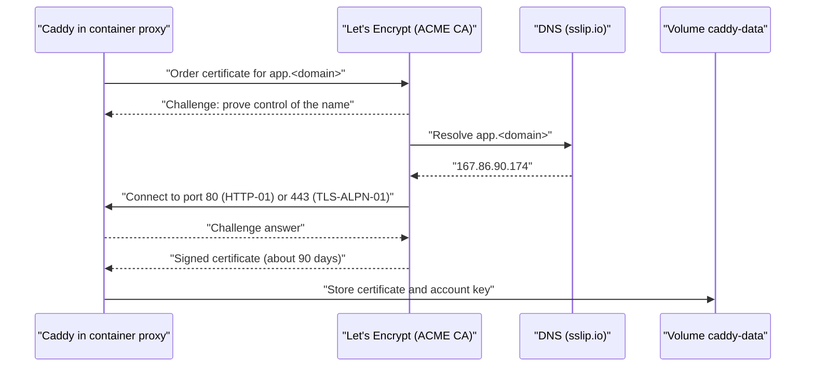

# DNS, HTTPS and sslip.io

> **Owner role:** Infrastructure and deployment
> **Status:** PARTIALLY IMPLEMENTED — the Preview hostnames, automatic HTTPS and Caddy routing are IMPLEMENTED and observed live; certificate renewal, live firewall rules and the live Docker runtime are NOT VERIFIED.
> **Language / اللغة:** English · [العربية](dns-https-sslip-io-ar.md)

This page explains, from first principles, how the Matbakhy Preview gets its names (DNS), its encryption (TLS) and its routing (Caddy). It also lists every place where the Preview domain is written into the repository and gives the runbook for replacing it. Related pages: [runtime architecture](runtime-architecture.md), [deployment pipeline](deployment-pipeline.md), [server inventory](contabo-server-inventory.md), [rebuild guide](server-rebuild-guide.md), [live Preview access](../05-developer-workflow/live-preview-access.md), and the architecture summary in [infrastructure and deployment](../03-architecture/infrastructure-and-deployment.md).

## Evidence legend

| Label | Meaning |
|---|---|
| VERIFIED LIVE | Observed on 2026-10-21 by the unprivileged Linux user aiagent on the Contabo VPS itself (read-only, no sudo, no Docker socket). Only the facts in the live-facts record count. |
| VERIFIED IN CODE | Read in this repository (file named next to the claim). |
| DOCUMENTED ONLY | A document or a vendor manual says it; not confirmed here or live. |
| OUTDATED / INCORRECT | Conflicts with newer evidence, for example Hetzner-era text. |
| NOT VERIFIED | Nobody has confirmed it. The page says how an authorized administrator can verify it. |

## 1. Concepts from first principles

### 1.1 What sslip.io is

sslip.io is a public DNS service run by a third party. It has no account, no dashboard and no configuration: a hostname that contains an IPv4 address answers a DNS query with that same address. (DOCUMENTED ONLY: the service description is not in this repository; the behaviour for this Preview is VERIFIED LIVE below.)

How the Preview name is built:

| Part | Value | Evidence |
|---|---|---|
| Preview domain (the variable PREVIEW_DOMAIN) | `167-86-90-174.sslip.io` | VERIFIED IN CODE: `.github/workflows/deploy-preview.yml` (front image build argument) and `docs/operations/14-keycloak-admin-console.md` |
| IPv4 encoded in the name | 167.86.90.174, with dashes in place of dots | VERIFIED LIVE: the name resolves to 167.86.90.174, which is the public IPv4 of the VPS interface eth0 |
| Host names derived from it | `app.`, `ops.`, `api.`, `id.`, `kc-admin.`, `media.` followed by the domain | VERIFIED IN CODE: `deploy/web-preview/Caddyfile` |

Because the third-party service answers for any name under its domain, there is no DNS record for the Preview owner to create, renew or lose. The consequence is a dependency: if the sslip.io service were unavailable, the Preview names would not resolve. Its availability and its terms are not controlled by the project (NOT VERIFIED beyond the live resolution observed on 2026-10-21).

### 1.2 DNS in one paragraph

DNS maps a name to addresses. An A record holds an IPv4 address and an AAAA record an IPv6 address. A resolver asks the authoritative server, then caches the answer for the record's time to live (TTL). A changed record is therefore not seen everywhere at once; clients keep the old answer until their cached copy expires. The live facts record that the names under the Preview domain resolve to 167.86.90.174 (VERIFIED LIVE). Whether an AAAA answer exists for them was not recorded (NOT VERIFIED), although the VPS has a public IPv6 address 2a02:c207:2367:3442::1 on eth0 (VERIFIED LIVE).

### 1.3 DNS is not TLS

DNS only says which address a name has. TLS proves that the server at that address holds a certificate for the name and encrypts the traffic. Both must be right: a correct A record with no valid certificate gives a browser warning, and a valid certificate cannot help if the name points at another server. Certificates are issued per name; Caddy requests one for each host written in the Caddyfile (VERIFIED IN CODE: one site block per host).

### 1.4 ACME and Let's Encrypt through Caddy

ACME is the protocol by which a certificate authority (CA) checks that a requester controls a name and then issues a certificate. Let's Encrypt is a free CA that speaks ACME. The Preview proxy is Caddy, which has automatic HTTPS: for each site address it obtains and renews certificates by itself, without cron jobs or manual commands. (DOCUMENTED ONLY: Caddy's manual; the behaviour in this repository is below.)

| Fact | Evidence |
|---|---|
| The Caddyfile global block sets the ACME account e-mail from the variable ACME_EMAIL and nothing else about ACME. No CA, challenge type or staging endpoint is configured, so Caddy defaults apply. | VERIFIED IN CODE: `deploy/web-preview/Caddyfile` (global block) |
| ACME_EMAIL is required (compose refuses to start without it). | VERIFIED IN CODE: `deploy/web-preview/compose.yaml` (service proxy, environment) |
| The certificate of `app.` is issued by Let's Encrypt (CN YE1), valid 2026-10-18 07:09:06 GMT to 2027-01-16 07:09:05 GMT, about 90 days. | VERIFIED LIVE |
| Caddy runs inside a container (image caddy:2.10.2-alpine); no caddy package is installed on the host. | VERIFIED IN CODE: `deploy/web-preview/front.Dockerfile`; VERIFIED LIVE: caddy is not installed on the host |
| Caddy tries Let's Encrypt first and may fall back to another CA when issuance fails. Which CA issued the other hosts' certificates was not recorded. | DOCUMENTED ONLY (Caddy manual); other hosts NOT VERIFIED |

The diagram shows one issuance. The CA first resolves the name through public DNS, then connects to the server on port 80 or 443; if either step fails, no certificate is issued.

### 1.5 Why ports 80 and 443 must be reachable from the Internet

The CA validates from the public Internet, not from inside your network. HTTP-01 uses port 80 and TLS-ALPN-01 uses port 443 (DOCUMENTED ONLY: ACME standard and Caddy manual). In this repository:

* The proxy service publishes `80:80` and `443:443` (VERIFIED IN CODE: `deploy/web-preview/compose.yaml`, service proxy, ports).
* The host listens publicly on 22, 80 and 443 (VERIFIED LIVE: ss output).
* The customer allow-list does not block the CA, because Caddy completes the challenge before the request reaches the route that applies the allow-list (DOCUMENTED ONLY for the ordering inside Caddy; NOT VERIFIED by a live issuance test). Do not firewall ports 80 and 443 by source address at the cloud or host firewall.
* The host firewall ufw is installed (VERIFIED LIVE) but its state and rules are NOT VERIFIED LIVE (root is required). A provider-level firewall for the Contabo VPS is also NOT VERIFIED.

### 1.6 Where certificates persist

compose.yaml mounts two named volumes into the proxy container: caddy-data at /data and caddy-config at /config (VERIFIED IN CODE). Caddy keeps issued certificates and its ACME account in its data directory (DOCUMENTED ONLY: Caddy manual), so they survive container recreation and image upgrades. Consequences:

* Removing the volume (for example `docker compose down -v`) discards the certificates and forces new orders, which count against CA rate limits.
* The `deploy.sh backup` command does not mention Caddy (VERIFIED IN CODE: no match for caddy in `deploy/web-preview/deploy.sh`), so on a rebuilt server certificates are re-issued rather than restored. The same applies to the live server: whether any other backup copies the volume is NOT VERIFIED.
* The real volume name on the live host (Compose normally prefixes it with the project name matbakhy-preview) and its size were NOT VERIFIED LIVE; an authorized administrator can list volumes with the read-only command in [admin read-only verification](admin-readonly-verification.md).

### 1.7 Renewal

Caddy renews certificates automatically before they expire, by default when about one third of the lifetime remains (DOCUMENTED ONLY: Caddy manual). Status:

| Item | Status |
|---|---|
| Renewal is automatic and needs no cron job in this repository | DOCUMENTED ONLY; VERIFIED IN CODE: no renewal command or timer exists in `deploy/web-preview` |
| The `app.` certificate was issued on 2026-10-18 and expires on 2027-01-16 | VERIFIED LIVE |
| A renewal has actually occurred on this server | NOT VERIFIED: the first certificate observed is still within its first period |

To check later without any privilege, run the openssl command in section 5 and confirm the expiry date moves forward before it passes; an administrator can also read the proxy container logs (see [admin read-only verification](admin-readonly-verification.md)).

### 1.8 Rate limits (DOCUMENTED ONLY)

Certificate authorities limit how many certificates, failed validations and duplicate orders they accept in a period. Let's Encrypt publishes such limits (for example for failed validations and for repeated identical certificates). The exact numbers change over time and are not stored in this repository, so read the current limits in the Let's Encrypt documentation before any bulk change. Practical rules that follow from the mechanism:

* Make sure DNS resolves to the server and ports 80 and 443 are open before the first start, otherwise Caddy retries and can exhaust the failed-validation allowance (the existing guidance in `docs/operations/12-owner-server-setup.md`, section 2, says the same, and is Hetzner-era text).
* Do not delete the caddy-data volume without reason.
* Six hosts need six certificates (or one per name); a domain replacement therefore issues six new orders at once.
* Whether a shared limit applies to names under sslip.io is NOT VERIFIED.

## 2. Hostnames, routing and live behaviour

All six hosts are defined in `deploy/web-preview/Caddyfile` (VERIFIED IN CODE). Each site wraps its directives in a route block so the written order is kept. Access logs are off. Live results were obtained with curl from the VPS itself, so the caller's address is the server's own address; a caller in another network can get a different answer where an access class applies (VERIFIED LIVE).

| Host | What the Caddyfile does (VERIFIED IN CODE) | Live result (VERIFIED LIVE) | Reading |
|---|---|---|---|
| `app.<domain>` | Customer access class; static customer web from /srv/customer-web with single-page fallback to index.html; CSP report-only; X-Frame-Options DENY | GET `/` returns 200 | Expected |
| `ops.<domain>` | Staff access class; static operations web from /srv/operations-web with the same fallback | GET `/` returns 200 | Expected |
| `api.<domain>` | Paths `/api/v1/ops` and `/api/v1/cook` answer 403 "Not available" to callers outside the staff class; the customer class is then applied to every request on the host as well, so a staff API caller must be in both lists (see section 3); only `/api/*`, `/oauth2/*`, `/login/oauth2/*` and `/logout` are proxied to api:8080; every other path answers 404 | `/api/v1/configuration/public` returns 200 JSON with orderingAvailable true and environment name PREVIEW, demo true; `/actuator/health` returns 404 | Expected. Actuator is deliberately not proxied; management runs on port 8081, which the proxy never forwards (`deploy/web-preview/compose.yaml`) |
| `id.<domain>` | Customer access class; `/admin`, `/admin/*`, `/realms/master` and `/realms/master/*` answer 404; everything else goes to identity:8080 (Keycloak) | GET `/` returns 302 with Location `https://kc-admin.167-86-90-174.sslip.io/admin/` | Expected, see section 2.2 |
| `kc-admin.<domain>` | Not IP-restricted. Whole host answers 404 "Not available" unless the flag file admin-console-public exists in /srv/flags inside the proxy container; `/` redirects with 302 to `/admin/master/console/`; only the console, master realm sign-in and static asset paths reach Keycloak; request body limit 10MB | GET `/` returns 302 with Location `/admin/master/console/` | Expected. The 302 (and not the closed-host 404) shows the flag is currently present and the console is published. Protection is password plus one-time password (`docs/operations/14-keycloak-admin-console.md`) |
| `media.<domain>` | Customer access class; everything proxied to storage:8333 (SeaweedFS S3 gateway) | GET `/` returns 403, Content-Type application/xml, with an x-amz-request-id header | Expected, see section 2.1 |

### 2.1 Why media returns 403 at its root

* The Caddyfile does not answer for media itself except for the customer access refusal, which sends a plain-text body "Not available" with status 403 and has no x-amz-request-id header (VERIFIED IN CODE).
* The live response has Content-Type application/xml and an x-amz-request-id header (VERIFIED LIVE). Those are S3 gateway features, so the response came from SeaweedFS behind Caddy, not from Caddy's own refusal.
* The request to the root path is an anonymous request to list buckets. S3 denies that without credentials (an access denied style XML error; the exact body and error code were not stored, so none is claimed).
* The public objects are under the path `/matbakhy-public/`: the API builds public URLs as `https://media.<domain>/matbakhy-public` (VERIFIED IN CODE: OBJECT_STORAGE_PUBLIC_BASE_URL in `deploy/web-preview/compose.yaml`). A 403 at the root is therefore the expected answer; it does not mean the media host is down. A real fault would show as 502 or a connection error (NOT VERIFIED; derived from how the proxy behaves), or as the plain "Not available" body if the caller is outside the customer class.
* An object under the public prefix returning 200 was not recorded live (NOT VERIFIED).

### 2.2 Why id returns 302

* Keycloak's hostname setting KC_HOSTNAME is https://id.<domain> and KC_HOSTNAME_ADMIN is https://kc-admin.<domain> (VERIFIED IN CODE: `deploy/web-preview/compose.yaml`, service identity).
* Caddy forwards `/` on id to Keycloak unchanged; the live redirect Location points at the kc-admin host's `/admin/` (VERIFIED LIVE). Keycloak redirects its own root to the admin URL when an admin hostname is configured, so the 302 is Keycloak behaviour, not a Caddy rule and not an error. This explanation of the cause is an inference from the configuration and the observed Location header; it was not confirmed by reading Keycloak internals.
* Sign-in for customers does not use the root. It uses paths such as `/realms/matbakhy/...`; `deploy/web-preview/smoke.sh` checks the issuer https://id.<domain>/realms/matbakhy and that `/admin` and master realm paths on id answer 404 (VERIFIED IN CODE).
* Do not "fix" the 302 by adding a Caddy rule on the id host without reading `docs/operations/14-keycloak-admin-console.md`.

## 3. Security headers, access classes and CSP

| Topic | Behaviour | Evidence |
|---|---|---|
| Headers on every host | Strict-Transport-Security max-age=31536000, X-Content-Type-Options nosniff, Referrer-Policy strict-origin-when-cross-origin, X-Robots-Tag noindex and nofollow, Server header removed | VERIFIED IN CODE: Caddyfile, snippet headers |
| Customer class | Variable CUSTOMER_ALLOWED_IPS. Applies to app, id and media, and to every request on api (after the staff check on the staff paths). Outside callers get 403 "Not available". | VERIFIED IN CODE: Caddyfile, snippet customer_access |
| Staff class | Variable STAFF_ALLOWED_IPS. Applies to ops and to `/api/v1/ops` and `/api/v1/cook` on api. On ops it is the only class. On those api paths it is checked first and the customer class is then applied to the same request, so a staff API caller must be in both STAFF_ALLOWED_IPS and CUSTOMER_ALLOWED_IPS (the intersection); keep every staff address in the customer list too. The Caddyfile comment that says these paths answer "the staff class only" describes the first check, not the second (the line `import customer_access` that follows it). | VERIFIED IN CODE: Caddyfile, snippet staff_access and api site |
| Defaults | Both default to ALLOWED_CLIENT_IPS, so no customer-class host (app, id, media, api) is public until the owner sets CUSTOMER_ALLOWED_IPS to "0.0.0.0/0 ::/0". The kc-admin host is exempt: it is in neither class, and whether it answers depends on the flag file admin-console-public (see the kc-admin row in section 2) | VERIFIED IN CODE: `deploy/web-preview/compose.yaml`, `deploy/web-preview/.env.example` |
| Current live values | NOT VERIFIED (the `.env` file is mode 600 and was not read). An administrator can read it with the procedure in [admin read-only verification](admin-readonly-verification.md). | VERIFIED LIVE for the file mode only |
| Content Security Policy | Sent as Content-Security-Policy-Report-Only on app and ops; it references https://media.<domain> for images and https://api.<domain> for connections, so both follow the PREVIEW_DOMAIN variable at container start. Promotion to an enforcing policy is planned in `docs/security/csp-rollout.md`. | VERIFIED IN CODE: Caddyfile, snippet web_csp |
| Access tests | `scripts/test_proxy_access.py` runs the real Caddyfile in a throwaway container with stub upstreams and fixed client addresses; it skips when Docker or a Caddy image is not already present | VERIFIED IN CODE |

Further explanation of the hardening decisions: [identity and security](../03-architecture/identity-and-security.md#browser-and-proxy-hardening).

## 4. Where the Preview domain is written in the repository

Search used: the dashed form 167-86-90-174 across the whole repository, excluding Git metadata and dependency folders (VERIFIED IN CODE, run on the worktree of develop at 39b8420). The dotted IP 167.86.90.174 does not appear in any file. The generated status reports under docs/status contain no occurrence of either form. Pages added by this handbook that quote the domain as documentation are not listed.

| File and line | Kind | Must change on domain replacement? |
|---|---|---|
| `.github/workflows/deploy-preview.yml:64` | Front image build argument PREVIEW_DOMAIN=167-86-90-174.sslip.io. This bakes the API address into the web builds. | Yes. The only executable hardcoded value; the deployed site would otherwise call the old API host. |
| `docs/operations/14-keycloak-admin-console.md:4` | Example URL of the admin console | Documentation only; update to avoid a wrong example |
| `docs/developer-handbook/03-architecture/infrastructure-and-deployment.md:114` | Known-limitations note naming the domain | Documentation only (its Arabic mirror `docs/developer-handbook/03-architecture/infrastructure-and-deployment-ar.md:114` is the same) |
| `docs/quality/owner-acceptance/owner-guide-ar.md:5` and lines 8 to 12 | Owner guide link table (Arabic) | Documentation only; owners follow these links, so update them |
| `docs/quality/owner-acceptance/cases/config-security.json:4994` and `:5223` | Review notes that mention the former hardcoded value | Documentation only (history); no change needed |
| `docs/quality/owner-acceptance/generated/review-findings.md:9` and `:34` | Generated review findings that mention it | Documentation only (history); no change needed |

Everything else takes the domain from the variable PREVIEW_DOMAIN, at run time for the Caddyfile, compose.yaml, the rendered realm file (rendered by `deploy.sh render`), smoke.sh, admin-console.sh and the identity scripts, and at build time for front.Dockerfile and preview-images.yml (VERIFIED IN CODE):

| Consumer | How it uses the domain |
|---|---|
| `deploy/web-preview/Caddyfile` | Site addresses app., ops., api., id., kc-admin. and media. followed by the variable; CSP source lists |
| `deploy/web-preview/compose.yaml` | KC_HOSTNAME, KC_HOSTNAME_ADMIN, OIDC_ISSUER, WEB_ALLOWED_ORIGINS, WEB_COOKIE_DOMAIN, WEB_POST_LOGIN_REDIRECT, OBJECT_STORAGE_CLIENT_ENDPOINT, OBJECT_STORAGE_PUBLIC_BASE_URL |
| `deploy/web-preview/identity/matbakhy-realm.preview.json` | Client matbakhy-web redirect URI and post-logout URIs, rendered by `deploy.sh render` (`deploy/web-preview/deploy.sh`, sed replacement of the domain placeholder) |
| `deploy/web-preview/front.Dockerfile` | Build argument PREVIEW_DOMAIN becomes VITE_API_BASE_URL https://api.<domain>; the build fails if it is empty |
| `.github/workflows/preview-images.yml` | Manual workflow with the input preview_domain, validated by a regular expression, passed as the build argument |
| `deploy/web-preview/smoke.sh`, `deploy/web-preview/admin-console.sh`, `deploy/web-preview/identity/*.py` | Receive the domain as an argument or environment variable |

## 5. Safe verification commands

These are read-only. They query public DNS and the public hosts; none changes anything. The command syntax is standard for each tool and is DOCUMENTED ONLY here; the expected results for the Preview come from the live facts above. Replace the placeholder with the real domain.

| Command | Machine | Linux user | Kind | Expected result | If it fails |
|---|---|---|---|---|---|
| `dig +short A app.<preview-domain>` | your laptop or the VPS | any | read-only | Prints 167.86.90.174 for the current Preview | Empty output: the name does not resolve; check the spelling, the IP embedded in the name, or the resolver (repeat with the nslookup command below, which uses another resolver) |
| `dig +short AAAA app.<preview-domain>` | your laptop or the VPS | any | read-only | Unknown for the Preview (NOT VERIFIED). Empty output is plausible for a name built from an IPv4 address, but this was not checked | If an IPv6 answer appears, check that the server really listens on that address |
| `nslookup app.<preview-domain> 1.1.1.1` | your laptop | any | read-only | The name resolves to the same address through an independent public resolver | Different answer: cached older record; wait for the TTL |
| `curl -sS -I https://app.<preview-domain>/` | your laptop | any | read-only | HTTP 200 with the security headers of section 3 when the caller is inside the customer class; 403 "Not available" from outside it | Certificate error: see the openssl command; timeout: the host or port 443 is not reachable |
| `curl -sS -I https://id.<preview-domain>/` | your laptop | any | read-only | 302 with Location to the kc-admin host (when the id host is allowed for your address) | 403: you are outside the customer class |
| `curl -sS -o /dev/null -w '%{http_code}\n' https://media.<preview-domain>/` | your laptop | any | read-only | 403 (S3 denial, see section 2.1) | 000 or 502: the proxy or storage is down |
| Inspect: `openssl s_client -connect app.<preview-domain>:443 -servername app.<preview-domain> </dev/null 2>/dev/null \| openssl x509 -noout -issuer -subject -dates -ext subjectAltName`. Validate: `curl -sS -o /dev/null -w '%{http_code} verify=%{ssl_verify_result}\n' https://app.<preview-domain>/` | your laptop | any | read-only | The inspection prints only the certificate the server presents; it does not validate it. Read the subjectAltName line for the host name. The validation keeps TLS verification on: it prints `verify=0` only when the chain and the host name validate (the HTTP code may be 403 from the access policy); exit status 60 or a non-zero verify value is a certificate failure. Never use `curl -k`. Issuer Let's Encrypt; notBefore and notAfter about 90 days apart (for the live app host, 2026-10-18 to 2027-01-16 at the time of observation) | Empty output: no TLS handshake; the `-servername` option is required because Caddy picks the certificate by the requested name |

The repository smoke test `sh deploy/web-preview/smoke.sh <preview-domain>` performs several of these checks and more (run on a machine in the staff class; set SMOKE_OPS=skip elsewhere). It is read-only (VERIFIED IN CODE: header comment of the script).

## 6. Domain replacement runbook

Use this when the Preview leaves sslip.io (for example for a company domain) or the server IP changes. This is a plan only; no code changes are made by this page. Everything here is state-changing: perform it first on a new isolated server or in a maintenance window, never as an experiment on the live Preview. Rehearsal cost: six new certificates.

**Decision before step 1: existing application accounts.** The API identifies an account by the pair issuer and subject (VERIFIED IN CODE: `backend/modules/identity/src/main/java/com/matbakhy/identity/internal/JdbcAccountDirectory.java`, lookup `WHERE issuer = ? AND subject = ?`), and the issuer is built from the domain (OIDC_ISSUER in `deploy/web-preview/compose.yaml`, `https://id.<domain>/realms/matbakhy`). After a domain change the stored issuer of every existing account no longer equals the token issuer, so existing users are not matched to their application accounts (the recovery page makes the same point: [backup, restore and disaster recovery](backup-restore-disaster-recovery.md)). Before anything else the owner must decide, and record, one of two outcomes: migrate the stored issuer values in the application database as a rehearsed, backed-up change (whether Keycloak subjects stay the same depends on the realm data being kept; NOT VERIFIED), or accept an intentional reset of the Preview accounts. Without that decision, do not change the domain.

### 6.1 Variables and values to decide

| Item | Where | Note |
|---|---|---|
| PREVIEW_DOMAIN | server `.env` (mode 600), built into the front image | New value; it is also the scope of the cookie domain |
| ACME_EMAIL | server `.env` | A monitored address for CA notices |
| ALLOWED_CLIENT_IPS, CUSTOMER_ALLOWED_IPS, STAFF_ALLOWED_IPS | server `.env` | Unchanged unless the audience changes; every staff address must also stay in the customer list (section 3) |
| GENERATED_DIR | server `.env` | `.env.example` still shows the Hetzner-era default /srv/matbakhy-preview/generated, which is OUTDATED for the Contabo layout (the live deployment directory is /srv/matbakhy-staging, VERIFIED LIVE); the value used by the live `.env` is NOT VERIFIED |

### 6.2 Ordered steps

| Step | Action | Machine and user | Kind |
|---|---|---|---|
| 1 | Create DNS: an A record (and AAAA if the server has public IPv6) for each of app., ops., api., id., kc-admin. and media. under the new domain, pointing at the server. Verify with the dig commands of section 5 before continuing. With sslip.io, only the IP in the name matters. | DNS provider console | State-changing at the provider |
| 2 | Confirm ports 80 and 443 reach the server from the Internet (provider firewall and ufw; both NOT VERIFIED LIVE for the current server). | Administrator on the VPS with sudo | Read-only check first |
| 3 | Make the code changes listed in section 6.3 in a pull request. | Your laptop | Code change |
| 4 | Build the front image for the new domain. Either merge the pull request to develop (the deployment workflow builds it and also deploys it, see the sequencing warning below) or run the manual workflow `.github/workflows/preview-images.yml` with the preview_domain input, which only builds. | GitHub | State-changing (publishes images) |
| 5 | Set PREVIEW_DOMAIN, RELEASE_COMMIT, API_IMAGE and FRONT_IMAGE in the server `.env`, all three release values from the same build (`deploy.sh` requires the commit and both digest-pinned images; the image workflow outputs all three); run `./deploy.sh render` to rewrite the realm import with the new redirect URIs. | The deployment user on the VPS (STAGING_SSH_USER, NOT VERIFIED which account) | State-changing |
| 6 | Keycloak: the realm import file is read when Keycloak starts with --import-realm. Keycloak's documented behaviour is that an already-existing realm is skipped by the import (DOCUMENTED ONLY; not rehearsed here), so the persisted matbakhy-web client redirect URI and post-logout URIs must be updated explicitly in the admin console (or by another rehearsed method); do not rely on the import to change them. | Authorized Keycloak administrator | State-changing |
| 7 | Run `./deploy.sh up`, then wait for the proxy to obtain certificates (first requests can show a certificate error for a short time). | Deployment user on the VPS | State-changing |
| 8 | Admin console: `./deploy.sh admin-console enable` re-hardens and re-verifies against the new host. | Deployment user on the VPS | State-changing |
| 9 | Verify: first the read-only checks (section 5 commands, then `sh deploy/web-preview/smoke.sh <new-domain>`). Then, only with explicit authorization, the browser journeys in [live Preview access](../05-developer-workflow/live-preview-access.md): those journeys create orders, change prices, grant permissions and modify MFA settings on synthetic data, so they are state-changing, not read-only. Do not run them as part of a routine check. | Your laptop | Read-only for the first part; state-changing (synthetic data) for the journeys |
| 10 | Update owner-facing links. Keeping the old names working while testers move is NOT possible with the current configuration: the Caddyfile builds every host from the single variable PREVIEW_DOMAIN (VERIFIED IN CODE), so recreating the proxy with the new value removes the old host definitions, and leaving DNS unchanged does not keep them served. Treat the change as a coordinated cutover with downtime for the old names. Temporary dual-domain routing is not designed and has not been rehearsed (NOT VERIFIED); it needs a separate design, rehearsal and an owner decision. | Maintainers | Documentation |

**Sequencing warning (VERIFIED IN CODE: `.github/workflows/deploy-preview.yml`).** A push to develop does not only build: the same workflow then deploys the new images to the server using the PREVIEW_DOMAIN that the server `.env` holds at that moment, and afterwards runs `./deploy.sh admin-console enable` as a separate step. If the pull request is merged first, the new front image (built for the new API host) is started on a server that is still configured for the old domain, and the old domain stops working before DNS, `.env`, Keycloak and certificates are ready. Treat steps 1, 2, 5, 6 and the merge as one coordinated window: prepare DNS and the ports first, rehearse on another server, set the new PREVIEW_DOMAIN in the server `.env` immediately before the merge (or build with the manual workflow and deploy by hand), and have the rollback of section 6.4 ready. The workflow restores the previous `.env` only when `up` or `smoke` fails inside its remote deployment script; it does not restore anything if the later admin-console step fails.

### 6.3 Required code and configuration changes (list only, none made here)

| Area | What must change | Evidence |
|---|---|---|
| GitHub Actions workflow | The literal build argument in `.github/workflows/deploy-preview.yml:64`: replace the hardcoded value with the new domain (preferably a repository variable). Otherwise every push to develop builds a front image for the old API host. | VERIFIED IN CODE |
| Caddyfile | No edit. Hosts and CSP use the variable. Check that the six names all point at the server. | VERIFIED IN CODE |
| Frontend build arguments | PREVIEW_DOMAIN sets VITE_API_BASE_URL for both web apps; they are rebuilt by the image build, nothing else to edit. | VERIFIED IN CODE: `deploy/web-preview/front.Dockerfile` |
| API base URLs and CORS | The API receives OIDC_ISSUER, WEB_ALLOWED_ORIGINS and the object storage URLs from compose.yaml with the domain variable; they follow `.env`. | VERIFIED IN CODE |
| Keycloak hostnames | KC_HOSTNAME and KC_HOSTNAME_ADMIN follow the variable. The master realm frontend URL is set by `deploy/web-preview/admin-console.sh` hardening, so run the admin-console step again. | VERIFIED IN CODE: `docs/operations/14-keycloak-admin-console.md` |
| OIDC redirect URIs | The matbakhy-web client redirect URI https://api.<domain>/login/oauth2/code/keycloak and post-logout URIs for app and ops come from the realm template rendered by deploy.sh. See step 6 for the caveat about an existing realm: the persisted client settings must be updated explicitly. | VERIFIED IN CODE: `deploy/web-preview/identity/matbakhy-realm.preview.json` |
| Cookies | WEB_COOKIE_DOMAIN equals the domain variable, so the XSRF-TOKEN cookie is set for the parent domain shared by app, ops and api. A new domain must stay a parent of all three hosts. Moving to a public-suffix-style shared domain (such as the sslip.io service itself) has browser cookie-sharing implications that are NOT VERIFIED. | VERIFIED IN CODE: `deploy/web-preview/compose.yaml` comment |
| Mobile preview configuration | The mobile app reads EXPO_PUBLIC_API_URL and EXPO_PUBLIC_OIDC_ISSUER at build time (`apps/customer-mobile/src/config.ts`); the Preview realm template has no mobile client (only the local realm `infra/identity/matbakhy-realm.json` defines matbakhy-mobile with the redirect matbakhy-dev://auth/callback), so no Preview mobile configuration exists to update. A future mobile preview needs a new client and build values. | VERIFIED IN CODE |
| Documentation | The owner guide, admin-console page and handbook examples (section 4 table). | VERIFIED IN CODE |
| Certificates | None to install; issuance is automatic after DNS and ports are right. | DOCUMENTED ONLY |

### 6.4 Rollback of a domain change

Keep the previous front image digest and `.env` copy before step 5, and write down the current matbakhy-web client settings (redirect URIs and post-logout URIs) in the Keycloak admin console before step 6. Reverting the containers means restoring both and running `./deploy.sh up` again; the previous domain's certificates are still in the caddy-data volume unless it was removed (DOCUMENTED ONLY for the storage layout). Restoring `.env` does not undo state that is already persisted in Keycloak: the admin-console hardening changes the master realm (frontend URL, required one-time password flow, brute-force protection, the admin-cli password grant, the operations client; VERIFIED IN CODE: `deploy/web-preview/identity/admin_console.py`), and these changes stay in the Keycloak database. After going back to the old domain, run `./deploy.sh admin-console enable` for the old host (the hardening is idempotent and sets the frontend URL again) and check it with `./deploy.sh admin-console status`; `./deploy.sh admin-console rollback` reverses the hardening itself and is a separate, deliberate decision. The client settings are not restored by that either: step 6 may have changed the matbakhy-web redirect and post-logout URIs in the persisted realm (Keycloak is documented to skip an existing realm on import, DOCUMENTED ONLY and not rehearsed here, see step 6; `admin-console enable` hardens the master realm only). Restore the recorded client settings by hand, reverse any issuer migration done in the application database (see the decision above), and verify that sign-in and sign-out work on the old domain; otherwise old-domain login can stay broken. Existing application accounts also follow the issuer decision above. Full rollback mechanics: [deployment pipeline](deployment-pipeline.md).

## Known limitations and documentation gaps

* Hetzner-era text is OUTDATED for the current host: the DNS section and cloud-firewall steps in `docs/operations/12-owner-server-setup.md`, the sizing note at the end of `deploy/web-preview/.env.example`, and `docs/operations/09-staging-hetzner-preparation.md`. The running host is Contabo (VERIFIED LIVE). Those documents describe the DNS and certificate idea correctly but their provider steps must not be used for the Contabo server.
* `.env.example` still points GENERATED_DIR at /srv/matbakhy-preview/generated, while the live deployment directory is /srv/matbakhy-staging and a stale older copy exists under /srv/matbakhy-preview (VERIFIED LIVE). Which path the live `.env` uses is NOT VERIFIED. The flag file for the admin console (generated/flags) depends on it.
* The location of the admin-console flag file inside the proxy container (mounted at /srv/flags) is NOT VERIFIED LIVE; `/srv/flags` does not exist on the host filesystem (VERIFIED LIVE).
* Live renewal, live firewall rules, the Docker runtime configuration, volumes and the proxy container logs are NOT VERIFIED LIVE; use [admin read-only verification](admin-readonly-verification.md).
* AAAA records and certificates of hosts other than `app.` were not recorded.
* The live CUSTOMER_ALLOWED_IPS and STAFF_ALLOWED_IPS values are NOT VERIFIED; a 403 "Not available" from outside the allowed networks is an access-policy answer, not an outage.
* The 302 and 403 explanations in sections 2.1 and 2.2 combine live observations with repository configuration; they were not confirmed by reading container logs.
