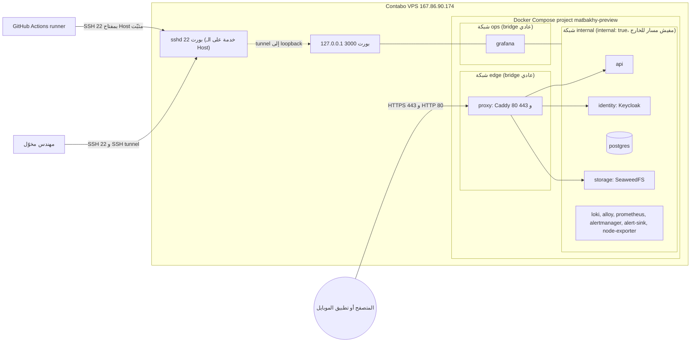
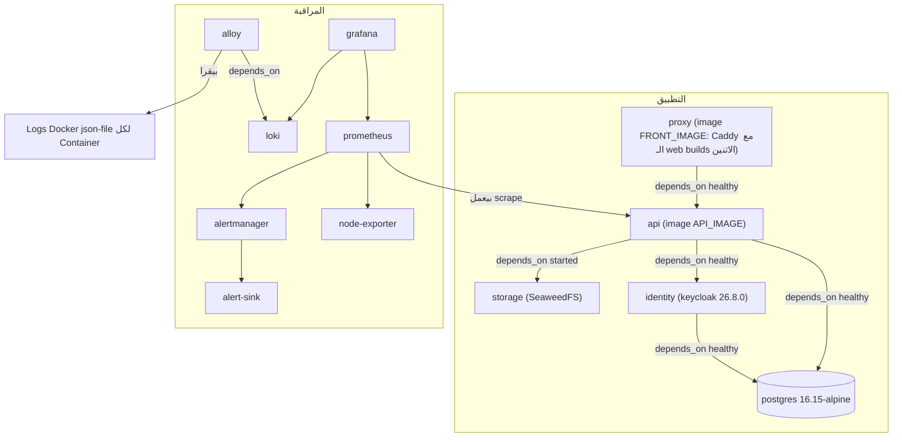
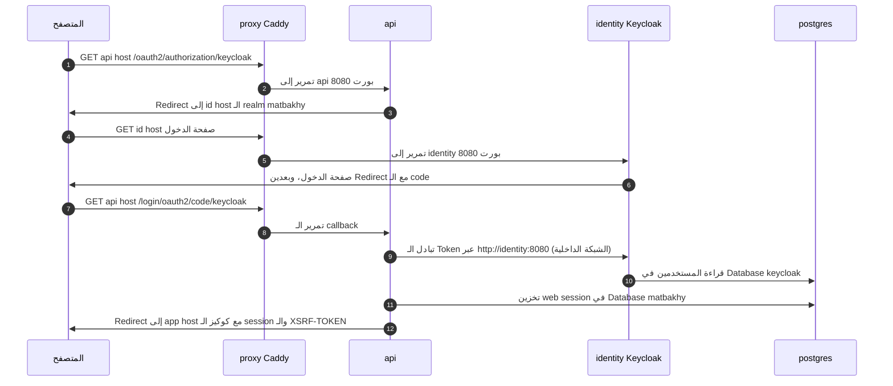
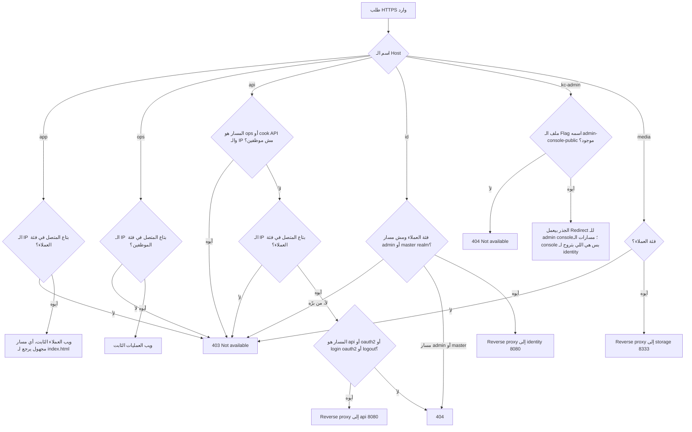
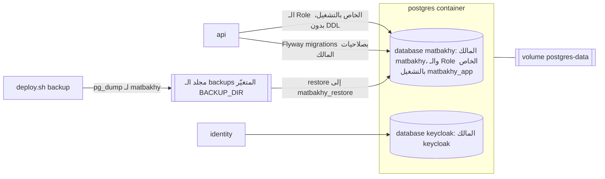
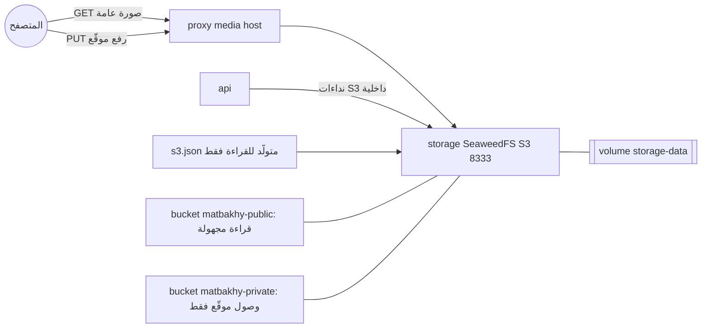
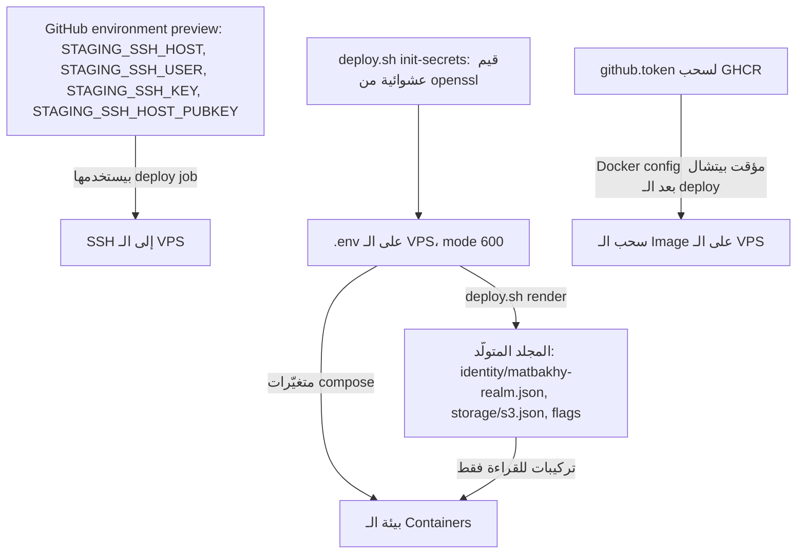
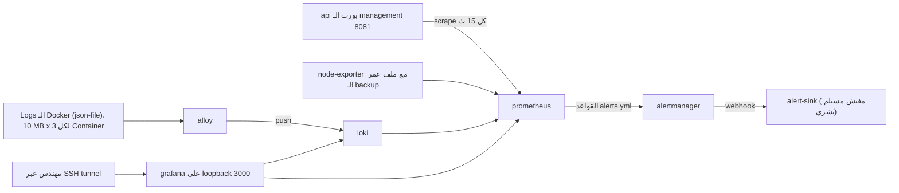
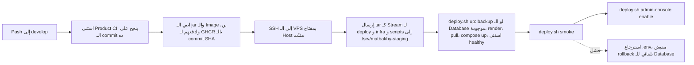
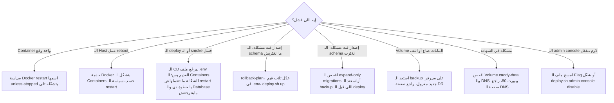

# معمارية التشغيل الخاصة بالـ Preview

> **Owner role:** Infrastructure and deployment
> **Status:** PARTIALLY IMPLEMENTED — الـ Preview stack متعرّف في الكود والـ Endpoints العامة بترد، لكن جرد الـ Containers على الـ Host الفعلي NOT VERIFIED LIVE
> **Language / اللغة:** [English](runtime-architecture.md) · العربية

الصفحة دي بتشرح الـ Preview بيشتغل إزاي: الشبكات، الـ Containers، الـ Authentication، توجيه الطلبات، التخزين الدائم، الميديا، الأسرار، المراقبة (Observability)، الـ Deployment ومسارات الفشل. هي بتلخّص الكود وبتربط بالمصادر الأصلية، ومابتكرّرهاش. النظرة العامة والرسومات الموجودة: [البنية التحتية والـ Deployment](../03-architecture/infrastructure-and-deployment-ar.md)، [رسم البنية التحتية للـ Preview](../03-architecture/diagrams-ar.md#14-بنية-المعاينة) و[رسم الـ Authentication](../03-architecture/diagrams-ar.md#6-الـ-authentication-oidc).

## دليل تصنيفات الأدلة

| التصنيف | معناه في الصفحة دي |
|---|---|
| VERIFIED LIVE | اتلاحظ على الـ Host بتاع Contabo بواسطة المستخدم aiagent اللي معندوش صلاحيات إدارية يوم 2026-10-21 (الـ Endpoints العامة، الـ Sockets اللي بتسمع، تواريخ شهادة TLS). مفيش أي حاجة تانية بتتسمّى LIVE. |
| VERIFIED IN CODE | اتقرا في الـ Repository (مع ذكر الملف). بيقول الكود بيطلب إيه، مش إيه اللي شغّال فعلًا. |
| DOCUMENTED ONLY | مستند أو سلوك منتج خارجي بيقول كده؛ ماتأكدناش منه هنا. |
| OUTDATED / INCORRECT | بيتعارض مع دليل أحدث، زي نص من فترة Hetzner. |
| NOT VERIFIED | مااتلاحظش في الـ Repository ولا على السيرفر الفعلي. الصفحة بتذكر طريقة للقراءة فقط يقدر الأدمن المخوّل يتأكد بيها، راجع [التحقق للقراءة فقط بواسطة الأدمن](admin-readonly-verification-ar.md). |

مهم: كل جملة عن الـ Containers (الأسماء، الـ Images، الحدود، الـ Volumes، الصحة) هي VERIFIED IN CODE بس. جرد الـ Containers الفعلي NOT VERIFIED LIVE لأن المستخدم aiagent مايقدرش يقرا الـ Docker socket. حقائق الـ Host الفعلية (الحسابات، المجلدات، الشبكة) موجودة في [جرد سيرفر Contabo](contabo-server-inventory-ar.md).

## 1. طوبولوجيا الشبكة

المصادر: `deploy/web-preview/compose.yaml` (الشبكات والـ Ports)، `deploy/web-preview/Caddyfile`، `.github/workflows/deploy-preview.yml`.

إزاي تقرا الرسم. في الكود، تلات حاجات بس يتوصّل ليها من الإنترنت: البورتين 80 و 443 بتوع الـ proxy container، وSSH على الـ Host (VERIFIED LIVE: الـ Listeners العامة على 22 و 80 و 443). الشبكة internal متعرّفة `internal: true`، فالـ Database وKeycloak والـ Storage والـ API Containers ملهاش مسار للإنترنت ومابتنشرش أي Ports (VERIFIED IN CODE). Grafana متوصّلة بالشبكة internal وبشبكة تانية عادية اسمها `ops` عشان Docker يقدر ينشر البورت بتاعها على `127.0.0.1:3000` بس؛ والمهندس بيدخل عليها عن طريق SSH tunnel (VERIFIED IN CODE؛ أمر الـ tunnel الموثّق موجود في `docs/operations/08-troubleshooting-runbook.md`). فيه Listener على 127.0.0.1:3000 على الـ Host (VERIFIED LIVE) بس مش ممكن نعرف العملية المالكة له من غير root، فده متوافق مع Grafana بس مش دليل قاطع عليها. حالة الـ Firewall بتاع الـ Host (ufw) NOT VERIFIED LIVE؛ ودليل Hetzner القديم كان معتمد على Cloud Firewall (OUTDATED بالنسبة لـ Contabo، راجع الفجوات تحت).

## 2. طوبولوجيا الـ Containers

المصادر: `deploy/web-preview/compose.yaml`، `deploy/web-preview/compose.4gb.yaml`، `deploy/web-preview/front.Dockerfile`.

إزاي تقرا الرسم. 12 Service متعرّفين (VERIFIED IN CODE). ترتيب التشغيل بيتفرض بـ `depends_on`: Postgres الأول، وبعدين Keycloak والـ API (الـ API بيستنى Keycloak يبقى healthy لأن استيراد الـ Realm لازم يكون خلص)، وبعدين الـ proxy لما الـ API يبقى healthy. الـ Images الاتنين الخاصين بالتطبيق بيتبنوا في الـ CI ومش على السيرفر أبدًا، ومحدّدين بالـ Digest في `.env`؛ والـ Images بتاعة الأطراف التالتة في Compose ليها Digest (أغلبها بالـ Tag والـ Digest؛ وصورة SeaweedFS بالـ Digest بس من غير Tag)، أما الـ Base images في الـ Dockerfiles فمتثبّتة بشكل مختلف: الـ Base image بتاع الـ API وهو `eclipse-temurin` بالـ Tag والـ Digest، لكن `front.Dockerfile` بيشير لـ Node وCaddy بالـ Tag بس من غير Digest (`deploy.sh` بيرفض Image للـ API أو الـ front من غير `@sha256:`).

### جدول الـ Services

كل القيم VERIFIED IN CODE من `deploy/web-preview/compose.yaml` إلا لو اتذكر غير كده. حدود الذاكرة هي القيم الافتراضية؛ و`compose.4gb.yaml` هو Override من فترة Hetzner (OUTDATED لـ Host بـ 23 GiB) وهل `COMPOSE_OVERRIDE` مظبوط في `.env` الفعلي NOT VERIFIED LIVE. كل الـ Services بتستخدم `restart: unless-stopped` والـ Logging المشترك json-file (10 MB، 3 ملفات، اسم الـ Container في الـ Tag).

| Service | الدور | البورت الداخلي | منشور | Health check | حد الذاكرة والـ CPU | Volume (نقطة التركيب) | حدود التخزين الدائم (Persistence Boundary) |
|---|---|---|---|---|---|---|---|
| proxy | Caddy: HTTPS، التوجيه، فئات الوصول، الـ web builds الثابتة | 80, 443 | أيوه، 80 و 443 على كل الـ Interfaces | مفيش | 256m, 0.5 | caddy-data (/data)، caddy-config (/config)، مجلد الـ flags للقراءة فقط (/srv/flags) | الشهادات وحساب ACME في caddy-data لازم تفضل موجودة؛ والـ web builds جوه الـ Image |
| postgres | الـ Databases matbakhy و keycloak | 5432 | لأ | pg_isready كل 5 ث، 30 محاولة | 1536m, 1.0 | postgres-data (/var/lib/postgresql/data)، مجلد الـ backups (/backups)، سكريبتات الـ init وreconcile.sql للقراءة فقط | النسخة الوحيدة من بيانات التطبيق والهوية إلا لو فيه Backup |
| identity | Keycloak 26.8.0 في وضع الـ Production، استيراد الـ Realm عند البدء | 8080 (الـ management 9000 حسب تعليق الـ Caddyfile) | لأ | بينجح بس لما وثيقة الـ discovery بتاعة الـ Realm matbakhy ترد؛ كل 10 ث، 60 محاولة | 1g, 1.0 | مجلد استيراد الـ Realm المتولّد، للقراءة فقط | Container بلا حالة (Stateless)؛ المستخدمين وبيانات الـ Realm في Database keycloak (VERIFIED IN CODE: اتصال الـ Database في `compose.yaml`)؛ واستمرارية الـ Sessions في الإعداد ده NOT VERIFIED، فمانفترضش إن الـ Sessions هتفضل موجودة بعد الاسترجاع |
| storage | SeaweedFS مع S3 gateway | 8333 | لأ | مفيش (الـ api بيستخدم الشرط service_started) | 512m, 0.5 | storage-data (/data)، s3.json المتولّد للقراءة فقط | الصور والمستندات الخاصة في storage-data |
| api | Spring Boot API، Flyway migrations | 8080 (الـ management 8081) | لأ | الـ Management health بيقول UP؛ كل 5 ث، 60 محاولة | 2g, 1.5 | مفيش | Stateless؛ الحالة في Postgres والـ storage |
| loki | مخزن الـ Logs | 3100 | لأ | مفيش | 384m, 0.5 | loki-data (/loki)، الـ config للقراءة فقط | الاحتفاظ 720h، و 168h للـ debug افتراضيًا |
| alloy | ناقل الـ Logs اللي بيقرا ملفات Logs الـ Docker | 12345 | لأ | مفيش | 256m, 0.25 | alloy-data، مجلد Docker containers على الـ Host للقراءة فقط | مواضع القراءة (Read Positions) بس |
| prometheus | المقاييس وقواعد التنبيه | 9090 | لأ | مفيش | 512m, 0.5 | prometheus-data (/prometheus)، الـ config والقواعد للقراءة فقط | 15d أو 2GB، أيهما أول |
| alertmanager | توجيه التنبيهات | 9093 | لأ | مفيش | 128m, 0.25 | alertmanager-data | الـ Silences وحالة الإشعارات |
| alert-sink | مستقبِل اختبار محلي للتنبيهات (مفيش حد بيتنبّه) | 8080 | لأ | مفيش | 64m, 0.1 | alert-sink-data | التنبيهات المخزّنة |
| node-exporter | مقياس قرص الـ Host والذاكرة والحِمل وعمر الـ Backup | 9100 | لأ | مفيش | 64m, 0.1 | جذر الـ Host للقراءة فقط، مجلد مقاييس الـ backups للقراءة فقط | مفيش |
| grafana | لوحات المتابعة | 3000 | أيوه، loopback بس (127.0.0.1:3000) | مفيش | 256m, 0.25 | grafana-data، الـ provisioning للقراءة فقط | حالة اللوحات؛ مصادر البيانات المتجهّزة موجودة في الـ Repository |

المجاميع (VERIFIED IN CODE، حساب على الجدول): حدود الذاكرة مجموعها 7040 MiB وحدود الـ CPU 6.45، وده داخل حدود الـ 8 vCPU والـ 23 GiB المتأكد منهم (VERIFIED LIVE) بهامش مريح. الحدود هي سقف مش استهلاك متقاس.

ملاحظات لازم تعرفها كمهندس:

* الـ alloy service بيشتغل بالمستخدم رقم 0 (root) وبيعمل Mount لمجلد Logs الـ Docker containers على الـ Host للقراءة فقط؛ والـ node-exporter بيعمل Mount لجذر الـ Host للقراءة فقط. الاتنين مقصودين في الكود وبيوسّعوا اللي ممكن يقراه Container مخترَق؛ ومفيش Mount لـ Docker socket في الملف.
* الـ Services المذكورة فوق هي الوحيدة الموجودة في الـ Preview؛ مفيش Redis ولا Queue broker ولا Worker container منفصل (VERIFIED IN CODE).
* الـ Named volumes بتاخد بادئة مشروع Compose `matbakhy-preview_` حسب قواعد التسمية في Compose (DOCUMENTED ONLY، سلوك Docker)؛ وأسماء الـ Volumes الفعلية ومسارها على الـ Host NOT VERIFIED LIVE.
* `compose.yaml` بيعمل Bind-mount لـ `${BACKUP_DIR}/metrics` للقراءة فقط جوه node-exporter (VERIFIED IN CODE)، فالمجلد ده لازم يكون موجود، بملكية تسمح لمستخدم الـ Backup بالكتابة فيه، قبل أول تشغيل. لو مش موجود، Docker بينشئ المسار على الـ Host بملكية root عند أول تشغيل (DOCUMENTED ONLY، سلوك Docker)، وساعتها ممكن مستخدم الـ Backup ما يقدرش يكتب ملف مقياس عمر الـ Backup. `deploy.sh` بينشئ المجلد في `backup_metric` بس، اللي بتشتغل بعد Backup متحقَّق منه، و`up` بياخد الـ Backup ده بس لو في Container لـ PostgreSQL شغال، فأول تشغيل مابينشئوش.
* الـ postgres service بيعمل Mount لـ `../../infra/db/reconcile.sql`، فلازم هيكل الـ Repository `deploy/web-preview` مع `infra/db` يكون موجود على السيرفر؛ علشان كده الـ CD بينقل `deploy` و`infra` و`scripts` (VERIFIED IN CODE).

## 3. مسار الـ Authentication

المصادر: `deploy/web-preview/compose.yaml` (متغيّرات OIDC)، `deploy/web-preview/Caddyfile`، التسلسل في [القسم 6 من الرسومات](../03-architecture/diagrams-ar.md#6-الـ-authentication-oidc). قواعد الأمان في [الهوية والأمان](../03-architecture/identity-and-security-ar.md).

إزاي تقرا الرسم. المتصفح بيشوف الأسماء العامة بس (الـ issuer هو `https://id.<domain>/realms/matbakhy`)، بينما الـ API بيكلّم Keycloak على الشبكة الداخلية (`OIDC_BACKCHANNEL_ISSUER`)، فتبادل الـ Token مابيخرجش برّه Docker أبدًا (VERIFIED IN CODE). `KC_HOSTNAME_BACKCHANNEL_DYNAMIC` بيخلّي Keycloak يرد على الاسمين. كوكي XSRF-TOKEN بتتحط للـ Domain الأب (`WEB_COOKIE_DOMAIN`) عشان تطبيقات الويب على app و ops تقدر تقرا اللي الـ API على api بيحطّه (تعليق VERIFIED IN CODE في ملف الـ compose). تخزين الـ web session في Postgres وأسماء الكوكيز جايين من الـ Backend ومتلخّصين في رسم الـ Authentication (DOCUMENTED ONLY هنا؛ صفحة الرسم استنتجتهم من إعدادات الأمان).

جذر الـ id host بيرد بـ 302 لـ admin console على kc-admin لأن `KC_HOSTNAME_ADMIN` بيشاور على الـ kc-admin host (VERIFIED LIVE للرد وVERIFIED IN CODE للسبب). الـ admin console موجودة على Host عام منفصل له حمايته الخاصة وملف Flag بيرفض في حالة الشك (Fail Closed) (راجع القسم 4).

## 4. توجيه الطلبات

المصدر: `deploy/web-preview/Caddyfile`؛ اختبارات السلوك: `scripts/test_proxy_access.py` (VERIFIED IN CODE إن الاختبار موجود؛ ومش بنقول إنه اتشغّل). تفاصيل الشهادات والـ DNS: [DNS وHTTPS وsslip.io](dns-https-sslip-io-ar.md).

إزاي تقرا الرسم. الوصول ممنوع افتراضيًا (Deny by Default) من خلال فئتين من الـ IP: فئة العملاء (app، الـ API بتاع العملاء، id، media) وفئة الموظفين (ops ومسارات `/api/v1/ops` و`/api/v1/cook`). الاتنين افتراضيًا بياخدوا `ALLOWED_CLIENT_IPS`؛ وفتح Hosts العملاء للكل خطوة صريحة من المالك (`CUSTOMER_ALLOWED_IPS`)، وفئة الموظفين عمرها ما بتتبعه. مسارات الـ API الخاصة بالموظفين (`/api/v1/ops` و`/api/v1/cook`) لازم تحقق القائمتين: الـ Caddyfile بيفحص `STAFF_ALLOWED_IPS` الأول وبعدين بيطبّق `customer_access` على نفس الطلب، فلازم عنوان الموظف يفضل كمان في قائمة العملاء (VERIFIED IN CODE، زي ما الرسم بيوضّح). الفئات المظبوطة فعليًا NOT VERIFIED LIVE لأن القيمة في `.env` المحمي؛ ومن عنوان السيرفر نفسه، app و ops و api ردّوا بنجاح (VERIFIED LIVE). رد Caddy بـ 403 والـ Body "Not available" هو رد سياسة وصول، مش انقطاع.

الردود اللي اتلاحظت (VERIFIED LIVE، من السيرفر نفسه): الـ Endpoint بتاع إعدادات الـ API بيرجّع 200 JSON؛ و`/actuator/health` على الـ api host بيرجّع 404 لأن الـ actuator مقصود إنه مش متمرّر عبر الـ proxy (الـ Caddyfile بيمرّر `/api/*` و`/oauth2/*` و`/login/oauth2/*` و`/logout` بس)؛ جذر id بيرجّع 302 للـ kc-admin console؛ جذر kc-admin بيرجّع 302 للـ master console (يعني ملف الـ Flag موجود دلوقتي)؛ جذر media بيرجّع 403 بنوع محتوى XML وهيدر `x-amz-request-id`، وده معناه إن S3 gateway نفسه رفض طلب سرد الـ Buckets من غير تسجيل دخول (Anonymous). ده متوقع: ملف الهوية الخاص بالـ storage بيسمح بالقراءة المجهولة على الـ Bucket matbakhy-public بس (VERIFIED IN CODE، `deploy/web-preview/storage/s3.json.template`)، فعرض الجذر مرفوض بينما الـ Objects تحت `/matbakhy-public/` مقروءة.

## 5. تتبّع طلب من البداية للنهاية

مثال: عميل مسجّل دخول فتح صفحة الوجبات وشاف صورة. كل خطوة مكتوب جنبها تصنيف الدليل.

| الخطوة | اللي بيحصل | فين | الدليل |
|---|---|---|---|
| 1 | المتصفح بيستعلم عن عنوان الـ IP للدومين `app.167-86-90-174.sslip.io`. خدمة sslip.io DNS بترد بالـ IP المضمّن في الاسم. | الـ DNS العام | VERIFIED LIVE (الاستعلام بيرجّع 167.86.90.174)؛ الآلية DOCUMENTED ONLY، راجع [صفحة الـ DNS](dns-https-sslip-io-ar.md) |
| 2 | المتصفح بيفتح TCP 443 على الـ IP العام. Docker بيمرّره للـ proxy container. | بورت الـ Host 443 | VERIFIED LIVE (الـ Listener)؛ التمرير VERIFIED IN CODE |
| 3 | Caddy بيقدّم شهادة Let's Encrypt (صالحة من 2026-10-18 إلى 2027-01-16 لـ app) وبيطبّق هيدرز الأمان. | proxy | VERIFIED LIVE (الشهادة)؛ الهيدرز VERIFIED IN CODE |
| 4 | Caddy بيفحص الـ IP بتاع المتصل مقابل فئة العملاء، وبعدين بيقدّم ملفات الـ single-page app من الـ Image. | proxy | VERIFIED IN CODE |
| 5 | الصفحة بتنادي `https://api.<domain>/api/...` (العنوان ثابت وقت بناء الـ Image). المتصفح بيبعت كوكيز الـ session والـ XSRF. | من المتصفح إلى proxy | VERIFIED IN CODE (الـ build argument في `front.Dockerfile`) |
| 6 | Caddy بيفحص فئة العملاء، وبيطابق `/api/*` وبيمرّر إلى `api:8080` على الشبكة الداخلية. | من proxy إلى api | VERIFIED IN CODE |
| 7 | الـ API بيحمّل الـ session والحساب من PostgreSQL وبيطبّق الـ Authorization والأسعار على السيرفر. | من api إلى postgres | DOCUMENTED ONLY (راجع [معمارية الـ Backend](../03-architecture/backend-architecture-ar.md)) |
| 8 | عند تسجيل الدخول، الـ API وKeycloak بيتبادلوا الـ Tokens عبر `http://identity:8080` (القسم 3). | من api إلى identity | VERIFIED IN CODE |
| 9 | الـ API بيرجّع بيانات الوجبة وفيها روابط الصور العامة تحت `https://media.<domain>/matbakhy-public/...`. | api | VERIFIED IN CODE (`OBJECT_STORAGE_PUBLIC_BASE_URL`) |
| 10 | المتصفح بيجيب الصورة من الـ media host؛ Caddy بيفحص فئة العملاء وبيمرّر إلى `storage:8333`؛ SeaweedFS بيقدّم Objects الـ Bucket العام بشكل مجهول. | من proxy إلى storage | VERIFIED IN CODE |
| 11 | الرد بيرجع بنفس الطريق؛ الـ proxy مابيحتفظش بـ access log (Logs الـ Container بس). | proxy | VERIFIED IN CODE (تعليق الـ Caddyfile) |

الرفع بيمشي على نفس الـ media host: الـ API بيطلّع عنوان رفع موقّع (Signed Upload URL) لـ `OBJECT_STORAGE_CLIENT_ENDPOINT` وهو بيوصل للـ storage بنفسه على `http://storage:8333` (VERIFIED IN CODE للـ Endpointين؛ والتوقيع منفّذ في `backend/app/src/main/java/com/matbakhy/app/providers/S3ObjectStorage.java`).

## 6. تخزين الـ Database الدائم

إزاي تقرا الرسم. Instance واحدة من PostgreSQL 16 فيها Databaseين. عند أول تشغيل لمجلد بيانات فاضي، `deploy/web-preview/postgres/10-keycloak.sh` بينشئ الـ Role والـ Database `keycloak` و`deploy/web-preview/postgres/20-runtime-role.sh` بينشئ الـ Role الأقل صلاحيات `matbakhy_app`؛ السكريبتات دي مابتشتغلش تاني، فتغيير كلمة سر Database في `.env` بعد كده مابيغيّرش الـ Role جوه Volume بيانات موجود (تعليقات VERIFIED IN CODE وسلوك Docker image، DOCUMENTED ONLY). Flyway بيعمل الـ Migration بدور المالك وبيدّي صلاحيات للـ Role الخاص بالتشغيل في خطوة after-migrate بتاعته. إجراء الـ Backup موجود في [النسخ الاحتياطي والاستعادة والتعافي من الكوارث](backup-restore-disaster-recovery-ar.md). حسب الكود، `deploy.sh backup` بيعمل dump للـ Database `matbakhy` بس (إعداد `PGDATABASE=matbakhy` في `backup_db`)، فالـ Database `keycloak` مش جزء من الـ dump ده؛ ومسارات Dump منفصلة لـ Keycloak متوصّفة في قسم الفجوات.

## 7. تخزين الميديا

إزاي تقرا الرسم. SeaweedFS بيشتغل في Container واحد بـ Volume محلي؛ و`deploy.sh up` بيحاول ينشئ الـ Buckets `matbakhy-public` و`matbakhy-private` من غير ما يضمن نجاح الإنشاء (Best Effort): الأمر ممكن يتكرر من غير مشاكل، بس مخرجاته بتتجاهل وأي فشل بيتتجاهل (`|| true`)، فنجاح `up` مابيثبتش إن أي واحد من الـ Bucketين موجود. اتأكد من الـ Buckets ومن ملف تجريبي بشكل منفصل (شوف السيناريو 21 في [حل مشاكل البنية التحتية](infrastructure-troubleshooting-ar.md)). ملف الهوية `s3.json` بيتولّد بواسطة `deploy.sh render` من `storage/s3.json.template` إلى المجلد المتولّد، وده بيبعد مفاتيح الـ storage عن Git. هوية `matbakhy-api` ليها كل الصلاحيات؛ وهوية `anonymous` تقدر تقرا الـ Bucket العام بس (VERIFIED IN CODE). أرشيف الـ storage في الـ Backup بيتاخد بعد إيقاف الـ storage service لفترة قصيرة. هل بيانات الـ storage بتتنسخ كمان برّه الـ Host NOT VERIFIED (مفيش خطوة زي كده في `deploy.sh`).

## 8. إدارة الأسرار

أسماء بس؛ ممنوع عرض القيم نهائيًا. المصدر: `deploy/web-preview/.env.example`، `deploy/web-preview/deploy.sh` (`init_secrets`، `render`)، `.github/workflows/deploy-preview.yml`.

| مجموعة الأسرار (الأسماء) | بتتخزن فين | بتتعمل إزاي | ملاحظة الاستعادة |
|---|---|---|---|
| الـ Database: POSTGRES_PASSWORD, KEYCLOAK_DB_PASSWORD, APP_DB_PASSWORD | `.env` على الـ VPS | `deploy.sh init-secrets` (hex عشوائي) | بتتطبّق على الأدوار عند أول تهيئة للـ Database بس؛ Volume بيانات مُستعاد بيحتفظ بكلمات سر الأدوار القديمة، فلازم تحافظ على `.env` المطابق |
| Keycloak Bootstrap (أدمن الـ Master Realm): KEYCLOAK_ADMIN_USER, KEYCLOAK_ADMIN_PASSWORD | `.env`؛ بتتبعت لـ Container الـ identity كمتغيّرات بيئة `KC_BOOTSTRAP_ADMIN_*` (`compose.yaml`)؛ مش جزء من ملف استيراد الـ Realm | `init-secrets` (كلمة السر؛ واسم المستخدم جاي من `.env.example`) | بتتستخدم لما Keycloak ينشئ الـ Master Realm أول مرة؛ وDatabase الـ Keycloak المُستعادة بتحتفظ بالأدمن اللي فيها أصلًا |
| الـ Application Realm في Keycloak: OIDC_WEB_CLIENT_SECRET, OIDC_ADMIN_CLIENT_SECRET, PREVIEW_USER_PASSWORD | `.env`؛ بتتحط في ملف استيراد الـ Realm | `init-secrets`؛ و`render` بيعمل الاستبدال للتلاتة دول بس في `identity/matbakhy-realm.preview.json` | أسرار الـ Clients لازم تتطابق بين Keycloak والـ API؛ اعمل render تاني بعد أي إعادة بناء |
| الـ Client بتاع العمليات في الـ Master Realm: KEYCLOAK_OPS_CLIENT_SECRET | `.env`؛ بيقراه `admin-console.sh` وبيمرّره لأداة الأدمن (`identity/admin_console.py`)؛ عمره ما بيتحط في ملف استيراد الـ Realm | `init-secrets`؛ و`admin-console.sh` بينشئ واحد لو مش موجود | بيتجهّز في الـ Master Realm بواسطة `deploy.sh admin-console enable`؛ وإجراء استعادته مش موثّق (NOT VERIFIED) |
| مفاتيح التطبيق: PHONE_CODE_PEPPER, HANDOVER_HASH_KEY, ACTIVITY_HASH_KEY, HANDOVER_ENCRYPTION_KEY, PUSH_TOKEN_HASH_KEY, PUSH_TOKEN_ENCRYPTION_KEY | `.env` | `init-secrets` | اعتبرها حرجة للاستعادة: الـ Hashes والحقول المشفّرة اللي اتكتبت بيها ماينفعش تتفحص أو تتقرا إلا بنفس القيم. الأثر الدقيق لضياع كل واحد منهم NOT VERIFIED |
| الـ Storage: STORAGE_ACCESS_KEY, STORAGE_SECRET_KEY | `.env`؛ بتتحط في `storage/s3.json` | `init-secrets`؛ `render` | لازم تطابق اللي الـ API بيستخدمه |
| Grafana: GRAFANA_ADMIN_PASSWORD | `.env` | `init-secrets` | إعادة الضبط ممكنة من جوه بيانات Grafana |
| صلاحية الـ Deployment: STAGING_SSH_HOST, STAGING_SSH_USER, STAGING_SSH_KEY, STAGING_SSH_HOST_PUBKEY | GitHub environment preview | بيظبطهم أدمن الـ Repository | المفتاح ده تابع لأنهي حساب Linux NOT VERIFIED |
| TLS: المفاتيح الخاصة للشهادات وحساب ACME | Docker volume caddy-data | بيتعمل تلقائيًا بواسطة Caddy | ضياعها معناه إعادة إصدار الشهادات، وده خاضع لحدود معدّل Let's Encrypt (DOCUMENTED ONLY) |

الحقائق اللي اتلاحظت على السيرفر الفعلي: الملف `/srv/matbakhy-staging/deploy/web-preview/.env` موجود بـ mode 600 والمالك devops، ومحتواه مااتقراش (VERIFIED LIVE). `deploy.sh render` بيخلّي المجلد المتولّد للمالك بس (mode 700) وبيسيب الملفات المتولّدة مقروءة جواه (VERIFIED IN CODE)؛ والمجلد المتولّد الفعلي drwx------ ومالكه devops (VERIFIED LIVE). `deploy.sh up` بيرفض الـ placeholders والـ Images اللي من غير Digest. الـ CD بيحتفظ بنسخة من `.env` القديم على جنب، وبيعيد كتابة RELEASE_COMMIT و API_IMAGE و FRONT_IMAGE بس، وبيرجّع الملف القديم لو `deploy.sh up` أو الـ smoke test فشل جوه السكريبت ده (VERIFIED IN CODE)؛ أما خطوة الـ admin console اللي بعدها فمابترجّعش حاجة.

## 9. المراقبة (Observability)

المصادر: `deploy/web-preview/observability/` و`docs/operations/05-observability-readiness.md` و`docs/operations/07-audit-and-log-readiness.md`.

إزاي تقرا الرسم. الـ API بيكتب Logs بصيغة ECS JSON فيها request ids؛ وAlloy بيتابع الملفات وبيعمل ليها Labels بالـ Container والـ stream والـ level؛ وLoki بيحتفظ بيها 720 ساعة (الـ debug 168 ساعة) افتراضيًا. Prometheus بيعمل scrape لبورت الـ management بتاع الـ API وnode-exporter وLoki وAlloy وAlertmanager ولنفسه. قواعد التنبيه فيها ApiDown و DatabaseUnavailable و BackupStale (مفيش Backup متحقق منه خلال آخر 24 ساعة) و DiskPressure (أقل من 15% فاضي). كل التنبيهات بتروح لـ alert-sink، وهو مستقبِل اختبار محلي، فمفيش حد بيتنبّه (تعليق VERIFIED IN CODE، موافقة المالك O07 لسه معلّقة). لو Docker عمل Log Rotation لملف قبل ما Alloy يقراه، السطور دي بتضيع. هل Grafana و Loki و Prometheus سليمين دلوقتي NOT VERIFIED LIVE.

## 10. مسار الـ Deployment

المصدر: `.github/workflows/deploy-preview.yml`؛ الإجراء خطوة بخطوة في [مسار الـ Deployment](deployment-pipeline-ar.md).

إزاي تقرا الرسم. مفيش حاجة بتتبني على السيرفر. الـ deploy بيكتب فوق الملفات المتتبَّعة في Git بس بيحتفظ بـ `.env` السيرفر والبيانات (VERIFIED IN CODE). Concurrency group بيمنع اتنين deploy في نفس الوقت، و`deploy.sh up` بياخد Lock file مابيستناش (`.preview-mutation.lock`) في مجلد الـ backups وبيفشل فورًا لو تغيير تاني ماسكه. و`admin-console.sh` بياخد نفس الـ Lock مع `enable` و`rollback` و`create-admin` بس؛ أوامر `verify` و`disable` و`fixture-clean` فيه مابتاخدش Lock وممكن تتداخل مع Deploy، و`deploy.sh backup` كمان مابياخدش Lock (VERIFIED IN CODE: `deploy.sh` و`admin-console.sh`). المستخدم اللي SSH بيتصل بيه هو السر STAGING_SSH_USER وهو NOT VERIFIED (مجلد الـ deploy مالكه devops، وده دليل غير مباشر بس).

## 11. مسارات الفشل والاستعادة

إزاي تقرا الرسم. إعادة تشغيل الـ Container بعد ما يقع سببها سياسة الـ restart (VERIFIED IN CODE). البدء التلقائي بعد الـ reboot بيعتمد على إن خدمة Docker تكون Enabled؛ وDocker شغّال (VERIFIED LIVE) لكن حالة الـ Enabled بتاعته NOT VERIFIED. قرارات الـ Rollback والاستعادة والتعافي من الكوارث في [النسخ الاحتياطي والاستعادة والتعافي من الكوارث](backup-restore-disaster-recovery-ar.md)؛ والتشخيص حسب العَرَض (Symptom) في [حل مشاكل البنية التحتية](infrastructure-troubleshooting-ar.md). الإجراءات المدمّرة وإجراءات الاستعادة بتتعمل على سيرفر جديد معزول، وعمرها ما بتتعمل على الـ Preview الفعلي.

### أوامر موجودة في الـ Repository

كلها بتشتغل من `/srv/matbakhy-staging/deploy/web-preview` على الـ VPS. محتاجة مستخدم Linux يقدر يشغّل Docker ويقرا `.env`؛ وأنهي مستخدم ده للعمليات الروتينية NOT VERIFIED، والمستخدم aiagent ممنوع يتدّي الصلاحية دي.

| الأمر | الجهاز والمستخدم | قراءة فقط؟ | المتطلب المسبق | النتيجة المتوقعة | التحقق | الفشل المحتمل والإجراء |
|---|---|---|---|---|---|---|
| `./deploy.sh status` | الـ VPS، مستخدم عنده صلاحية Docker و`.env` | قراءة فقط | الـ Stack منشور | الـ Containers، نسخة الـ schema، آخر الإصدارات | المخرجات بتعرض الـ Images والـ commit | Permission denied على Docker socket: شغّله كمشغّل مخوّل، مش كـ aiagent |
| `./deploy.sh rollback-plan 1` | الـ VPS، نفس المستخدم | قراءة فقط (بيطبع بس) | سجل الإصدارات موجود في مجلد الـ backups | تلات قيم `.env` وحكم (Verdict) | سطر الحكم | "no release log": مفيش إصدار سابق نرجع له. الـ `N` بيعدّ الإصدارات الناجحة المسجَّلة بس (الـ `up` الفاشل مابيسيبش سطر)؛ شوف فقرة اختيار الهدف في [مسار الـ Deployment](deployment-pipeline-ar.md) |
| `./deploy.sh smoke` | الـ VPS، نفس المستخدم | فحوصات HTTPS للقراءة فقط | الأسماء العامة بتتحلّ | فحوصات الـ smoke بتنجح | Exit code 0 | فشل: اقرا الفحص اللي فشل، ماتعملش redeploy عشوائي |
| `ssh -L 3000:127.0.0.1:3000 <ssh-user>@<host>` | اللابتوب بتاعك | بيفتح tunnel بس | مفتاح SSH مخوّل | Grafana على http://localhost:3000 | صفحة الدخول بتفتح | Connection refused: Grafana مش شغّالة أو مش منشورة (NOT VERIFIED LIVE) |

`./deploy.sh up` و`backup` و`restore-db` و`e2e-reset` و`admin-console enable` بيغيّروا الحالة؛ ماتشغّلهمش على الـ Preview الفعلي خارج الإجراء الموثّق.

## القيود المعروفة وفجوات التوثيق

* **تعارض الـ profile بتاع Grafana.** [رسم البنية التحتية للـ Preview](../03-architecture/diagrams-ar.md#14-بنية-المعاينة) بيقول إن Grafana بتستخدم الـ profile "tools". في `deploy/web-preview/compose.yaml` مفيش Profile لـ Grafana؛ الـ Profile موجود بس في `compose.4gb.yaml` بتاع فترة Hetzner. هل Grafana شغّالة على السيرفر الفعلي بيعتمد على الـ Override، وده NOT VERIFIED LIVE.
* **بيانات Keycloak: مسارات الـ Backup موجودة في الكود، لكن إمكانية الاسترجاع مش مثبتة.** `deploy.sh backup` بيعمل Dump للـ Database `matbakhy` بس، لكن دالة `backup` الداخلية في `deploy/web-preview/admin-console.sh` (بتتندهلها الأول من `admin-console.sh enable` اللي مسار الـ Deployment بيشغّله بعد كل Deploy ناجح؛ والـ Dispatcher بتاع السكريبت مفيهوش أمر فرعي اسمه `backup`، فـ `admin-console.sh backup` بيطبع طريقة الاستخدام بس) وأمر `backup` الفعلي في `deploy/web-preview/migrate-mfa.sh` (وفيه كمان `apply`) كل واحد منهم بيكتب Dump بصيغة Custom لكل الـ Database `keycloak` في `$BACKUP_DIR/keycloak/keycloak-db-<stamp>.dump` (VERIFIED IN CODE). هل الـ Dumps دي موجودة، وإمتى اتعملت أحدث نسخة منهم، وهل بتتسترجع، ده NOT VERIFIED LIVE؛ ماحصلتش تجربة استرجاع منها، ومالقيناش Backup متجدول لـ Keycloak. المفروض الأدمن يتأكد من محتويات مجلد الـ backups ويقرر؛ وقرار المالك المطلوب هو تجربة استرجاع كامل عبر كل المخازن (الـ Database وKeycloak والـ Storage) على سيرفر جديد معزول، والـ Repository مابيقدّمهاش كتسلسل واحد للخطوات. التجربة دي لازم تستخدم Repository منفصل (أو Workflow معزول) بـ Environment وSecrets وConcurrency group خاصين بيها، عشان ما تحوّلش أتمتة الـ Preview الفعلي.
* **نسخ خارج السيرفر (Off-host).** مفيش خطوة بتنسخ الـ backups أو أرشيفات الـ storage برّه الـ VPS (NOT VERIFIED؛ راجع [البنية التحتية والـ Deployment](../03-architecture/infrastructure-and-deployment-ar.md)).
* **مسارات قديمة.** `.env.example` بيحط `GENERATED_DIR` افتراضيًا وافتراضيات ملف الـ compose بتشاور على `/srv/matbakhy-preview`، بينما مجلد الـ deployment الفعلي هو `/srv/matbakhy-staging` وفيه نسخة أقدم تحت `/srv/matbakhy-preview` (VERIFIED LIVE). القيم الفعلية لـ `GENERATED_DIR` و`BACKUP_DIR` NOT VERIFIED LIVE لأن `.env` محمي.
* **نص Hetzner تاريخي.** `compose.4gb.yaml` ونصيحة الـ Cloud Firewall في `docs/operations/12-owner-server-setup.md` و`docs/operations/09-staging-hetzner-preparation.md` بيوصفوا Host Hetzner المقترح وهما OUTDATED بالنسبة لـ Host بتاع Contabo. الـ Host الحالي متوصّف في [جرد سيرفر Contabo](contabo-server-inventory-ar.md).
* **عمليات مجهولة.** عملية Java على بورتات loopback 18080 و 38189 وعملية Node على 3080 اتلاحظوا على الـ Host؛ ومفيهمش حاجة تبع ملف الـ compose ده (VERIFIED LIVE إنهم موجودين). عملية Node على 3080 هي أدوات الـ AI Supervisor؛ أما مالك عملية Java فمش معروف وماينفعش نفترض إنه Matbakhy.
* **بنود للأدمن المخوّل** (قراءة فقط، راجع [التحقق للقراءة فقط بواسطة الأدمن](admin-readonly-verification-ar.md)): قائمة الـ Containers وصحتها، إعدادات الـ compose الفعلية، أسماء الـ Volumes وأحجامها، حالة الـ Firewall، هل Override الحجم شغّال، Logs تجديد الشهادات، والقيم الفعلية لمتغيّرات فئات الوصول.
