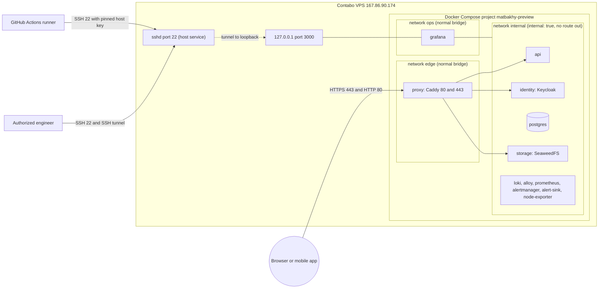
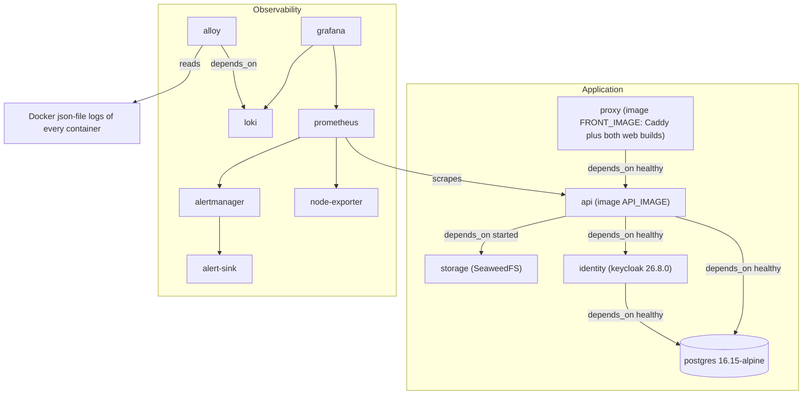
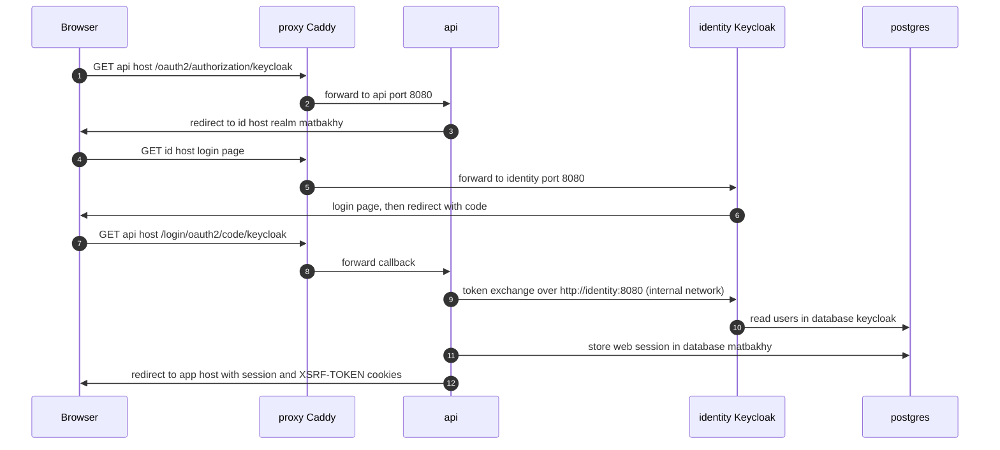
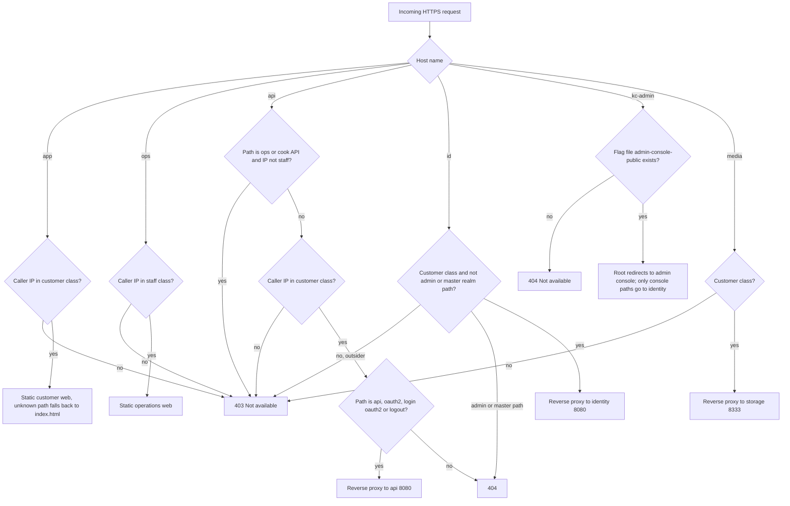
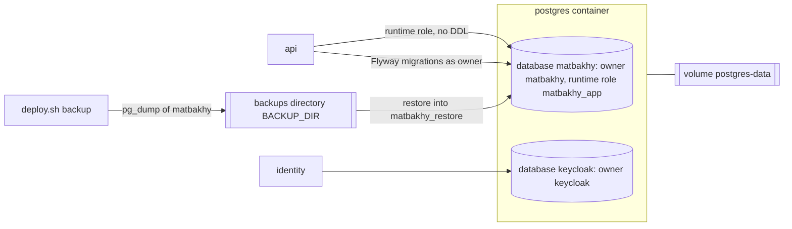
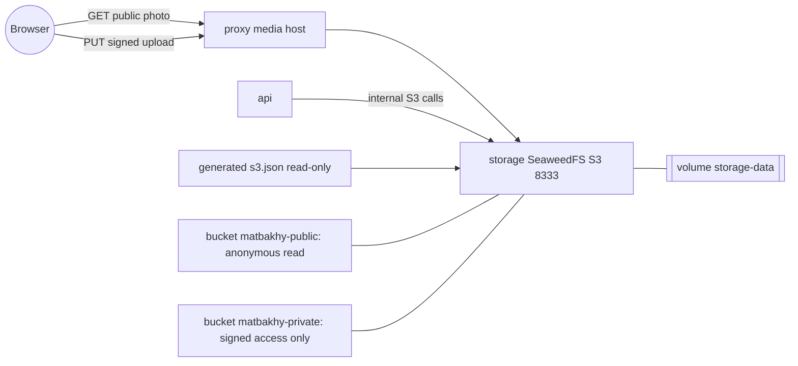
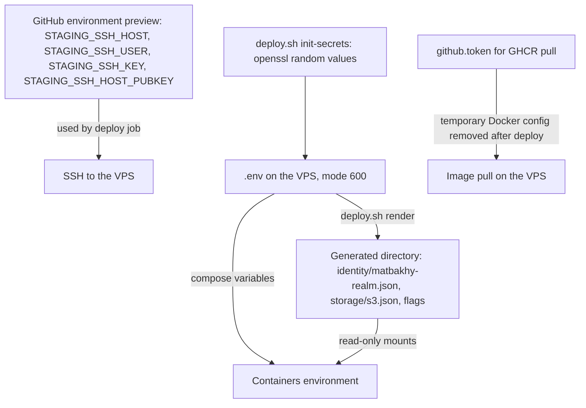
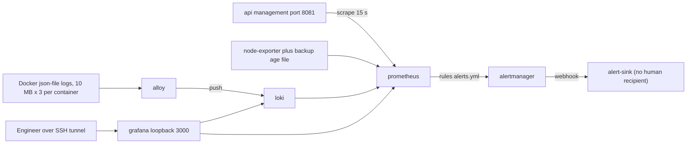
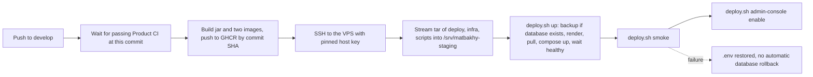
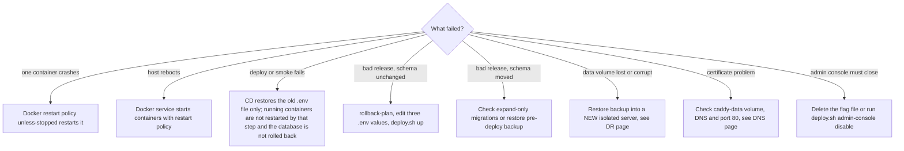

# Runtime architecture of the Preview

> **Owner role:** Infrastructure and deployment
> **Status:** PARTIALLY IMPLEMENTED — the Preview stack is defined in code and the public endpoints answer; the container inventory on the live host is NOT VERIFIED LIVE
> **Language / اللغة:** English · [العربية](runtime-architecture-ar.md)

This page explains how the Preview runs: networks, containers, authentication, request routing, persistence, media, secrets, observability, deployment and failure paths. It summarises the code and links to the canonical sources; it does not repeat them. Existing overview and diagrams: [infrastructure and deployment](../03-architecture/infrastructure-and-deployment.md), [preview infrastructure diagram](../03-architecture/diagrams.md#14-preview-infrastructure) and [authentication diagram](../03-architecture/diagrams.md#6-authentication-oidc).

## Evidence legend

| Label | Meaning on this page |
|---|---|
| VERIFIED LIVE | Observed on the Contabo host by the non-privileged user aiagent on 2026-10-21 (public endpoints, listening sockets, TLS certificate dates). Nothing else is called live. |
| VERIFIED IN CODE | Read in the repository (cited by file). It says what the code asks for, not what is running. |
| DOCUMENTED ONLY | A document or upstream product behaviour says it; not confirmed here. |
| OUTDATED / INCORRECT | Conflicts with newer evidence, for example Hetzner-era text. |
| NOT VERIFIED | Not seen in the repository or live. The page names a read-only way for an authorized administrator to check, see [admin read-only verification](admin-readonly-verification.md). |

Important: every statement about containers (names, images, limits, volumes, health) is VERIFIED IN CODE only. The live container inventory is NOT VERIFIED LIVE because the user aiagent cannot read the Docker socket. The live host facts (accounts, directories, network) are in the [Contabo server inventory](contabo-server-inventory.md).

## 1. Network topology

Sources: `deploy/web-preview/compose.yaml` (networks and ports), `deploy/web-preview/Caddyfile`, `.github/workflows/deploy-preview.yml`.

How to read it. Only three things are reachable from the internet in the code: ports 80 and 443 of the proxy container, and SSH on the host (VERIFIED LIVE: public listeners on 22, 80 and 443). The internal network is declared `internal: true`, so the database, Keycloak, storage and API containers have no route to the internet and publish no ports (VERIFIED IN CODE). Grafana is attached to both internal and a second normal network `ops` only so that Docker can publish its port on `127.0.0.1:3000`; an engineer reaches it through an SSH tunnel (VERIFIED IN CODE; the documented tunnel command is in `docs/operations/08-troubleshooting-runbook.md`). A listener on 127.0.0.1:3000 exists on the host (VERIFIED LIVE) but its owner process cannot be shown without root, so it is consistent with Grafana, not proof. The host firewall state (ufw) is NOT VERIFIED LIVE; the historical Hetzner guide relied on a cloud firewall (OUTDATED for Contabo, see the gaps below).

## 2. Container topology

Sources: `deploy/web-preview/compose.yaml`, `deploy/web-preview/compose.4gb.yaml`, `deploy/web-preview/front.Dockerfile`.

How to read it. Twelve services are defined (VERIFIED IN CODE). Start order is enforced by `depends_on`: Postgres first, then Keycloak and the API (the API waits for a healthy Keycloak because the realm import must have finished), then the proxy once the API is healthy. The two application images are built in CI, never on the server, and referenced by digest from `.env`; third-party Compose service images carry a digest (most as tag plus digest; the SeaweedFS image by digest only, without a tag), while Dockerfile base images are pinned differently: the API base image `eclipse-temurin` by tag and digest, but `front.Dockerfile` references Node and Caddy by tag only, without digests (`deploy.sh` refuses an API or front image without `@sha256:`).

### Services table

All values are VERIFIED IN CODE from `deploy/web-preview/compose.yaml` unless stated. Memory limits are the defaults; `compose.4gb.yaml` is a Hetzner-era override (OUTDATED for a 23 GiB host) and whether `COMPOSE_OVERRIDE` is set in the live `.env` is NOT VERIFIED LIVE. All services use `restart: unless-stopped` and the shared json-file logging (10 MB, 3 files, container name in the tag).

| Service | Role | Internal port | Published | Health check | Memory and CPU limit | Volume (mount) | Persistence boundary |
|---|---|---|---|---|---|---|---|
| proxy | Caddy: HTTPS, routing, access classes, static web builds | 80, 443 | Yes, 80 and 443 on all interfaces | None defined | 256m, 0.5 | caddy-data (/data), caddy-config (/config), flags directory read-only (/srv/flags) | Certificates and ACME account in caddy-data must survive; web builds live in the image |
| postgres | Databases matbakhy and keycloak | 5432 | No | pg_isready every 5 s, 30 retries | 1536m, 1.0 | postgres-data (/var/lib/postgresql/data), backups directory (/backups), init scripts and reconcile.sql read-only | The only copy of application and identity data unless a backup exists |
| identity | Keycloak 26.8.0 in production mode, realm import at start | 8080 (management 9000 per Caddyfile comment) | No | Succeeds only when the matbakhy realm discovery document answers; every 10 s, 60 retries | 1g, 1.0 | Generated realm import directory, read-only | Stateless container; users and sessions are in the keycloak database |
| storage | SeaweedFS with S3 gateway | 8333 | No | None defined (api uses condition service_started) | 512m, 0.5 | storage-data (/data), generated s3.json read-only | Photos and private documents in storage-data |
| api | Spring Boot API, Flyway migrations | 8080 (management 8081) | No | Management health reports UP; every 5 s, 60 retries | 2g, 1.5 | None | Stateless; state in Postgres and storage |
| loki | Log store | 3100 | No | None defined | 384m, 0.5 | loki-data (/loki), config read-only | Retention 720h, debug 168h by default |
| alloy | Log shipper reading Docker log files | 12345 | No | None defined | 256m, 0.25 | alloy-data, host Docker containers directory read-only | Read positions only |
| prometheus | Metrics and alert rules | 9090 | No | None defined | 512m, 0.5 | prometheus-data (/prometheus), config and rules read-only | 15d or 2GB, whichever first |
| alertmanager | Alert routing | 9093 | No | None defined | 128m, 0.25 | alertmanager-data | Silences and notification state |
| alert-sink | Local test receiver for alerts (no human is paged) | 8080 | No | None defined | 64m, 0.1 | alert-sink-data | Stored alerts |
| node-exporter | Host disk, memory, load and backup-age metric | 9100 | No | None defined | 64m, 0.1 | Host root read-only, backups metrics directory read-only | None |
| grafana | Dashboards | 3000 | Yes, loopback only (127.0.0.1:3000) | None defined | 256m, 0.25 | grafana-data, provisioning read-only | Dashboard state; provisioned data sources are in the repository |

Sums (VERIFIED IN CODE, arithmetic on the table): memory limits total 7040 MiB and CPU limits 6.45, which fit the verified 8 vCPU and 23 GiB (VERIFIED LIVE) with margin. Limits are ceilings, not measured use.

Notes an engineer needs:

* The alloy service runs as user 0 and mounts the host directory of Docker container logs read-only; the node-exporter mounts the host root read-only. Both are deliberate in the code and widen what a container compromise could read; there is no Docker socket mount in the file.
* Only the services listed above exist in the Preview; there is no Redis, queue broker or separate worker container (VERIFIED IN CODE).
* Named volumes get the Compose project prefix `matbakhy-preview_` by Compose convention (DOCUMENTED ONLY, Docker behaviour); live volume names and their host path are NOT VERIFIED LIVE.
* `compose.yaml` bind-mounts `${BACKUP_DIR}/metrics` read-only into node-exporter (VERIFIED IN CODE), so that directory must exist, with ownership the backup user can write to, before the first start. If it is missing, Docker creates the host path as root on first start (DOCUMENTED ONLY, Docker behaviour), and the backup user may then be unable to write the backup-age metric file. `deploy.sh` creates the directory only in `backup_metric`, which runs after a verified backup, and `up` takes that backup only when a PostgreSQL container already runs, so a first start does not create it.
* The postgres service mounts `../../infra/db/reconcile.sql`, so the repository layout `deploy/web-preview` plus `infra/db` must exist on the server; the CD transfers `deploy`, `infra` and `scripts` for this reason (VERIFIED IN CODE).

## 3. Authentication flow

Sources: `deploy/web-preview/compose.yaml` (OIDC variables), `deploy/web-preview/Caddyfile`, the sequence in [diagrams section 6](../03-architecture/diagrams.md#6-authentication-oidc). Security rules are in [identity and security](../03-architecture/identity-and-security.md).

How to read it. The browser sees only public names (the issuer is `https://id.<domain>/realms/matbakhy`), while the API talks to Keycloak over the internal network (`OIDC_BACKCHANNEL_ISSUER`), so the token exchange never leaves Docker (VERIFIED IN CODE). `KC_HOSTNAME_BACKCHANNEL_DYNAMIC` lets Keycloak answer on both names. The XSRF-TOKEN cookie is set for the parent domain (`WEB_COOKIE_DOMAIN`) so the web apps on app and ops can read what the API on api sets (VERIFIED IN CODE comment in the compose file). The web session storage in Postgres and the cookie names come from the backend and are summarised in the authentication diagram (DOCUMENTED ONLY here; derived by that page from the security configuration).

The id host answers a 302 to the kc-admin admin console at its root because `KC_HOSTNAME_ADMIN` points to the kc-admin host (VERIFIED LIVE for the response and VERIFIED IN CODE for the cause). The admin console is a separate public host with its own protection and a fail-closed flag file (see section 4).

## 4. Request routing

Source: `deploy/web-preview/Caddyfile`; behaviour tests: `scripts/test_proxy_access.py` (VERIFIED IN CODE that the test exists; running it is not claimed). Certificate and DNS detail: [DNS, HTTPS and sslip.io](dns-https-sslip-io.md).

How to read it. Access is deny by default through two IP classes: the customer class (app, customer API, id, media) and the staff class (ops and the `/api/v1/ops` and `/api/v1/cook` paths). Both default to `ALLOWED_CLIENT_IPS`; opening the customer hosts to everyone is an explicit owner step (`CUSTOMER_ALLOWED_IPS`), and the staff class never follows it. The staff API paths (`/api/v1/ops`, `/api/v1/cook`) must satisfy both lists: the Caddyfile checks `STAFF_ALLOWED_IPS` first and then applies `customer_access` to the same request, so a staff address must also stay in the customer list (VERIFIED IN CODE, as the diagram shows). Which classes are configured live is NOT VERIFIED LIVE because the value is in the protected `.env`; from the server's own address, app, ops and api answered as allowed (VERIFIED LIVE). A Caddy 403 with the body "Not available" is an access-policy answer, not an outage.

Observed responses (VERIFIED LIVE, from the server itself): the API configuration endpoint returns 200 JSON; `/actuator/health` on the api host returns 404 because actuator is deliberately not proxied (the Caddyfile forwards only `/api/*`, `/oauth2/*`, `/login/oauth2/*` and `/logout`); the id root returns a 302 to the kc-admin console; the kc-admin root returns a 302 to the master console (so the flag file is present now); the media root returns 403 with an XML content type and an `x-amz-request-id` header, which means the S3 gateway itself denied the anonymous bucket-list request. That is expected: the storage identity file allows anonymous read only on the bucket matbakhy-public (VERIFIED IN CODE, `deploy/web-preview/storage/s3.json.template`), so the root listing is denied while objects under `/matbakhy-public/` are readable.

## 5. End-to-end request walkthrough

Example: a signed-in customer opens the meals page and sees a photo. Every step names the evidence class.

| Step | What happens | Where | Evidence |
|---|---|---|---|
| 1 | The browser resolves `app.167-86-90-174.sslip.io`. The sslip.io DNS service answers with the IP embedded in the name. | Public DNS | VERIFIED LIVE (resolves to 167.86.90.174); mechanism DOCUMENTED ONLY, see [DNS page](dns-https-sslip-io.md) |
| 2 | The browser opens TCP 443 on the public IP. Docker forwards it to the proxy container. | Host port 443 | VERIFIED LIVE (listener); forwarding VERIFIED IN CODE |
| 3 | Caddy presents a Let's Encrypt certificate (valid 2026-10-18 to 2027-01-16 for app) and applies security headers. | proxy | VERIFIED LIVE (certificate); headers VERIFIED IN CODE |
| 4 | Caddy checks the caller IP against the customer class, then serves the single-page app files from the image. | proxy | VERIFIED IN CODE |
| 5 | The page calls `https://api.<domain>/api/...` (the address is fixed at image build time). The browser sends the session and XSRF cookies. | Browser to proxy | VERIFIED IN CODE (`front.Dockerfile` build argument) |
| 6 | Caddy checks the customer class, matches `/api/*` and forwards to `api:8080` over the internal network. | proxy to api | VERIFIED IN CODE |
| 7 | The API loads the session and account from PostgreSQL and applies server-side authorization and prices. | api to postgres | DOCUMENTED ONLY (see [backend architecture](../03-architecture/backend-architecture.md)) |
| 8 | For sign-in the API and Keycloak exchange tokens over `http://identity:8080` (section 3). | api to identity | VERIFIED IN CODE |
| 9 | The API returns meal data containing public photo URLs under `https://media.<domain>/matbakhy-public/...`. | api | VERIFIED IN CODE (`OBJECT_STORAGE_PUBLIC_BASE_URL`) |
| 10 | The browser fetches the photo from the media host; Caddy checks the customer class and forwards to `storage:8333`; SeaweedFS serves objects of the public bucket anonymously. | proxy to storage | VERIFIED IN CODE |
| 11 | The response travels back the same way; the proxy keeps no access log (container logs only). | proxy | VERIFIED IN CODE (Caddyfile comment) |

Uploads follow the same media host: the API issues a signed upload address for `OBJECT_STORAGE_CLIENT_ENDPOINT` while it reaches storage itself at `http://storage:8333` (VERIFIED IN CODE for the two endpoints; the signing is implemented in `backend/app/src/main/java/com/matbakhy/app/providers/S3ObjectStorage.java`).

## 6. Database persistence

How to read it. One PostgreSQL 16 instance holds two databases. On the first start of an empty data directory, `deploy/web-preview/postgres/10-keycloak.sh` creates the `keycloak` role and database and `deploy/web-preview/postgres/20-runtime-role.sh` creates the least-privileged `matbakhy_app` role; these scripts do not run again, so changing a database password in `.env` later does not change the role inside an existing data volume (VERIFIED IN CODE comments and Docker image behaviour, DOCUMENTED ONLY). Flyway migrates as the owner and grants the runtime role in its after-migrate step. The backup procedure is in [backup, restore and disaster recovery](backup-restore-disaster-recovery.md). Per the code, `deploy.sh backup` dumps the database `matbakhy` only (the `PGDATABASE=matbakhy` setting in `backup_db`), so the `keycloak` database is not part of that dump; separate Keycloak dump paths are described in the gaps section.

## 7. Media storage

How to read it. SeaweedFS runs in one container with a local volume; `deploy.sh up` attempts to create the buckets `matbakhy-public` and `matbakhy-private` on a best-effort basis: the command is repeatable, but its output is discarded and every failure is ignored (`|| true`), so a successful `up` does not prove that either bucket exists. Verify the buckets and a test object separately (see scenario 21 in [infrastructure troubleshooting](infrastructure-troubleshooting.md)). The identity file `s3.json` is rendered by `deploy.sh render` from `storage/s3.json.template` into the generated directory, which keeps the storage keys out of Git. The `matbakhy-api` identity has all actions; the `anonymous` identity can only read the public bucket (VERIFIED IN CODE). A storage archive in the backup is taken after stopping the storage service for a short time. Whether storage data is also copied off the host is NOT VERIFIED (no such step in `deploy.sh`).

## 8. Secrets management

Names only; never values. Source: `deploy/web-preview/.env.example`, `deploy/web-preview/deploy.sh` (`init_secrets`, `render`), `.github/workflows/deploy-preview.yml`.

| Secret group (names) | Where it lives | How it is created | Recovery note |
|---|---|---|---|
| Database: POSTGRES_PASSWORD, KEYCLOAK_DB_PASSWORD, APP_DB_PASSWORD | `.env` on the VPS | `deploy.sh init-secrets` (random hex) | Applied to roles only at first database initialisation; a restored data volume keeps the old role passwords, so the matching `.env` must be preserved |
| Keycloak bootstrap (master realm administrator): KEYCLOAK_ADMIN_USER, KEYCLOAK_ADMIN_PASSWORD | `.env`; passed to the identity container as `KC_BOOTSTRAP_ADMIN_*` environment variables (`compose.yaml`); not part of the realm import file | `init-secrets` (the password; the user name comes from `.env.example`) | Used when Keycloak first creates its master realm; a restored Keycloak database keeps the administrator it already holds |
| Keycloak application realm: OIDC_WEB_CLIENT_SECRET, OIDC_ADMIN_CLIENT_SECRET, PREVIEW_USER_PASSWORD | `.env`; rendered into the realm import file | `init-secrets`; `render` substitutes only these three into `identity/matbakhy-realm.preview.json` | Client secrets must match between Keycloak and the API; render again after a rebuild |
| Keycloak master-realm operations client: KEYCLOAK_OPS_CLIENT_SECRET | `.env`; read by `admin-console.sh` and passed to the admin tooling (`identity/admin_console.py`); never substituted into the realm import | `init-secrets`; `admin-console.sh` creates one if it is missing | Provisioned in the master realm by `deploy.sh admin-console enable`; its recovery procedure is not documented (NOT VERIFIED) |
| Application keys: PHONE_CODE_PEPPER, HANDOVER_HASH_KEY, ACTIVITY_HASH_KEY, HANDOVER_ENCRYPTION_KEY, PUSH_TOKEN_HASH_KEY, PUSH_TOKEN_ENCRYPTION_KEY | `.env` | `init-secrets` | Treat as recovery-critical: hashes and encrypted fields written with them can only be checked or read with the same values. The exact effect of losing each one is NOT VERIFIED |
| Storage: STORAGE_ACCESS_KEY, STORAGE_SECRET_KEY | `.env`; rendered into `storage/s3.json` | `init-secrets`; `render` | Must match what the API uses |
| Grafana: GRAFANA_ADMIN_PASSWORD | `.env` | `init-secrets` | Reset is possible inside Grafana data |
| Deployment access: STAGING_SSH_HOST, STAGING_SSH_USER, STAGING_SSH_KEY, STAGING_SSH_HOST_PUBKEY | GitHub environment preview | Set by a repository administrator | Which Linux account the key belongs to is NOT VERIFIED |
| TLS: certificate private keys and ACME account | Docker volume caddy-data | Created by Caddy automatically | Loss means re-issuance, subject to Let's Encrypt rate limits (DOCUMENTED ONLY) |

Live facts: `/srv/matbakhy-staging/deploy/web-preview/.env` exists with mode 600 and owner devops, and its content was not read (VERIFIED LIVE). `deploy.sh render` restricts the generated directory to its owner (mode 700) and leaves the rendered files readable inside it (VERIFIED IN CODE); the live generated directory is drwx------ owned by devops (VERIFIED LIVE). `deploy.sh up` refuses placeholders and non-digest images. The CD copies the old `.env` aside, rewrites only RELEASE_COMMIT, API_IMAGE and FRONT_IMAGE, and restores the old file if `deploy.sh up` or the smoke test fails inside that remote script (VERIFIED IN CODE); the later admin-console step restores nothing.

## 9. Observability

Sources: `deploy/web-preview/observability/` and `docs/operations/05-observability-readiness.md`, `docs/operations/07-audit-and-log-readiness.md`.

How to read it. The API writes ECS JSON logs with request ids; Alloy tails the files and labels them by container, stream and level; Loki keeps them 720 hours (debug 168 hours) by default. Prometheus scrapes the API management port, node-exporter, Loki, Alloy, Alertmanager and itself. Alert rules include ApiDown, DatabaseUnavailable, BackupStale (no verified backup in 24 hours) and DiskPressure (less than 15 percent free). All alerts go to alert-sink, a local test receiver, so nobody is notified (VERIFIED IN CODE comment, owner approval O07 pending). If Docker rotates a log file before Alloy reads it, those lines are lost. Whether Grafana, Loki and Prometheus are healthy now is NOT VERIFIED LIVE.

## 10. Deployment path

Source: `.github/workflows/deploy-preview.yml`; step-by-step procedure in [deployment pipeline](deployment-pipeline.md).

How to read it. Nothing is built on the server. The deploy overwrites files tracked in Git but keeps the server `.env` and data (VERIFIED IN CODE). A concurrency group prevents two deploys at once, and `deploy.sh up` takes a non-waiting lock file (`.preview-mutation.lock`) in the backups directory and fails at once if another change holds it. `admin-console.sh` takes the same lock only for `enable`, `rollback` and `create-admin`; its `verify`, `disable` and `fixture-clean` commands take no lock and can overlap a deployment, and `deploy.sh backup` takes no lock either (VERIFIED IN CODE: `deploy.sh`, `admin-console.sh`). The user that SSH connects as is the secret STAGING_SSH_USER and is NOT VERIFIED (the deploy directory is owned by devops, which is circumstantial only).

## 11. Failure and recovery paths

How to read it. Container restarts after a crash follow from the restart policy (VERIFIED IN CODE). Starting automatically after a reboot depends on the Docker service being enabled; Docker is active (VERIFIED LIVE) but its enabled state is NOT VERIFIED. Rollback, restore and disaster recovery decisions are in [backup, restore and disaster recovery](backup-restore-disaster-recovery.md); symptom-based diagnosis is in [infrastructure troubleshooting](infrastructure-troubleshooting.md). Destructive or restore actions are for a new isolated server, never for the live Preview.

### Commands that exist in the repository

All run from `/srv/matbakhy-staging/deploy/web-preview` on the VPS. They need a Linux user that can run Docker and read `.env`; which user that is for routine operations is NOT VERIFIED, and the user aiagent must not be given that access.

| Command | Machine and user | Read-only? | Prerequisite | Expected result | Verification | Likely failure and action |
|---|---|---|---|---|---|---|
| `./deploy.sh status` | VPS, a user with Docker and `.env` access | Read-only | Stack deployed | Containers, schema version, last releases | Output lists images and commit | Permission denied on Docker socket: run as an authorized operator, not as aiagent |
| `./deploy.sh rollback-plan 1` | VPS, same | Read-only (prints only) | Release log exists in the backups directory | Three `.env` values and a verdict | Verdict line | "no release log": nothing to roll back to. `N` counts only recorded successful releases (a failed `up` leaves no line); see the target-selection paragraph in the [deployment pipeline](deployment-pipeline.md) |
| `./deploy.sh smoke` | VPS, same | Read-only HTTPS checks | Public names resolve | Smoke checks pass | Exit code 0 | Failure: read the failing check, do not redeploy blindly |
| `ssh -L 3000:127.0.0.1:3000 <ssh-user>@<host>` | Your laptop | Opens a tunnel only | Authorized SSH key | Grafana at http://localhost:3000 | Login page loads | Connection refused: Grafana not running or not published (NOT VERIFIED LIVE) |

`./deploy.sh up`, `backup`, `restore-db`, `e2e-reset` and `admin-console enable` change state; do not run them on the live Preview outside the documented procedure.

## Known limitations and documentation gaps

* **Grafana profile conflict.** The [preview infrastructure diagram](../03-architecture/diagrams.md#14-preview-infrastructure) says Grafana uses the "tools" profile. In `deploy/web-preview/compose.yaml` Grafana has no profile; the profile exists only in the Hetzner-era `compose.4gb.yaml`. Whether Grafana runs live depends on the override and is NOT VERIFIED LIVE.
* **Keycloak data: backup paths exist in code, recoverability is unproven.** `deploy.sh backup` dumps only the `matbakhy` database, but the internal `backup` function of `deploy/web-preview/admin-console.sh` (called first by `admin-console.sh enable`, which the deployment pipeline runs after every successful deploy; the script's dispatcher has no `backup` subcommand, so `admin-console.sh backup` only prints usage) and the actual `backup` command of `deploy/web-preview/migrate-mfa.sh` (which also has `apply`) each write a custom-format dump of the whole `keycloak` database to `$BACKUP_DIR/keycloak/keycloak-db-<stamp>.dump` (VERIFIED IN CODE). Whether those dumps exist, how recent the newest one is, and whether it restores are NOT VERIFIED LIVE; no restore of it was rehearsed, and no scheduled Keycloak backup was found. An administrator should confirm with the backup directory listing and decide; the owner decision needed is a rehearsed multi-store recovery (database, Keycloak, storage) on a new isolated server, which the repository does not provide as one sequence. Such a rehearsal must use a separate repository (or isolated workflow) with its own environment, secrets and concurrency group, so that it cannot redirect the live Preview automation.
* **Off-host copies.** No step copies backups or storage archives off the VPS (NOT VERIFIED; see [infrastructure and deployment](../03-architecture/infrastructure-and-deployment.md)).
* **Stale paths.** `.env.example` defaults `GENERATED_DIR` and the compose file defaults point to `/srv/matbakhy-preview`, while the live deployment directory is `/srv/matbakhy-staging` and an older copy exists under `/srv/matbakhy-preview` (VERIFIED LIVE). The live values of `GENERATED_DIR` and `BACKUP_DIR` are NOT VERIFIED LIVE because `.env` is protected.
* **Hetzner text is historical.** `compose.4gb.yaml`, the cloud-firewall advice in `docs/operations/12-owner-server-setup.md` and `docs/operations/09-staging-hetzner-preparation.md` describe the proposed Hetzner host and are OUTDATED for the Contabo host. The current host is described in the [Contabo server inventory](contabo-server-inventory.md).
* **Unknown processes.** A Java process on loopback ports 18080 and 38189 and a Node process on 3080 were seen on the host; neither belongs to this compose file (VERIFIED LIVE that they exist). The Node process on 3080 is AI-supervisor tooling; the owner of the Java process is not established and must not be assumed to be Matbakhy.
* **Items for an authorized administrator** (read-only, see [admin read-only verification](admin-readonly-verification.md)): container list and health, effective compose configuration, volume names and sizes, firewall state, whether the sizing override is active, certificate renewal logs, and the live values of the access class variables.
