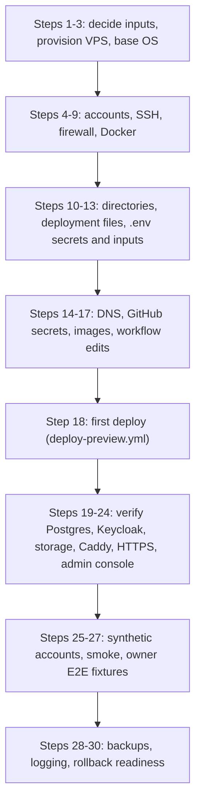

# دليل إعادة بناء السيرفر

> **Owner role:** Infrastructure and deployment
> **Status:** NOT VERIFIED — التوثيق اتقرا مقابل الكود، لكن الإجراء عمره ما اتنفّذ من أوله لآخره على سيرفر نضيف
> **Language / اللغة:** [English](server-rebuild-guide.md) · العربية

**التصنيف: DOCUMENTATION VERIFIED (اتقرا مقابل كود الـ Repository يوم 2026-10-21)، NOT EXECUTION VERIFIED.** مفيش خطوة من الدليل ده اتشغّلت كاملة على VPS فاضي. التجربة الوحيدة في الـ Repository اتعملت على جهاز مهندس (راجع [إيه اللي بتثبته التجربة وإيه اللي مش بتثبته](#إيه-اللي-بتثبته-التجربة-وإيه-اللي-مش-بتثبته)). اعتبر كل أمر غير مُختبَر على سيرفر نضيف لحد ما تجرّبه على سيرفر مؤقت.

**النطاق والأمان.** الدليل ده بيبني سيرفر جديد ومعزول بيشغّل الـ Preview ببيانات تجريبية غير حقيقية (Synthetic Data) (`APP_ENV=PREVIEW`). مش إجراء يتنفّذ أبدًا على سيرفر الـ Preview الشغّال. مفيش حاجة هنا يُسمح لحساب Agent ذكاء اصطناعي إنه ينفّذها؛ الخطوات اللي محتاجة root أو Docker بتبقى لأدمن بشري مُصرَّح له. ماتستخدمش قسم الاستعادة على سيرفر فيه بيانات عايز تحتفظ بيها.

**شرط العزل.** الأتمتة في الـ Repository (`deploy-preview.yml` و`owner-e2e-provision.yml`) بتشتغل في بيئة GitHub اسمها `preview` وبتنشر على السيرفر اللي Secrets البيئة دي بتحدده، عند أي Push على `develop`. لو ضبطت الـ Secrets دي لسيرفر إعادة البناء، أو عدّلت الـ Workflow في الـ Repository الشغّال، أتمتة الـ Preview الشغّال هتتحوّل لسيرفر إعادة البناء. عشان كده التمرين (Rehearsal) محتاج Repository منفصل (أو نسخة معزولة من الـ Workflows) ليه بيئته وSecrets بتاعته وConcurrency Groups بتاعته. تحويل الـ Preview الشغّال لسيرفر معاد بناؤه (Cutover) الدليل ده مابيوصفوش؛ ده NOT VERIFIED ولسه ماتجرّبش عمليًا، ومحتاج إجراء مُصرَّح بيه صراحةً من المالك (قرار مطلوب من المالك).

## مفتاح الأدلة

| الوسم | المعنى |
|---|---|
| VERIFIED LIVE | اتلاحظ على سيرفر Contabo الشغّال بواسطة حساب من غير صلاحيات؛ متسجّل في [جرد سيرفر Contabo](contabo-server-inventory-ar.md). |
| VERIFIED IN CODE | اتقرا في ملف جوه الـ Repository (اسم الملف مكتوب جنب الادّعاء). بيقول الكود بيعمل إيه، مش إن السيرفر اتظبط كده. |
| DOCUMENTED ONLY | مستند أو دليل منتج خارجي بيقوله؛ مش مؤكد بالكود ولا بالسيرفر. |
| OUTDATED / INCORRECT | بيتعارض مع دليل أحدث، وغالبًا نص من وقت Hetzner. ماتتّبعوش أبدًا كتعليمات حالية. |
| NOT VERIFIED | لا الـ Repository ولا الملاحظة الحيّة حسمته. النص بيذكر فحص للقراءة فقط ممكن أدمن مُصرَّح له يشغّله. |

## إزاي تقرا الدليل ده

- الجزء A تثبيت نظيف (الخطوات من 1 لـ 30). الجزء B استعادة على سيرفر اتعمله إعادة بناء؛ والتعافي الكامل للخدمة هناك BLOCKED (شوف الصندوق في أول الجزء B).
- كل خطوة بتذكر المتطلب المسبق بتاعها، وبعدين جدول أوامر. الأعمدة هي: الأمر، الجهاز وحساب Linux، للقراءة فقط ولا بيغيّر الحالة، إزاي تتحقق، الفشل المحتمل والتصرف. الأوامر اللي محتاجة Pipe أو كذا سطر موجودة في كتلة الكود تحت الجدول.
- الـ Placeholders بين أقواس زاوية: `<domain>` (الدومين الأساسي للـ Preview)، `<deploy-user>`، `<admin-user>`، `<vps-ip>`، `<owner>` و`<repo>` (مالك GitHub والـ Repository). ماتكتبش قيمة Secret في الـ Repository ولا في تذكرة ولا في شات.
- مستندات وقت Hetzner ([تجهيز Hetzner للـ Staging](../../operations/09-staging-hetzner-preparation.md)، [إعداد سيرفر المالك](../../operations/12-owner-server-setup.md)) اتكتبت لسيرفر Hetzner مقترح 2 vCPU / 4 GB ماكانش هو السيرفر الشغّال. الأوامر دي اتعدّلت هنا بس لما الكود يأكدها؛ وتفاصيل Hetzner موسومة OUTDATED / INCORRECT. السيرفر الحالي متوصّف في [جرد سيرفر Contabo](contabo-server-inventory-ar.md).

## المراحل في لمحة



الرسم بيوضّح ترتيب المراحل. لازم الـ DNS والـ GitHub Secrets يكونوا موجودين قبل أول Deployment، لأن الـ Deploy Job بيتصل بالـ SSH وCaddy بيطلب الشهادات أول ما يشتغل.

## إيه اللي بتثبته التجربة وإيه اللي مش بتثبته

`scripts/rehearse-preview.sh` هو التجربة الوحيدة في الـ Repository (VERIFIED IN CODE: الهيدر بتاعه بيقول إنه مش Deployment ومابيلمسش أي سيرفر وملوش قيمة كدليل عن أي سيرفر). نتايجه المسجّلة في `verification/runs/20261014-STAGING-REHEARSAL/README.md` وفي [نشر الـ Staging والرجوع عنه](../../operations/11-staging-deployment-and-rollback.md)، القسم 6 (مراجعة ذاتية، الـ Commit المصدر `ea159c1`).

| بتثبت (على جهاز مهندس واحد، الاسم المحلي `mb.localhost`، صور اتبنت محليًا، بيانات تجريبية غير حقيقية (Synthetic Data)) | مش بتثبت |
|---|---|
| حزمة الـ Compose بتشتغل من Volumes فاضية بترتيب الاعتماديات وبتبقى سليمة | التجهيز، المستخدمين، المجموعات، تقوية SSH، الـ Firewall، تثبيت Docker |
| `smoke.sh` والـ Smoke بالمتصفح بأوردر عربون محاكى بينجحوا | الـ DNS العام، حلّ sslip.io، إصدار أو تجديد Let's Encrypt |
| الحِمل، والثبات بعد down وup، وإعادة التشغيل بعد قتل عملية الـ API، وصورة API أقدم على Schema أحدث | `deploy.sh up` المثبّت بـ Digest، سحب GHCR، Deploy Job بتاع GitHub Actions، قناة الـ SSH |
| إعادة الضبط (Reset) والـ Seed المحمية بضوابط للـ E2E | سيرفر Contabo، أي استعادة على سيرفر جديد، أي Commit بعد `ea159c1` (السكريبت ماتشغّلش تاني لأجل الدليل ده) |

الـ Preview الشغّال (بيرد على HTTPS، راجع صفحة الجرد) دليل غير مباشر (Circumstantial) إن مسار الـ CD شغّال على السيرفر ده. مش دليل إن الدليل ده، لو اتنفّذ من VPS فاضي، هيطلّع نفس النتيجة.

---

# الجزء A. تثبيت نظيف

## المرحلة 1. المدخلات والتجهيز ونظام التشغيل الأساسي

### الخطوة 1. حدّد المدخلات

المتطلب المسبق: صلاحية أدمن على الـ Repository في GitHub وطريقة تدفع بيها تمن الـ VPS (قرارك).

| المدخل | القيمة اللي تحدّدها | الدليل |
|---|---|---|
| دومين الـ Preview `<domain>` | الـ Preview الحالي بيستخدم `167-86-90-174.sslip.io`، اللي بيكتب الـ IPv4 بتاع السيرفر جوه الاسم بشرطات. IPv4 جديد معناه دومين جديد إلا لو عندك دومين حقيقي. | VERIFIED IN CODE: `.github/workflows/deploy-preview.yml` بيمرّر `PREVIEW_DOMAIN=167-86-90-174.sslip.io` كـ Build Argument؛ حلّ الـ DNS VERIFIED LIVE |
| الـ Hosts اللي لازم تتحلّ | `app.` و`ops.` و`api.` و`id.` و`kc-admin.` و`media.` تحت `<domain>` (ستة) | VERIFIED IN CODE: `deploy/web-preview/Caddyfile` |
| عناوين العملاء المسموحة | `ALLOWED_CLIENT_IPS`، واختياريًا `CUSTOMER_ALLOWED_IPS` و`STAFF_ALLOWED_IPS` | VERIFIED IN CODE: `deploy/web-preview/.env.example` |
| إيميل التواصل مع ACME | `ACME_EMAIL` | VERIFIED IN CODE: `deploy/web-preview/Caddyfile` كتلة global |

مفيش أمر. النتيجة: قائمة مكتوبة بالقيم اللي فوق، محفوظة برّه الـ Repository لو فيها أي حاجة مش عامة.

### الخطوة 2. جهّز الـ VPS

المتطلب المسبق: الخطوة 1. شاشات الطلب الخاصة بـ Contabo وكتالوج الصور والـ Firewall بتاع لوحة التحكم NOT VERIFIED (الـ Repository مفيهوش إجراء لطلب Contabo).

| البند | النموذج اللي تمشي عليه | الدليل |
|---|---|---|
| نظام التشغيل | Ubuntu 24.04 LTS (السيرفر الحالي بيشغّل 24.04.5، الـ Kernel هو 6.8.0-147-generic) | VERIFIED LIVE |
| الحجم | السيرفر الحالي فيه 8 vCPU و 23 GiB RAM وديسك 290 GB | VERIFIED LIVE |
| الحد الأدنى للكود | حدود الذاكرة في `compose.yaml` مجموعها حوالي 6.9 GiB (proxy 256m، postgres 1536m، identity 1g، storage 512m، api 2g، loki 384m، alloy 256m، prometheus 512m، alertmanager 128m، alert-sink 64m، node-exporter 64m، grafana 256m). السيرفر الأصغر محتاج `compose.4gb.yaml` اللي اتحجّم لـ 2 vCPU و 4 GB | VERIFIED IN CODE: `deploy/web-preview/compose.yaml`، `deploy/web-preview/compose.4gb.yaml` |
| الشبكة | IPv4 عام على أول Interface؛ السيرفر الحالي كمان فيه IPv6 عام | VERIFIED LIVE |
| الوصول وقت الإنشاء | مفتاح SSH العام بتاعك لحساب الأدمن؛ من غير Login بباسورد | DOCUMENTED ONLY: `docs/operations/12-owner-server-setup.md` القسم 1 (صياغة وقت Hetzner، لكن المبدأ عام) |

التحقق بعد ما الـ VPS يتعمل (اللابتوب، أي مستخدم): `ssh <admin-user>@<vps-ip> true` بيرجع من غير ما يطلب باسورد. الفشل المحتمل: المستخدم الافتراضي عند المزوّد مختلف؛ استخدم المستخدم المذكور في رسالة الترحيب بتاعة المزوّد.

### الخطوة 3. حدّث نظام التشغيل وسطّب الحزم الأساسية

المتطلب المسبق: وصول SSH كأدمن عنده sudo.

| الأمر | الجهاز والمستخدم | النوع | التحقق | الفشل المحتمل |
|---|---|---|---|---|
| `sudo apt-get update` then `sudo apt-get -y upgrade` | VPS، `<admin-user>` مع sudo | بيغيّر الحالة | `lsb_release -d` بيعرض Ubuntu 24.04 | حزمة Kernel تحديثها متوقّف بـ `apt-mark hold`، أو محتاج إعادة تشغيل: أعد التشغيل في وقت هادي |
| `sudo apt-get -y install unattended-upgrades ca-certificates curl gnupg openssl python3 tar` | VPS، `<admin-user>` مع sudo | بيغيّر الحالة | `command -v openssl python3 curl flock tar` بيطبع خمسة مسارات | `flock` جزء من util-linux، وغالبًا بيبقى متسطّب |

ليه الحزم دي (VERIFIED IN CODE): `deploy.sh` بيستخدم `openssl` و`flock` و`sed` و`awk`؛ سكريبت الـ CD البعيد و`admin-console.sh` بيستدعوا `python3`؛ الـ CD Job بيبعت `tar` Stream؛ و`smoke.sh` بيستخدم `curl`. مفيش حاجة في السكريبتات بتستخدم `sudo`. مسار الـ CD مش محتاج `git` (بينسخ الملفات بـ `tar`)؛ و`docs/operations/12-owner-server-setup.md` بيسطّبه للـ Clone اليدوي بس. `unattended-upgrades` شغّال على السيرفر الحالي (VERIFIED LIVE) لكنه مجرد عُرف مش متطلب في الكود. `fail2ban` مش متسطّب على السيرفر الحالي (VERIFIED LIVE) ومفيش حاجة في الـ Repository بتتطلبه. ملف الـ Swap بحجم 2 GiB في نص وقت Hetzner كان متحجّم لسيرفر 4 GB؛ هل السيرفر الحالي فيه swap NOT VERIFIED والكود مابيتطلبوش.

## المرحلة 2. الحسابات والـ SSH والـ Firewall وDocker

### الخطوة 4. المستخدمين والمجموعات

المتطلب المسبق: الخطوة 3. ماتعملش حسابات بالتخمين عن الأدوار؛ الجدول بيفصل اللي الكود بيتطلبه عن اللي السيرفر الحالي بيبيّنه بالصدفة.

**مطلوب من الكود (VERIFIED IN CODE).** الحساب اللي الـ Deploy Job بيتصل بيه (الـ Secret بتاع الـ Repository اسمه `STAGING_SSH_USER`) لازم: يقبل SSH بالمفتاح بس؛ يقدر يكتب في `/srv/matbakhy-staging` (`test -w` في خطوة النقل)؛ يشغّل `docker` و`docker compose` من غير sudo (السكريبت البعيد بيستدعي `./deploy.sh up` اللي بيستدعي `docker`)؛ يقرا ويكتب `.env` بتاع السيرفر (Mode 600) و`BACKUP_DIR`. مفيش sudo بيتستخدم في أي مكان في مسار الـ Deploy.

**اللي اتلاحظ على السيرفر الحالي (VERIFIED LIVE)، بيتستخدم كنموذج بس.**

| الحساب | uid | المجموعات | اللي الدليل ده بيفترضه عن مهمته |
|---|---|---|---|
| `ubuntu` | 1000 | ubuntu, adm, cdrom, sudo, dip, lxd | ولا حاجة. الدور مش بيتحدّد من الاسم. |
| `devops` | 1001 | devops, sudo, users, docker | ولا حاجة بعد الحقايق دي: بيملك `/srv/matbakhy-staging`، وهو العضو الوحيد في `docker`. أنهي حساب الـ Pipeline بيسجّل بيه NOT VERIFIED (مخزّن في الـ Secret `STAGING_SSH_USER`). |
| `aiagent` | 1002 | aiagent, users | ولا حاجة. هو عن قصد مش في `sudo` ولا `docker`؛ خلّي أي حساب غير بشري أو مراقِب كده. |

الشائع (Convention، مش مطلوب من الكود): أدمن بشري واحد عنده sudo، وحساب Deploy واحد في `docker` مش محتاج sudo، وأي حسابات مراقبة أو أدوات من غير الاتنين. هل حساب الـ Deploy الحالي عنده sudo كمان مش معروف للدليل ده؛ الكود مش محتاجه، فإعادة البناء تقدر تستغنى عنه من غير مشكلة.

| الأمر | الجهاز والمستخدم | النوع | التحقق | الفشل المحتمل |
|---|---|---|---|---|
| `sudo adduser --disabled-password --gecos "" <deploy-user>` | VPS، `<admin-user>` مع sudo | بيغيّر الحالة | `id <deploy-user>` بيعرض الـ uid الجديد | الاسم موجود: اختار اسم تاني |
| `getent group docker` | VPS، أي مستخدم | للقراءة فقط | بعد الخطوة 9 بيعرض `<deploy-user>` | المجموعة مش موجودة قبل تسطيب Docker |

ماتضيفش حساب غير بشري أو مراقِب لـ `sudo` أو `docker`. العضوية في `docker` مكافئة لـ root على السيرفر (DOCUMENTED ONLY: توثيق Docker)، فادّيها لحساب الـ Deploy بس.

### الخطوة 5. وصول SSH بالمفتاح لحساب الـ Deploy

المتطلب المسبق: الخطوة 4. الـ CD Job بيكتب المفتاح الخاص في ملف ويتصل بـ `BatchMode=yes`، فلازم المفتاح يكون من غير Passphrase (VERIFIED IN CODE: `.github/workflows/deploy-preview.yml`).

ولّد زوج مفاتيح مخصص على اللابتوب بتاعك (ماتعيدش استخدام مفتاح شخصي أبدًا)، وانسخ المفتاح العام بس للـ VPS وسطّبه. المفتاح الخاص عمره ما بيسيب اللابتوب غير للـ Secret بتاع GitHub في الخطوة 15. ماتمسحش المفتاح الخاص المحلي قبل ما تثبت إن فيه Login بشري تاني منفصل شغّال (مفتاحك الشخصي على `<admin-user>`، من الخطوة 2)، لأن المفتاح ده هو الـ Credential الوحيد اللي الدليل بيسطّبه لحساب الـ Deploy؛ من غير Login بشري هتفقد الطريق للخطوات اليدوية اللاحقة، اللي تقدر تعدّي بدالها على `<admin-user>` وبعدين `sudo -iu <deploy-user>`.

```sh
# laptop, any user: state-changing (creates a key pair in <keyfile>); the private key goes into the GitHub secret in Step 15 and is deleted only after the operator login is proven
ssh-keygen -t ed25519 -N "" -C "matbakhy-cd" -f <keyfile>
# laptop, any user: state-changing on the VPS (copies only the PUBLIC key to a temporary file)
scp <keyfile>.pub <admin-user>@<vps-ip>:/tmp/matbakhy-cd.pub
# VPS, <admin-user> with sudo: state-changing (installs the public key for the deploy account, then removes the temporary file)
sudo install -d -m 700 -o <deploy-user> -g <deploy-user> /home/<deploy-user>/.ssh
sudo install -m 600 -o <deploy-user> -g <deploy-user> /dev/stdin /home/<deploy-user>/.ssh/authorized_keys < /tmp/matbakhy-cd.pub
rm /tmp/matbakhy-cd.pub
```

| التحقق | الفشل المحتمل |
|---|---|
| اللابتوب: `ssh -i <keyfile> -o BatchMode=yes <deploy-user>@<vps-ip> id` بيطبع مجموعات الحساب | `Permission denied (publickey)`: المالك أو الـ Mode غلط على `.ssh` أو `authorized_keys`؛ راجع بـ `ls -ld` و`ls -l` |

### الخطوة 6. تقوية الـ SSH

المتطلب المسبق: الخطوة 5 متحقق منها من Terminal تاني. سيب الـ Session الحالية مفتوحة لحد ما الإعدادات الجديدة تثبت.

اللي اتلاحظ (VERIFIED LIVE): نص إعدادات الـ SSH المقروء فيه `PasswordAuthentication no` و`KbdInteractiveAuthentication no` و`PubkeyAuthentication yes`. ده نص ملف مش القيمة الفعلية، لأن `/etc/ssh/sshd_config.d/50-cloud-init.conf` ماكانش مقروء. الملفات المقروءة فيها `PermitRootLogin no` و`PermitRootLogin yes` الاتنين؛ القيمة الفعلية منهم NOT VERIFIED ومحتاجة `sshd -T` يشغّله أدمن. تعديل `sed` على `sshd_config` من وقت Hetzner في `docs/operations/12-owner-server-setup.md` مابنعيدش استخدامه: صور السحابة بتيجي بملفات Drop-in ممكن تلغي مفعوله.

```sh
# VPS, <admin-user> with sudo: state-changing. The 00- prefix makes this file the first one read, ahead of 50-cloud-init.conf.
sudo tee /etc/ssh/sshd_config.d/00-matbakhy-hardening.conf >/dev/null <<'EOF'
PermitRootLogin no
PasswordAuthentication no
KbdInteractiveAuthentication no
PubkeyAuthentication yes
EOF
sudo sshd -t && sudo systemctl reload ssh
sudo sshd -T | grep -E '^(permitrootlogin|passwordauthentication|kbdinteractiveauthentication|pubkeyauthentication) '
```

| التحقق | الفشل المحتمل |
|---|---|
| آخر أمر بيطبع `permitrootlogin no` و`passwordauthentication no` و`kbdinteractiveauthentication no` و`pubkeyauthentication yes` | قيمة لسه `yes`: Drop-in تاني قيمته هي اللي بتتطبّق. sshd بيحتفظ بأول قيمة يقراها (DOCUMENTED ONLY: `sshd_config(5)`)؛ اعرض `ls /etc/ssh/sshd_config.d` وأعد الترتيب. لو `sshd -t` طلّع أخطاء: امسح الملف الجديد وماتعملش reload. اسم الـ Service Unit هو `ssh` على نظام التشغيل ده (VERIFIED LIVE: `ssh` شغّال). |

`X11Forwarding yes` اتلاحظ على السيرفر الحالي (VERIFIED LIVE)؛ الكود مابيستخدموش وتقدر تحطه `no`.

### الخطوة 7. الـ Firewall

المتطلب المسبق: الخطوة 6. على صورة سيرفر جديدة سطّب أداة الـ Firewall الأول: `sudo apt-get -y install ufw` (بيغيّر الحالة؛ الخطوة 3 مابتسطّبهاش). على السيرفر الحالي حزمة `ufw` متسطّبة (VERIFIED LIVE)، وده مش دليل إنها موجودة في صورة سيرفر جديدة. ملف الـ Compose بينشر البورتات 80 و 443 بس على كل الـ Interfaces؛ وGrafana منشور على `127.0.0.1:3000` بس (VERIFIED IN CODE: `deploy/web-preview/compose.yaml`). الـ Sockets العامة على السيرفر الحالي هي 22 و 80 و 443 (VERIFIED LIVE). هل `ufw` مفعّل وإيه القواعد الموجودة NOT VERIFIED LIVE. Firewall على لوحة المزوّد عند Contabo NOT VERIFIED. تعليمات الـ Firewall السحابي بتاع Hetzner OUTDATED / INCORRECT للسيرفر ده.

| الأمر | الجهاز والمستخدم | النوع | التحقق | الفشل المحتمل |
|---|---|---|---|---|
| `sudo ufw allow 22/tcp` then `sudo ufw allow 80/tcp` then `sudo ufw allow 443/tcp` | VPS، `<admin-user>` مع sudo | بيغيّر الحالة | `sudo ufw show added` بيعرض ثلاث قواعد | اسمح بالـ SSH الأول؛ التفعيل قبله بيقفل عليك |
| `sudo ufw enable` | VPS، `<admin-user>` مع sudo | بيغيّر الحالة | `sudo ufw status verbose` بيبيّن active، والافتراضي deny incoming | اتقفل عليك: استخدم كونسول المزوّد لتعطيله |

ماتفتحش 3000 ولا 5432 ولا 8080 ولا 8081 ولا 8180 ولا 8333 (DOCUMENTED ONLY: `docs/operations/12-owner-server-setup.md`؛ متسق مع ملف الـ Compose، حيث الخدمات دي ملهاش بورت على الـ Host). البورتات المنشورة من Docker ممكن تتخطى قواعد Firewall الـ Host (DOCUMENTED ONLY: توثيق Docker، مااتختبرش هنا)، فالأمان بييجي أساسًا من نشر 80 و 443 بس. لازم بورت 80 يفضل متاح لإصدار الشهادات (DOCUMENTED ONLY: `docs/operations/12-owner-server-setup.md` القسم 1). Tailscale شغّال على السيرفر الحالي (VERIFIED LIVE) لكن مفيش حاجة في الـ Repository بتستخدمه؛ ماتنسخهوش في إعادة بناء إلا لو قررت كده.

### الخطوة 8. Docker Engine وإضافة Compose

المتطلب المسبق: الخطوة 3. السيرفر الحالي بيبلّغ عن Docker 29.9.1 وCompose v5.6.0 (VERIFIED LIVE). حزم Docker اللي اتشافت: docker-ce, docker-ce-cli, containerd.io, docker-ce-rootless-extras (VERIFIED LIVE)؛ إزاي إضافة Compose اتسطّبت NOT VERIFIED. الأوامر اللي تحت بتتبع طريقة Docker بالـ apt repository زي ما هي مكتوبة في `docs/operations/12-owner-server-setup.md` القسم 3 (DOCUMENTED ONLY؛ قارنها بتعليمات Docker الحالية لـ Ubuntu، اللي كمان بتضيف الـ Architecture لسطر المصدر).

```sh
# VPS, <admin-user> with sudo: state-changing
sudo install -m 0755 -d /etc/apt/keyrings
sudo curl -fsSL https://download.docker.com/linux/ubuntu/gpg -o /etc/apt/keyrings/docker.asc
echo "deb [signed-by=/etc/apt/keyrings/docker.asc] https://download.docker.com/linux/ubuntu $(. /etc/os-release && echo $VERSION_CODENAME) stable" | sudo tee /etc/apt/sources.list.d/docker.list
sudo apt-get update
sudo apt-get -y install docker-ce docker-ce-cli containerd.io docker-compose-plugin
```

| التحقق | الفشل المحتمل |
|---|---|
| `sudo docker version` و`docker compose version` الاتنين بيطبعوا إصدارات (ملف الـ Compose بيستخدم `name:` على المستوى الأعلى و`mem_limit`، فاستخدم Compose v2 حديث أو أحدث) | `Unable to locate package docker-compose-plugin`: سطر الـ Repository غلط؛ راجع الـ Codename والـ Architecture |

### الخطوة 9. مجموعة Docker لحساب الـ Deploy

| الأمر | الجهاز والمستخدم | النوع | التحقق | الفشل المحتمل |
|---|---|---|---|---|
| `sudo usermod -aG docker <deploy-user>` | VPS، `<admin-user>` مع sudo | بيغيّر الحالة | `id <deploy-user>` بيعرض `docker`؛ وبعدين من Login جديد `docker ps` بيشتغل من غير sudo | المجموعة ماتطبّقتش: الحساب محتاج SSH Session جديدة |
| `getent group docker` | VPS، أي مستخدم | للقراءة فقط | الأعضاء فيها حساب الـ Deploy بس | حساب غير بشري موجود: شيله بـ `sudo gpasswd -d <name> docker` |

ماتضيفش أي حساب غير حساب الـ Deploy. جلسات SSH بتاعة الـ CD Job هي Logins جديدة، فبتاخد المجموعة.

## المرحلة 3. المجلدات والملفات والـ Secrets

### الخطوة 10. المجلدات والملكية

المتطلب المسبق: الخطوتين 4 و 9. ملاحظ على السيرفر الحالي (VERIFIED LIVE): `/srv` هو `root:root` 755؛ `/srv/matbakhy-staging` هو `devops:devops` 755؛ `/srv/matbakhy-staging/deploy/web-preview` هو `devops:devops` 755 وفيه ملف `.env` بـ Mode 600؛ `/srv/matbakhy-staging/generated` بـ Mode 700 ومملوك لـ `devops`؛ و`/srv/matbakhy-backups` هو `devops:devops` 750. السيرفر الحالي كمان فيه مجلدات أقدم أو مش متعلقة: `/srv/matbakhy-preview` (نسخة أقدم من ملفات الـ Deploy)، `/srv/backups`، `/srv/deployments`، `/srv/ai-supervisor`، `/srv/ai-workspaces`؛ أغراضها NOT VERIFIED ومفيش حاجة في الـ Repository بتشاور على `/srv/backups` أو `/srv/deployments`، فإعادة البناء مابتعملهمش.

اللي الكود بيتطلبه:

| المسار | ليه | الـ Mode (الكود أو النموذج) | الدليل |
|---|---|---|---|
| `/srv/matbakhy-staging` | هدف ثابت لنقل الـ CD وللسكريبت البعيد | قابل للكتابة من حساب الـ Deploy | VERIFIED IN CODE: `.github/workflows/deploy-preview.yml` |
| `/srv/matbakhy-staging/deploy/web-preview/.env` | الـ Secrets والمدخلات | 600 | VERIFIED IN CODE: `init_secrets` في `deploy.sh` بيستخدم `umask 077`؛ والسكريبت البعيد بيشغّل `chmod 600` |
| `GENERATED_DIR` (اضبطه على `/srv/matbakhy-staging/generated`) | ملفات الـ Realm والـ Storage اللي بيولّدها render وفيها Secrets، بالإضافة لمجلد مفاتيح التبديل `flags` | 700 على المجلد، 644 على الملفين المتولّدين، 755 على `identity` و`storage` و`flags` | VERIFIED IN CODE: `render` في `deploy.sh` |
| `BACKUP_DIR` (`/srv/matbakhy-backups`) | النسخ الاحتياطية، `releases.log`، `metrics/`، `keycloak/`، `owner-e2e-private/`، ملف القفل المشترك `.preview-mutation.lock` | مملوك لحساب الـ Deploy، مش مقروء للكل | VERIFIED IN CODE: `deploy.sh`، `admin-console.sh`، `owner-e2e-provision.sh` |
| `QA_ARTIFACT_DIR` (`/srv/matbakhy-qa-artifacts`) | لـ `deploy.sh prune-qa` بس | مملوك لحساب الـ Deploy | VERIFIED IN CODE: `.env.example`؛ هل موجود على السيرفر الشغّال NOT VERIFIED |

| الأمر | الجهاز والمستخدم | النوع | التحقق | الفشل المحتمل |
|---|---|---|---|---|
| `sudo install -d -m 755 -o <deploy-user> -g <deploy-user> /srv/matbakhy-staging` | VPS، `<admin-user>` مع sudo | بيغيّر الحالة | `ls -ld /srv/matbakhy-staging` بيعرض المالك | `/srv` مش موجود: اعمله كـ root |
| `sudo install -d -m 750 -o <deploy-user> -g <deploy-user> /srv/matbakhy-backups /srv/matbakhy-qa-artifacts` | VPS، `<admin-user>` مع sudo | بيغيّر الحالة | `ls -ld` على الاتنين | مفيش فشل متوقع |
| `sudo install -d -m 755 -o <deploy-user> -g <deploy-user> /srv/matbakhy-backups/metrics` | VPS، `<admin-user>` مع sudo | بيغيّر الحالة | `ls -ld /srv/matbakhy-backups/metrics` بيبيّن إن حساب الـ Deploy هو المالك | مفيش فشل متوقع |

اعمل `BACKUP_DIR/metrics` **قبل** أول تشغيل لـ Compose: الـ `compose.yaml` بيربطه Bind Mount جوه node-exporter (VERIFIED IN CODE: سطر `${BACKUP_DIR}/metrics:/textfile:ro` في `compose.yaml`)، ولو مش موجود Docker بيعمله بملكية root؛ وبعدين `deploy.sh backup` بيكتب `matbakhy_backup.prom` فيه بحساب الـ Deploy، فالكتابة بتفشل وممكن توقّف الـ Deployments اللي بعدها. الـ Mode 755 بيخلّي حاوية node-exporter تقدر تقراه؛ أما رقم المستخدم اللي node-exporter بيشتغل بيه فهو NOT VERIFIED، فبعد أول نسخة احتياطية اتأكد إن ملف الـ Metrics مقروء (الخطوة 28).

فجوة مهمة: `.env.example` و`compose.yaml` و`admin-console.sh` الافتراضي لـ `GENERATED_DIR` فيهم هو المسار القديم `/srv/matbakhy-preview/generated`، بينما الـ CD بينشر في `/srv/matbakhy-staging`. لازم إعادة البناء تضبط `GENERATED_DIR` صراحةً في الخطوة 13. إزاي `.env` الشغّال بيضبطه NOT VERIFIED (Mode 600 وماتقراش)؛ المجلد الموجود `/srv/matbakhy-staging/generated` بيوحي إنه بيشاور هناك.

الملفات اللي بتتكتب من الـ Containers: حاوية PostgreSQL بتكتب الـ Dumps في `/backups` (الـ `BACKUP_DIR` المربوط كـ Bind Mount) وأرشيف الـ Storage بتكتبه حاوية كمان. رقم المستخدم المالك للملفات دي (UID) بيكون إيه، وهل حساب الـ Deploy يقدر يقراها NOT VERIFIED. بعد أول نسخة احتياطية يقدر الأدمن يتحقق بـ `ls -ln /srv/matbakhy-backups` (راجع [التحقق للقراءة فقط للأدمن](admin-readonly-verification-ar.md)).

### الخطوة 11. حط ملفات الـ Deployment على السيرفر (أول مرة بس)

المتطلب المسبق: الخطوة 10 وإنك اخترت الـ Commit بتاع الإصدار. الـ CD Job عادةً بينسخ الملفات، لكنه الأول بيتطلب إن `.env` يكون موجود (`test -f /srv/matbakhy-staging/deploy/web-preview/.env`، VERIFIED IN CODE)، و`.env` بيتعمل من `.env.example` اللي بيوصل مع الملفات. فأول نسخة بتبقى يدوية. وصفة الـ Bootstrap دي بتبعت الملفات المتتبَّعة (Tracked) بتاعة الـ Commit بتاع الإصدار بس عن طريق `git archive`، ومش بتبعت `.env` ولا الملفات المتولّدة أبدًا (`.gitignore` بيخفيهم، فـ `git status` النضيف مابيثبتش إن `tar` عادي على مجلد الشغل خالي منهم)؛ ماتنفّذتش (NOT VERIFIED).

```sh
# laptop, in a checkout of the repository, as your own user: state-changing on the VPS. git archive exports only tracked files of <release-commit>
git archive --format=tar <release-commit> deploy infra scripts docs/quality/owner-acceptance/fixtures.json | ssh -i <keyfile> <deploy-user>@<vps-ip> 'tar -xf - -C /srv/matbakhy-staging'
```

| التحقق | الفشل المحتمل |
|---|---|
| VPS، `<deploy-user>`: `ls /srv/matbakhy-staging/deploy/web-preview/deploy.sh` موجود | `Permission denied` عند الفك: ملكية الخطوة 10. أول اتصال SSH بيطلب الثقة في مفتاح الـ Host؛ قارنه بالمفتاح من الخطوة 15 |

### الخطوة 12. ولّد الـ Secrets بـ init-secrets

المتطلب المسبق: الخطوة 11. `./deploy.sh init-secrets` بينسخ `.env.example` لـ `.env`، وبيستبدل كل Secret `REPLACE_ME` بقيمة عشوائية من `openssl rand`، ومابيكتبش فوق `.env` موجود (VERIFIED IN CODE: `deploy/web-preview/deploy.sh`). مابيطبعش أي قيمة أبدًا.

| الأمر | الجهاز والمستخدم | النوع | التحقق | الفشل المحتمل |
|---|---|---|---|---|
| `cd /srv/matbakhy-staging/deploy/web-preview && ./deploy.sh init-secrets` | VPS، `<deploy-user>` | بيغيّر الحالة (بيعمل `.env`، Mode 600) | `ls -l .env` بيعرض `-rw-------` ومملوك لحساب الـ Deploy؛ السكريبت بيطبع `wrote .env (mode 600)...` بس | `.env exists; refusing to overwrite`: ده الأمان؛ ماتمسحش `.env` متعبّي من غير نسخة احتياطية |

ماتعيدش توليد `.env` بعد ما Volumes البيانات تتعمل: باسوردات أدوار PostgreSQL بتتطبّق في أول تشغيل لـ Volume فاضي بس (VERIFIED IN CODE: `deploy/web-preview/postgres/20-runtime-role.sh` فيه "First start only")، فالـ Secrets الجديدة مع Volumes قديمة بتسبب فشل في الـ Authentication (سلوك صورة PostgreSQL DOCUMENTED ONLY).

### الخطوة 13. املا مدخلات المالك في .env

المتطلب المسبق: الخطوة 12. عدّل الملف بالمحرر اللي تفضّله كـ `<deploy-user>`؛ ماتلصقش محتواه في أي مكان.

| المتغيّر | اضبطه على | الدليل |
|---|---|---|
| `PREVIEW_DOMAIN` | `<domain>` | `deploy.sh check` بيرفض `example.invalid` (VERIFIED IN CODE) |
| `ACME_EMAIL` | صندوق بريد انت متحكم فيه | مطلوب من `compose.yaml` |
| `ALLOWED_CLIENT_IPS` | عناوين أو نطاقات مفصولة بمسافات؛ حط القيمة بين علامات تنصيص لو فيها أكتر من واحدة، لأن الـ Shell بيعمل Source للملف. ولازم تضم عنوان الـ VPS العام نفسه `<vps-ip>` (ولو ضبطت `CUSTOMER_ALLOWED_IPS` و`STAFF_ALLOWED_IPS` يبقى لازم يكون في القايمتين)، لأن أول Deployment بيشغّل `./deploy.sh smoke` على الـ VPS نفسه؛ والعنوان اللي Caddy بيشوفه للطلب ده NOT VERIFIED (الخطوة 26) ومينفعش يتجرّب قبل ما Caddy يشتغل | VERIFIED IN CODE: `.env.example`، `load` في `deploy.sh` |
| `GENERATED_DIR` | `/srv/matbakhy-staging/generated` | راجع الفجوة في الخطوة 10 |
| `BACKUP_DIR`، `QA_ARTIFACT_DIR` | المجلدات من الخطوة 10 | VERIFIED IN CODE |
| `CUSTOMER_ALLOWED_IPS`، `STAFF_ALLOWED_IPS` | سيبهم من غير ضبط عشان كل حاجة تفضل مقيّدة بـ `ALLOWED_CLIENT_IPS`؛ العملاء العامين قرار صريح من المالك (`0.0.0.0/0 ::/0`)؛ مسارات الـ API الخاصة بالموظفين محتاجة الفئتين (راجع الخطوة 22)، فأي عنوان موظف لازم يكون في قايمة العملاء كمان | VERIFIED IN CODE: `.env.example` |
| `PUSH_DELIVERY_ENABLED` | `false` | VERIFIED IN CODE: `ProviderConfiguration.pushSender` بينده `requireLocal` اللي بيفحص `environment.synthetic()`؛ و`MatbakhyProperties` بتعتبر PREVIEW بيئة Synthetic، فـ `true` في `APP_ENV=PREVIEW` مش بيترفض وبيختار مزوّد Push تجريبي (Simulated)، أما STAGING وPRODUCTION فبيرفضوه. خلّيه `false` كإعداد تشغيلي |
| `COMPOSE_OVERRIDE` | سيبه من غير ضبط على سيرفر بالحجم الحالي؛ `compose.4gb.yaml` لسيرفر 4 GB بس. هل `.env` الشغّال بيضبطه NOT VERIFIED | VERIFIED IN CODE |
| `RELEASE_COMMIT`، `API_IMAGE`، `FRONT_IMAGE` | سيب الـ Placeholders؛ السكريبت البعيد بتاع الـ CD بيعيد كتابة الأسطر التلاتة دي (الخطوة 18). تشغيل `./deploy.sh up` يدويًا قبل كده بيفشل عن قصد | VERIFIED IN CODE: `deploy.sh check`، الـ Workflow |

التحقق (للقراءة فقط، حساب الـ Deploy): `grep -v '^[[:space:]]*#' .env | grep -c REPLACE_ME` المفروض يطبع 0 بعد ما الـ Secrets تتعمل (أسطر التعليقات مستبعدة لأن `.env` بيحتفظ بتعليقات `.env.example` وواحد منها بيذكر `REPLACE_ME`، بالظبط زي ما `deploy.sh check` بيتخطّاها)؛ `grep -v '^#' .env | grep -c 'example.invalid'` المفروض يطبع 0. الأوامر دي بتطبع أعداد مش قيم. الفشل المحتمل: قيمة فيها مسافة من غير تنصيص بتكسر الـ Source؛ حطها بين تنصيص.

## المرحلة 4. الـ DNS وGitHub Secrets والصور والـ Workflow

### الخطوة 14. الـ DNS

المتطلب المسبق: الخطوة 1. الـ Hosts الستة لازم تتحلّ لعنوان الـ VPS قبل أول تشغيل، وإلا طلبات الشهادات بتفشل (VERIFIED IN CODE: Caddy بيطلب شهادات لكل Host في الـ Caddyfile؛ تحذير حدود المعدّل DOCUMENTED ONLY في `docs/operations/12-owner-server-setup.md` القسم 2). تفاصيل sslip.io والـ TLS في [الـ DNS وHTTPS وsslip.io](dns-https-sslip-io-ar.md).

| الخيار | تعمل إيه | الدليل |
|---|---|---|
| sslip.io | مفيش سجل تعمله. `<anything>.<ip-with-dashes>.sslip.io` بيتحلّ للـ IP. `app.167-86-90-174.sslip.io` بيتحلّ لـ 167.86.90.174 النهارده | VERIFIED LIVE |
| دومين خاص بيك | اعمل سجلات A (وAAAA) لـ `app` و`ops` و`api` و`id` و`kc-admin` و`media` | VERIFIED IN CODE للأسماء الستة؛ صفحة وقت Hetzner بتعدّد خمسة بس (من غير `kc-admin`)، وده OUTDATED / INCORRECT |

| الأمر | الجهاز والمستخدم | النوع | التحقق | الفشل المحتمل |
|---|---|---|---|---|
| `getent hosts app.<domain> ops.<domain> api.<domain> id.<domain> kc-admin.<domain> media.<domain>` | اللابتوب أو الـ VPS، أي مستخدم | للقراءة فقط | ستة أسطر، كل واحد فيه `<vps-ip>` | سطر ناقص: السجل مش موجود أو لسه ماانتشرش؛ استنى وأعد المحاولة قبل الخطوة 18 |

### الخطوة 15. بيئة GitHub والـ Secrets

المتطلب المسبق: الخطوتين 5 و 6. الاتنين `deploy-preview.yml` و`owner-e2e-provision.yml` بيشتغلوا في بيئة GitHub اسمها `preview` وبيقروا أربع Secrets (VERIFIED IN CODE). **اعمل ده في Repository تمرين منفصل ليه بيئة `preview` بتاعته بس (شوف شرط العزل في أول الصفحة).** ضبط الـ Secrets دي في بيئة `preview` بتاعة الـ Repository الشغّال بيوجّه أتمتة الـ Preview الشغّال للسيرفر الجديد. هل هي مخزّنة كـ Environment Secrets ولا Repository Secrets، وإيه قواعد الحماية على البيئة NOT VERIFIED (راجع Settings, Environments، كأدمن على الـ Repository).

| اسم الـ Secret | المحتوى | إزاي تجيبه من غير ما تكشفه |
|---|---|---|
| `STAGING_SSH_HOST` | عنوان الـ VPS اللي الـ SSH بيتصل بيه (`<vps-ip>` أو اسم DNS) | قيمتك من الخطوة 2 |
| `STAGING_SSH_USER` | `<deploy-user>` | الخطوة 4 |
| `STAGING_SSH_KEY` | ملف المفتاح الخاص من الخطوة 5 | اقراه من الملف على اللابتوب بتاعك |
| `STAGING_SSH_HOST_PUBKEY` | مفتاح الـ Host بتاع السيرفر بصيغة `<type> <base64>`؛ الـ Job بيكتب السطر `<STAGING_SSH_HOST> <STAGING_SSH_HOST_PUBKEY>` في `known_hosts` وبيتصل بتحقق صارم من مفتاح الـ Host (Strict Host Key Checking) | على الـ VPS: `cut -d' ' -f1,2 /etc/ssh/ssh_host_ed25519_key.pub` (ملف عام) |

```sh
# laptop, GitHub CLI signed in as a repository admin: state-changing; values come from files or stdin, never from the command line
gh secret set STAGING_SSH_HOST --env preview --repo <owner>/<repo> < <file-with-host>
gh secret set STAGING_SSH_USER --env preview --repo <owner>/<repo> < <file-with-user>
gh secret set STAGING_SSH_KEY --env preview --repo <owner>/<repo> < <keyfile>
gh secret set STAGING_SSH_HOST_PUBKEY --env preview --repo <owner>/<repo> < <file-with-hostkey>
```

| التحقق | الفشل المحتمل |
|---|---|
| `gh secret list --env preview --repo <owner>/<repo>` بيعرض الأسماء الأربعة (أسماء بس، القيم عمرها ما بتتعرض) | لازم البيئة `preview` تكون موجودة الأول؛ اعملها من إعدادات الـ Repository. بعد ضبط المفتاح، وبس بعد ما Login الأدمن البشري من الخطوة 5 يشتغل، امسح `<keyfile>` المحلي و`.pub` بتاعه لو مش محتاجهم. الـ Flags بتاعة `gh` بتتبع دليل الأداة نفسها؛ أكّد بـ `gh secret set --help` |

الـ Deploy Job بيوقف بـ `Missing <name>` لو أي واحد من الأربعة فاضي (VERIFIED IN CODE).

### الخطوة 16. صور GHCR

المتطلب المسبق: الخطوة 15. في مسار الـ CD العادي مفيش حاجة بتتعمل يدويًا: الـ Job اسمه `build` بيبني Jar الـ API وصورتين، وبيرفعهم على GHCR كـ `ghcr.io/<owner-lowercase>/matbakhy-api:<sha>` و`ghcr.io/<owner-lowercase>/matbakhy-preview-front:<sha>`، وبيمرّر الـ Digests للـ Deploy Job. الـ Deploy Job بيستخدم `GITHUB_TOKEN` الخاص بالـ Workflow نفسه لتشغيل `docker login ghcr.io` على السيرفر جوه مجلد إعداد Docker مؤقت بيتمسح بعد كده، فمفيش Credential للـ Registry بيفضل على السيرفر (VERIFIED IN CODE: `.github/workflows/deploy-preview.yml`). السيرفر بيسحب الصور المثبّتة بـ Digest بس (`deploy.sh check`).

الـ Workflow اليدوي المنفصل `.github/workflows/preview-images.yml` بيبني نفس الصورتين لدومين معيّن وبيطبع `RELEASE_COMMIT` و`API_IMAGE` و`FRONT_IMAGE` في ملخص الـ Job؛ هو للـ Deployments اليدوية وبيرفض Commit من غير تشغيل ناجح لـ Product CI (VERIFIED IN CODE).

التحقق بعد التشغيل: GitHub، Packages، الحزمتين موجودتين وDigests بتاعتهم بتطابق الأسطر اللي الـ Deploy Job كتبها في `.env` بتاع السيرفر. الفشل المحتمل: `./deploy.sh up` يدوي برّه الـ CD مايقدرش يسحب حزم خاصة من غير `docker login ghcr.io` من شخص مُصرَّح له.

### الخطوة 17. وافق بين الـ Workflow والسيرفر الجديد

المتطلب المسبق: عملية Pull Request انت متحكم فيها. القيم دي مكتوبة بشكل ثابت في الـ Workflow، فإعادة بناء بدومين أو حساب مختلف محتاجة تعديل بيعدّي على Review في `.github/workflows/deploy-preview.yml` (VERIFIED IN CODE):

| القيمة الثابتة | فين | غيّرها لما |
|---|---|---|
| `--build-arg PREVIEW_DOMAIN=167-86-90-174.sslip.io` | الـ Build Job، صورة الـ Front | الدومين يتغيّر (عنوان الـ API مضمَّن جوه Build الويب وقت الـ Build، راجع `deploy/web-preview/front.Dockerfile`) |
| `docker login ghcr.io -u afawzy70` | السكريبت البعيد | مالك الـ Repository أو مستخدم الـ Login يتغيّر |
| `/srv/matbakhy-staging/deploy/web-preview` | خطوة النقل، السكريبت البعيد، خطوة كونسول الأدمن | تختار مسار تثبيت مختلف |
| بيشتغل على push إلى `develop` وعلى `workflow_dispatch`؛ والـ Deploy Job على `develop` بس | المحفّزات | عايز Branch تاني |

ماتغيّرش ملفات الـ Workflow من غير تصريح من مالك الـ Repository. في Repository التمرين، إدّي كمان للـ Workflows المنسوخة Concurrency Groups خاصة بيها بدل `matbakhy-preview-deploy` و`matbakhy-preview-owner-e2e`، عشان التمرين مايتحطش في طابور ورا الـ Workflows الشغّالة ولا يلغيها. تعديل الـ Workflow في الـ Repository الشغّال لدومين جديد ده خطوة من الـ Cutover، مش من التمرين.

## المرحلة 5. أول Deployment

### الخطوة 18. أول Deployment عن طريق الـ CD

المتطلب المسبق: الخطوات من 1 لـ 17، بما فيها عنوان الـ VPS نفسه في قايمة السماح (الخطوة 13). لو الـ Smoke خد 403 لأن Caddy شايف عنوان تاني، الـ CD Job بيستعيد `.env` السابق ويفشل؛ صحّح قايمة السماح وشغّل تاني. المحفّز: push إلى `develop`، أو Run workflow على `develop` لـ `Deploy Matbakhy preview to Contabo` (VERIFIED IN CODE: `workflow_dispatch` موجود). مجموعة الـ Concurrency اسمها `matbakhy-preview-deploy` وبتخلّي التشغيلات تمشي واحد ورا التاني. الـ Job بيطبع `DEPLOYED <sha>` قبل آخر خطوة فيه (`admin-console enable`)، فممكن تشغيل أحدث ينشر وبعدين يفشل في الخطوة دي؛ يعني آخر تشغيل ناجح ممكن يكون أقدم من اللي شغّال فعلًا. لما تحتاج الـ Commit المنشور، بُص كمان على التشغيلات الأحدث الفاشلة وشوف إن كانت خطوة النشر فيها خلصت، وأكّد بـ `./deploy.sh status` على السيرفر.

الـ Pipeline بيعمل إيه، بالترتيب (VERIFIED IN CODE): بيستنى لحد 60 مرة × 30 ثانية لتشغيل ناجح لـ Product CI على نفس الـ Commit بالظبط؛ يبني Jar الـ API؛ يبني ويرفع الصورتين؛ في الـ Deploy Job، يفحص الـ Secrets الأربعة، يكتب المفتاح و`known_hosts`، يفحص إن `.env` موجود والمجلد قابل للكتابة، يبعت `deploy` و`infra` و`scripts` وملف الـ Fixtures لـ `/srv/matbakhy-staging` بـ `tar`، ينسخ سكريبت بعيد مؤقت، يعيد كتابة `RELEASE_COMMIT` و`API_IMAGE` و`FRONT_IMAGE` في `.env`، يشغّل `./deploy.sh up` و`./deploy.sh smoke`؛ عند الفشل يستعيد `.env` السابق (الحاويات والبيانات مابترجعش)؛ وأخيرًا يشغّل `./deploy.sh admin-console enable`.

`./deploy.sh up` بيعمل إيه على السيرفر (VERIFIED IN CODE): يتحقق من `.env`؛ ياخد القفل المشترك؛ يولّد ملفات الـ Realm والـ Storage في `GENERATED_DIR` بالـ render؛ ياخد نسخة احتياطية متحقق منها للـ Database لو فيه حاوية postgres موجودة بس؛ يسحب الصور الناقصة؛ `docker compose up -d`؛ يستنى لحد 90 مرة × 5 ثواني لفحص صحة الـ API؛ يعمل الـ Buckets `matbakhy-public` و`matbakhy-private` (الأخطاء بتتجاهل)؛ ويضيف سطر لـ `releases.log`.

| التحقق | الفشل المحتمل |
|---|---|
| الـ Workflow بينجح وبيخلص بـ `DEPLOYED <sha>` (دليل مساعد على اللي اتنشر، مش إثبات للي شغّال دلوقتي). على الـ VPS كـ `<deploy-user>`: `cd /srv/matbakhy-staging/deploy/web-preview && ./deploy.sh status` بيعرض الحاويات ونسخة الـ Schema وآخر إصدار | `Missing STAGING_SSH_*`: الخطوة 15. `Host key verification failed`: قيمة الـ Secret بتاع مفتاح الـ Host مختلفة عن مفتاح السيرفر. `.env still has placeholders`: الخطوة 13. `API did not become healthy`: اقرا لوجات الـ API والـ Identity المطبوعة. Product CI فشل أو انتهت مهلته: مفيش حاجة اتبنت |

## المرحلة 6. تحقق من الأجزاء الشغّالة

### الخطوة 19. PostgreSQL

أول تشغيل لـ Volume اسمه `postgres-data` الفاضي بيشغّل سكريبتات التهيئة: Database ومستخدم `keycloak`، وبعدين الدور بأقل صلاحيات `matbakhy_app` (VERIFIED IN CODE: `deploy/web-preview/postgres/10-keycloak.sh`، `deploy/web-preview/postgres/20-runtime-role.sh`). Flyway بيعمل Migration بدور المالك لما الـ API يشتغل. PostgreSQL مالوش بورت على الـ Host (بيدخل شبكة `internal` بس). النسخة `postgres:16.15-alpine` مثبّتة بـ Digest (VERIFIED IN CODE).

| الأمر | الجهاز والمستخدم | النوع | التحقق | الفشل المحتمل |
|---|---|---|---|---|
| `./deploy.sh status` (في `deploy/web-preview`) | VPS، `<deploy-user>` | للقراءة فقط | `== schema version:` بيعرض رقم أكبر من 0 | `0`: الـ Migrations ماشتغلتش، اقرا `docker compose logs api` |

### الخطوة 20. استيراد الـ Realm بتاع Keycloak

`./deploy.sh render` (بيتستدعى من `up`) بيملا `deploy/web-preview/identity/matbakhy-realm.preview.json` بالـ Secrets والدومين وبيكتبه في `GENERATED_DIR/identity/`؛ Keycloak بيشتغل بـ `start --import-realm` وفحص صحته بينجح بس لما الـ Realm `matbakhy` يرد (VERIFIED IN CODE: `compose.yaml`). الاستيراد عند التشغيل بيتخطى Realm موجود بالفعل (DOCUMENTED ONLY: سلوك Keycloak، مااتختبرش هنا)، فتغييرات الـ Realm اللاحقة بتستخدم سكريبتات زي `deploy/web-preview/migrate-mfa.sh` وسكريبت كونسول الأدمن بدل إعادة الـ render.

| الأمر | الجهاز والمستخدم | النوع | التحقق | الفشل المحتمل |
|---|---|---|---|---|
| `curl -s https://id.<domain>/realms/matbakhy/.well-known/openid-configuration` | أي جهاز جوه فئة العملاء | للقراءة فقط | JSON فيه `"issuer":"https://id.<domain>/realms/matbakhy"` | 403 `Not available`: عنوانك برّه قائمة السماح؛ 404 أو خطأ اتصال: Caddy أو Keycloak مش جاهز |

فتح `https://id.<domain>/` بيرجع 302 إلى `https://kc-admin.<domain>/admin/`؛ ده متوقع (VERIFIED LIVE وVERIFIED IN CODE عن طريق `KC_HOSTNAME_ADMIN` في `compose.yaml`).

### الخطوة 21. تخزين الكائنات

SeaweedFS شغّال ورا `storage:8333` على شبكة `internal`؛ و`s3.json` بيتولّد من `deploy/web-preview/storage/s3.json.template` (المفاتيح السرية عمرها ما بتبقى في Git)، والمستخدم المجهول (من غير تسجيل دخول) يقدر يقرا الـ Bucket `matbakhy-public` بس (VERIFIED IN CODE). `GET https://media.<domain>/` من غير تسجيل دخول بيرجع 403 من بوابة التخزين، وده الرد المتوقع لطلب سرد الـ Buckets (VERIFIED LIVE على السيرفر الحالي؛ نص الخطأ بالظبط ماتسجّلش).

```sh
# VPS, <deploy-user>, in deploy/web-preview: read-only
docker compose --env-file .env -f compose.yaml exec -T storage sh -c 'echo s3.bucket.list | weed shell'
```

| التحقق | الفشل المحتمل |
|---|---|
| الناتج بيعرض `matbakhy-public` و`matbakhy-private` (نفس الفحص بيتستخدم في `scripts/rehearse-preview.sh persist`) | Buckets مش موجودة: `up` بيتجاهل خطأ الإنشاء؛ أعد تشغيل `./deploy.sh up` أو اعملها بأسطر `s3.bucket.create` الظاهرة في `deploy.sh` |

لو `.env` بيضبط `COMPOSE_OVERRIDE`، أضف `-f <override-file>` للأمر (مثلًا `-f compose.4gb.yaml`). الـ `--env-file` بيدّي قيم للـ Interpolation بتاع Compose بس، ومابيحمّلش `COMPOSE_OVERRIDE` في الـ Shell بتاعك، فـ `$COMPOSE_OVERRIDE` لو اتكتب زي ما هو هيبقى فاضي. اقرا القيمة بـ `grep '^COMPOSE_OVERRIDE=' .env` (مش Secret).

### الخطوة 22. بروكسي Caddy والتوجيه

Caddy شغّال جوه حاوية الـ Front، مش على الـ Host (VERIFIED IN CODE: `deploy/web-preview/front.Dockerfile`، `compose.yaml`؛ `caddy` مش متسطّب على الـ Host، VERIFIED LIVE). التوجيه (VERIFIED IN CODE: `deploy/web-preview/Caddyfile`):

| الـ Host | السلوك | الفئة |
|---|---|---|
| `app.` | ويب العميل | العميل |
| `ops.` | ويب العمليات | الموظفين |
| `api.` | بيعمل Proxy لـ `/api/*` و`/oauth2/*` و`/login/oauth2/*` و`/logout` بس؛ أي حاجة تانية 404 (الـ actuator مش معروض)؛ و`/api/v1/ops*` و`/api/v1/cook*` محتاجين فئة الموظفين، بتتفحص الأول، وبعدين فئة العملاء زي أي مسار تاني على الـ Host ده | العميل؛ الموظفين والعميل للمسارات دي |
| `id.` | Keycloak، لكن `/admin*` و`/realms/master*` بيردوا 404 | العميل |
| `kc-admin.` | 404 لحد ما ملف المفتاح `flags/admin-console-public` يتعمل، وبعدها مسارات الكونسول بس | مش مقيّد بالـ IP؛ محمي بباسورد Keycloak وكلمة مرور لمرة واحدة |
| `media.` | بوابة التخزين | العميل |

| الأمر | الجهاز والمستخدم | النوع | التحقق | الفشل المحتمل |
|---|---|---|---|---|
| `curl -s -o /dev/null -w '%{http_code}\n' https://api.<domain>/actuator/health` | أي جهاز في فئة العملاء | للقراءة فقط | `404` | `200`: إعداد البروكسي غلط؛ ماتعرضهوش |
| `curl -s https://api.<domain>/api/v1/configuration/public` | نفسه | للقراءة فقط | JSON فيه `"environment":{"name":"PREVIEW","demo":true}` | 403 `Not available`: رد سياسة الوصول، مش عطل |

### الخطوة 23. شهادات HTTPS

Caddy بيحصل على الشهادات ويجددها تلقائيًا لكل اسم Host في الـ Caddyfile وبيخزّنها في Volume اسمه `caddy-data` (VERIFIED IN CODE للإعداد؛ الإصدار التلقائي سلوك Caddy الموثّق). شهادة `app.` الحالية صدرت من Let's Encrypt (CN YE1)، صالحة من 2026-10-18 إلى 2027-01-16 (VERIFIED LIVE)؛ التجديد نفسه NOT VERIFIED. فقدان Volume `caddy-data` بيجبر على إعادة الإصدار وممكن توصل لحدود معدّل Let's Encrypt (Rate Limits) (DOCUMENTED ONLY).

```sh
# any machine: read-only
openssl s_client -connect <vps-ip>:443 -servername app.<domain> </dev/null 2>/dev/null | openssl x509 -noout -issuer -dates
```

| التحقق | الفشل المحتمل |
|---|---|
| الشهادة موثوقة (مش موقّعة ذاتيًا) وصالحة لاسم الـ Host `app.<domain>` ومنتهيتش؛ شهادة Let's Encrypt المسجَّلة وتواريخها بينها حوالي 90 يوم مجرد ملاحظة، لأن Caddy ممكن يستخدم جهة إصدار بديلة | شهادة موقّعة ذاتيًا أو خطأ Handshake: الـ DNS (الخطوة 14) أو بورت 80 مقفول (الخطوة 7)؛ راجع [حل مشاكل البنية التحتية](infrastructure-troubleshooting-ar.md) |

### الخطوة 24. مفتاح كونسول أدمن Keycloak

آخر خطوة في الـ CD Job بتشغّل `./deploy.sh admin-console enable`: بياخد نسخة احتياطية، ويقوّي الـ Realm الرئيسي (كلمة مرور لمرة واحدة مطلوبة، من غير password grant، حماية من هجمات التخمين المتكرر (Brute-force Protection))، ويعمل ملف المفتاح ويتحقق من الـ URL العام، ويقفله تاني لو التقوية أو الفتح أو التحقق فشل. بعد كده السكريبت بيحط علامة "enabled" (ومن بعدها الـ Exit Trap مابيقفلش المفتاح تاني)، ولو مفيش أدمن يقدر يسجّل دخول بس بينادي `create-admin` لحساب المالك. لو النداء الأخير ده فشل، الأمر بيخرج بخطأ لكن المفتاح بيفضل مفتوح (VERIFIED IN CODE: `deploy/web-preview/admin-console.sh`، موافقة المالك يوم 2026-10-19). بعد أي `enable` فشل، شغّل `./deploy.sh admin-console status`، ولو المفتاح مفتوح من غير أدمن شغّال شغّل `./deploy.sh admin-console disable`. السكريبت بيكتب Dump لـ Database الـ Keycloak في `BACKUP_DIR/keycloak/keycloak-db-<stamp>.dump` مع كل `enable`؛ هل اتنفّذ على السيرفر الشغّال وقد إيه حديث وهل ينفع يتستعاد NOT VERIFIED LIVE. على السيرفر الحالي الـ Host بيرد 302 إلى `/admin/master/console/` (VERIFIED LIVE)، فالمفتاح مفتوح والكونسول منشور. اقرا [كونسول أدمن Keycloak](../../operations/14-keycloak-admin-console.md) قبل أول تسجيل دخول.

| الأمر | الجهاز والمستخدم | النوع | التحقق | الفشل المحتمل |
|---|---|---|---|---|
| `./deploy.sh admin-console status` | VPS، `<deploy-user>` | للقراءة فقط | بيطبع حالة التقوية وحالة المفتاح وعدد المستخدمين اللي عندهم كلمة مرور لمرة واحدة | فشل: شغّل `./deploy.sh admin-console disable` للقفل فورًا |

## المرحلة 7. الحسابات والفحوصات

### الخطوة 25. حسابات تجريبية غير حقيقية وكتالوج تجريبي

الـ CD مابيعملش Seed للبيانات (VERIFIED IN CODE: مفيش `seed` في الـ Workflow). ده إجراء بيتعمل مرة واحدة بس، بعد أول Deployment. أمر `./deploy.sh seed` مش Idempotent: ملف `seed-preview.sql` فيه معالجة تعارض على إدخالين بس، `app_user` و`kitchen_payment_profile` (`ON CONFLICT (kitchen_id) DO NOTHING`)؛ إدخالات `cook_application` و`kitchen` و`meal` وبعدها مفيهاش معالجة تعارض، فالتكرار ممكن يفشل ويعمل Rollback للـ Transaction بتاعته (VERIFIED IN CODE: `deploy/web-preview/seed-preview.sql` و`deploy.sh`). عشان تعرف لو اتشغّل قبل كده، أدمن مصرّح له يقدر يشغّل الاستعلام ده للقراءة بس على الـ VPS كـ `<deploy-user>`: `docker compose --env-file .env -f compose.yaml exec -T postgres psql -U matbakhy -d matbakhy -At -c "select count(*) from kitchen where public_slug = 'preview-kitchen'"` (زوّد `-f <override-file>` لو `.env` بيظبط `COMPOSE_OVERRIDE`). النتيجة `1` معناها إن مطبخ الـ Seed موجود؛ الاستعلام مبني من ملف الـ Seed وماتشغّلش، وهل الـ Seed اتشغّل على السيرفر الشغّال NOT VERIFIED.

| الأمر | الجهاز والمستخدم | النوع | التحقق | الفشل المحتمل |
|---|---|---|---|---|
| `./deploy.sh seed` | VPS، `<deploy-user>` | بيغيّر الحالة (بيضيف صفوف بيانات تجريبية غير حقيقية (Synthetic Data)؛ مرة واحدة بس، مش Idempotent) | `curl -s 'https://api.<domain>/api/v1/meals?limit=3'` بيرجع قائمة `items` | خطأ SQL: الـ Schema لسه ماعملتش Migration، أو الـ Seed اتشغّل قبل كده والتكرار فشل وعمل Rollback |

المستخدمين التجريبيين غير الحقيقيين في الـ Realm بييجوا من ملف الـ Realm اللي اتولّد بالـ render: `preview-customer-1` و`preview-customer-2` و`preview-cook-1` و`preview-ops-1` و`preview-ops-2` (VERIFIED IN CODE: `deploy/web-preview/identity/matbakhy-realm.preview.json`)، وكلهم بيشتركوا في `PREVIEW_USER_PASSWORD` من `.env` بتاع السيرفر. مهندس مُصرَّح له يقرا القيمة دي على السيرفر؛ عمرها ما بتتنسخ في مستندات. `preview-ops-1` هو أدمن الموظفين الأولي عن طريق `STAFF_BOOTSTRAP_SUBJECT`.

### الخطوة 26. اختبار الـ Smoke

| الأمر | الجهاز والمستخدم | النوع | التحقق | الفشل المحتمل |
|---|---|---|---|---|
| `./deploy.sh smoke` | VPS، `<deploy-user>` | للقراءة فقط (مابيعملش حساب ولا أوردر) | بينتهي بـ `PASS: web preview smoke test for <domain>` | `FAIL: ...` بيسمّي الفحص. 403 من `ops.` أو `app.` معناه إن عنوان المتصل برّه الفئة؛ أنهي عنوان Caddy بيشوفه لطلب بيبعته الـ VPS لعنوانه العام NOT VERIFIED، فضيفه في قائمة السماح لو الـ Smoke بيشتغل على السيرفر |
| `SMOKE_OPS=skip sh smoke.sh <domain>` | جهاز برّه فئة الموظفين | للقراءة فقط | بيأكد إن `ops.` بيرفضه | مفيش |

`smoke.sh` بيفحص ويب العميل والعمليات، والـ Security Headers، وإشعار الـ Demo، والإعدادات العامة، و 401/403 على الـ APIs الخاصة، و 404 على الـ actuator، والـ Issuer بتاع Keycloak، وحالة كونسول الأدمن مقفول أو مفتوح، والـ Redirect لتسجيل الدخول (VERIFIED IN CODE). الـ Smoke بالمتصفح بأوردر محاكى هو أمر `playwright.staging.config.ts` في `docs/operations/12-owner-server-setup.md` القسم 7 ومحتاج جهاز مطوّر.

### الخطوة 27. Fixtures الـ E2E بتاعة المالك (اختياري)

تغيير في `deploy/web-preview/owner-e2e-run.request` على `develop` بيحفّز `.github/workflows/owner-e2e-provision.yml`. أول كلمة فيه هي `plan` (مابيغيّرش بيانات التطبيق؛ لكن السكريبت بينشئ `BACKUP_DIR` لو مش موجود وبيفتح ملف القفل المشترك قبل ما يختار الوضع) أو `apply` (نسخة احتياطية متحقق منها، استيراد جزئي لـ Keycloak، SQL Seeds، تحديث الـ Slots، مطابقة (Reconciliation))؛ بيستنى Deployment نفس الـ Commit وبعدين بيشغّل `./owner-e2e-provision.sh` على السيرفر عن طريق نفس Secrets الـ SSH (VERIFIED IN CODE). بيرفض إلا لو الـ API بيبلّغ `APP_ENV=PREVIEW`. الباسوردات المولّدة بتتكتب في ملف Mode 600 تحت `BACKUP_DIR/owner-e2e-private/<run>` وعمرها ما بتتطبع. اتخطى الخطوة دي إلا لو اختبار قبول المالك محتاجها.

الأمر المدمّر `./deploy.sh e2e-reset` كمان محتاج ملف العلامة `.e2e-enabled` وHosts عملاء مش عامة وتأكيد بالكتابة (Typed Confirmation) (VERIFIED IN CODE). ماتشغّلهوش أبدًا على Preview شغّال.

## المرحلة 8. جاهزية التشغيل

### الخطوة 28. النسخ الاحتياطية

`./deploy.sh backup` بيكتب Dump بصيغة custom لـ PostgreSQL مع Checksum وManifest في `BACKUP_DIR`، ويستعيده في Database مؤقتة ويطابقه، وبعدين يوقف خدمة التخزين لفترة قصيرة ويؤرشف بياناتها كـ `storage-<stamp>.tgz` (الرفع بيتوقف في الأثناء). النسخة الاحتياطية مابتتحسبش إلا بعد فحص الاستعادة. حالة الفشل: `backup` ملوش Recovery Trap، فلو أمر الأرشفة فشل السكريبت بيخرج قبل `compose start storage` وخدمة التخزين بتفضل واقفة (الرفع بيفضل يفشل)؛ اتأكد بـ `docker compose --env-file .env -f compose.yaml ps storage` وشغّلها تاني بحساب الـ Deploy بـ `docker compose --env-file .env -f compose.yaml start storage` (أضف `-f <override-file>` لما `.env` يضبط `COMPOSE_OVERRIDE`؛ الـ `--env-file` مابيحمّلوش في الـ Shell، شوف الخطوة 21)، وبعدين دوّر على سبب خطأ الأرشفة. النسخة الاحتياطية قبل الـ Deploy في `up` بتستخدم نفس روتين الـ Database (VERIFIED IN CODE). التسلسل: `deploy.sh backup` مابياخدش قفل التعديل المشترك، والتحقق بتاعه بيمسح ويعيد إنشاء الـ Database الثابتة `matbakhy_restore_check`، فلو النسخة اتداخلت مع Deployment أو نسخة قبل الـ Deploy أو تشغيل Provisioning ممكن تبوّظ التحقق ده. ماتجدولهاش تشتغل في نفس الوقت معاهم؛ اختار وقت مفيهوش Deployment وراجع `releases.log` وتشغيلات الـ Workflow قبل ما تشغّلها بإيدك (VERIFIED IN CODE: `deploy/web-preview/deploy.sh`). الـ Repository مفيهوش Cron ولا Timer للنسخ الاحتياطية؛ ومفيش Cron لنسخ Matbakhy الاحتياطية كان ظاهر للحساب من غير صلاحيات على السيرفر الشغّال، وملفات crontab بتاعة المستخدمين التانيين مش مقروءة، فهل فيه نسخ احتياطية مجدولة NOT VERIFIED.

```sh
# VPS, <deploy-user>: state-changing (edits that account's crontab). The schedule is a convention taken from docs/operations/12-owner-server-setup.md section 9, adapted to this install path; server local time applies.
( crontab -l 2>/dev/null; echo '17 3 * * * cd /srv/matbakhy-staging/deploy/web-preview && ./deploy.sh backup >> /srv/matbakhy-backups/backup.log 2>&1' ) | crontab -
```

| التحقق | الفشل المحتمل |
|---|---|
| شغّل `./deploy.sh backup` مرة يدويًا: بيتطبع `backup verified:` والملف `/srv/matbakhy-backups/metrics/matbakhy_backup.prom` موجود | أخطاء `flock` أو صلاحيات: ملكية الخطوة 10. النسخ الاحتياطية بتفضل على نفس السيرفر؛ نسخها لمكان تاني مش مضبوط في الـ Repository. راجع [النسخ الاحتياطي والاستعادة والتعافي من الكوارث](backup-restore-disaster-recovery-ar.md) |

### الخطوة 29. اللوجات والمراقبة

الحاويات بتسجّل لوجات بـ Driver اسمه `json-file` (10 MB، 3 ملفات)؛ Alloy بيقرا `/var/lib/docker/containers` ويبعت لـ Loki؛ Prometheus وAlertmanager (Sink اختباري محلي بس، من غير مستلمين حقيقيين) وnode-exporter وGrafana بيشتغلوا على الشبكة الداخلية؛ فترات الاحتفاظ هي `LOG_RETENTION=720h` و`DEBUG_LOG_RETENTION=168h` و`METRICS_RETENTION=15d` (VERIFIED IN CODE: `compose.yaml`، `.env.example`؛ قيم افتراضية مقترحة، مش سياسة معتمدة). Grafana منشور على `127.0.0.1:3000` بس؛ اتصل بيه من خلال SSH Tunnel بـ Login الأدمن البشري من الخطوة 5، مش بمفتاح الـ CD. فيه Listener على Loopback على بورت 3000 على السيرفر الحالي (VERIFIED LIVE)، لكن الحقايق على مستوى الـ Compose (قائمة الحاويات، الحدود) NOT VERIFIED LIVE لأن الحساب من غير صلاحيات مايقدرش يقرا Docker Socket.

| الأمر | الجهاز والمستخدم | النوع | التحقق | الفشل المحتمل |
|---|---|---|---|---|
| `ssh -N -L 3000:127.0.0.1:3000 <admin-user>@<vps-ip>` then open `http://127.0.0.1:3000` | اللابتوب | للقراءة فقط | صفحة تسجيل دخول Grafana بتفتح؛ المستخدم `ops-admin`، والباسورد `GRAFANA_ADMIN_PASSWORD` من `.env` بتاع السيرفر | البورت مشغول على اللابتوب: استخدم بورت محلي تاني |

### الخطوة 30. جاهزية الـ Rollback

قبل ما تعلن إن السيرفر جاهز، أكّد إن أدوات الـ Rollback شغّالة (VERIFIED IN CODE):

| الأمر | الجهاز والمستخدم | النوع | التحقق | الفشل المحتمل |
|---|---|---|---|---|
| `./deploy.sh rollback-plan` | VPS، `<deploy-user>` | للقراءة فقط (بيطبع بس) | مع مدخلين على الأقل في `releases.log` بيطبع الـ Commit الهدف ونتيجة التقييم (Verdict)؛ ومع مدخل واحد بيقول `only 1 release(s) recorded` | مفيش سجل: ماحصلش `up` مكتمل لسه. الرقم N بيعدّ أسطر `releases.log`، واللي فيه الإصدارات الناجحة المسجّلة بس؛ `up` الفاشل مابيسيبش سطر. عشان تلاقي الهدف الصح اعرض السجل الأول (`cut -f1,2 /srv/matbakhy-backups/releases.log \| nl -ba`، للقراءة فقط: الوقت والـ Commit؛ و N = عدد الأسطر ناقص رقم سطر الإصدار المطلوب) وطابق الـ Commits مع تشغيلات الـ Workflow |
| `./deploy.sh status` | VPS، `<deploy-user>` | للقراءة فقط | الصور المضبوطة بتطابق الشغّالة | عدم تطابق: Deployment فاشل |

قواعد الـ Rollback: الرجوع لإصدار Docker Images سابق من غير استرجاع قاعدة البيانات آمن لما مفيش أي تغيير في بنية الـ Database Schema اتطبّق بعد الإصدار المستهدف أو كل Migration لاحق هو expand-only (`scripts/check_migration_compat.py` بيفرض الـ Annotation في الـ CI)؛ غير كده استعد النسخة الاحتياطية المأخوذة قبل أول Deployment طبّقهم (البيانات المكتوبة من وقتها بتضيع). الـ CD Job بيستعيد `.env` بس عند الفشل، عمره ما بيستعيد الـ Database. جداول القرار في [النسخ الاحتياطي والاستعادة والتعافي من الكوارث](backup-restore-disaster-recovery-ar.md) و[الـ Pipeline بتاع الـ Deployment](deployment-pipeline-ar.md).

---

# الجزء B. الاستعادة من نسخة احتياطية على سيرفر اتعمله إعادة بناء

> **حالة الجزء B: BLOCKED للتعافي الكامل للخدمة.** الموجود: استعادة Database التطبيق في Database مؤقتة (`restore-db`)، والسكريبتات اللي بتكتب الـ Dump وأرشيف التخزين، والسكريبتات اللي بتكتب Dump الـ Keycloak. الناقص: تسلسل مدعوم ومتجرَّب على أكتر من مخزن يغطي تجهيز أو استعادة Keycloak، واستعادة التخزين، وتحويل التطبيق للـ Database المستعادة، وملكية وصلاحيات الكائنات المستعادة، والتحقق. قرار مطلوب من المالك: يحدد ويصرّح بتسلسل واحد ويجرّبه على سيرفر مؤقت. الصفحة دي مابتخترعش واحد. التثبيت النظيف في الجزء A فاضل DOCUMENTATION VERIFIED, NOT EXECUTION VERIFIED.

استخدم الجزء ده على سيرفر جديد ومعزول بس بعد ما خطوات الجزء A من 1 لـ 18 تطلّع Stack سليم فاضي، ومعاك نسخ احتياطية نسختها من سيرفر سابق. منطق القرار الكامل وتفاصيل البيانات اللي ممكن تضيع والسيناريوهات في [النسخ الاحتياطي والاستعادة والتعافي من الكوارث](backup-restore-disaster-recovery-ar.md)؛ والقسم ده بيسرد اللي الكود بيدعمه بس.

| البند | الكود بيعمل إيه | الحالة |
|---|---|---|
| Database التطبيق | `./deploy.sh restore-db <dump>` بيشغّل `scripts/db-restore.sh` جوه حاوية postgres مع `RESTORE_CONFIRM_TARGET=matbakhy_restore`: فحص Checksum، يعمل Database `matbakhy_restore` لو مش موجودة، يرفض هدف غير فاضي، `pg_restore`، وبعدين مطابقة. مابيكتبش فوق Database `matbakhy` الشغّالة؛ تحويل التطبيق لاستخدام الـ Database المستعادة خطوة يدوية من المالك. مسار الـ Dump: الـ Argument بيتبعت زي ما هو لجوه حاوية postgres، فلازم يبقى مسار ظاهر هناك. الـ `BACKUP_DIR` على الـ Host متركّب على `/backups`، فحط الـ Dump تحت `BACKUP_DIR` على الـ Host وابعت المسار اللي بيبدأ بـ `/backups/...`. السكريبت محتاج ملف `<dump>.sha256` جنب الـ Dump (من غيره فحص الـ Checksum بيرفض)، وبيقرا ملف `.manifest` اختياري (نفس الاسم بـ `.manifest` بدل `.dump`). من غير الـ Manifest السكريبت بيطبع `WARNING: no manifest ...; row counts not compared` وممكن برضه يطبع `RECONCILED`، فاقبل الاستعادة بس لو الـ Manifest المطابق كان موجود وأعداد الصفوف طابقت | VERIFIED IN CODE: `deploy.sh`، `scripts/db-restore.sh` |
| Database الـ Keycloak | تلات سكريبتات بتكتب `pg_dump` لـ `keycloak` تحت `BACKUP_DIR/keycloak`: `admin-console.sh enable` (بيشغّل دالة النسخ الاحتياطي الداخلية؛ والـ Dispatcher بتاع السكريبت مفيهوش أمر فرعي `backup`) و`migrate-mfa.sh` (`backup` و`apply`) و`owner-e2e-provision.sh apply`؛ تنفيذها على السيرفر الشغّال وحداثة الـ Dumps وهل بتتستعاد NOT VERIFIED LIVE. مفيش سكريبت استعادة ليها (`migrate-mfa.sh` بس بيذكر `pg_restore` جوه Database `keycloak` فاضية والـ Identity واقف، كتعليمة في تعليق). لازم Secrets الـ Realm في Database مستعادة تطابق `.env` الجديد | إجراء NOT VERIFIED |
| تخزين الصور | `./deploy.sh backup` بيعمل `storage-<stamp>.tgz`؛ مفيش سكريبت استعادة | إجراء NOT VERIFIED |
| الـ Secrets (`.env`) | مش في أي نسخة احتياطية عن قصد؛ `.env` مفقود مايتولّدش تاني من غير ما يكسر الـ Volumes الموجودة (الخطوة 12) | VERIFIED IN CODE |

الجدول ده قايمة باللي الكود بيدعمه، مش تسلسل استعادة ينفع يتعمل عليه تمرين. الناقص في الـ Repository: استعادة Keycloak والتخزين، تحويل التطبيق للـ Database المستعادة، ملكية وصلاحيات الكائنات المستعادة، مطابقة Secrets الـ Realm مع إعدادات البيئة الجديدة، وضبط الـ Front Image وعناوين الـ Redirect URIs للـ Clients في الـ Realm على الدومين الجديد (إعادة إنشاء الـ Proxy بـ `PREVIEW_DOMAIN` جديد بتشيل أسماء الـ Hosts القديمة، فتحويل الدومين فيه Downtime إلا لو توجيه الطلبات باستخدام دومينين اتصمّم واتجرّب بشكل منفصل)، التعامل مع الـ Secrets، والتحقق والـ Rollback للتحويل ده. يعني الـ Repository بيدّي لبنات استعادة لـ Database التطبيق بس، ومش بيدّي تسلسل يتعمل عليه تمرين يغطي أكتر من مخزن، والصفحة دي مابتخترعوش. اعتبر الاستعادة NOT VERIFIED ومش متجرّبة. قرار مطلوب من المالك: يحدد تسلسل واحد مُصرَّح بيه يغطي Database التطبيق وDatabase الـ Keycloak وأرشيف التخزين وتحويل التطبيق، وبعدين يجرّبه على سيرفر مؤقت.

التحقق بعد الاستعادة: `./deploy.sh status` (نسخة الـ Schema) وأسطر عدد الصفوف اللي بتطبعها خطوة المطابقة؛ `RECONCILED` لوحدها مش قبول لو الـ Manifest كان ناقص. ماتعتبرش الاستعادة مكتملة لحد ما أدمن مُصرَّح له يشغّل فحوصات صفحة الاستعادة وانت تجرّب الإجراء على سيرفر مؤقت.

## القيود المعروفة وفجوات التوثيق

- الدليل ده NOT EXECUTION VERIFIED. الـ Bootstrap في الخطوة 11 (النسخ اليدوي الأول) وأوامر الصلاحيات مشتقة من الكود وماتشغّلتش. خطوات تحويل أتمتة الـ Preview الشغّال لسيرفر معاد بناؤه (الـ Secrets وقيم الـ Workflow وتغيير الدومين) مفيش ليها تسلسل مُصرَّح بيه ومجرَّب في الـ Repository؛ قرار مطلوب من المالك.
- `GENERATED_DIR` افتراضيه `/srv/matbakhy-preview/generated` في `.env.example` و`compose.yaml` و`admin-console.sh`، بينما الـ CD بينشر في `/srv/matbakhy-staging`؛ القيمة الشغّالة NOT VERIFIED. تعارض في التوثيق: `deploy/web-preview/README.md` و`docs/operations/09-staging-hetzner-preparation.md` لسه بيوصفوا سيرفر Hetzner بمواصفات 2 vCPU / 4 GB، و`docs/operations/12-owner-server-setup.md` بيعدّد خمس Hosts DNS (من غير `kc-admin`) والمسار `/srv/matbakhy-preview` (كلهم OUTDATED / INCORRECT لسيرفر Contabo).
- الـ Deploy Workflow بيكتب الدومين `167-86-90-174.sslip.io` واسم الـ Login على GHCR `afawzy70` بشكل ثابت؛ إعادة بناء على IP تاني محتاجة تعديل بيعدّي على Review في الـ Workflow (الخطوة 17).
- مش متحقق منه على السيرفر الشغّال: القيمة الفعلية لـ `PermitRootLogin`، سياسة sudo، حالة وقواعد `ufw`، حاويات Docker والشبكات والـ Volumes، أماكن الـ Named Volumes بتاعة Docker على الـ Host (الـ `compose.yaml` مابيحددهاش؛ فحصها بيتم بفحص Volumes على إيد أدمن مُصرَّح له)، ملكية ملفات النسخ الاحتياطي اللي بتكتبها الحاويات، قيمة `STAGING_SSH_USER`، هل فيه Cron للنسخ الاحتياطي، تجديد الشهادات، هل الـ Compose Override بيتستخدم.
- خطوات الطلب من Contabo والـ Firewall على مستوى اللوحة مش متوثقة في أي مكان في الـ Repository.
- مفيش إجراء استعادة في الكود لـ Database الـ Keycloak ولا لأرشيف الـ Storage. التعافي الكامل للخدمة BLOCKED (شوف الصندوق في أول الجزء B).
- إعدادات المصادقة الفعلية في الـ SSH (منها `PasswordAuthentication` و`KbdInteractiveAuthentication`) NOT VERIFIED: اللي كان مقروء نص ملفات الإعدادات بس.
- أوامر الأدمن اللي هتحسم كذا بند من اللي فوق متجمّعة في [التحقق للقراءة فقط للأدمن](admin-readonly-verification-ar.md)؛ حساب الـ Agent ماينفعش يشغّلها أبدًا.
