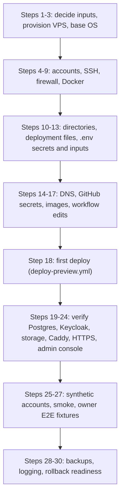

# Server rebuild guide

> **Owner role:** Infrastructure and deployment
> **Status:** NOT VERIFIED — documentation was read against the code, but the procedure has never been executed end to end on a clean server
> **Language / اللغة:** English · [العربية](server-rebuild-guide-ar.md)

**Classification: DOCUMENTATION VERIFIED (read against the repository code on 2026-10-21), NOT EXECUTION VERIFIED.** No step of this guide has been run as a whole on a blank VPS. The only rehearsal in the repository ran on an engineer's own machine (see [What the rehearsal proves](#what-the-rehearsal-proves-and-what-it-does-not)). Treat every command as untested on a clean server until you have rehearsed it on a throwaway one.

**Scope and safety.** This guide builds a NEW, isolated server that runs the synthetic-data Preview (`APP_ENV=PREVIEW`). It is never a procedure to run on the live Preview host. Nothing here may be executed by an AI agent account; steps that need root or Docker belong to an authorized human administrator. Do not use the Restore section on a host that already holds data you want to keep.

## Evidence legend

| Label | Meaning |
|---|---|
| VERIFIED LIVE | Observed on the running Contabo host by a non-privileged account; recorded in [Contabo server inventory](contabo-server-inventory.md). |
| VERIFIED IN CODE | Read in a repository file (file named next to the claim). Says what the code does, not that a server was configured that way. |
| DOCUMENTED ONLY | A document or an upstream product manual says it; not confirmed by code or by the host. |
| OUTDATED / INCORRECT | Conflicts with newer evidence, typically Hetzner-era text. Never follow it as a current instruction. |
| NOT VERIFIED | Neither the repository nor the live observation settles it. The text names a read-only check an authorized administrator can run. |

## How to read this guide

- Part A is a clean installation (steps 1 to 30). Part B is a restore onto a rebuilt server and only points to the recovery page.
- Every step lists its prerequisite, then a command table. The columns are: command, machine and Linux user, read-only or state-changing, how to verify, likely failure and response. Commands that need a pipe or several lines are in the code block under the table.
- Placeholders are in angle brackets: `<domain>` (Preview base domain), `<deploy-user>`, `<admin-user>`, `<vps-ip>`, `<owner>` and `<repo>` (GitHub owner and repository). Never write a secret value into this repository, a ticket or a chat.
- Hetzner-era documents ([Hetzner staging preparation](../../operations/09-staging-hetzner-preparation.md), [owner server setup](../../operations/12-owner-server-setup.md)) were written for a proposed 2 vCPU / 4 GB Hetzner host that was not the running one. Their commands are adapted here only where the code confirms them; Hetzner specifics are marked OUTDATED / INCORRECT. The current host is described in [Contabo server inventory](contabo-server-inventory.md).

## Phases at a glance



The diagram shows the order of the phases. DNS and the GitHub secrets must exist before the first deploy, because the deploy job connects over SSH and Caddy requests certificates on its first start.

## What the rehearsal proves and what it does not

`scripts/rehearse-preview.sh` is the only rehearsal in the repository (VERIFIED IN CODE: its header says it is not a deployment, touches no server and is not evidence about any host). Its recorded results are in `verification/runs/20261014-STAGING-REHEARSAL/README.md` and in [staging deployment and rollback](../../operations/11-staging-deployment-and-rollback.md), section 6 (self-review, source commit `ea159c1`).

| It proves (on one engineer machine, local name `mb.localhost`, locally built images, synthetic data) | It does NOT prove |
|---|---|
| The Compose package starts from empty volumes in dependency order and becomes healthy | Provisioning, users, groups, SSH hardening, firewall, Docker installation |
| `smoke.sh` and a browser smoke with a simulated deposit order pass | Public DNS, sslip.io resolution, Let's Encrypt issuance or renewal |
| Load, persistence across down and up, restart after a killed API process, an older API image on the newer schema | Digest-pinned `deploy.sh up`, GHCR pulls, the GitHub Actions deploy job, the SSH transport |
| Guarded E2E reset and re-seed | The Contabo host, any restore onto a new server, any commit after `ea159c1` (the script was not re-run for this guide) |

The running Preview (answering over HTTPS, see the inventory page) is circumstantial evidence that the CD path works on that host. It is not evidence that this guide, executed from a blank VPS, produces the same result.

---

# Part A. Clean installation

## Phase 1. Inputs, provisioning, base OS

### Step 1. Decide the inputs

Prerequisite: repository admin access on GitHub and a way to pay for a VPS (your decision).

| Input | Value to decide | Evidence |
|---|---|---|
| Preview domain `<domain>` | Current Preview uses `167-86-90-174.sslip.io`, which embeds the server IPv4 with dashes. A new IPv4 means a new domain unless you own a real domain. | VERIFIED IN CODE: `.github/workflows/deploy-preview.yml` passes `PREVIEW_DOMAIN=167-86-90-174.sslip.io` as a build argument; DNS resolution VERIFIED LIVE |
| Hosts that must resolve | `app.`, `ops.`, `api.`, `id.`, `kc-admin.`, `media.` under `<domain>` (six) | VERIFIED IN CODE: `deploy/web-preview/Caddyfile` |
| Allowed client addresses | `ALLOWED_CLIENT_IPS`, optionally `CUSTOMER_ALLOWED_IPS` and `STAFF_ALLOWED_IPS` | VERIFIED IN CODE: `deploy/web-preview/.env.example` |
| ACME contact e-mail | `ACME_EMAIL` | VERIFIED IN CODE: `deploy/web-preview/Caddyfile` global block |

No command. Result: a written list of the values above, kept outside the repository if it holds anything non-public.

### Step 2. Provision the VPS

Prerequisite: Step 1. Contabo-specific ordering screens, image catalogue and panel firewall are NOT VERIFIED (the repository has no Contabo order procedure).

| Item | Model to follow | Evidence |
|---|---|---|
| Operating system | Ubuntu 24.04 LTS (the current host runs 24.04.5, kernel 6.8.0-147-generic) | VERIFIED LIVE |
| Size | The current host has 8 vCPU, 23 GiB RAM and a 290 GB disk | VERIFIED LIVE |
| Minimum for the code | `compose.yaml` memory limits add up to about 6.9 GiB (proxy 256m, postgres 1536m, identity 1g, storage 512m, api 2g, loki 384m, alloy 256m, prometheus 512m, alertmanager 128m, alert-sink 64m, node-exporter 64m, grafana 256m). A smaller host needs `compose.4gb.yaml`, which was sized for 2 vCPU and 4 GB | VERIFIED IN CODE: `deploy/web-preview/compose.yaml`, `deploy/web-preview/compose.4gb.yaml` |
| Network | Public IPv4 on the first interface; the current host also has public IPv6 | VERIFIED LIVE |
| Access at creation | Your SSH public key for the admin account; no password login | DOCUMENTED ONLY: `docs/operations/12-owner-server-setup.md` section 1 (Hetzner-era wording, the principle is generic) |

Verification once the VPS exists (laptop, any user): `ssh <admin-user>@<vps-ip> true` returns without prompting for a password. Likely failure: the provider default user differs; use the user named in the provider welcome message.

### Step 3. Update the OS and install base packages

Prerequisite: SSH access as a sudo-capable administrator.

| Command | Machine and user | Type | Verify | Likely failure |
|---|---|---|---|---|
| `sudo apt-get update` then `sudo apt-get -y upgrade` | VPS, `<admin-user>` with sudo | state-changing | `lsb_release -d` shows Ubuntu 24.04 | a kernel package held back by `apt-mark hold`, or a reboot is required: reboot in a quiet window |
| `sudo apt-get -y install unattended-upgrades ca-certificates curl gnupg openssl python3 tar` | VPS, `<admin-user>` with sudo | state-changing | `command -v openssl python3 curl flock tar` prints five paths | `flock` is in util-linux, normally preinstalled |

Why these packages (VERIFIED IN CODE): `deploy.sh` uses `openssl`, `flock`, `sed`, `awk`; the CD remote script and `admin-console.sh` call `python3`; the CD job streams `tar`; `smoke.sh` uses `curl`. Nothing in the scripts uses `sudo`. `git` is not needed by the CD path (it copies files with `tar`); `docs/operations/12-owner-server-setup.md` installs it only for a manual clone. `unattended-upgrades` is active on the current host (VERIFIED LIVE) but is a convention, not a code requirement. `fail2ban` is not installed on the current host (VERIFIED LIVE) and nothing in the repository requires it. The 2 GiB swap file in the Hetzner-era text was sized for a 4 GB host; whether the current host has swap is NOT VERIFIED and the code does not require it.

## Phase 2. Accounts, SSH, firewall, Docker

### Step 4. Users and groups

Prerequisite: Step 3. Do not create accounts by guesswork about roles; the table separates what the code requires from what the current host happens to show.

**Required by the code (VERIFIED IN CODE).** The account that the deploy job connects as (repository secret `STAGING_SSH_USER`) must: accept key-only SSH; be able to write `/srv/matbakhy-staging` (`test -w` in the transfer step); run `docker` and `docker compose` without sudo (the remote script calls `./deploy.sh up`, which calls `docker`); read and write the server `.env` (mode 600) and `BACKUP_DIR`. No sudo is used anywhere in the deploy path.

**Observed on the current host (VERIFIED LIVE), used only as a model.**

| Account | uid | Groups | What this guide assumes about its duty |
|---|---|---|---|
| `ubuntu` | 1000 | ubuntu, adm, cdrom, sudo, dip, lxd | Nothing. The role is not established from the name. |
| `devops` | 1001 | devops, sudo, users, docker | Nothing beyond the facts: it owns `/srv/matbakhy-staging`, and is the only member of `docker`. Which account the pipeline logs in as is NOT VERIFIED (it lives in the secret `STAGING_SSH_USER`). |
| `aiagent` | 1002 | aiagent, users | Nothing. It is deliberately NOT in `sudo` or `docker`; keep any non-human or observer account that way. |

Convention (not required by code): one human administrator with sudo, one deploy account in `docker` that does not need sudo, and any observer or tooling accounts with neither. Whether the current deploy account also has sudo is unknown to this guide; the code does not need it, so a rebuild can omit it.

| Command | Machine and user | Type | Verify | Likely failure |
|---|---|---|---|---|
| `sudo adduser --disabled-password --gecos "" <deploy-user>` | VPS, `<admin-user>` with sudo | state-changing | `id <deploy-user>` shows the new uid | name already exists: pick another |
| `getent group docker` | VPS, any | read-only | after Step 9 lists `<deploy-user>` | group missing before Docker is installed |

Do not add a non-human or observer account to `sudo` or `docker`. Membership of `docker` is equivalent to root on the host (DOCUMENTED ONLY: Docker documentation), so grant it only to the deploy account.

### Step 5. SSH key access for the deploy account

Prerequisite: Step 4. The CD job writes the private key to a file and connects with `BatchMode=yes`, so the key must have no passphrase (VERIFIED IN CODE: `.github/workflows/deploy-preview.yml`).

Generate a dedicated key pair on your laptop (never reuse a personal key), copy only the public half to the VPS and install it. The private key never leaves the laptop except into the GitHub secret in Step 15. Do not delete the local private key until a separate human operator login (your own personal key on `<admin-user>`, from Step 2) is proven, because that key is the only credential this guide installs for the deploy account; without a human login you lose the route for later manual steps, which can go through `<admin-user>` and `sudo -iu <deploy-user>` instead.

```sh
# laptop, any user: state-changing (creates a key pair in <keyfile>); the private key goes into the GitHub secret in Step 15 and is deleted only after the operator login is proven
ssh-keygen -t ed25519 -N "" -C "matbakhy-cd" -f <keyfile>
# laptop, any user: state-changing on the VPS (copies only the PUBLIC key to a temporary file)
scp <keyfile>.pub <admin-user>@<vps-ip>:/tmp/matbakhy-cd.pub
# VPS, <admin-user> with sudo: state-changing (installs the public key for the deploy account, then removes the temporary file)
sudo install -d -m 700 -o <deploy-user> -g <deploy-user> /home/<deploy-user>/.ssh
sudo install -m 600 -o <deploy-user> -g <deploy-user> /dev/stdin /home/<deploy-user>/.ssh/authorized_keys < /tmp/matbakhy-cd.pub
rm /tmp/matbakhy-cd.pub
```

| Verify | Likely failure |
|---|---|
| Laptop: `ssh -i <keyfile> -o BatchMode=yes <deploy-user>@<vps-ip> id` prints the groups of the account | `Permission denied (publickey)`: wrong owner or mode on `.ssh` or `authorized_keys`; recheck with `ls -ld` and `ls -l` |

### Step 6. SSH hardening

Prerequisite: Step 5 verified from a second terminal. Keep your current session open until the new settings are proven.

Observed (VERIFIED LIVE): password and keyboard-interactive login are off, public-key login is on, and the effective value of `PermitRootLogin` is NOT VERIFIED because `/etc/ssh/sshd_config.d/50-cloud-init.conf` was not readable. The Hetzner-era `sed` edit of `sshd_config` in `docs/operations/12-owner-server-setup.md` is not reused: cloud images ship drop-in files that can override it.

```sh
# VPS, <admin-user> with sudo: state-changing. The 00- prefix makes this file the first one read, ahead of 50-cloud-init.conf.
sudo tee /etc/ssh/sshd_config.d/00-matbakhy-hardening.conf >/dev/null <<'EOF'
PermitRootLogin no
PasswordAuthentication no
KbdInteractiveAuthentication no
PubkeyAuthentication yes
EOF
sudo sshd -t && sudo systemctl reload ssh
sudo sshd -T | grep -E '^(permitrootlogin|passwordauthentication|kbdinteractiveauthentication|pubkeyauthentication) '
```

| Verify | Likely failure |
|---|---|
| The last command prints `permitrootlogin no`, `passwordauthentication no`, `kbdinteractiveauthentication no`, `pubkeyauthentication yes` | A value still shows `yes`: another drop-in wins. sshd keeps the first value it reads (DOCUMENTED ONLY: `sshd_config(5)`); list `ls /etc/ssh/sshd_config.d` and reorder. `sshd -t` errors: remove the new file, do not reload. The service unit is `ssh` on this OS (VERIFIED LIVE: `ssh` is active). |

`X11Forwarding yes` was observed on the current host (VERIFIED LIVE); the code does not use it and you may set it to `no`.

### Step 7. Firewall

Prerequisite: Step 6. The compose file publishes only ports 80 and 443 on all interfaces; Grafana is published on `127.0.0.1:3000` only (VERIFIED IN CODE: `deploy/web-preview/compose.yaml`). Public sockets on the current host are 22, 80 and 443 (VERIFIED LIVE). Whether `ufw` is enabled and which rules exist is NOT VERIFIED LIVE (the package is installed). A provider-panel firewall at Contabo is NOT VERIFIED. The Hetzner cloud firewall instructions are OUTDATED / INCORRECT for this host.

| Command | Machine and user | Type | Verify | Likely failure |
|---|---|---|---|---|
| `sudo ufw allow 22/tcp` then `sudo ufw allow 80/tcp` then `sudo ufw allow 443/tcp` | VPS, `<admin-user>` with sudo | state-changing | `sudo ufw show added` lists three rules | allow SSH first; enabling before it locks you out |
| `sudo ufw enable` | VPS, `<admin-user>` with sudo | state-changing | `sudo ufw status verbose` shows active, default deny incoming | lockout: use the provider console to disable |

Do not open 3000, 5432, 8080, 8081, 8180 or 8333 (DOCUMENTED ONLY: `docs/operations/12-owner-server-setup.md`; consistent with the compose file, where those services have no host port). Docker-published ports can bypass host firewall rules (DOCUMENTED ONLY: Docker documentation, not tested here), so the safety comes mainly from publishing only 80 and 443. Port 80 must stay reachable for certificate issuance (DOCUMENTED ONLY: `docs/operations/12-owner-server-setup.md` section 1). Tailscale is running on the current host (VERIFIED LIVE) but nothing in the repository uses it; do not copy it into a rebuild unless you decide to.

### Step 8. Docker Engine and the Compose plugin

Prerequisite: Step 3. The current host reports Docker 29.9.1 and Compose v5.6.0 (VERIFIED LIVE). Installed Docker packages seen: docker-ce, docker-ce-cli, containerd.io, docker-ce-rootless-extras (VERIFIED LIVE); how the Compose plugin was installed is NOT VERIFIED. The commands below follow Docker's apt repository method as written in `docs/operations/12-owner-server-setup.md` section 3 (DOCUMENTED ONLY; check them against Docker's current Ubuntu instructions, which also add the architecture to the source line).

```sh
# VPS, <admin-user> with sudo: state-changing
sudo install -m 0755 -d /etc/apt/keyrings
sudo curl -fsSL https://download.docker.com/linux/ubuntu/gpg -o /etc/apt/keyrings/docker.asc
echo "deb [signed-by=/etc/apt/keyrings/docker.asc] https://download.docker.com/linux/ubuntu $(. /etc/os-release && echo $VERSION_CODENAME) stable" | sudo tee /etc/apt/sources.list.d/docker.list
sudo apt-get update
sudo apt-get -y install docker-ce docker-ce-cli containerd.io docker-compose-plugin
```

| Verify | Likely failure |
|---|---|
| `sudo docker version` and `docker compose version` both print versions (the compose file uses top-level `name:` and `mem_limit`, so use a current Compose v2 or later) | `Unable to locate package docker-compose-plugin`: the repository line is wrong; recheck the codename and the architecture |

### Step 9. Docker group for the deploy account

| Command | Machine and user | Type | Verify | Likely failure |
|---|---|---|---|---|
| `sudo usermod -aG docker <deploy-user>` | VPS, `<admin-user>` with sudo | state-changing | `id <deploy-user>` lists `docker`; then from a NEW login `docker ps` works without sudo | group not applied: the account needs a fresh SSH session |
| `getent group docker` | VPS, any | read-only | members list only the deploy account | a non-human account listed: remove it with `sudo gpasswd -d <name> docker` |

Do not add any account other than the deploy account. The CD job's SSH sessions are new logins, so they receive the group.

## Phase 3. Directories, files, secrets

### Step 10. Directories and ownership

Prerequisite: Steps 4 and 9. Observed on the current host (VERIFIED LIVE): `/srv` is `root:root` 755; `/srv/matbakhy-staging` is `devops:devops` 755; `/srv/matbakhy-staging/deploy/web-preview` is `devops:devops` 755 and contains the `.env` file with mode 600; `/srv/matbakhy-staging/generated` is mode 700 owned by `devops`; `/srv/matbakhy-backups` is `devops:devops` 750. The current host also has older or unrelated directories: `/srv/matbakhy-preview` (an older copy of the deploy files), `/srv/backups`, `/srv/deployments`, `/srv/ai-supervisor`, `/srv/ai-workspaces`; their purposes are NOT VERIFIED and nothing in the repository references `/srv/backups` or `/srv/deployments`, so a rebuild does not create them.

What the code requires:

| Path | Why | Mode (code or model) | Evidence |
|---|---|---|---|
| `/srv/matbakhy-staging` | Fixed target of the CD transfer and remote script | writable by the deploy account | VERIFIED IN CODE: `.github/workflows/deploy-preview.yml` |
| `/srv/matbakhy-staging/deploy/web-preview/.env` | Secrets and inputs | 600 | VERIFIED IN CODE: `deploy.sh` `init_secrets` uses `umask 077`; the remote script runs `chmod 600` |
| `GENERATED_DIR` (set it to `/srv/matbakhy-staging/generated`) | Rendered realm and storage files with secrets, plus the `flags` switch directory | 700 on the directory, 644 on the two rendered files, 755 on `identity`, `storage` and `flags` | VERIFIED IN CODE: `deploy.sh` `render` |
| `BACKUP_DIR` (`/srv/matbakhy-backups`) | Backups, `releases.log`, `metrics/`, `keycloak/`, `owner-e2e-private/`, the shared lock file `.preview-mutation.lock` | owned by the deploy account, not world readable | VERIFIED IN CODE: `deploy.sh`, `admin-console.sh`, `owner-e2e-provision.sh` |
| `QA_ARTIFACT_DIR` (`/srv/matbakhy-qa-artifacts`) | Only for `deploy.sh prune-qa` | owned by the deploy account | VERIFIED IN CODE: `.env.example`; whether it exists on the live host is NOT VERIFIED |

| Command | Machine and user | Type | Verify | Likely failure |
|---|---|---|---|---|
| `sudo install -d -m 755 -o <deploy-user> -g <deploy-user> /srv/matbakhy-staging` | VPS, `<admin-user>` with sudo | state-changing | `ls -ld /srv/matbakhy-staging` shows the owner | `/srv` missing: create it as root |
| `sudo install -d -m 750 -o <deploy-user> -g <deploy-user> /srv/matbakhy-backups /srv/matbakhy-qa-artifacts` | VPS, `<admin-user>` with sudo | state-changing | `ls -ld` on both | none expected |

Important gap: `.env.example`, `compose.yaml` and `admin-console.sh` default `GENERATED_DIR` to the legacy `/srv/matbakhy-preview/generated`, while CD deploys into `/srv/matbakhy-staging`. A rebuild must set `GENERATED_DIR` explicitly in Step 13. How the live `.env` sets it is NOT VERIFIED (it is mode 600 and was not read); the existing `/srv/matbakhy-staging/generated` directory suggests it points there.

Container-written files: the PostgreSQL container writes dumps into `/backups` (the bind-mounted `BACKUP_DIR`) and the storage archive is written by a container too. Which numeric owner those files get, and whether the deploy account can read them, is NOT VERIFIED. After the first backup an administrator can check with `ls -ln /srv/matbakhy-backups` (see [admin read-only verification](admin-readonly-verification.md)).

### Step 11. Put the deployment files on the server (first time only)

Prerequisite: Step 10 and the release commit chosen. The CD job normally copies the files, but it first requires `.env` to exist (`test -f /srv/matbakhy-staging/deploy/web-preview/.env`, VERIFIED IN CODE), and `.env` is created from `.env.example`, which arrives with the files. So the first copy is manual. This bootstrap recipe reuses the CD job's own `tar` command; it has not been executed (NOT VERIFIED).

```sh
# laptop, in a clean checkout of the release commit (git status clean), as your own user: state-changing on the VPS
tar -cf - deploy infra scripts docs/quality/owner-acceptance/fixtures.json | ssh -i <keyfile> <deploy-user>@<vps-ip> 'tar -xf - -C /srv/matbakhy-staging'
```

| Verify | Likely failure |
|---|---|
| VPS, `<deploy-user>`: `ls /srv/matbakhy-staging/deploy/web-preview/deploy.sh` exists | `Permission denied` on extract: Step 10 ownership. The first SSH connection asks to trust the host key; compare it with the key from Step 15 |

### Step 12. Generate secrets with init-secrets

Prerequisite: Step 11. `./deploy.sh init-secrets` copies `.env.example` to `.env`, replaces every `REPLACE_ME` secret with a random value from `openssl rand`, and refuses to overwrite an existing `.env` (VERIFIED IN CODE: `deploy/web-preview/deploy.sh`). It never prints a value.

| Command | Machine and user | Type | Verify | Likely failure |
|---|---|---|---|---|
| `cd /srv/matbakhy-staging/deploy/web-preview && ./deploy.sh init-secrets` | VPS, `<deploy-user>` | state-changing (creates `.env`, mode 600) | `ls -l .env` shows `-rw-------` owned by the deploy account; the script prints only `wrote .env (mode 600)...` | `.env exists; refusing to overwrite`: that is the safety; do not delete a populated `.env` without a backup |

Never regenerate `.env` after the data volumes exist: the PostgreSQL role passwords are applied only on the first start of an empty volume (VERIFIED IN CODE: `deploy/web-preview/postgres/20-runtime-role.sh` says "First start only"), so new secrets with old volumes cause authentication failures (the PostgreSQL image behaviour is DOCUMENTED ONLY).

### Step 13. Fill in the owner inputs in .env

Prerequisite: Step 12. Edit the file with the editor of your choice as `<deploy-user>`; do not paste its content anywhere.

| Variable | Set to | Evidence |
|---|---|---|
| `PREVIEW_DOMAIN` | `<domain>` | `deploy.sh check` refuses `example.invalid` (VERIFIED IN CODE) |
| `ACME_EMAIL` | a mailbox you control | required by `compose.yaml` |
| `ALLOWED_CLIENT_IPS` | space-separated addresses or ranges; quote the value when it holds more than one, because the shell sources the file. It must also contain the VPS's own public address `<vps-ip>` (and, if you set `CUSTOMER_ALLOWED_IPS` and `STAFF_ALLOWED_IPS`, it must be in both lists), because the first deployment runs `./deploy.sh smoke` on the VPS itself; the address Caddy sees for that request is NOT VERIFIED (Step 26) and cannot be tested before Caddy runs | VERIFIED IN CODE: `.env.example`, `deploy.sh` `load` |
| `GENERATED_DIR` | `/srv/matbakhy-staging/generated` | see the gap in Step 10 |
| `BACKUP_DIR`, `QA_ARTIFACT_DIR` | the directories from Step 10 | VERIFIED IN CODE |
| `CUSTOMER_ALLOWED_IPS`, `STAFF_ALLOWED_IPS` | leave unset to keep everything restricted to `ALLOWED_CLIENT_IPS`; public customers are an explicit owner decision (`0.0.0.0/0 ::/0`); staff API paths need both classes (see Step 22), so every staff address must also be in the customer list | VERIFIED IN CODE: `.env.example` |
| `PUSH_DELIVERY_ENABLED` | `false` | VERIFIED IN CODE: deployed environments refuse `true` |
| `COMPOSE_OVERRIDE` | leave unset on a host of the current size; `compose.4gb.yaml` only for a 4 GB host. Whether the live `.env` sets it is NOT VERIFIED | VERIFIED IN CODE |
| `RELEASE_COMMIT`, `API_IMAGE`, `FRONT_IMAGE` | leave the placeholders; the CD remote script rewrites these three lines (Step 18). Running `./deploy.sh up` by hand before that fails by design | VERIFIED IN CODE: `deploy.sh check`, workflow |

Verify (read-only, deploy account): `grep -v '^[[:space:]]*#' .env | grep -c REPLACE_ME` should print 0 once the secrets exist (comment lines are excluded because `.env` keeps the comments of `.env.example`, one of which mentions `REPLACE_ME`, exactly as `deploy.sh check` skips them); `grep -v '^#' .env | grep -c 'example.invalid'` should print 0. These commands print counts, not values. Likely failure: a value with a space and no quotes breaks sourcing; quote it.

## Phase 4. DNS, GitHub secrets, images, workflow

### Step 14. DNS

Prerequisite: Step 1. The six hosts must resolve to the VPS before the first start, or certificate requests fail (VERIFIED IN CODE: Caddy requests certificates for every host in the Caddyfile; the rate-limit warning is DOCUMENTED ONLY in `docs/operations/12-owner-server-setup.md` section 2). Details of sslip.io and TLS are in [DNS, HTTPS and sslip.io](dns-https-sslip-io.md).

| Option | What to do | Evidence |
|---|---|---|
| sslip.io | No record to create. `<anything>.<ip-with-dashes>.sslip.io` resolves to the IP. `app.167-86-90-174.sslip.io` resolves to 167.86.90.174 today | VERIFIED LIVE |
| Your own domain | Create A (and AAAA) records for `app`, `ops`, `api`, `id`, `kc-admin` and `media` | VERIFIED IN CODE for the six names; the Hetzner-era page lists only five (no `kc-admin`), which is OUTDATED / INCORRECT |

| Command | Machine and user | Type | Verify | Likely failure |
|---|---|---|---|---|
| `getent hosts app.<domain> ops.<domain> api.<domain> id.<domain> kc-admin.<domain> media.<domain>` | laptop or VPS, any | read-only | six lines, each with `<vps-ip>` | missing line: the record is absent or not yet propagated; wait and retry before Step 18 |

### Step 15. GitHub environment and secrets

Prerequisite: Steps 5 and 6. Both `deploy-preview.yml` and `owner-e2e-provision.yml` run in the GitHub environment `preview` and read four secrets (VERIFIED IN CODE). Whether they are stored as environment secrets or repository secrets, and what protection rules the environment has, is NOT VERIFIED (check Settings, Environments, as a repository admin).

| Secret name | Content | How to obtain without exposing it |
|---|---|---|
| `STAGING_SSH_HOST` | the VPS address that SSH connects to (`<vps-ip>` or a DNS name) | your Step 2 value |
| `STAGING_SSH_USER` | `<deploy-user>` | Step 4 |
| `STAGING_SSH_KEY` | the private key file from Step 5 | read from the file on your laptop |
| `STAGING_SSH_HOST_PUBKEY` | the server host key in the form `<type> <base64>`; the job writes the line `<STAGING_SSH_HOST> <STAGING_SSH_HOST_PUBKEY>` to `known_hosts` and connects with strict checking | on the VPS: `cut -d' ' -f1,2 /etc/ssh/ssh_host_ed25519_key.pub` (a public file) |

```sh
# laptop, GitHub CLI signed in as a repository admin: state-changing; values come from files or stdin, never from the command line
gh secret set STAGING_SSH_HOST --env preview --repo <owner>/<repo> < <file-with-host>
gh secret set STAGING_SSH_USER --env preview --repo <owner>/<repo> < <file-with-user>
gh secret set STAGING_SSH_KEY --env preview --repo <owner>/<repo> < <keyfile>
gh secret set STAGING_SSH_HOST_PUBKEY --env preview --repo <owner>/<repo> < <file-with-hostkey>
```

| Verify | Likely failure |
|---|---|
| `gh secret list --env preview --repo <owner>/<repo>` lists the four names (names only, values are never shown) | The environment `preview` must exist first; create it in the repository settings. After setting the key, and only after the human operator login from Step 5 works, delete the local `<keyfile>` and its `.pub` if you do not need them. The `gh` flags follow the tool's own manual; confirm with `gh secret set --help` |

The deploy job aborts with `Missing <name>` when any of the four is empty (VERIFIED IN CODE).

### Step 16. GHCR images

Prerequisite: Step 15. In the normal CD path nothing is done by hand: the `build` job builds the API jar and two images, pushes them to GHCR as `ghcr.io/<owner-lowercase>/matbakhy-api:<sha>` and `ghcr.io/<owner-lowercase>/matbakhy-preview-front:<sha>`, and passes the digests to the deploy job. The deploy job uses the workflow's own `GITHUB_TOKEN` to run `docker login ghcr.io` on the server inside a temporary Docker config directory that is deleted afterwards, so no registry credential stays on the server (VERIFIED IN CODE: `.github/workflows/deploy-preview.yml`). The server pulls only images pinned by digest (`deploy.sh check`).

The separate manual workflow `.github/workflows/preview-images.yml` builds the same two images for a given domain and prints `RELEASE_COMMIT`, `API_IMAGE`, `FRONT_IMAGE` in its job summary; it is for manual deployments and it refuses a commit without a passing Product CI run (VERIFIED IN CODE).

Verify after a run: GitHub, Packages, the two package names exist and their digests match the lines the deploy job wrote to the server `.env`. Likely failure: a manual `./deploy.sh up` outside CD cannot pull private packages without a `docker login ghcr.io` by an authorized person.

### Step 17. Align the workflow with the new server

Prerequisite: a pull request process you control. These values are hard-coded in the workflow, so a rebuild with a different domain or account needs a reviewed change to `.github/workflows/deploy-preview.yml` (VERIFIED IN CODE):

| Hard-coded value | Where | Change when |
|---|---|---|
| `--build-arg PREVIEW_DOMAIN=167-86-90-174.sslip.io` | build job, front image | the domain changes (the API address is baked into the web build, see `deploy/web-preview/front.Dockerfile`) |
| `docker login ghcr.io -u afawzy70` | remote script | the repository owner or login user changes |
| `/srv/matbakhy-staging/deploy/web-preview` | transfer step, remote script, admin console step | you choose a different install path |
| runs on push to `develop` and `workflow_dispatch`; deploy job only on `develop` | triggers | you want another branch |

Do not change workflow files without the repository owner's authorization.

## Phase 5. First deploy

### Step 18. First deploy through CD

Prerequisite: Steps 1 to 17, including the VPS's own address in the allow-list (Step 13). If smoke gets a 403 because Caddy sees another address, the CD job restores the previous `.env` and fails; correct the allow-list and run again. Trigger: a push to `develop`, or Run workflow on `develop` for `Deploy Matbakhy preview to Contabo` (VERIFIED IN CODE: `workflow_dispatch` exists). Concurrency group `matbakhy-preview-deploy` serialises runs.

What the pipeline does, in order (VERIFIED IN CODE): wait up to 60 times 30 seconds for a passing Product CI run on the exact commit; build the API jar; build and push both images; in the deploy job, check the four secrets, write the key and `known_hosts`, check `.env` exists and the directory is writable, stream `deploy`, `infra`, `scripts` and the fixtures file to `/srv/matbakhy-staging` with `tar`, copy a temporary remote script, rewrite `RELEASE_COMMIT`, `API_IMAGE` and `FRONT_IMAGE` in `.env`, run `./deploy.sh up` and `./deploy.sh smoke`; on failure restore the previous `.env` (containers and data are not rolled back); finally run `./deploy.sh admin-console enable`.

What `./deploy.sh up` does on the server (VERIFIED IN CODE): validates `.env`; takes the shared lock; renders the realm and storage files into `GENERATED_DIR`; takes a verified database backup only when a postgres container already exists; pulls missing images; `docker compose up -d`; waits up to 90 times 5 seconds for the API health check; creates the buckets `matbakhy-public` and `matbakhy-private` (errors ignored); appends a line to `releases.log`.

| Verify | Likely failure |
|---|---|
| The workflow run ends green with `DEPLOYED <sha>`. On the VPS as `<deploy-user>`: `cd /srv/matbakhy-staging/deploy/web-preview && ./deploy.sh status` lists the containers, the schema version and the last release | `Missing STAGING_SSH_*`: Step 15. `Host key verification failed`: the host key secret differs from the server key. `.env still has placeholders`: Step 13. `API did not become healthy`: read the printed API and identity logs. Product CI failed or timed out: nothing is built |

## Phase 6. Verify the running pieces

### Step 19. PostgreSQL

First start of the empty `postgres-data` volume runs the init scripts: a `keycloak` database and user, then the least-privilege role `matbakhy_app` (VERIFIED IN CODE: `deploy/web-preview/postgres/10-keycloak.sh`, `deploy/web-preview/postgres/20-runtime-role.sh`). Flyway migrates as the owner role when the API starts. PostgreSQL has no host port (it joins only the `internal` network). Version `postgres:16.15-alpine` pinned by digest (VERIFIED IN CODE).

| Command | Machine and user | Type | Verify | Likely failure |
|---|---|---|---|---|
| `./deploy.sh status` (in `deploy/web-preview`) | VPS, `<deploy-user>` | read-only | `== schema version:` shows a number above 0 | `0`: migrations did not run, read `docker compose logs api` |

### Step 20. Keycloak realm import

`./deploy.sh render` (called by `up`) fills `deploy/web-preview/identity/matbakhy-realm.preview.json` with secrets and the domain and writes it to `GENERATED_DIR/identity/`; Keycloak starts with `start --import-realm` and its health check passes only when the `matbakhy` realm answers (VERIFIED IN CODE: `compose.yaml`). Import on start skips a realm that already exists (DOCUMENTED ONLY: Keycloak behaviour, not tested here), so later realm changes use scripts such as `deploy/web-preview/migrate-mfa.sh` and the admin console script instead of a re-render.

| Command | Machine and user | Type | Verify | Likely failure |
|---|---|---|---|---|
| `curl -s https://id.<domain>/realms/matbakhy/.well-known/openid-configuration` | any machine inside the customer class | read-only | JSON containing `"issuer":"https://id.<domain>/realms/matbakhy"` | 403 `Not available`: your address is outside the allow-list; 404 or connection error: Caddy or Keycloak not ready |

Opening `https://id.<domain>/` returns a 302 to `https://kc-admin.<domain>/admin/`; that is expected (VERIFIED LIVE and VERIFIED IN CODE via `KC_HOSTNAME_ADMIN` in `compose.yaml`).

### Step 21. Object storage

SeaweedFS runs behind `storage:8333` on the `internal` network; `s3.json` is rendered from `deploy/web-preview/storage/s3.json.template` (secret keys never in Git), and anonymous users may only read the bucket `matbakhy-public` (VERIFIED IN CODE). Anonymous `GET https://media.<domain>/` returns 403 from the storage gateway, which is the expected answer for a bucket-list request (VERIFIED LIVE on the current host; the exact error body was not stored).

```sh
# VPS, <deploy-user>, in deploy/web-preview: read-only
docker compose --env-file .env -f compose.yaml exec -T storage sh -c 'echo s3.bucket.list | weed shell'
```

| Verify | Likely failure |
|---|---|
| The output lists `matbakhy-public` and `matbakhy-private` (the same check is used in `scripts/rehearse-preview.sh persist`) | Buckets absent: `up` ignores the creation error; rerun `./deploy.sh up` or create them with the `s3.bucket.create` lines shown in `deploy.sh` |

Add `-f "$COMPOSE_OVERRIDE"` to the command when `.env` sets `COMPOSE_OVERRIDE`.

### Step 22. Caddy proxy and routing

Caddy runs inside the front container, not on the host (VERIFIED IN CODE: `deploy/web-preview/front.Dockerfile`, `compose.yaml`; `caddy` is not installed on the host, VERIFIED LIVE). Routing (VERIFIED IN CODE: `deploy/web-preview/Caddyfile`):

| Host | Behaviour | Class |
|---|---|---|
| `app.` | customer web | customer |
| `ops.` | operations web | staff |
| `api.` | proxies only `/api/*`, `/oauth2/*`, `/login/oauth2/*`, `/logout`; everything else 404 (actuator is not exposed); `/api/v1/ops*` and `/api/v1/cook*` need the staff class, checked first, and then the customer class like every other path of this host | customer; staff and customer for those paths |
| `id.` | Keycloak, but `/admin*` and `/realms/master*` answer 404 | customer |
| `kc-admin.` | 404 until the switch file `flags/admin-console-public` exists, then only the console paths | not IP restricted; protected by Keycloak password plus one-time password |
| `media.` | storage gateway | customer |

| Command | Machine and user | Type | Verify | Likely failure |
|---|---|---|---|---|
| `curl -s -o /dev/null -w '%{http_code}\n' https://api.<domain>/actuator/health` | any machine in the customer class | read-only | `404` | `200`: the proxy config is wrong; do not expose |
| `curl -s https://api.<domain>/api/v1/configuration/public` | same | read-only | JSON with `"environment":{"name":"PREVIEW","demo":true}` | 403 `Not available`: access-policy answer, not an outage |

### Step 23. HTTPS certificates

Caddy obtains and renews certificates automatically for every host name in the Caddyfile and stores them in the `caddy-data` volume (VERIFIED IN CODE for the configuration; automatic issuance is Caddy's documented behaviour). The current `app.` certificate was issued by Let's Encrypt (CN YE1), valid 2026-10-18 to 2027-01-16 (VERIFIED LIVE); renewal itself is NOT VERIFIED. Losing the `caddy-data` volume forces reissuance and can hit rate limits (DOCUMENTED ONLY).

```sh
# any machine: read-only
openssl s_client -connect <vps-ip>:443 -servername app.<domain> </dev/null 2>/dev/null | openssl x509 -noout -issuer -dates
```

| Verify | Likely failure |
|---|---|
| issuer is Let's Encrypt and the dates are about 90 days apart | self-signed or handshake error: DNS (Step 14) or port 80 closed (Step 7); see [infrastructure troubleshooting](infrastructure-troubleshooting.md) |

### Step 24. Keycloak admin console switch

The last step of the CD job runs `./deploy.sh admin-console enable`: it backs up, hardens the master realm (required one-time password, no password grant, brute-force protection), creates the switch file and verifies the public URL, closing it again on failure (VERIFIED IN CODE: `deploy/web-preview/admin-console.sh`, owner approval of 2026-10-19). On the current host the host answers 302 to `/admin/master/console/` (VERIFIED LIVE), so the switch is open. Read [Keycloak admin console](../../operations/14-keycloak-admin-console.md) before first sign-in.

| Command | Machine and user | Type | Verify | Likely failure |
|---|---|---|---|---|
| `./deploy.sh admin-console status` | VPS, `<deploy-user>` | read-only | prints hardening state, switch state and the number of users with a one-time password | failure: run `./deploy.sh admin-console disable` to close at once |

## Phase 7. Accounts and checks

### Step 25. Synthetic accounts and demo catalogue

CD does not seed data (VERIFIED IN CODE: no `seed` in the workflow). Run once after the first deploy:

| Command | Machine and user | Type | Verify | Likely failure |
|---|---|---|---|---|
| `./deploy.sh seed` | VPS, `<deploy-user>` | state-changing (inserts synthetic rows; idempotent through `ON CONFLICT`) | `curl -s 'https://api.<domain>/api/v1/meals?limit=3'` returns an `items` list | SQL error: the schema is not migrated yet |

Realm users come from the rendered realm file: `preview-customer-1`, `preview-customer-2`, `preview-cook-1`, `preview-ops-1`, `preview-ops-2` (VERIFIED IN CODE: `deploy/web-preview/identity/matbakhy-realm.preview.json`), all sharing `PREVIEW_USER_PASSWORD` from the server `.env`. An authorized engineer reads that value on the server; it is never copied into documents. `preview-ops-1` is the bootstrap staff administrator through `STAFF_BOOTSTRAP_SUBJECT`.

### Step 26. Smoke test

| Command | Machine and user | Type | Verify | Likely failure |
|---|---|---|---|---|
| `./deploy.sh smoke` | VPS, `<deploy-user>` | read-only (creates no account or order) | ends with `PASS: web preview smoke test for <domain>` | `FAIL: ...` names the check. A 403 from `ops.` or `app.` means the caller address is outside the class; what address Caddy sees for a request the VPS sends to its own public IP is NOT VERIFIED, so include it in the allow-list if smoke is run on the server |
| `SMOKE_OPS=skip sh smoke.sh <domain>` | a machine outside the staff class | read-only | confirms `ops.` refuses it | none |

`smoke.sh` checks the customer and operations web, security headers, the demo notice, the public configuration, 401/403 on private APIs, 404 on actuator, the Keycloak issuer, the closed or open admin console state and the sign-in redirect (VERIFIED IN CODE). The simulated-order browser smoke is the `playwright.staging.config.ts` command in `docs/operations/12-owner-server-setup.md` section 7 and needs a developer machine.

### Step 27. Owner E2E fixtures (optional)

A change to `deploy/web-preview/owner-e2e-run.request` on `develop` triggers `.github/workflows/owner-e2e-provision.yml`. Its first word is `plan` (read-only) or `apply` (verified backup, Keycloak partial import, SQL seeds, slot refresh, reconciliation); it waits for the deployment of the same commit and then runs `./owner-e2e-provision.sh` on the server over the same SSH secrets (VERIFIED IN CODE). It refuses unless the API reports `APP_ENV=PREVIEW`. Generated passwords are written to a mode-600 file under `BACKUP_DIR/owner-e2e-private/<run>` and are never printed. Skip this step unless owner acceptance testing needs it.

The destructive `./deploy.sh e2e-reset` additionally needs the marker file `.e2e-enabled`, non-public customer hosts and a typed confirmation (VERIFIED IN CODE). Never run it on a live Preview.

## Phase 8. Operations readiness

### Step 28. Backups

`./deploy.sh backup` writes a custom-format PostgreSQL dump with checksum and manifest into `BACKUP_DIR`, restores it into a scratch database and reconciles it, then stops the storage service briefly and archives its data as `storage-<stamp>.tgz` (uploads pause meanwhile). A backup counts only after the restore check. Failure state: `backup` has no recovery trap, so if the archive command fails the script exits before `compose start storage` and the storage service stays stopped (uploads keep failing); check it with `docker compose --env-file .env -f compose.yaml ps storage` and, as the deploy account, restart it with `docker compose --env-file .env -f compose.yaml start storage` (add `-f "$COMPOSE_OVERRIDE"` when `.env` sets it), then investigate the archive error. The pre-deploy backup in `up` uses the same database routine (VERIFIED IN CODE). The repository contains no cron entry or timer for backups; no Matbakhy backup cron was visible to the unprivileged account on the live host, and other users' crontabs are unreadable, so whether scheduled backups exist is NOT VERIFIED.

```sh
# VPS, <deploy-user>: state-changing (edits that account's crontab). The schedule is a convention taken from docs/operations/12-owner-server-setup.md section 9, adapted to this install path; server local time applies.
( crontab -l 2>/dev/null; echo '17 3 * * * cd /srv/matbakhy-staging/deploy/web-preview && ./deploy.sh backup >> /srv/matbakhy-backups/backup.log 2>&1' ) | crontab -
```

| Verify | Likely failure |
|---|---|
| Run `./deploy.sh backup` once by hand: `backup verified:` is printed and `/srv/matbakhy-backups/metrics/matbakhy_backup.prom` exists | `flock` or permission errors: Step 10 ownership. Backups stay on the same server; copying them elsewhere is not configured in the repository. See [backup, restore and disaster recovery](backup-restore-disaster-recovery.md) |

### Step 29. Logging and monitoring

Containers log with the `json-file` driver (10 MB, 3 files); Alloy reads `/var/lib/docker/containers` and ships to Loki; Prometheus, Alertmanager (local test sink only, no real recipients), node-exporter and Grafana run on the internal network; retention is `LOG_RETENTION=720h`, `DEBUG_LOG_RETENTION=168h`, `METRICS_RETENTION=15d` (VERIFIED IN CODE: `compose.yaml`, `.env.example`; proposed defaults, not approved policy). Grafana is published only on `127.0.0.1:3000`; reach it with an SSH tunnel through the human operator login from Step 5, not through the CD key. A loopback listener on port 3000 exists on the current host (VERIFIED LIVE), but the compose-level facts (container list, limits) are NOT VERIFIED LIVE because the unprivileged account cannot read the Docker socket.

| Command | Machine and user | Type | Verify | Likely failure |
|---|---|---|---|---|
| `ssh -N -L 3000:127.0.0.1:3000 <admin-user>@<vps-ip>` then open `http://127.0.0.1:3000` | laptop | read-only | the Grafana sign-in page opens; user `ops-admin`, password `GRAFANA_ADMIN_PASSWORD` from the server `.env` | port busy on the laptop: use another local port |

### Step 30. Rollback readiness

Before declaring the server ready, confirm the rollback tools work (VERIFIED IN CODE):

| Command | Machine and user | Type | Verify | Likely failure |
|---|---|---|---|---|
| `./deploy.sh rollback-plan` | VPS, `<deploy-user>` | read-only (prints only) | with at least two entries in `releases.log` it prints the target commit and a verdict; with one entry it says `only 1 release(s) recorded` | no log: no `up` has completed yet |
| `./deploy.sh status` | VPS, `<deploy-user>` | read-only | configured versus running images match | mismatch: a failed deploy |

Rollback rules: an image-only rollback is safe when the schema did not move or every later migration is expand-only (`scripts/check_migration_compat.py` enforces the annotation in CI); otherwise restore the backup taken before the first deploy that applied them (data written since is lost). The CD job restores only `.env` on failure, never the database. Decision tables are in [backup, restore and disaster recovery](backup-restore-disaster-recovery.md) and [deployment pipeline](deployment-pipeline.md).

---

# Part B. Restore from backup onto a rebuilt server

Use this part only on a NEW isolated server after Part A steps 1 to 18 produced a healthy empty stack, and only with backups you copied from an earlier host. The full decision logic, data-loss statements and scenarios are in [backup, restore and disaster recovery](backup-restore-disaster-recovery.md); this section lists only what the code supports.

| Item | What the code does | Status |
|---|---|---|
| Application database | `./deploy.sh restore-db <dump>` runs `scripts/db-restore.sh` inside the postgres container with `RESTORE_CONFIRM_TARGET=matbakhy_restore`: checksum check, creates the database `matbakhy_restore` if absent, refuses a non-empty target, `pg_restore`, then reconcile. It does NOT overwrite the live `matbakhy` database; pointing the application at the restored one is a manual owner step | VERIFIED IN CODE: `deploy.sh`, `scripts/db-restore.sh` |
| Keycloak database | `owner-e2e-provision.sh apply` writes a `pg_dump` of `keycloak` under `BACKUP_DIR/keycloak`; there is no restore script for it. Realm secrets in a restored database must match the new `.env` | NOT VERIFIED procedure |
| Image storage | `./deploy.sh backup` creates `storage-<stamp>.tgz`; there is no restore script | NOT VERIFIED procedure |
| Secrets (`.env`) | Not in any backup by design; a lost `.env` cannot be regenerated without breaking existing volumes (Step 12) | VERIFIED IN CODE |

This table is a list of what the code supports, not a rehearsable recovery sequence. Missing from the repository: the Keycloak and storage restore, the cutover of the application to the restored database, ownership and grants of the restored objects, secrets handling, validation and rollback of the cutover. Treat the recovery as NOT VERIFIED and not operationally sufficient until the owner defines and rehearses one sequence covering all stores.

Verification after a restore: `./deploy.sh status` (schema version) and the row-count lines printed by the reconcile step. Do not treat a restore as complete until an authorized administrator has run the recovery page's checks and you have rehearsed the procedure on a throwaway server.

## Known limitations and documentation gaps

- This guide is not execution verified. The bootstrap in Step 11 (manual first copy) and the permission commands are derived from the code and were not run.
- `GENERATED_DIR` defaults to `/srv/matbakhy-preview/generated` in `.env.example`, `compose.yaml` and `admin-console.sh`, while CD deploys into `/srv/matbakhy-staging`; the live value is NOT VERIFIED. Documentation conflict: `deploy/web-preview/README.md` and `docs/operations/09-staging-hetzner-preparation.md` still describe a Hetzner 2 vCPU / 4 GB profile, `docs/operations/12-owner-server-setup.md` lists five DNS hosts (no `kc-admin`) and the path `/srv/matbakhy-preview` (all OUTDATED / INCORRECT for the Contabo host).
- The deploy workflow hard-codes the domain `167-86-90-174.sslip.io` and the GHCR login name `afawzy70`; a rebuild on another IP needs a reviewed workflow change (Step 17).
- Not verified live: effective `PermitRootLogin`, sudo policy, `ufw` state and rules, Docker containers, networks and volumes, ownership of container-written backup files, the value of `STAGING_SSH_USER`, whether backup cron exists, certificate renewal, whether the Compose override is used.
- Contabo ordering and panel-level firewall steps are not documented anywhere in the repository.
- No restore procedure exists in code for the Keycloak database or the storage archive.
- Administrator commands that would settle several of the items above are collected in [admin read-only verification](admin-readonly-verification.md); an agent account must not run them.
