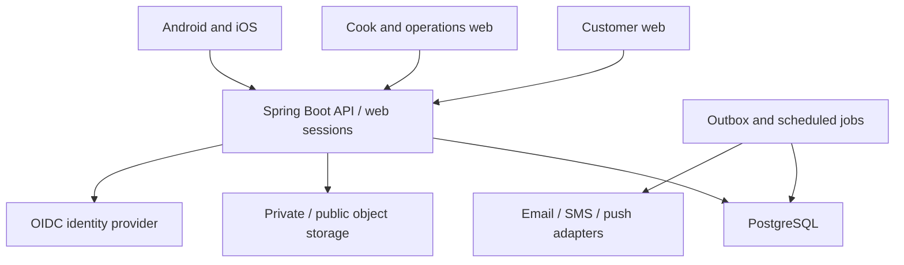

# Architecture baseline and decisions

Status: PROPOSED_DEFAULT pending P01 compatibility spike. Spring Boot and customer Android/iOS are owner requirements. Other technologies are recommendations for a maintainable AI-assisted build.

## Runtime shape

Use a modular monolith: one backend deployment and database, explicit domain modules, background workers using database leases. Start with a single instance locally; prove correctness with two worker/API instances in reliability tests. No Kafka, Kubernetes, service mesh, distributed transactions, Elasticsearch or Redis dependency unless a measured need is recorded.

## Proposed repository layout to implement

| Path | Ownership |
|---|---|
| `backend/pom.xml` | Maven parent/BOM; Java 21; pinned plugins/dependencies |
| `backend/app` | Spring Boot entry point, composition/configuration |
| `backend/modules/{identity,cooks,catalog,availability,orders,finance,support,notifications,operations}` | Domain/application services, module-local adapters/repositories/controllers |
| `backend/shared` | Small stable primitives: Money, IDs, errors, audit context; no universal business model |
| `apps/customer-web` | React/TypeScript/Vite customer web |
| `apps/operations-web` | React/TypeScript/Vite cook and platform operations |
| `apps/customer-mobile` | React Native/Expo app for both native platforms |
| `packages/api-client` | Generated TypeScript client and validated shared API types |
| `packages/i18n` | Translation keys/resources shared when platform appropriate |
| `packages/design-tokens` | Brand tokens; web/native adapters remain separate |
| `contracts` | Endpoint registry now; complete OpenAPI generated in P01/P04 before dependent UI |
| `infra` | Compose, reverse proxy, environment templates and deployment manifests |
| `scripts` | Portable developer, validation, migration, smoke and evidence commands |
| `tests/e2e`, `tests/mobile`, `tests/load` | Cross-surface journeys, native flows and load scenarios |

Create these paths through the backlog, not empty placeholder code presented as implementation. [planning/inventory.json](../../planning/inventory.json) records which exist.

## ADR-001: module boundaries

Controller → application service → domain logic → repository/integration adapter. Catalogue owns meal definitions; availability owns dated stock; orders owns snapshots/transitions; finance owns monetary obligations and reconciliation. Cross-module calls use explicit application interfaces and immutable DTOs. Only the composition layer wires modules; forbid reverse dependencies with architecture tests. Internal domain events are local plus persisted outbox for external effects; they do not require a broker.

Use PostgreSQL transactions for ordering invariants. Choose JPA for normal persistence and explicit SQL/locking for stock reservation where clear. Flyway owns schema history. H2 is insufficient proof for PostgreSQL concurrency and migrations. Use Testcontainers with the production database major version.

## ADR-002: clients and contract ownership

Three apps, one API contract. Web and native share generated clients, validation primitives and translation keys; native UI is built for native navigation/input and accessibility. Do not wrap customer web in a WebView and claim native app acceptance. Server code owns business decisions. A UI price preview never becomes an authoritative order total.

Use server-state query caching with keys including identity, locale, filters and pagination. Invalidate affected data after commands. Clear private caches on logout/account switch. URL represents web filters; mobile navigation state uses equivalent typed parameters. Cart drafts can persist locally but must always revalidate at checkout.

## ADR-003: authentication

Use maintained OIDC libraries and a provider. Local reference is Keycloak with realm/config import; production provider selection stays open. Web uses authorization-code login and server-managed sessions (HttpOnly, Secure in HTTPS, SameSite cookies) through Spring Security; CSRF protection on cookie-authenticated mutations. Native uses authorization code with PKCE, system browser and validated app/universal links; tokens in OS secure storage, no embedded client secret.

Customer and operations web may be separate origins; prefer same-origin reverse proxy per surface to its API, strict allowed origins and host-only cookies. Do not disable CSRF to make multi-origin development easier. Persist web sessions in PostgreSQL where restart/multi-instance behavior requires it. Design and test logout, expiration and revocation across all clients in P02.

Provider subject (`issuer`,`sub`) maps to local user. Application grants are server-controlled. Phone OTP is a checkout contact-verification adapter, not a replacement authentication implementation. Staff MFA and fresh step-up are checked through the provider's supported assurance claims or reauthentication contract; a frontend boolean is insufficient.

## ADR-004: external services

Ports: IdentityProvider, PhoneVerificationSender, EmailSender, PushSender, ObjectStorage, MalwareScanner; optional PaymentGateway and DeliveryPartner later. Fakes exist only in dev/test profiles with unmistakable fixture identifiers. Production startup fails if a required provider uses a fake. No real SMS/email sent from automated tests.

Use outbox, timeouts, exponential bounded retries with jitter, idempotency and dead-letter visibility. A provider outage cannot roll back an already placed order. Expose pending notifications to ops; customer can read status in-app.

## ADR-005: dependency and environment lock

P01 selects maintained stable versions supported together: Java 21, Spring Boot, PostgreSQL, Node LTS, pnpm, React, Expo SDK/React Native pair, Android toolchain and Xcode. Check official sources at execution time, pin exact versions/lockfiles/container digests and record a tested matrix. Do not use `latest` image tags, release candidates or a random React Native version incompatible with Expo. Current documentation is a reference, not a permanent version guarantee.

## Non-functional design budgets (provisional targets)

With documented staging hardware, 10,000 published meals, 100,000 historical orders and 100 active users: catalogue p95 ≤500ms, quote/order p95 ≤1s excluding external identity/provider latency; error rate under 1% excluding expected validation/stock conflicts. No duplicate orders, oversell or ledger drift at any load. Web core pages target LCP ≤2.5s and CLS ≤0.1 on a documented mobile network/device profile; cold-start native performance gets a measured baseline before target lock. Revisit measured limits, not correctness requirements.

RPO ≤24 hours and RTO ≤4 hours are proposed pilot objectives requiring real backup/restore evidence and owner acceptance. They are not infrastructure guarantees supplied by this repository.
