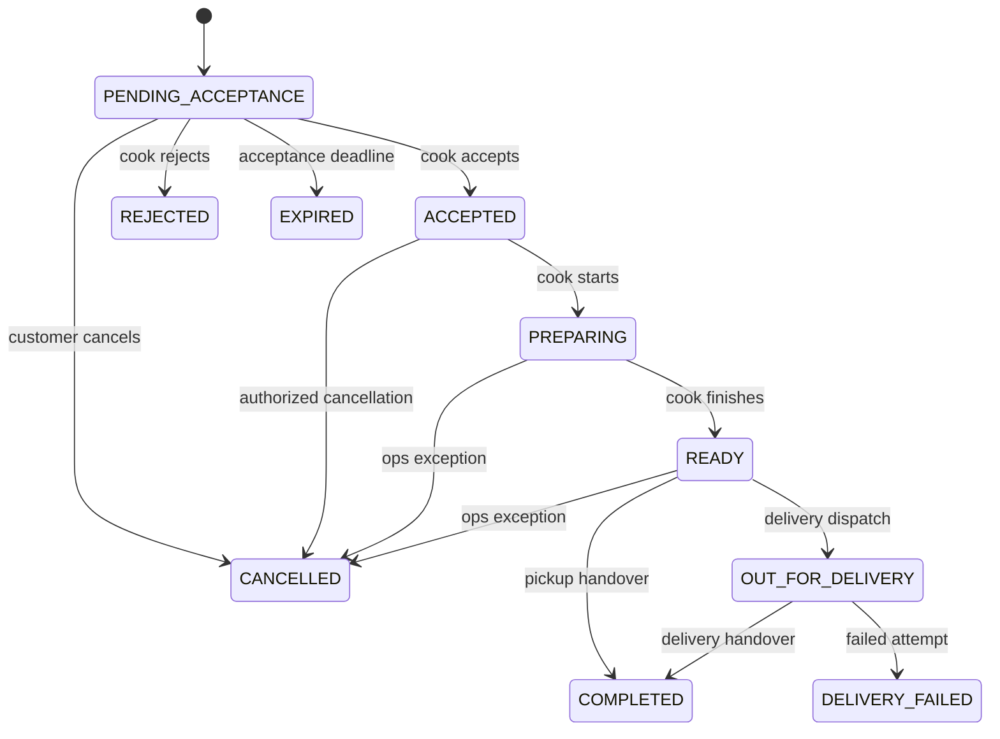

# Transaction and lifecycle state machines

These are proposed normative defaults for the cash-first baseline. All transitions are server-side commands with authorization, expected version, reason where required, audit event and transaction boundary. No client may PATCH a free-form status.

## Order states

Rejected, expired, cancelled, completed and delivery-failed are terminal order states. Refunds, disputes and financial adjustments do not rewrite them. A customer cancellation *request* after acceptance is a case/action request, not an order state. Reorder creates a new quote/order.

| Command | Allowed state | Actor/guard | Atomic result |
|---|---|---|---|
| Place | New | Customer active, verified email/phone, own valid unexpired quote, serviceable, approved active cook, live slot/cutoff, capacity available | Reserve portions; snapshot order; create pending cash obligation; audit/outbox; persist idempotency result |
| Accept | PENDING_ACCEPTANCE | Owning cook, not suspended, before `acceptBy` | ACCEPTED; reservation becomes allocated; accepted timestamp; outbox |
| Reject | PENDING_ACCEPTANCE | Owning cook; reason code | REJECTED; release reservation once; no commission |
| Expire | PENDING_ACCEPTANCE | System with database time `now >= acceptBy` | EXPIRED; release once; publish event |
| Customer cancel | PENDING_ACCEPTANCE | Owner of order | CANCELLED; release once; no penalty |
| Cancel accepted | ACCEPTED | Owning cook or ops; mandatory reason; customer uses request workflow | CANCELLED; release allocation once; exception record |
| Start preparation | ACCEPTED | Owning cook | PREPARING; mark allocation consumed; no subsequent automatic capacity restoration |
| Ready | PREPARING | Owning cook | READY; handover code usable by customer |
| Dispatch | READY | Owning cook/ops; delivery mode only; delivery arrangement recorded | OUT_FOR_DELIVERY; timestamp/contact reference |
| Complete pickup | READY | Owning cook/ops; pickup mode; code verification | COMPLETED; immutable fulfillment event; cash may still be due |
| Complete delivery | OUT_FOR_DELIVERY | Owning cook/ops; delivery mode; code verification | COMPLETED; immutable fulfillment event; cash may still be due |
| Fail delivery | OUT_FOR_DELIVERY | Owning cook/ops; reason/evidence | DELIVERY_FAILED; support task; no automatic refund/payment/commission |
| Exception cancel | PREPARING/READY | Ops only; safety/operational reason and case reference | CANCELLED; consumed capacity stays consumed; manual finance review |
| Override handover | READY/OUT_FOR_DELIVERY | Ops with `order.handover_override`; fresh MFA; reason + evidence | Complete only allowed fulfillment mode; immutable override audit |

Suspension prevents new sales/acceptance but does not remove visibility or ability to safely complete existing accepted orders; ops can intervene. A safety suspension can freeze specific affected orders for ops decision; do not auto-cancel unrelated fulfilled history.

### Race and transaction rules

- Lock the order row or use compare-and-set on its version and state. Exactly one of simultaneous accept/expire/cancel wins. Losing commands return 409 with current state; a replay of the same idempotent command returns the original outcome.
- Default acceptance deadline is `min(createdAt + 15 minutes, slotStart - leadTime)`. Require at least 5 minutes before that deadline when placing. Default `leadTime=120 minutes` is a synthetic pilot value. All three values are versioned policy configuration.
- A quote expires after 5 minutes and holds **no capacity**. Submission revalidates price versions, serviceability, approval, slot and capacity in a database transaction. Changed terms require a fresh quote and explicit customer acceptance.
- Portion capacity is bounded per meal-slot AND at the cook-slot aggregate level. Reserve every involved row in stable ID order; roll back all if any row cannot satisfy the request.
- Capacity transitions: available → reserved on placement; reserved → allocated on acceptance; allocated → consumed on preparation. Reject/expire/pre-preparation cancel restores exactly once. After preparation, restoration is an explicit audited stock adjustment only if appropriate; never automatic.
- A transaction includes order, item snapshots, capacity counters, events, idempotency and outbox. Do not send SMS/email inside the transaction. Outbox worker commits delivery attempt state separately and uses a stable event ID for deduplication.
- Retry a transient database deadlock a bounded number of times with the original idempotency key. Do not retry validation/business conflicts blindly.

### Handover challenge details

Generate a cryptographically random six-digit code when the order becomes READY. Store a slow/appropriate keyed verification hash and an encrypted customer-display value under a managed key, never plaintext logs or cook/staff DTOs. Only the authenticated order owner can retrieve the display value over TLS. Default expiry is slot end plus two hours; five wrong attempts lock the challenge and open an ops recovery path. Rate-limit attempts per order and actor as well. Consume the challenge atomically with completion. If expiry/lock prevents a legitimate handover, ops verifies the situation and uses the separately audited override; do not let cooks reset codes or skip verification. These are proposed operational defaults to review before pilot.

## Payment, refunds and settlement are independent

| Record | States | Rules |
|---|---|---|
| Cash payment | DUE → COLLECTION_REPORTED → VERIFIED; or DISPUTED | Cook reports amount/reference; finance verifies. Completion never implies VERIFIED. A zero/partial cash report creates an exception, not success |
| Refund request | REQUESTED → APPROVED/REJECTED → PAYMENT_RECORDED → VERIFIED | Amount capped by verified collected less prior verified refunds; reason/case required; original order preserved |
| Settlement batch | DRAFT → REVIEWED → PAYMENT_RECORDED → RECONCILED; or CANCELLED before payment | Freeze order lines at REVIEWED, unique inclusion, dual-person review if staffing allows; record actual evidence, never imply a bank transfer occurred |
| Support case | OPEN → IN_PROGRESS → WAITING_CUSTOMER/WAITING_COOK → RESOLVED → CLOSED | Reopen creates new event; SLA stops/starts explicitly; safety category escalates immediately |

Cook receives customer cash under the default model. Platform commission becomes a cook-to-platform receivable on completed orders after policy eligibility is checked. Refund approval creates a cook-to-customer obligation unless the platform actually collected/paid funds. Do not model all completed orders as platform cash or payout liabilities. Changing cash collector requires a new finance ADR before live use.

## Other entity states

| Entity | States and transitions |
|---|---|
| Cook application | DRAFT → SUBMITTED → UNDER_REVIEW → APPROVED / CHANGES_REQUESTED / REJECTED; requested changes return to SUBMITTED; all decisions have reason and reviewer |
| Cook operating state | ACTIVE / PAUSED / SUSPENDED / CLOSED; only ops suspends or restores a suspension; cook can pause/resume when approved |
| Meal | DRAFT → PUBLISHED ↔ PAUSED → ARCHIVED; PUBLISHED requires approved cook, safe media status and required declarations; archive does not delete order snapshots |
| Media | UPLOADED → QUARANTINED → APPROVED / REJECTED; public URL only when approved |
| Slot | DRAFT → OPEN → CLOSED; auto-close at cutoff; cancelled slots disable new orders and create exception tasks for existing orders |
| Review | VISIBLE → HIDDEN / REMOVED with reason; one per completed order; aggregates include only visible reviews |
| Account | ACTIVE / SUSPENDED / DELETION_REQUESTED / ANONYMIZED; retention decisions applied to transactional data separately |

All non-order transition services enforce legal edges, actor scope and concurrency guards. UI hides unavailable actions and still handles server rejection because displayed state can become stale.
